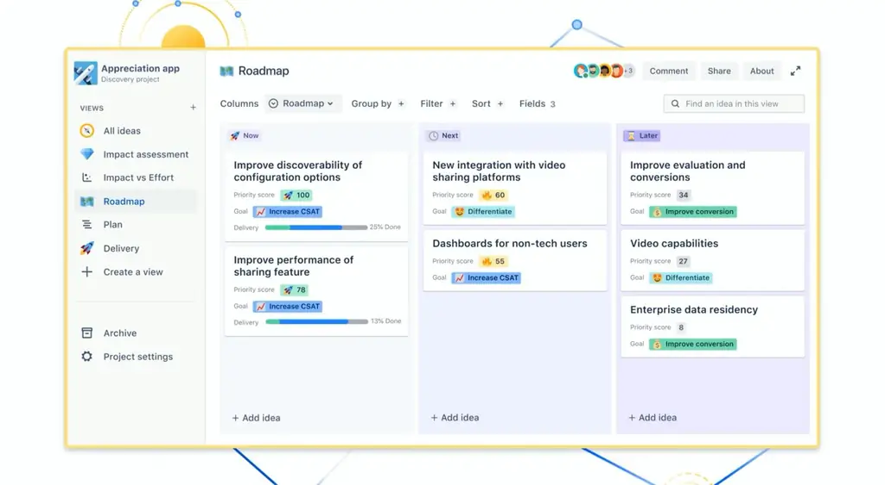
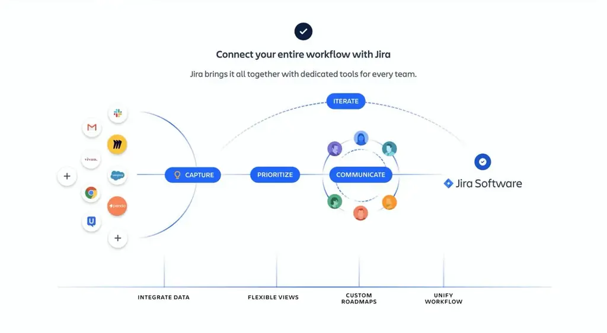
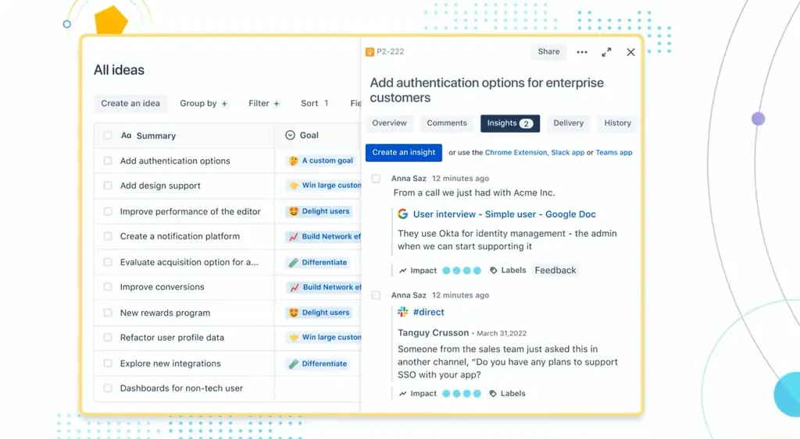
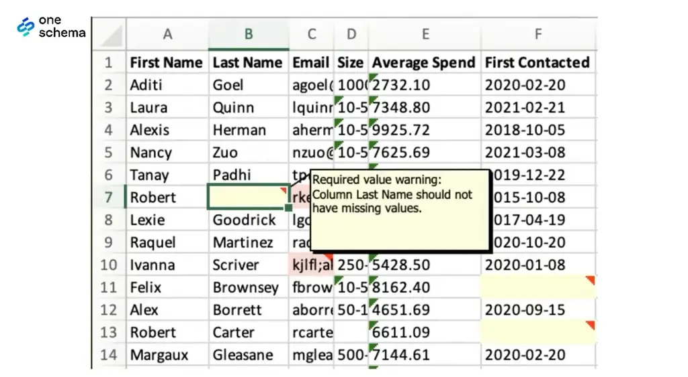
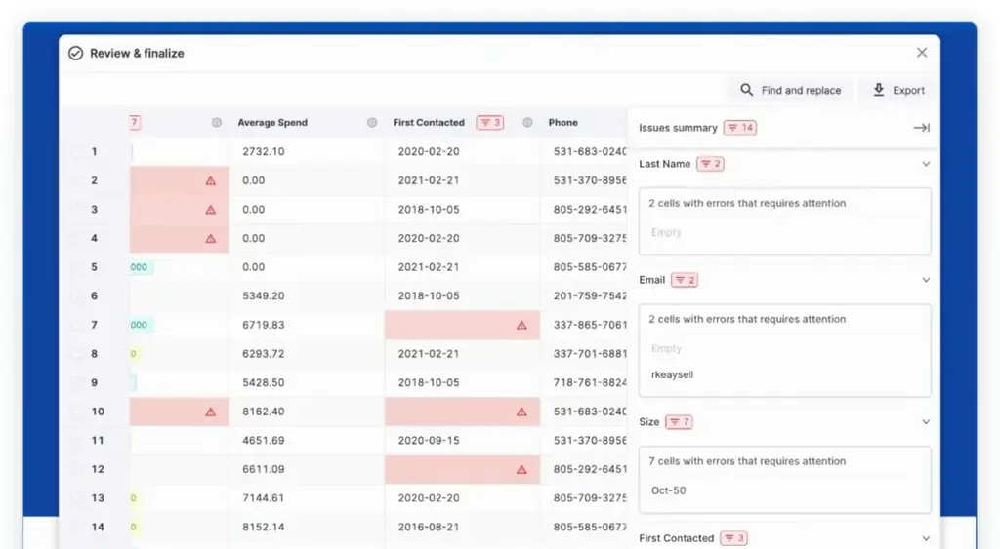
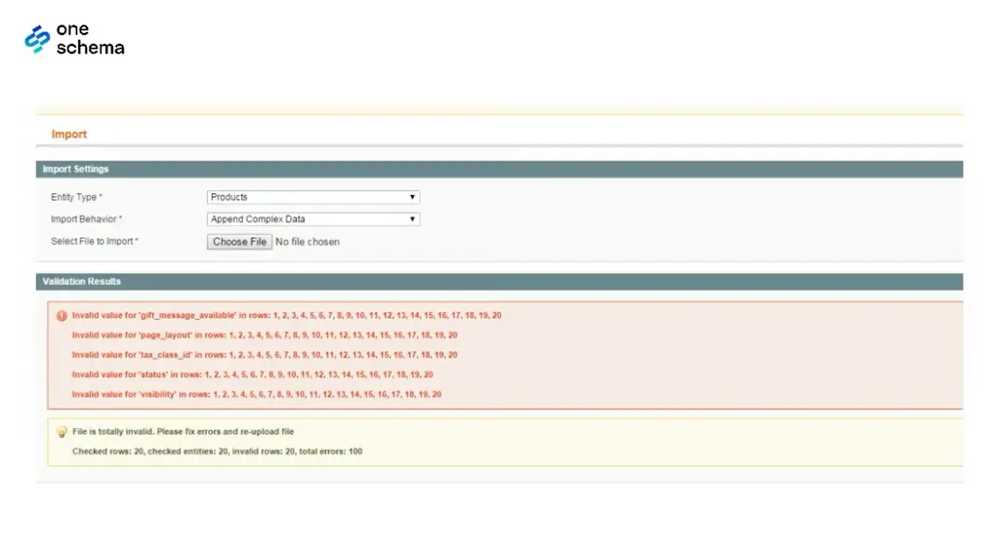
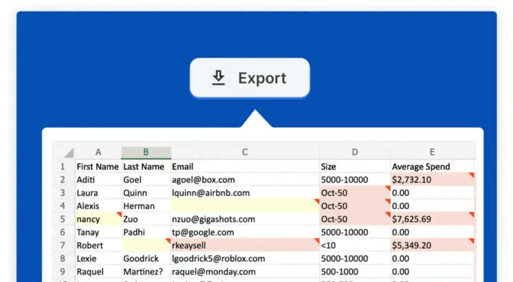
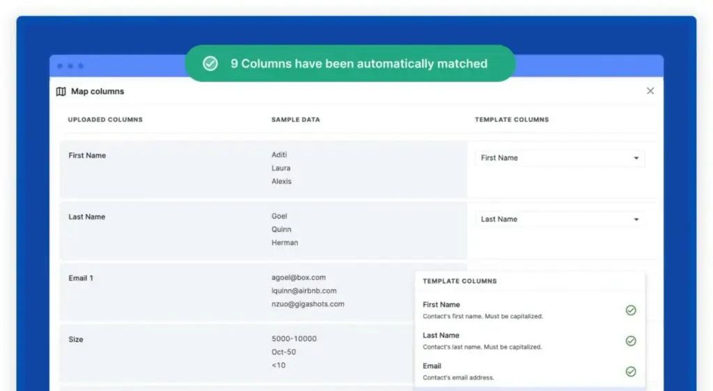

# Building beautiful products with Stripe’s Head of Design | Katie Dill (Stripe, Airbnb, Lyft)

*How Stripe's Head of Design, Katie Dill, defines product quality, measures it with user-journey walkthroughs, and structures teams so craft isn't lost as they grow.*

Source: [Building beautiful products with Stripe’s Head of Design | Katie Dill (Stripe, Airbnb, Lyft)](https://www.youtube.com/watch?v=gfEEcssu304) · Katie Dill · Lenny's Podcast · 1 h 34 min

## TL;DR

Teams often treat beauty and quality as extras and prioritize features that map to measurable goals, so quality slips as products and companies grow. Katie Dill argues that beauty makes products more usable and builds trust, and that quality drives growth because easier products get used and recommended. Stripe applies this through 15 critical user journeys, each owned by engineering, product, and design leaders who walk the journey, log friction, and score it in calibration. For anyone building products or teams, the talk offers concrete practices for keeping the quality bar from sliding.

## Key takeaways

- Earn the team's trust before pushing change: Dill learned at Airbnb that people will only follow a new direction once they believe the leader cares about them and shares their goals.
- Define quality against user expectations in three levels: the product works, it works exceedingly well with no errors, and it exceeds expectations with things users never asked for.
- Treat quality as growth, since easier products get used more and recommended, and Stripe found that moving to a newer checkout form raised business revenue by 10.5%.
- Run quarterly walkthroughs of the 15 critical user journeys with at least an engineer, a product manager, and a designer, logging friction with screenshots and tagging each item as a nice touch, a fix to consider, or a P0 bug.
- Score journeys in colors rather than numbers, then review scores in a calibration meeting so reviewers don't haggle over fine distinctions and the bar is applied consistently.
- Show that quality moves metrics with concrete examples, such as a unclear invoice-status button that drove support contacts and whose clarification improved the bottom line.
- Use the formula performance = potential − interference: hire and develop talent to raise potential, and remove processes that get in the way as the company grows.
- When hiring designers, teach tools and process but screen for taste, humility, courage to say 'this is not good enough,' and hustle to act on it.

## Beauty enhances functionality

[▶ 00:00:00](https://www.youtube.com/watch?v=gfEEcssu304&t=0s)

Beauty and functionality are not opposites. Beauty makes a product easier to use, more approachable, and more compelling to use, so it strengthens functionality.

*[▶ 00:04:04](https://www.youtube.com/watch?v=gfEEcssu304&t=244s) · Roadmap view with Now, Next, Later columns*

How people feel is the part business discussions often skip. Beautiful products build trust. Visible care in details signals that the invisible details are also handled with care.

*[▶ 00:04:10](https://www.youtube.com/watch?v=gfEEcssu304&t=250s) · Connecting the workflow with Jira*

*[▶ 00:04:24](https://www.youtube.com/watch?v=gfEEcssu304&t=264s) · All ideas list with idea detail panel*

## Earn trust before driving change

[▶ 00:04:47](https://www.youtube.com/watch?v=gfEEcssu304&t=287s)

Katie Dill joined Airbnb to lead the 10-person product design team and started by pushing for change. About a month in, five designers and an HR partner read aloud a list of what she was doing wrong. Her instinct was to defend each point. Instead she listened, because the common theme was that she had not earned the team's trust. They didn't know she cared about them or shared their goals.

She changed how she operated. She learned what each person cared about and what motivated them, and moved the org toward its goals with them rather than over them. A couple of months later, the design team had the company's best engagement scores.

Her lesson: "You can inflict change on people, but if you want to do it with them, trust is the key element." Come in listening, not swinging.

She also kept designers together as a community, bringing them together several times a week, while still sitting with engineers and product managers so the groups could build together.

## Quality Levels and the Growth Case

[▶ 00:10:55](https://www.youtube.com/watch?v=gfEEcssu304&t=655s)

Dill sorts quality into levels, judged against user expectations:

1. The product works and delivers its value.
2. It works exceedingly well, error-free and well-rounded.
3. It exceeds expectations with things users never asked for.

Teams pick features over quality because features map to measurable business goals. Companies that see quality as non-negotiable still invest in it. Dill compares this to exercise: one skipped day invites the next. Customers rarely ask for higher levels directly, but support cases reveal where they are stuck.

Competition sets the bar. Early cars had none, but today stitching, leather, and the sound of a door separate ordinary cars from premium ones. Her conclusion: **quality is growth**, because easier products get used more and recommended.

## Checkout and onboarding quality show up in revenue

[▶ 00:16:07](https://www.youtube.com/watch?v=gfEEcssu304&t=967s)

Stripe's checkout research found that 99% of top e-commerce sites have errors that slow checkout and lower conversion. These small details are quality issues. Moving from an older checkout form to a newer one raised business revenue by 10.5%. Onboarding fixes that clarify how the product works for different use cases increased activations.

## Stripe's scope: from checkout to financial automation

[▶ 00:17:50](https://www.youtube.com/watch?v=gfEEcssu304&t=1070s)

Stripe serves millions of businesses, from early-stage startups to enterprises such as Amazon, Hertz, Shopify, Spotify and X. Its work spans two areas:

- Checkout flows for online and in-person payments.
- Financial automation tools for running subscriptions, recognizing revenue and handling tax.

These tools aim to manage financial complexity so businesses don't have to sweat the details.

## Utility, usability and desirability together

[▶ 00:18:45](https://www.youtube.com/watch?v=gfEEcssu304&t=1125s)

Drop the split between business goals and design goals, and first ask what you are trying to build. Designers often weigh emotional experience, where others chase a bigger button and more clicks. Great products need utility, usability and desirability together; craft without utility is not enough. Execution details matter most when a feature feels made for the user and fits their mental model.

## Beauty as a signal of care

[▶ 00:21:39](https://www.youtube.com/watch?v=gfEEcssu304&t=1299s)

The book *Beauty* by Sagmeister & Walsh shows the word's use in Google-digitized books falling sharply from the 1800s to the 2000s.

Beyond trust, beauty matters in B2B for two more reasons:

- It improves outcomes by making tools easier to use, which helps businesses make better decisions.
- It **begets beauty**: care visible in one product reassures users that everything else was cared for too.

Surroundings shape feelings. Tweets from Penn Station were more negative than tweets from Grand Central.

Beauty is also pride. Visible care attracts people who want their craft recognized.

## Keeping the quality bar from sliding

[▶ 00:26:19](https://www.youtube.com/watch?v=gfEEcssu304&t=1579s)

Without deliberate effort, work drifts toward mediocrity; a truly great level takes a concerted push. Stripe treats its website as an expression of how it cares for users, blending creativity with technical execution. Engineering, design, product and product marketing report into one design organization for the website. Engineers and designers push each other's ideas in a rapid loop, moving fast at a very high standard.

## Shared Care, Editing and the Courage to Say No

[▶ 00:28:44](https://www.youtube.com/watch?v=gfEEcssu304&t=1724s)

Quality is a group effort, not one hire's or one QA team's job. How internal functions communicate shows up outside, so shared care has to be reinforced.

Vision and alignment matter too: good people can build parts that don't fit a whole. Dill compares this to a house, where architects and general contractors keep the pieces aligned.

Someone must **edit**, narrowing and removing what doesn't fit. Airbnb's Brian Chesky plays that role; The Economist has a chief editor. Decentralizing it is possible but hard.

Leaders also need courage to say "Almost, but no" and send work back, which Dill calls one of the hardest decisions.

Judge quality across the **user journey**: learning about a product, getting to know it, deciding to use it, then needing it differently.

Products also regress after launch as other work ships, and focused teams can lose sight of how their piece connects to others.

## Fifteen essential journeys as a quality scorecard

[▶ 00:34:47](https://www.youtube.com/watch?v=gfEEcssu304&t=2087s)

Stripe tracks 15 critical user journeys. The number is arbitrary; it is trackable, broad, and not comprehensive. Each journey has engineering, product, and design leaders accountable for its quality.

Owners **walk the store**: they move through the journey as a user would, often starting from a web search and continuing through the website, docs, and dashboard. They log friction, note what works and what doesn't, file bugs, and contact the teams that own each part. This substitutes for user research and adds to it; it does not replace it.

Each walkthrough ends with a score on a rubric. Scores are reviewed in a calibration meeting, much like managers calibrate performance reviews, so the quality bar is read consistently across the company.

- Walk the journey together: at minimum an engineer, a product manager, and a designer, since each notices different problems.
- Score quarterly and publish the scorecards on a shared dashboard. Quarters are long enough for real change and short enough to catch setbacks.

Walkthroughs also expose upstream problems. One team found that a product's SEO copy didn't match how users would later understand it, so fixing it improved outcomes later in the journey.

## Tagging friction and scoring with colors

[▶ 00:44:35](https://www.youtube.com/watch?v=gfEEcssu304&t=2675s)

Reviewers fill a friction log with screenshots of what they experienced, then tag each moment as a nice touch, a fix to consider, or a P0 bug to fix now. A rubric covering usability, utility, desirability and "surprisingly great" produces a summary score.

Stripe scores in colors, not numbers, so reviewers don't haggle over whether something is a six or a seven. The score is qualitative judgment, which speeds up decisions.

## Culture, not a time split, drives quality work

[▶ 00:46:25](https://www.youtube.com/watch?v=gfEEcssu304&t=2785s)

Some companies budget fixed time shares, such as 10% for fixing, 20% for growth and the rest for keeping the lights on. Stripe uses no formula. It hires people with strong judgment and pride in their work, then trusts them to decide. Leadership advocates for quality. Multidisciplinary planners check each plan: does it advance features, growth and quality?

## Showing that quality moves the bottom line

[▶ 00:48:29](https://www.youtube.com/watch?v=gfEEcssu304&t=2909s)

Quality must be shown to move metrics, since believing it doesn't is dangerous. Example: users contacted support about invoice status because a nicely styled button was unclear. Clarifying it cut those contacts and improved the bottom line. Share such examples; some effects are quick, others show in trust, sharing and success over time.

## Rewarding quality in performance reviews

[▶ 00:50:28](https://www.youtube.com/watch?v=gfEEcssu304&t=3028s)

Define impact broadly. Some work is multi-quarter or multi-year and essential to the business without moving a key metric in one quarter. Build the performance rubric around that definition, and recognize strong work even when the headline number doesn't move.

*[▶ 00:53:12](https://www.youtube.com/watch?v=gfEEcssu304&t=3192s) · Excel sheet with required-value warning*

*[▶ 00:53:50](https://www.youtube.com/watch?v=gfEEcssu304&t=3230s) · Review & finalize: flagged import errors*

Stripe's level ladder is a guide to what each role expects, not a checklist, and it names quality. Beneath it sits the operating principle **meticulous craft**, which applies to everyone, whether they are designing the workspace, writing an API, building an interface or handling support calls.

*[▶ 00:53:21](https://www.youtube.com/watch?v=gfEEcssu304&t=3201s) · Magento import validation errors*

*[▶ 00:53:41](https://www.youtube.com/watch?v=gfEEcssu304&t=3221s) · Export screen with flagged cells*

*[▶ 00:53:45](https://www.youtube.com/watch?v=gfEEcssu304&t=3225s) · Map columns: automatic matching in OneSchema*

## Potential minus interference, and sharing work in progress

[▶ 00:54:09](https://www.youtube.com/watch?v=gfEEcssu304&t=3249s)

Katie Dill frames leadership with a formula she learned at Airbnb: **performance = potential − interference**. Leaders raise potential by hiring well and developing talent, and they remove interference, which she likens to a cast on a muscle. As companies grow, processes break. When a team outgrows them, that shows how people actually work, so you can change the processes to match.

To keep people aware of each other's work, her design team shares a screenshot or prototype of each project in one shared Google Slides deck. Product managers, engineering leads and company leaders receive it too.

- Keep it low-maintenance: a flip-through deck any function can open, not a Figma requirement.
- It is not a status check. Share only medium and large projects, or the deck becomes too long to read.
- Cadence: biweekly at first, now monthly. If it feels arduous, it is failing.
- Label work in progress and protect confidential work.

Early visibility exposes redundant efforts and paths that will collide, which saves time and improves the work. Designers often resist showing unpolished work at first, but she says the benefits show up in outcomes and culture over time.

## Co-locating teams by area to cut wasted work at Lyft

[▶ 01:01:46](https://www.youtube.com/watch?v=gfEEcssu304&t=3706s)

When Katie Dill joined Lyft, the design team sat in a well-designed room behind a locked door, apart from engineering and product. The room protected creative exploration, but product managers and engineers made decisions without designers. Designers then met them with work that didn't fit the goals, so effort was wasted and iteration was slow.

Her team fixed this by:

- Breaking down the wall and seating designers with their engineers and PMs, organized by area such as driver, rider and safety.
- Keeping a shared creative room for working sessions and for people not embedded in a team.
- Bringing the whole design function together at key moments to align on the overall experience.

The result was faster iteration and clearer work, with creative space still protected.

## Seating designers by discipline, with a shared creative room

[▶ 01:06:10](https://www.youtube.com/watch?v=gfEEcssu304&t=3970s)

Stripe's designers sit with the engineers and PMs they work with daily. Functions outside embedded teams, like brand creative and the website team, sit together. A studio with craft tools and a creative wall complements this. A quote she keeps, attributed to Robert Henry: the aim is a state that makes art inevitable, not art itself.

## Reaching for the stars, landing on the moon

[▶ 01:07:41](https://www.youtube.com/watch?v=gfEEcssu304&t=4061s)

Fear of bold ideas grows at every company size. Incremental changes are measurable and finish within a quarter, but users judge quality across products, surfaces and time, so polishing your own slice rarely improves the whole.

Instead, sketch the ideal end-to-end journey, not a deck for a shelf. Work back from it: where should the product be in two years, and how do we get there? Ship pieces in sequence, checking data before the next, with teams owning their parts.

## Hiring designers for taste and character

[▶ 01:11:07](https://www.youtube.com/watch?v=gfEEcssu304&t=4267s)

Teach tools and process; taste and character are harder to teach. Look for natural judgment even in less experienced candidates. Alongside talent and high craft, screen for:

- **Humility**: respect for teammates and curiosity about what works for users.
- **Courage**: willingness to say "this is not good enough" and push for a redo.
- **Hustle**: speed in executing on that.

Early-stage teams often need a doer, but one approach is pairing a senior design advisor with a full-time executor to build user focus from the start.

Taste has no universal formula; it depends on the product. Power tools favor dense but accessible information, while consumer products favor sparse, directive screens.

## Stripe Press: Browsing Books Like a Bookstore

[▶ 01:15:15](https://www.youtube.com/watch?v=gfEEcssu304&t=4515s)

Stripe Press publishes books on "ideas of progress," most of them unrelated to financial infrastructure. Its upcoming *Poor Charlie's Almanac*, a 20-year-old collection of Charlie Munger's writings and talks assembled by his colleague Peter Kaufman, is open for pre-order.

The website replaces the usual grid of buy boxes with bookstore-style spines you can pick up and turn over, matching how readers actually browse.

## Links & resources

- [Lenny's Newsletter article with this talk (video description source)](https://www.lennysnewsletter.com/p/building-beautiful-products-with) — <https://www.lennysnewsletter.com/p/building-beautiful-products-with> · video description
- Stripe Press books site, where the books can be read online — URL not in allowed list · mentioned [▶ 01:17:19](https://www.youtube.com/watch?v=gfEEcssu304&t=4639s)
- Books on principles of great design the speaker recommends — titles not named, URL not shown · mentioned [▶ 01:15:12](https://www.youtube.com/watch?v=gfEEcssu304&t=4512s)
