# Coder, Coach, Catalyst using questions to make people grow by Martin Mazur

*How to use coaching questions in five stages to help colleagues solve their own problems and grow, instead of becoming the team's bottleneck.*

Source: [Coder, Coach, Catalyst using questions to make people grow by Martin Mazur](https://www.youtube.com/watch?v=yhk1qvy6A_4) · Martin Mazur · Devoxx · 52 min

## TL;DR

Engineers often act as heroes who solve everyone's problems, which works until workload grows and leads to burnout or becoming an uncooperative bottleneck. Martin Mazur's answer is coaching: asking questions so people find their own solutions, which builds their skills over time. The talk gives a five-question framework (initiation, excavation, focus, option, action), three coaching formats, and common pitfalls. This matters because each answer you give creates dependence, while good questions make people capable.

## Key takeaways

- Solving everything for others keeps you as the bottleneck and stops them from building skills, so ask questions that let them find the solution.
- Open with "What's on your mind?" and avoid yes/no questions, status checks, and prompts that invite problems.
- Use excavation by repeatedly asking "And what else?" until the root cause surfaces, and stop when the conversation becomes circular or awkward.
- Frame the problem with "What is the real challenge here for you?", where "for you" keeps answers within the person's control.
- In the option phase, ask what they have tried, what resources they have, and what they feel comfortable doing, and do not offer your own fix.
- Close with a milder action question such as "What's one step you feel comfortable taking?", accept their step even if you would choose differently, and set a timeframe.
- Build heuristics for recurring problems by asking for criteria rather than answers, and add missing criteria yourself when they run out of ideas.
- To coach someone senior, first ask a permission question one-on-one, such as "Would you be open to talking through this?", and accept a decline gracefully.

## The Hero Trap

[▶ 00:00:00](https://www.youtube.com/watch?v=yhk1qvy6A_4&t=0s)

Technologists are trained to believe logic and correctness solve everything, so they treat people problems as puzzles with one right answer. Every time someone hands over work with "leave it on my desk," the engineer becomes the hero: the person who is quick and never a problem to work with.

*[▶ 00:06:00](https://www.youtube.com/watch?v=yhk1qvy6A_4&t=360s) · Central question: Are you the hero?*

The hero model works until it doesn't. Once the workload exceeds what one person can carry, the hero ends up in one of two places. In the speaker's consulting experience, burnout is more common, but the other outcome is becoming a villain: snarky, uncooperative, and withholding feedback while shipping slide decks and architecture sketches from an ivory tower.

*[▶ 00:06:53](https://www.youtube.com/watch?v=yhk1qvy6A_4&t=413s) · Harvey Dent quote on hero or villain*

Overburdened people usually ask for help, but the managers they turn to often lack technical context, so their advice is generic. Typical suggestions include delegating more, protecting your time, setting clear boundaries, saying no, or simply cloning yourself. The speaker calls this advice unhelpful, because none of it says what to do next.

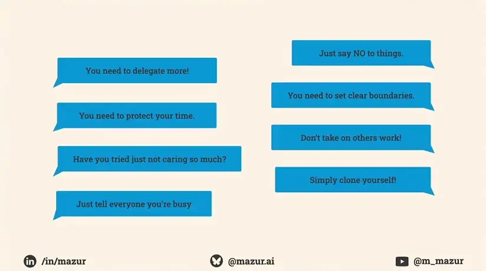
*[▶ 00:08:35](https://www.youtube.com/watch?v=yhk1qvy6A_4&t=515s) · Common unhelpful advice for overburdened people*

## Coaching Instead of Solving

[▶ 00:08:20](https://www.youtube.com/watch?v=yhk1qvy6A_4&t=500s)

Overload creates two problems. The first is **you**: you become the bottleneck that stops work from moving. The second, which matters more long-term, is **they**: when you solve everything for people, they never build the skills to grow.

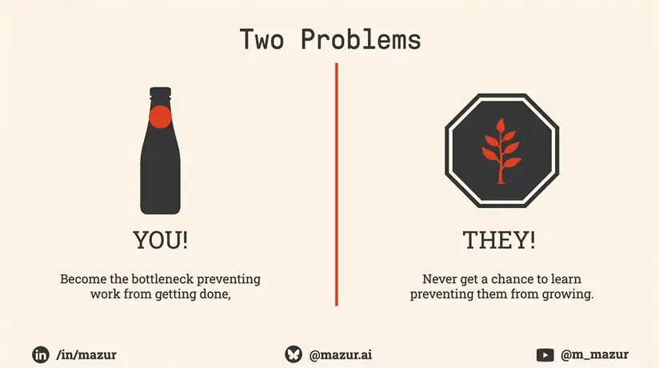
*[▶ 00:09:51](https://www.youtube.com/watch?v=yhk1qvy6A_4&t=591s) · Two problems: you and they*

Coaching here means helping people discover a solution, asking good questions, focusing on the person, aiming for long-term growth, and adapting to each person. It excludes solving problems for them, giving answers, chasing immediate outcomes, and using one approach for everyone. A tennis coach found that direct corrections fixed a stroke only in the moment, while pointing at the error ("watch your left foot") led players to correct themselves over time.

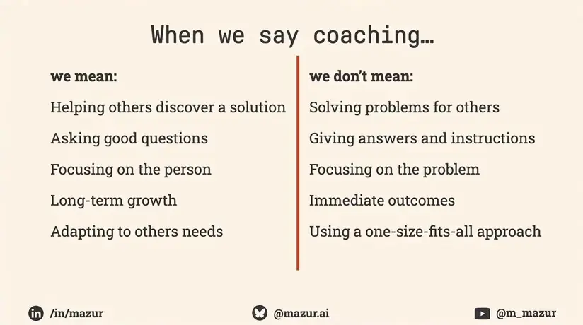
*[▶ 00:12:45](https://www.youtube.com/watch?v=yhk1qvy6A_4&t=765s) · What coaching means and does not mean*

Doing it yourself is faster, but the person never learns. Treat the framework as a starter kit and adjust the questions and style to each person.

**Active listening** is the skill everything else depends on. It covers the words plus tone, body language, and context. Practical habits:

- Put away your phone and watch, and keep eye contact.
- Nod, and paraphrase back in different words. This shows you understood and lets the other person correct you.

Underneath this is **empathy**: accept what you hear as that person's truth, even when you disagree with it.

To practice, pair up. Person 1 describes an issue they're comfortable sharing. When they stop, Person 2 asks only "Why?", "What?", or "How?" and notes what goes unsaid. This is a root-cause exercise, a variation of the five W's, not a coaching session, but it works well in team workshops.

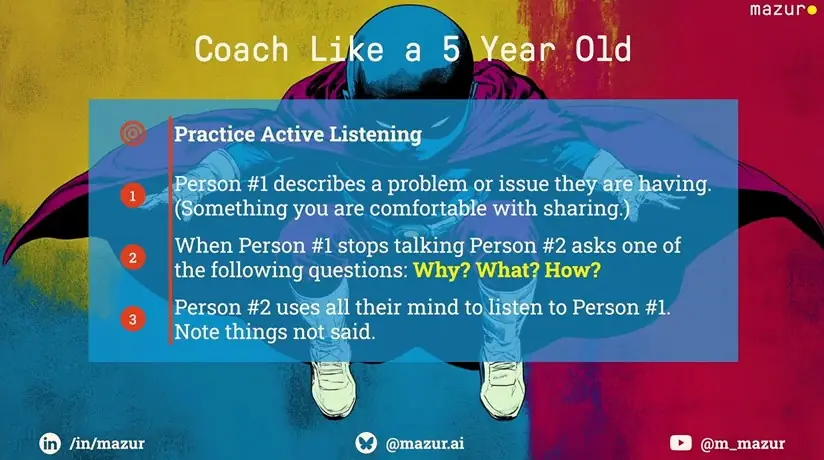
*[▶ 00:18:13](https://www.youtube.com/watch?v=yhk1qvy6A_4&t=1093s) · Practice Active Listening exercise*

## Three coaching formats and when each fits

[▶ 00:18:32](https://www.youtube.com/watch?v=yhk1qvy6A_4&t=1112s)

**Formal coaching** is a booked session aimed at a longer behavioral change. It needs mutual agreement and follow-up between sessions, so it rarely fits colleagues or managers.

**Bite-sized coaching** suits individual contributors. It lasts 5 to 15 minutes, targets one specific situation, needs no permission, and happens in meetings, at the desk, or over coffee. Doing it well often leads to formal sessions.

**Team coaching** works on several people at once, for changing how a team works or untangling its dynamics. It avoids suspicion and saves time: in his consulting work, five one-on-ones took about two working days of prep and follow-up, and one session replaces them. The coach must switch to facilitator or mediator when people talk over each other or disagree.

## Five question types that move a conversation to action

[▶ 00:23:41](https://www.youtube.com/watch?v=yhk1qvy6A_4&t=1421s)

Coaching runs through five question types: initiation, excavation, focus, option, and action.

**Initiation** opens the conversation. Ask "What's on your mind?" Avoid "How are you?", yes/no questions, status checks like "What's the progress?", and questions that prompt for problems, which invite invented or trivial ones.

**Excavation** digs past the first answer. Ask "And what else?" until the real problem surfaces. Silence works better but is hard to hold, so the question fills the gap. Stop when it gets awkward or circular.

Sam's first answer, about the crunch, is surface-level. Asking again shows that Sam keeps saying yes to changes.

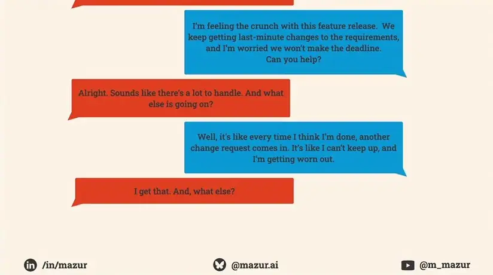
*[▶ 00:29:52](https://www.youtube.com/watch?v=yhk1qvy6A_4&t=1792s) · Chat example probing for root cause*

The third answer names the root: Sam hasn't pushed back since joining the team.

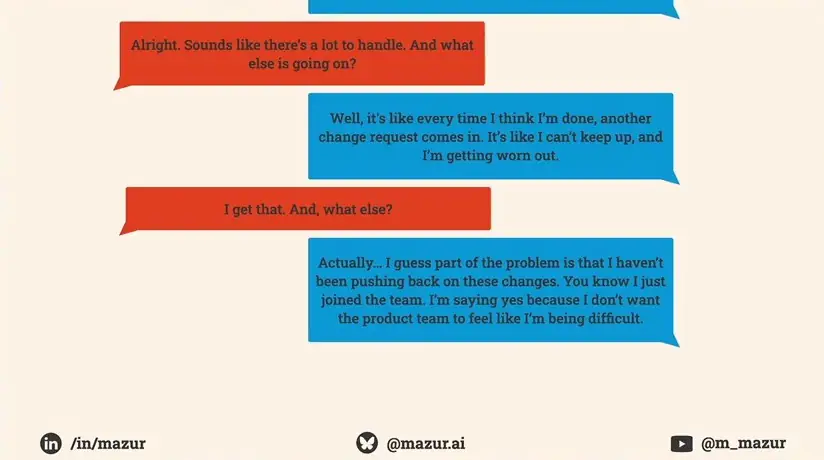
*[▶ 00:30:22](https://www.youtube.com/watch?v=yhk1qvy6A_4&t=1822s) · Chat reveals the underlying issue*

**Focus** narrows the problem to something fixable. Ask "What is the real challenge here for you?" The words "for you" are essential. Without them, answers drift to things outside the person's control.

**Option** is a battery of questions, not one: "What have you tried so far?", "What resources do you have?", and "What do you feel comfortable doing?" Don't offer your own fix. Telling your story removes the person's agency.

Longer hours and a priority list had already failed, so suggesting either would be redundant.

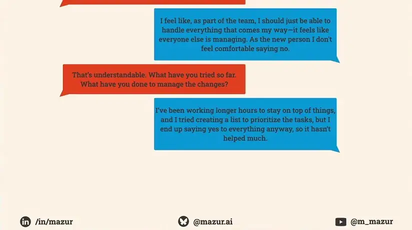
*[▶ 00:34:01](https://www.youtube.com/watch?v=yhk1qvy6A_4&t=2041s) · Coaching chat: first answers about workload*

Checking priorities with the team worked before; now fear of disappointing people blocks it.

*[▶ 00:34:38](https://www.youtube.com/watch?v=yhk1qvy6A_4&t=2078s) · Coaching chat: past strategies and what worked*

Asking about support reveals what Sam is willing to do.

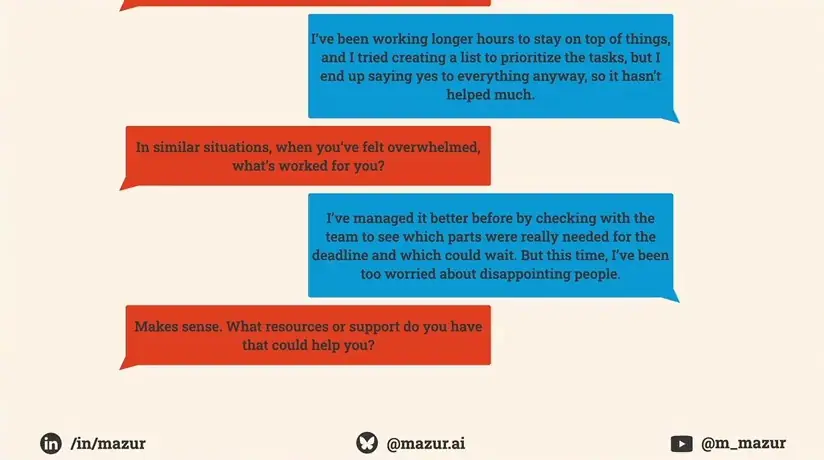
*[▶ 00:34:45](https://www.youtube.com/watch?v=yhk1qvy6A_4&t=2085s) · Coaching chat: looking for available support*

Sam's proposal to clarify priorities with product gives the coach something to build on.

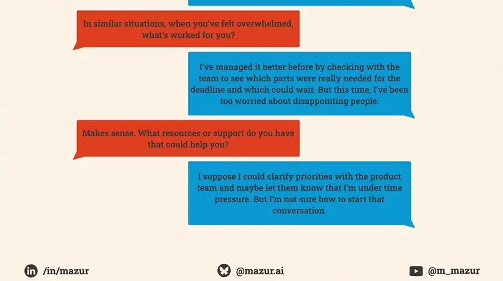
*[▶ 00:35:00](https://www.youtube.com/watch?v=yhk1qvy6A_4&t=2100s) · Coaching chat: client considers talking to product team*

**Action** is the closer. The person leaves with the issue and knows what to do about it.

## Milder action questions and building heuristics

[▶ 00:34:52](https://www.youtube.com/watch?v=yhk1qvy6A_4&t=2092s)

For someone already stressed or unsure, use a milder action question, such as "What's one step you feel comfortable taking?" Accept the step even if you would choose differently. It is their solution, and if it fails, they will come back, which serves long-term growth.

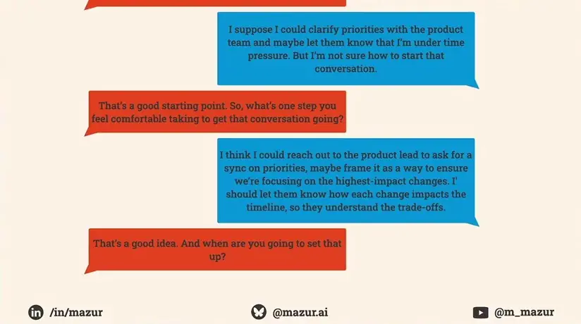
*[▶ 00:37:28](https://www.youtube.com/watch?v=yhk1qvy6A_4&t=2248s) · Chat example: first action step*

Then ask for a timeframe. A committed time makes follow-through more likely. Without an accountability check-in, follow up informally, such as a coffee-machine conversation.

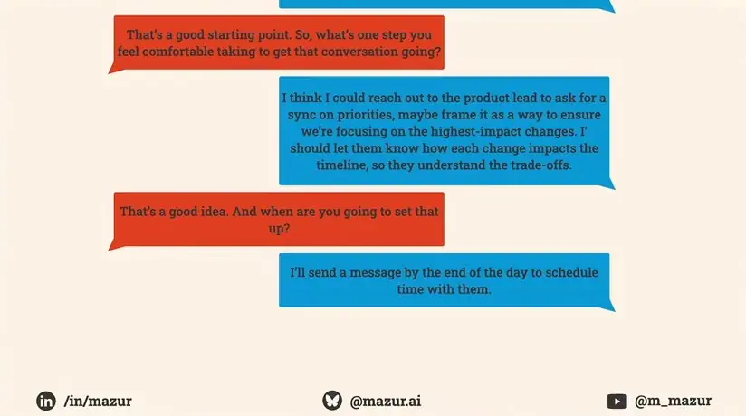
*[▶ 00:37:43](https://www.youtube.com/watch?v=yhk1qvy6A_4&t=2263s) · Chat example: committing to a timeframe*

Close with empathy, and add praise only if it is genuine.

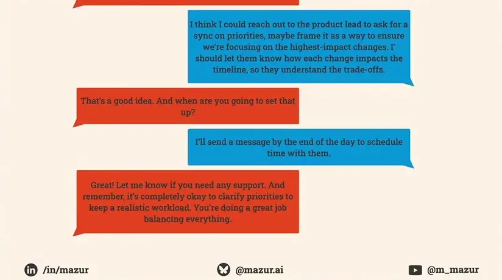
*[▶ 00:38:32](https://www.youtube.com/watch?v=yhk1qvy6A_4&t=2312s) · Chat example: closing with empathy*

Giving answers creates dependence: each answered question sends someone away, and eventually everyone returns at once. Instead, build a **heuristic**, a rule of thumb for similar future problems. For React or Vue, ask Sam for criteria rather than naming a winner.

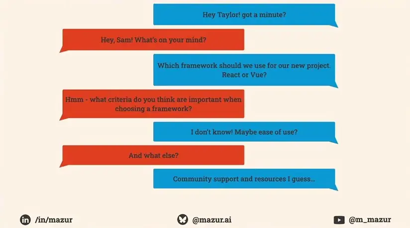
*[▶ 00:40:55](https://www.youtube.com/watch?v=yhk1qvy6A_4&t=2455s) · Chat bubbles: eliciting criteria*

When Sam runs out of ideas, add the missing criteria yourself, here scalability and licensing, even if you already know the answers.

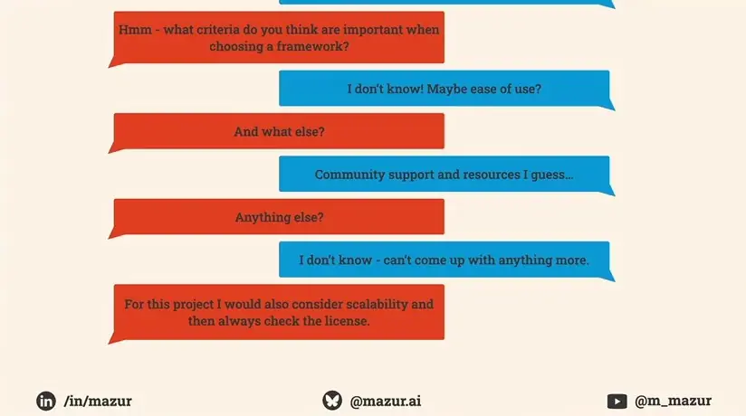
*[▶ 00:41:25](https://www.youtube.com/watch?v=yhk1qvy6A_4&t=2485s) · Chat bubbles: coach adds missing criteria*

Then check that they can find the information themselves.

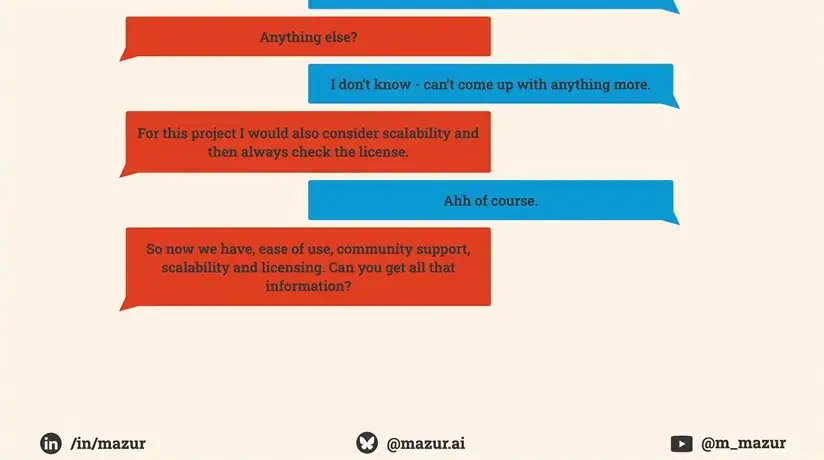
*[▶ 00:41:43](https://www.youtube.com/watch?v=yhk1qvy6A_4&t=2503s) · Chat bubbles: confirming Sam can get the info*

Anyone can coach without a license, including in domains they don't know, as long as they actively listen.

## Coaching up with a permission question

[▶ 00:43:03](https://www.youtube.com/watch?v=yhk1qvy6A_4&t=2583s)

Coaching someone higher in the hierarchy carries a power imbalance. The workaround is a **permission question**: "Would you be open to talking through this?"

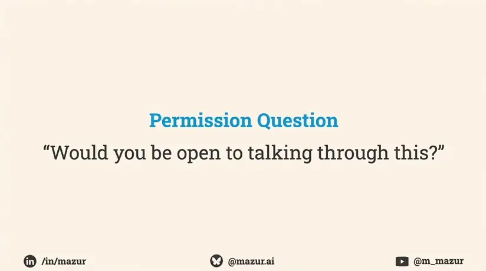
*[▶ 00:43:52](https://www.youtube.com/watch?v=yhk1qvy6A_4&t=2632s) · Permission Question*

Ask it one-on-one, after the meeting. A decline is fine. If they accept, let them pick the time, even over dinner, and then run the five questions.

A PM preparing a board budget request shows how it plays out:

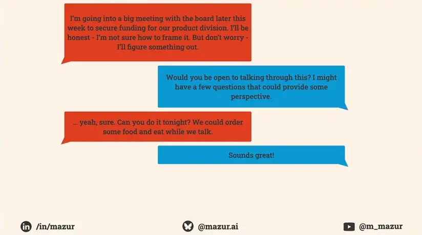
*[▶ 00:45:18](https://www.youtube.com/watch?v=yhk1qvy6A_4&t=2718s) · Example chat asking permission to coach*

Four pitfalls can derail a session:

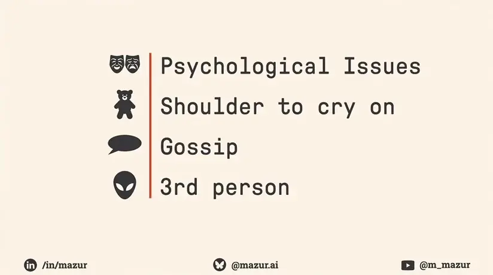
*[▶ 00:50:07](https://www.youtube.com/watch?v=yhk1qvy6A_4&t=3007s) · Four pitfalls to watch for*

- **Psychological issues** (the most dangerous): stop coaching and connect the person to professional help.
- **Shoulder to cry on**: ask "What do you need from me?" Listen if that's all they want; coach only if they ask for help.
- **Gossip**: a colleague discusses someone absent. Reply neutrally and ask what that person said.
- **Third person**: they blame others. Ask "What is the real challenge here for you?"

Active listening runs under every phase.

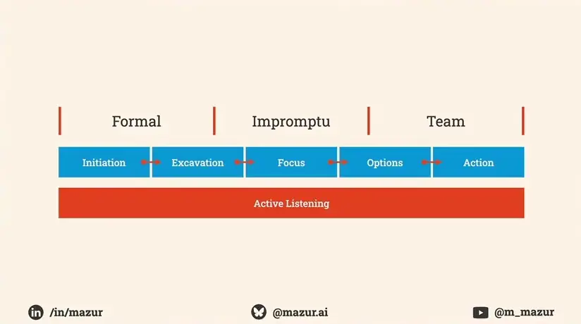
*[▶ 00:51:30](https://www.youtube.com/watch?v=yhk1qvy6A_4&t=3090s) · Coaching conversation phases overview*

Peter Block's line sums it up: "Questions are more transforming than answers. The skill is getting the questions right."

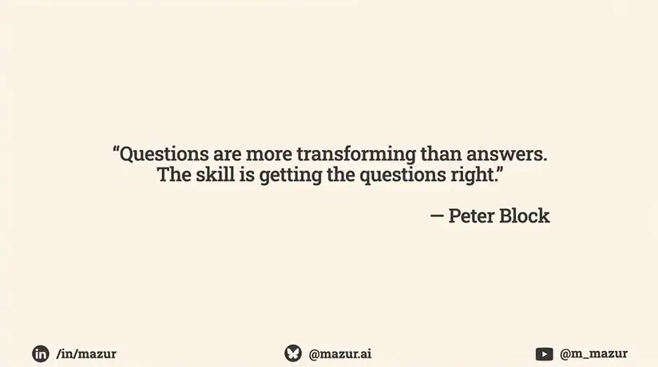
*[▶ 00:51:41](https://www.youtube.com/watch?v=yhk1qvy6A_4&t=3101s) · Peter Block quote on questions*
