# Dream Machines & Walled Gardens by Anders Norås

*Explore the visionary ideas of Ted Nelson and their impact on modern computing.*

Source: [Dream Machines & Walled Gardens by Anders Norås](https://www.youtube.com/watch?v=am8adCMJQzk) · Anders Noras · Devoxx · 49 min

## TL;DR

Ted Nelson's work in the 1960s and 70s laid the groundwork for hypertext and bidirectional linking, which could have shaped the internet differently. His concepts of transclusion and transcopyright address modern issues like piracy and misinformation, highlighting the importance of democratizing access to technology.

## Key takeaways

- Ted Nelson's vision for Xanadu, detailed in his book 'Literary Machines,' aimed to transform computers into a new form of literature with bidirectional hyperlinks and transclusion.
- Nelson's Jot, a hypertextual editor, predates modern version control systems like Git by storing text changes sequentially on tape.
- Vannevar Bush's MEX inspired Nelson to question how to transmit and reconstruct information over distance, leading to his concept of 'Flowers by Wire'.
- Douglas Engelbart's 'Mother of All Demos' in 1968 showcased innovations like real-time video conferencing and the mouse, but Nelson envisioned computers revolutionizing human creativity and connectivity beyond office practices.
- Nelson's transcopyright concept, a micropayment mechanism, could address piracy and provide fair compensation to content creators, aligning with modern concerns about AI model training and intellectual property theft.

## Tribute to Margaret Hamilton

[▶ 00:00:00](https://www.youtube.com/watch?v=am8adCMJQzk&t=0s)

BACK. DOWN. Good morning, DevOps. This talk honors Ted Nelson, but we begin by remembering Margaret Hamilton, who invented computer engineering and programmed the Apollo guidance computer. She passed away recently, leaving a legacy of professionalizing our industry.  Theodore Nelson, born in 1937 in Chicago, was adopted by his grandparents, academics who fostered a love of reading. He read classics and sci-fi, including L. Ron Hubbard's works.

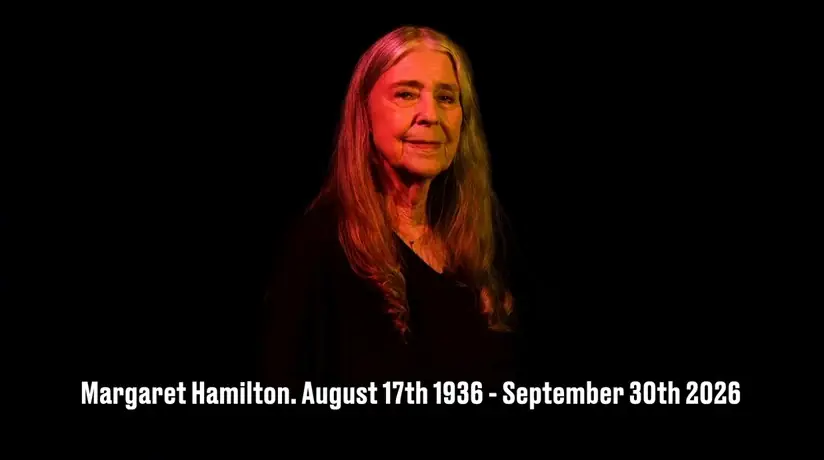
*[▶ 00:02:14](https://www.youtube.com/watch?v=am8adCMJQzk&t=134s) · Margaret Hamilton*

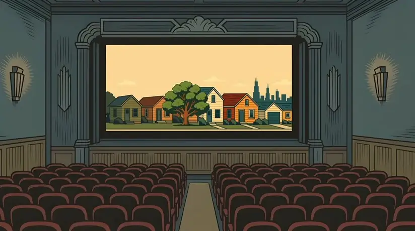
*[▶ 00:02:56](https://www.youtube.com/watch?v=am8adCMJQzk&t=176s) · Chicago in 1937*

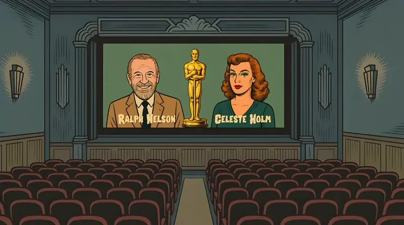
*[▶ 00:03:47](https://www.youtube.com/watch?v=am8adCMJQzk&t=227s) · Ralph Nelson and Celeste Holm*

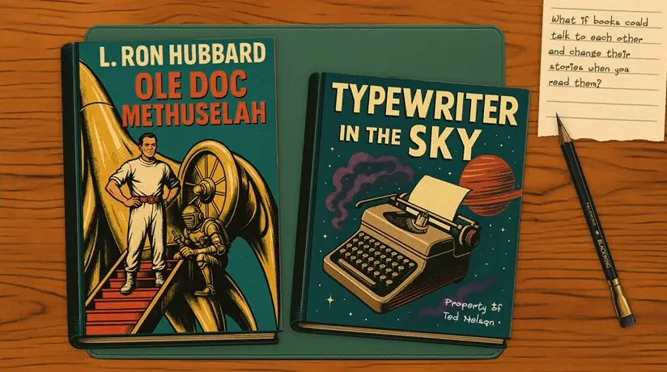
*[▶ 00:06:13](https://www.youtube.com/watch?v=am8adCMJQzk&t=373s) · Ted Nelson's Favorite Sci-Fi Books*

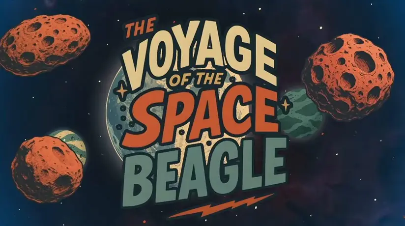
*[▶ 00:06:17](https://www.youtube.com/watch?v=am8adCMJQzk&t=377s) · The Voyage of the Space Beagle*

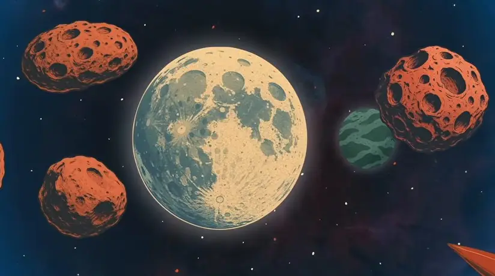
*[▶ 00:06:22](https://www.youtube.com/watch?v=am8adCMJQzk&t=382s) · Planetary and Asteroid Scene*

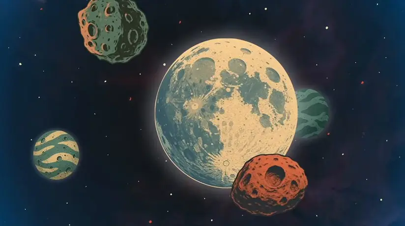
*[▶ 00:06:58](https://www.youtube.com/watch?v=am8adCMJQzk&t=418s) · Astronomical Scene*

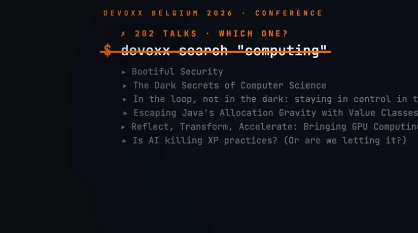
*[▶ 00:00:02](https://www.youtube.com/watch?v=am8adCMJQzk&t=2s) · Terminal Command*

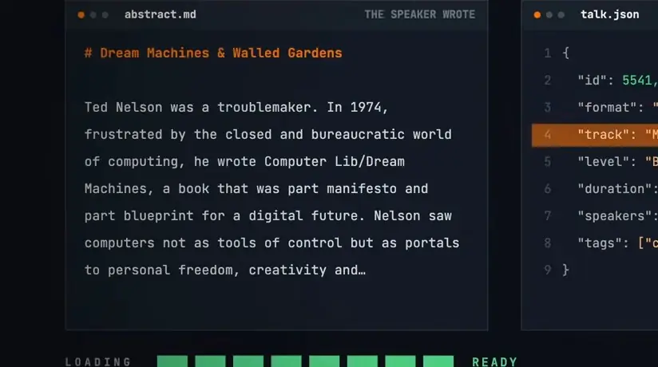
*[▶ 00:00:19](https://www.youtube.com/watch?v=am8adCMJQzk&t=19s) · abstract.md*

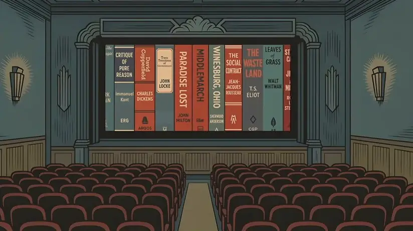
*[▶ 00:04:45](https://www.youtube.com/watch?v=am8adCMJQzk&t=285s) · Books on Display*

## Vannevar Bush's MEX and Its Impact

[▶ 00:08:33](https://www.youtube.com/watch?v=am8adCMJQzk&t=513s)

Vannevar Bush's 1945 essay 'As We May Think' in Life magazine envisioned a future where technology could enhance human intellect. Bush described the MEX, a desk with screens, knobs, and buttons, storing information on microfilm. Inside MEX, users could connect and share information. This inspired young Ted Nelson to ponder the concept of 'Flowers by Wire,' questioning how to transmit and reconstruct information over distance.

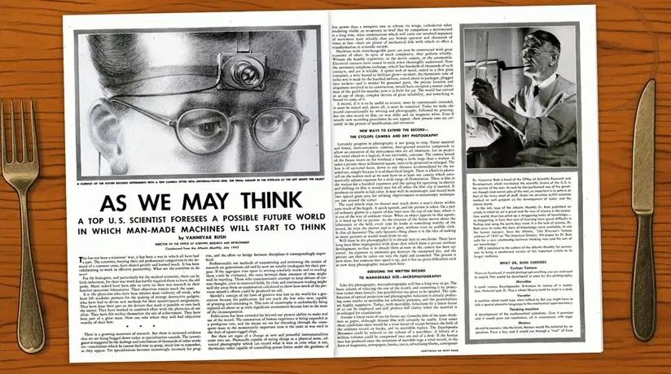
*[▶ 00:10:06](https://www.youtube.com/watch?v=am8adCMJQzk&t=606s) · As We May Think*

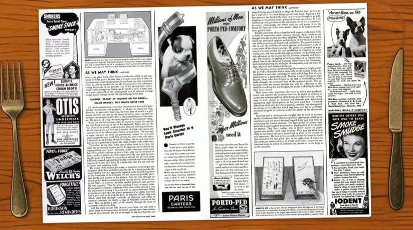
*[▶ 00:10:26](https://www.youtube.com/watch?v=am8adCMJQzk&t=626s) · As We May Think*

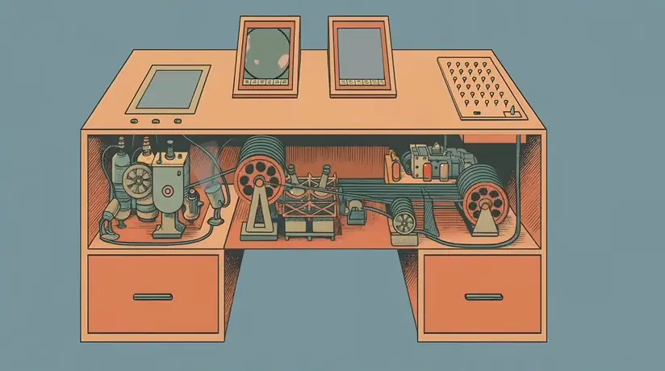
*[▶ 00:11:51](https://www.youtube.com/watch?v=am8adCMJQzk&t=711s) · Desk with Microfilm Storage*

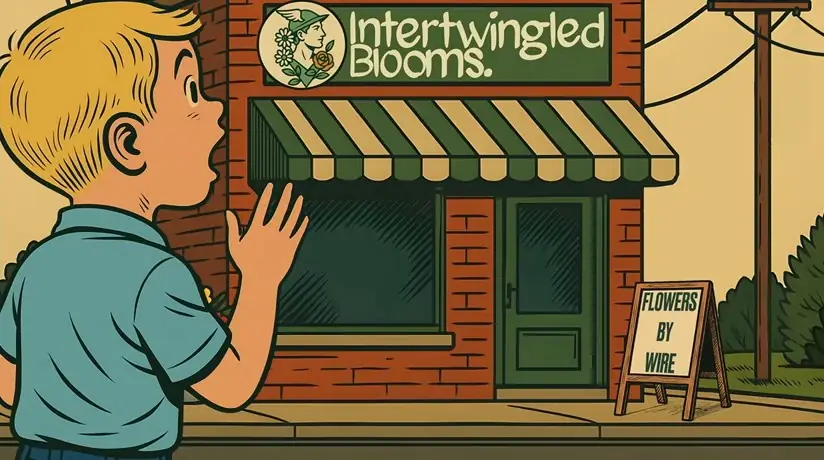
*[▶ 00:12:02](https://www.youtube.com/watch?v=am8adCMJQzk&t=722s) · Flowers by Wire*

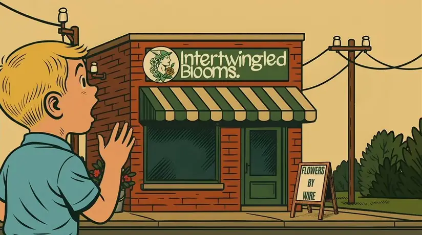
*[▶ 00:12:50](https://www.youtube.com/watch?v=am8adCMJQzk&t=770s) · Flowers by Wire*

*[▶ 00:13:00](https://www.youtube.com/watch?v=am8adCMJQzk&t=780s) · Flower Illustration*

*[▶ 00:13:14](https://www.youtube.com/watch?v=am8adCMJQzk&t=794s) · Flower and Gramophone*

## Douglas Engelbart's Mother of All Demos

[▶ 00:14:41](https://www.youtube.com/watch?v=am8adCMJQzk&t=881s)

Douglas Engelbart's 1968 presentation, known as the 'Mother of All Demos,' showcased innovations like real-time video conferencing, text editing, and the mouse. Ted Nelson, however, was underwhelmed, feeling Engelbart's demo merely replicated existing office practices on computers. Nelson's vision was to use computers to revolutionize human creativity and connectivity. Inspired by William Burroughs' writing techniques, Nelson created Jot, a hypertextual editor that stored text changes sequentially on tape, preserving history. This approach foreshadowed modern version control systems like Git. Nelson's work on hypertext and his book 'Computer Lib' advocated for accessible computer technology, emphasizing the importance of democratizing access to computers.

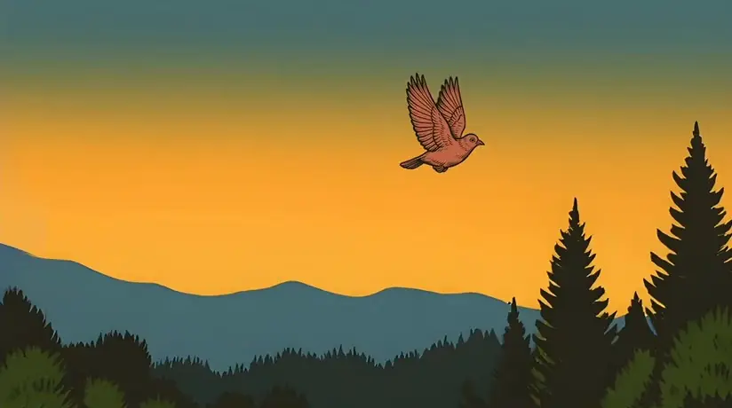
*[▶ 00:15:52](https://www.youtube.com/watch?v=am8adCMJQzk&t=952s) · Bird Flying Over Forest*

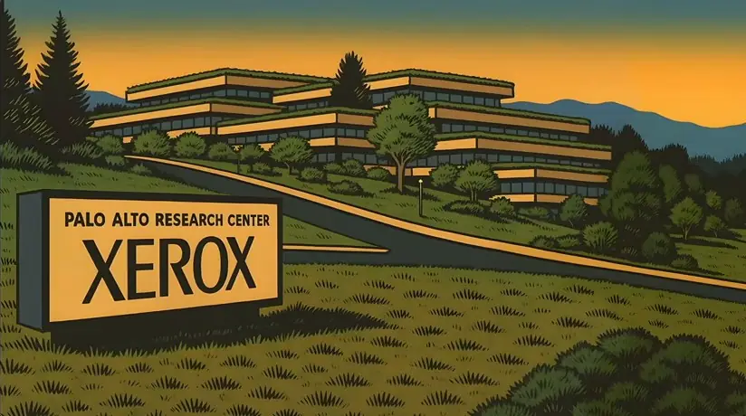
*[▶ 00:17:06](https://www.youtube.com/watch?v=am8adCMJQzk&t=1026s) · Palo Alto Research Center Xerox*

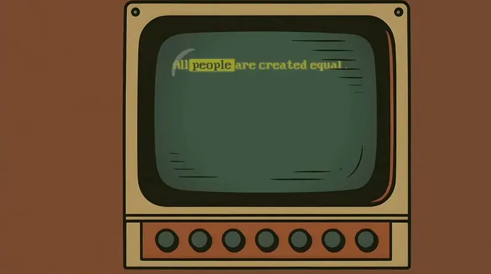
*[▶ 00:17:44](https://www.youtube.com/watch?v=am8adCMJQzk&t=1064s) · Declaration of Independence*

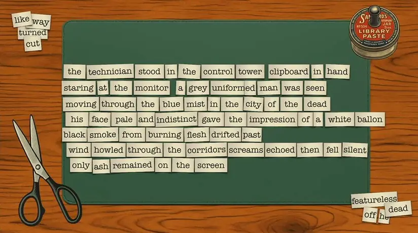
*[▶ 00:18:54](https://www.youtube.com/watch?v=am8adCMJQzk&t=1134s) · William Burroughs' Writing Technique*

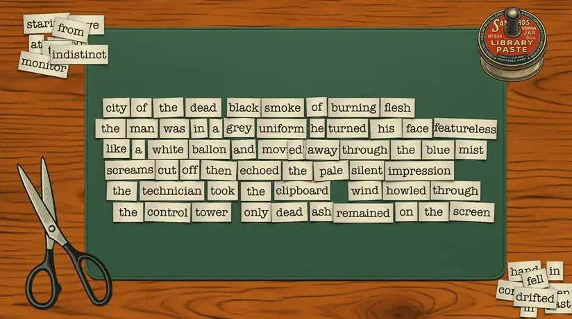
*[▶ 00:19:12](https://www.youtube.com/watch?v=am8adCMJQzk&t=1152s) · Text Jumbling*

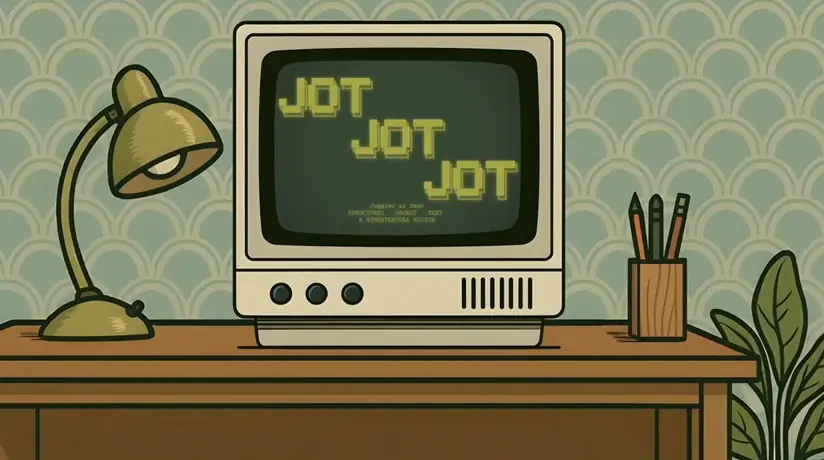
*[▶ 00:19:41](https://www.youtube.com/watch?v=am8adCMJQzk&t=1181s) · Jot: The Juggler of Text*

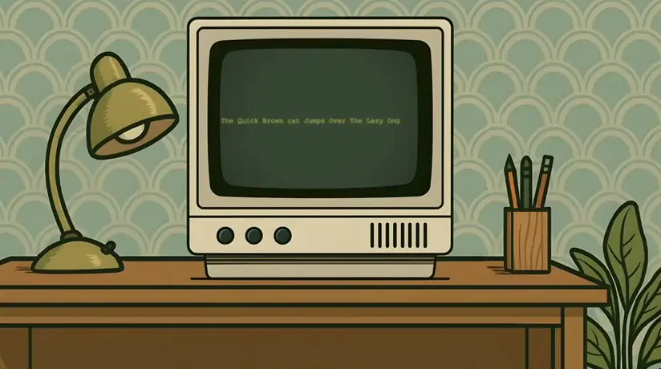
*[▶ 00:20:07](https://www.youtube.com/watch?v=am8adCMJQzk&t=1207s) · Terminal Output*

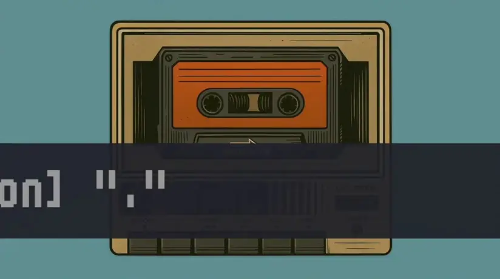
*[▶ 00:20:46](https://www.youtube.com/watch?v=am8adCMJQzk&t=1246s) · Code*

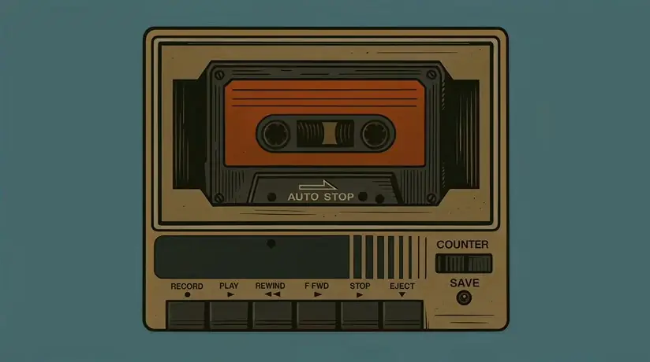
*[▶ 00:21:11](https://www.youtube.com/watch?v=am8adCMJQzk&t=1271s) · A Cassette Tape*

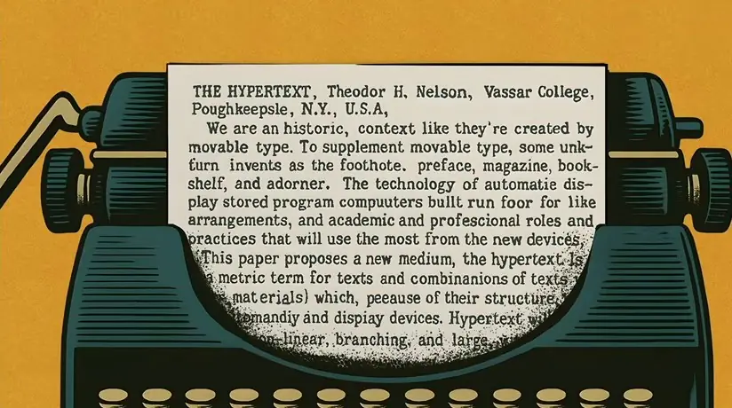
*[▶ 00:21:22](https://www.youtube.com/watch?v=am8adCMJQzk&t=1282s) · THE HYPERTEXT*

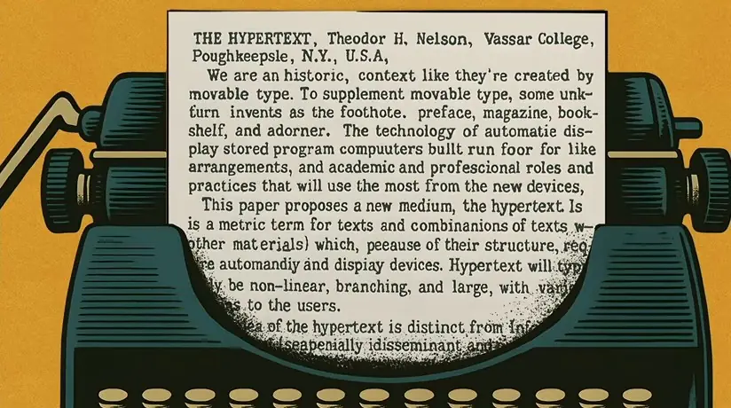
*[▶ 00:22:02](https://www.youtube.com/watch?v=am8adCMJQzk&t=1322s) · THE HYPERTEXT, Theodor H. Nelson, Vassar College, Poughkeepsie, N.Y., U.S.A.*

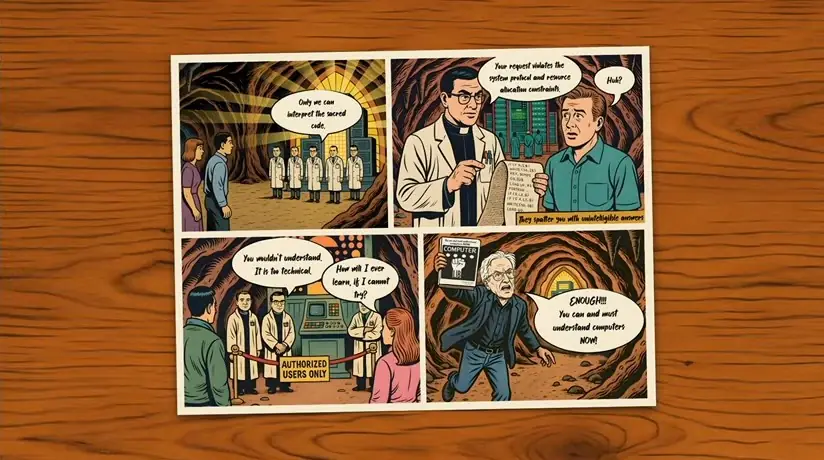
*[▶ 00:23:04](https://www.youtube.com/watch?v=am8adCMJQzk&t=1384s) · Code*

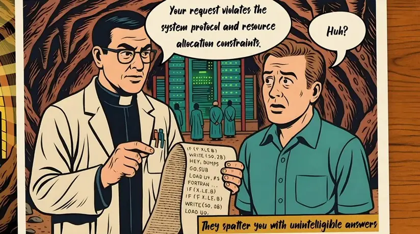
*[▶ 00:23:35](https://www.youtube.com/watch?v=am8adCMJQzk&t=1415s) · Fortran code*

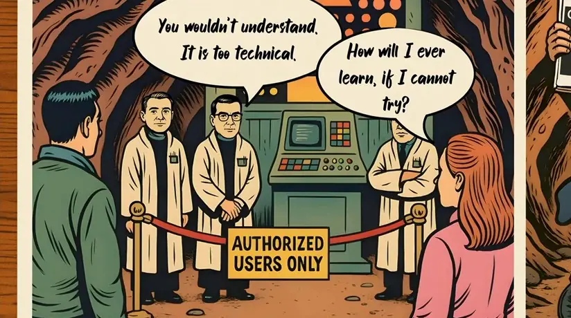
*[▶ 00:23:48](https://www.youtube.com/watch?v=am8adCMJQzk&t=1428s) · Code*

## Xanadu and Literary Machines

[▶ 00:27:22](https://www.youtube.com/watch?v=am8adCMJQzk&t=1642s)

Ted Nelson's vision for Xanadu, inspired by a 1816 poem, aims to transform computers into a new form of literature. In 1974, he outlined this project in a book, detailing a network of knowledge accessible through Sanadoo cafes. Literary Machines, published in 1980, describes bidirectional hyperlinks and transclusion, where information can be cited without duplication and retains version history. This concept influenced Google's page rank algorithm. Nelson also envisioned user-generated content, similar to modern social media, allowing annotations and contributions to the network.

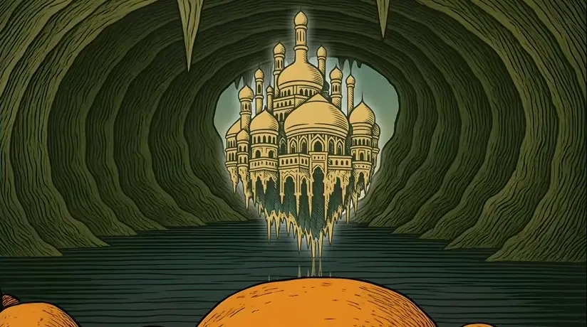
*[▶ 00:27:32](https://www.youtube.com/watch?v=am8adCMJQzk&t=1652s) · Xanadu: A Vision for Literature*

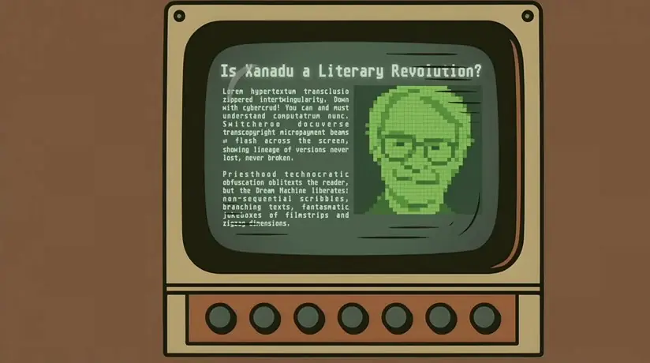
*[▶ 00:30:16](https://www.youtube.com/watch?v=am8adCMJQzk&t=1816s) · Is Xanadu a Literary Revolution?*

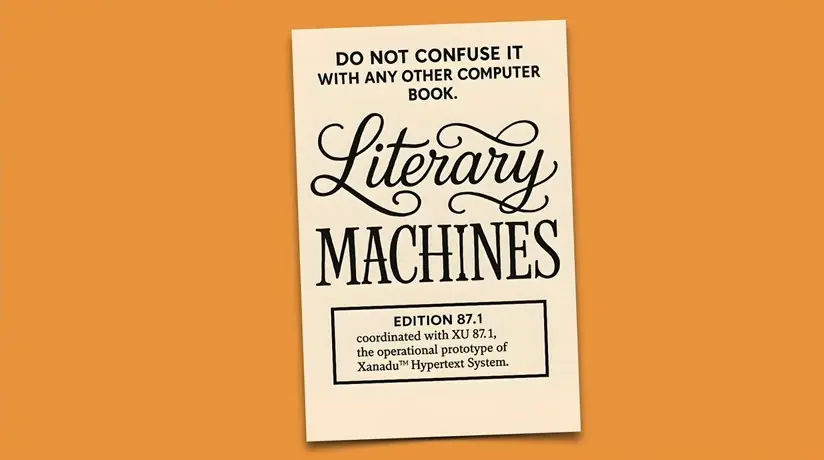
*[▶ 00:31:10](https://www.youtube.com/watch?v=am8adCMJQzk&t=1870s) · Literary Machines*

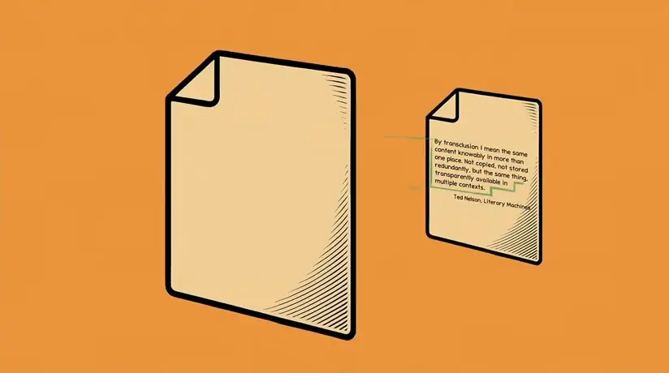
*[▶ 00:32:22](https://www.youtube.com/watch?v=am8adCMJQzk&t=1942s) · Transclusion*

*[▶ 00:33:23](https://www.youtube.com/watch?v=am8adCMJQzk&t=2003s) · Transclusion and Information Versioning*

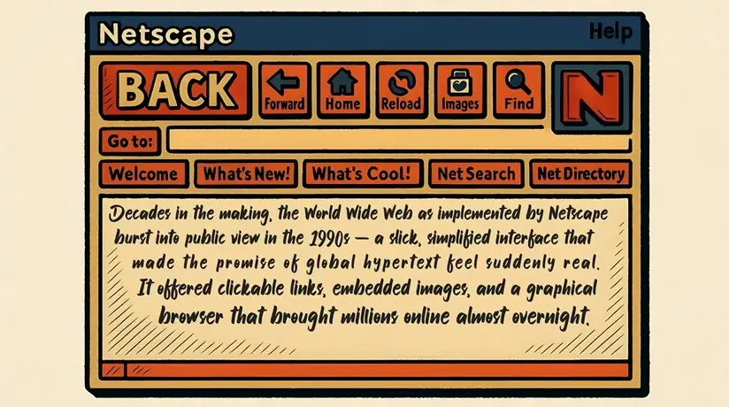
*[▶ 00:37:14](https://www.youtube.com/watch?v=am8adCMJQzk&t=2234s) · Netscape Browser Interface*

## Ted Nelson's Impact on the Web

[▶ 00:37:14](https://www.youtube.com/watch?v=am8adCMJQzk&t=2234s)

Ted Nelson's project Xanadu, which he envisioned as a commercial product, could have been a protocol for hypertext linking. If Nelson had pursued this idea, the World Wide Web might have developed with true hypertext and bidirectional links, rather than one-way HTML links. In the 1990s, the first web browser, Mosaic, would have been a hypernet browser, enabling a different web experience. By Y2K, piracy and DRM disrupted the internet, but Nelson had already proposed transcopyright, a micropayment mechanism allowing direct payments to content creators, eliminating piracy. Today, social media's 'invisible walls' and misinformation are issues Nelson foresaw. His concept of bidirectional links and transclusion could help verify information and pay creators fairly, addressing problems like AI model training and intellectual property theft. Nelson continues to work on his vision despite being 89 years old.

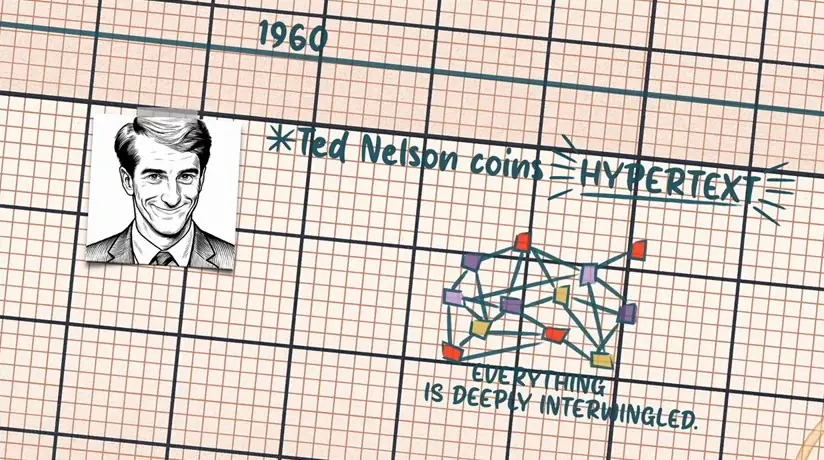
*[▶ 00:38:34](https://www.youtube.com/watch?v=am8adCMJQzk&t=2314s) · Ted Nelson coins HYPERTEXT*

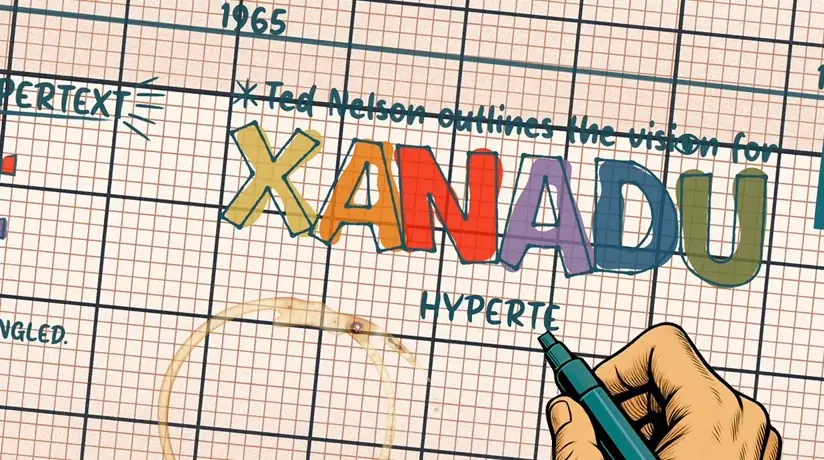
*[▶ 00:39:17](https://www.youtube.com/watch?v=am8adCMJQzk&t=2357s) · 1965*

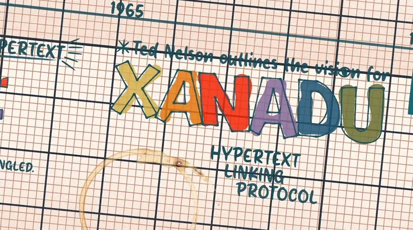
*[▶ 00:39:28](https://www.youtube.com/watch?v=am8adCMJQzk&t=2368s) · 1965*

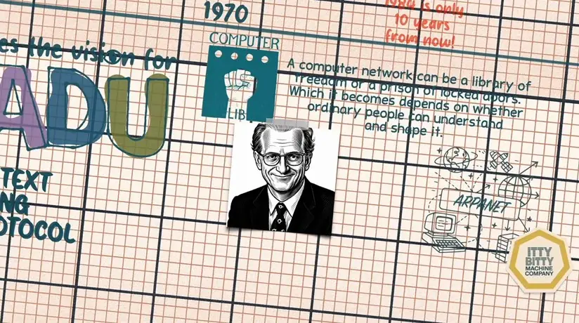
*[▶ 00:39:32](https://www.youtube.com/watch?v=am8adCMJQzk&t=2372s) · Computer*

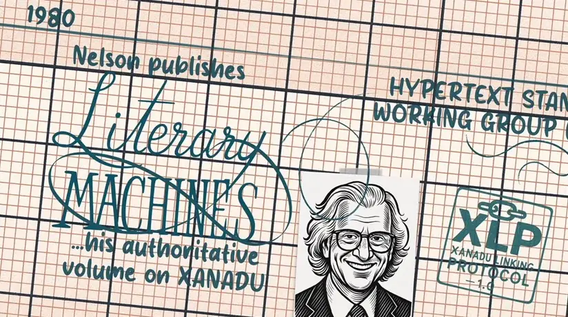
*[▶ 00:40:33](https://www.youtube.com/watch?v=am8adCMJQzk&t=2433s) · Literary Machines*

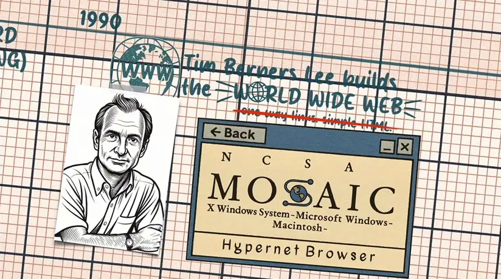
*[▶ 00:41:10](https://www.youtube.com/watch?v=am8adCMJQzk&t=2470s) · 1990*

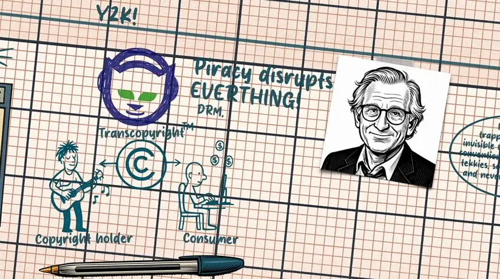
*[▶ 00:42:33](https://www.youtube.com/watch?v=am8adCMJQzk&t=2553s) · Transcopyright Mechanism*

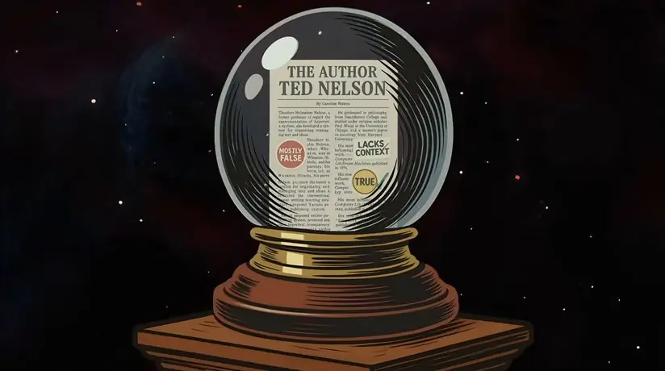
*[▶ 00:44:23](https://www.youtube.com/watch?v=am8adCMJQzk&t=2663s) · The Author Ted Nelson*

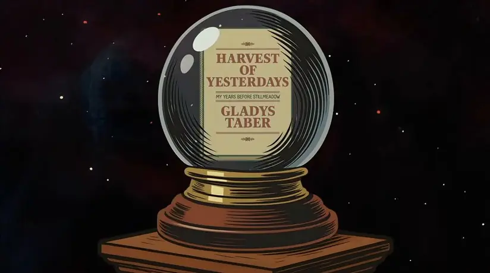
*[▶ 00:46:54](https://www.youtube.com/watch?v=am8adCMJQzk&t=2814s) · Harvest of Yesterdays*

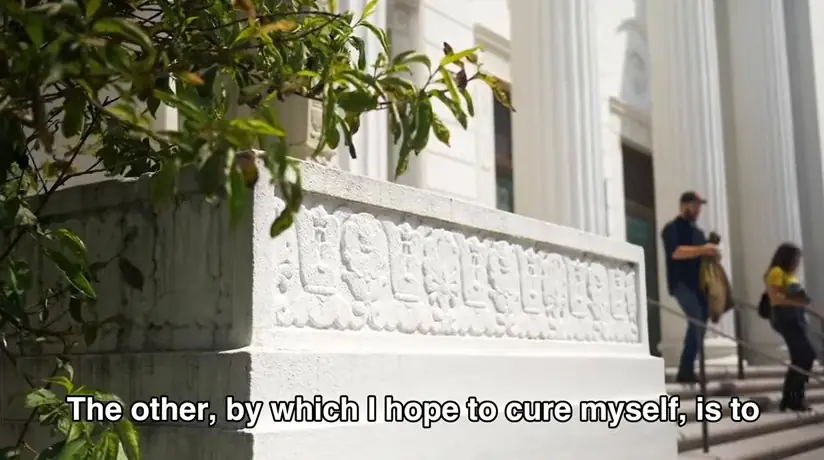
*[▶ 00:48:14](https://www.youtube.com/watch?v=am8adCMJQzk&t=2894s) · Code*

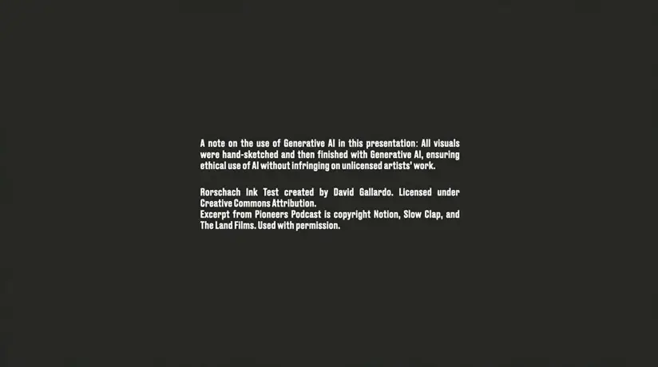
*[▶ 00:48:55](https://www.youtube.com/watch?v=am8adCMJQzk&t=2935s) · Acknowledgment*

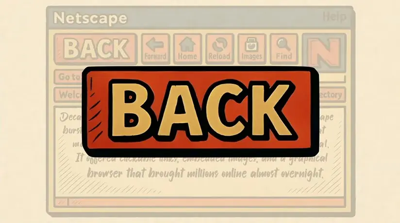
*[▶ 00:37:48](https://www.youtube.com/watch?v=am8adCMJQzk&t=2268s) · Netscape Browser Back Button*

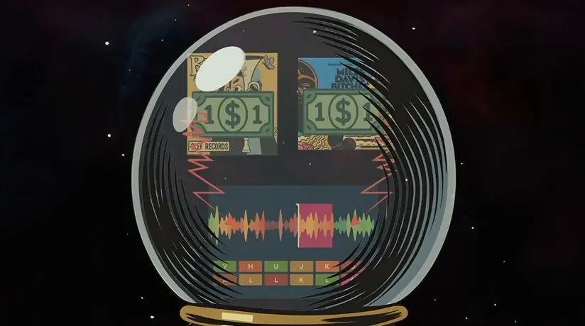
*[▶ 00:45:22](https://www.youtube.com/watch?v=am8adCMJQzk&t=2722s) · Money and Sound*

## Links & resources

- Bidirectional links and transclusion notation · mentioned [▶ 00:40:09](https://www.youtube.com/watch?v=am8adCMJQzk&t=2409s)
- Brewlet — project site and docs · mentioned [▶ 00:46:12](https://www.youtube.com/watch?v=am8adCMJQzk&t=2772s)
