# Inside Asimov: Building an Open-Source Humanoid Robot | Matthew Moore

*Learn about the challenges and successes of building an open-source humanoid robot, Asimov, from scratch.*

Source: [Inside Asimov: Building an Open-Source Humanoid Robot | Matthew Moore](https://www.youtube.com/watch?v=96lFS1O1qx8) · Matthew Moore · The Robotics Stack · 44 min

## TL;DR

Building an open-source humanoid robot like Asimov involves overcoming significant hardware and software challenges. The main idea is to democratize access to robotics technology by making it open-source, which accelerates innovation and collaboration. This matters because it lowers the barrier to entry for robotics development and fosters a more inclusive ecosystem.

## Key takeaways

- Open robotics is crucial for democratizing access to technology and accelerating development.
- Menlo Research started by developing robot brains and then moved to building their own robot due to proprietary and expensive existing options.
- Asimov 1 is a 1.2m tall, 35kg humanoid robot capable of lifting up to 15kg per arm, shipped as a kit for customization and rapid testing.
- Actuator selection and simulation are critical for accurate performance modeling in humanoid robots.
- Menlo operates in both the US and Singapore to leverage grants, funding, and talent availability, providing a competitive edge for a pre-seed startup.

## Importance of Open Robotics

[▶ 00:00:38](https://www.youtube.com/watch?v=96lFS1O1qx8&t=38s)

Open robotics is essential for democratizing access to technology. It lowers barriers to entry, allowing more people to contribute and innovate. Closed systems require massive funding, hindering progress. Open source enables widespread collaboration and accelerates development.

## Robotics and Open Source

[▶ 00:01:28](https://www.youtube.com/watch?v=96lFS1O1qx8&t=88s)

I started with software and machine learning, then built a toilet cleaning robot in 2014. [s009] AlexNet's success in 2012 inspired me to focus on robotics for manipulation tasks. In 2019, I began working on a cooking robot to help with my child's food allergies. [s012] This robot used a 3D printer arm and burners to cook meals. However, proprietary motor controllers and changing ROS 2 updates hindered progress. [s014] Transitioning to NVIDIA's Jetson Orin Nano also introduced new challenges. Menlo's vision of an open-source robot, from motor controllers to path planning, aligns with my goals and could accelerate future projects.

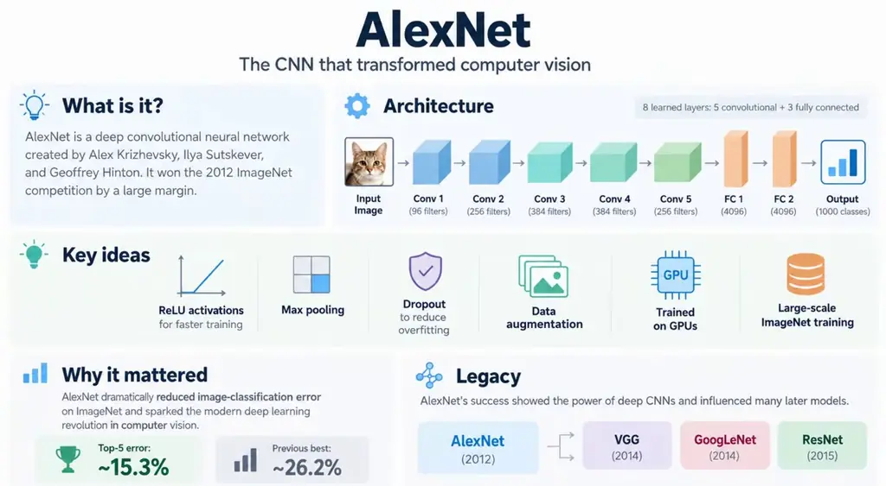
*[▶ 00:01:53](https://www.youtube.com/watch?v=96lFS1O1qx8&t=113s) · AlexNet Architecture*

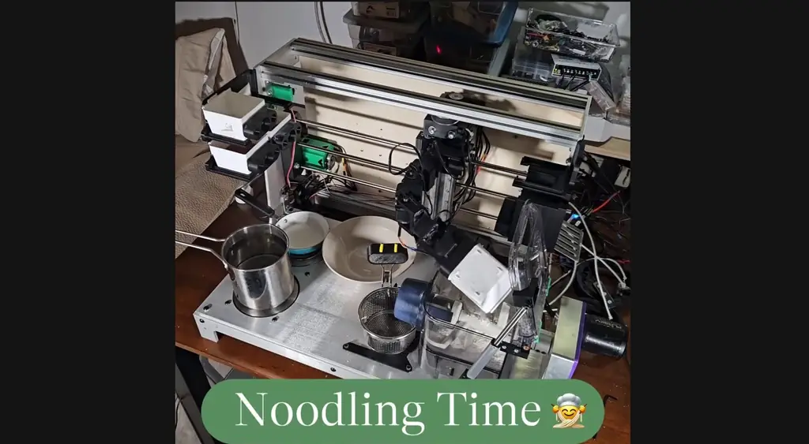
*[▶ 00:03:07](https://www.youtube.com/watch?v=96lFS1O1qx8&t=187s) · Noodling Time*

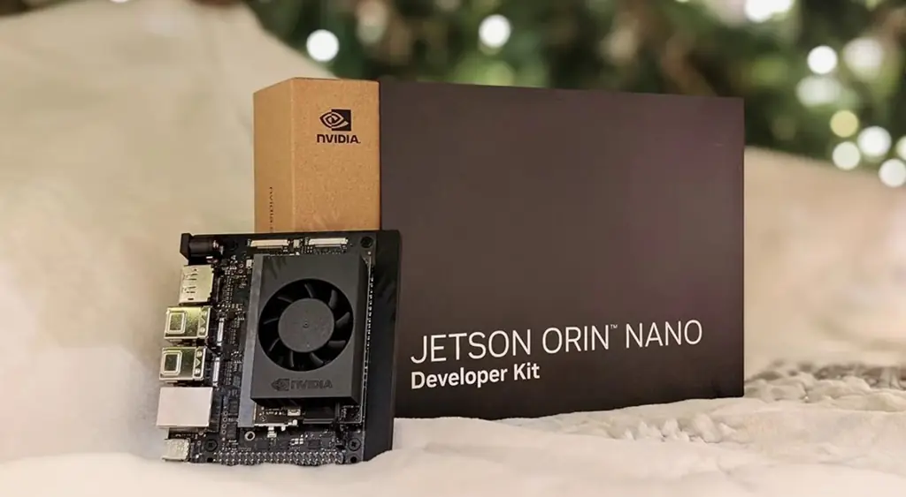
*[▶ 00:03:58](https://www.youtube.com/watch?v=96lFS1O1qx8&t=238s) · Jetson Orin Nano Developer Kit*

## Cooking Robots

[▶ 00:05:16](https://www.youtube.com/watch?v=96lFS1O1qx8&t=316s)

Cooking robots like Pasha aim to simplify meal preparation, but current models require manual ingredient preparation and limit the user's control over ingredients. Matthew Moore desires a robot that handles all prep work, allowing users to focus on the cooking process.

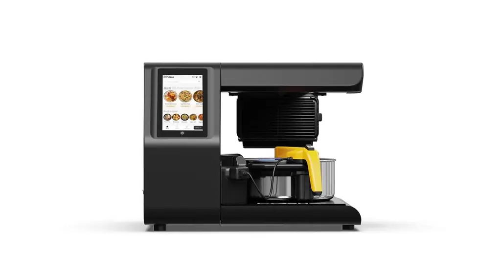
*[▶ 00:05:58](https://www.youtube.com/watch?v=96lFS1O1qx8&t=358s) · Cooking Robot*

## Menlo's Impact

[▶ 00:06:35](https://www.youtube.com/watch?v=96lFS1O1qx8&t=395s)

At Actuate in August 2026, I was impressed that Menlo was shipping robots, unlike most US companies. This is crucial for advancing the ecosystem. China leads in robotics, but Menlo's initiative is a significant step forward.

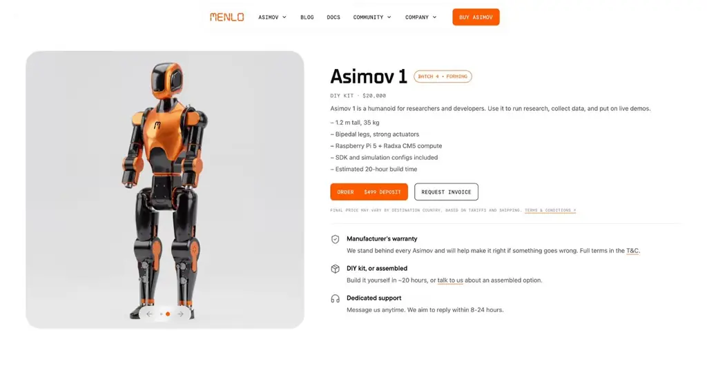
*[▶ 00:06:49](https://www.youtube.com/watch?v=96lFS1O1qx8&t=409s) · Asimov 1*

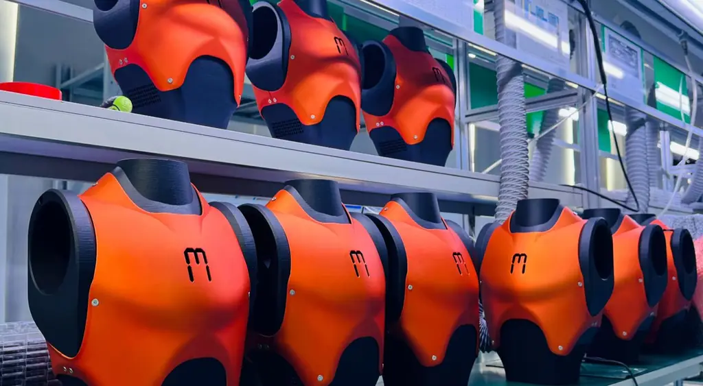
*[▶ 00:07:25](https://www.youtube.com/watch?v=96lFS1O1qx8&t=445s) · Menlo's Robots*

## Asimov Development

[▶ 00:07:34](https://www.youtube.com/watch?v=96lFS1O1qx8&t=454s)

Menlo started with developing robot brains, then sought to control robots but found existing options too expensive and proprietary. After a Chinese robot broke and repair was impractical, they decided to build their own robot, focusing on repairability and open hardware. This led to Asimov 0, a bipedal robot for learning locomotion, and Asimov 1, an educational robot for whole-body control.

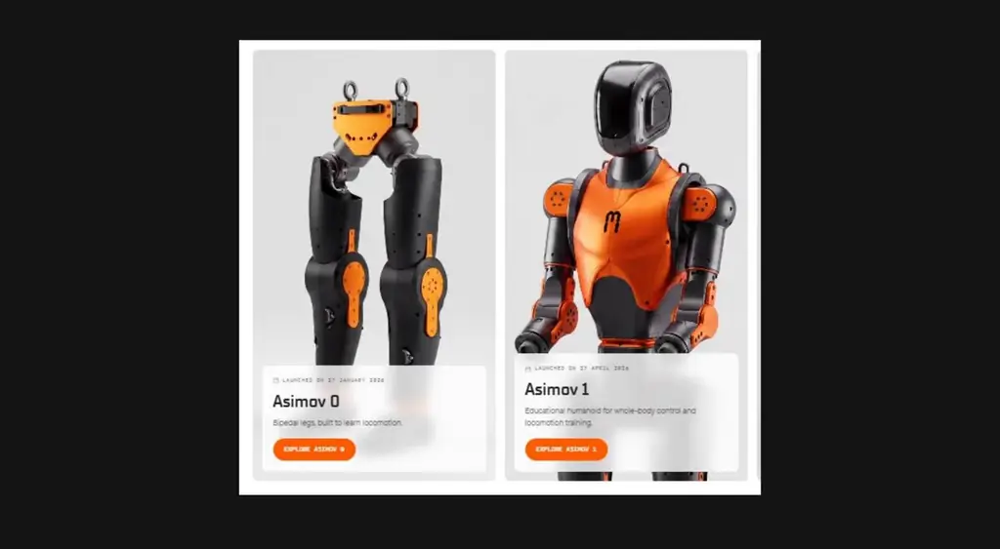
*[▶ 00:07:46](https://www.youtube.com/watch?v=96lFS1O1qx8&t=466s) · Asimov 0 and Asimov 1*

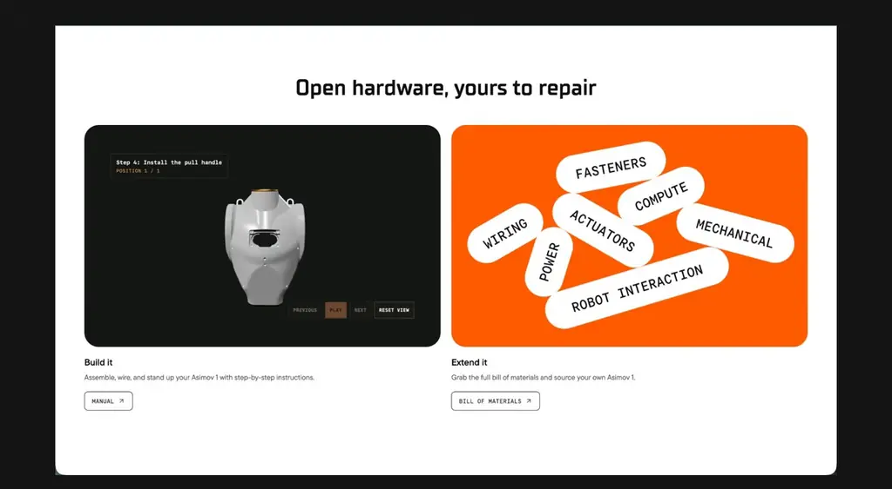
*[▶ 00:09:53](https://www.youtube.com/watch?v=96lFS1O1qx8&t=593s) · Open hardware, yours to repair*

## Building Expertise and Supply Chain

[▶ 00:10:13](https://www.youtube.com/watch?v=96lFS1O1qx8&t=613s)

Menlo lacked hardware expertise initially, so they hired key personnel with experience from Tesla and Amazon Robotics. Designing a humanoid robot is half the challenge; the other half is managing the supply chain for actuators, batteries, and other components. Ensuring these parts are readily available and easy to simulate is crucial for scaling production.

*[▶ 00:10:22](https://www.youtube.com/watch?v=96lFS1O1qx8&t=622s) · Jan Personal Intelligence*

## Actuator Selection

[▶ 00:11:40](https://www.youtube.com/watch?v=96lFS1O1qx8&t=700s)

Actuator selection for humanoid robots is crucial for zero-shot simulation. Non-linear actuator performance complicates simulation accuracy, necessitating detailed physics modeling. The AI team must influence hardware choices, a unique approach compared to traditional industries. This brain-first design ensures alignment of competing priorities.

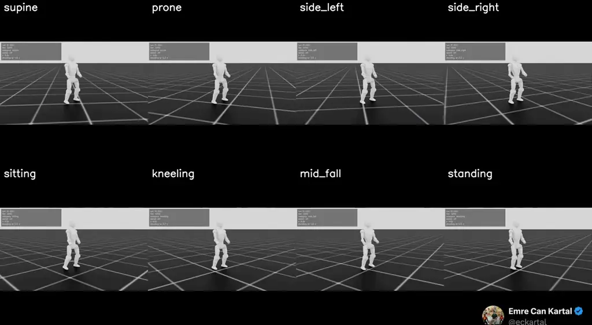
*[▶ 00:11:48](https://www.youtube.com/watch?v=96lFS1O1qx8&t=708s) · Humanoid Robot Postures*

## Asimov 1 Overview

[▶ 00:12:50](https://www.youtube.com/watch?v=96lFS1O1qx8&t=770s)

Asimov 1 is a 1.2m tall, 35kg humanoid robot capable of lifting up to 15kg per arm. It ships as a kit with all necessary parts for assembly, enabling customization and rapid testing. The robot supports sim-to-real training and is now available for worldwide shipping.

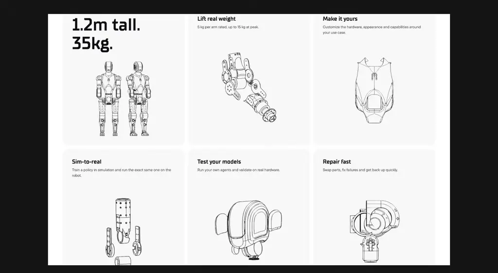
*[▶ 00:13:26](https://www.youtube.com/watch?v=96lFS1O1qx8&t=806s) · Asimov 1*

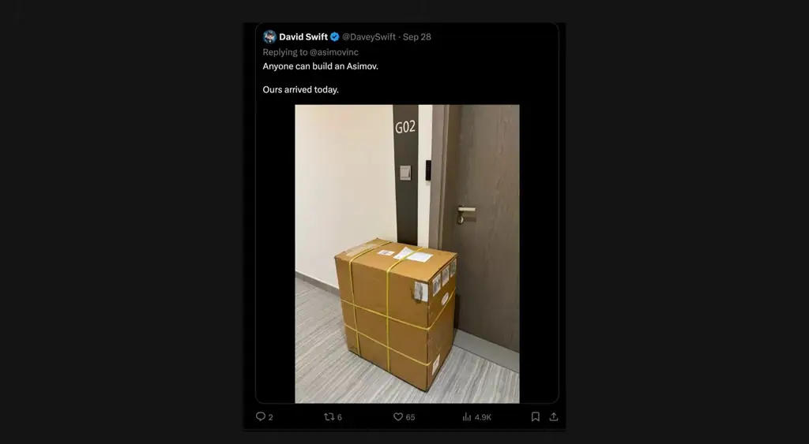
*[▶ 00:14:00](https://www.youtube.com/watch?v=96lFS1O1qx8&t=840s) · Asimov Robot Delivery*

## Actuator Simulation Challenges

[▶ 00:14:40](https://www.youtube.com/watch?v=96lFS1O1qx8&t=880s)

Actuator simulation is complex due to non-linear performance, especially with 27 actuators. Planetary gears simplify simulation but introduce computational challenges. Simulating non-linear behaviors like harmonics is resource-intensive.

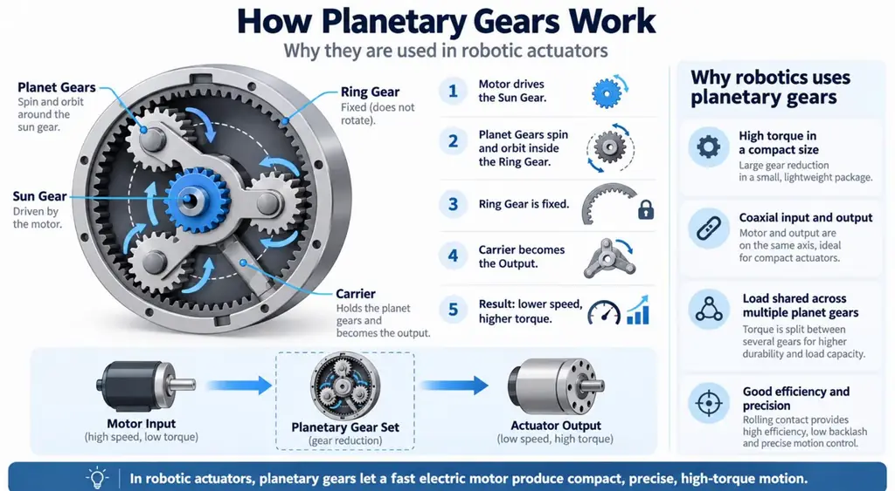
*[▶ 00:15:57](https://www.youtube.com/watch?v=96lFS1O1qx8&t=957s) · How Planetary Gears Work*

## Actuator Sourcing

[▶ 00:16:35](https://www.youtube.com/watch?v=96lFS1O1qx8&t=995s)

Actuator sourcing is a challenge, especially manufacturing magnets in the US. Menlo is seeking US-based partners to assemble robots and produce actuators domestically. Bend Briggs aims to build an open-source humanoid entirely made in the US, focusing on US-sourced components for actuators.

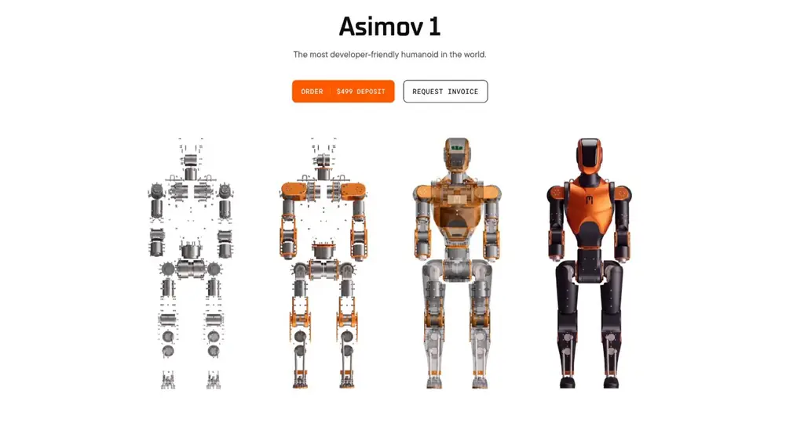
*[▶ 00:17:01](https://www.youtube.com/watch?v=96lFS1O1qx8&t=1021s) · Asimov 1*

## International Operations

[▶ 00:18:58](https://www.youtube.com/watch?v=96lFS1O1qx8&t=1138s)

Menlo operates in both the US and Singapore due to trade restrictions and talent availability. The US operation focuses on manufacturing, while Singapore offers grants and funding for startups, making it easier to attract talent. This dual approach provides a competitive edge, especially for a pre-seed startup like Menlo.

## Compute and Training

[▶ 00:21:22](https://www.youtube.com/watch?v=96lFS1O1qx8&t=1282s)

Locomotion training occurs in simulation, with plans to integrate into Nvidia's Isaac Lab soon. Menlo uses its own data center and open-source VLA and LM training platform. Training happens on Nvidia chips, with zero-shot transfer to real-world robots. The low-level control runs on an eight-core ARM chip, while higher-level tasks use a Raspberry Pi 5 or cloud GPUs. **Sim-to-real** training is the current approach.

## Software and Team Resources

[▶ 00:23:49](https://www.youtube.com/watch?v=96lFS1O1qx8&t=1429s)

We are opening up all GitHub repositories and cleaning them up for clarity. Out-of-the-box control via mobile web app and computer is available. Teams are evenly divided among data center, AI core, locomotion, robotic control, electromechanical design, manufacturing, supply chain, and delivery. Each team has a small number of specialists and generalists who can switch between teams as needed.

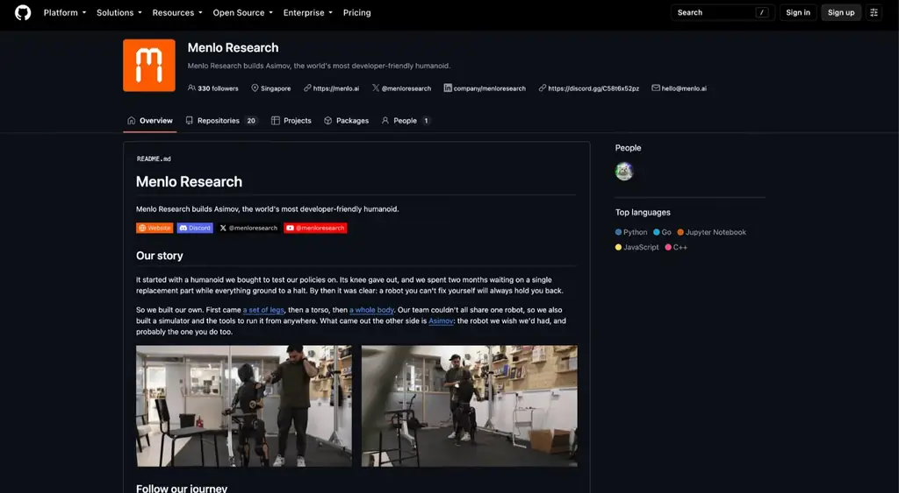
*[▶ 00:24:11](https://www.youtube.com/watch?v=96lFS1O1qx8&t=1451s) · Asimov Robot*

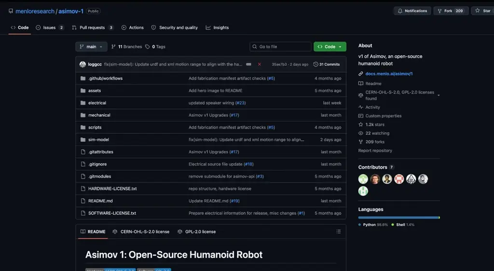
*[▶ 00:24:16](https://www.youtube.com/watch?v=96lFS1O1qx8&t=1456s) · Asimov 1: Open-Source Humanoid Robot*

## Design Flexibility

[▶ 00:25:10](https://www.youtube.com/watch?v=96lFS1O1qx8&t=1510s)

Designing Asimov involves a balance between specialization and versatility. Team members must wear multiple hats, from industrial design to AI appreciation, to optimize resource use. This flexibility ensures that even part-time contributors can make meaningful contributions at critical times. **Aesthetic considerations** are also important, reflecting Menlo's commitment to a cohesive and visually appealing product.

## Funding and Data Center

[▶ 00:25:56](https://www.youtube.com/watch?v=96lFS1O1qx8&t=1556s)

Daniel and Nicole, Menlo's founders, fund the company personally. The journey has been expensive, starting with AI research projects. The data center uses Nvidia GPUs, enabling collaboration with academic institutions like Stanford. This access to GPU cycles is a key asset for advancing robotics research.

## Customer Groups and Applications

[▶ 00:28:06](https://www.youtube.com/watch?v=96lFS1O1qx8&t=1686s)

Asimov 1 targets three main customer groups: individuals and entertainment enthusiasts, academic researchers, and corporate R&D teams. About a third are individuals who want to live in the future, spending up to $20,000. Two-thirds are split between academic and corporate research, with a third focusing on product development. Modular design allows for customization, such as using only the upper half of Asimov. The company aims to democratize robotics by providing open-source hardware and firmware, reducing the cost of entry.

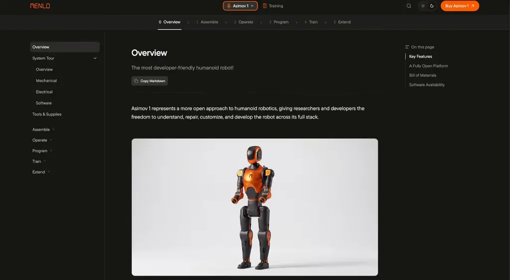
*[▶ 00:28:17](https://www.youtube.com/watch?v=96lFS1O1qx8&t=1697s) · Overview*

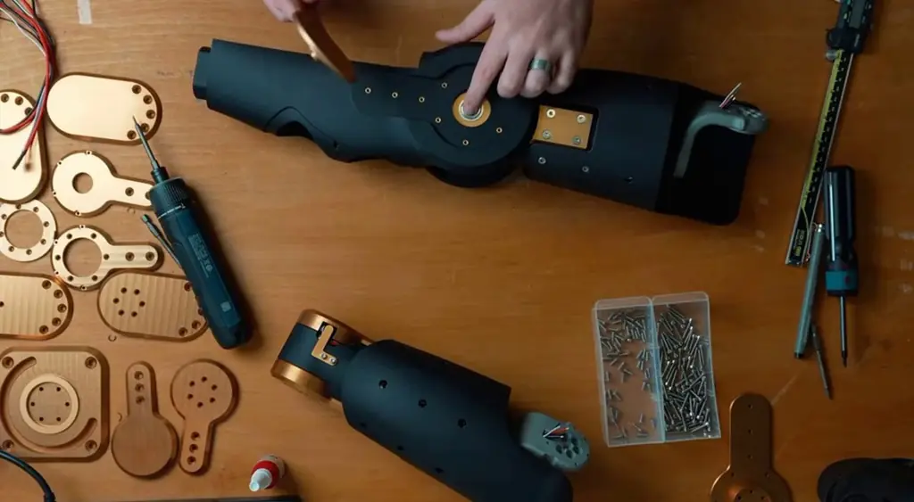
*[▶ 00:30:23](https://www.youtube.com/watch?v=96lFS1O1qx8&t=1823s) · Building an Open-Source Humanoid Robot*

## Data Collection and Ecosystem Discovery

[▶ 00:31:06](https://www.youtube.com/watch?v=96lFS1O1qx8&t=1866s)

Menlo aims to build a global robotics ecosystem directory, identifying skilled technicians, CNC mills, fabricators, and other service providers. Currently, data collection is in early stages, focusing on fine-tuning existing models rather than purchasing external data.

## Hands and Grippers

[▶ 00:33:22](https://www.youtube.com/watch?v=96lFS1O1qx8&t=2002s)

The team is exploring parallel grippers as a baseline, with plans to support various hands through an open interface. They consider designing their own hands but see value in compatibility with existing solutions. The challenge lies in standardizing power requirements and interfaces. A universal hand interface is an active topic, potentially offering flexibility and ease of use.

## Product Ambitions

[▶ 00:35:28](https://www.youtube.com/watch?v=96lFS1O1qx8&t=2128s)

We aim to ship open solutions that are safe, capable, and easy to fine-tune. Components like control, management, and teleoperation remain integral. Asimov OS may be rebranded, but its core functionalities will persist. Asimov 2 is already in development.

## Asimov 2 Development

[▶ 00:36:12](https://www.youtube.com/watch?v=96lFS1O1qx8&t=2172s)

We are teasing Asimov 2 to gather feedback for better manufacturing and deployment. For example, reducing the number of actuator models from five to two simplifies inventory management and reduces downtime in real-world deployments. This focus on practical deployment contrasts with the research-oriented approach of Asimov 1.

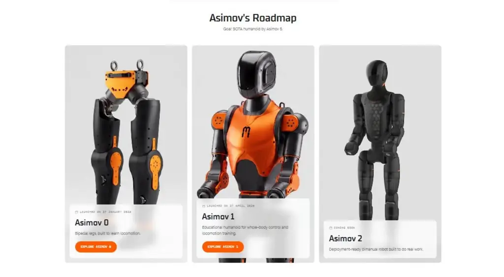
*[▶ 00:36:16](https://www.youtube.com/watch?v=96lFS1O1qx8&t=2176s) · Asimov's Roadmap*

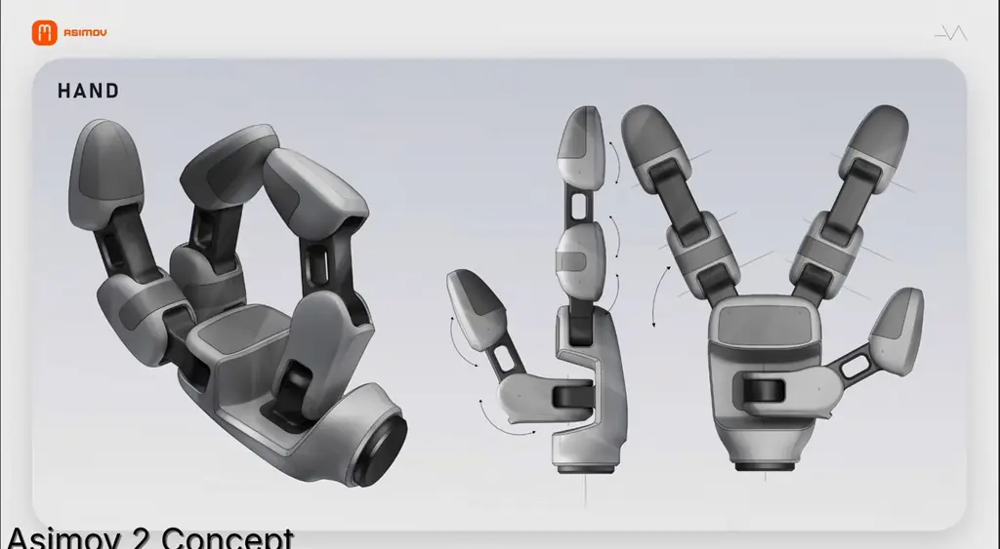
*[▶ 00:36:55](https://www.youtube.com/watch?v=96lFS1O1qx8&t=2215s) · Asimov 2 Concept*

## Pre-Assembled Version

[▶ 00:37:32](https://www.youtube.com/watch?v=96lFS1O1qx8&t=2252s)

We are still fulfilling orders for the kit version, but I expect demand for pre-assembled units to be significantly higher. For those who want a true learning experience, sourcing all components yourself is an option. The market is evolving, with major labs and researchers increasingly interested in open-source robotics.

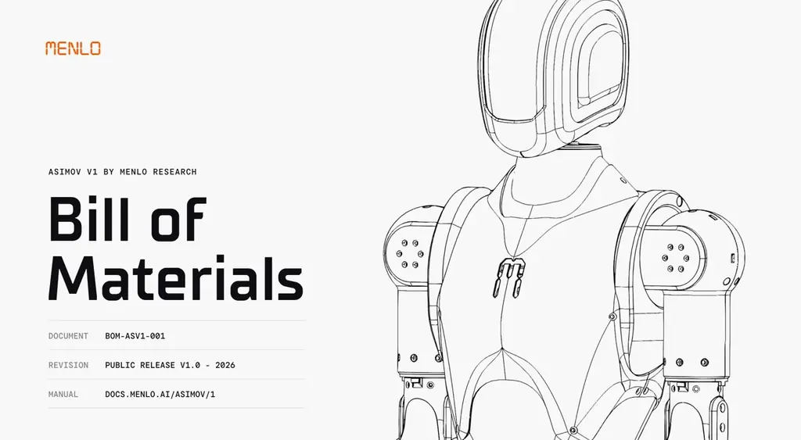
*[▶ 00:38:12](https://www.youtube.com/watch?v=96lFS1O1qx8&t=2292s) · Bill of Materials*

## Future of Robotics

[▶ 00:38:18](https://www.youtube.com/watch?v=96lFS1O1qx8&t=2298s)

A bold prediction is that while AI models like those from OpenAI and Anthropic will dominate, there will still be significant room for companies to innovate in hardware and electromechanical designs. Mechanical engineering remains crucial for specialized tools and end effectors, especially in high-throughput scenarios where human-like manipulation is inefficient. Custom solutions will coexist with generalized models.

## Industry Observations

[▶ 00:40:24](https://www.youtube.com/watch?v=96lFS1O1qx8&t=2424s)

Nvidia stands out due to its role in AI hardware. Skild.ai's end effector differs from Menlo's, suggesting unique approaches. The golden use case for robots remains undefined but could revolutionize supply chain and manufacturing. Excitement lies in solving US and European supply chain deficiencies with robotics. [s141]

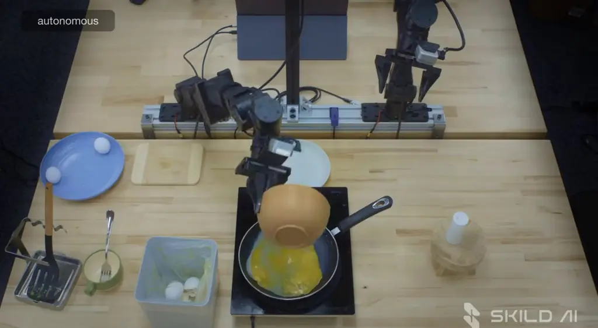
*[▶ 00:40:50](https://www.youtube.com/watch?v=96lFS1O1qx8&t=2450s) · Robotic Arm Cooking*

## Hiring and Partnerships

[▶ 00:42:02](https://www.youtube.com/watch?v=96lFS1O1qx8&t=2522s)

Mimir Research is hiring extensively across product development, engineering, and research roles, with a focus on Singapore. They are also looking for research evangelists to collaborate with research labs globally. Engineers interested in open-source robotics are encouraged to reach out. [https://docs.menlo.ai/ASIMOV/1](https://docs.menlo.ai/ASIMOV/1) for more details.

## Scaling Production

[▶ 00:42:52](https://www.youtube.com/watch?v=96lFS1O1qx8&t=2572s)

My estimate for this year is around 100 units, aiming to scale up as much as possible while operating conservatively. We are preparing for success by partnering with research labs and showing the potential of our open-source product.

## Links & resources

- [ASIMOV Bill of Materials](https://docs.menlo.ai/ASIMOV/1) — <https://docs.menlo.ai/ASIMOV/1> · on screen [▶ 00:38:12](https://www.youtube.com/watch?v=96lFS1O1qx8&t=2292s)
