# Java on Kubernetes Without Container Images: The WebAssembly Way By Bruno Borges

*How Brewlet ships Java apps as OCI artifacts while platform teams patch the JDK on each node, so a JDK fix doesn't force an app rebuild.*

Source: [Java on Kubernetes Without Container Images: The WebAssembly Way By Bruno Borges](https://www.youtube.com/watch?v=fszyRIZXjQM) · Bruno Borges · Devoxx · 53 min

## TL;DR

Developers own every layer of a container image, so one OS or JDK CVE forces every team to rebuild and redeploy services even when their code is unchanged. Brewlet applies the WebAssembly model from SpinKube to Java: the JDK stays on each node under platform control, and developers ship only a JAR as an OCI artifact. A containerd shim assembles the runtime at container start, so a JDK patch changes one node profile digest and leaves the application digest untouched. This separates patch ownership from application ownership, which lets platform teams patch without waiting on app teams.

## Key takeaways

- Ownership of a container image is split across app code, dependencies, JDK, and OS base image, so a single OS or JDK CVE can force a rebuild of every service.
- With Brewlet, JARs ship as OCI artifacts while JDKs stay on the node, so the platform team can patch the JDK without changing the application digest.
- Platform teams declare approved JDKs per node pool in a NodeProfile, pin each JDK by image digest, and patch day means changing one digest.
- Developers select a JDK with the brewlet.sh/jdk annotation or a JavaApplication CRD, and should name the distribution explicitly because otherwise matching major versions are picked alphabetically.
- The platform team publishes an approved dependency BOM as an immutable OCI bundle, and CI composes each app with that exact layer and rejects drift.
- Readiness for Brewlet needs two checks: nodes must advertise the runtime and the brewlet RuntimeClass must exist, and the NodeProfile output is the real proof of node runtime readiness, not Helm success alone.
- The Brewlet shim only overrides the Create call to write an OCI bundle with JVM args and limits, and delegating other calls to runc keeps logs, exec, probes, pod IPs, limits, signals, and HPA metrics working.
- Brewlet took about 12 weeks and 600+ commits, using a SPECIFICATION.md as the source of truth, tiered tests from CLI to PetClinic, humans owning trust boundaries, and agents handling plumbing.

## Ownership has outrun the teams that can patch

[▶ 00:00:00](https://www.youtube.com/watch?v=fszyRIZXjQM&t=0s)

Developers write one layer but own all of them: app, dependencies, JDK, and OS base image. One OS or JDK CVE forces every team to rebuild, even untouched services.

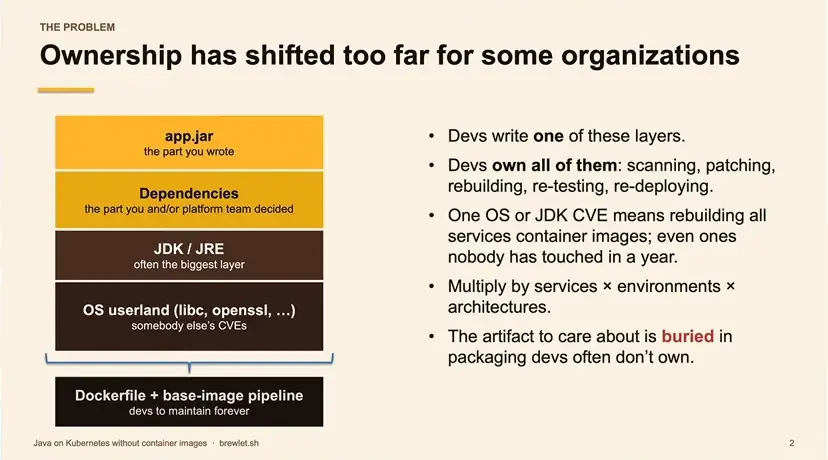
*[▶ 00:02:59](https://www.youtube.com/watch?v=fszyRIZXjQM&t=179s) · Ownership has shifted too far for some organizations*

That rebuild chain changes no application code: base image, every service image, CI for each service, then redeploy everything. Platform teams cannot patch without app teams.

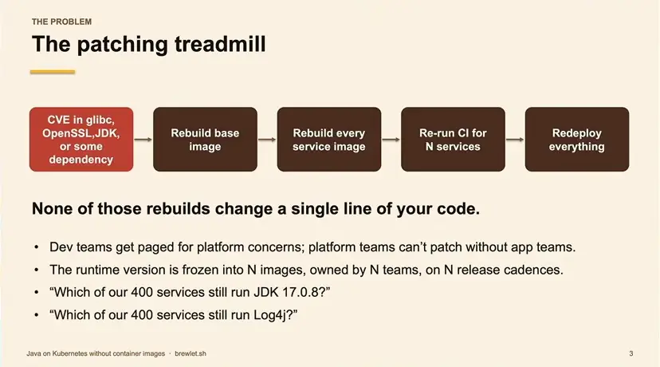
*[▶ 00:03:52](https://www.youtube.com/watch?v=fszyRIZXjQM&t=232s) · The patching treadmill*

## Who should own the JVM and its dependencies

[▶ 00:03:13](https://www.youtube.com/watch?v=fszyRIZXjQM&t=193s)

App teams choose and rebuild the JVM and OS layers, yet the platform team should patch them. Dependencies can belong to either team, depending on the organization.

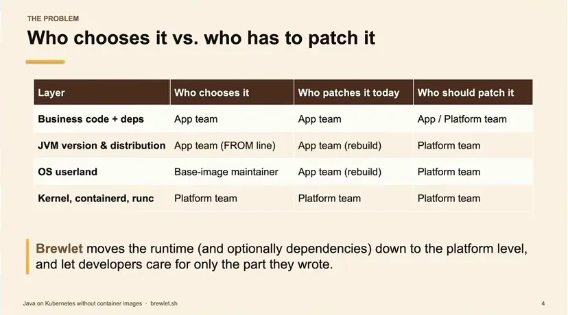
*[▶ 00:06:08](https://www.youtube.com/watch?v=fszyRIZXjQM&t=368s) · Who chooses it vs. who has to patch it*

In his Java EE years, the platform team patched the JDK and app server; he only built the WAR.

SpinKube does this for WebAssembly: the runtime lives on each node, and developers ship only an OCI artifact.

```yaml
apiVersion: v1
kind: Pod
spec:
  runtimeClassName: wasmtime-spin
  containers:
  - image: ghcr.io/me/app:v1   # just .wasm
```

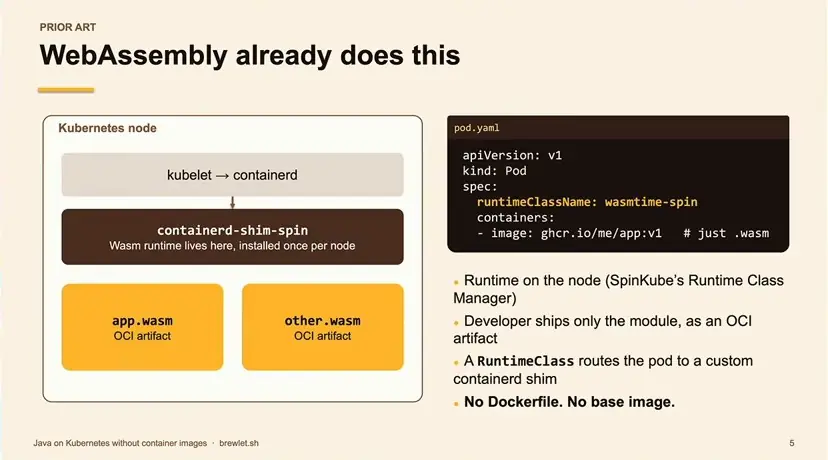
*[▶ 00:07:13](https://www.youtube.com/watch?v=fszyRIZXjQM&t=433s) · WebAssembly already does this (SpinKube)*

Brewlet applies the same model to Java: JARs ship as OCI artifacts, and JDKs stay on the node.

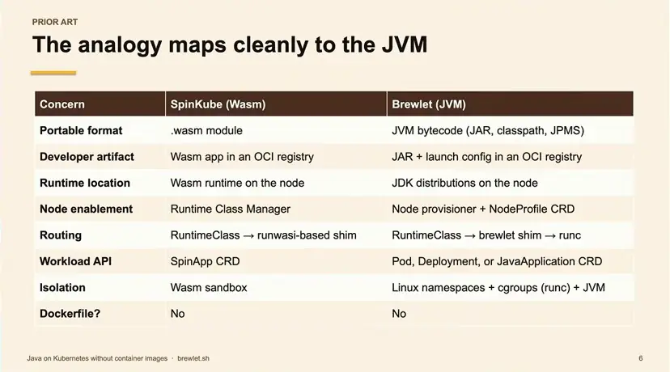
*[▶ 00:08:08](https://www.youtube.com/watch?v=fszyRIZXjQM&t=488s) · The analogy maps cleanly to the JVM*

Platform teams pin approved JDKs per node pool, and `runtimeClassName: brewlet` routes pods to a containerd shim. [Brewlet](https://brewlet.sh) is about three months old.

```text
brewlet push app.jar

kind: NodeProfile

runtimeClassName: brewlet
```

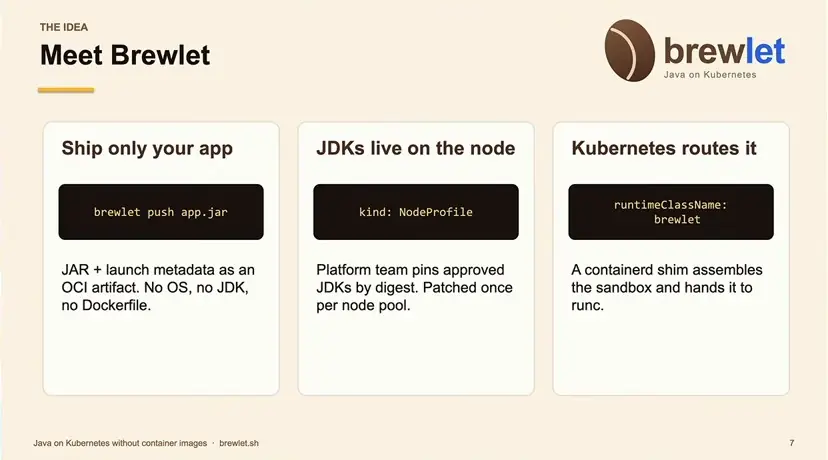
*[▶ 00:09:20](https://www.youtube.com/watch?v=fszyRIZXjQM&t=560s) · Meet Brewlet: three core ideas*

## The shim assembles the runtime at container start

[▶ 00:09:18](https://www.youtube.com/watch?v=fszyRIZXjQM&t=558s)

Patches change only the node JDK, not the application digest.

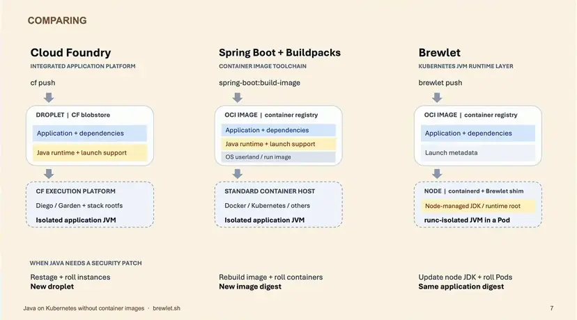
*[▶ 00:10:09](https://www.youtube.com/watch?v=fszyRIZXjQM&t=609s) · Comparing Cloud Foundry, Buildpacks, and Brewlet*

Only the shim is new: containerd hands pods to the Brewlet shim, and runc starts Java as PID 1.

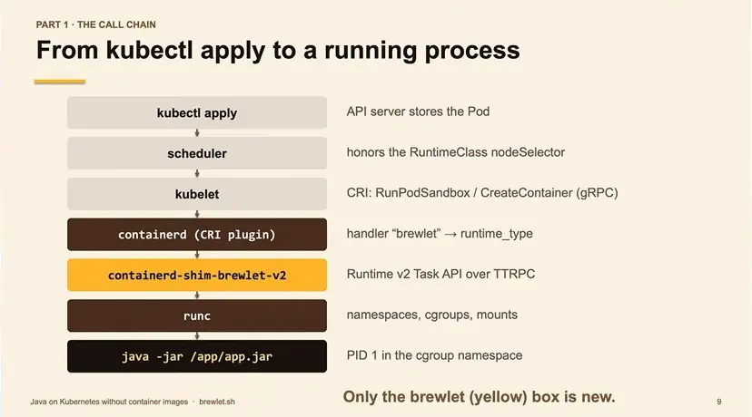
*[▶ 00:11:32](https://www.youtube.com/watch?v=fszyRIZXjQM&t=692s) · From kubectl apply to a running process*

`Create` writes a standard OCI bundle with JVM args and limits.

```json
{
  "process": {
    "args": ["java", "-XX:MaxRAMPercentage=75",
             "-jar", "/app/app.jar"],
    "env":  ["PATH=<jdk>/bin:...", ...]
  },
  "root":   { "path": "rootfs" },
  "mounts": [ { "destination": "/app", ... } ],
  "linux": {
    "resources": { "memory": { "limit": 805306368 },
                   "cpu": { "quota": 100000 } },
    "namespaces": [ { "type": "network",
                      "path": "/var/run/netns/cni-…" } ]
  }
}
```

*[▶ 00:12:45](https://www.youtube.com/watch?v=fszyRIZXjQM&t=765s) · OCI runtime bundle: config.json rewritten by Brewlet*

Only `Create` is overridden; other lifecycle calls stay upstream.

```go
// Embeds containerd's runc-backed Task service.
// Every method is inherited... except Create.
type brewletTaskService struct {
    taskAPI.TTRPCTaskService     // stock runc shim
}

func (s *brewletTaskService) Create(ctx context.Context,
    r *taskAPI.CreateTaskRequest) (*CreateTaskResponse, error) {
    if isSandbox(r.Bundle) {            // pause container
        return s.TTRPCTaskService.Create(ctx, r)
    }
    assembleBrewletBundle(ctx, r)       // resolve image, pick JDK,
                                        // overlay rootfs, rewrite spec
    return s.TTRPCTaskService.Create(ctx, r)  // runc does the rest
}
```

*[▶ 00:13:04](https://www.youtube.com/watch?v=fszyRIZXjQM&t=784s) · Brewlet decorates the Create method*

The root is overlayfs: a shared read-only JDK lowerdir under a writable upperdir.

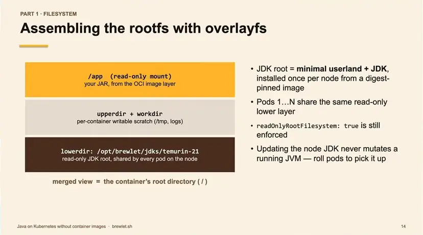
*[▶ 00:13:49](https://www.youtube.com/watch?v=fszyRIZXjQM&t=829s) · Assembling the rootfs with overlayfs*

Delegating to runc keeps logs, exec, probes, pod IPs, limits, signals and HPA metrics working.

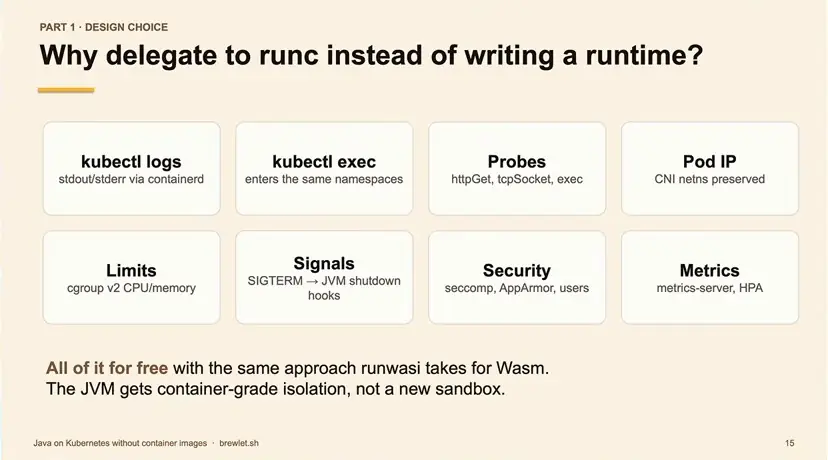
*[▶ 00:14:31](https://www.youtube.com/watch?v=fszyRIZXjQM&t=871s) · Why delegate to runc instead of writing a runtime?*

## Platform-owned JDKs and dependency bundles

[▶ 00:14:35](https://www.youtube.com/watch?v=fszyRIZXjQM&t=875s)

Platform teams declare approved JDKs per node pool in a `NodeProfile`. Selecting the pool opts it in.

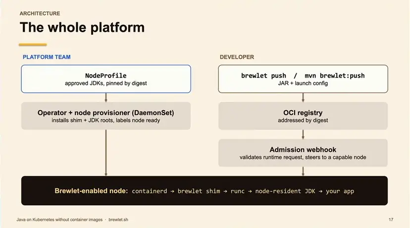
*[▶ 00:16:12](https://www.youtube.com/watch?v=fszyRIZXjQM&t=972s) · The whole platform*

Each JDK is pinned by image digest, and rollouts probe it before a node is marked ready. Patch day means changing one digest.

```yaml
apiVersion: node.brewlet.sh/v1alpha1
kind: NodeProfile
metadata: { name: web }
spec:
  nodePool:
    names: ["web"]        # agentpool / gke-nodepool / karpenter
  jdks:
  - distribution: microsoft
    feature: 25
    source:
      image: mcr.microsoft.com/openjdk/jdk@sha256:bfde2e…
      javaHome: /usr/lib/jvm/msopenjdk-25
  rollout:
    maxUnavailable: 1
    validate: true          # java -version before "ready"
    containerdRestart: validated
```

*[▶ 00:17:17](https://www.youtube.com/watch?v=fszyRIZXjQM&t=1037s) · Platform team: declare runtimes per node pool*

Developers select a JDK with the `brewlet.sh/jdk` annotation or a `JavaApplication` CRD. Name the distribution explicitly, because otherwise matching major versions are picked alphabetically.

```yaml
apiVersion: apps/v1
kind: Deployment
spec:
  template:
    metadata:
      annotations:
        brewlet.sh/jdk: "21"
        brewlet.sh/jvm-args: ['-XX:+UseZGC']
    spec:
      runtimeClassName: brewlet
      containers:
      - name: petclinic
        image: registry/petclinic@sha256:…
        resources:
          limits: { cpu: "1", memory: 768Mi }

apiVersion: apps.brewlet.sh/v1alpha1
kind: JavaApplication
metadata: { name: petclinic }
spec:
  artifact:
    image: registry/petclinic@sha256:…
  replicas: 2
  jvm:
    version: 21
    distribution: temurin
    args: ["-XX:MaxRAMPercentage=75.0"]
  resources:
    limits: { cpu: "1", memory: 768Mi }
  ports: [{ name: http, containerPort: 8080 }]
  service: { enabled: true }
  autoscaling: { enabled: true, maxReplicas: 10 }
```

*[▶ 00:20:19](https://www.youtube.com/watch?v=fszyRIZXjQM&t=1219s) · Developer: two ways to deploy*

Three layers have separate owners: the app JAR (application team), and the dependency bundle and node JDK (platform team).

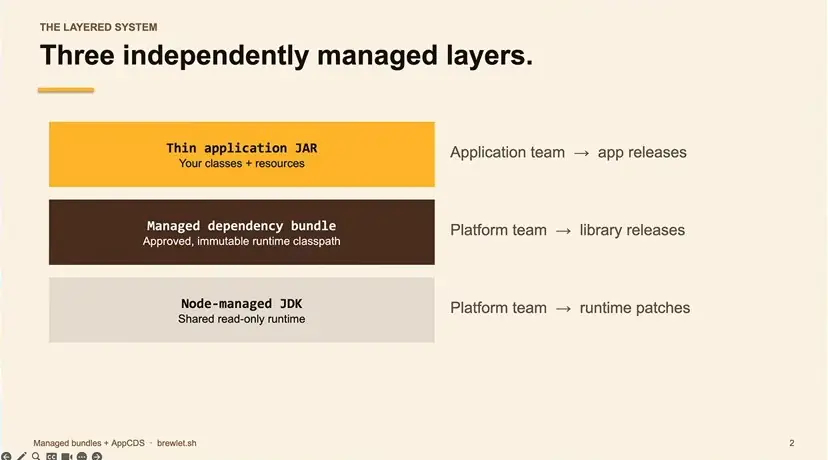
*[▶ 00:21:06](https://www.youtube.com/watch?v=fszyRIZXjQM&t=1266s) · Three independently managed layers.*

The platform team publishes an approved BOM as an immutable OCI bundle. CI composes the app with that exact layer and rejects drift.

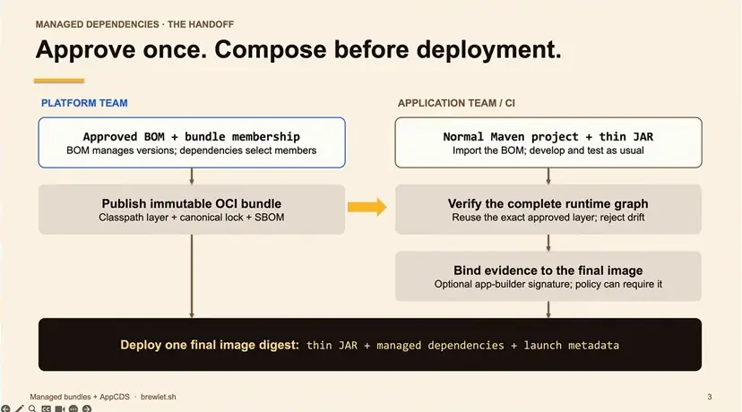
*[▶ 00:21:30](https://www.youtube.com/watch?v=fszyRIZXjQM&t=1290s) · Approve once. Compose before deployment.*

App changes publish a new image that reuses the dependency layer. Dependency CVEs recompose the same JAR with an updated lock. JDK CVEs change only the NodeProfile.

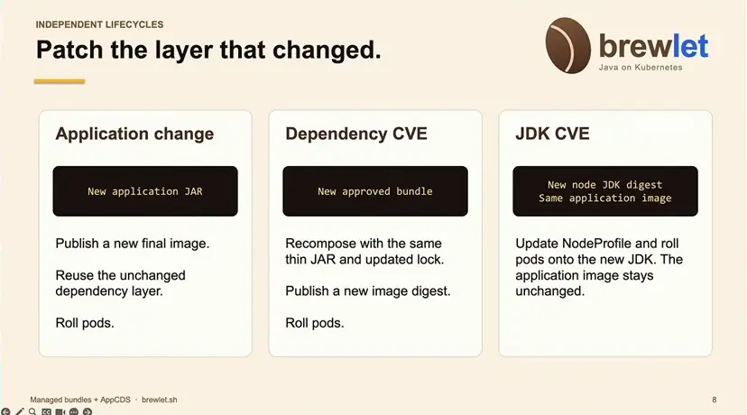
*[▶ 00:22:24](https://www.youtube.com/watch?v=fszyRIZXjQM&t=1344s) · Patch the layer that changed.*

## Running a Spring Boot app on Brewlet, end to end

[▶ 00:22:22](https://www.youtube.com/watch?v=fszyRIZXjQM&t=1342s)

The demo runs one path from build to patch. The platform team sets up the node side once, and the developer publishes only the application.

On the platform side, a values file pins an approved JDK by image and digest for a node pool. The [Brewlet](https://brewlet.sh) CLI runs the Helm chart that installs the operator, admission webhook and node provisioning. Readiness needs two checks: the nodes must advertise the runtime, and the `brewlet` RuntimeClass must exist.

```yaml
provisioner:
  pools: [javaworkers]
  jdks:
    - distribution: temurin
      feature: 21
      source:
        image: <JDK_IMAGE>@sha256:<JDK_DIGEST>
        javaHome: /opt/java/openjdk

helm install brewlet \
  oci://ghcr.io/microsoft/charts/brewlet \
  --namespace brewlet --create-namespace \
  --values brewlet-values.yaml

kubectl get nodes -L brewlet.sh/runtime
kubectl get runtimeclass brewlet
```

*[▶ 00:23:20](https://www.youtube.com/watch?v=fszyRIZXjQM&t=1400s) · Enable Brewlet on the cluster*

On a fresh cluster the CLI runs a dry run before the install. The demo cluster already had Brewlet, so the install was shown as a simulation.

```yaml
    poolKey: agentpool
    jdks:
      - distribution: temurin
        feature: 25
        source:
          image: docker.io/library/eclipse-temurin@sha256:119a3d18f160a3e7655a66034d0f43beee31cd7b3b9142d57a5d0e29772011de6
          javaHome: /opt/java/openjdk
      rollout:
        maxUnavailable: 1
        validate: true
        containerdRestart: validated

# FRESH CLUSTER ONLY -- already executed here.
brewlet k8s install --version "$BREWLET_VERSION" --namespace brewlet \
```

*[▶ 00:30:37](https://www.youtube.com/watch?v=fszyRIZXjQM&t=1837s) · Brewlet install command preview (simulation)*

The install runs in five stages: prerequisites, chart pull, CRDs and operator, the default NodeProfile, then waiting for resources. Helm readiness alone does not prove node runtime readiness, so the profile output is the real check. In the live output, the userpool profile has two ready nodes, each advertising Temurin 25, Temurin 27 and Distroless 25.

```text
$ brewlet k8s install --version 0.7.1 --namespace brewlet --values
"$DEMO_DIR/userpool-values.yaml" --dry-run
[Preview] Review the planned cluster installation and runtime configuration.

$ brewlet k8s install --version 0.7.1 --namespace brewlet --values
"$DEMO_DIR/userpool-values.yaml" --wait-timeout 5m

[1/5] Checking local prerequisites, cluster access, and fresh-install eligibility.

[2/5] Pulling the version-pinned Brewlet Helm chart from ghcr.io/microsoft/charts/brewlet.

[3/5] Installing CRDs, operator, admission webhook, and provisioner permissions in namespace brewlet.

[4/5] Creating the default NodeProfile for userpool; the operator reconciles its provisioner DaemonSet.

[5/5] Waiting for the chart's Kubernetes resources to become ready
```

*[▶ 00:31:48](https://www.youtube.com/watch?v=fszyRIZXjQM&t=1908s) · Brewlet install dry-run and simulated run output*

```bash
brewlet k8s profile status deployment/brewlet-admission --timeout=2m
brewlet k8s profile list
brewlet k8s profile inspect default

deployment "brewlet-operator" successfully rolled out
deployment "brewlet-admission" successfully rolled out
PROFILE        POOLS      DESIRED JDKS                          DESIRED LAUNCHERS
READY  NODES  REASON
brewlet-demo   brewlet    temurin-25,temurin-27,distroless-25
0/3    CleanupBlocked
default        userpool   temurin-25,temurin-27,distroless-25
true   2/2    AllNodesProvisioned
javaworkers    javaworkers   temurin-25
false  0/2    CleanupBlocked
nodes:
  - advertisedJdks: temurin-25,temurin-27,distroless-25
    advertisedLaunchers: java
    name: aks-userpool-15703665-vmss000000
    nodeReady: true
    profile: default
    profileGeneration: "2"
    runtimeReady: true
    unschedulable: false
```

*[▶ 00:32:54](https://www.youtube.com/watch?v=fszyRIZXjQM&t=1974s) · Brewlet operator rollout and profile inspect output*

On the developer side, a Maven plugin in `pom.xml` declares the registry, app name, JDK feature and port. `mvn package` builds a normal executable JAR. `mvn brewlet:push brewlet:manifest` pushes it, writes `push.json` with the image digest, and writes `javaapplication.yaml`, which uses that digest.

```xml
<artifactId>brewlet-maven-plugin</artifactId>
<configuration>
<registry>registry.example.com/team</registry>
  <appName>hello</appName>
  <jdkFeature>21</jdkFeature>
  <ports>
    <port><name>http</name>
      <containerPort>8080</containerPort>
    </port>
  </ports>
</configuration>

mvn package

mvn brewlet:push brewlet:manifest

target/brewlet/push.json
target/brewlet/javaapplication.yaml
```

*[▶ 00:23:55](https://www.youtube.com/watch?v=fszyRIZXjQM&t=1435s) · Configure the Maven plugin and generate YAML*

`brewlet inspect` shows the artifact as layers: the application JAR, a classpath layer, a separate snapshot-dependency layer so unchanged dependencies stay cached, and a JVM launch configuration. The configuration gives the launch mode (classpath, fat JAR or JPMS modules) and the main class. There is no OS layer.

Applying the generated YAML creates the Deployment and Service. Logs and `exec` work as usual, and `exec` confirms which JDK the pod runs. `exec` needs a shell in the JDK image, so it fails on a Distroless JDK.

```bash
kubectl apply -f \
  target/brewlet/javaapplication.yaml
kubectl wait \
  javaapplication/hello \
  --for=condition=Ready \
  --timeout=180s

kubectl get pods
kubectl logs deploy/hello
kubectl exec deploy/hello -- \
  java -version

kubectl port-forward \
  svc/hello 8080:8080
```

*[▶ 00:24:42](https://www.youtube.com/watch?v=fszyRIZXjQM&t=1482s) · Deploy, verify the JVM, and open the app*

The demo then moved the node profile from Temurin 25 to Temurin 27 without rebuilding the artifact. The application digest stayed the same, and the app reported Java 27 after the rollout. The speaker called moving between patch versions of one major release almost always okay for a platform team.

Pitfalls from the live run:

- Port-forwarding to a single pod breaks when the JDK change restarts that pod. Forward to the service instead.
- `brewlet:push` failed until Docker Desktop was running after a restart.
- Workloads without `runtimeClassName: brewlet` run as regular Deployments, so a cluster can mix both kinds.

## Spec-first agent building and real-cluster testing

[▶ 00:46:28](https://www.youtube.com/watch?v=fszyRIZXjQM&t=2788s)

Brewlet took about 12 weeks and 600+ commits, mostly spent on specs and tests.

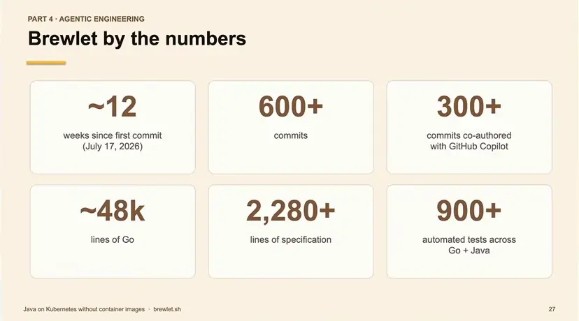
*[▶ 00:48:03](https://www.youtube.com/watch?v=fszyRIZXjQM&t=2883s) · Brewlet by the numbers*

What worked:

- **Spec first:** `SPECIFICATION.md` is the source of truth.
- **Tiered tests as guardrails:** CLI → JVM → runc → kind → Helm → PetClinic.
- **Humans own trust boundaries:** digest checks, path containment.
- **Agents for plumbing:** containerd APIs, CRD boilerplate, Helm templates.

Kind and Docker Desktop caught 70% of issues; real clusters found the rest.

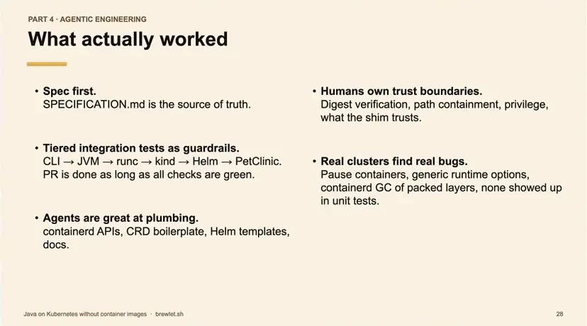
*[▶ 00:48:46](https://www.youtube.com/watch?v=fszyRIZXjQM&t=2926s) · What actually worked*

Brewlet is pre-1.0, JVM-only, and needs privileged node access.

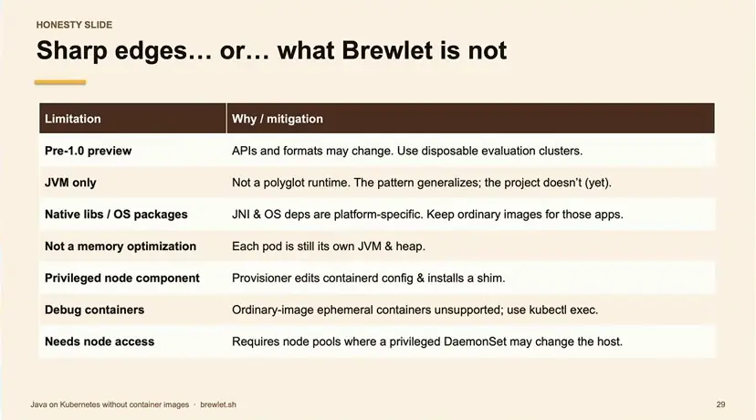
*[▶ 00:49:07](https://www.youtube.com/watch?v=fszyRIZXjQM&t=2947s) · Sharp edges: what Brewlet is not*

The recipe needs a containerd shim, a privileged node provisioner, a RuntimeClass, and CRDs with an admission webhook. Swap JDK for Python or Node.js.

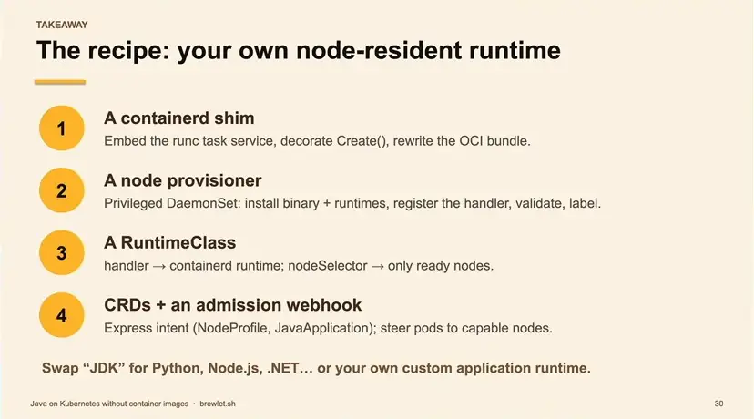
*[▶ 00:49:21](https://www.youtube.com/watch?v=fszyRIZXjQM&t=2961s) · The recipe: your own node-resident runtime*

Spec, tests and agents make custom platforms a one-person project.

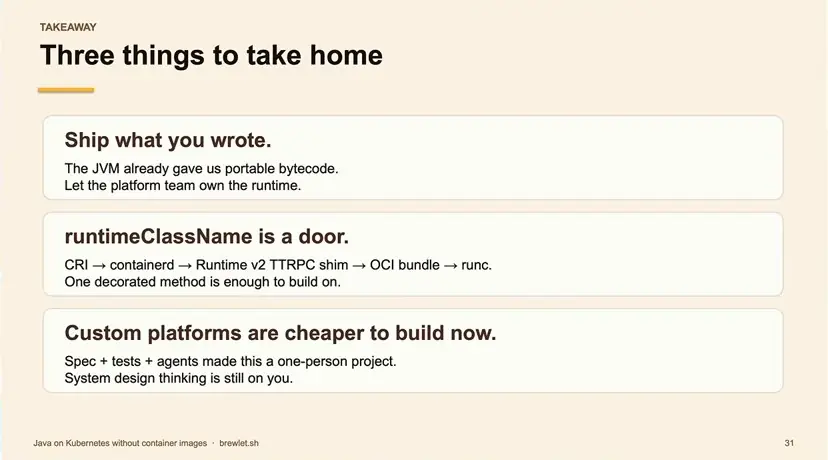
*[▶ 00:50:18](https://www.youtube.com/watch?v=fszyRIZXjQM&t=3018s) · Three things to take home*

Install with the command below. Docs are at [brewlet.sh](https://brewlet.sh); issues and specs are on [GitHub](https://github.com/microsoft/brewlet).

```bash
curl -fsSL https://brewlet.sh/install.sh | sh
```

*[▶ 00:52:21](https://www.youtube.com/watch?v=fszyRIZXjQM&t=3141s) · Try it. Break it. Tell us.*

## Links & resources

- [Brewlet project site: try it, break it, tell us](https://brewlet.sh) — <https://brewlet.sh> · on screen [▶ 00:52:21](https://www.youtube.com/watch?v=fszyRIZXjQM&t=3141s)
- [Brewlet GitHub repository under Microsoft organization](https://github.com/microsoft/brewlet) — <https://github.com/microsoft/brewlet> · on screen [▶ 00:52:21](https://www.youtube.com/watch?v=fszyRIZXjQM&t=3141s)
- ShowMyJVM demo with Quarkus on the speaker's GitHub, URL not shown · mentioned [▶ 00:46:50](https://www.youtube.com/watch?v=fszyRIZXjQM&t=2810s)
