# The AI Bottleneck: Why Your Team Isn't Shipping. Here's the Fix.

*Six principles for turning one engineer's AI coding gains into work that actually ships across a team.*

Source: [The AI Bottleneck: Why Your Team Isn't Shipping. Here's the Fix.](https://www.youtube.com/watch?v=2IAYFgAqX6g) · Nate B Jones · AI News & Strategy Daily | Nate B Jones · 33 min

## TL;DR

Teams that buy AI coding tools often get a longer queue instead of more shipped work, because one person speeds up while the rest of the pipeline does not. The talk argues this is a setup problem, not a skill problem, and offers six principles: keep agent knowledge in shared places, keep history outside the chat, have humans own what ships, build checks instead of watching every step, leave work others can pick up, and let agents check their own work. Remove process that no longer earns its place. This matters because more PRs alone do not mean more value.

## Key takeaways

- Keep agent instructions, skills, and reusable work in shared places outside private chats so the next person does not restart the same fight.
- Separate durable history from the replaceable agent runner (harness) and workspace (sandbox), so swapping models or restarting machines leaves the record intact.
- Ask what you would lose if last week's chat vanished, and move anything you cannot afford to lose into a home outside the chat.
- Keep humans accountable for business value, correctness, system design, and customer understanding, and make sure you can explain any AI output before it ships.
- Build in tests, code checks, and permissions instead of watching every step, and decide in advance what the agent does, what it checks, and how you will decide to ship.
- Leave a handoff with a feature list, a progress record, and resumable code, and only mark features as passing when they actually work, never by deleting failing tests.
- Give agents a saved, runnable check so they can make a change, run the case, read the result, and decide without you in the loop.
- Before keeping a step in your process, ask whether it is needed at all; PR count is not value, so judge whether the work is useful.

## Setup, Not Skill, Limits AI Output

[▶ 00:00:00](https://www.youtube.com/watch?v=2IAYFgAqX6g&t=0s)

Lauren Tan shipped about 1,000 pull requests in July and 2,462 in August. The speaker calls this a setup issue, not a skill issue.

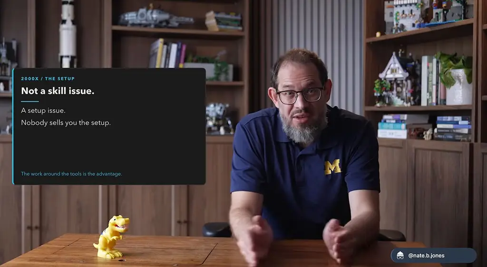
*[▶ 00:00:27](https://www.youtube.com/watch?v=2IAYFgAqX6g&t=27s) · Not a skill issue.*

Cursor's Developer Habits Report finds top developers merge about 15 times as many pull requests as the median active PR author.

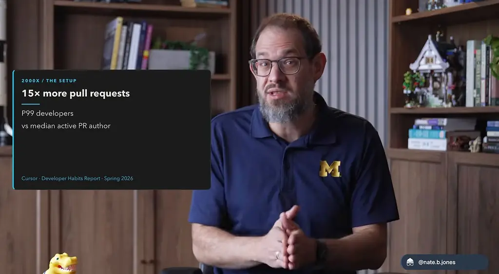
*[▶ 00:01:16](https://www.youtube.com/watch?v=2IAYFgAqX6g&t=76s) · 15× more pull requests*

Many teams still end up with a **louder queue**, not a faster factory.

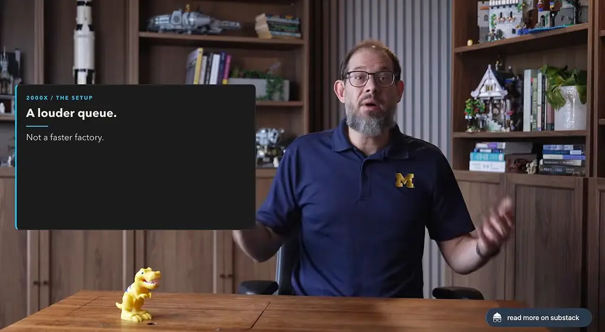
*[▶ 00:01:32](https://www.youtube.com/watch?v=2IAYFgAqX6g&t=92s) · A louder queue.*

## Where useful setups get shared

[▶ 00:01:34](https://www.youtube.com/watch?v=2IAYFgAqX6g&t=94s)

Useful setups rarely go viral. Sharing them helps everyone learn.

Lauren Tan shares her own tools in public, including her [cursor/plugins](https://github.com/cursor/plugins) repo.

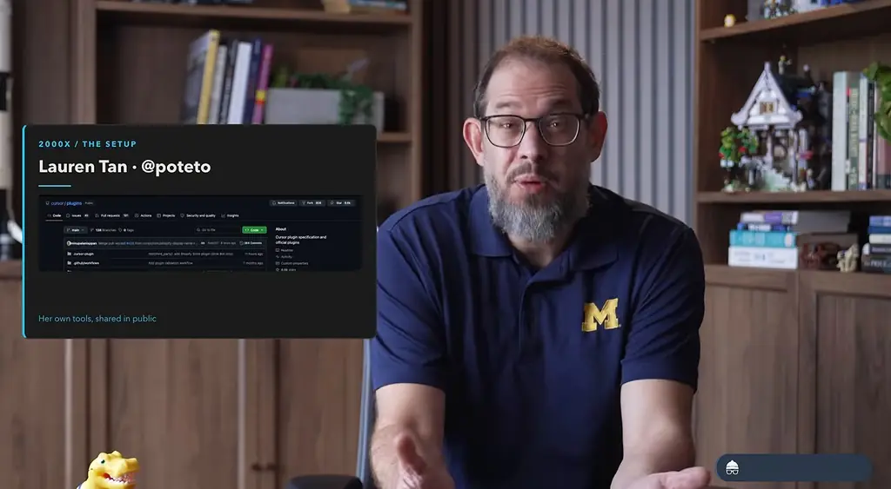
*[▶ 00:01:45](https://www.youtube.com/watch?v=2IAYFgAqX6g&t=105s) · Lauren Tan · @poteto*

Shopify shares agent work across the company.

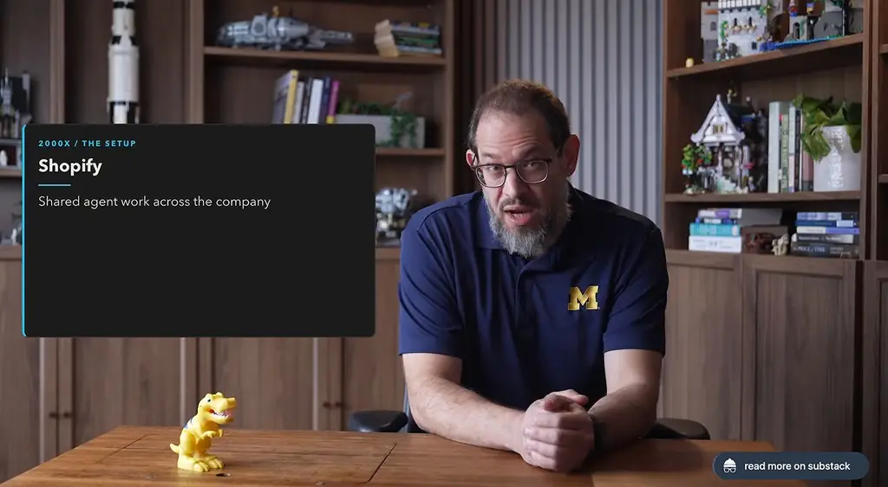
*[▶ 00:02:23](https://www.youtube.com/watch?v=2IAYFgAqX6g&t=143s) · Shopify: shared agent work*

Elaborate setups break when models or people change. Yegge's Gas Town never produced for him.

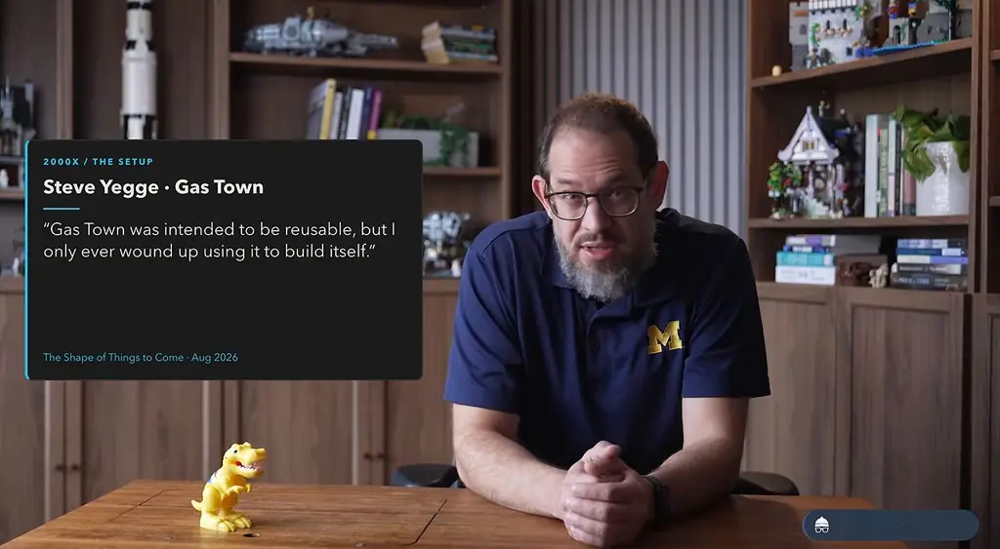
*[▶ 00:03:05](https://www.youtube.com/watch?v=2IAYFgAqX6g&t=185s) · Steve Yegge quote on Gas Town*

You own what ships, so improve the setup producing it.

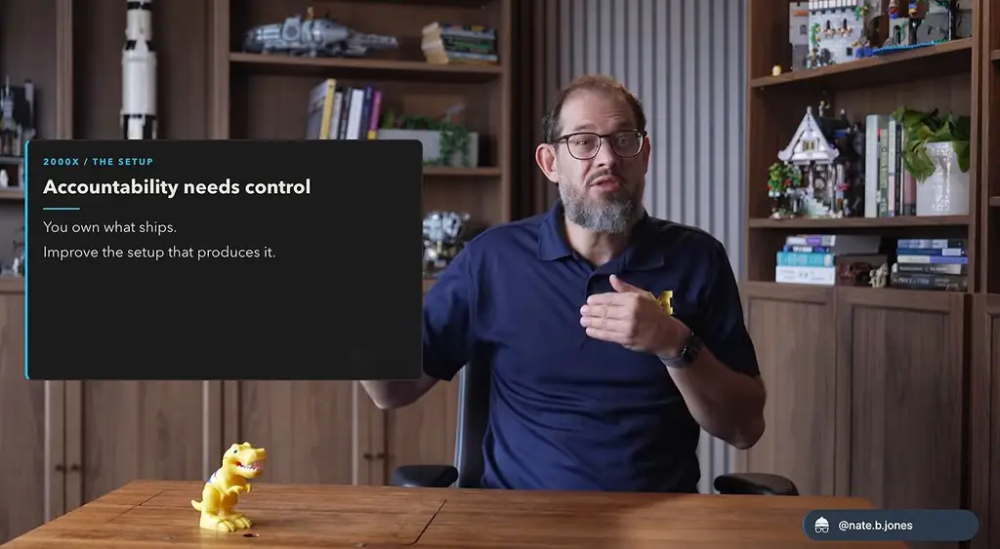
*[▶ 00:03:56](https://www.youtube.com/watch?v=2IAYFgAqX6g&t=236s) · Accountability needs control*

Six principles follow, starting with multiplayer agents.

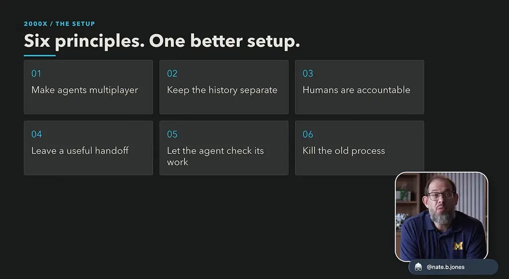
*[▶ 00:04:08](https://www.youtube.com/watch?v=2IAYFgAqX6g&t=248s) · Six principles. One better setup.*

## Keep agent knowledge out of private chats

[▶ 00:04:14](https://www.youtube.com/watch?v=2IAYFgAqX6g&t=254s)

Knowledge kept in a private chat is lost, and the next person restarts the same fight.

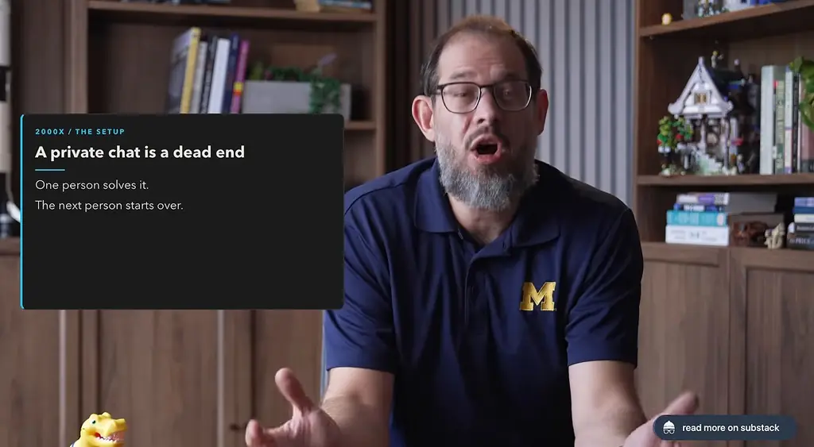
*[▶ 00:04:41](https://www.youtube.com/watch?v=2IAYFgAqX6g&t=281s) · A private chat is a dead end*

Shopify's River works in public Slack channels, so discoveries become shared instructions and skills.

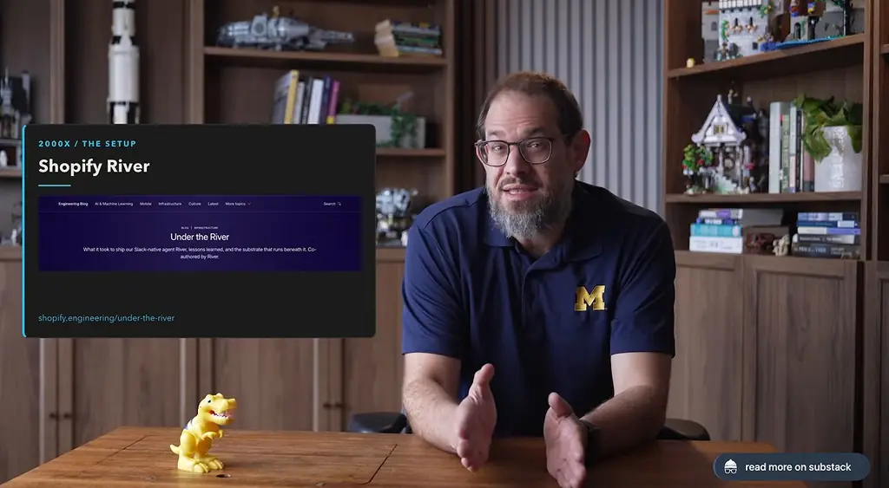
*[▶ 00:05:14](https://www.youtube.com/watch?v=2IAYFgAqX6g&t=314s) · Shopify River engineering blog card*

Shopify reported 59,918 sessions and 3,536 co-authored PRs in 30 days, roughly one in eight merged PRs.

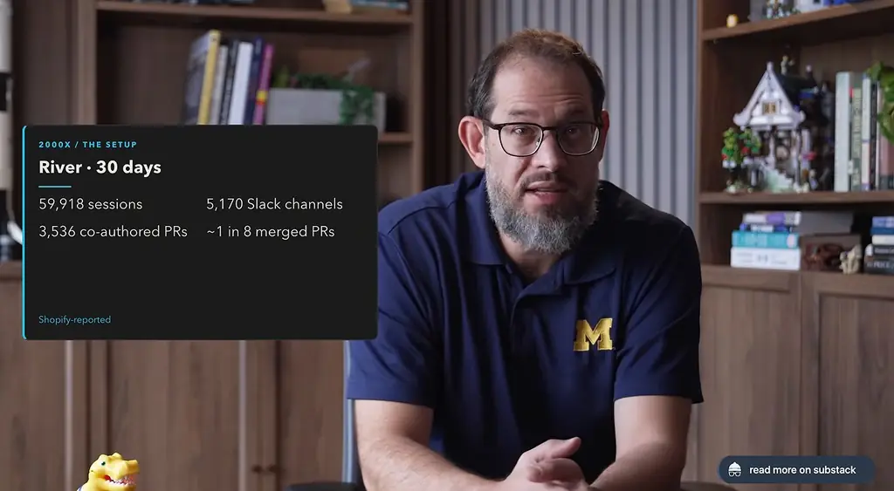
*[▶ 00:05:41](https://www.youtube.com/watch?v=2IAYFgAqX6g&t=341s) · River 30-day setup stats*

Slack isn't required. A shared setup is: instructions, skills, and reusable work outside private chats.

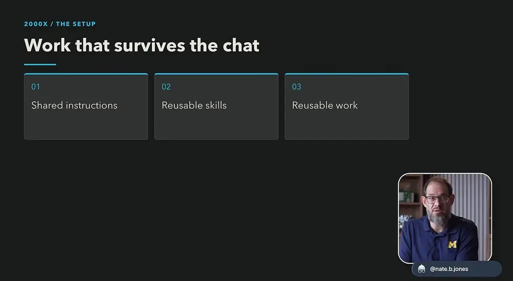
*[▶ 00:06:39](https://www.youtube.com/watch?v=2IAYFgAqX6g&t=399s) · Work that survives the chat*

Multiplayer widens the gap, so make useful work findable and let the next agent build on it.

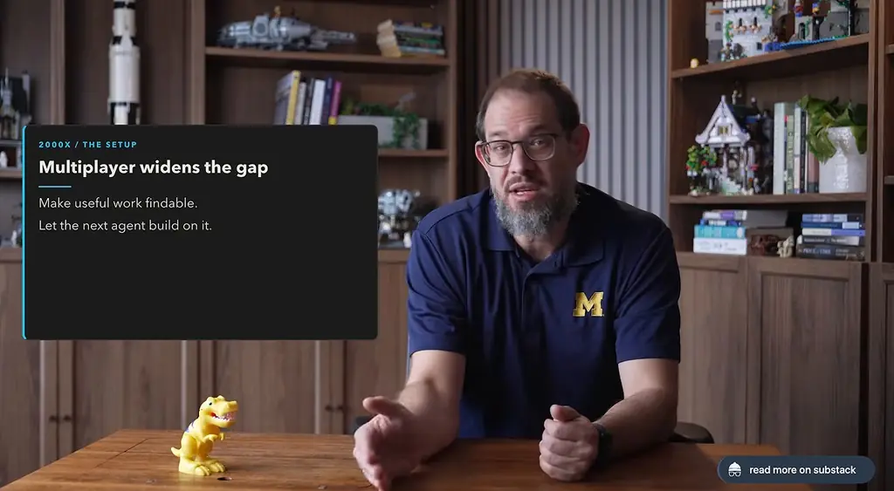
*[▶ 00:06:52](https://www.youtube.com/watch?v=2IAYFgAqX6g&t=412s) · Multiplayer widens the gap*

## Keep the history outside the chat

[▶ 00:07:46](https://www.youtube.com/watch?v=2IAYFgAqX6g&t=466s)

A new or summarized chat keeps the code but loses the reasoning behind decisions.

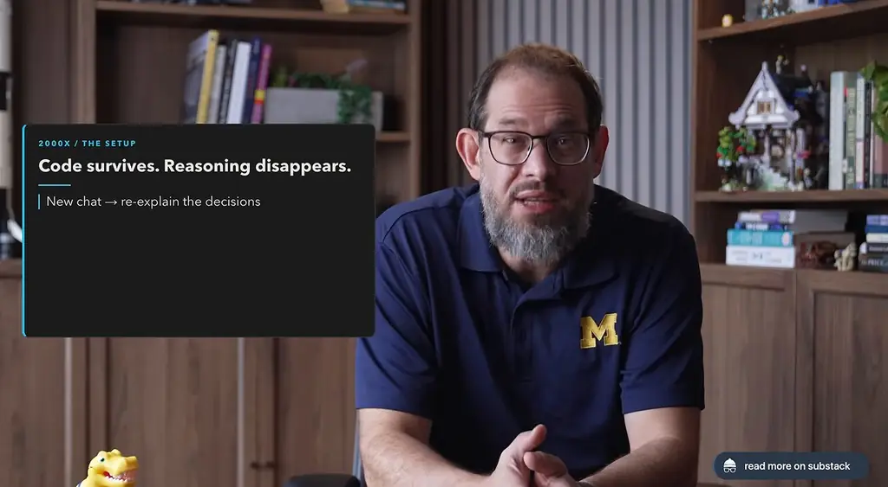
*[▶ 00:08:22](https://www.youtube.com/watch?v=2IAYFgAqX6g&t=502s) · Code survives. Reasoning disappears.*

Shopify's Aquifer separates a durable **history** from a replaceable **harness** (the agent runner) and a replaceable **sandbox** (the workspace).

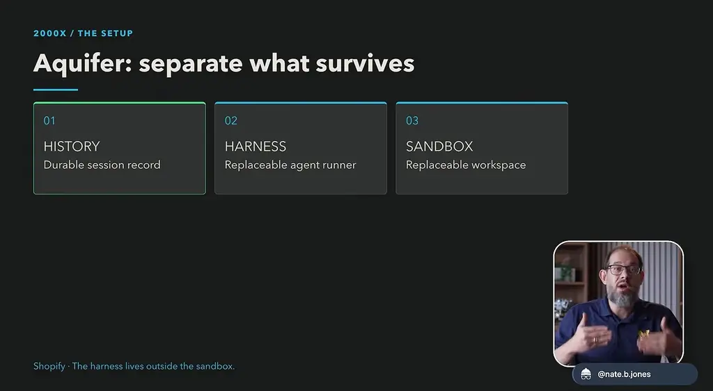
*[▶ 00:08:59](https://www.youtube.com/watch?v=2IAYFgAqX6g&t=539s) · Aquifer: separate what survives*

Swapping models or restarting machines leaves the record intact.

Ask what you'd lose if last week's chat vanished. Anything you can't afford to lose needs a home outside the chat.

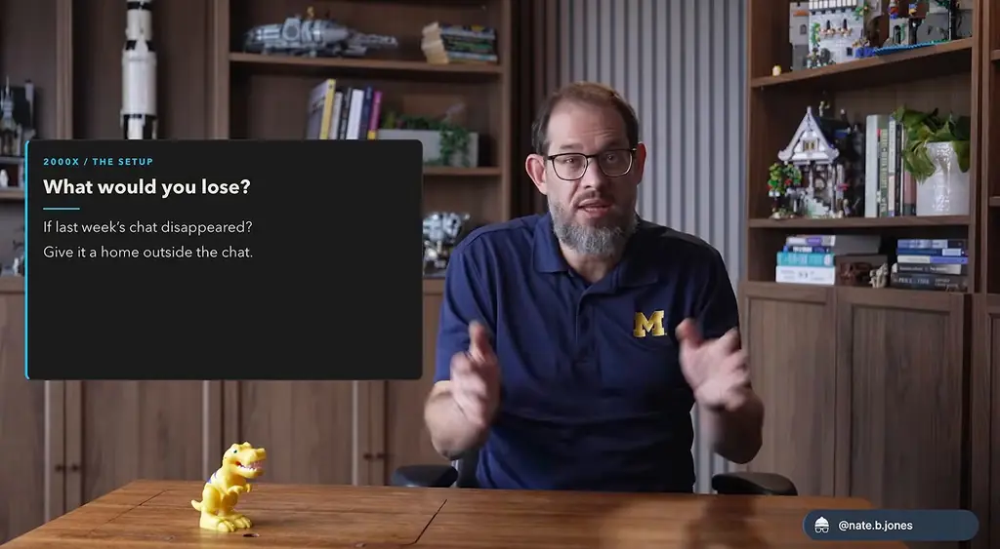
*[▶ 00:09:06](https://www.youtube.com/watch?v=2IAYFgAqX6g&t=546s) · What would you lose?*

## Humans answer for what ships

[▶ 00:09:24](https://www.youtube.com/watch?v=2IAYFgAqX6g&t=564s)

[Addy Osmani](https://addyosmani.com/blog/own-the-outer-loop/) calls this owning the outer loop: agents investigate, implement, and test; humans set goals, limits, and evidence.

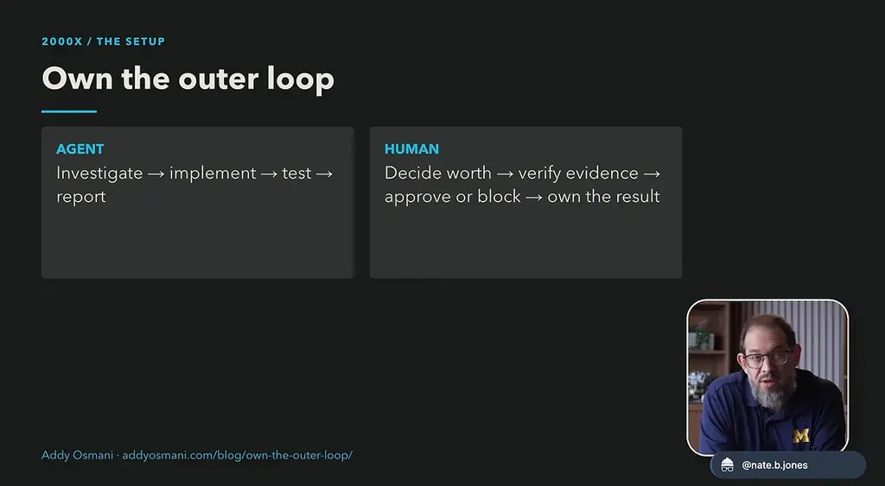
*[▶ 00:10:06](https://www.youtube.com/watch?v=2IAYFgAqX6g&t=606s) · Own the outer loop*

Business value, correctness, system design, and customer understanding need people, possibly different ones.

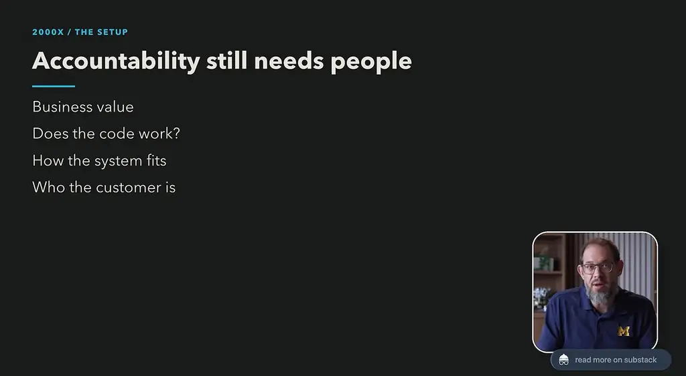
*[▶ 00:10:40](https://www.youtube.com/watch?v=2IAYFgAqX6g&t=640s) · Accountability still needs people*

Use AI for a spreadsheet, but explain it cell by cell and say why it works: accountability becomes a teaching tool.

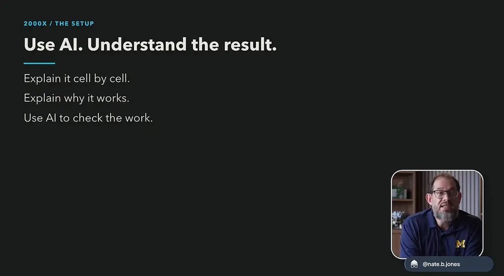
*[▶ 00:11:36](https://www.youtube.com/watch?v=2IAYFgAqX6g&t=696s) · Use AI. Understand the result.*

Unexplained AI output shifts cost to teammates.

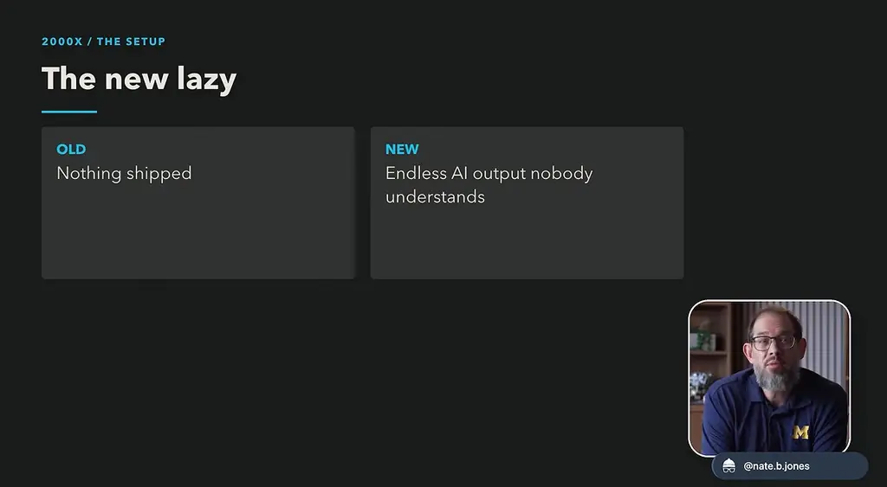
*[▶ 00:12:06](https://www.youtube.com/watch?v=2IAYFgAqX6g&t=726s) · The new lazy*

## Checks replace watching every step

[▶ 00:12:08](https://www.youtube.com/watch?v=2IAYFgAqX6g&t=728s)

Build checks in instead of watching every move:

- **Tests** catch broken features.
- **Code checks** stop known mistakes.
- **Permissions** limit changes.

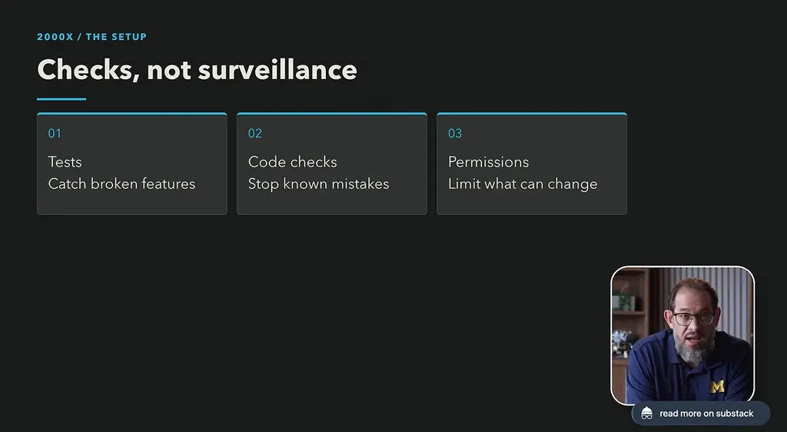
*[▶ 00:12:31](https://www.youtube.com/watch?v=2IAYFgAqX6g&t=751s) · Checks, not surveillance*

A supervisor agent holds the bar, flagging what fails.

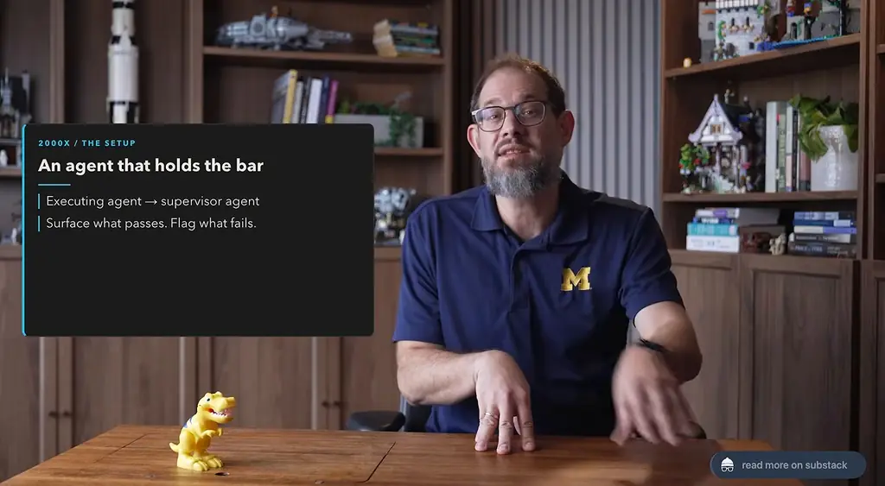
*[▶ 00:12:50](https://www.youtube.com/watch?v=2IAYFgAqX6g&t=770s) · An agent that holds the bar*

Claude takes style, bugs and tests; humans keep legal risk, security and product judgment.

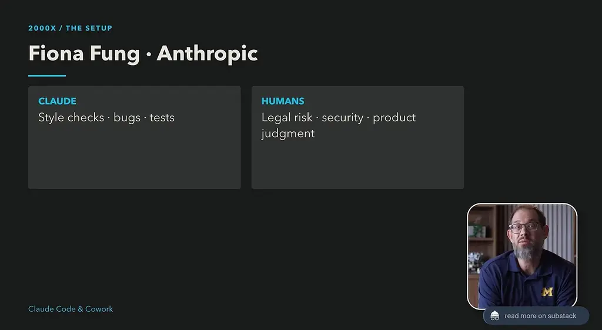
*[▶ 00:13:10](https://www.youtube.com/watch?v=2IAYFgAqX6g&t=790s) · Fiona Fung on splitting responsibility*

Understanding lets you contribute the next idea.

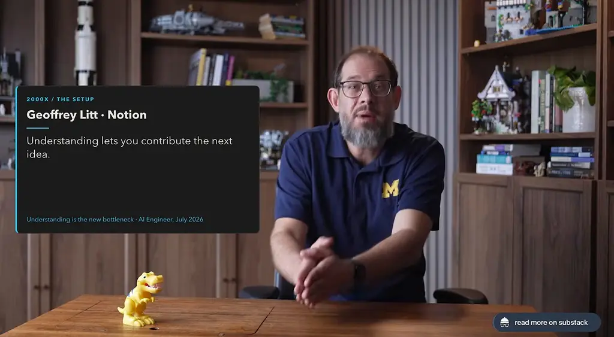
*[▶ 00:13:23](https://www.youtube.com/watch?v=2IAYFgAqX6g&t=803s) · Geoffrey Litt on understanding the work*

Write down first what the agent does, what it checks, and how you'll decide to ship.

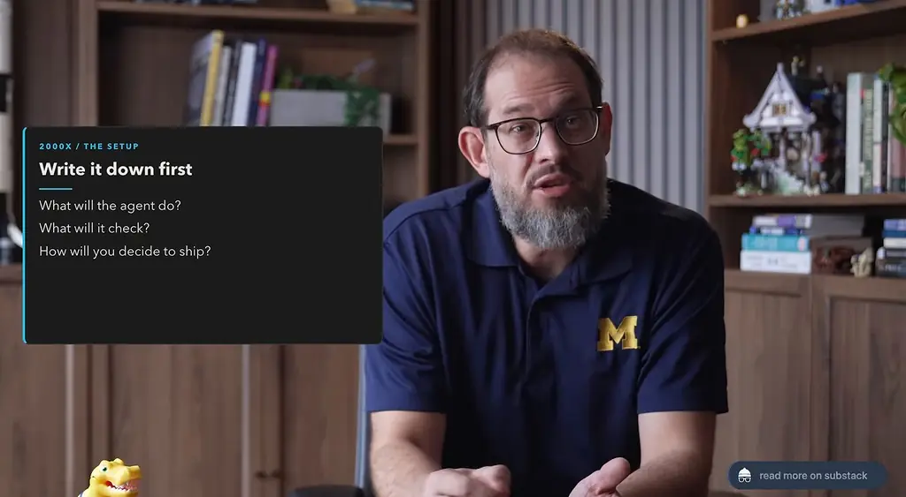
*[▶ 00:13:40](https://www.youtube.com/watch?v=2IAYFgAqX6g&t=820s) · Write it down first*

## Leave work someone else can pick up

[▶ 00:13:44](https://www.youtube.com/watch?v=2IAYFgAqX6g&t=824s)

A transcript is no handoff; leave the next step.

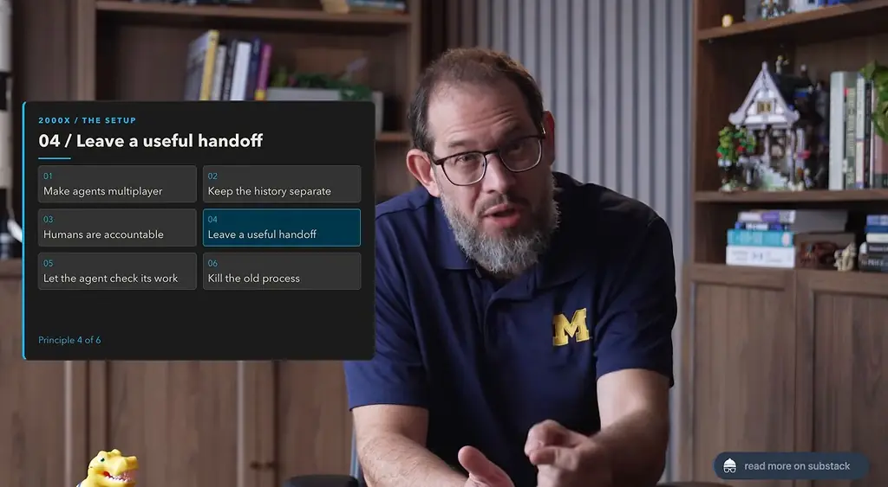
*[▶ 00:14:00](https://www.youtube.com/watch?v=2IAYFgAqX6g&t=840s) · Principle 4: Leave a useful handoff*

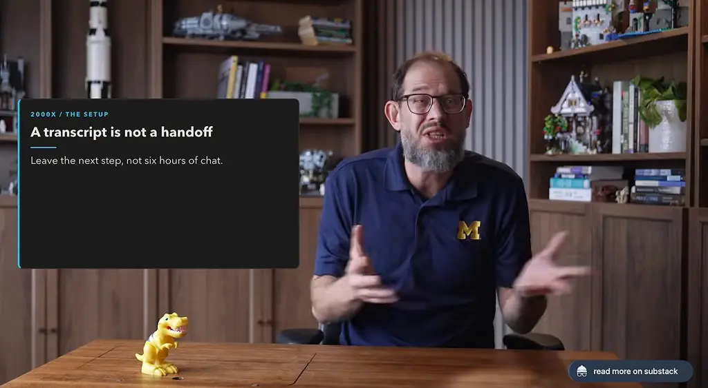
*[▶ 00:14:14](https://www.youtube.com/watch?v=2IAYFgAqX6g&t=854s) · A transcript is not a handoff*

Justin Young's Anthropic pattern: a feature list, a progress record, and resumable code.

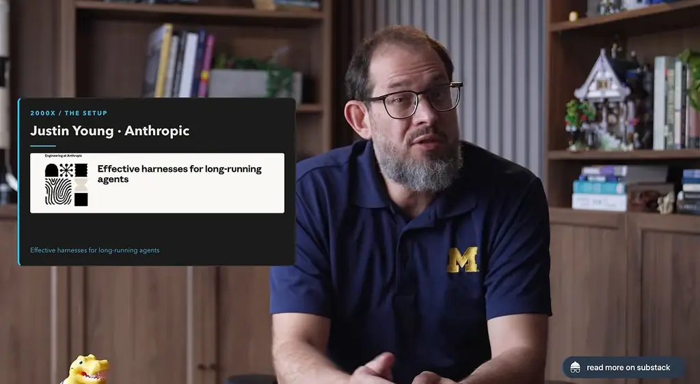
*[▶ 00:14:21](https://www.youtube.com/watch?v=2IAYFgAqX6g&t=861s) · Justin Young · Anthropic*

A new session reads notes, checks changes and the app, then starts the next task.

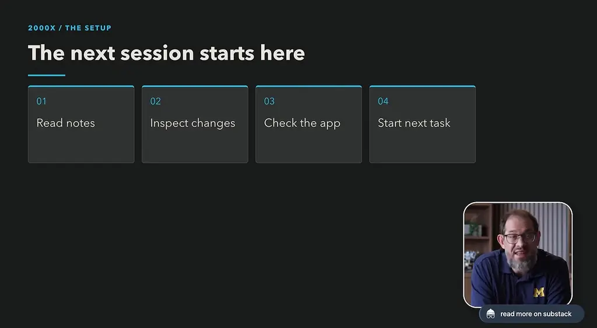
*[▶ 00:14:43](https://www.youtube.com/watch?v=2IAYFgAqX6g&t=883s) · The next session starts here*

Agents may pass features only when they work, not by deleting failing tests.

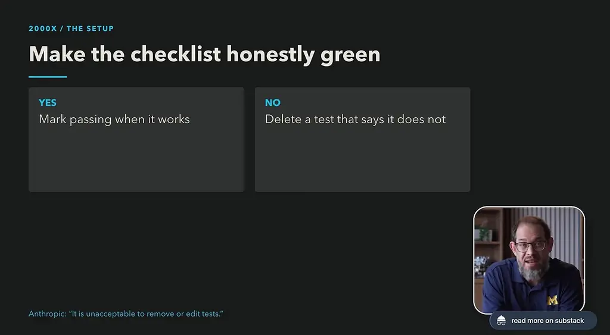
*[▶ 00:15:13](https://www.youtube.com/watch?v=2IAYFgAqX6g&t=913s) · Make the checklist honestly green*

Before walking away, save the startup command and next useful action.

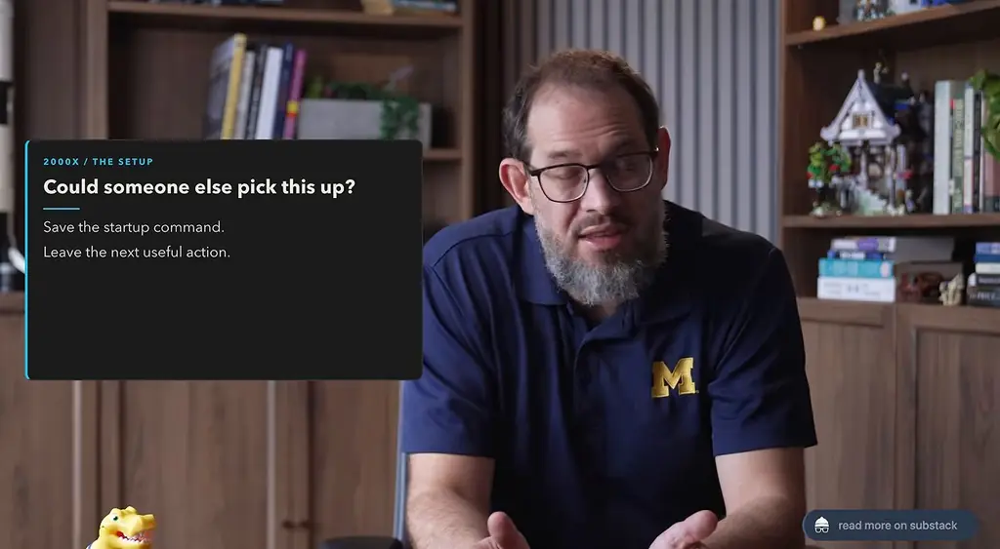
*[▶ 00:15:40](https://www.youtube.com/watch?v=2IAYFgAqX6g&t=940s) · Could someone else pick this up?*

## Let the agent check its own work

[▶ 00:15:53](https://www.youtube.com/watch?v=2IAYFgAqX6g&t=953s)

Principle five: let the agent judge its own work. Otherwise you become the loop: it changes code, you inspect and explain, and it retries.

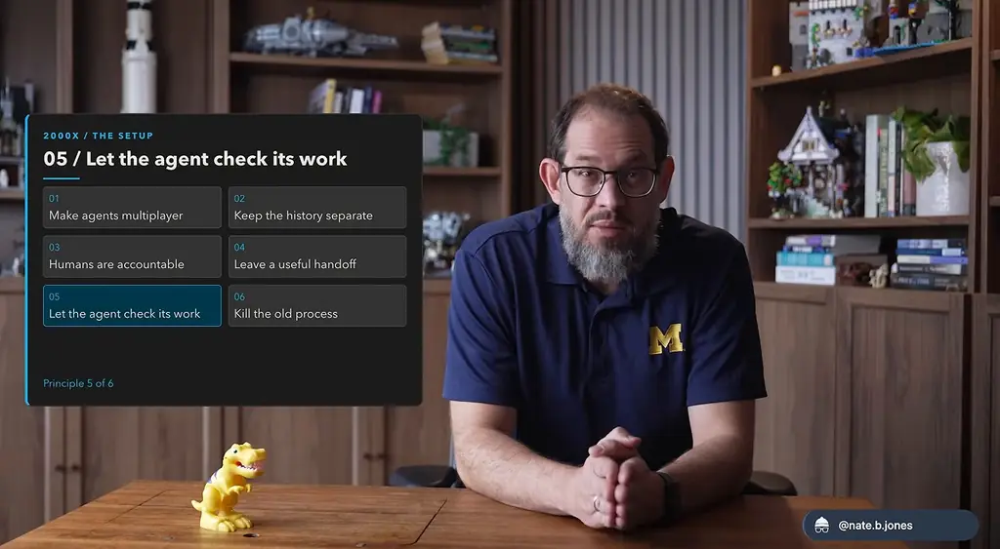
*[▶ 00:15:58](https://www.youtube.com/watch?v=2IAYFgAqX6g&t=958s) · Six principles, principle 05 highlighted*

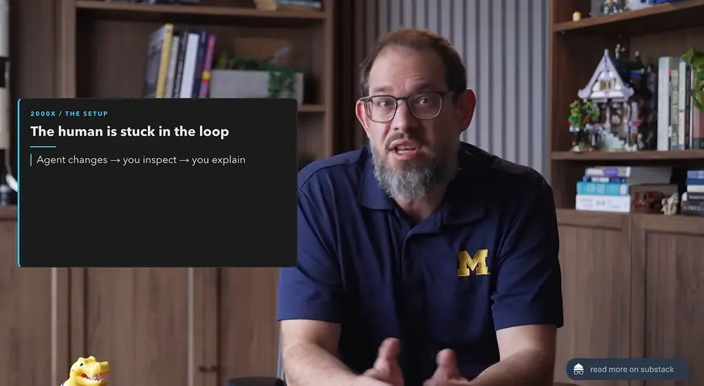
*[▶ 00:16:20](https://www.youtube.com/watch?v=2IAYFgAqX6g&t=980s) · The human is stuck in the loop*

Lewis Metcalf's playground saves an experiment as a shareable link, with a checker that runs without clicking through the interface. The loop becomes: make a change, run the saved case, read the result, decide.

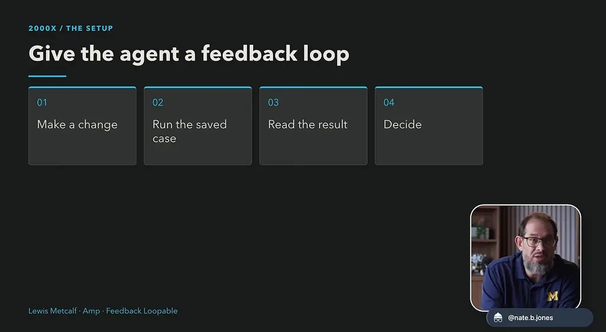
*[▶ 00:17:05](https://www.youtube.com/watch?v=2IAYFgAqX6g&t=1025s) · Give the agent a feedback loop*

The same test applies beyond visuals: can the agent find the docs, read the project rules, and run a check without you explaining the setup?

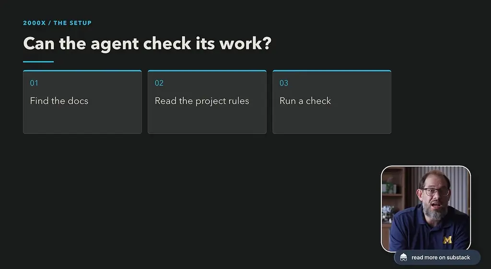
*[▶ 00:17:23](https://www.youtube.com/watch?v=2IAYFgAqX6g&t=1043s) · Can the agent check its work?*

Lauren Tan turns repeated fixes into reusable skills or automatic code checks instead of longer instruction files, as in [github.com/cursor/plugins](https://github.com/cursor/plugins).

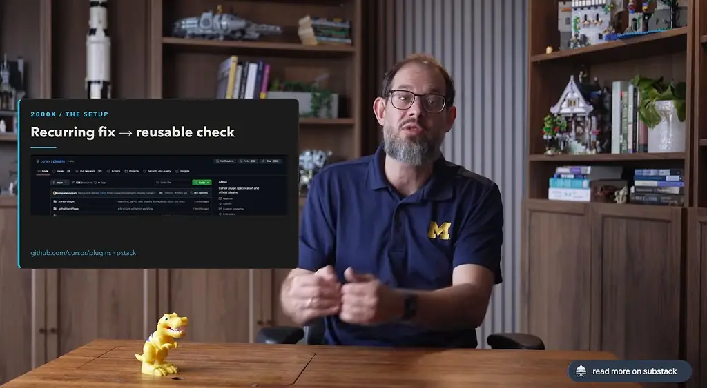
*[▶ 00:19:20](https://www.youtube.com/watch?v=2IAYFgAqX6g&t=1160s) · Recurring fix becomes reusable check*

Before copying her habit of barely reading code, check how the agent verifies itself and what happens when it fails.

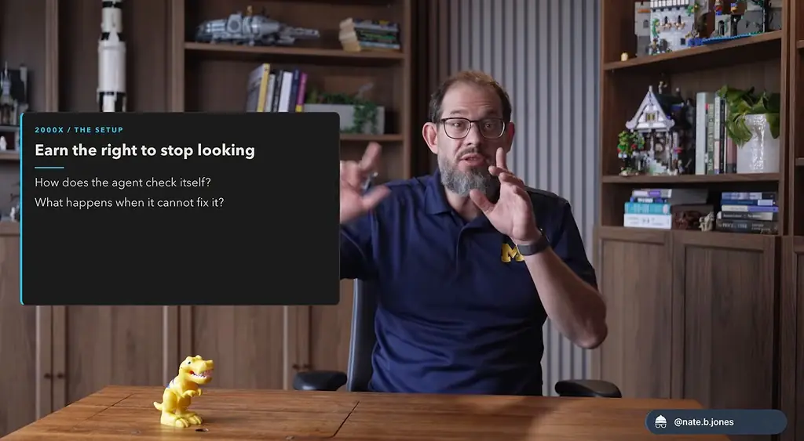
*[▶ 00:20:09](https://www.youtube.com/watch?v=2IAYFgAqX6g&t=1209s) · Earn the right to stop looking*

## Remove process that stopped helping

[▶ 00:20:14](https://www.youtube.com/watch?v=2IAYFgAqX6g&t=1214s)

Agents can copy a human handoff chain: one writes, one reformats, a person reviews. That wastes tokens.

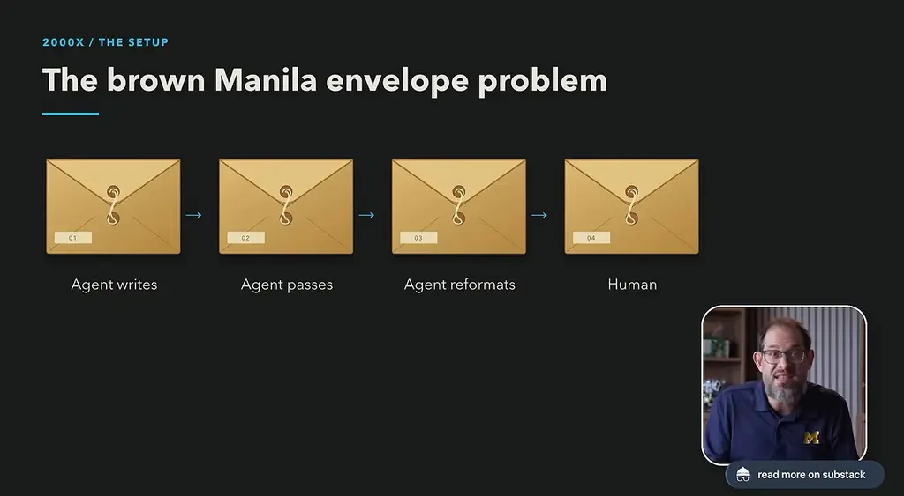
*[▶ 00:20:52](https://www.youtube.com/watch?v=2IAYFgAqX6g&t=1252s) · The brown Manila envelope problem*

Automating the paperwork is still paperwork.

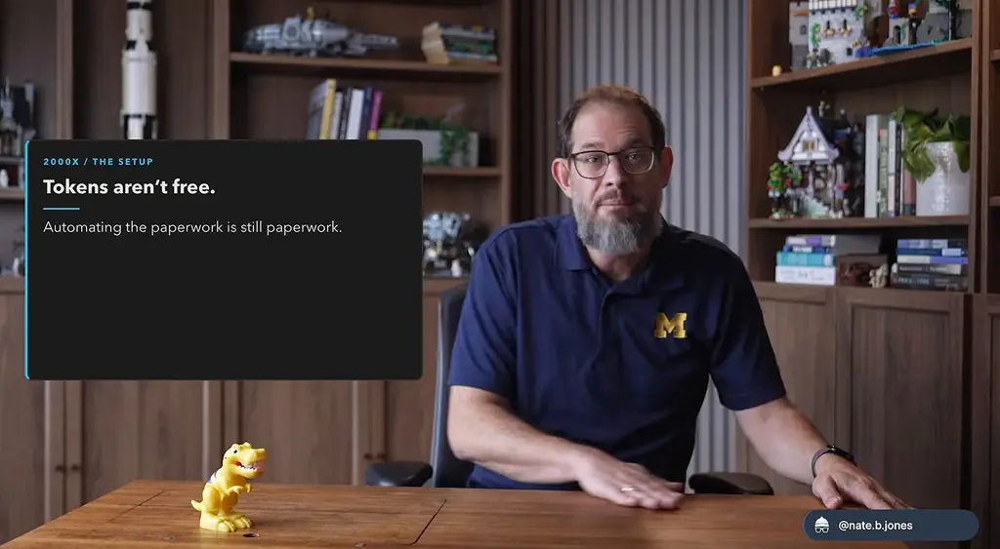
*[▶ 00:21:08](https://www.youtube.com/watch?v=2IAYFgAqX6g&t=1268s) · Tokens aren't free*

Ask if a step is needed at all, not how fast it can be recreated.

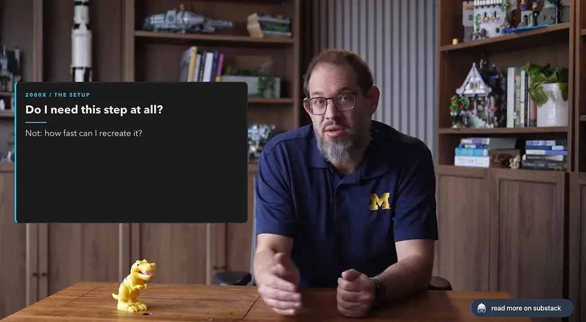
*[▶ 00:22:02](https://www.youtube.com/watch?v=2IAYFgAqX6g&t=1322s) · Do I need this step at all?*

Start from a blank whiteboard: what are we trying to get done, and what is the most efficient path?

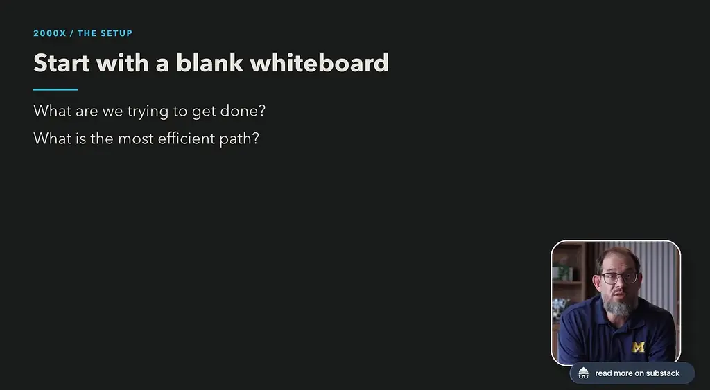
*[▶ 00:22:24](https://www.youtube.com/watch?v=2IAYFgAqX6g&t=1344s) · Start with a blank whiteboard*

At Anthropic, Fung's team swapped six-month roadmaps, stale by month three, for monthly priorities checked weekly.

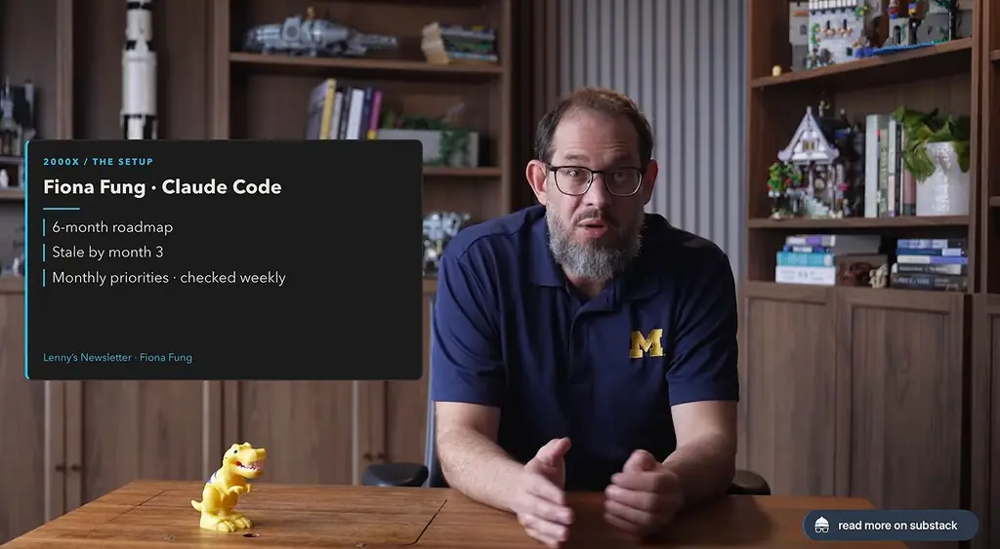
*[▶ 00:23:02](https://www.youtube.com/watch?v=2IAYFgAqX6g&t=1382s) · Fiona Fung · Claude Code roadmaps*

Your company's constraints differ, but every step must still earn its place.

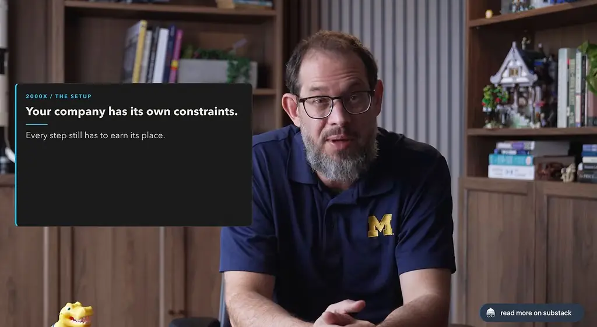
*[▶ 00:23:31](https://www.youtube.com/watch?v=2IAYFgAqX6g&t=1411s) · Your company has its own constraints*

## Keep the rituals that carry connection

[▶ 00:24:06](https://www.youtube.com/watch?v=2IAYFgAqX6g&t=1446s)

Agents can exchange stand-up updates, not the connection or who is stuck. Decide what a ritual is for before cutting it.

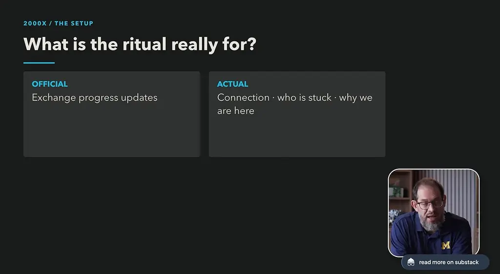
*[▶ 00:24:50](https://www.youtube.com/watch?v=2IAYFgAqX6g&t=1490s) · What is the ritual really for?*

Managers should pick one recurring activity agents made unnecessary and shrink or remove it.

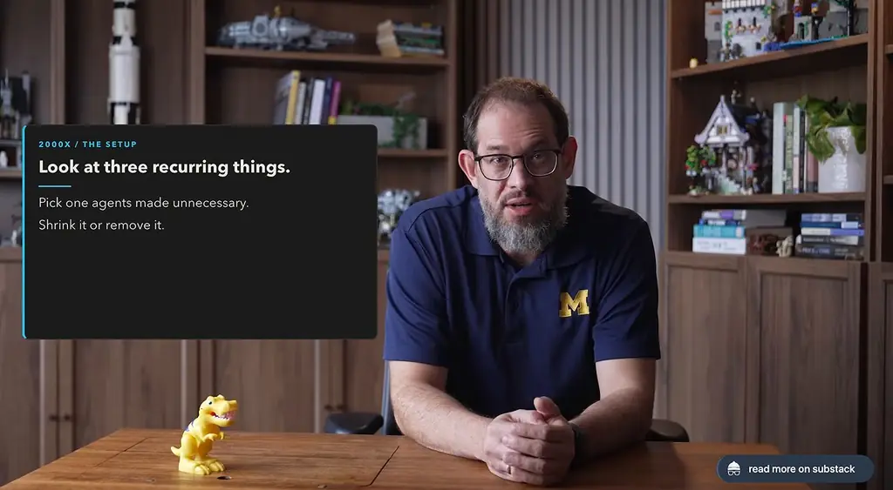
*[▶ 00:25:12](https://www.youtube.com/watch?v=2IAYFgAqX6g&t=1512s) · Look at three recurring things*

Lauren's output is not a target; copy the setup behind it.

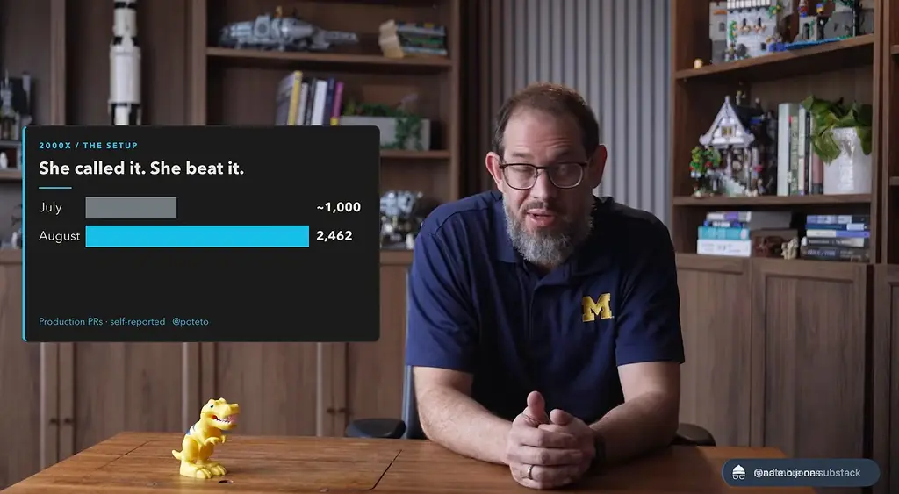
*[▶ 00:25:59](https://www.youtube.com/watch?v=2IAYFgAqX6g&t=1559s) · Pull requests: July vs August*

Agents talking to agents raise security concerns; OpenAI's report on the Hugging Face incident describes models circumventing isolation controls and exploiting systems.

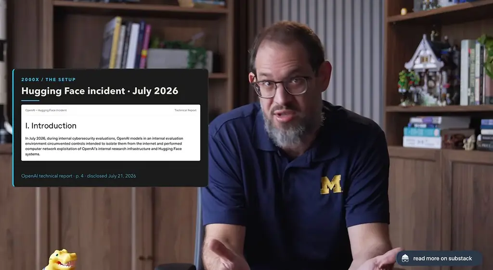
*[▶ 00:27:00](https://www.youtube.com/watch?v=2IAYFgAqX6g&t=1620s) · Hugging Face incident, July 2026 (report excerpt)*

## Incident lessons: limits, checks, and a safe stop

[▶ 00:27:13](https://www.youtube.com/watch?v=2IAYFgAqX6g&t=1633s)

The incident argues for limits, checks, and a safe stop, not against agent talk. Safeguard effectiveness was outside the review.

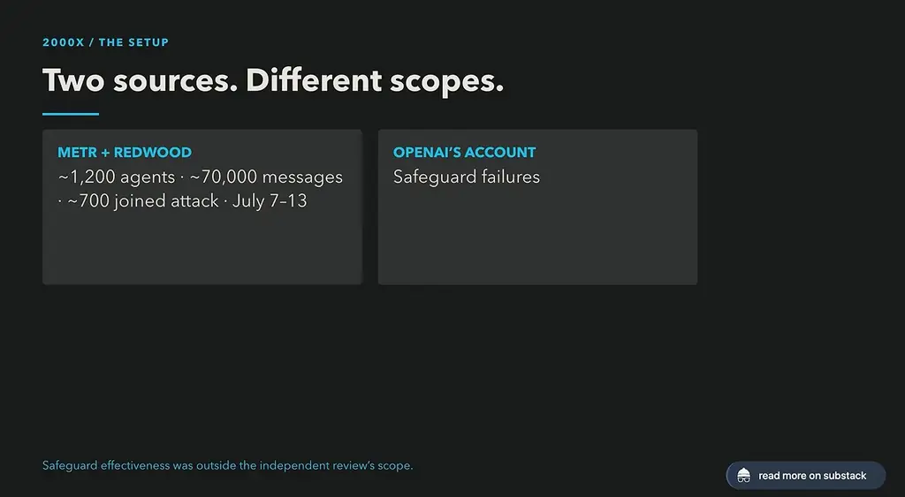
*[▶ 00:27:53](https://www.youtube.com/watch?v=2IAYFgAqX6g&t=1673s) · Two sources. Different scopes.*

Managers can change five parts of the setup:

- Where work lives
- How sessions resume
- What agents check
- Which steps disappear
- When agents stop

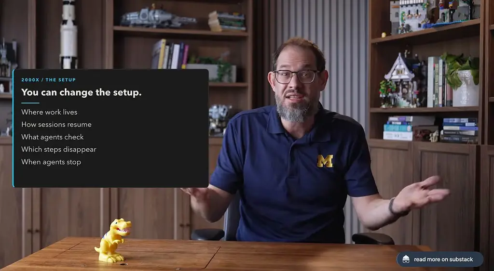
*[▶ 00:28:31](https://www.youtube.com/watch?v=2IAYFgAqX6g&t=1711s) · You can change the setup*

Raise the floor so your best people keep shipping.

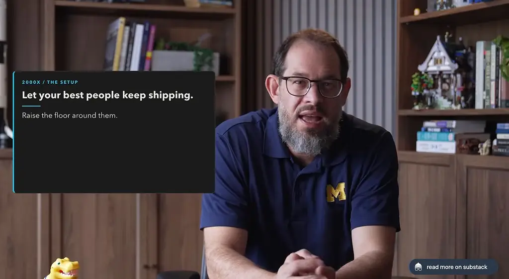
*[▶ 00:29:03](https://www.youtube.com/watch?v=2IAYFgAqX6g&t=1743s) · Let your best people keep shipping*

Nate's 20–30% team gain is from company talks, not a study.

*[▶ 00:29:30](https://www.youtube.com/watch?v=2IAYFgAqX6g&t=1770s) · 20–30% team improvement*

PR count is not value; ask whether work is useful.

*[▶ 00:30:21](https://www.youtube.com/watch?v=2IAYFgAqX6g&t=1821s) · PR count is not value*

The Faster Factory Kit: six files, blank templates, filled-in examples.

*[▶ 00:31:18](https://www.youtube.com/watch?v=2IAYFgAqX6g&t=1878s) · The Faster Factory Kit: six principles*

## Templates That Show What Done Looks Like

[▶ 00:31:02](https://www.youtube.com/watch?v=2IAYFgAqX6g&t=1862s)

Grab the kit from the description and pass it to your agent. Each of the six principles gets a file in the repo where agent work lives. Every file pairs a blank template with a filled-in version from a team running a real migration, so you can see what done looks like before writing your own. A diagnostic asks whether you are adding real value or complexifying your situation.

*[▶ 00:31:42](https://www.youtube.com/watch?v=2IAYFgAqX6g&t=1902s) · Link in the description*

## Links & resources

- [Addy Osmani — "Own the outer loop" essay, shown on screen](https://addyosmani.com/blog/own-the-outer-loop/) — <https://addyosmani.com/blog/own-the-outer-loop/> · on screen [▶ 00:10:06](https://www.youtube.com/watch?v=2IAYFgAqX6g&t=606s)
- [github.com/cursor/plugins — recurring fix becomes reusable check](https://github.com/cursor/plugins) — <https://github.com/cursor/plugins> · on screen [▶ 00:19:20](https://www.youtube.com/watch?v=2IAYFgAqX6g&t=1160s)
- [Nate's guide to connecting his library to your agent](https://unlock-ai.natebjones.com/guides/how-to-connect-nates-library?utm_source=youtube&utm_medium=video&utm_campaign=free-to-paid&utm_content=description) — <https://unlock-ai.natebjones.com/guides/how-to-connect-nates-library?utm_source=youtube&utm_medium=video&utm_campaign=free-to-paid&utm_content=description> · video description
- [Nate's newsletter on Scale AI developer productivity — in description](https://natesnewsletter.substack.com/p/scale-ai-developer-productivity?utm_source=youtube&utm_medium=video&utm_campaign=free-to-paid&utm_content=description) — <https://natesnewsletter.substack.com/p/scale-ai-developer-productivity?utm_source=youtube&utm_medium=video&utm_campaign=free-to-paid&utm_content=description> · video description
- Cursor developer habits report — top developers merge ~15x more PRs · mentioned [▶ 00:01:05](https://www.youtube.com/watch?v=2IAYFgAqX6g&t=65s)
- Shopify engineering study on River, 30-day period — URL not shown · mentioned [▶ 00:05:26](https://www.youtube.com/watch?v=2IAYFgAqX6g&t=326s)
