# The end of the app era: What comes next?

*How agents change software buying, which parts of your stack still earn their price, and what to do about it at work.*

Source: [The end of the app era: What comes next?](https://www.youtube.com/watch?v=0j8wy4jUlsw) · AI News & Strategy Daily | Nate B Jones · 36 min

## TL;DR

Agents are changing how companies buy and sell software, so the value of an app shifts away from its screen. Old tools get easier to leave, trained agents get harder to replace, and switching vendors costs more. The talk argues that the fight over this plays out in 2027, and that buyers and sellers should map where their data, applications, and agent workflows sit before any switch. Teams should also share how they actually use AI, since private personal tricks make a workflow fragile.

## Key takeaways

- Ask whether you open a piece of software yourself, outside an agent, for information you can't get elsewhere and to do work correctly; that is direct use and the part that still earns its price.
- Most SaaS bundles finding, arranging, acting, and storing together, so an agent improving one slice exposes the whole subscription.
- An agent that learns how a recruiter screens candidates, what managers want, and who was hired becomes hard to replace, because it absorbs your unwritten process.
- Being reachable by agents is table stakes; it does not by itself justify a customer continuing to pay, which is why vendors must show lasting value beyond the interface.
- Sell optionality, not lock-in: buyers fear lock-in, so vendors should offer multiple models, data access, and engineering support.
- Keep the data and build the workflow yourself where possible: a two-person recruiting firm built a Claude skill on a provider's APIs instead of buying a packaged tool, with skills giving instructions and APIs supplying data or actions.
- Map your work across three layers (data, application, and agentic) and ask whether the data layer is sorted, whether the application layer makes sense, and whether the agentic layer gives flexibility.
- Before any vendor switch, talk with your manager and share how your team uses AI, so the cost of changing a workflow is visible rather than hidden in personal habits.

## Agents Take Over Software's Work

[▶ 00:00:00](https://www.youtube.com/watch?v=0j8wy4jUlsw&t=0s)

DoorDash previews it: message an agent, get results.

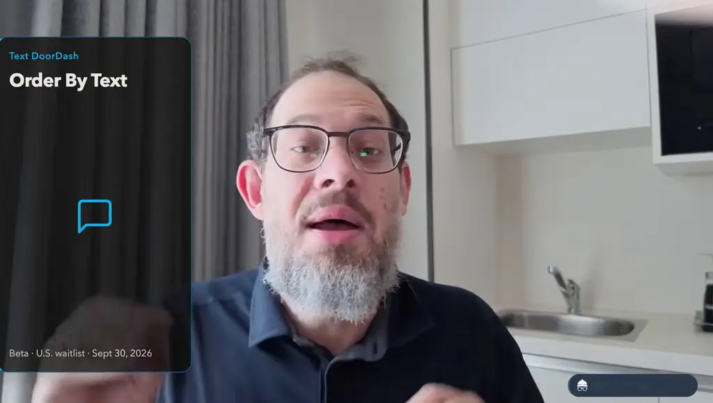
*[▶ 00:00:15](https://www.youtube.com/watch?v=0j8wy4jUlsw&t=15s) · DoorDash Order By Text card*

An agent reads the contract, then writes the kickoff plan.

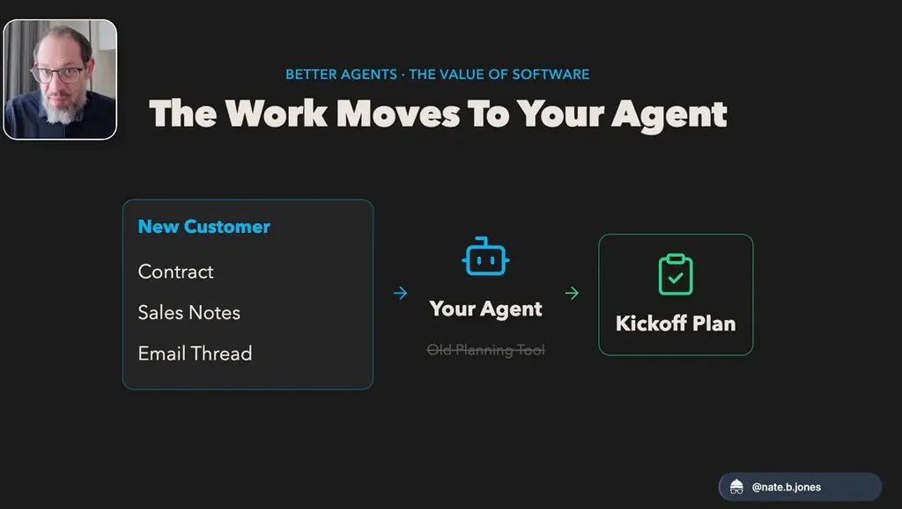
*[▶ 00:00:49](https://www.youtube.com/watch?v=0j8wy4jUlsw&t=49s) · The Work Moves To Your Agent*

Records holders still get paid.

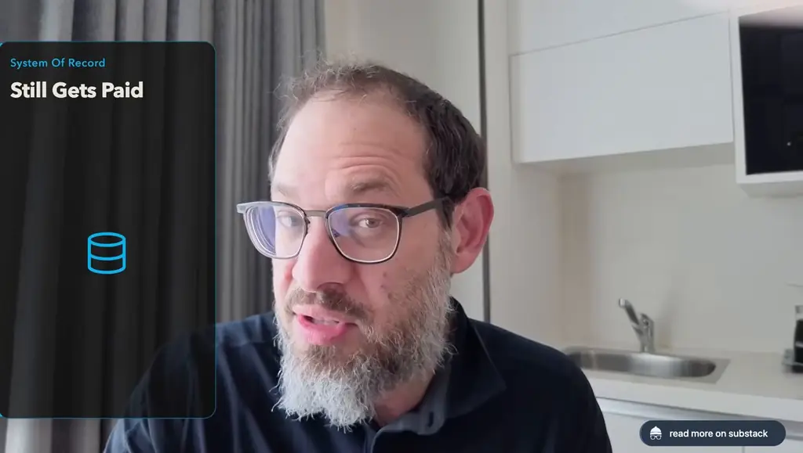
*[▶ 00:00:54](https://www.youtube.com/watch?v=0j8wy4jUlsw&t=54s) · System Of Record: Still Gets Paid*

Agents learn unwritten rules, like pre-kickoff security approval.

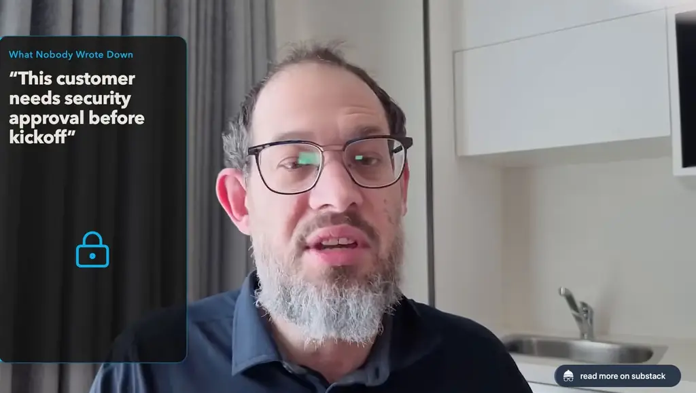
*[▶ 00:01:03](https://www.youtube.com/watch?v=0j8wy4jUlsw&t=63s) · What Nobody Wrote Down*

Three things at once:

- Old tools get easier to leave.
- Trained agents get harder to replace.
- Switching vendors costs more.

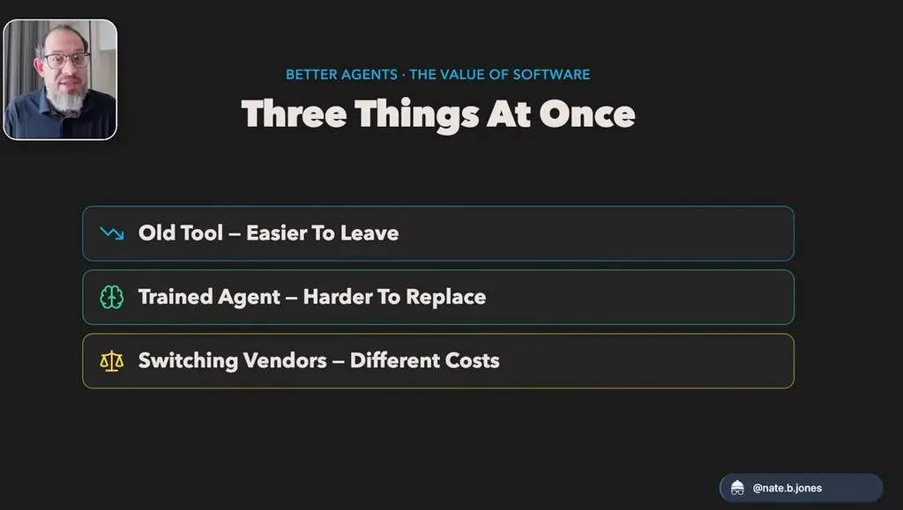
*[▶ 00:01:49](https://www.youtube.com/watch?v=0j8wy4jUlsw&t=109s) · Three Things At Once*

The fight hits teams in 2027.

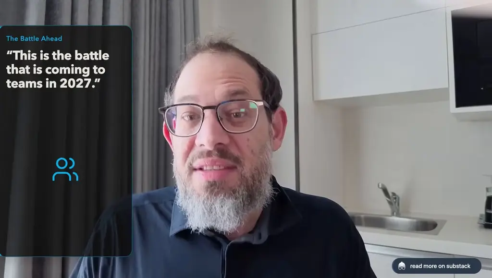
*[▶ 00:01:53](https://www.youtube.com/watch?v=0j8wy4jUlsw&t=113s) · The Battle Ahead*

## A recruiter's agent becomes hard to leave

[▶ 00:02:01](https://www.youtube.com/watch?v=0j8wy4jUlsw&t=121s)

Before agents, a recruiter moved candidates through a recruiting tool, a spreadsheet, and a short list for the hiring manager.

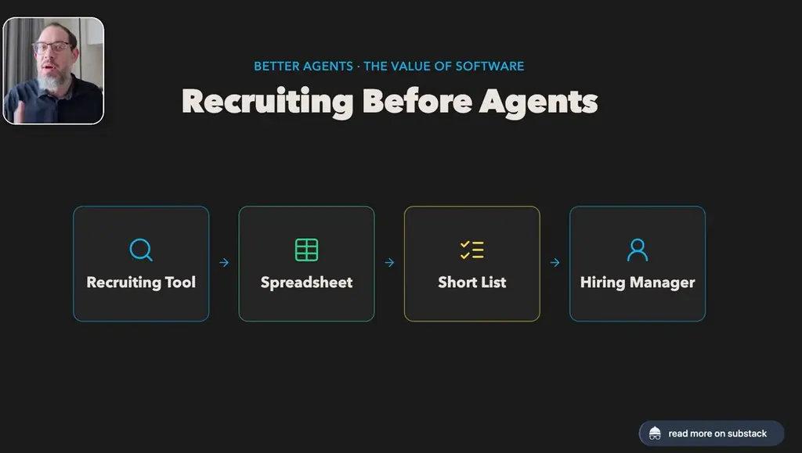
*[▶ 00:02:12](https://www.youtube.com/watch?v=0j8wy4jUlsw&t=132s) · Recruiting Before Agents*

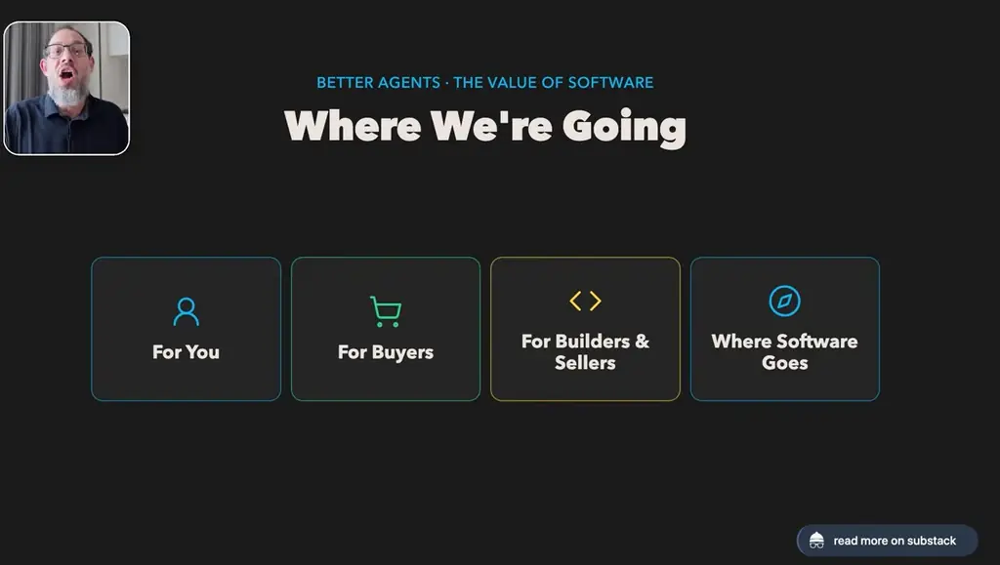
*[▶ 00:04:23](https://www.youtube.com/watch?v=0j8wy4jUlsw&t=263s) · Where We're Going*

With an agent, the short list is drafted from pulled candidate data. The recruiter still reviews it, but the recruiting tool drops out of the loop.

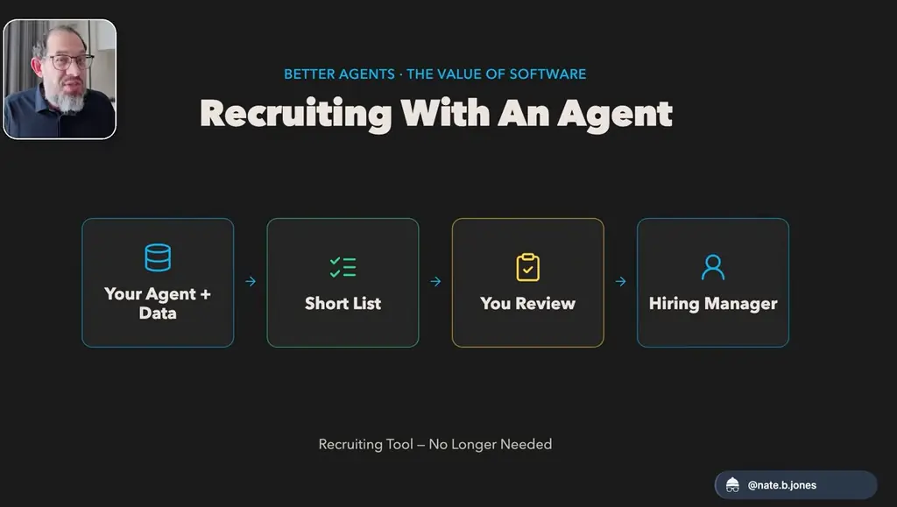
*[▶ 00:02:28](https://www.youtube.com/watch?v=0j8wy4jUlsw&t=148s) · Recruiting With An Agent*

The agent absorbs how you screen, who doesn't fit, what great looks like, what managers want, and who you hired.

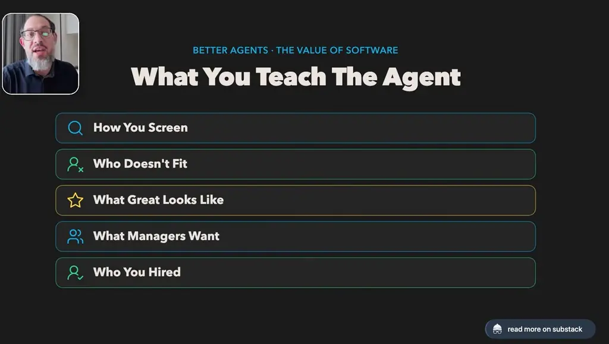
*[▶ 00:03:14](https://www.youtube.com/watch?v=0j8wy4jUlsw&t=194s) · What You Teach The Agent*

## What you still open software for

[▶ 00:04:36](https://www.youtube.com/watch?v=0j8wy4jUlsw&t=276s)

Ask when you open an app yourself, not through an agent: you need it for information you can't get elsewhere and work done correctly.

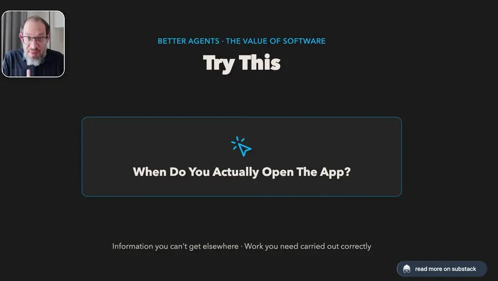
*[▶ 00:05:14](https://www.youtube.com/watch?v=0j8wy4jUlsw&t=314s) · Try This: When Do You Actually Open The App?*

That's direct use.

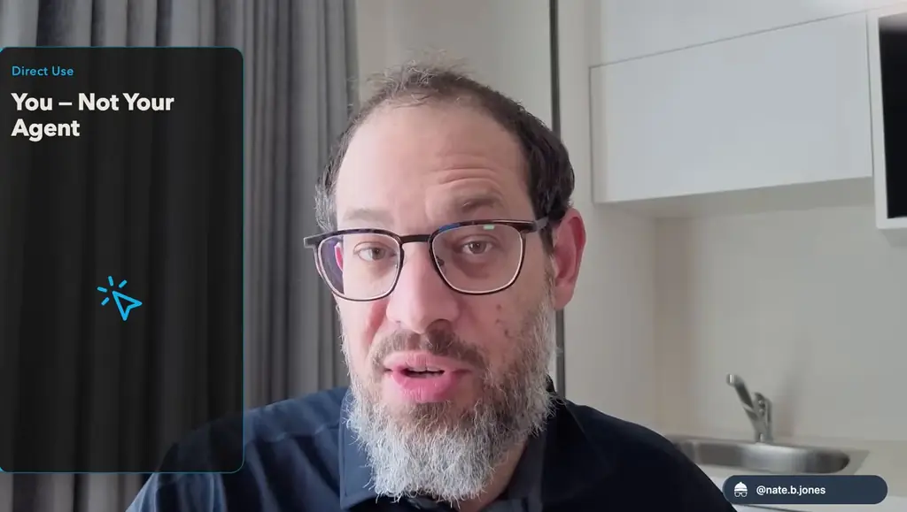
*[▶ 00:05:18](https://www.youtube.com/watch?v=0j8wy4jUlsw&t=318s) · Direct Use: You – Not Your Agent*

Most SaaS sells a muddy bundle of finding, arranging, acting and storing. An agent improving one slice exposes the whole subscription.

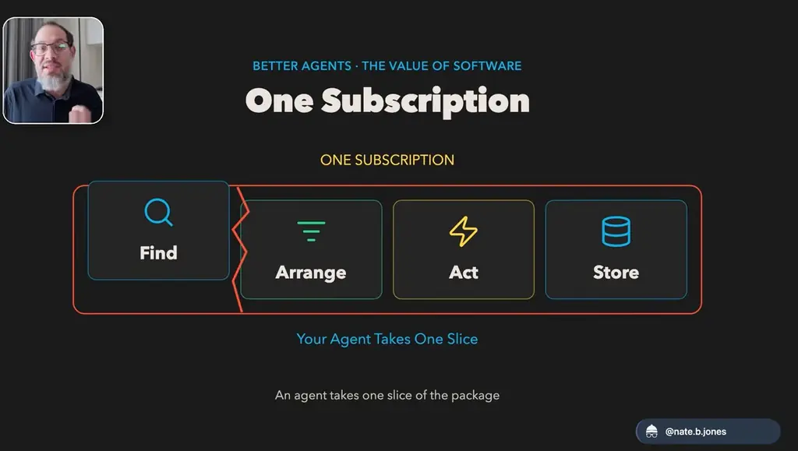
*[▶ 00:05:57](https://www.youtube.com/watch?v=0j8wy4jUlsw&t=357s) · One Subscription: Agent Takes One Slice*

Vendors reason from existing data and distribution toward an agent position. The competitive set now spans consumers, enterprise, labs and specialists.

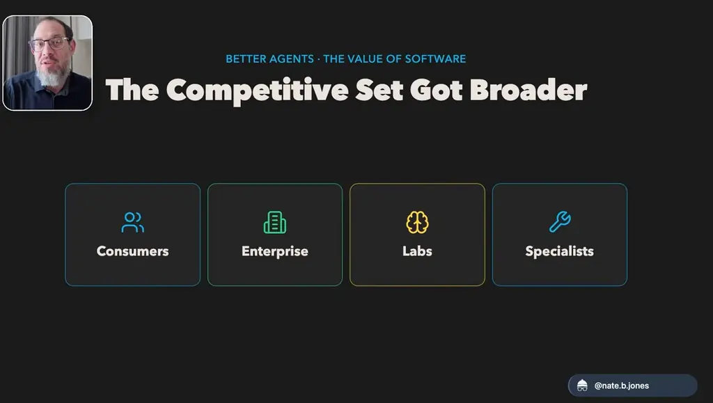
*[▶ 00:07:19](https://www.youtube.com/watch?v=0j8wy4jUlsw&t=439s) · The Competitive Set Got Broader*

## A Consumer Agent Becomes the Business Console

[▶ 00:07:35](https://www.youtube.com/watch?v=0j8wy4jUlsw&t=455s)

Meta's consumer agent Muse got a small-business version within weeks, because people already used it for business. Its first move: connecting business accounts and tools like Shopify and QuickBooks.

The speaker reads this as Meta making Muse business HQ, helping owners find customers and operate. With the agent already in use, the step from personal to business is short.

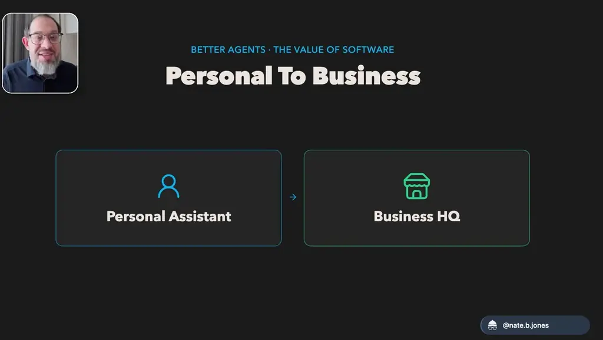
*[▶ 00:09:17](https://www.youtube.com/watch?v=0j8wy4jUlsw&t=557s) · Personal To Business*

## Salesforce's Data, Distribution, and Trusted Gateway

[▶ 00:09:17](https://www.youtube.com/watch?v=0j8wy4jUlsw&t=557s)

Better models let Salesforce use existing knowledge for more customer work.

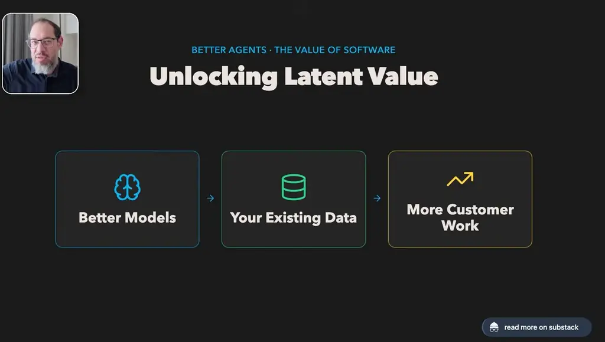
*[▶ 00:10:14](https://www.youtube.com/watch?v=0j8wy4jUlsw&t=614s) · Unlocking Latent Value*

Its Koa reasoning model, in pilot, was trained on synthetic data modeled on CRM deployments, not customer data.

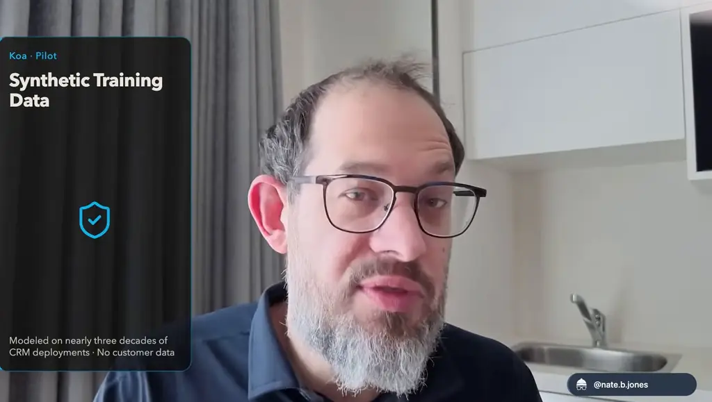
*[▶ 00:10:27](https://www.youtube.com/watch?v=0j8wy4jUlsw&t=627s) · Koa Pilot: Synthetic Training Data*

Data and distribution are in place; Koa is the first toe in the water into agents.

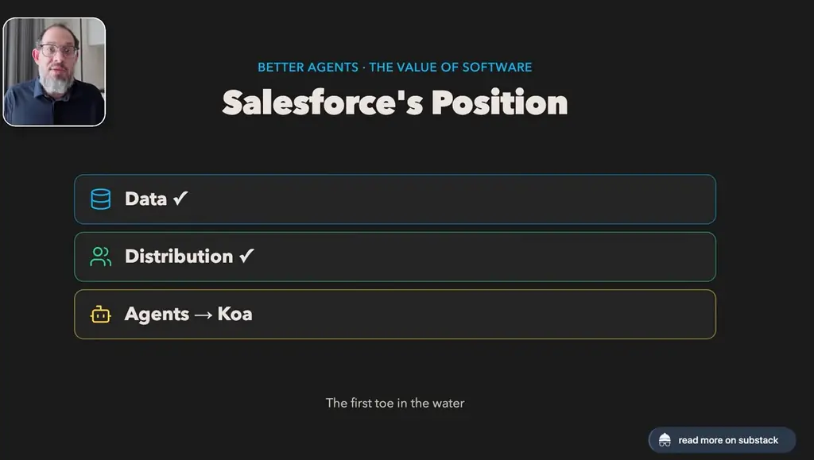
*[▶ 00:11:14](https://www.youtube.com/watch?v=0j8wy4jUlsw&t=674s) · Salesforce's Position*

Across three levels, the AI control plane rolls out in 2027.

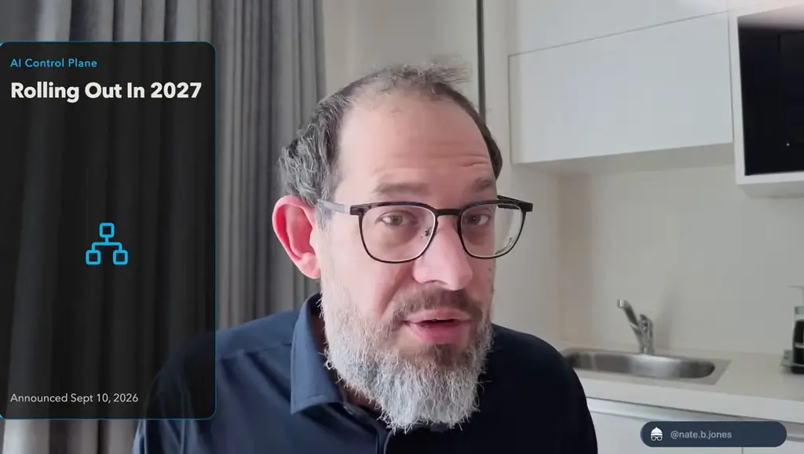
*[▶ 00:11:35](https://www.youtube.com/watch?v=0j8wy4jUlsw&t=695s) · AI Control Plane: Rolling Out In 2027*

A gateway lets Koa, Claude and other agents reach CRM data through one trusted surface.

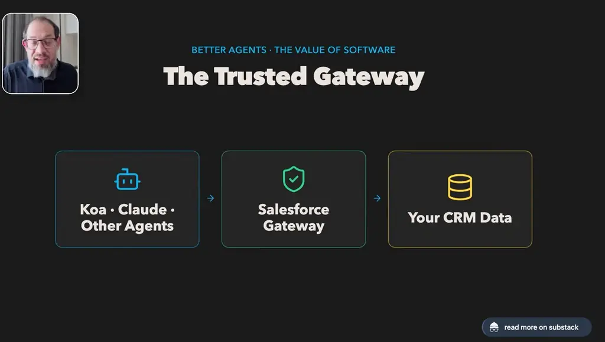
*[▶ 00:12:04](https://www.youtube.com/watch?v=0j8wy4jUlsw&t=724s) · The Trusted Gateway*

Selling in 2026 and 2027 means moving to a multi-value stack.

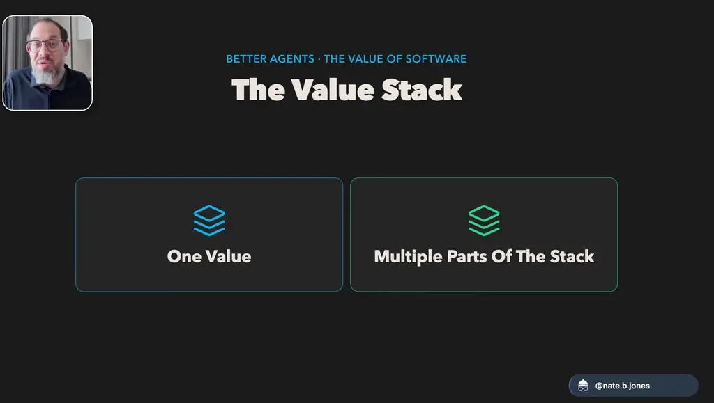
*[▶ 00:12:47](https://www.youtube.com/watch?v=0j8wy4jUlsw&t=767s) · The Value Stack: one value vs. multiple parts*

## Microsoft's Dilemma and Trust Play

[▶ 00:12:56](https://www.youtube.com/watch?v=0j8wy4jUlsw&t=776s)

Microsoft faces the same squeeze: a data layer, a control-plane bid, and apps used in Outlook and Excel.

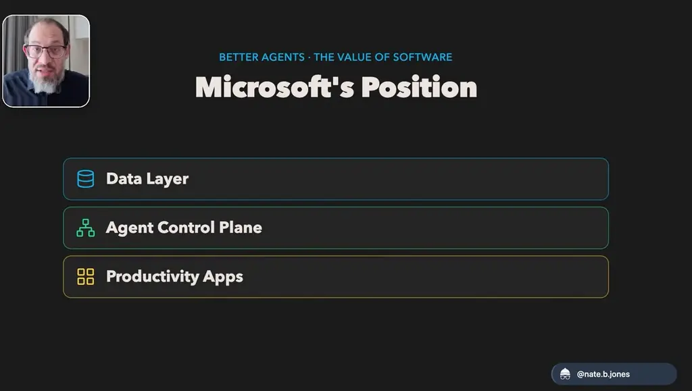
*[▶ 00:13:29](https://www.youtube.com/watch?v=0j8wy4jUlsw&t=809s) · Microsoft's Position*

As work moves to agents, the data and work stay valuable.

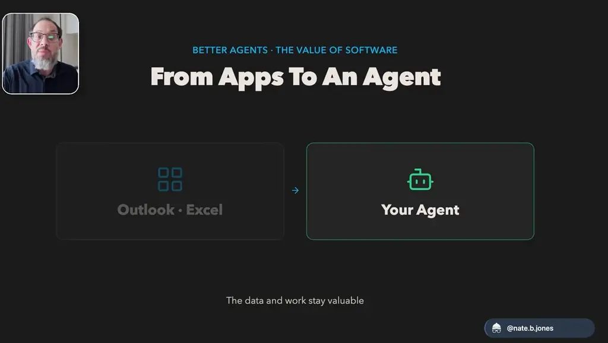
*[▶ 00:13:49](https://www.youtube.com/watch?v=0j8wy4jUlsw&t=829s) · From Apps To An Agent*

Autopilot, a persistent agent in preview, backs a stack pitch: Azure, developer tools, and Microsoft 365.

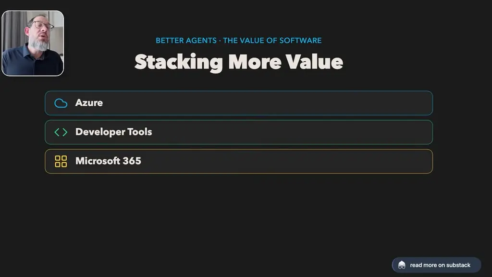
*[▶ 00:14:31](https://www.youtube.com/watch?v=0j8wy4jUlsw&t=871s) · Stacking More Value*

Copilot and Autopilot sell trusted AI, backed by scale and the trust Microsoft monetizes.

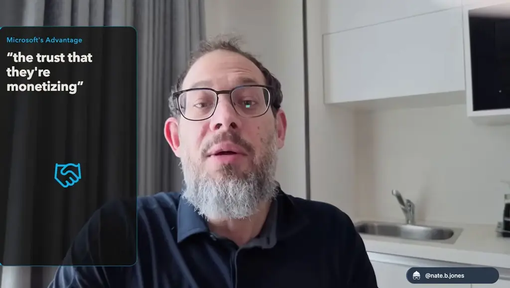
*[▶ 00:14:57](https://www.youtube.com/watch?v=0j8wy4jUlsw&t=897s) · Microsoft's Advantage quote card*

## Labs Sell Optionality, Not Lock-In

[▶ 00:15:02](https://www.youtube.com/watch?v=0j8wy4jUlsw&t=902s)

Labs start with no customer data and no existing distribution, so their pitch to buyers centers on the model.

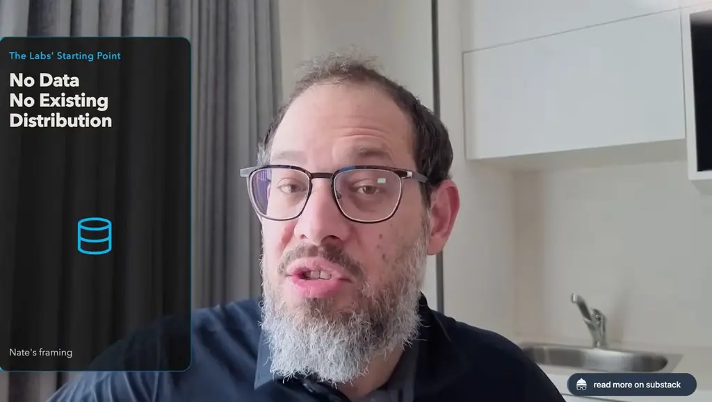
*[▶ 00:15:31](https://www.youtube.com/watch?v=0j8wy4jUlsw&t=931s) · The Labs' starting point: no data, no distribution*

The pitch has three promises: intelligence, applying it to your data, and future intelligence.

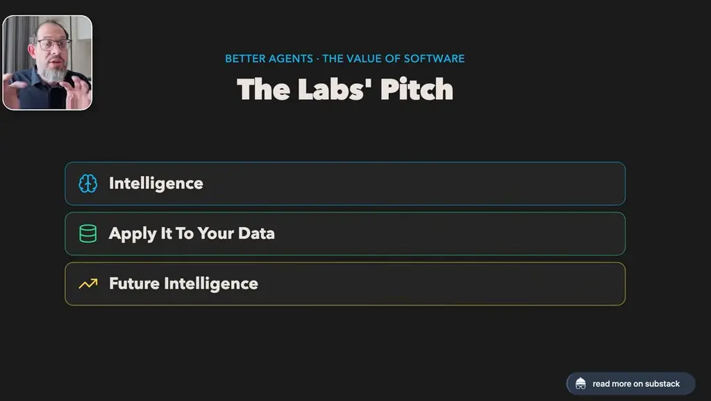
*[▶ 00:15:54](https://www.youtube.com/watch?v=0j8wy4jUlsw&t=954s) · The Labs' Pitch*

Buyers fear lock-in, so vendors must **sell optionality**: Claude, Koa, other models, and engineering support.

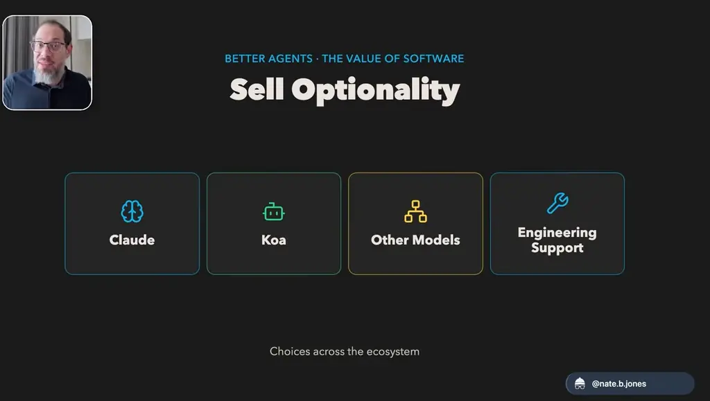
*[▶ 00:16:58](https://www.youtube.com/watch?v=0j8wy4jUlsw&t=1018s) · Sell Optionality*

## Winning the Order Without the Interface

[▶ 00:17:03](https://www.youtube.com/watch?v=0j8wy4jUlsw&t=1023s)

DoorDash wants the order whichever interface is used: text, an ordering connector, or a CLI.

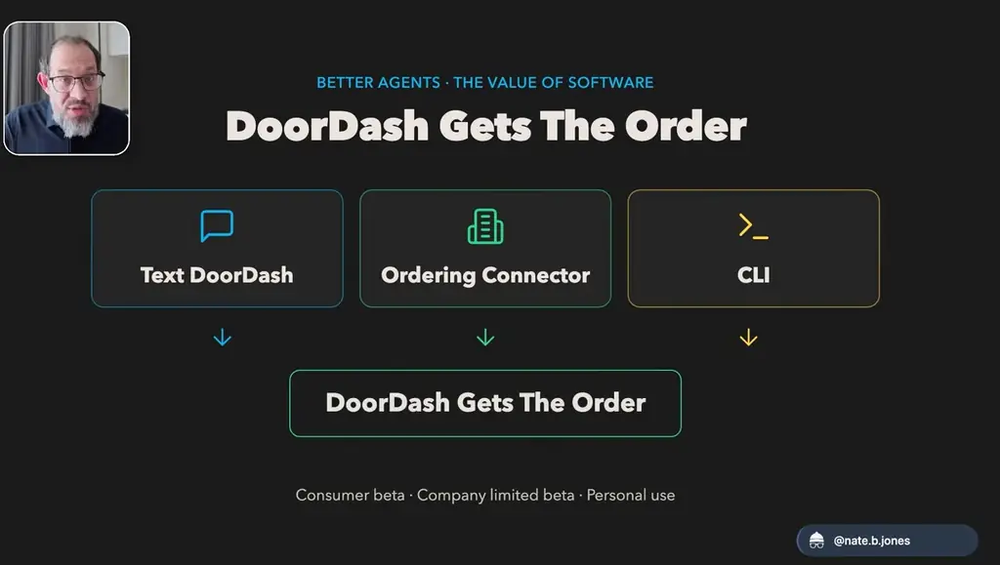
*[▶ 00:18:17](https://www.youtube.com/watch?v=0j8wy4jUlsw&t=1097s) · DoorDash Gets The Order*

Its CLI works the same for a person in a terminal or an agent acting for them.

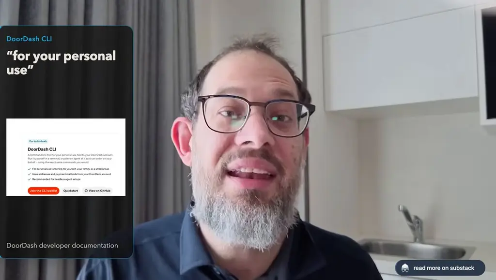
*[▶ 00:18:21](https://www.youtube.com/watch?v=0j8wy4jUlsw&t=1101s) · DoorDash CLI for personal use*

Losing the app screen does not mean losing the transaction or its value.

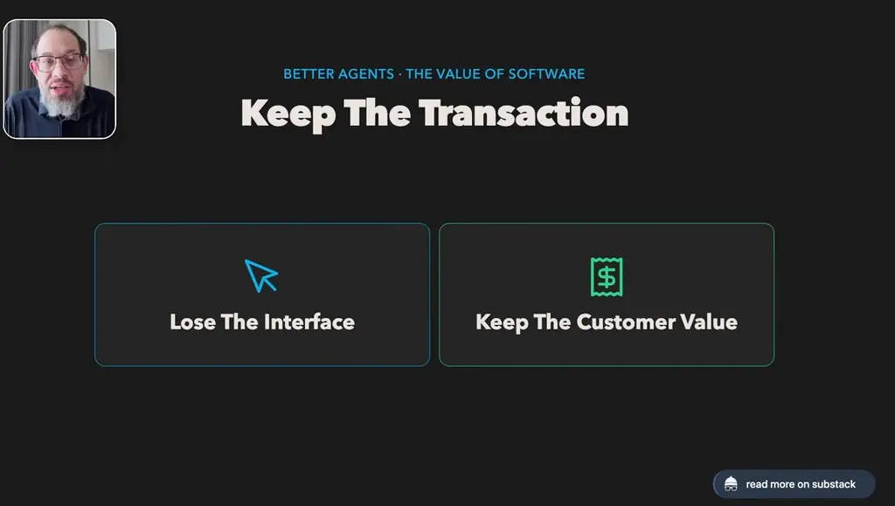
*[▶ 00:18:43](https://www.youtube.com/watch?v=0j8wy4jUlsw&t=1123s) · Keep The Transaction*

Being reachable by agents is table stakes. It does not establish why customers should keep paying.

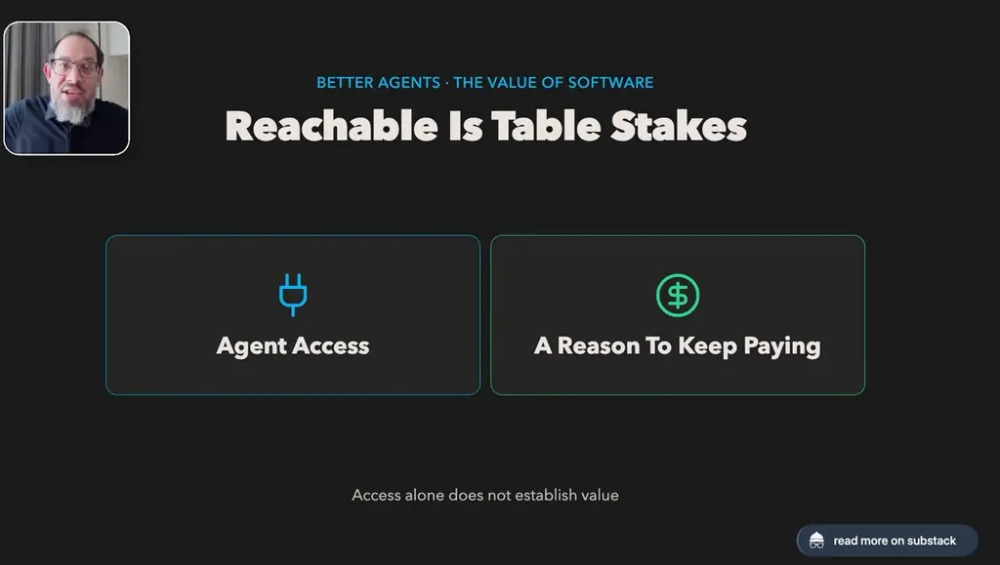
*[▶ 00:20:03](https://www.youtube.com/watch?v=0j8wy4jUlsw&t=1203s) · Reachable Is Table Stakes*

## Team AI habits shape the buying decision

[▶ 00:19:39](https://www.youtube.com/watch?v=0j8wy4jUlsw&t=1179s)

Buyers must know how their team actually uses AI before choosing software.

Keeping a personal AI trick private makes your standing brittle: a vendor switch breaks your workflow.

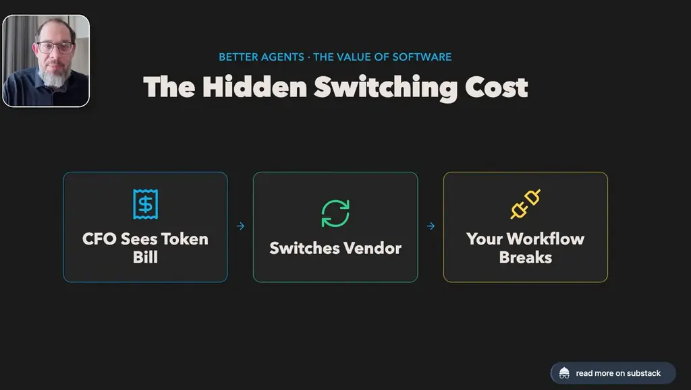
*[▶ 00:21:01](https://www.youtube.com/watch?v=0j8wy4jUlsw&t=1261s) · The Hidden Switching Cost*

A CFO may cut a token bill without knowing your use case; socializing it with your manager helps them see what a switch costs.

## Keep the Data, Build the Workflow

[▶ 00:21:06](https://www.youtube.com/watch?v=0j8wy4jUlsw&t=1266s)

A two-person recruiting firm built a Claude skill on Crust Data's APIs instead of buying a packaged tool. Skills give AI instructions; APIs supply data or actions.

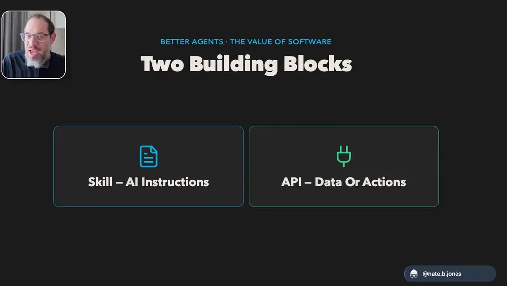
*[▶ 00:21:47](https://www.youtube.com/watch?v=0j8wy4jUlsw&t=1307s) · Two Building Blocks*

Founders set the criteria; the provider supplied candidate data. They kept the provider and built search over it, not a SaaS tool.

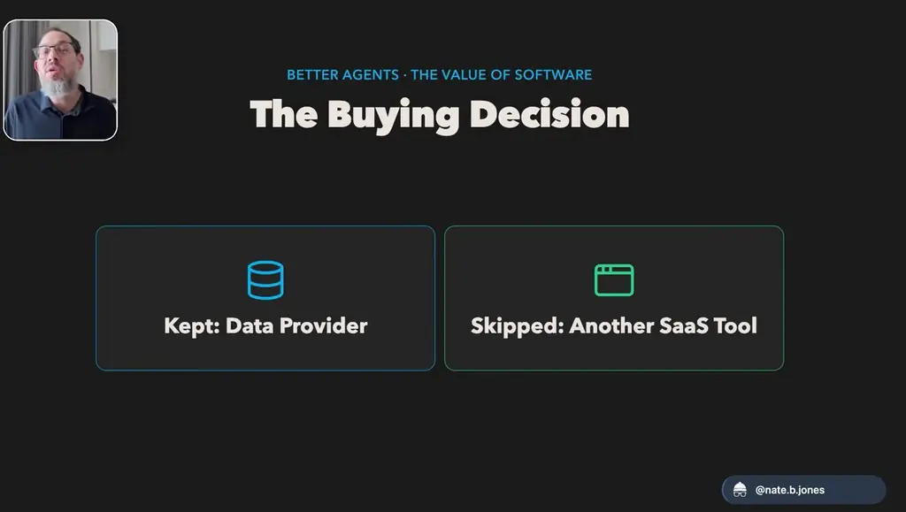
*[▶ 00:22:28](https://www.youtube.com/watch?v=0j8wy4jUlsw&t=1348s) · The Buying Decision*

Explaining a paycheck differs from replacing payroll.

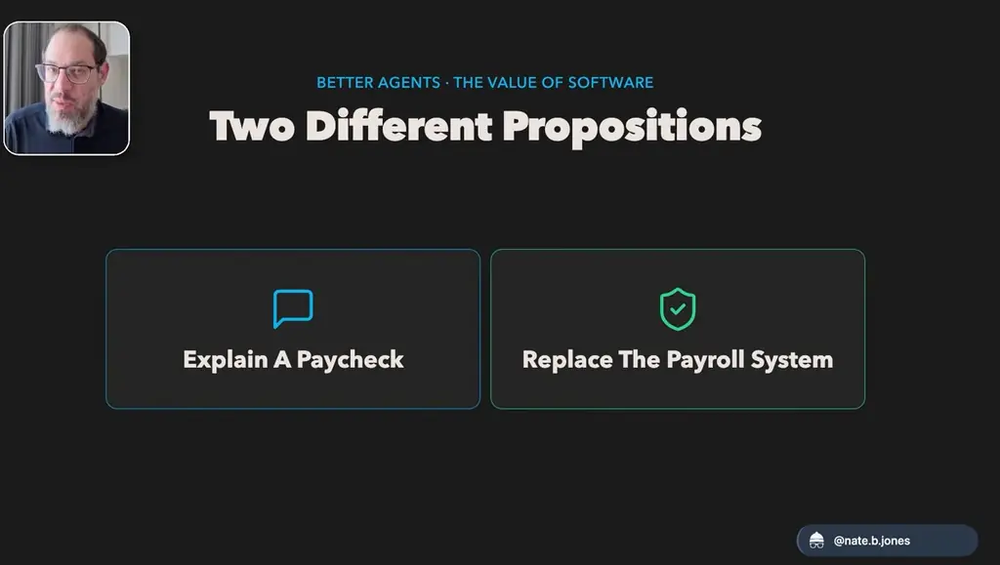
*[▶ 00:22:38](https://www.youtube.com/watch?v=0j8wy4jUlsw&t=1358s) · Two Different Propositions*

Workday's payroll agent depends on configured rules, records and approvals.

## Map Your Position Across the Three Layers

[▶ 00:24:30](https://www.youtube.com/watch?v=0j8wy4jUlsw&t=1470s)

Place your work against three layers: data, application and agentic.

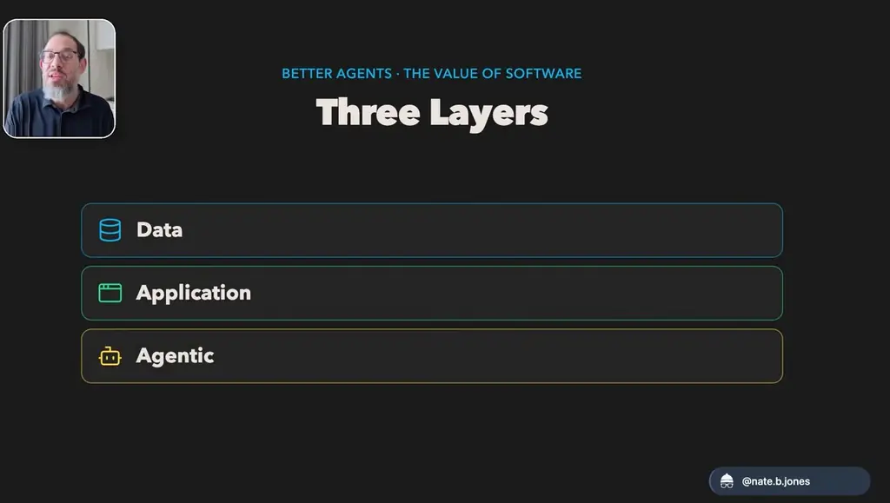
*[▶ 00:24:38](https://www.youtube.com/watch?v=0j8wy4jUlsw&t=1478s) · Three Layers*

Buyers face a mosaic. Every business's data and applications are unique, and small-team AI use adds more complexity. Simplifying without mapping it can cut productivity you didn't know you had.

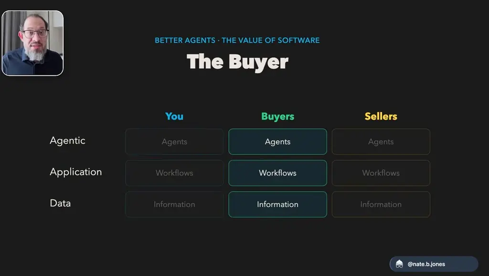
*[▶ 00:25:18](https://www.youtube.com/watch?v=0j8wy4jUlsw&t=1518s) · The Buyer*

Sellers should move past "Do you have AI?" Ask whether the data layer is sorted, whether the application layer makes sense, and whether the agentic layer gives flexibility.

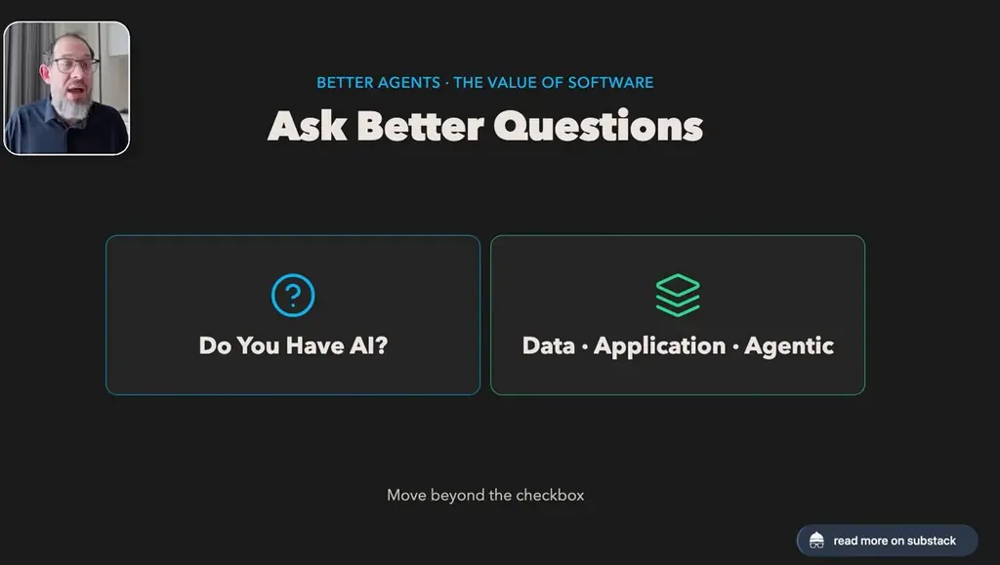
*[▶ 00:26:13](https://www.youtube.com/watch?v=0j8wy4jUlsw&t=1573s) · Ask Better Questions*

Software builders get a chance to reinvent what software means.

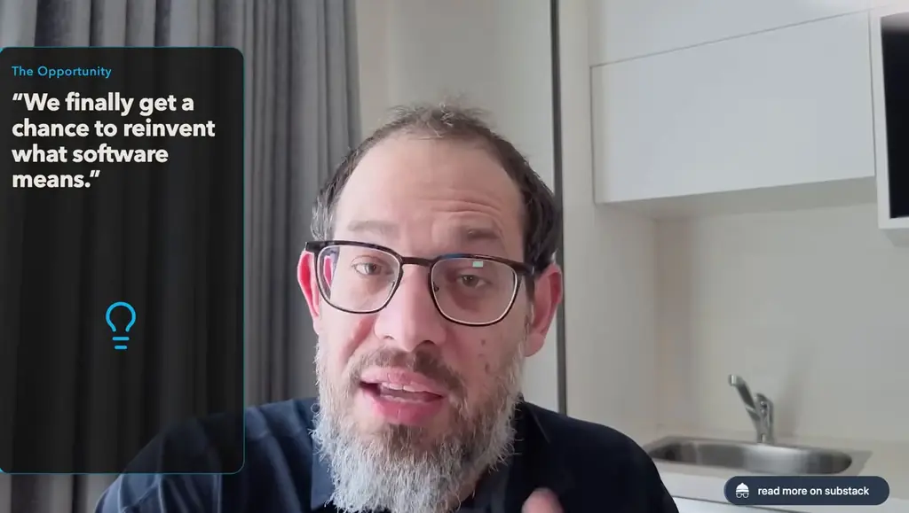
*[▶ 00:26:22](https://www.youtube.com/watch?v=0j8wy4jUlsw&t=1582s) · The Opportunity quote*

An application is an interface plus a workflow. Interfaces may shift, but structured, compliant workflows built on data stay valuable.

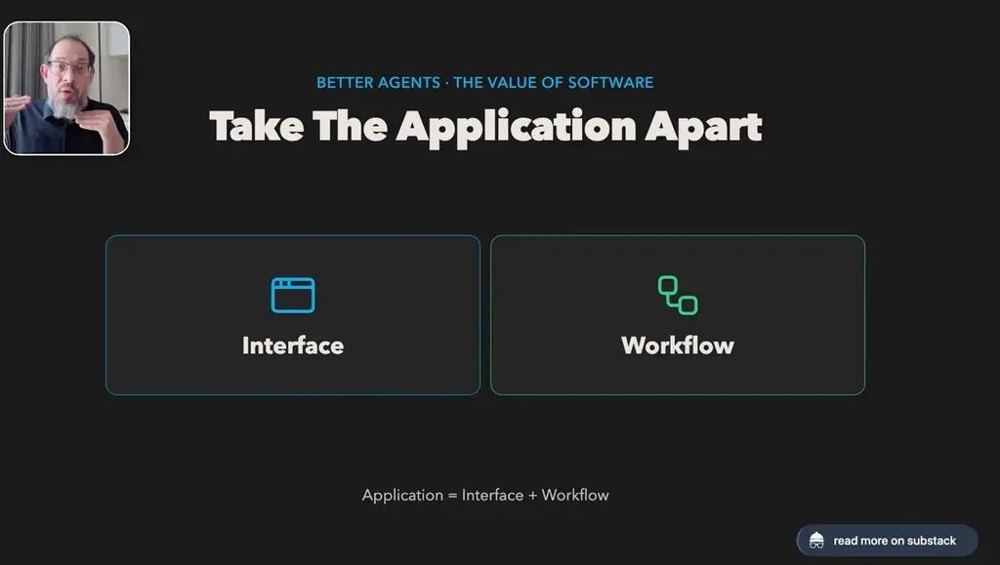
*[▶ 00:27:40](https://www.youtube.com/watch?v=0j8wy4jUlsw&t=1660s) · Take The Application Apart*

Buyers should decide whether engineers go to back-office operations or to competitive advantage.

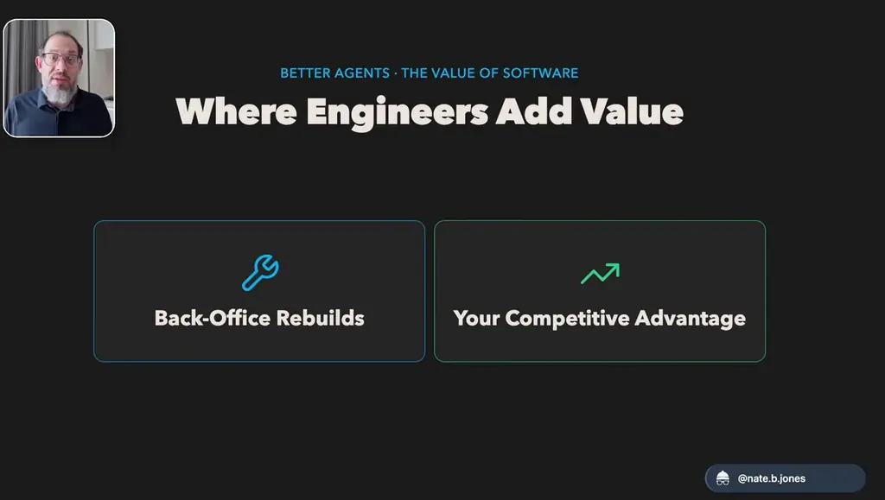
*[▶ 00:28:58](https://www.youtube.com/watch?v=0j8wy4jUlsw&t=1738s) · Where Engineers Add Value*

## Talk fluently about how you use AI

[▶ 00:29:40](https://www.youtube.com/watch?v=0j8wy4jUlsw&t=1780s)

Leaders must dig in with teams to see what they actually do, not add AI over the top at board level. Individuals should talk fluently about the data they use, their workflows, where workflows fail compared with software and mouse clicks, and when they still click. Sharing what works makes the whole team better.

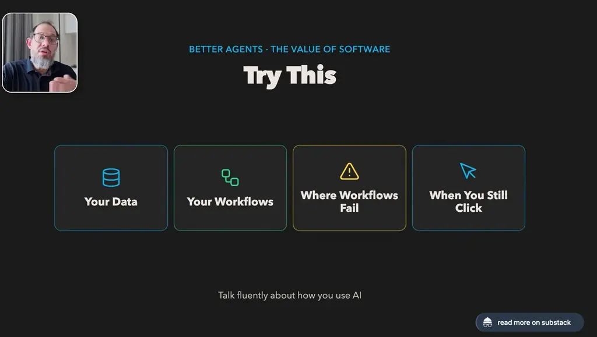
*[▶ 00:30:22](https://www.youtube.com/watch?v=0j8wy4jUlsw&t=1822s) · Try This: four things to discuss about AI use*

Sellers should be able to show a four-point checklist:

- **Plug-and-play workflows**: AI plugs in easily.
- **Easy-to-reach data**: accessible from many interfaces.
- **Agent-readable** systems.
- **Multiplayer agent**: a specialist agent that other agents can also help.

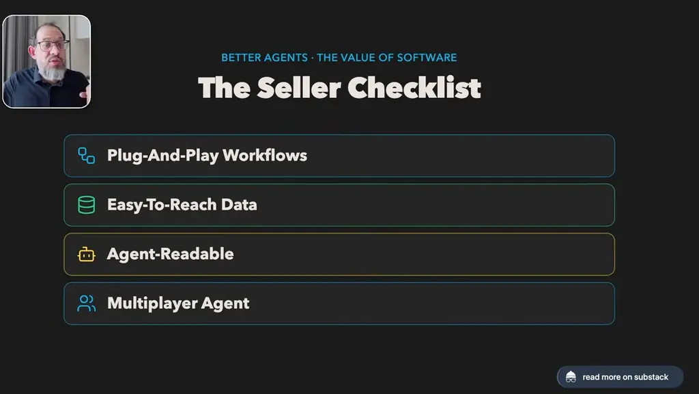
*[▶ 00:32:13](https://www.youtube.com/watch?v=0j8wy4jUlsw&t=1933s) · The Seller Checklist (four items)*

Buyers are paying for a belief that the vendor will keep up with new models, so sellers should answer for 2027, not today. Buyers increasingly buy outcomes, so answers must show how AI moves sales, revenue and profitability.

Agents force everyone to vertically integrate their stack.

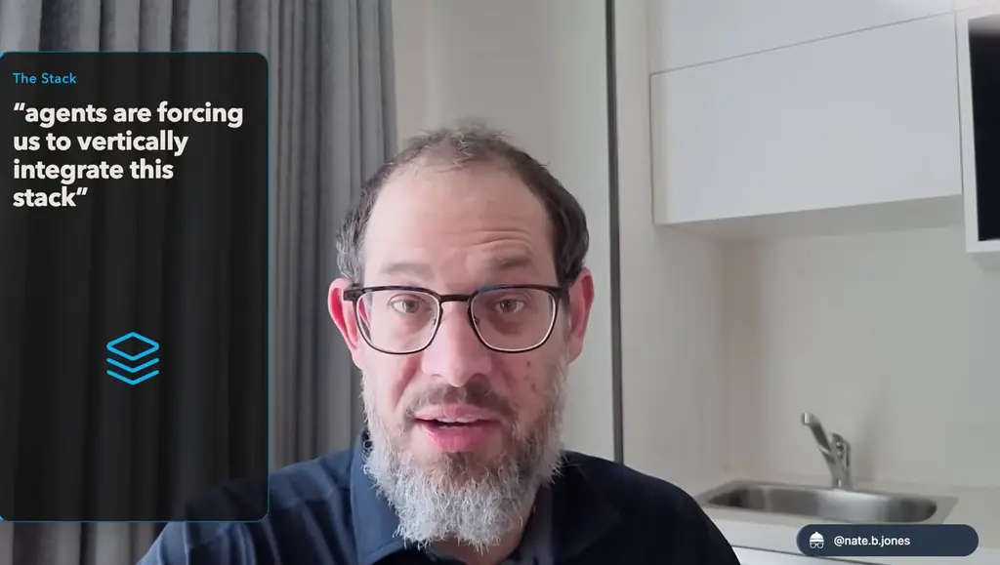
*[▶ 00:35:37](https://www.youtube.com/watch?v=0j8wy4jUlsw&t=2137s) · The Stack quote card*

Everyone is now a decision maker in how their company uses AI.

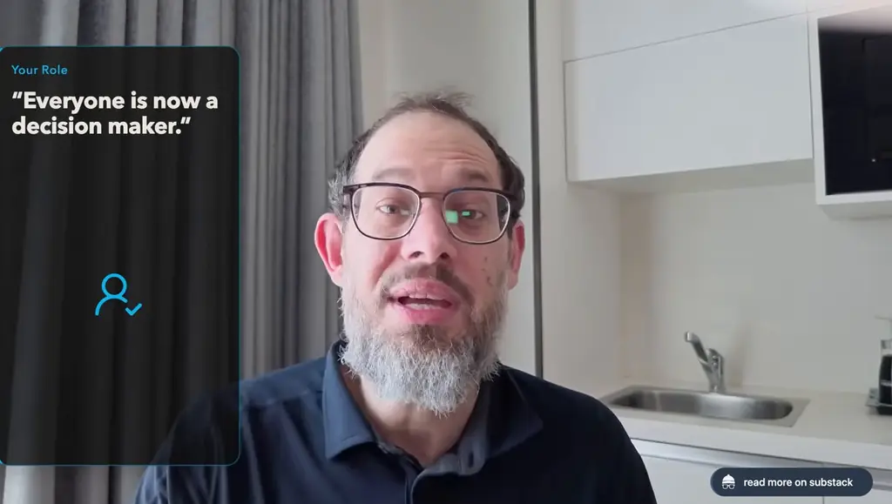
*[▶ 00:35:41](https://www.youtube.com/watch?v=0j8wy4jUlsw&t=2141s) · Your Role quote card*

Software stacks are getting more complicated for buyers, sellers and you.

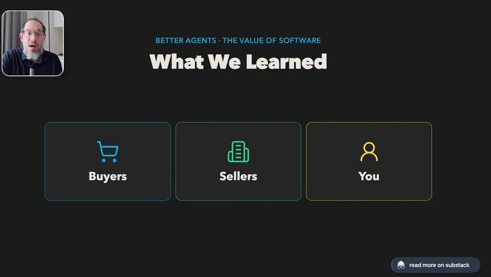
*[▶ 00:33:43](https://www.youtube.com/watch?v=0j8wy4jUlsw&t=2023s) · What We Learned: Buyers, Sellers, You*

Before any switch, have the conversation and share how you work.

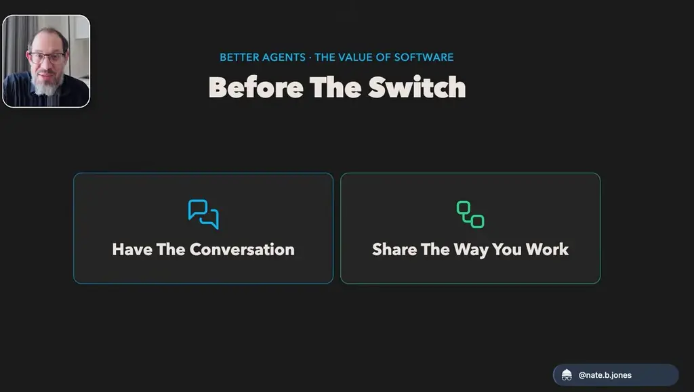
*[▶ 00:35:08](https://www.youtube.com/watch?v=0j8wy4jUlsw&t=2108s) · Before The Switch*

## Links & resources

- [AI agents and software buying — Nate's newsletter article linked to the talk](https://natesnewsletter.substack.com/p/ai-agents-software-buying?utm_source=youtube&utm_medium=video&utm_campaign=ai-agents-software-buying-launch&utm_content=description) — <https://natesnewsletter.substack.com/p/ai-agents-software-buying?utm_source=youtube&utm_medium=video&utm_campaign=ai-agents-software-buying-launch&utm_content=description> · video description
- [How to connect Nate's Library — unlock-ai guide for the speaker's library](https://unlock-ai.natebjones.com/guides/how-to-connect-nates-library?utm_source=youtube&utm_medium=video&utm_campaign=ai-agents-software-buying-launch&utm_content=description) — <https://unlock-ai.natebjones.com/guides/how-to-connect-nates-library?utm_source=youtube&utm_medium=video&utm_campaign=ai-agents-software-buying-launch&utm_content=description> · video description
- [Nate's Newsletter — speaker's Substack homepage](https://natesnewsletter.substack.com/?utm_source=youtube&utm_medium=video&utm_campaign=ai-agents-software-buying-launch&utm_content=description) — <https://natesnewsletter.substack.com/?utm_source=youtube&utm_medium=video&utm_campaign=ai-agents-software-buying-launch&utm_content=description> · video description
