# The Hexagonal Hangover by Ties van de Ven

*Understanding the trade-offs of hexagonal architecture and how it affects software quality.*

Source: [The Hexagonal Hangover by Ties van de Ven](https://www.youtube.com/watch?v=m9viRAIRAUQ) · by Ties van de Ven · Devoxx · 49 min

## TL;DR

Hexagonal architecture aims to isolate dependencies and prevent breaking changes by adding layers, but it can introduce complexity and reduce functionality. The talk explores the concepts of coupling, cohesion, and distance to help developers make informed decisions about architectural trade-offs, emphasizing the importance of achieving functional cohesion and managing change.

## Key takeaways

- Hexagonal architecture involves adding layers to isolate dependencies, but it doesn't always improve functionality and can introduce complexity.
- Understanding coupling, cohesion, and distance is crucial for managing architectural trade-offs.
- Functional cohesion, where components solve specific use cases, is ideal but challenging to achieve.
- Distance between components improves readability and maintainability but increases the cost of change.
- Hexagonal architecture aims for functional cohesion and contract coupling but introduces distance, making it harder to understand request handling.
- Changes in hexagonal architecture can be costly, especially if there are breaking changes that require fixing across all layers.

## Introduction and Speaker Background

[▶ 00:00:00](https://www.youtube.com/watch?v=m9viRAIRAUQ&t=0s)

Ties van de Ven introduces himself as a software quality expert with over 15 years of experience in Java, Kotlin, and Scala. He volunteers as a coach for ArnhemJUG and focuses on helping teams improve code quality and security. The talk emphasizes understanding trade-offs in architecture, a concept developed by his colleague Buenorp.

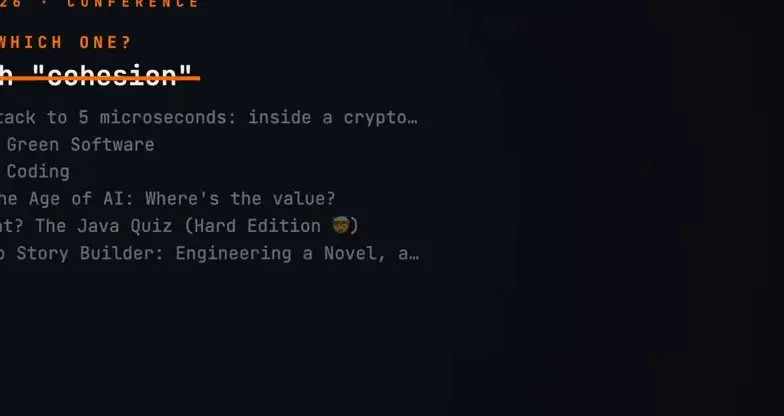
*[▶ 00:00:02](https://www.youtube.com/watch?v=m9viRAIRAUQ&t=2s) · Terminal Output*

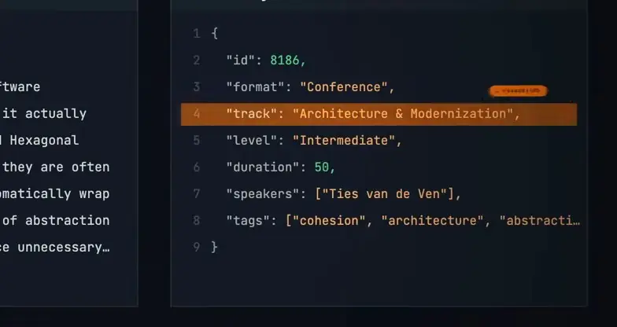
*[▶ 00:00:19](https://www.youtube.com/watch?v=m9viRAIRAUQ&t=19s) · JSON Object*

*[▶ 00:01:34](https://www.youtube.com/watch?v=m9viRAIRAUQ&t=94s) · Ties van de Ven*

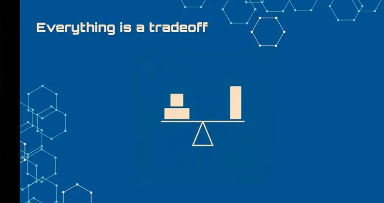
*[▶ 00:02:56](https://www.youtube.com/watch?v=m9viRAIRAUQ&t=176s) · Tradeoff Balance*

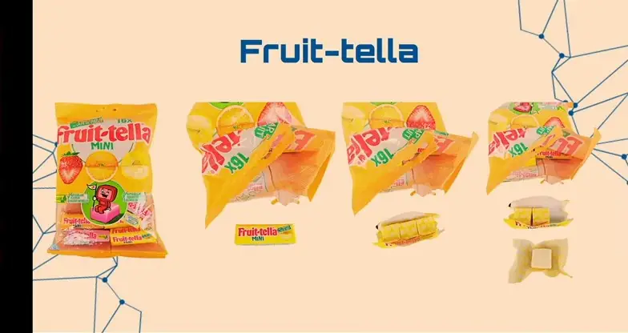
*[▶ 00:05:17](https://www.youtube.com/watch?v=m9viRAIRAUQ&t=317s) · Fruit-tella*

## Hexagonal Architecture and Layering

[▶ 00:05:17](https://www.youtube.com/watch?v=m9viRAIRAUQ&t=317s)

Hexagonal architecture involves adding layers to isolate dependencies and prevent changes from breaking components. However, adding layers doesn't always improve functionality. For example, introducing an entity layer to map database entities to API models prevents breaking changes when column names change, but it doesn't protect against information loss if a column is dropped. Each layer adds complexity and can reduce functionality by removing features not supported by all implementations.

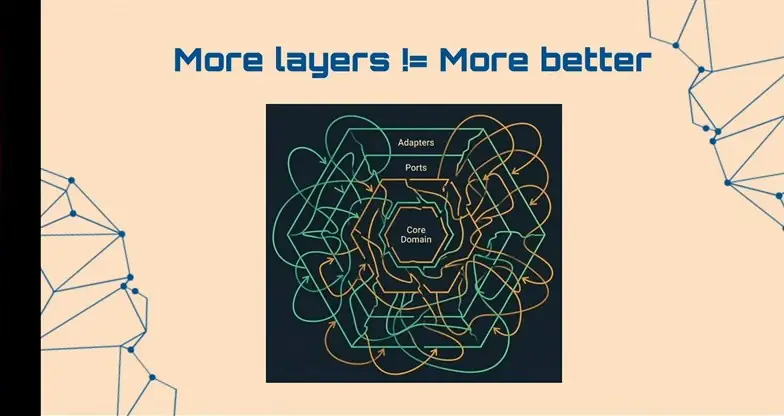
*[▶ 00:05:38](https://www.youtube.com/watch?v=m9viRAIRAUQ&t=338s) · Hexagonal Architecture*

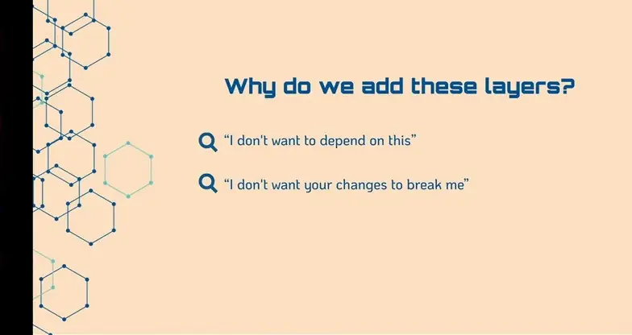
*[▶ 00:05:57](https://www.youtube.com/watch?v=m9viRAIRAUQ&t=357s) · Why do we add these layers?*

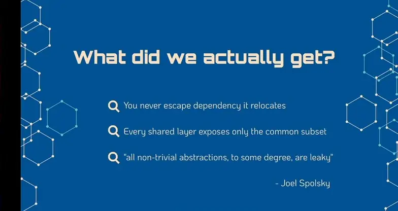
*[▶ 00:08:33](https://www.youtube.com/watch?v=m9viRAIRAUQ&t=513s) · What did we actually get?*

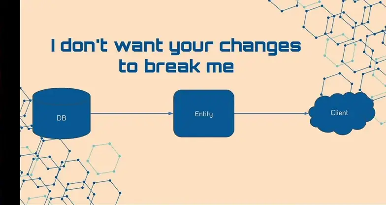
*[▶ 00:09:00](https://www.youtube.com/watch?v=m9viRAIRAUQ&t=540s) · Entity Layering*

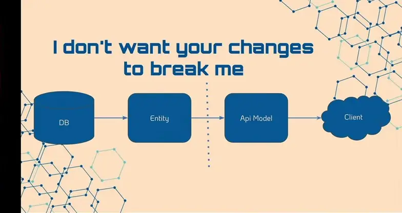
*[▶ 00:09:31](https://www.youtube.com/watch?v=m9viRAIRAUQ&t=571s) · Architecture Diagram*

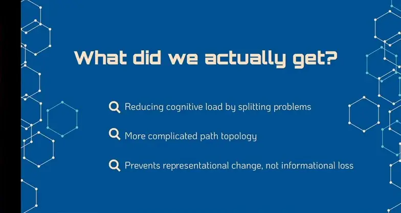
*[▶ 00:10:08](https://www.youtube.com/watch?v=m9viRAIRAUQ&t=608s) · What did we actually get?*

## Trade-offs of Adding Layers

[▶ 00:10:25](https://www.youtube.com/watch?v=m9viRAIRAUQ&t=625s)

Adding abstraction layers can protect against certain problems but introduces others. A project I worked on aimed to be highly generic and adaptable, taking almost a year to develop. In contrast, a simpler approach using native Kafka libraries completed the task in an afternoon. The generic approach was expensive and complex, while the simpler one was cheap and straightforward but less extendable.

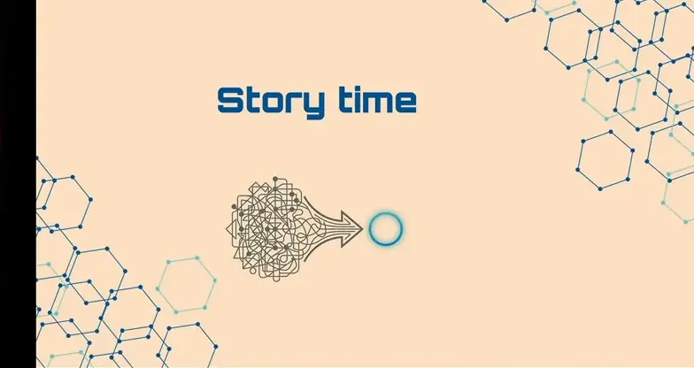
*[▶ 00:12:27](https://www.youtube.com/watch?v=m9viRAIRAUQ&t=747s) · Story time*

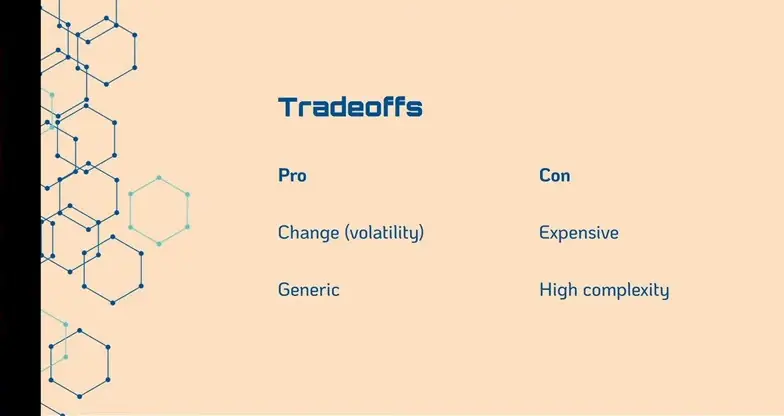
*[▶ 00:12:58](https://www.youtube.com/watch?v=m9viRAIRAUQ&t=778s) · Tradeoffs*

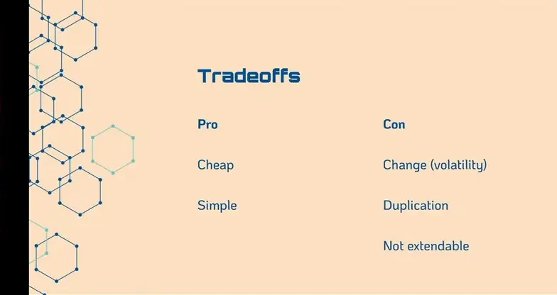
*[▶ 00:13:23](https://www.youtube.com/watch?v=m9viRAIRAUQ&t=803s) · Tradeoffs*

## Understanding Coupling, Cohesion, and Distance

[▶ 00:13:23](https://www.youtube.com/watch?v=m9viRAIRAUQ&t=803s)

Adding more layers to a system doesn't always improve it. Understanding the trade-offs requires grasping three fundamental concepts: coupling, cohesion, and distance. Coupling refers to the degree of interdependence between components, while cohesion measures how closely related the components within a module are. Distance involves separating components to improve readability and maintainability.

Cohesion ranges from accidental cohesion, where components are grouped together without a clear reason, to functional cohesion, where components solve specific use cases. Accidental cohesion is common in utility folders, while functional cohesion is ideal but challenging to achieve. Logical cohesion groups components by function, such as in MVC or layered architecture, while model cohesion focuses on working with the same data, like user components.

Thinking in state changes helps achieve functional cohesion. Break down the program into validation, enrichment, and logic components, each handling a specific state change. This approach enforces rules through strong type systems and creates highly cohesive components. Distance adds separation between components, improving readability and allowing parallel development. However, it increases the cost of change and complicates understanding the overall system.

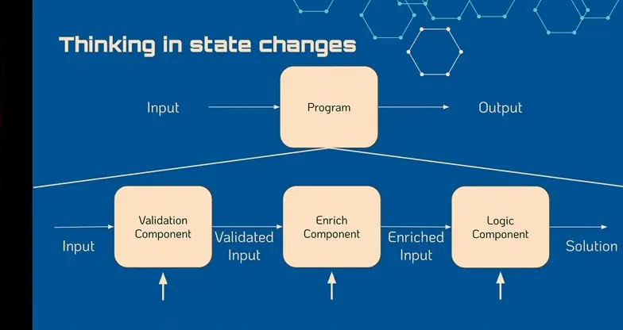
*[▶ 00:22:22](https://www.youtube.com/watch?v=m9viRAIRAUQ&t=1342s) · Thinking in state changes*

Coupling depth measures how tightly components are coupled, with intrusive coupling being the worst, where components depend on implementation details. Functional coupling is less explicit, often caused by mutable state or temporal coupling. Contract coupling uses explicit contracts to prevent breaking changes. Connectivity measures the number of components a component depends on (fan in) and the number of components that depend on it (fan out). God objects with high connectivity are problematic, but functional cohesion can reduce fan in and fan out.

Distance and coupling can be balanced to manage change and maintain cohesion. Strong contracts limit change for components with high fan in, while weak contracts allow more flexibility for components with high fan out.

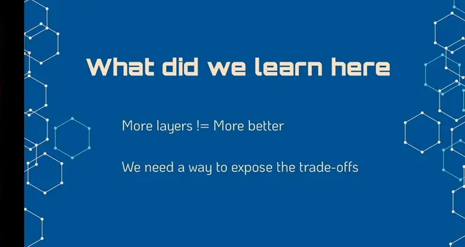
*[▶ 00:13:36](https://www.youtube.com/watch?v=m9viRAIRAUQ&t=816s) · What did we learn here*

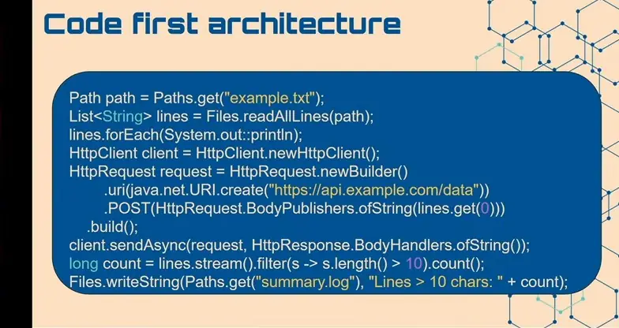
*[▶ 00:15:19](https://www.youtube.com/watch?v=m9viRAIRAUQ&t=919s) · Code first architecture*

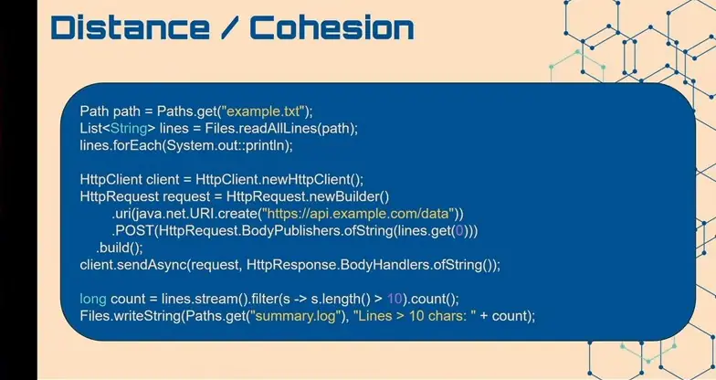
*[▶ 00:16:46](https://www.youtube.com/watch?v=m9viRAIRAUQ&t=1006s) · Code Example*

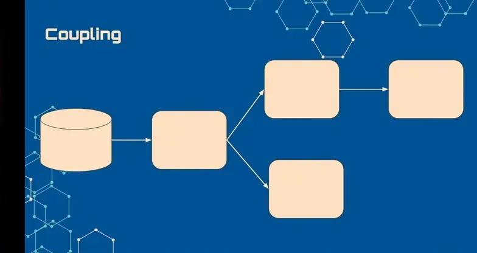
*[▶ 00:17:26](https://www.youtube.com/watch?v=m9viRAIRAUQ&t=1046s) · Coupling*

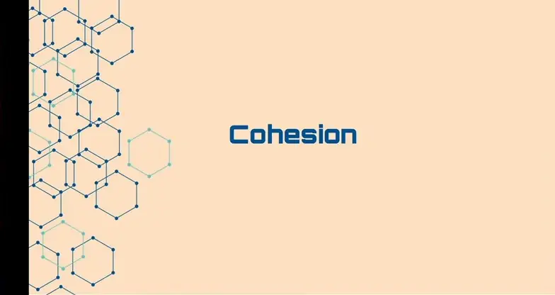
*[▶ 00:17:49](https://www.youtube.com/watch?v=m9viRAIRAUQ&t=1069s) · Cohesion*

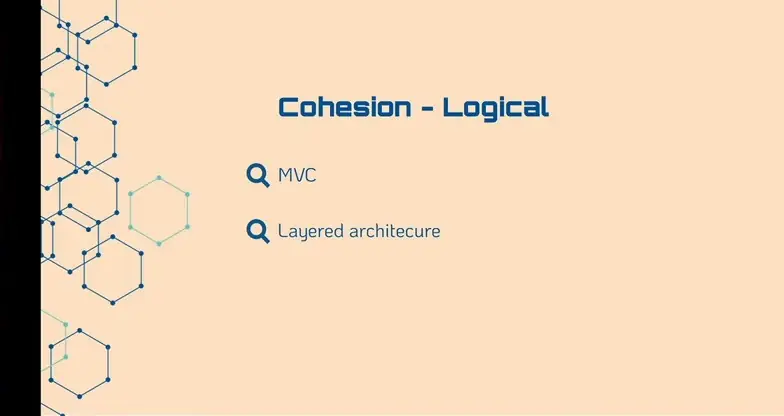
*[▶ 00:18:48](https://www.youtube.com/watch?v=m9viRAIRAUQ&t=1128s) · Cohesion - Logical*

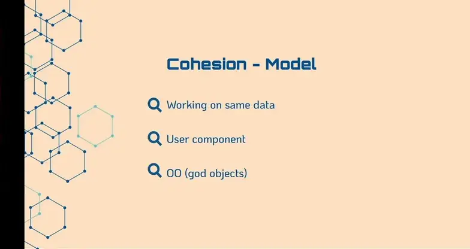
*[▶ 00:19:25](https://www.youtube.com/watch?v=m9viRAIRAUQ&t=1165s) · Cohesion - Model*

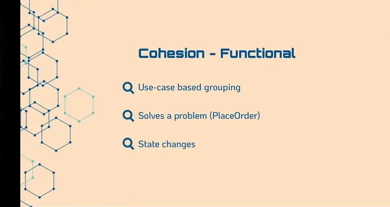
*[▶ 00:20:13](https://www.youtube.com/watch?v=m9viRAIRAUQ&t=1213s) · Cohesion - Functional*

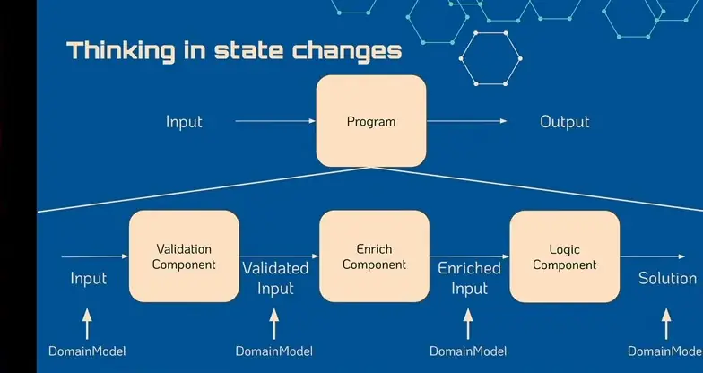
*[▶ 00:21:55](https://www.youtube.com/watch?v=m9viRAIRAUQ&t=1315s) · Thinking in state changes*

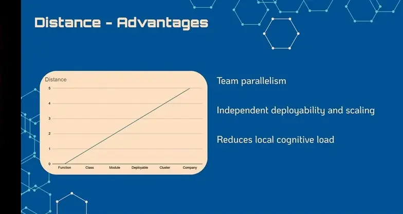
*[▶ 00:23:45](https://www.youtube.com/watch?v=m9viRAIRAUQ&t=1425s) · Distance - Advantages*

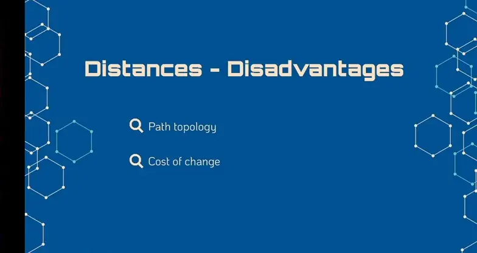
*[▶ 00:25:40](https://www.youtube.com/watch?v=m9viRAIRAUQ&t=1540s) · Distances - Disadvantages*

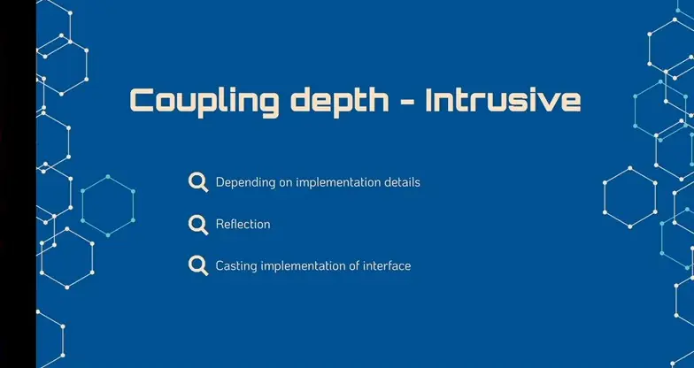
*[▶ 00:27:10](https://www.youtube.com/watch?v=m9viRAIRAUQ&t=1630s) · Coupling depth - Intrusive*

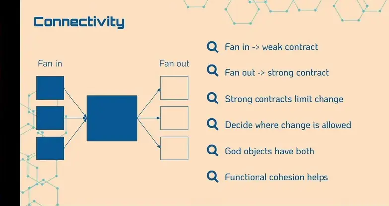
*[▶ 00:38:16](https://www.youtube.com/watch?v=m9viRAIRAUQ&t=2296s) · Connectivity*

## Connectivity and Spaghettification

[▶ 00:39:00](https://www.youtube.com/watch?v=m9viRAIRAUQ&t=2340s)

Coupling in software architecture is calculated as depth times connectivity divided by cohesion debt. Spaghettification, a measure of architectural complexity, equals coupling plus cohesion debt, and pain is spaghettification times volatility. High coupling and low cohesion lead to high spaghettification and pain. Hexagonal architecture aims for functional cohesion and contract coupling but introduces distance, making it harder to understand how requests are handled. Each request must pass through multiple layers, including adapters and anti-corruption layers, increasing cognitive load. Changes can be costly, especially if there are breaking changes that require fixing across all layers. Distance and change frequency are key factors in evaluating the benefits of hexagonal architecture.

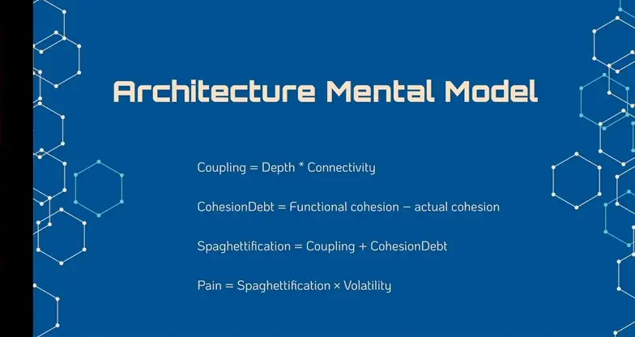
*[▶ 00:41:31](https://www.youtube.com/watch?v=m9viRAIRAUQ&t=2491s) · Architecture Mental Model*

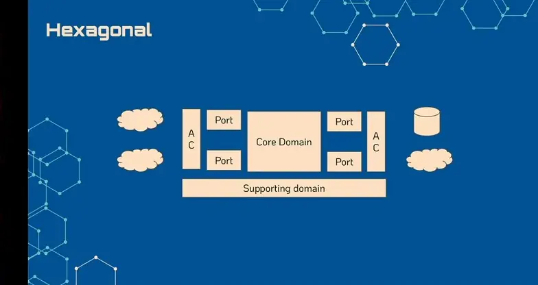
*[▶ 00:42:23](https://www.youtube.com/watch?v=m9viRAIRAUQ&t=2543s) · Hexagonal Architecture Diagram*

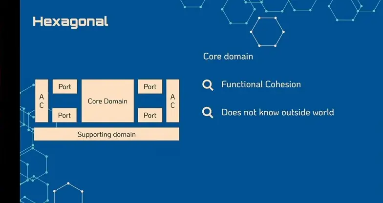
*[▶ 00:42:53](https://www.youtube.com/watch?v=m9viRAIRAUQ&t=2573s) · Hexagonal Architecture*

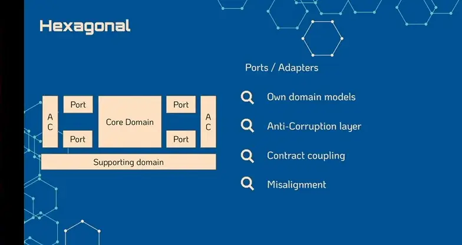
*[▶ 00:43:25](https://www.youtube.com/watch?v=m9viRAIRAUQ&t=2605s) · Hexagonal Architecture Diagram*

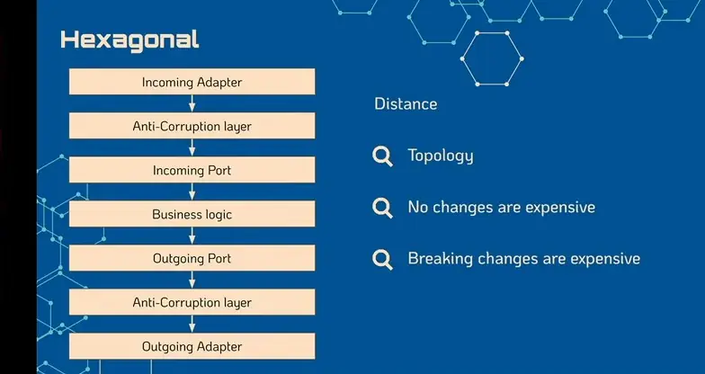
*[▶ 00:45:47](https://www.youtube.com/watch?v=m9viRAIRAUQ&t=2747s) · Hexagonal Architecture*

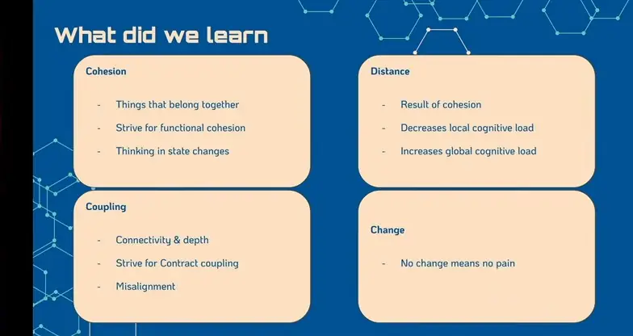
*[▶ 00:47:30](https://www.youtube.com/watch?v=m9viRAIRAUQ&t=2850s) · What did we learn*

## Links & resources

- [Ties van de Ven — website](https://www.tiesvandeven.nl) — <https://www.tiesvandeven.nl> · on screen [▶ 00:48:50](https://www.youtube.com/watch?v=m9viRAIRAUQ&t=2930s)
