# The state of the tech industry in 2026 - LDX3 New York

*How engineering work, team structure, review, and infrastructure are changing as agents write most of the code, based on a LDX3 keynote.*

Source: [The state of the tech industry in 2026 - LDX3 New York](https://www.youtube.com/watch?v=Ru99FGJ_yuE) · The Pragmatic Engineer · 30 min

## TL;DR

Agents now write most code at many companies, but review, reliability, and compute capacity have not kept up with the higher output. Code volume has grown about 5x for merged pull requests since 2023, reviews are often rubber-stamped, and 98% uptime is becoming normal for large services. The talk's main point is that teams should build team-level agentic systems with cloud harnesses, secure compute early, and manage the cost of tokens. This matters because the bottlenecks have moved from writing code to reviewing, deploying, and trusting it.

## Key takeaways

- Since January, models such as Opus 4.5 and GPT-5.2 have worked well inside agent harnesses, and many startups track AI-written code approaching 100%.
- Engineers run several agents in parallel: Boris Cherny runs five local terminal sessions plus 5–10 web sessions, and Linear's Dima Zaytsev rotates across 5–10 worktrees.
- Migrations that once took years now finish quickly: Anthropic moved Bun from Zig to Rust in 11 days, Airbnb moved from Enzyme to React Testing Library in six weeks, and Uber moved millions of lines from JUnit 4 to 5 in four months.
- Merged pull requests are up about 5x since 2023, commits 6x, and new repos 5x, and agent-only-reviewed PRs rose from 10% in July to 18% in August.
- Many large companies cut per-token cost by about 50% using open models and smarter routing after AI budgets ran out, so cost optimization is now a major concern.
- Projects rarely fit more than two engineers, because each engineer's agents step on the others' implementation, so teams remain the unit of work that owns software and on-call.
- Planning, testing, and tests still matter: planning prevents building the wrong thing, testing still takes about as long as coding, and tests remain the best way to trust AI-written code.
- Lead times for CPU capacity rose from weeks to up to six months, so the author advises securing compute now, even at a premium.

## Agents now write most of the code

[▶ 00:00:53](https://www.youtube.com/watch?v=Ru99FGJ_yuE&t=53s)

Almost nobody writes code by hand anymore. Since January, models such as Opus 4.5 and GPT-5.2 have worked well inside agent harnesses, and many startups track AI-written code approaching 100%. The trend is covered in [When AI writes almost all code, what happens to software engineering?](https://newsletter.pragmaticengineer.com/p/when-ai-writes-almost-all-code-what)

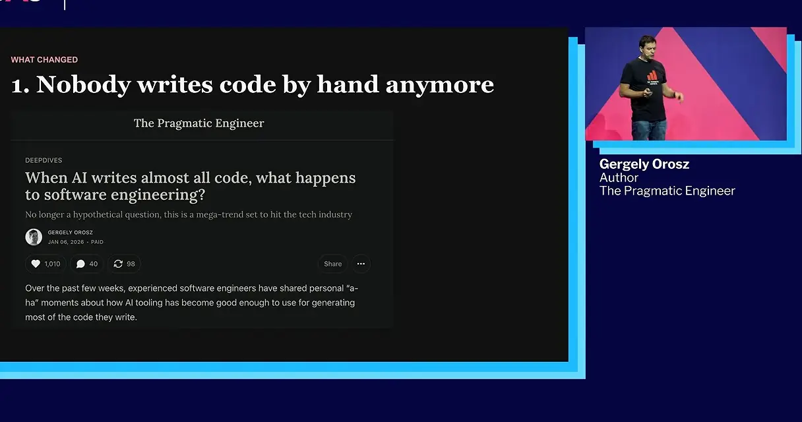
*[▶ 00:01:29](https://www.youtube.com/watch?v=Ru99FGJ_yuE&t=89s) · Nobody writes code by hand anymore*

Engineers run several agents at once. Boris Cherny, creator of Claude Code, runs five local terminal sessions plus 5–10 web sessions, and Linear's Dima Zaytsev rotates across 5–10 worktrees. Heavyweight IDE usage is trending down. Cursor now calls its IDE a legacy product, kept for enterprise but shrinking.

Many large companies build their own agent harnesses to connect data sources they won't expose to outside tools.

OpenAI's "agentic software factory" shows the full loop: Codex writes code, agentic review handles most changes, low-risk changes deploy automatically, and a Perf Factory proposes fixes from production signals. A [deep dive on it](https://newsletter.pragmaticengineer.com/p/openai-software-factory) is coming.

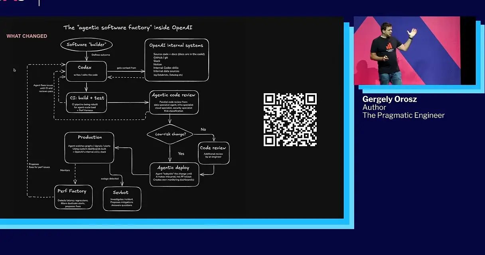
*[▶ 00:06:25](https://www.youtube.com/watch?v=Ru99FGJ_yuE&t=385s) · The agentic software factory inside OpenAI*

Migrations no longer take years. Anthropic moved Bun from Zig to Rust in 11 days, Airbnb moved from Enzyme to React Testing Library in six weeks, and Uber moved millions of lines from JUnit 4 to 5 in four months.

Agent output is growing fast. On Linear, agent-created issues outnumbered human-created ones for the first time.

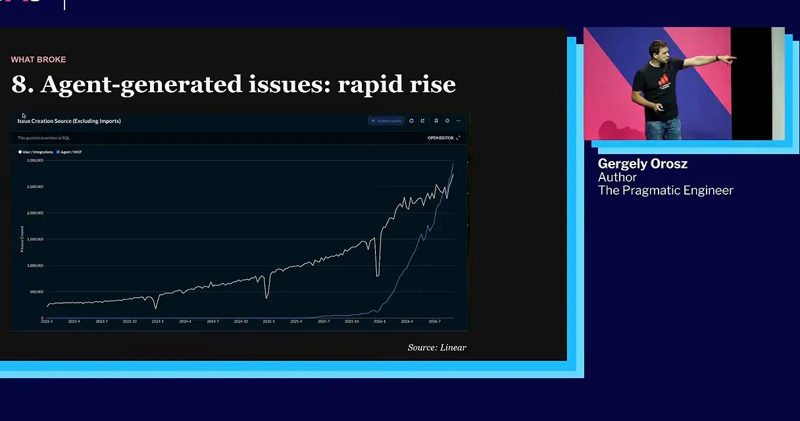
*[▶ 00:08:33](https://www.youtube.com/watch?v=Ru99FGJ_yuE&t=513s) · Agent-generated issues: rapid rise*

Agent-only-reviewed pull requests rose from 10% of PRs in July to 18% in August.

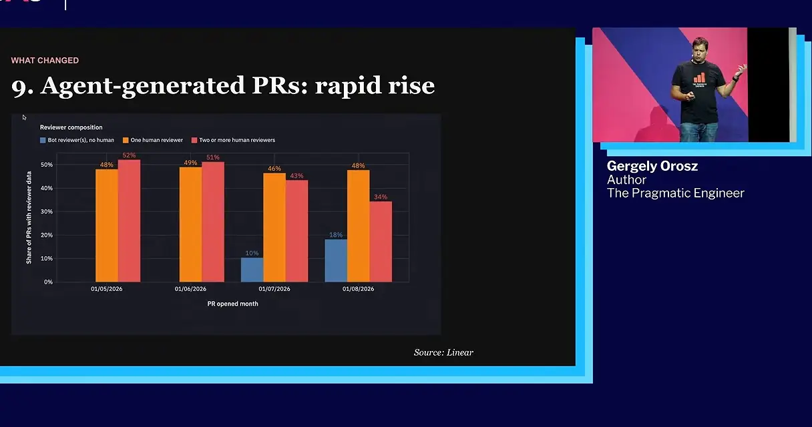
*[▶ 00:08:56](https://www.youtube.com/watch?v=Ru99FGJ_yuE&t=536s) · Reviewer composition of agent PRs*

Cost is now a major concern. After news that Uber exhausted its annual AI budget, many large companies cut per-token cost by about 50% using open models and smarter routing. OpenCode's Dax Raad says every enterprise request in the past month was about optimizing spend.

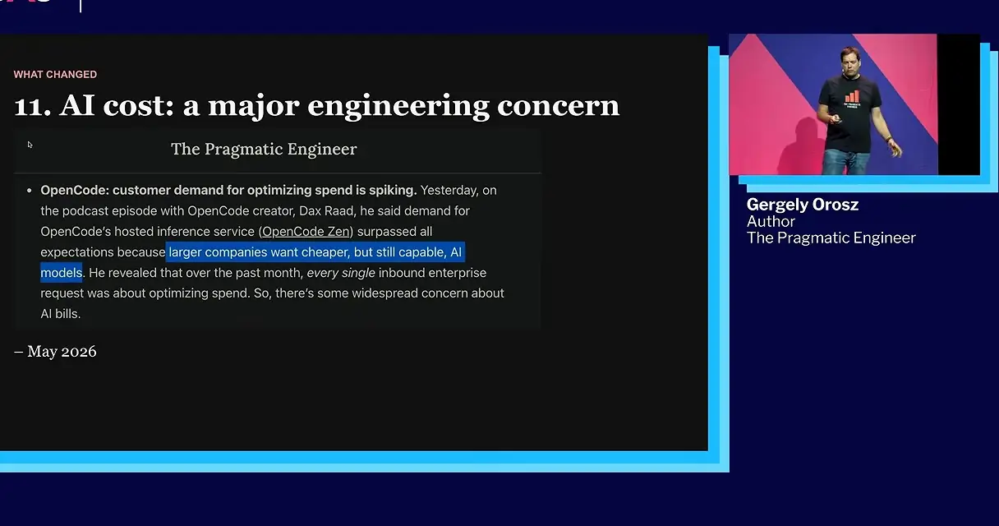
*[▶ 00:09:56](https://www.youtube.com/watch?v=Ru99FGJ_yuE&t=596s) · AI cost: OpenCode demand for spend optimization*

Team structure is shifting too. OpenAI stopped hiring iOS and Android specialists, since anyone can now do the work at a good-enough level. Katelyn Lesse, Head of Engineering for Claude Platform, says projects rarely fit more than two engineers, because each engineer's agents step on the others' implementation.

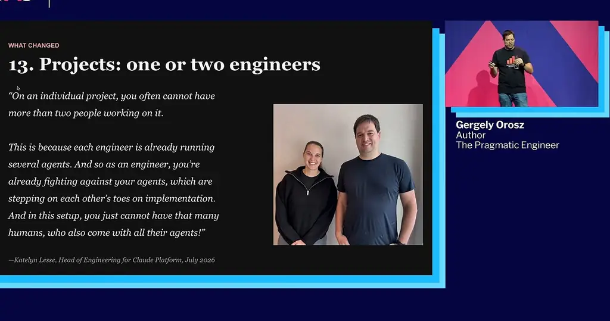
*[▶ 00:11:40](https://www.youtube.com/watch?v=Ru99FGJ_yuE&t=700s) · 13. Projects: one or two engineers*

## Teams, planning, and tests still matter

[▶ 00:12:29](https://www.youtube.com/watch?v=Ru99FGJ_yuE&t=749s)

Teams remain the unit of work. Two humans plus agents is likely a one-off project, not a team. Anthropic's Katelyn Lesse says teams still own software and on-call.

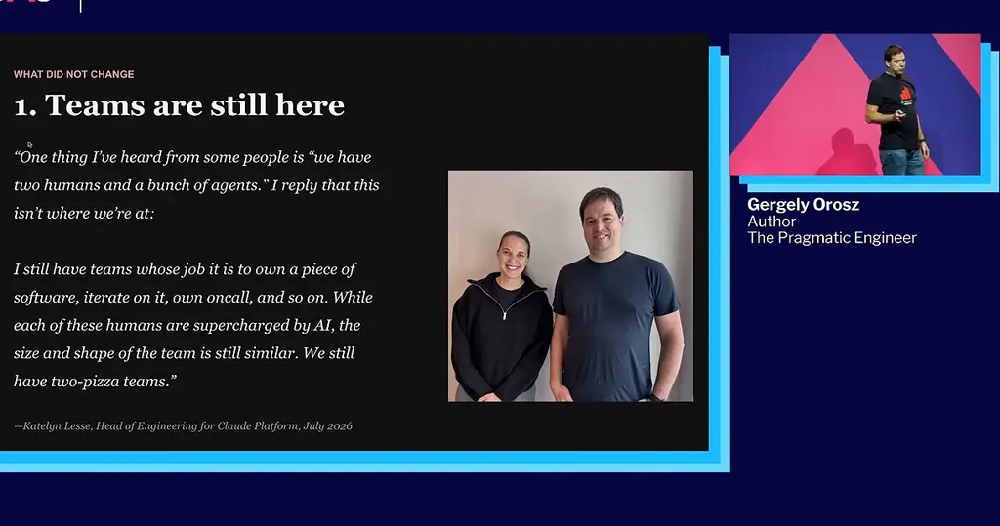
*[▶ 00:13:34](https://www.youtube.com/watch?v=Ru99FGJ_yuE&t=814s) · 1. Teams are still here*

Planning still matters for complex work, because building the wrong thing is waste. It matters most for infra, team alignment, and customer communication.

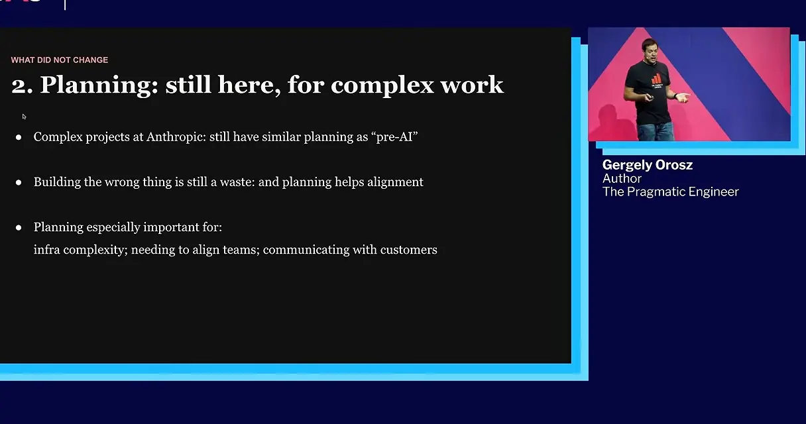
*[▶ 00:14:00](https://www.youtube.com/watch?v=Ru99FGJ_yuE&t=840s) · 2. Planning: still here, for complex work*

Testing still takes about as long as coding. Tests remain the best way to trust AI-written code.

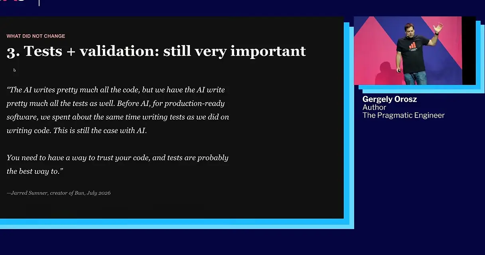
*[▶ 00:14:41](https://www.youtube.com/watch?v=Ru99FGJ_yuE&t=881s) · 3. Tests + validation: still very important*

Non-engineers still aren't shipping production code. They file bug reports in Slack.

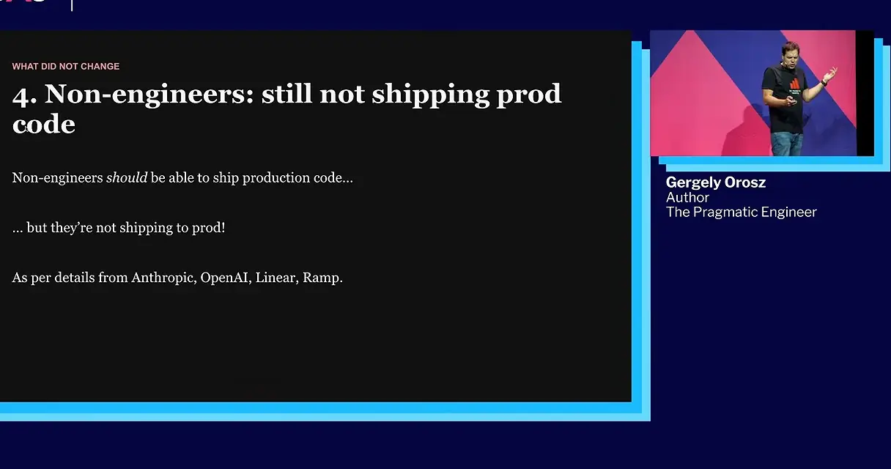
*[▶ 00:15:26](https://www.youtube.com/watch?v=Ru99FGJ_yuE&t=926s) · 4. Non-engineers: still not shipping prod code*

Old ideas are resurfacing. Matt Pocock found that terms like tracer bullets and deep modules make AI-written code better.

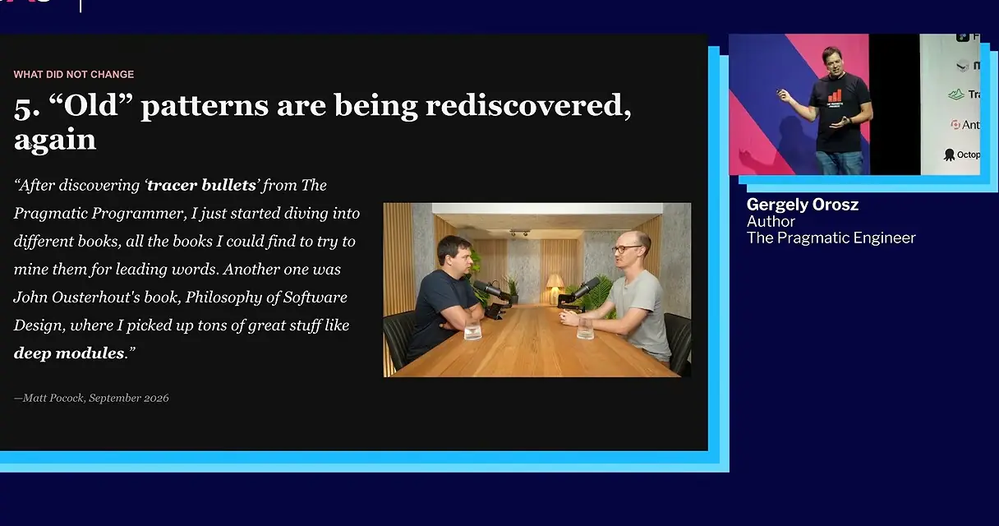
*[▶ 00:16:09](https://www.youtube.com/watch?v=Ru99FGJ_yuE&t=969s) · What did not change: old patterns rediscovered*

## Volume outran review, reliability and capacity

[▶ 00:16:14](https://www.youtube.com/watch?v=Ru99FGJ_yuE&t=974s)

Code volume has outrun review and delivery assumptions. Merged pull requests are up about 5x since 2023, commits 6x, and new repos 5x, according to GitHub data.

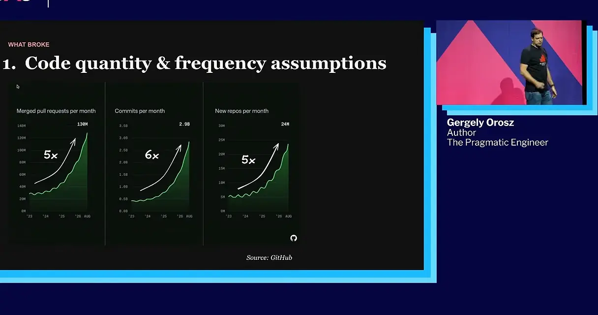
*[▶ 00:16:58](https://www.youtube.com/watch?v=Ru99FGJ_yuE&t=1018s) · Code quantity and frequency assumptions broke*

Reviews have become rubber-stamping: a teammate who "stamps everything with LGTM" is what the speaker calls a zombie code review. Ramp now lets teams skip review for some non-critical code.

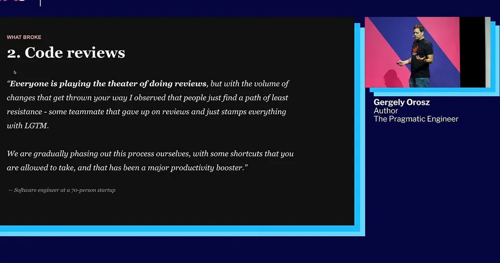
*[▶ 00:17:47](https://www.youtube.com/watch?v=Ru99FGJ_yuE&t=1067s) · What broke: code reviews*

Reliability is slipping: Mario Zechner says 98% uptime is becoming normal, even for big services, and the trend is accelerating.

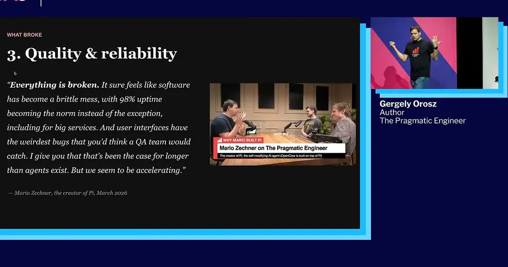
*[▶ 00:18:12](https://www.youtube.com/watch?v=Ru99FGJ_yuE&t=1092s) · What broke: quality and reliability*

CPU is scarce too. Lead times rose from weeks to up to six months, and some companies pay for capacity arriving in December. The author's [The Pulse: a new trend of CPU shortages](https://blog.pragmaticengineer.com/the-pulse-a-new-trend-of-cpu-shortages/) advises: secure compute now, even at a premium.

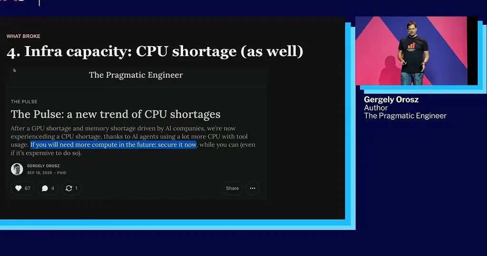
*[▶ 00:19:17](https://www.youtube.com/watch?v=Ru99FGJ_yuE&t=1157s) · 4. Infra capacity: CPU shortage (as well)*

Productivity gains raised the baseline. Dima Zaytsev at Linear finished in an hour what peers needed a day, but parallel work is now expected, leaving him more work than pre-AI.

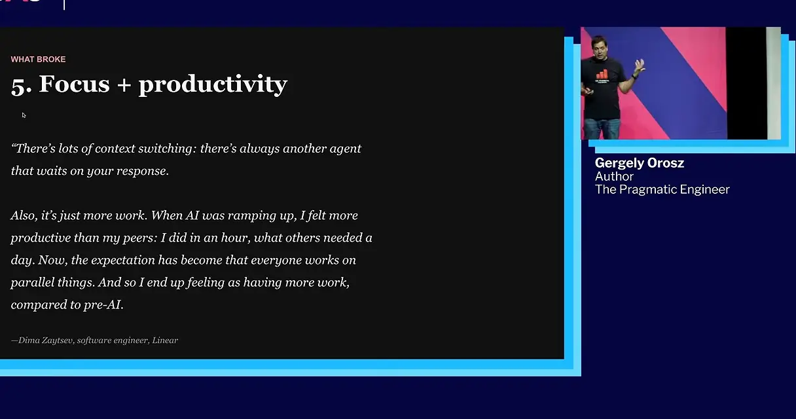
*[▶ 00:19:59](https://www.youtube.com/watch?v=Ru99FGJ_yuE&t=1199s) · 5. Focus + productivity quote*

Leaders are leaving mainly because the job got harder: founder-mode demands like cutting half the team while doubling revenue. Losing startups and slow AI adoption also push them out.

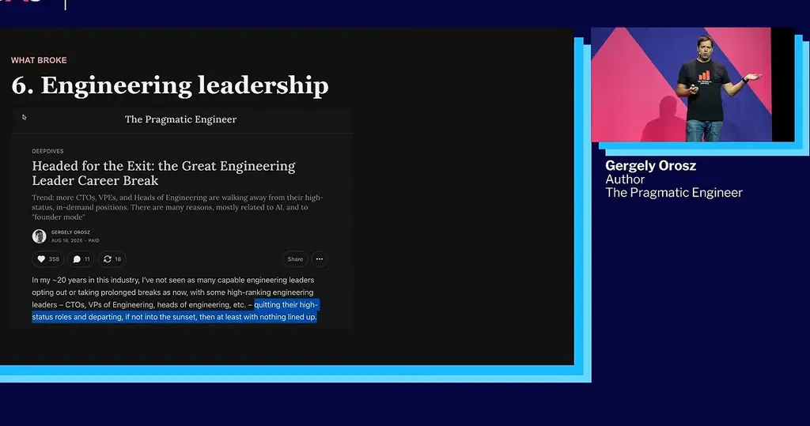
*[▶ 00:20:21](https://www.youtube.com/watch?v=Ru99FGJ_yuE&t=1221s) · 6. Engineering leadership: article excerpt*

## What comes next for engineers

[▶ 00:22:53](https://www.youtube.com/watch?v=Ru99FGJ_yuE&t=1373s)

Ramp runs one of the most advanced cloud agent harnesses because local machines can run only one or two agent sessions. A CPU shortage makes capacity harder to secure.

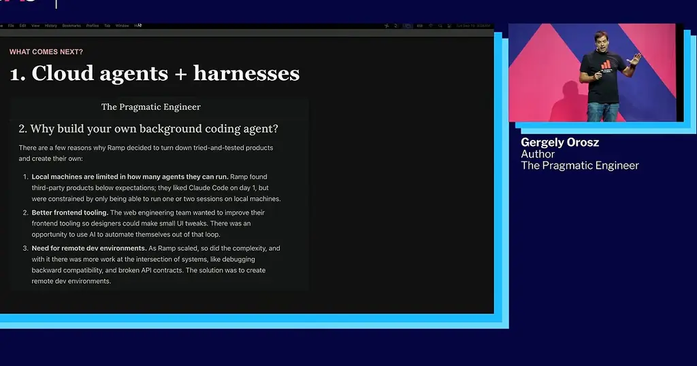
*[▶ 00:23:51](https://www.youtube.com/watch?v=Ru99FGJ_yuE&t=1431s) · Cloud agents + harnesses: Ramp's background agent*

Linear's Dima Zaytsev now prefers cloud: it doesn't hog his machine, and pulling branches locally is cumbersome.

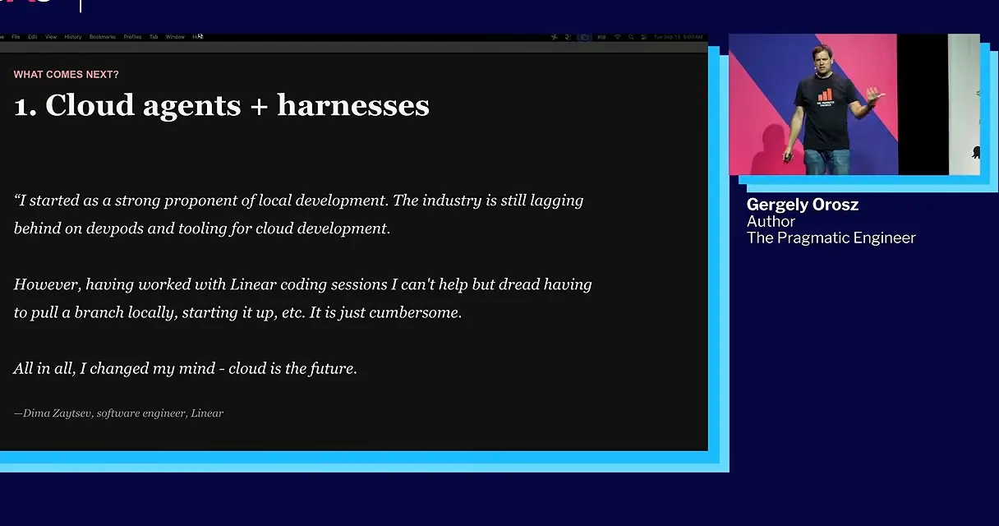
*[▶ 00:24:18](https://www.youtube.com/watch?v=Ru99FGJ_yuE&t=1458s) · Dima Zaytsev (Linear) on cloud vs local development*

Teams will stop reading every line of code, as ops and QA already do, and evals will move into CI/CD.

Cheap refactoring will trigger migrations and rewrites. A Series D engineering director screens hires for AI positivity.

AI maturity comes from applying AI to the system, not the individual, says Laura Tacho of AWS. Build team-level agentic systems, not individual simple automation.

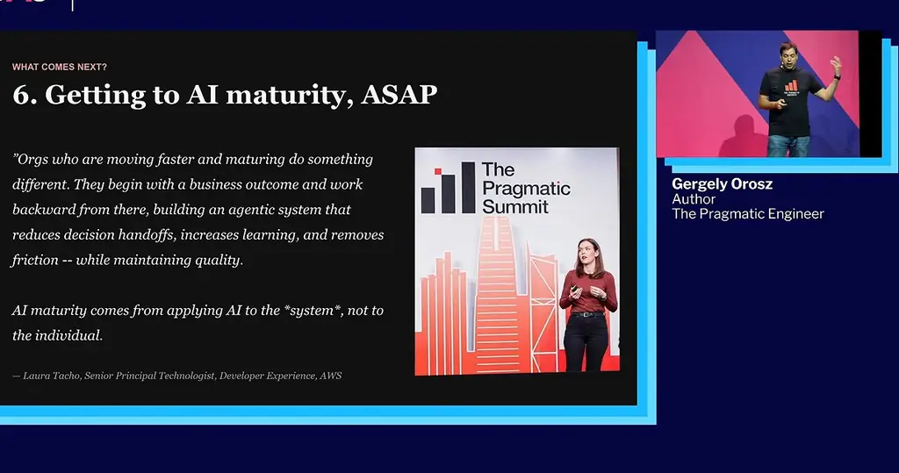
*[▶ 00:26:13](https://www.youtube.com/watch?v=Ru99FGJ_yuE&t=1573s) · Getting to AI maturity, ASAP (quote)*

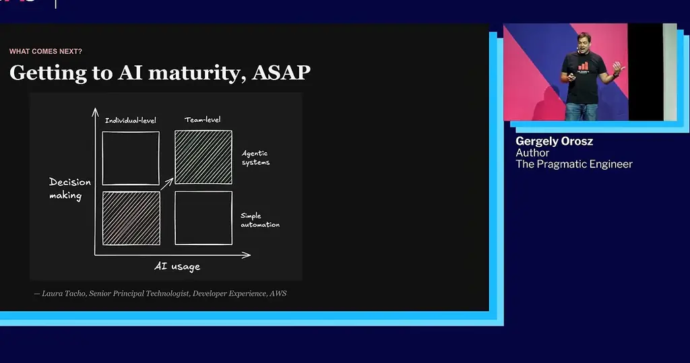
*[▶ 00:26:32](https://www.youtube.com/watch?v=Ru99FGJ_yuE&t=1592s) · AI usage vs decision making 2x2*

Titus Winters says that as intelligence (how to do it) gets cheap, wisdom (what to do) and charisma (convincing others) matter more, so deep domain knowledge will be in demand.

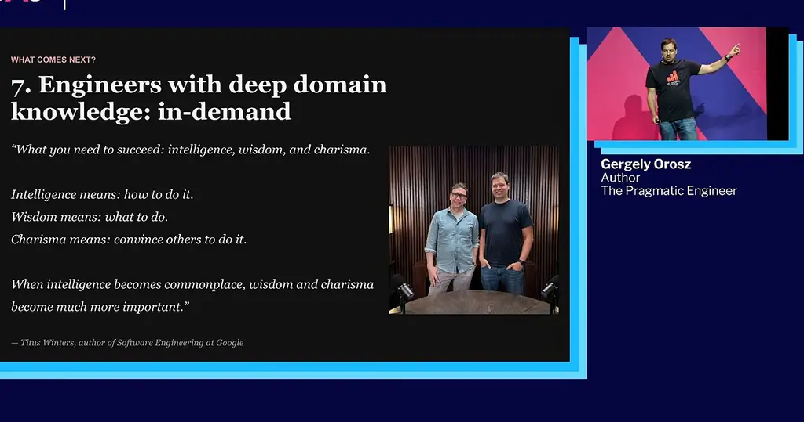
*[▶ 00:27:20](https://www.youtube.com/watch?v=Ru99FGJ_yuE&t=1640s) · Engineers with deep domain knowledge: in-demand*

To future-proof your career: stay hands-on, build AI infrastructure, use AI to remove friction, don't outsource your learning, and expect less people management for now.

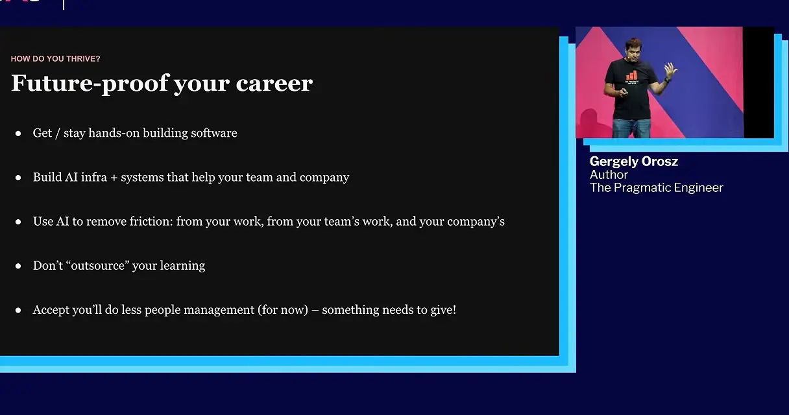
*[▶ 00:28:26](https://www.youtube.com/watch?v=Ru99FGJ_yuE&t=1706s) · Future-proof your career*

## Links & resources

- GitHub data on agent-generated PRs and monthly pushes — cited by speaker, URL not shown · mentioned [▶ 00:09:00](https://www.youtube.com/watch?v=Ru99FGJ_yuE&t=540s)
- [Pragmatic Engineer — inside OpenAI's software factory article](https://newsletter.pragmaticengineer.com/p/openai-software-factory) — <https://newsletter.pragmaticengineer.com/p/openai-software-factory> · video description
- [Pragmatic Engineer — inside Anthropic article](https://newsletter.pragmaticengineer.com/p/inside-anthropic) — <https://newsletter.pragmaticengineer.com/p/inside-anthropic> · video description
- [Pragmatic Engineer — when AI writes almost all code, article](https://newsletter.pragmaticengineer.com/p/when-ai-writes-almost-all-code-what) — <https://newsletter.pragmaticengineer.com/p/when-ai-writes-almost-all-code-what> · video description
- [Pragmatic Pulse — new trend of CPU shortages, blog post](https://blog.pragmaticengineer.com/the-pulse-a-new-trend-of-cpu-shortages/) — <https://blog.pragmaticengineer.com/the-pulse-a-new-trend-of-cpu-shortages/> · video description
