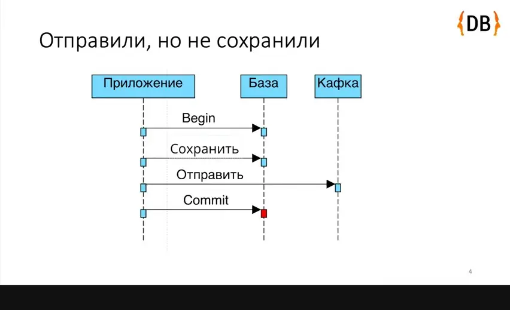
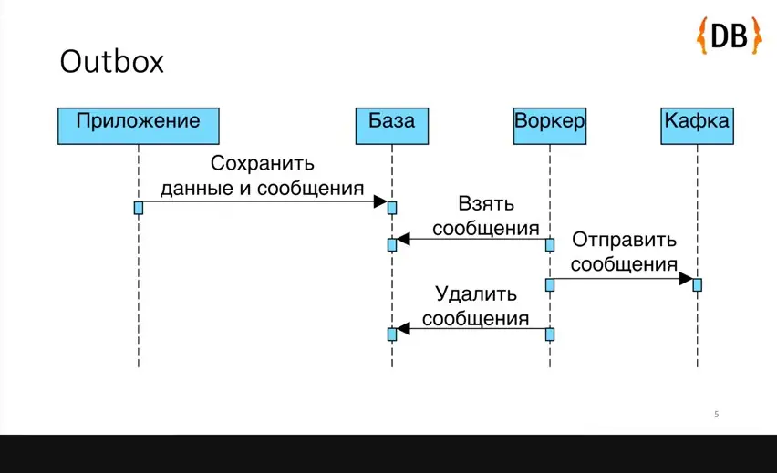
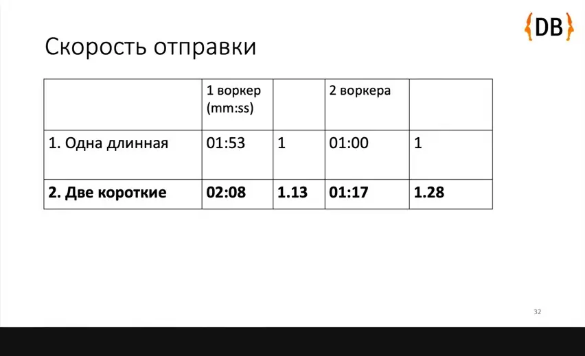
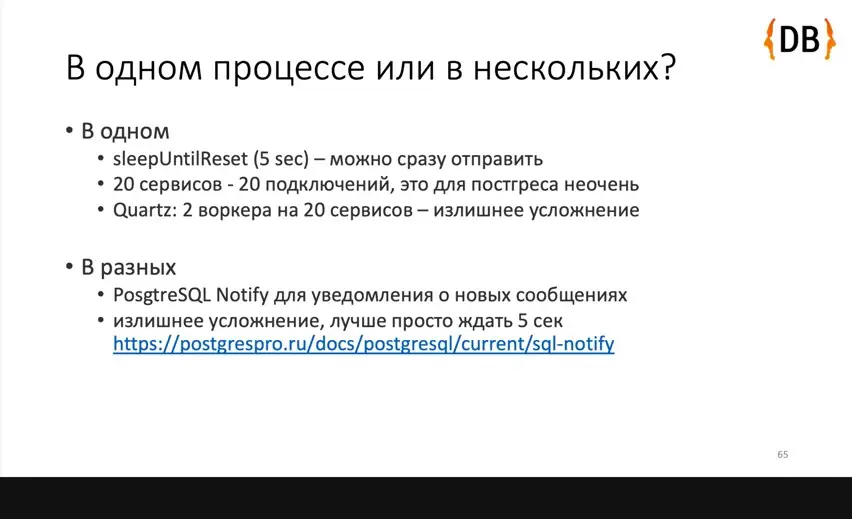
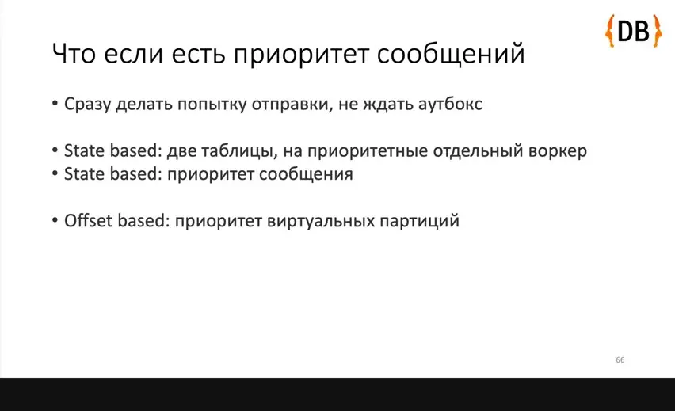
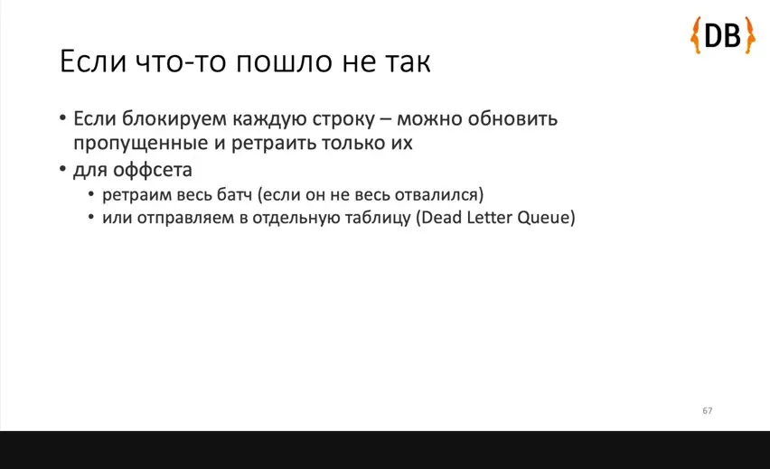
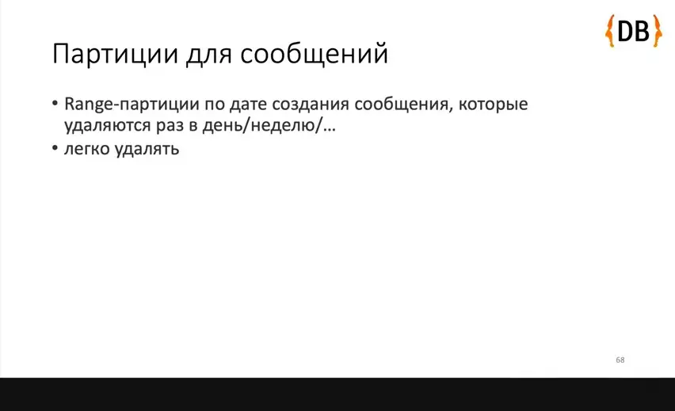
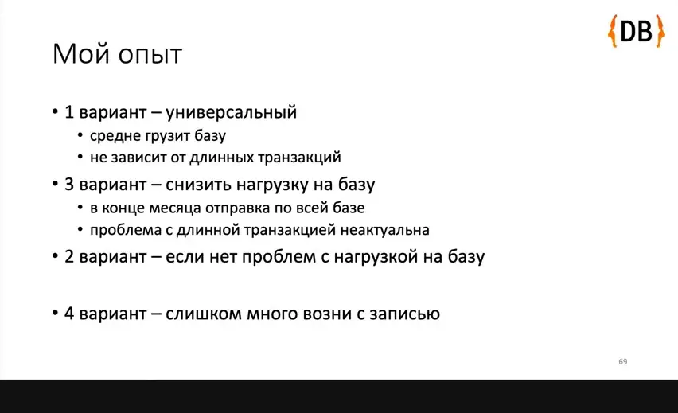
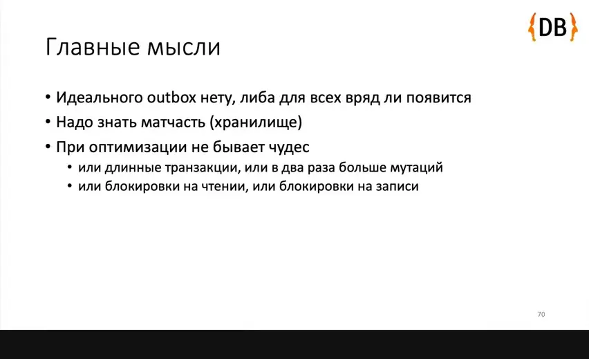
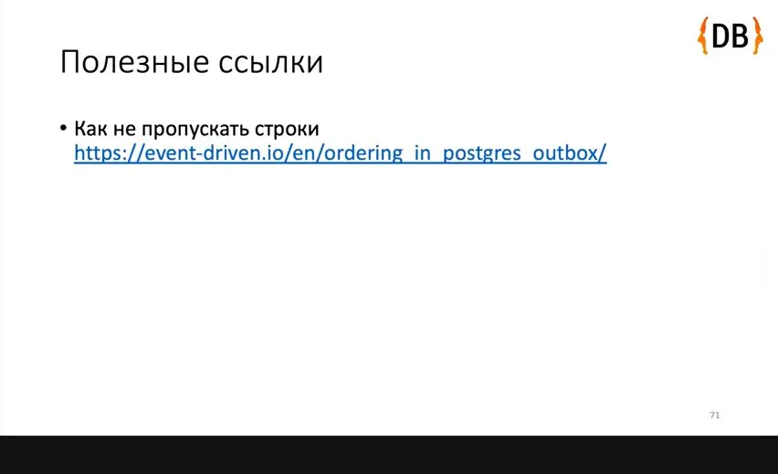

# Денис Цветцих — А сколько реализаций Transactional Outbox для PostgreSQL вы знаете?

*Разбор вариантов Transactional Outbox для PostgreSQL: как устроен каждый, какие у него минусы и как выбрать вариант под свою задачу.*

Источник: [Денис Цветцих — А сколько реализаций Transactional Outbox для PostgreSQL вы знаете?](https://www.youtube.com/watch?v=m82RaZcpcgU) · Денис Цветцих · Joker — Конференция о будущем разработки · 45 мин

## Коротко

Запись данных в базу и отправка сообщения в Kafka двумя отдельными действиями могут рассогласоваться, а двухфазный коммит на практике не подходит, потому что Kafka, RabbitMQ, MongoDB и Cassandra его не реализуют. Transactional Outbox решает это записью данных и сообщений в одной транзакции, после чего отдельный воркер отправляет сообщения и удаляет их. Докладчик показывает, как вариант с длинной транзакцией эволюционирует к коротким транзакциям, офсетам по xid8 и синхронизированной записи, и что каждая оптимизация меняет один недостаток на другой. Это важно, потому что, по словам докладчика, готовой библиотеки, которая реализует outbox единственно правильно, нет, и выбирать вариант приходится под свою нагрузку.

## Главное

- Двухфазный коммит XA на практике не годится: Kafka, RabbitMQ, MongoDB и Cassandra его не реализуют, а сам он медленный и сложный.
- Базовый вариант с длинной транзакцией держит отправку в Kafka внутри транзакции БД, из-за чего строки остаются заблокированными, растёт нагрузка на autovacuum и порядок сообщений не гарантируется.
- Вариант с advisory lock требует PgBouncer в session mode, а вариант с колонкой available_after и двумя короткими транзакциями убирает долгую блокировку, но вдвое увеличивает число мутаций строк и работу autovacuum.
- Чтобы не терять сообщения и сохранять порядок внутри виртуальной партиции, читайте только сообщения, чья транзакция раньше минимальной активной: используйте 64-битный xid8 и условие с pg_snapshot_xmin(pg_current_snapshot()), а не системный xmin.
- Наивный батч по id пропускает сообщения, потому что транзакция с меньшим id может закоммититься позже, а воркер уже сдвинул офсет дальше.
- Синхронизированная запись через pg_advisory_xact_lock или LOCK TABLE outbox_messages IN ROW EXCLUSIVE MODE делает id монотонным, и чтение сводится к id > last_processed_id, но все транзакции, пишущие в outbox, начинают ждать друг друга.
- При многих инстансах сервиса выносите воркер outbox в отдельный процесс, иначе воркеры займут подключения к Postgres; опроса таблицы раз в 5 секунд достаточно, LISTEN/NOTIFY не нужен.
- Приоритетные сообщения можно отправлять из сервиса сразу после коммита, но тогда возможен дубль при повторной отправке, поэтому консьюмер должен быть идемпотентным; сообщения, которые только вставляются, дешевле удалять range-партициями, чем DELETE.

## Двойная запись и длинная транзакция

[▶ 00:00:00](https://www.youtube.com/watch?v=m82RaZcpcgU&t=0s)

Приложение пишет в базу и отправляет сообщение в Kafka двумя отдельными действиями. Сбой между ними или при commit оставляет систему несогласованной.


*[▶ 00:02:42](https://www.youtube.com/watch?v=m82RaZcpcgU&t=162s) · Sent to Kafka but not saved*

Двухфазный коммит ([стандарт X/Open XA](https://ru.wikipedia.org/wiki/XA)) не решает задачу на практике: Kafka, RabbitMQ, MongoDB и Cassandra его не реализуют, а сам он медленный и сложный.

Решение — **Transactional Outbox**: данные и сообщения пишутся в одной транзакции, а отдельный воркер отправляет сообщения в Kafka и удаляет их.


*[▶ 00:03:13](https://www.youtube.com/watch?v=m82RaZcpcgU&t=193s) · Outbox sequence diagram*

Таблица `outbox_messages` хранит топик, ключ, тип, payload, headers и время создания.

```sql
CREATE TABLE outbox_messages (
id int4 GENERATED BY DEFAULT AS IDENTITY() NOT NULL,
topic varchar(128) NOT NULL,
key varchar(128) NULL,
type varchar(128) NOT NULL,
payload jsonb NOT NULL,
headers jsonb NOT NULL,
created_at timestamptz DEFAULT now() NOT NULL,
CONSTRAINT pk_outbox_messages PRIMARY KEY (id)
);
```

*[▶ 00:05:10](https://www.youtube.com/watch?v=m82RaZcpcgU&t=310s) · Табличка сообщений (outbox_messages table)*

Первый вариант — **длинная транзакция**. Воркер выбирает сообщения через `FOR UPDATE SKIP LOCKED`, отправляет их в Kafka, удаляет и делает commit. Если сообщений нет, он делает commit и засыпает на 5 секунд.

```text
BeginTransaction()

messages = GetPendingMessagesForUpdateSkipLocked()

if (messages.Any())
    SendBatchToKafka(messages)
    DeleteMessages(messages)
    CommitTransaction()
else
    CommitTransaction()
    sleep (5 sec)
```

*[▶ 00:05:54](https://www.youtube.com/watch?v=m82RaZcpcgU&t=354s) · Блокировка отправляемых сообщений*

В SQL отправка в Kafka стоит между вторым и третьим шагом:

```sql
--roundtrip 1
BEGIN;

--roundtrip 2
SELECT * FROM outbox_messages
ORDER BY id
LIMIT $batch_size
FOR UPDATE SKIP LOCKED;

--roundtrip 3
DELETE FROM outbox_messages
WHERE id IN ($messsage_ids);

--roundtrip 4
COMMIT;
```

*[▶ 00:06:22](https://www.youtube.com/watch?v=m82RaZcpcgU&t=382s) · Блокировка отправляемых сообщений (SQL)*

Плюс — несколько воркеров разбирают очередь параллельно. Минусы: отправка в Kafka идёт внутри транзакции, строки остаются заблокированными, их обновления нагружают autovacuum, а порядок сообщений не гарантируется.

```text
lock = GetAdvisoryLock()

messages = GetPendingMessages()

if (messages.Any())
    SendBatchToKafka(messages)
    DeleteMessages(messages)
    lock.Release()
else
    lock.Release()
    sleep (5 sec)
```

*[▶ 00:09:55](https://www.youtube.com/watch?v=m82RaZcpcgU&t=595s) · Порядок сообщений*

Замер на миллионе сообщений по 256 байт (батчи по 100): CPU базы достигает 20–25% с одним воркером и около 50% с двумя, отправка занимает 01:53 и 01:00. Это базовая линия для следующих вариантов.

Сам Outbox почти не нагружает CPU приложения, но короткоживущие объекты загружают сборщик мусора, поэтому докладчик советует читать сырым SQL вместо тяжёлых ORM.

## Блокировка вместо длинной транзакции

[▶ 00:09:28](https://www.youtube.com/watch?v=m82RaZcpcgU&t=568s)

Advisory lock заменяет длинную транзакцию: воркер берёт блокировку, читает пачку, отправляет в Kafka, удаляет сообщения и снимает блокировку.

```sql
--roundtrip 1
SELECT pg_catalog.pg_advisory_lock(-1613257171, -31457281);

--roundtrip 2
SELECT * FROM outbox_messages
ORDER BY id
LIMIT $batch_size;

--roundtrip 3
DELETE FROM outbox_messages
WHERE id IN ($messsage_ids);

--roundtrip 5
SELECT pg_catalog.pg_advisory_unlock(-1613257171, -31457281);
```

*[▶ 00:10:21](https://www.youtube.com/watch?v=m82RaZcpcgU&t=621s) · AdvisoryLock – без длинной транзакции*

Минусы: PgBouncer должен работать в session mode, иначе блокировку не снять. Соединение всё равно занято во время отправки, строки мутируют, а отправляет только один воркер.

Вариант с двумя короткими транзакциями использует колонку `available_after` с индексом. Блокировка здесь пессимистическая в смысле Фаулера (offline lock), а не `select for update`.

```sql
CREATE TABLE outbox.outbox_messages (
id int4 GENERATED BY DEFAULT AS IDENTITY() NOT NULL,
topic varchar(128) NOT NULL,
"key" varchar(128) NULL,
"type" varchar(128) NOT NULL,
payload jsonb NOT NULL,
headers jsonb NOT NULL,
created_at timestamptz DEFAULT now() NOT NULL,
available_after timestamptz DEFAULT now() NOT NULL,
CONSTRAINT pk_outbox_messages PRIMARY KEY (id)
);

CREATE INDEX ix_outbox_messages_available_after ON
outbox.outbox_messages USING btree (available_after);
```

*[▶ 00:12:53](https://www.youtube.com/watch?v=m82RaZcpcgU&t=773s) · Колонка для пессимистической блокировки*

Первая транзакция выбирает доступные строки `FOR UPDATE SKIP LOCKED` и сдвигает `available_after` на таймаут. Отправка и удаление идут после неё.

```text
messages = GetPendingMessagesAndLock(now() + lockTimeout)

if (messages.Any())
    SendBatchToKafka(messages)
    DeleteMessages(messages)
else
    sleep (5 sec)
```

*[▶ 00:13:40](https://www.youtube.com/watch?v=m82RaZcpcgU&t=820s) · Две короткие транзакции*

Четырёхшаговая транзакция сводится к одному запросу `UPDATE ... FROM`:

```sql
--roundtrip 1
BEGIN;

--roundtrip 2
SELECT id
FROM outbox_messages
WHERE available_after < now()
ORDER BY available_after
LIMIT $batch_size
FOR UPDATE SKIP LOCKED;

--roundtrip 3
UPDATE outbox_messages
SET available_after = $now_plus_lock_timeout
WHERE id IN ($messsage_ids);

--roundtrip 4
COMMIT;
```

*[▶ 00:13:59](https://www.youtube.com/watch?v=m82RaZcpcgU&t=839s) · Блокировка сообщений*

```sql
--roundtrip 1
UPDATE outbox_messages
SET available_after = $now_plus_lock_timeout
FROM
(
    SELECT id
    FROM outbox_messages
    WHERE available_after < now()
    ORDER BY available_after
    LIMIT $batch_size
    FOR UPDATE SKIP LOCKED
) locked_messages
WHERE
outbox_messages.id = locked_messages.id
RETURNING
outbox_messages.*;
```

*[▶ 00:14:13](https://www.youtube.com/watch?v=m82RaZcpcgU&t=853s) · Блокировка одним запросом*

Апгрейд: сохранять имя сервиса-владельца. Перезапущенный pod StatefulSet с тем же именем отправит свои сообщения без ожидания таймаута.

Цена: мутаций строк и работы автовакуума вдвое больше, порядка сообщений нет. Отправка медленнее: один воркер 02:08 против 01:53 (в 1.13 раза), два воркера 01:17 против 01:00 (в 1.28 раза).


*[▶ 00:16:23](https://www.youtube.com/watch?v=m82RaZcpcgU&t=983s) · Скорость отправки*

## Порядок внутри виртуальных партиций без пропусков

[▶ 00:16:23](https://www.youtube.com/watch?v=m82RaZcpcgU&t=983s)

Порядок нужен не глобальный, а внутри агрегата, как порядок внутри партиции Kafka. Требования: несколько воркеров, короткие транзакции без отправки внутри транзакции БД, строки не блокируются и не меняются, сообщения не пропускаются.

Наивный батч по `id` пропускает сообщения: транзакция получила меньший id, но закоммитилась позже, а воркер уже сдвинул офсет дальше.

```sql
SELECT *
FROM outbox_messages
WHERE
id > $last_processed_id
ORDER BY id
LIMIT $batch_size;
```

*[▶ 00:17:46](https://www.youtube.com/watch?v=m82RaZcpcgU&t=1066s) · Пропуски из-за длинных транзакций*

Читать можно только сообщения, чья транзакция раньше минимальной активной. Системный `xmin` для этого не годится: он 32-битный, сбрасывается, не сравнивается с bigint без конвертации и не индексируется. Берется 64-битный `xid8`, который по умолчанию заполняется через `pg_current_xact_id()`. Идея счетчика транзакций описана в [статье Оскара Дудыча](https://event-driven.io/en/ordering_in_postgres_outbox/).

Таблица `outbox_offsets` хранит для каждой пары topic и partition позицию (`last_processed_transaction_id`, `last_processed_id`) и `available_after`. В простом варианте виртуальная партиция соответствует физической один к одному.

```sql
CREATE TABLE outbox_offsets (
id int4 GENERATED BY DEFAULT AS IDENTITY() NOT NULL,
last_processed_id int4 NOT NULL,
available_after timestamptz DEFAULT now() NOT NULL,
last_processed_transaction_id xid8 NOT NULL,
"partition" int4 NOT NULL,
topic varchar(128) NOT NULL,
CONSTRAINT pk_outbox_offsets PRIMARY KEY (id)
);

CREATE UNIQUE INDEX ix_outbox_offsets_topic_partition
ON outbox_offsets
USING btree (topic, partition);
```

*[▶ 00:20:50](https://www.youtube.com/watch?v=m82RaZcpcgU&t=1250s) · Виртуальные партиции*

В `outbox_messages` добавляются колонки `partition` и `transaction_id` и индекс по (topic, partition, transaction_id, id).

```sql
CREATE TABLE outbox_messages (
id int4 GENERATED BY DEFAULT AS IDENTITY() NOT NULL,
topic varchar(128) NOT NULL,
"key" varchar(128) NULL,
"type" varchar(128) NOT NULL,
payload jsonb NOT NULL,
headers jsonb NOT NULL,
created_at timestamptz DEFAULT now() NOT NULL,
"partition" int4 DEFAULT 0 NOT NULL,
transaction_id xid8 DEFAULT pg_current_xact_id() NOT NULL,
CONSTRAINT pk_outbox_messages PRIMARY KEY (id)
);
CREATE INDEX ix_outbox_messages_topic_partition_transaction_id_id ON
outbox_messages USING btree (topic, partition, transaction_id, id);
```

*[▶ 00:21:08](https://www.youtube.com/watch?v=m82RaZcpcgU&t=1268s) · Id транзакции в сообщении*

Воркер берет партицию, которую проверяли дольше всего, через `UPDATE ... FROM SELECT ... FOR UPDATE SKIP LOCKED`, и сразу откладывает ее `available_after` на время блокировки.

```sql
UPDATE outbox_offsets
SET available_after = $now_plus_lock_timeout
FROM
(
    SELECT id
    FROM outbox_offsets
    WHERE available_after < now()
    ORDER BY available_after
    LIMIT 1
    FOR UPDATE SKIP LOCKED
) locked_offsets
WHERE
outbox_offsets.id = locked_offsets.id
RETURNING
outbox_offsets.*;
```

*[▶ 00:22:24](https://www.youtube.com/watch?v=m82RaZcpcgU&t=1344s) · Давно не проверенная партиция*

Курсор состоит из двух значений, `transaction_id` и `id`: одна транзакция может записать 200 сообщений при батче 100. Условие `transaction_id < pg_snapshot_xmin(pg_current_snapshot())` не дает прочитать незавершенные транзакции.

```sql
SELECT *
FROM outbox_messages
WHERE
topic = $topic AND
partition = $partition AND
transaction_id > $last_processed_transaction_id AND
(
    transaction_id > $last_processed_transaction_id
    OR
    transaction_id = $last_processed_transaction_id AND id > $last_processed_…
) AND
transaction_id < pg_snapshot_xmin(pg_current_snapshot())
ORDER BY transaction_id, id
LIMIT $batch_size;
```

*[▶ 00:23:52](https://www.youtube.com/watch?v=m82RaZcpcgU&t=1432s) · Сообщения для партиции*

Если сообщений нет или случилась ошибка, партиция откладывается на таймаут и проверяется позже. Это три обращения к БД:

```sql
--roundtrip 1
UPDATE FROM SELECT outbox_offsets …;

--roundtrip 2
SELECT * FROM outbox_messages
WHERE {condition};

--roundtrip 3
UPDATE outbox_offsets
SET
available_after = $now_plus_timeout
WHERE id = $id;
```

*[▶ 00:24:35](https://www.youtube.com/watch?v=m82RaZcpcgU&t=1475s) · Error flow*

Плюсы: порядок внутри партиции, несколько воркеров, короткие транзакции, отсутствие блокировок строк, нет пропусков. Минусы: длинная транзакция, например миграция на минуты, останавливает отправку из всех партиций, а ошибка может остановить одну. Приоритетные сообщения лучше отправлять из сервиса сразу, минуя outbox.

## Синхронизированная запись сообщений в конце транзакции

[▶ 00:27:23](https://www.youtube.com/watch?v=m82RaZcpcgU&t=1643s)

Чтобы чтение не зависело от длинных транзакций, запись в `outbox_messages` синхронизируют: транзакции пишут сообщения по очереди, и id растёт монотонно. Пропуски при откате допустимы. Тогда выборка сводится к `id > last_processed_id`, без офсетов и идентификаторов транзакций.

Раньше бизнес-данные и сообщения попадали в один Unit of Work и коммитились вместе, поэтому блокировка держалась всю транзакцию:

```csharp
unitOfWork.Add(entity1);
unitOfWork.Add(message1);

unitOfWork.Add(entity2);
unitOfWork.Add(message2);

unitOfWork.SaveChanges()
```

*[▶ 00:29:42](https://www.youtube.com/watch?v=m82RaZcpcgU&t=1782s) · Было: данные и сообщения*

Теперь данные сохраняются без сообщений, а сообщения записываются отдельным репозиторием уже под блокировкой:

```text
unitOfWork.Add(entity1);
messageRepository.Add(message1);

unitOfWork.Add(entity2);
messageRepository.Add(message2);

beginTransaction()

unitOfWork.SaveChanges() // without messages

messageRepository.SaveChanges()

commitTransaction()
```

*[▶ 00:30:14](https://www.youtube.com/watch?v=m82RaZcpcgU&t=1814s) · Стало: отдельно данные и сообщения*

Без Unit of Work порядок тот же: если вставки чередуются, блокировка таблицы сообщений держится весь путь транзакции, а если сначала вставить все данные, окно сужается:

```text
beginTransaction()

entityRepository.Insert(entity1);
messageRepository.Insert(message1);

entityRepository.Insert(entity2);
messageRepository.Insert(message2);

commitTransaction()
```

*[▶ 00:30:28](https://www.youtube.com/watch?v=m82RaZcpcgU&t=1828s) · Было без Unit of Work*

```text
beginTransaction()

entityRepository.Insert(entity1);
entityRepository.Insert(entity2);

messageRepository.Insert(message1);
messageRepository.Insert(message2);

commitTransaction()
```

*[▶ 00:30:38](https://www.youtube.com/watch?v=m82RaZcpcgU&t=1838s) · Стало без Unit of Work*

В PostgreSQL блокировку берут двумя способами:

- транзакционный advisory-лок `pg_advisory_xact_lock`, который снимается сам при commit или rollback;
- явный `LOCK TABLE outbox_messages IN ROW EXCLUSIVE MODE`, после которого остальные транзакции ждут.

```sql
--roundtrip 1
BEGIN;

--roundtrip 2
INSERT/UPDATE/DELETE business_data;

--roundtrip 3
SELECT pg_advisory_xact_lock(554738281823524); --transactional

INSERT INTO outbox_messages
(topic, partition, type, key, payload, headers)
VALUES
($topic, $partition, $type, $key, $payload, $headers);

--roundtrip 4
COMMIT;
```

*[▶ 00:31:10](https://www.youtube.com/watch?v=m82RaZcpcgU&t=1870s) · Стало*

```sql
--roundtrip 1
BEGIN;

--roundtrip 2
INSERT/UPDATE/DELETE business_data;

--roundtrip 3
LOCK TABLE outbox_messages IN ROW EXCLUSIVE MODE;

INSERT INTO outbox_messages
(topic, partition, type, key, payload, headers)
VALUES
($topic, $partition, $type, $key, $payload, $headers);

--roundtrip 4
COMMIT;
```

*[▶ 00:31:35](https://www.youtube.com/watch?v=m82RaZcpcgU&t=1895s) · Стало*

Цена решения: все транзакции, пишущие в outbox, теперь ждут друг друга в очереди, и тяжёлый ORM с трекингом изменений нужно дотюнивать. Нагрузка на базу при этом остаётся низкой, а скорость отправки сопоставима с другими вариантами.

## Где запускать воркер и как вести приоритетные сообщения

[▶ 00:34:29](https://www.youtube.com/watch?v=m82RaZcpcgU&t=2069s)

Воркер аутбокса можно запускать в том же процессе, что и бизнес-сервис: после сохранения сообщения он будится через канал. Но если инстансов много, например 20 по 20 воркеров, они займут 20 подключений из примерно 100 в Постгресе. В таком случае выносите аутбокс в отдельный процесс. Ограничивать число активных воркеров через Quartz — излишнее усложнение, на практике так не делают. Уведомления через [LISTEN/NOTIFY](https://postgrespro.ru/docs/postgresql/current/sql-notify) тоже лишние: достаточно опрашивать таблицу раз в 5 секунд.


*[▶ 00:37:08](https://www.youtube.com/watch?v=m82RaZcpcgU&t=2228s) · В одном процессе или в нескольких?*

Приоритетные сообщения можно не ждать аутбокса: закоммитить транзакцию и сразу отправить сообщение в Кафку из бизнес-сервиса. Тогда при повторной отправке аутбоксом появится дубль, и консьюмер должен быть идемпотентным. Для приоритета внутри аутбокса:

- State based: отдельная таблица или колонка приоритета с сортировкой.
- Offset based: приоритетные виртуальные партиции.


*[▶ 00:38:28](https://www.youtube.com/watch?v=m82RaZcpcgU&t=2308s) · Что если есть приоритет сообщений*

При ошибке в state based аутбоксе, где блокируется каждая строка, обновляются пропущенные строки и ретраятся только они. В offset based ретраится весь батч или он уходит в Dead Letter Queue. Dead Letter Queue ломает порядок сообщений, так как батч из партиции уходит отдельно.


*[▶ 00:39:24](https://www.youtube.com/watch?v=m82RaZcpcgU&t=2364s) · Если что-то пошло не так*

## Удаление партициями и выбор варианта outbox

[▶ 00:39:24](https://www.youtube.com/watch?v=m82RaZcpcgU&t=2364s)

Сообщения только вставляют и не обновляют, поэтому дешевле всего удалять их партициями: range-партиции по дате создания отстыковывают раз в день или неделю. Это быстрее `DELETE`, после которого работает вакуум.


*[▶ 00:40:02](https://www.youtube.com/watch?v=m82RaZcpcgU&t=2402s) · Партиции для сообщений*

Первый вариант строят чаще всего: он средне нагружает базу и не зависит от длинных транзакций. Третий популярен для массовых рассылок в конце периода: база не нагружается.


*[▶ 00:43:03](https://www.youtube.com/watch?v=m82RaZcpcgU&t=2583s) · Мой опыт*

Идеального outbox нет, а каждая оптимизация меняет один недостаток на другой.


*[▶ 00:44:35](https://www.youtube.com/watch?v=m82RaZcpcgU&t=2675s) · Главные мысли*

Для третьего варианта нужно не пропускать строки: см. [Счетчик транзакций для батчинга в Outbox](https://event-driven.io/en/ordering_in_postgres_outbox/) Оскара Дудыча.


*[▶ 00:44:46](https://www.youtube.com/watch?v=m82RaZcpcgU&t=2686s) · Полезные ссылки*

## Ссылки и материалы

- [Стандарт X/Open XA (eXtended Architecture) — описание на Википедии](https://ru.wikipedia.org/wiki/XA) — <https://ru.wikipedia.org/wiki/XA> · на экране [▶ 00:04:22](https://www.youtube.com/watch?v=m82RaZcpcgU&t=262s)
- [AdvisoryLock и pg_bouncer в session mode — статья на Хабре](https://habr.com/ru/companies/karuna/articles/674730/) — <https://habr.com/ru/companies/karuna/articles/674730/> · на экране [▶ 00:11:22](https://www.youtube.com/watch?v=m82RaZcpcgU&t=682s)
- [Счетчик транзакций для батчинга в Outbox — статья Оскара Дудыча](https://event-driven.io/en/ordering_in_postgres_outbox/) — <https://event-driven.io/en/ordering_in_postgres_outbox/> · на экране [▶ 00:18:45](https://www.youtube.com/watch?v=m82RaZcpcgU&t=1125s)
- [Документация PostgreSQL по NOTIFY — о LISTEN/NOTIFY в одном или нескольких процессах](https://postgrespro.ru/docs/postgresql/current/sql-notify) — <https://postgrespro.ru/docs/postgresql/current/sql-notify> · на экране [▶ 00:37:08](https://www.youtube.com/watch?v=m82RaZcpcgU&t=2228s)
