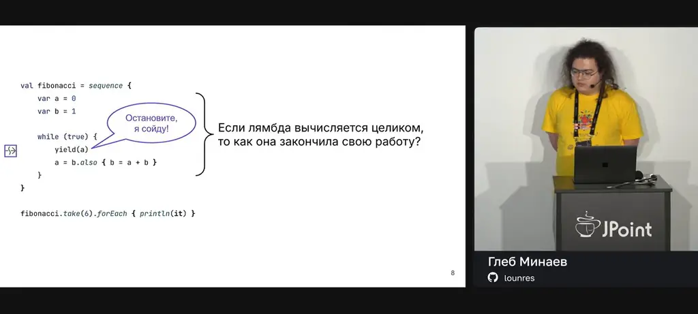
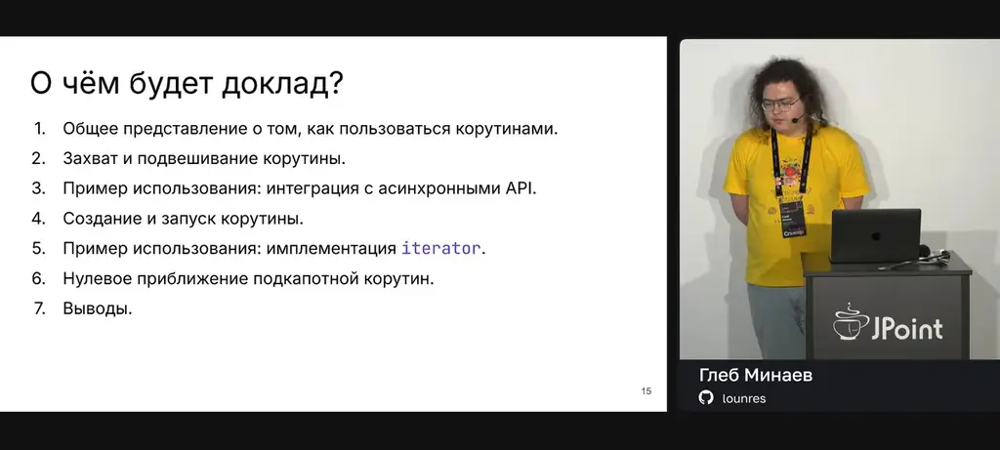
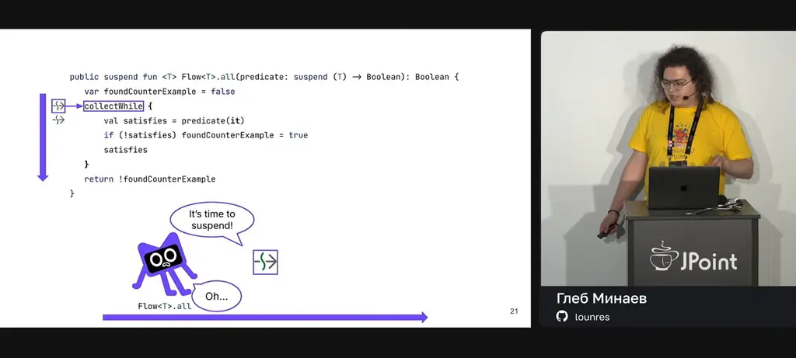
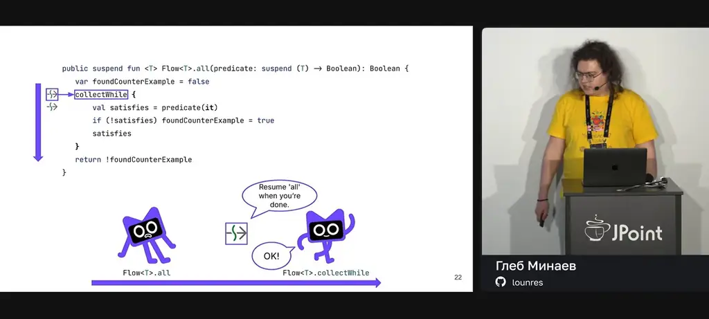
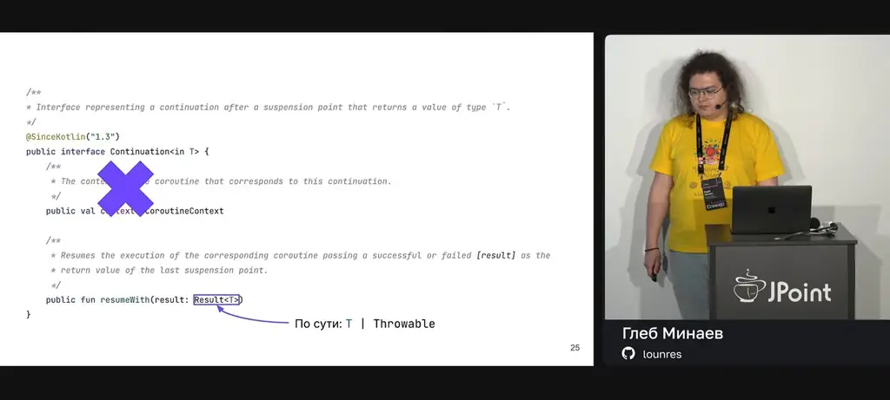
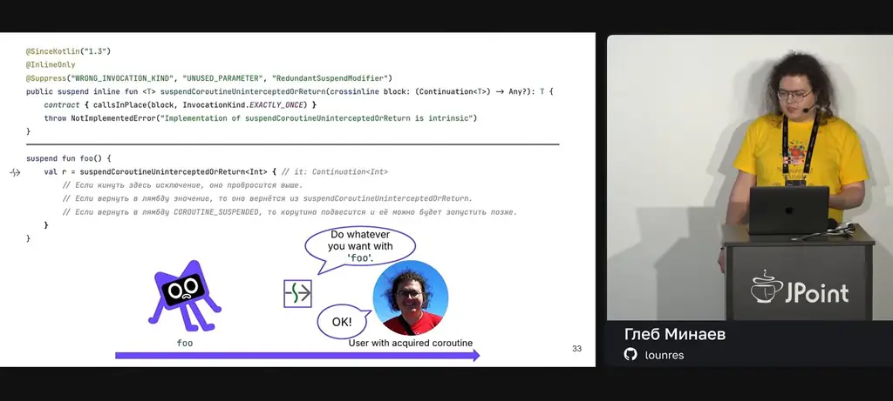
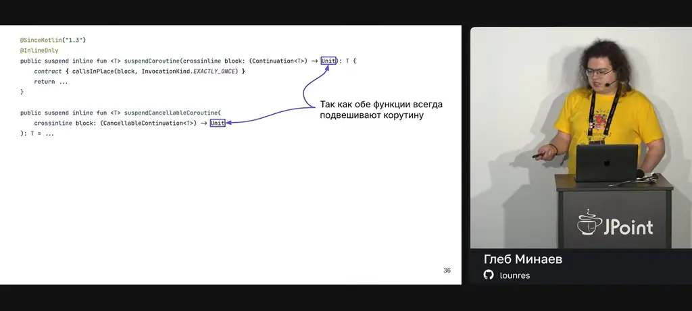
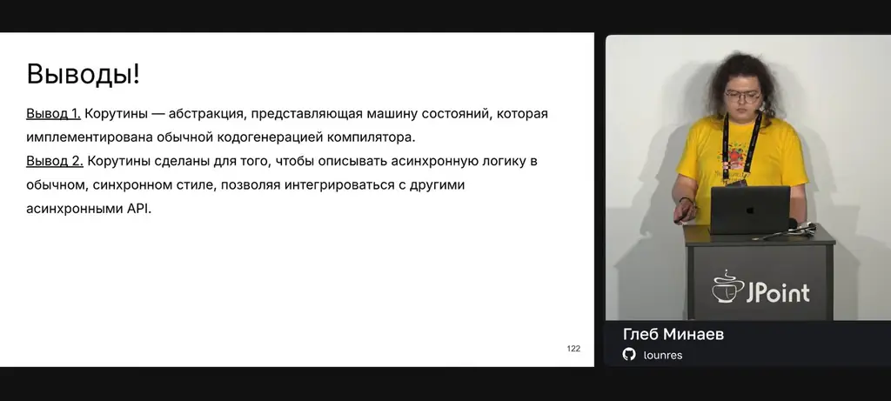

# Глеб Минаев — А вы можете сказать, что все-таки такое «корутина» в Kotlin?

*Как корутины Kotlin устроены на уровне языка: suspend-функции, Continuation и машина состояний, на которой построена стандартная функция iterator { ... }.*

Источник: [Глеб Минаев — А вы можете сказать, что все-таки такое «корутина» в Kotlin?](https://www.youtube.com/watch?v=WAsW8RuWZuY) · Глеб Минаев · Joker — Конференция о будущем разработки · 46 мин

## Коротко

Бесконечный цикл с yield внутри sequence выглядит невозможным: лямбда вычисляется целиком, и непонятно, как она останавливается. Ответ лежит в корутинах, которые являются возможностью самого языка, а не библиотеки: suspend-функция сохраняет состояние в объекте корутины, приостанавливается и возобновляется через Continuation.resumeWith. Компилятор превращает такую функцию в машину состояний с меткой точки подвешивания и локальными переменными, и именно так устроена iterator { ... }. Это важно, потому что корутины нужны не как легковесные потоки, а чтобы писать асинхронный код в синхронном стиле и подключаться к другим асинхронным API.

## Главное

- Корутина в Kotlin — не легковесный поток, а машина состояний, которую компилятор генерирует обычной кодогенерацией, и она работает без дополнительных библиотек.
- suspend-функция может приостановиться, а её состояние хранится в объекте корутины, а не в кадре вызова.
- Continuation с методом resumeWith(result: Result<T>) — это callback, который возобновляет корутину значением или исключением.
- suspendCoroutineUninterceptedOrReturn либо пробрасывает исключение, либо возвращает значение, либо возвращает COROUTINE_SUSPENDED и подвешивает корутину до последующего вызова resumeWith.
- Мост к java.util.concurrent.CompletionStage строится через suspendCoroutine: результат из handle передаётся в resume, а исключение — в resumeWithException.
- iterator { ... } реализуется посредником IteratorBuilderMachine с состояниями Waits, WaitsWithElement и Finished: yield сохраняет continuation и элемент, а hasNext возобновляет корутину.
- Компилятор превращает suspend-функцию в обычную функцию с дополнительным параметром continuation и класс CallableContinuation, который хранит label, значения переменных, Result и completion.
- Корутины и виртуальные потоки решают разные задачи: корутины — возможность языка для асинхронного кода в синхронном стиле, а виртуальные потоки — механизм виртуальной машины для запуска старого синхронного кода без переписывания.

## Бесконечная последовательность и вопрос об остановке

[▶ 00:00:00](https://www.youtube.com/watch?v=WAsW8RuWZuY&t=0s)

Бесконечный цикл с `println` печатает числа Фибоначчи и никогда не завершается.

```kotlin
var a = 0
var b = 1

while (true) {
    println(a)
    a = b.also { b = a + b }
}
```

*[▶ 00:02:59](https://www.youtube.com/watch?v=WAsW8RuWZuY&t=179s) · Fibonacci teaser: infinite loop with println*

Если заменить `println` на `yield` и обернуть цикл в `sequence`, получится последовательность, которую можно обойти через `forEach`. Вывод остаётся тем же.

```kotlin
val fibonacci = sequence {
    var a = 0
    var b = 1

    while (true) {
        yield(a)
        a = b.also { b = a + b }
    }
}

fibonacci.forEach { println(it) }
```

*[▶ 00:03:16](https://www.youtube.com/watch?v=WAsW8RuWZuY&t=196s) · Fibonacci as a Kotlin sequence builder*

Вызов `take(6)` перед `forEach` даёт ровно шесть элементов, хотя тело лямбды по-прежнему бесконечно.

```kotlin
val fibonacci = sequence {
    var a = 0
    var b = 1

    while (true) {
        yield(a)
        a = b.also { b = a + b }
    }
}

fibonacci.take(6).forEach { println(it) }
```

*[▶ 00:03:29](https://www.youtube.com/watch?v=WAsW8RuWZuY&t=209s) · Fibonacci sequence builder with take(6)*

Лямбда вычисляется целиком, поэтому непонятно, как она останавливается на `yield` и завершает работу.


*[▶ 00:04:05](https://www.youtube.com/watch?v=WAsW8RuWZuY&t=245s) · Where the sequence lambda suspends*

Дальше разбираются **корутины**: подвешивание и захват, интеграция с асинхронными API, создание и запуск, реализация `iterator` и нулевое приближение к устройству корутин.


*[▶ 00:05:36](https://www.youtube.com/watch?v=WAsW8RuWZuY&t=336s) · О чём будет доклад? (talk outline)*

## Как suspend-функция подвешивает корутину

[▶ 00:05:37](https://www.youtube.com/watch?v=WAsW8RuWZuY&t=337s)

`suspend` означает, что функция может приостановиться; вызов такой функции из другой в IDE помечен перечёркнутой стрелкой. `Flow<T>.all` приостанавливается на `collectWhile` и передаёт ему продолжение, чтобы тот вернул управление после завершения.

```kotlin
public suspend fun <T> Flow<T>.all(predicate: suspend (T) -> Boolean): Boolean {
    var foundCounterExample = false
    collectWhile {
        val satisfies = predicate(it)
        if (!satisfies) foundCounterExample = true
        satisfies
    }
    return !foundCounterExample
}
```


*[▶ 00:06:55](https://www.youtube.com/watch?v=WAsW8RuWZuY&t=415s) · Flow.all suspends at collectWhile*

Состояние при этом хранится не в кадре вызова, а в объекте корутины, которым можно управлять напрямую.

```kotlin
public suspend fun <T> Flow<T>.all(predicate: suspend (T) -> Boolean): Boolean {
    var foundCounterExample = false
    collectWhile {
        val satisfies = predicate(it)
        if (!satisfies) foundCounterExample = true
        satisfies
    }
    return !foundCounterExample
}
```


*[▶ 00:07:50](https://www.youtube.com/watch?v=WAsW8RuWZuY&t=470s) · collectWhile resumes Flow.all when done*

Управление идёт через `Continuation` с методом `resumeWith(result: Result<T>)`: это callback, принимающий значение или исключение.

```kotlin
/**
 * Interface representing a continuation after a suspension point that returns a value of type `T`.
 */
@SinceKotlin("1.3")
public interface Continuation<in T> {
    /**
     * The conte…the coroutine that corresponds to this continuation.
     */
    public val c…CoroutineContext

    /**
     * Resumes the execution of the corresponding coroutine passing a successful or failed [result] as the
     * return value of the last suspension point.
     */
    public fun resumeWith(result: Result<T>)
}
```


*[▶ 00:08:56](https://www.youtube.com/watch?v=WAsW8RuWZuY&t=536s) · Continuation interface and resumeWith*

`suspendCoroutineUninterceptedOrReturn` захватывает корутину, а исход определяет лямбда.

```kotlin
@SinceKotlin("1.3")
@InlineOnly
@Suppress("WRONG_INVOCATION_KIND", "UNUSED_PARAMETER", "RedundantSuspendModifier")
public suspend inline fun <T> suspendCoroutineUninterceptedOrReturn(crossinline block: (Continuation<T>) → Any?): T {
    contract { callsInPlace(block, InvocationKind.EXACTLY_ONCE) }
    throw NotImplementedError("Implementation of suspendCoroutineUninterceptedOrReturn is intrinsic")
}

suspend fun foo() {
    val r = suspendCoroutineUninterceptedOrReturn<Int> { // it: Continuation<Int>
        // Если кинуть здесь исключение, оно пробросится выше.
    }
}
```

*[▶ 00:10:31](https://www.youtube.com/watch?v=WAsW8RuWZuY&t=631s) · suspendCoroutineUninterceptedOrReturn signature and foo example*

- исключение пробрасывается выше;
- значение становится результатом вызова;
- `COROUTINE_SUSPENDED` подвешивает корутину до последующего вызова `resumeWith`.

```kotlin
@SinceKotlin("1.3")
@InlineOnly
@Suppress("WRONG_INVOCATION_KIND", "UNUSED_PARAMETER", "RedundantSuspendModifier")
public suspend inline fun <T> suspendCoroutineUninterceptedOrReturn(crossinline block: (Continuation<T>) → Any?): T {
    contract { callsInPlace(block, InvocationKind.EXACTLY_ONCE) }
    throw NotImplementedError("Implementation of suspendCoroutineUninterceptedOrReturn is intrinsic")
}

suspend fun foo() {
    val r = suspendCoroutineUninterceptedOrReturn<Int> { // it: Continuation<Int>
        // Если кинуть здесь исключение, оно пробросится выше.
        // Если вернуть в лямбду значение, то оно вернётся из suspendCoroutineUninterceptedOrReturn.
        // Если вернуть в лямбду COROUTINE_SUSPENDED, то корутина подвесится и её можно будет запустить позже.
    }
}
```


*[▶ 00:11:59](https://www.youtube.com/watch?v=WAsW8RuWZuY&t=719s) · Lambda outcomes for suspendCoroutineUninterceptedOrReturn*

Обёртки `suspendCoroutine` и `suspendCancellableCoroutine` подвешивают корутину всегда, поэтому их лямбда возвращает `Unit`; вторая позволяет отменить `Job`.

```kotlin
@SinceKotlin("1.3")
@InlineOnly
public suspend inline fun <T> suspendCoroutine(crossinline block: (Continuation<T>) → Unit): T {
    contract { callsInPlace(block, InvocationKind.EXACTLY_ONCE) }
    return ...
}

public suspend inline fun <T> suspendCancellableCoroutine(
    crossinline block: (CancellableContinuation<T>) → Unit
): T = ...
```


*[▶ 00:13:01](https://www.youtube.com/watch?v=WAsW8RuWZuY&t=781s) · suspendCoroutine vs suspendCancellableCoroutine signatures*

## Отмена через CancellableContinuation и мост к CompletionStage

[▶ 00:13:01](https://www.youtube.com/watch?v=WAsW8RuWZuY&t=781s)

Для отмены используется `suspendCancellableCoroutine`: его лямбда получает `CancellableContinuation`, через который можно отменить `Job`.

```kotlin
@SinceKotlin("1.3")
@InlineOnly
public suspend inline fun <T> suspendCoroutine(crossinline block: (Continuation<T>) → Unit): T {
    contract { callsInPlace(block, InvocationKind.EXACTLY_ONCE) }
    return ...
}

public suspend inline fun <T> suspendCancellableCoroutine(
    crossinline block: (CancellableContinuation<T>) → Unit
): T = ...
```

*[▶ 00:13:14](https://www.youtube.com/watch?v=WAsW8RuWZuY&t=794s) · CancellableContinuation controls Job cancellation*

Через него доступны три операции:
- `cancel()` отменяет корутину;
- `resumeWithException(...)` заставляет `suspendCancellableCoroutine` выбросить исключение;
- `resume(...)` возвращает значение из `suspendCancellableCoroutine`.

```kotlin
@SinceKotlin("1.3")
@InlineOnly
public suspend inline fun <T> suspendCoroutine(crossinline block: (Continuation<T>) → Unit): T {
    contract { callsInPlace(block, InvocationKind.EXACTLY_ONCE) }
    return ...
}

public suspend inline fun <T> suspendCancellableCoroutine(
    crossinline block: (CancellableContinuation<T>) → Unit
): T = ...

suspend fun foo() {
    val r = suspendCancellableCoroutine<Int> { // it: CancellableContinuation<Int>
        // it.cancel(), чтобы отменить корутину
        // it.resumeWithException(...), чтобы suspendCancellableCoroutine кинуло исключение
        // it.resume(...), чтобы получить этот аргумент из suspendCancellableCoroutine
    }
}
```

*[▶ 00:13:57](https://www.youtube.com/watch?v=WAsW8RuWZuY&t=837s) · Using suspendCancellableCoroutine inside foo*

Цель — suspend-функция `await()` для `java.util.concurrent.CompletionStage`, которая приостанавливает корутину до вычисления значения.

```kotlin
suspend fun <T> CompletionStage<T>.await(): T = ???
```

*[▶ 00:15:02](https://www.youtube.com/watch?v=WAsW8RuWZuY&t=902s) · CompletionStage.await() signature*

Тело строится на `suspendCoroutine`, который даёт continuation для возобновления позже.

```kotlin
suspend fun <T> CompletionStage<T>.await(): T =
   suspendCoroutine<T> { continuation: Continuation<T> ->
   }
```

*[▶ 00:15:28](https://www.youtube.com/watch?v=WAsW8RuWZuY&t=928s) · await() wrapped in suspendCoroutine*

Через `handle` приходит либо результат, либо исключение: результат передаётся в `resume`, исключение — в `resumeWithException`. Такие мосты строят и к другим асинхронным API.

Создать корутину из suspend-функции можно через `createCoroutineUnintercepted` (интерцепторы здесь не рассматриваются). Он принимает `completion` и возвращает `Continuation<Unit>`. Вторая перегрузка принимает `receiver`, который передаётся лямбде как дополнительный аргумент.

```kotlin
@SinceKotlin("1.3")
public expect fun <T> (suspend () -> T).createCoroutineUnintercepted(
   completion: Continuation<T>
): Continuation<Unit>

@SinceKotlin("1.3")
public expect fun <R, T> (suspend R.() -> T).createCoroutineUnintercepted(
   receiver: R,
   completion: Continuation<T>
): Continuation<Unit>

val greetingContinuation = Continuation<String>(EmptyCoroutineContext) { println("Hello, ${it.getOrThrow()}!") }
```

*[▶ 00:18:46](https://www.youtube.com/watch?v=WAsW8RuWZuY&t=1126s) · Receiver parameter of createCoroutineUnintercepted*

В итоговом API метод называется `createCoroutine`. Например, `::getConferenceName.createCoroutine(greetingContinuation)` после `resume(Unit)` печатает «Hello, JPoint!».

```kotlin
@SinceKotlin("1.3")
public fun <T> (suspend () → T).createCoroutine(
   completion: Continuation<T>
): Continuation<Unit> = ...

@SinceKotlin("1.3")
public fun <R, T> (suspend R.() → T).createCoroutine(
   receiver: R,
   completion: Continuation<T>
): Continuation<Unit> = ...

val greetingContinuation = Continuation<String>(EmptyCoroutineContext) { println("Hello, ${it.getOrThrow()}!") }
suspend fun getConferenceName(): String = "JPoint"

val conferenceGreetingContinuation = ::getConferenceName.createCoroutine(greetingContinuation)

conferenceGreetingContinuation.resume(Unit)
```

*[▶ 00:20:25](https://www.youtube.com/watch?v=WAsW8RuWZuY&t=1225s) · Renamed to createCoroutine, same usage*

## IteratorBuilderMachine: состояния и переходы

[▶ 00:21:41](https://www.youtube.com/watch?v=WAsW8RuWZuY&t=1301s)

Посредник `IteratorBuilderMachine<T>` реализует `IteratorBuilder<T>`, `Iterator<T>` и `Continuation<Unit>`: получает элементы от лямбды, запросы от пользователя и сигнал завершения.

```kotlin
private class IteratorBuilderMachine<T> : IteratorBuilder<T>, Iterator<T>, Continuation<Unit>
```

*[▶ 00:23:05](https://www.youtube.com/watch?v=WAsW8RuWZuY&t=1385s) · IteratorBuilderMachine class and its three roles*

Промежуточные состояния хранятся в sealed-иерархии:

- **Waits** — вычисление не закончено, существование следующего элемента неизвестно;
- **WaitsWithElement** — лямбда приостановлена, элемент выдан, но не передан пользователю;
- **Finished** — вычисление закончено.

```kotlin
private class IteratorBuilderMachine<T> : IteratorBuilder<T>, Iterator<T>, Continuation<Unit> {
    sealed interface State<out T> {
        data class Waits(
            val continuation: Continuation<Unit>
        ) : State<Nothing>
        data class WaitsWithElement<out T>(
            val continuation: Continuation<Unit>,
            val element: T
        ) : State<T>
        data object Finished : State<Nothing>
    }

    var state: State<T>

}
```

*[▶ 00:23:58](https://www.youtube.com/watch?v=WAsW8RuWZuY&t=1438s) · Sealed State hierarchy for the machine*

Методы реализуются в обратном порядке, начиная с сигналов лямбды: `yield` получает новый элемент, `resumeWith` — сигнал о завершении.

```kotlin
override suspend fun yield(element: T) {
    suspendCoroutineUninterceptedOrReturn<Unit> { continuation: Continuation<Unit> →


    }
}
override fun resumeWith(result: Result<Unit>) {

}
```

*[▶ 00:24:50](https://www.youtube.com/watch?v=WAsW8RuWZuY&t=1490s) · yield and resumeWith signals from the lambda*

`yield` сохраняет continuation и элемент в `WaitsWithElement` и возвращает `COROUTINE_SUSPENDED`; `resumeWith` ставит `Finished`.

```kotlin
override suspend fun yield(element: T) {
    suspendCoroutineUninterceptedOrReturn { continuation ->
        state = State.WaitsWithElement(continuation, element)
        COROUTINE_SUSPENDED
    }
}

override fun resumeWith(result: Result<Unit>) {
    state = State.Finished
}
```

*[▶ 00:25:12](https://www.youtube.com/watch?v=WAsW8RuWZuY&t=1512s) · yield and resumeWith in the lambda state machine*

`hasNext` в состоянии `Waits` возобновляет корутину, после чего состояние — `WaitsWithElement` (true) или `Finished` (false). Повторный `Waits` недостижим, поэтому там стоит исключение.

```kotlin
override fun hasNext(): Boolean =
    when (val currentState = state) {
        is State.Waits -> {
            currentState.continuation.resume(Unit)
            when (state) {
                is State.Waits -> error("Something strange happened")
                is State.WaitsWithElement<T> -> true
                State.Finished -> false
            }
        }
        is State.WaitsWithElement<T> -> true
        State.Finished -> false
    }
```

*[▶ 00:27:24](https://www.youtube.com/watch?v=WAsW8RuWZuY&t=1644s) · hasNext() implementation over the state machine*

`next` вызывает `hasNext`, при отсутствии элемента бросает `NoSuchElementException`, иначе переводит состояние в `Waits` с сохранённым continuation и возвращает элемент.

Начальное состояние — `Waits` с корутиной из `createCoroutineUnintercepted(this, this)`: первый `this` — ресивер для `yield`, второй — `Continuation` для сигнала о завершении. Контекст пустой.

```kotlin
private class IteratorBuilderMachine<T>(
    suspendableFunction: suspend IteratorBuilder<T>.() -> Unit
) : IteratorBuilder<T>, Iterator<T>, Continuation<Unit> {

    // ...

    var state: State<T> = State.Waits(suspendableFunction.createCoroutineUnintercepted(this, this))

    // ...

    override val context: CoroutineContext get() = EmptyCoroutineContext
}

fun <T> myIterator(builder: suspend IteratorBuilder<T>.() -> Unit): Iterator<T> =
    IteratorBuilderMachine(builder)
```

*[▶ 00:30:13](https://www.youtube.com/watch?v=WAsW8RuWZuY&t=1813s) · Why this is passed twice to the coroutine*

## Два сгенерированных элемента: функция и CallableContinuation

[▶ 00:30:50](https://www.youtube.com/watch?v=WAsW8RuWZuY&t=1850s)

Компилятор создаёт из suspend-функции две сущности: обычную функцию с дополнительным параметром `continuation`, которая возвращает `Res` или `COROUTINE_SUSPENDED`, и класс `CallableContinuation`, реализующий `Continuation`.

```kotlin
suspend fun callable(arg1: Arg1, arg2: Arg2, ...): Res

fun callable(arg1: Arg1, arg2: Arg2, ..., continuation: Continuation<Res>): Res | COROUTINE_SUSPENDED

class CallableContinuation(val continuation: Continuation<Any?>) : Continuation<Any?>
```

*[▶ 00:31:29](https://www.youtube.com/watch?v=WAsW8RuWZuY&t=1889s) · Compiler rewrite of a suspend function and CallableContinuation*

Класс хранит четыре вещи: номер точки подвешивания (`label`), значения переменных в промежуточных состояниях, `Result`-значение для продолжения работы и `completion`, который вызывается по завершении.

```kotlin
class CallableContinuation(val completion: Continuation<Any?>) : Continuation<Any?> {
    var arg1: Any? = null
    var arg2: Any? = null
    // ...
    var var1: Any? = null
    var var2: Any? = null
    // ...

    var result: Result<Any?>? = null
    var label: Int = 0

    override val context: CoroutineContext get() = completion.context
    override fun resumeWith(result: Result<Any?>) { ... }
}
```

*[▶ 00:37:00](https://www.youtube.com/watch?v=WAsW8RuWZuY&t=2220s) · CallableContinuation state fields*

```kotlin
suspend fun callable(arg1: Arg1, arg2: Arg2, ...): Res

fun callable(arg1: Arg1, arg2: Arg2, ..., continuation: Continuation<Res>): Res | COROUTINE_SUSPENDED

class CallableContinuation(val continuation: Continuation<Any?>) : Continuation<Any?>
```

*[▶ 00:33:48](https://www.youtube.com/watch?v=WAsW8RuWZuY&t=2028s) · Fields that CallableContinuation must store*

Если функции передана внешняя континуация, она оборачивает её в `CallableContinuation` и запускает.

```kotlin
suspend fun callable(arg1: Arg1, arg2: Arg2, ...): Res

fun callable(arg1: Arg1, arg2: Arg2, ..., continuation: Continuation<Res>): Res | COROUTINE_SUSPENDED

class CallableContinuation(val continuation: Continuation<Any?>) : Continuation<Any?>
```

*[▶ 00:35:03](https://www.youtube.com/watch?v=WAsW8RuWZuY&t=2103s) · callable wraps an external continuation*

Если передана собственная континуация, функция продолжает выполнение с сохранённого состояния до следующей точки остановки.

```kotlin
suspend fun callable(arg1: Arg1, arg2: Arg2, ...): Res

fun callable(arg1: Arg1, arg2: Arg2, ..., continuation: Continuation<Res>): Res | COROUTINE_SUSPENDED

class CallableContinuation(val continuation: Continuation<Any?>) : Continuation<Any?>
```

*[▶ 00:35:19](https://www.youtube.com/watch?v=WAsW8RuWZuY&t=2119s) · Two cases for the passed continuation*

Функция завершается тремя способами: пробрасывает исключение, возвращает значение как есть или, если подвесилась, возвращает `COROUTINE_SUSPENDED`.

```kotlin
suspend fun callable(arg1: Arg1, arg2: Arg2, ...): Res

fun callable(arg1: Arg1, arg2: Arg2, ..., continuation: Continuation<Res>): Res | COROUTINE_SUSPENDED

class CallableContinuation(val continuation: Continuation<Any?>) : Continuation<Any?>
```

*[▶ 00:36:07](https://www.youtube.com/watch?v=WAsW8RuWZuY&t=2167s) · How callable finishes its work*

`resumeWith` вызывает преобразованную функцию на самом себе с сохранёнными аргументами. Если она не подвесилась, результат передаётся в `completion.resume`.

```kotlin
class CallableContinuation(val completion: Continuation<Any?>) : Continuation<Any?> {
    var arg1: Any? = null
    var arg2: Any? = null
    // ...
    var var1: Any? = null
    var var2: Any? = null
    // ...

    var result: Result<Any?>? = null
    var label: Int = 0

    override val context: CoroutineContext get() = completion.context
    override fun resumeWith(result: Result<Any?>) { ... }
}
```

*[▶ 00:37:14](https://www.youtube.com/watch?v=WAsW8RuWZuY&t=2234s) · resumeWith drives the transformed callable*

Тело функции создаёт или переиспользует `CallableContinuation`, поднимает локальные переменные наверх и в `while (true)` переходит по `label` к нужному месту, пока не будет возврата или подвешивания.

```kotlin
fun callable(arg1: Arg1, arg2: Arg2, continuation: Continuation<Res>): Any? {
    val continuation: CallableContinuation = ...

    var var1: Var1? = null
    var var2: Var2? = null
    // ...

    while (true) {
        when (continuation.label) {
            // ...
            else -> error("call to 'resume' before 'invoke' with coroutine")
        }
    }
}
```

*[▶ 00:39:34](https://www.youtube.com/watch?v=WAsW8RuWZuY&t=2374s) · callable state machine loop skeleton*

## Корутины против виртуальных потоков

[▶ 00:41:06](https://www.youtube.com/watch?v=WAsW8RuWZuY&t=2466s)

Корутины — машина состояний, которую компилятор генерирует обычной кодогенерацией. Их цель — писать асинхронный код в синхронном стиле и интегрироваться с другими асинхронными API, например `CompletionStage` или промисами.


*[▶ 00:41:55](https://www.youtube.com/watch?v=WAsW8RuWZuY&t=2515s) · Выводы: два вывода о корутинах*

Виртуальные потоки решают другую задачу — запуск старого синхронного кода без переписывания. Это механизм виртуальной машины, тогда как корутины — возможность языка.

Для подвешивания лучше брать примитив `suspendCoroutineUninterceptedOrReturn`: он генерируется компилятором и легче. `suspendCancellableCoroutine` запускает интерцепторы, которых в пустом контексте корутины нет.

## Ссылки и материалы

- Слайды доклада (упоминается 79-й слайд), ссылка не показана · упомянуто [▶ 00:44:44](https://www.youtube.com/watch?v=WAsW8RuWZuY&t=2684s)
