# Никита Кириллов — Beyond @SpringBootApplication: создание собственных экосистем поверх Spring Boot

*Как написать платформенный стартер Spring Boot, который работает на Boot 2.x, 3.x и 4.0 и на Java 8–21: регистрация бинов, тестирование автоконфигураций и проверка совместимости в CI.*

Источник: [Никита Кириллов — Beyond @SpringBootApplication: создание собственных экосистем поверх Spring Boot](https://www.youtube.com/watch?v=vr3f_Nlq1Wg) · Никита Кириллов · Joker — Конференция о будущем разработки · 44 мин

## Коротко

В компаниях одновременно работают сервисы на Spring Boot 2.x, 3.x и 4.0 и на Java 8–21, а общий стартер должен работать во всех них и не ломать соседние сервисы. Автор разбирает три способа программно регистрировать бины, включая BeanRegistrar из Spring 7.0, и предлагает вынести независимую от версий логику в чистый Java-модуль, а версионные модули держать тонкими. Также он показывает, что ApplicationContextRunner на порядки быстрее @SpringBootTest для тестов автоконфигураций, а матричная сборка в CI ловит проблемы бинарной совместимости, которые не видны при компиляции. Это важно, потому что такие ошибки проявляются уже у пользователей библиотеки, например как NoSuchMethodError на Java 8.

## Главное

- Бины, которые пропускаются по свойствам или аннотациям, можно регистрировать только программно: через SingletonBeanRegistry, ImportBeanDefinitionRegistrar или BeanRegistrar.
- SingletonBeanRegistry через BeanFactoryPostProcessor прост, но бины всегда singleton, lifecycle-методы не работают, а конфигурация ограничена.
- ImportBeanDefinitionRegistrar даёт init/destroy, scope, role и autowire mode, но API низкоуровневый; автор берёт его для стартера, потому что BeanRegistrar пока не используют Spring-библиотеки.
- BeanRegistrar (Spring 7.0, нужен Spring Boot 4) даёт полный контроль lifecycle, доступ к Environment, Kotlin DSL и AOT-совместимость, но требует явно задавать имя бина.
- Общую логику стартера стоит выносить в core-модуль на чистой Java без зависимостей от Spring, Brave или Micrometer, а для Spring Boot 2, 3 и 4 оставлять тонкие модули; это оправдано, когда сервисы живут на разных мажорных версиях.
- Ветвление по наличию классов в рантайме (например, isBrave() с проверкой brave.Tracer) компилируется, но тяжело читается и тестируется и порождает Jar Hell, поэтому подходит только небольшим библиотекам с одним модулем.
- Для тестов автоконфигураций лучше ApplicationContextRunner с withPropertyValues и withBean: по замерам автора 1000 итераций занимают 2,1 с против 1023 с у @SpringBootTest, потому что у таких тестов почти всегда cache miss.
- Source compatibility не гарантирует binary compatibility: библиотека, собранная на JDK 11 с target 1.8, падала на Java 8 с NoSuchMethodError из-за ковариантного возвращаемого типа ByteBuffer.position(), поэтому для кроссверсионной совместимости нужна матричная сборка в CI по версиям Java (и по ОС, если поведение от неё зависит).

## Зачем платформенный стартер и что в него выносить

[▶ 00:00:00](https://www.youtube.com/watch?v=vr3f_Nlq1Wg&t=0s)

В типичной компании одновременно работают сервисы на Spring Boot 2.x, 3.x и 4.0 и на Java 8–21, и они общаются между собой.

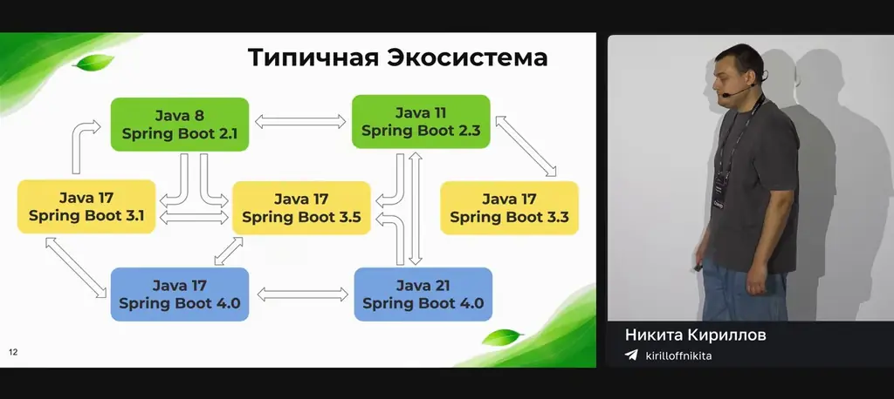
*[▶ 00:02:25](https://www.youtube.com/watch?v=vr3f_Nlq1Wg&t=145s) · Типичная Экосистема*

Общие решения выносят из сервисов в собственный стартер: security-фильтры на `FilterChain`, инструменты для БД (например, аудит сущностей), кастомные трейсинг и телеметрию, свои `@AutoConfiguration`-бины. Такой стартер должен работать на разных версиях Spring Boot и поддерживать разные версии Java.

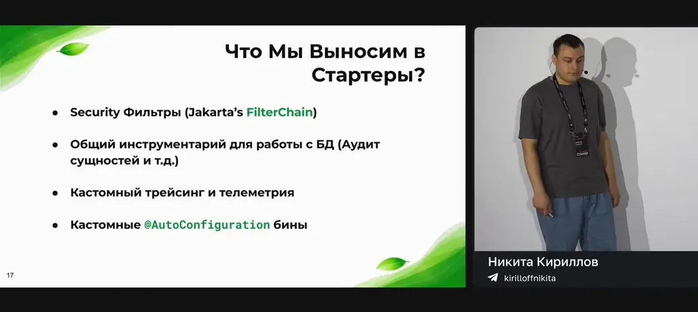
*[▶ 00:02:59](https://www.youtube.com/watch?v=vr3f_Nlq1Wg&t=179s) · Что Мы Выносим в Стартеры?*

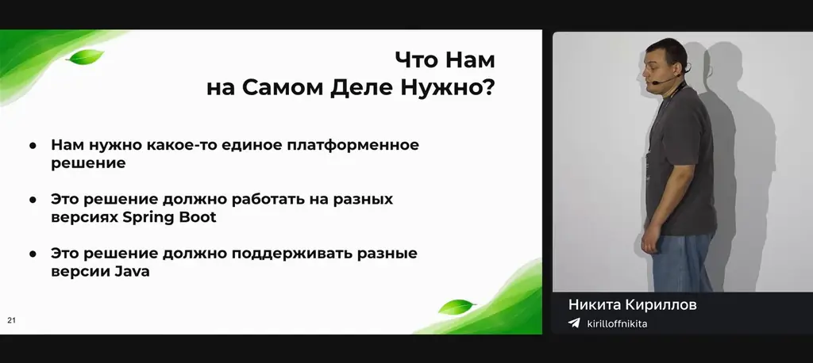
*[▶ 00:03:13](https://www.youtube.com/watch?v=vr3f_Nlq1Wg&t=193s) · Что Нам на Самом Деле Нужно?*

Пример: `@SpanTag` из Spring Cloud передаёт аргументы метода в трейсинг как есть, а конфиденциальные данные туда попадать не должны. Нужны свои аннотации и санитайзеры.

```java
@Service
public class PaymentService {

    @NewSpan(name = “payment.processing”)
    public void processPayment(
            @SpanTag Transaction transaction,
            @SpanTag Customer customer,
            @SpanTag String cardNumber
    ) {
        // ...
    }
}
```

*[▶ 00:03:55](https://www.youtube.com/watch?v=vr3f_Nlq1Wg&t=235s) · Представим Себе Кейс*

Каждый уровень чувствительности в `DataSensitivity` связан со своим санитайзером: FINANCIAL оставляет только ID транзакции, PII маскирует фамилию и отчество, SECRET не пишет ничего. Санитайзеры должны быть бинами в контексте.

```java
public enum DataSensitivity {

    PUBLIC(PublicSanitizer.class),              // ничего не скрываем
    PII(PiiSanitizer.class),                    // ФИО — маскируем фамилию и отчество
    FINANCIAL(FinancialSanitizer.class),        // только ID транзакции, остальное скрыть
    CREDENTIALS(CredentialsSanitizer.class),    // пароли, токены, ключи, полная замена на ***
    SECRET(SecretSanitizer.class)               // ничего в спан не пишем

    ...
}

Span: payment.processing
  param.0 = { transactionId: "tx-123" }    // @Financial только ID
  param.1 = "Иван ***. ***."               // @PII маскируем фамилию и отчество
  param.2 = "[REDACTED]"                   // @Secret
```

*[▶ 00:04:35](https://www.youtube.com/watch?v=vr3f_Nlq1Wg&t=275s) · Кейс. Возможные Типы Тегов*

Простое решение — один `@AutoConfiguration` с отдельным `@Bean` на каждый санитайзер. По мнению спикера, при десятках уровней это превращается в почти одинаковые методы, нарушает DRY и усложняет кастомизацию, например отключение части бинов.

```java
@AutoConfiguration
class SanitizerBeans {

    @Bean
    PublicSanitizer publicSanitizer() {
        return PublicSanitizer().create();
    }

    @Bean
    PiiSanitizer piiSanitizer() {
        return PiiSanitizer().create();
    }

    @Bean
    FinancialSanitizer financialSanitizer() {
        return FinancialSanitizer().create();
    }

    @Bean
    CredentialsSanitizer credentialsSanitizer() {
        return CredentialsSanitizer().create();
    }

    // ...
}
```

*[▶ 00:05:03](https://www.youtube.com/watch?v=vr3f_Nlq1Wg&t=303s) · Объявляем @Bean для Каждого Sanitzer*

## Три способа программной регистрации бинов и условный пропуск

[▶ 00:05:26](https://www.youtube.com/watch?v=vr3f_Nlq1Wg&t=326s)

Пропускать бины по свойствам или аннотациям можно только при программной регистрации.

```java
public enum DataSensitivity {
    PUBLIC(PublicSanitizer.class),          // ничего не скрываем
    PII(PiiSanitizer.class),                // ФИО — маскируем фамилию и отчество
    FINANCIAL(FinancialSanitizer.class),    // только ID транзакции, остальное скрыть
    CREDENTIALS(CredentialsSanitizer.class), // пароли, токены — полная замена на ***
    SECRET(SecretSanitizer.class)           // ничего в спан не пишем

    ...
}
```

*[▶ 00:06:11](https://www.youtube.com/watch?v=vr3f_Nlq1Wg&t=371s) · DataSensitivity enum of sanitizers*

**Первый способ — SingletonBeanRegistry** через BeanFactoryPostProcessor: просто и быстро, но scope всегда singleton, lifecycle-методы не работают, конфигурация ограничена.

```java
public class SanitizerSingletonRegistrar implements BeanFactoryPostProcessor {
    @Override
    public void postProcessBeanFactory(ConfigurableListableBeanFactory beanFactory) {
        for (DataSensitivity sanitizer : DataSensitivity.values()) {
            beanFactory.registerSingleton(
                sanitizer.beanName(),
                sanitizer.create()
            );
        }
    }
}
```

*[▶ 00:06:53](https://www.youtube.com/watch?v=vr3f_Nlq1Wg&t=413s) · SanitizerSingletonRegistrar BeanFactoryPostProcessor*

**Второй способ — ImportBeanDefinitionRegistrar**: регистрирует BeanDefinition через `registerBeanDefinitions`.

```java
public interface ImportBeanDefinitionRegistrar {
    ...


    /**
     * @param importingClassMetadata annotation metadata of the importing class
     * @param registry current bean definition registry
     */
    default void registerBeanDefinitions(
        AnnotationMetadata importingClassMetadata,
        BeanDefinitionRegistry registry) {}

    ...
}
```

*[▶ 00:08:06](https://www.youtube.com/watch?v=vr3f_Nlq1Wg&t=486s) · Способ Второй ImportBeanDefinitionRegistrar: interface*

Здесь доступны init/destroy, scope, role и autowire mode; минус — низкоуровневый API. Используется в Spring Cloud, Spring Data и Spring Security.

```java
public class SanitizerBeanDefinitionRegistrar
        implements ImportBeanDefinitionRegistrar {

    @Override
    public void registerBeanDefinitions(AnnotationMetadata importingClassMetadata,
                                        BeanDefinitionRegistry registry) {
        for (DataSensitivity sanitizer : DataSensitivity.values()) {

            BeanDefinition beanDefinition = BeanDefinitionBuilder
                .rootBeanDefinition(sanitizer.sanitizerClass())
                .setScope(BeanDefinition.SCOPE_SINGLETON)
                .setInitMethodName("init")
                .setDestroyMethodName("destroy")
                .setLazyInit(true)
                .setSynthetic(true)
                .setRole(ROLE_INFRASTRUCTURE)
                .setAutowireMode(AUTOWIRE_CONSTRUCTOR)
                .getBeanDefinition();

            registry.registerBeanDefinition(sanitizer.beanName(), beanDefinition);
        }
    }
}
```

*[▶ 00:08:39](https://www.youtube.com/watch?v=vr3f_Nlq1Wg&t=519s) · SanitizerBeanDefinitionRegistrar with BeanDefinitionBuilder*

Registrar — временный объект при парсинге `@Configuration`, поэтому `@Autowired` на нём не работает. Свойства Environment берём через EnvironmentAware.

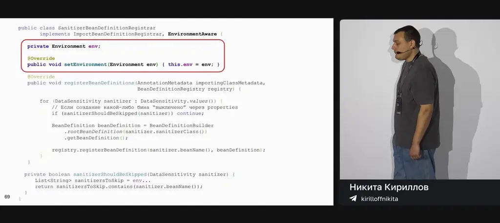
*[▶ 00:10:41](https://www.youtube.com/watch?v=vr3f_Nlq1Wg&t=641s) · SanitizerBeanDefinitionRegistrar with EnvironmentAware*

По аннотациям — ImportBeanDefinitionRegistrar, по наличию бина — BeanDefinitionRegistryPostProcessor (он работает, когда все бины зарегистрированы).

**Третий способ — BeanRegistrar** (Spring 7.0): функциональный интерфейс, который получает Environment напрямую.

```java
/**
 * @author Sebastien Deleuze
 * @since 7.0
 */
@FunctionalInterface
public interface BeanRegistrar {

    /**
     * Register beans on the given {@link BeanRegistry} in a programmatic way.
     * @param registry the bean registry to operate on
     * @param env the environment that can be used to get the active profile or
     * some properties
     */
    void register(BeanRegistry registry, Environment env);
}
```

*[▶ 00:12:22](https://www.youtube.com/watch?v=vr3f_Nlq1Wg&t=742s) · Способ Третий: BeanRegistrar interface*

## BeanRegistrar: API, ограничения и выбор подхода

[▶ 00:12:21](https://www.youtube.com/watch?v=vr3f_Nlq1Wg&t=741s)

В `register` бины регистрируются через `registry.registerBean` с явным именем: Spring не выведет его из класса.

```java
public class SanitizerBeanRegistrar implements BeanRegistrar {

  @Override
  public void register(BeanRegistry registry, Environment env) {
    for (DataSensitivity sanitizer : DataSensitivity.values()) {

      registry.registerBean(sanitizer.beanName(), sanitizer.beanClass());


      );
    }
  }
}
```

*[▶ 00:12:49](https://www.youtube.com/watch?v=vr3f_Nlq1Wg&t=769s) · SanitizerBeanRegistrar implementing BeanRegistrar*

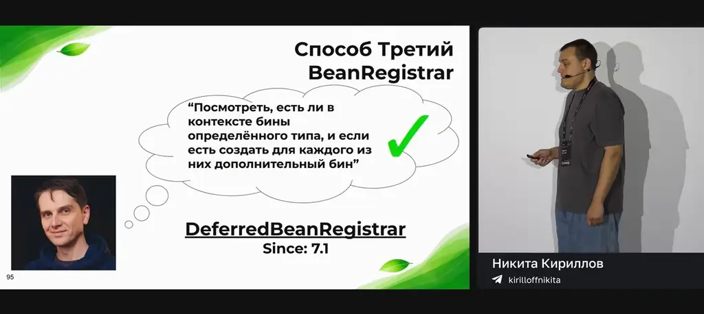
*[▶ 00:15:21](https://www.youtube.com/watch?v=vr3f_Nlq1Wg&t=921s) · DeferredBeanRegistrar for conditional beans*

Fluent-спецификация задаёт description, infrastructure, lazyInit, prototype и primary.

```java
public class SanitizerBeanRegistrar implements BeanRegistrar {

    @Override
    public void register(BeanRegistry registry, Environment env) {
        for (DataSanitizer sanitizer : DataSanitizer.values()) {

            registry.registerBean(sanitizer.beanName(), sanitizer.beanClass(),
                spec -> spec
                    .description("Sanitizer for " + sanitizer.name())
                    .infrastructure()
                    .lazyInit()
                    .prototype()
                    .primary()
            );
        }
    }
}
```

*[▶ 00:13:10](https://www.youtube.com/watch?v=vr3f_Nlq1Wg&t=790s) · BeanRegistrar implementation example*

Плюсы: полное управление lifecycle, доступ к Environment, Kotlin DSL, AOT-совместимость. Минус: нужен Spring Framework 7 (Spring Boot 4).

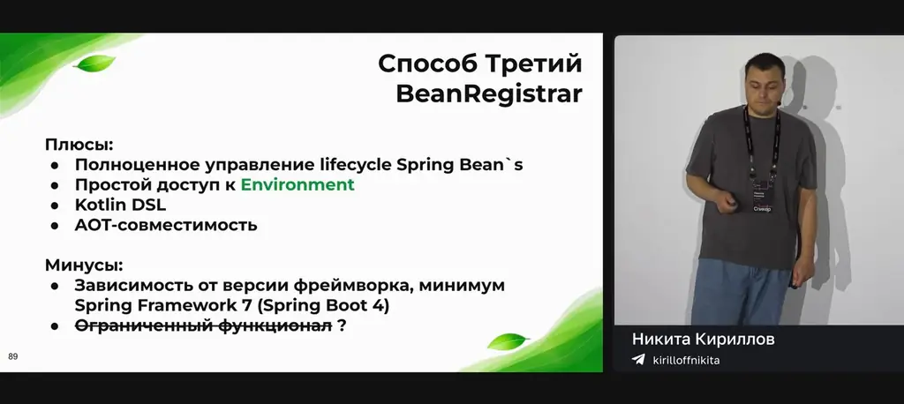
*[▶ 00:14:23](https://www.youtube.com/watch?v=vr3f_Nlq1Wg&t=863s) · BeanRegistrar limitations added*

Условие выбора: аннотация — ImportAware; свойство в Env — BeanRegistrar; наличие бина — DeferredBeanRegistrar (7.1).

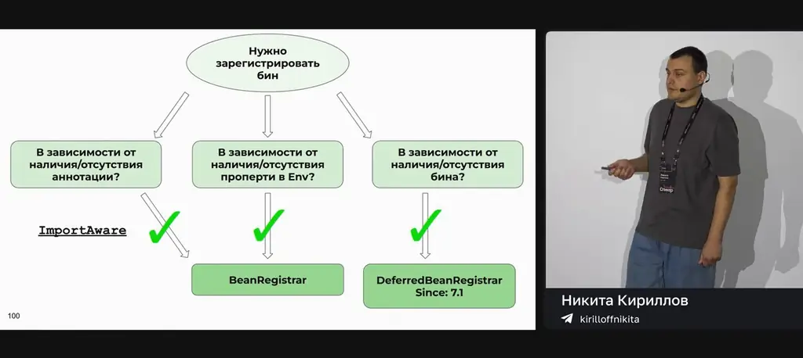
*[▶ 00:15:55](https://www.youtube.com/watch?v=vr3f_Nlq1Wg&t=955s) · Which registrar to use for a bean*

BeanRegistrar — обёртка над BeanRegistry (с Spring 7.0), который через адаптер использует BeanDefinitionRegistry.

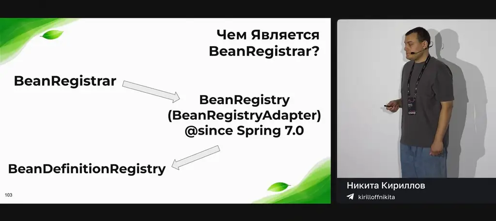
*[▶ 00:16:34](https://www.youtube.com/watch?v=vr3f_Nlq1Wg&t=994s) · What BeanRegistrar is built on*

Для стартера автор берёт ImportBeanDefinitionRegistrar: BeanRegistrar пока playground, его не используют Spring-библиотеки и стартеры.

## Runtime-проверки и общий domain-модуль

[▶ 00:17:45](https://www.youtube.com/watch?v=vr3f_Nlq1Wg&t=1065s)

Второй вариант — проверка версии в рантайме: `isBrave()` смотрит, есть ли на classpath `brave.Tracer`, и от этого выбирается ветка.

```java
public class TracingInterceptor implements MethodInterceptor {

    private final Object tracer;

    public TracingInterceptor(Object tracer) { this.tracer = tracer; }

    @Override
    public Object invoke(MethodInvocation invocation) throws Throwable {
        try { return invocation.proceed(); }
        finally {
            Map<String, String> tags = buildTags(invocation.getArguments(), getAnn(invocation));

            if (isBrave()) { // Spring Boot 2 — Brave


            } else {        // Spring Boot 3 — Micrometer


            }
        }
    }

    private Map<String, String> buildTags(Object[] args, Annotation[][] ann) {
        Map<String, String> tags = new LinkedHashMap<>();
        for (int i = 0; i < args.length; i++) { tags.put("param." + i, sanitize(args[i], ann[i])); }
        return tags;
    }

    private boolean isBrave() {
        return ClassUtils.isPresent("brave.Tracer", null);
    }
```

*[▶ 00:19:37](https://www.youtube.com/watch?v=vr3f_Nlq1Wg&t=1177s) · Способ Второй: Условия в коде, TracingInterceptor*

Каждая ветка приводит трейсер к своему типу. Код компилируется, но тяжело читается и тестируется, плохо масштабируется и порождает Jar Hell. Подходит только небольшим библиотекам с одним модулем.

```java
public class TracingInterceptor implements MethodInterceptor {

    private final Object tracer;

    public TracingInterceptor(Object tracer) { this.tracer = tracer; }

    @Override
    public Object invoke(MethodInvocation invocation) throws Throwable {
        try { return invocation.proceed(); }
        finally {
            Map<String, String> tags = buildTags(invocation.getArguments(), getAnn(invocation));

            if (isBrave()) { // Spring Boot 2 — Brave
                brave.Span span = ((brave.Tracer) tracer).currentSpan();
                tags.forEach(span::tag);
            } else {        // Spring Boot 3 — Micrometer
                io.micrometer.tracing.Span span = ((io.micrometer.tracing.Tracer) tracer).currentSpan();
                tags.forEach(span::tag);
            }
        }
    }

    private Map<String, String> buildTags(Object[] args, Annotation[][] ann) {
        Map<String, String> tags = new LinkedHashMap<>();
        for (int i = 0; i < args.length; i++) { tags.put("param." + i, sanitize(args[i], ann[i])); }
        return tags;
    }

    private boolean isBrave() {
        return ClassUtils.isPresent("brave.Tracer", null);
    }
```

*[▶ 00:19:57](https://www.youtube.com/watch?v=vr3f_Nlq1Wg&t=1197s) · Runtime checks: Brave vs Micrometer branches filled in*

Третий вариант — общий domain-модуль. Логика, не зависящая от версии Spring, выносится в core-модуль на чистой Java, а версионные модули остаются тонкими.

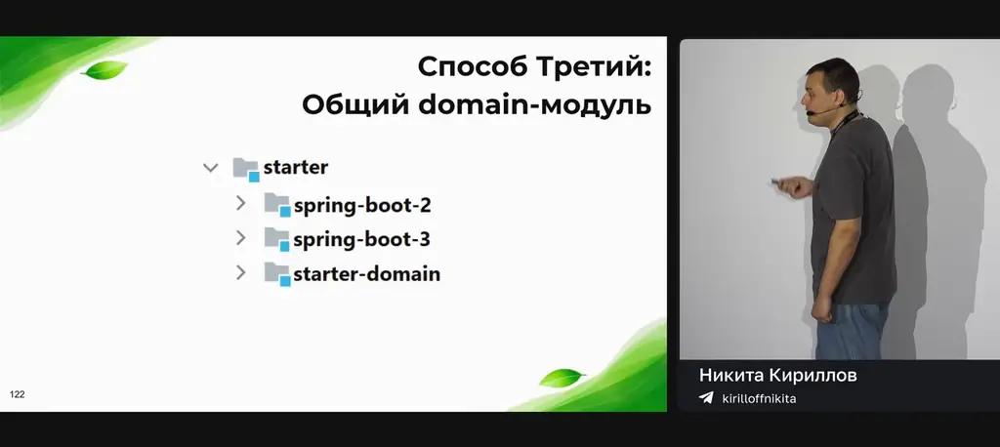
*[▶ 00:21:12](https://www.youtube.com/watch?v=vr3f_Nlq1Wg&t=1272s) · Третий способ: общий domain-модуль*

`SanitizingProcessor` не импортирует ни Spring, ни Brave, ни Micrometer:

```java
// NO Spring, NO Brave, NO Micrometer imports
public class SanitizingProcessor {

    private final SanitizerRegistry sanitizers;

    public SanitizedOutcome process(Object[] args, Annotation[][] paramAnnotations) {
        Map<String, String> tags = new LinkedHashMap<>();
        for (int i = 0; i < args.length; i++) {
            String sanitized = sanitizers.sanitize(args[i], paramAnnotations[i]);
            tags.put("param." + i, sanitized);
        }
        return new SanitizedOutcome(tags);
    }

    public record SanitizedOutcome(Map<String, String> tags) {}
}
```

*[▶ 00:21:39](https://www.youtube.com/watch?v=vr3f_Nlq1Wg&t=1299s) · SanitizingProcessor in the core module*

Интерцептор для Spring Boot 3 отличается только импортами Micrometer и использует тот же процессор:

```java
import io.micrometer.tracing.Tracer;
import io.micrometer.tracing.Span;

public class TracingInterceptor implements MethodInterceptor {

    private final Tracer tracer;
    private final SanitizingProcessor sanitizingProcessor;

    @Override
    public Object invoke(MethodInvocation invocation) throws Throwable {
        try { return invocation.proceed(); }

        finally {
            SanitizedOutcome outcome = sanitizingProcessor.process(
                    invocation.getArguments(),
                    getParamAnnotations(invocation)
            );
            Span span = tracer.currentSpan();
            outcome.tags().forEach(span::tag);
        }
    }
}
```

*[▶ 00:22:01](https://www.youtube.com/watch?v=vr3f_Nlq1Wg&t=1321s) · TracingInterceptor for Spring Boot 3*

Получается гексагональная архитектура: ядро с портами, к которым подключаются модули под Spring Boot 2, 3 и 4.

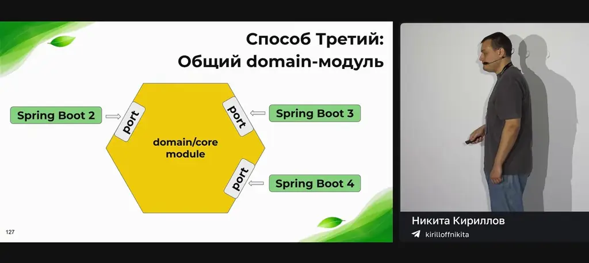
*[▶ 00:22:18](https://www.youtube.com/watch?v=vr3f_Nlq1Wg&t=1338s) · Способ Третий: Общий domain-модуль*

Плюсы: чистые зависимости, простое тестирование, масштабируемость, меньше дублирования, но не нулевое. Минусы: сложнее структура проекта, выше порог входа, отладка требует переходов между модулями. Подход оправдан, когда сервисы экосистемы живут на разных мажорных версиях Spring Boot. Если версии растут планомерно, лучше отдельные ветки и модули.

## ApplicationContextRunner вместо @SpringBootTest для автоконфигураций

[▶ 00:23:52](https://www.youtube.com/watch?v=vr3f_Nlq1Wg&t=1432s)

Автоконфигурация должна подниматься только при заданных условиях, и это нужно проверять тестом. Тестируемая автоконфигурация содержит два бина, потому что санитайзеры регистрируются программно.

```java
@AutoConfiguration
@ConditionalOnProperty(prefix = "extended.tracer", name = "enabled", havingValue = "true")
public class TracerAutoConfiguration {

    @Bean
    @ConditionalOnMissingBean
    public TracingInterceptor tracingInterceptor(
            Tracer tracer,
            SanitizingProcessor processor) {
        return new TracingInterceptor(tracer, processor);
    }

    @Bean
    @ConditionalOnMissingBean
    public SanitizingProcessor sanitizingProcessor(SanitizerRegistry sanitizers) {
        return new SanitizingProcessor(sanitizers);
    }
}
```

*[▶ 00:24:44](https://www.youtube.com/watch?v=vr3f_Nlq1Wg&t=1484s) · Тестирование @Autoconfiguration`s: исходный код*

`@SpringBootTest` с property `true` и вложенным классом с `false` работает, но это тяжеловесно и замедляет сборку.

```java
@SpringBootTest(
        classes = TracerAutoConfiguration.class,
        properties = "extended.tracer.enabled=true")

public class WhenEnabledTest {

    @Autowired
    private ApplicationContext context;

    @Test
    void shouldCreateAllBeans() {
     assertThat(context.containsBean("sanitizingProcessor")).isTrue();
     assertThat(context.containsBean("tracingInterceptor")).isTrue();
    }
)
```

*[▶ 00:25:21](https://www.youtube.com/watch?v=vr3f_Nlq1Wg&t=1521s) · WhenEnabledTest with @SpringBootTest*

```java
public class TracerAutoConfigurationWithSpringBootTest {

    @SpringBootTest(
            classes = TracerAutoConfiguration.class,
            properties = "extended.tracer.enabled=true")
    @Nested
    public static class WhenEnabledTest {

        @Autowired
        private ApplicationContext context;

        @Test
        void shouldCreateAllBeans() {
         assertThat(context.containsBean("sanitizingProcessor")).isTrue();
         assertThat(context.containsBean("tracingInterceptor")).isTrue();
        }
    }

    @SpringBootTest(
            classes = TracerAutoConfiguration.class,
            properties = "extended.tracer.enabled=false")
    @Nested
    public static class WhenDisabledTest {

        @Autowired
        private ApplicationContext context;

        @Test
        void shouldNotCreateAnyBeans() {
         assertThat(context.containsBean("sanitizingProcessor")).isFalse();
         assertThat(context.containsBean("tracingInterceptor")).isFalse();
        }
    }
}
```

*[▶ 00:25:41](https://www.youtube.com/watch?v=vr3f_Nlq1Wg&t=1541s) · Nested @SpringBootTest enabled and disabled cases*

`ApplicationContextRunner` подходит лучше: он симулирует окружение (`withPropertyValues`) и управляет загрузкой бинов и классов (`withBean`, `withConfiguration`).

```java
public class TracerAutoConfigurationTest {

    private final ApplicationContextRunner contextRunner = new ApplicationContextRunner()
            .withConfiguration(AutoConfigurations.of(TracerAutoConfiguration.class));

    @Test
    void whenEnabledShouldCreateBeans() {
        contextRunner
                .withPropertyValues("extended.tracer.enabled=true",)
                .withBean(Tracer.class, () -> mock(Tracer.class))
                .run(context -> {
                    assertThat(context).hasSingleBean(SanitizingProcessor.class);
                    assertThat(context).hasSingleBean(TracingInterceptor.class);
                });
    }

}
```

*[▶ 00:26:47](https://www.youtube.com/watch?v=vr3f_Nlq1Wg&t=1607s) · TracerAutoConfigurationTest: enabled case*

```java
public class TracerAutoConfigurationTest {

    private final ApplicationContextRunner contextRunner = new ApplicationContextRunner()
            .withConfiguration(AutoConfigurations.of(TracerAutoConfiguration.class));

    @Test
    void whenEnabledShouldCreateBeans() {
        contextRunner
                .withPropertyValues("extended.tracer.enabled=true",)
                .withBean(Tracer.class, () -> mock(Tracer.class))
                .run(context -> {
                    assertThat(context).hasSingleBean(SanitizingProcessor.class);
                    assertThat(context).hasSingleBean(TracingInterceptor.class);
                });
    }

    @Test
    void whenDisabledShouldNotCreateBeans() {
        contextRunner
                .withPropertyValues("extended.tracer.enabled=false")
                .run(context -> {
                    assertThat(context).doesNotHaveBean(SanitizingProcessor.class);
                    assertThat(context).doesNotHaveBean(TracingInterceptor.class);
                });
    }

}
```

*[▶ 00:26:57](https://www.youtube.com/watch?v=vr3f_Nlq1Wg&t=1617s) · TracerAutoConfigurationTest: enabled and disabled cases*

По замерам автора, 100 итераций занимают 103 с у `@SpringBootTest` против 0,5 с у `ApplicationContextRunner`, а 1000 итераций — 1023 с против 2,1 с. Веб-сервер в тесте `@SpringBootTest` был отключён.

Причина в кешировании. `@SpringBootTest` рассчитан на cache hit, а тесты автоконфигураций почти всегда дают cache miss, потому что ключ кеша (`MergedContextConfiguration`: классы, профили, property sources, кастомайзеры) у них меняется.

В Spring 7.0 контекст после теста не ставится на паузу сразу, а помечается кандидатом на паузу через `contextUsageMap` и `unusedContexts`. Раньше пауза с последующим пересозданием замедляла интеграционные тесты.

```java
/**
 * Map of context keys to active test classes (i.e., test classes that are actively
 * using the corresponding {@link ApplicationContext}).
 * @since 7.0
 */
private final Map<MergedContextConfiguration, Set<Class<?>>> contextUsageMap =
      new ConcurrentHashMap<>(32);

/**
 * Set of keys for contexts that are currently unused and are therefore
 * candidates for pausing on context switch.
 * @since 7.0.3
 */
private final Set<MergedContextConfiguration> unusedContexts = new LinkedHashSet<>(4);
```

*[▶ 00:31:46](https://www.youtube.com/watch?v=vr3f_Nlq1Wg&t=1906s) · Spring 7.0 context usage map and unused contexts*

## Binary compatibility и матричная сборка в CI

[▶ 00:32:06](https://www.youtube.com/watch?v=vr3f_Nlq1Wg&t=1926s)

Команда Debezium собирала библиотеку на JDK 11 с target 1.8. Компиляция и тесты проходили, но у пользователей на Java 8 библиотека падала с `NoSuchMethodError`.

```bash
$ mvn package -Dmaven.compiler.source=1.8 -Dmaven.compiler.target=1.8
```

*[▶ 00:32:55](https://www.youtube.com/watch?v=vr3f_Nlq1Wg&t=1975s) · ByteBuffer article: building with Java 11*

В Java 8 метод `Buffer.position()` был `final` и возвращал `Buffer`.

```java
public abstract class Buffer {
  ...
  public final Buffer position(int newPosition) {
    if (newPosition > limit | newPosition < 0){
      throw createPositionException(newPosition);
    }

    if (mark > newPosition) {
      mark = -1;
    }

    position = newPosition;
    return this;
  }
  ...
}
```

*[▶ 00:33:13](https://www.youtube.com/watch?v=vr3f_Nlq1Wg&t=1993s) · Buffer.position() in Java 8 (final)*

В Java 9 модификатор `final` убрали, а `ByteBuffer` переопределил `position()` с ковариантным возвращаемым типом. Return type входит в дескриптор метода, и JVM на Java 8 ищет метод, возвращающий `ByteBuffer`, которого там нет. Source compatibility сохраняется, binary compatibility ломается.

```java
public abstract class Buffer {
  ...
  public Buffer position(int newPosition) {
    if (newPosition > limit | newPosition < 0){
      throw createPositionException(newPosition);
    }

    if (mark > newPosition) {
      mark = -1;
    }

    position = newPosition;
    return this;
  }
  ...
}

public abstract class ByteBuffer extends Buffer {
  ...
  // -- Covariant return type overrides
  /**
   * {@inheritDoc}
   * @sience 9
   */
  @Override
  public ByteBuffer position(int newPosition) {
    super.position(newPosition);
    return this;
  }
  ...
}
```

*[▶ 00:34:04](https://www.youtube.com/watch?v=vr3f_Nlq1Wg&t=2044s) · Covariant override highlighted: final removed*

Проверять это предлагается матричной сборкой в CI. Всё, что ниже `strategy: matrix`, выполняется изолированно на каждой версии Java.

```yaml
name: CI
on:
  push: branches: [ "main" ]

jobs:
  test:
    name: "Java ${{ matrix.java  }}"
    runs-on: ubuntu-latest
    strategy:
      matrix:
        java [ 17, 18, 19, 20, 21 ]
    steps:
      - uses: actions/checkout@v4

      - name: Set up JDK ${{ matrix.java }}
        uses: actions/setup-java@v4
        with:
          java-version: ${{ matrix.java }}
          distribution 'liberica'

      - name: Run tests
        run: ./gradlew test
```

*[▶ 00:35:14](https://www.youtube.com/watch?v=vr3f_Nlq1Wg&t=2114s) · Матричная сборка в CI (Matrix Build in CI)*

Если поведение зависит от ОС, в матрицу добавляют ось `os`, и тесты идут на каждой комбинации версии Java и ОС.

```yaml
name: CI
on:
  push: branches: [ "main" ]

jobs:
  test:
    name: "${{ matrix.os }} | Java ${{ matrix.java }}"
    runs-on: ${{ matrix.os }}
    strategy:
      matrix:
        os: [ ubuntu-latest, windows-latest, macos-latest ]
        java [ 17, 18, 19, 20, 21 ]
    steps:
      - uses: actions/checkout@v4

      - name: Set up JDK ${{ matrix.java }}
        uses: actions/setup-java@v4
        with:
          java-version: ${{ matrix.java }}
          distribution 'liberica'

      - name: Run tests
        run: ./gradlew test
```

*[▶ 00:35:27](https://www.youtube.com/watch?v=vr3f_Nlq1Wg&t=2127s) · Матричная сборка в CI с несколькими ОС*

Сборка длинная, но это релизный билд, и такой компромисс оправдан. Собирать на минимальной версии надёжнее, но нужного JDK может не быть под рукой. Крупные проекты, включая Apache и Red Hat, сталкивались с такой несовместимостью.

Вывод: для кроссверсионной совместимости Java используйте matrix build в CI.

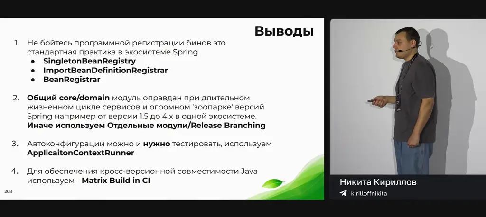
*[▶ 00:36:26](https://www.youtube.com/watch?v=vr3f_Nlq1Wg&t=2186s) · Выводы*

## Ссылки и материалы

- Исходный код Spring на GitHub, где спикер смотрел реализацию (URL не показан) · упомянуто [▶ 00:14:11](https://www.youtube.com/watch?v=vr3f_Nlq1Wg&t=851s)
