# Decoupling the Brain from the Hands: Claude Managed Agents (Part 1 of 4) — Anthropic

*How Anthropic split the first one-container-per-session Managed Agents design into a durable session log, a stateless brain, and disposable hands, and why that split helped.*

Source: [Decoupling the Brain from the Hands: Claude Managed Agents (Part 1 of 4) — Anthropic](https://www.youtube.com/watch?v=Uv0nAf_7tyU) · Priyanka Phatak · AI Engineer · 18 min

## TL;DR

The first Claude Managed Agents design ran the session log, the harness, and the sandbox in one container per session. That made failures hard to debug, blocked shell access, and tied the agent to one network. Anthropic split the agent into a durable append-only session log, a stateless brain (Claude plus the agent loop), and disposable hands (sandboxes and tools). The split cut p95 time-to-first-token by about 90% and the median by roughly 60%, and stable interfaces let the team swap the harness without changing the architecture.

## Key takeaways

- An agent is a model running in a loop with tools, and a harness fills gaps that are specific to each model, such as Sonnet 4.5's context anxiety, so harness assumptions go stale with each new model.
- Generated code is untrusted, so each task should run in its own disposable sandbox that holds nothing valuable, which keeps the blast radius small.
- In the single-container design, a dead container lost the session, so bugs, dropped packets, and dead containers looked identical, and shell access was blocked because the container held user data.
- Keep the session as an append-only event log: compaction never edits the stream, and a strategy such as summarizing the full log or keeping the last n events produces a disposable view.
- Store credentials in a vault outside the sandbox and have a proxy inject them into outbound calls, so the model never sees the tokens and prompt injection cannot make it print them.
- Define the sandbox template (with unrestricted or domain-limited networking) separately from the reusable agent (model, system prompt, tools), then bind them in a session that stays idle until an event arrives.
- Decoupling the brain from the hands cut p95 time-to-first-token by about 90% and the median by roughly 60%, because inference starts immediately and the sandbox spins up only when needed.
- Give every hand the same tool interface (a name and input in, a string out), so a sandbox, a customer's VPC, or an MCP server can be plugged in interchangeably.

## An agent is a model in a loop with tools

[▶ 00:02:05](https://www.youtube.com/watch?v=Uv0nAf_7tyU&t=125s)

An **agent** is a model running in a loop with tools. The model decides the next action and makes a tool call to the environment, which holds the tools, files and code. The result goes back to the model, and the loop repeats until the task is done.

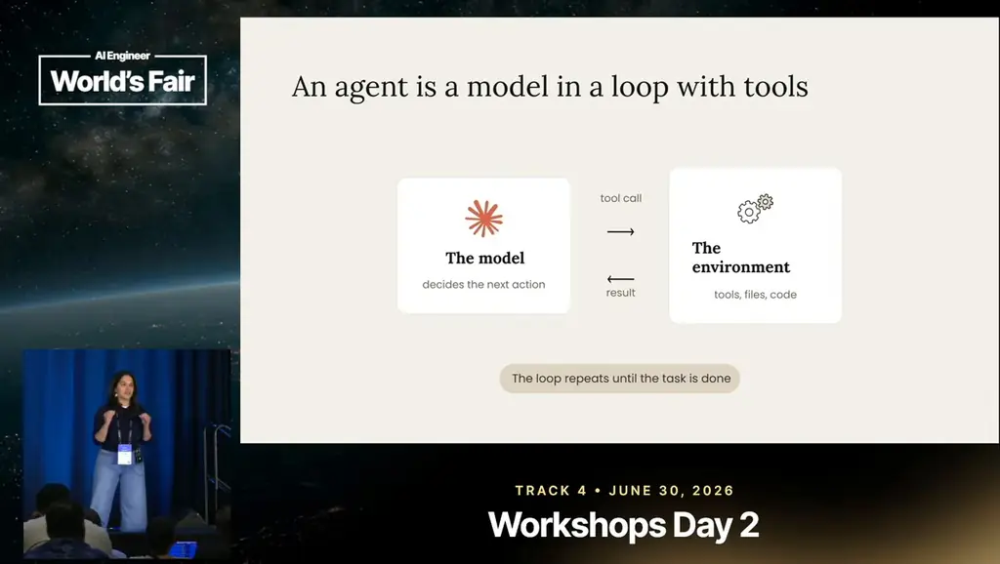
*[▶ 00:02:28](https://www.youtube.com/watch?v=Uv0nAf_7tyU&t=148s) · An agent is a model in a loop with tools*

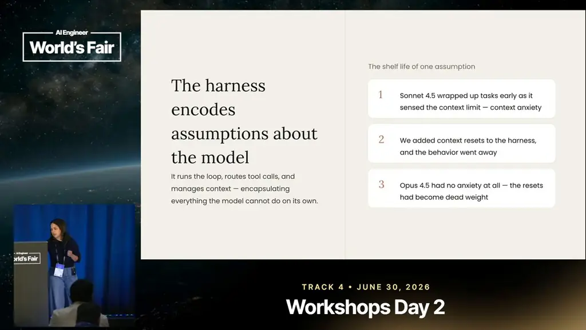
*[▶ 00:04:15](https://www.youtube.com/watch?v=Uv0nAf_7tyU&t=255s) · The harness encodes assumptions about the model*

## Harnesses encode what the model can't do

[▶ 00:03:06](https://www.youtube.com/watch?v=Uv0nAf_7tyU&t=186s)

A harness wraps a model, looping over tool calls and filling what the model can't do. Those gaps are model-specific: Sonnet 4.5 had "context anxiety," rushing tasks near its context limit, so its harness needed a context reset; Opus 4.5 didn't. Each new model means revisiting those assumptions, which [Claude Managed Agents](https://platform.claude.com/docs/en/managed-agents/overview) tries to do.

## Sandboxes contain untrusted agent code

[▶ 00:04:16](https://www.youtube.com/watch?v=Uv0nAf_7tyU&t=256s)

Agents need a computer to run code, edit files and install dependencies. Generated code is untrusted: it may be buggy or follow a prompt injection, so it must run in an isolated, disposable sandbox container.

Run each task in its own container so tasks don't mix and the blast radius stays small. Ideally, the sandbox holds nothing valuable.


*[▶ 00:05:10](https://www.youtube.com/watch?v=Uv0nAf_7tyU&t=310s) · The sandbox gives the agent a safe place to act*

## One container per session

[▶ 00:05:10](https://www.youtube.com/watch?v=Uv0nAf_7tyU&t=310s)

The first Managed Agents architecture put everything in one container per session: the session log, the harness that calls Claude and routes tools, and the sandbox where generated code runs. A session is the unit of work.

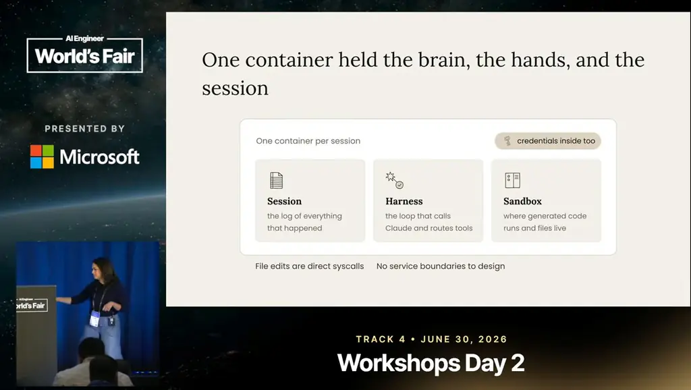
*[▶ 00:06:05](https://www.youtube.com/watch?v=Uv0nAf_7tyU&t=365s) · One container held the brain, the hands, and the session*

This kept things simple. With no service boundaries to design, everything was local and easy to edit, and file edits were direct syscalls.

## Why the containers became pets

[▶ 00:06:05](https://www.youtube.com/watch?v=Uv0nAf_7tyU&t=365s)

Pets are nursed back to health; cattle are replaced when they fail. Their containers became pets because a failed container lost the session inside it.

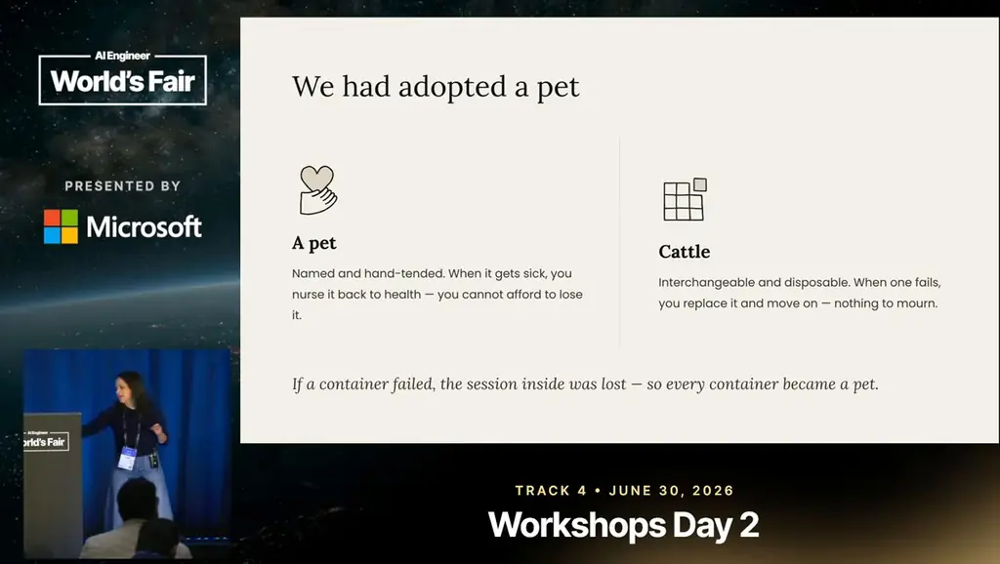
*[▶ 00:06:54](https://www.youtube.com/watch?v=Uv0nAf_7tyU&t=414s) · We had adopted a pet*

The pet became a liability in three ways:

- **Debugging blind:** bugs, dropped packets, and dead containers looked identical.
- **No way in:** a shell was off-limits because the container held user data.
- **Welded to the network:** reaching a customer VPC meant peering networks or shipping the harness.


*[▶ 00:06:59](https://www.youtube.com/watch?v=Uv0nAf_7tyU&t=419s) · The pet became a liability*

## Splitting the brain from the hands

[▶ 00:07:45](https://www.youtube.com/watch?v=Uv0nAf_7tyU&t=465s)

The agent splits into three interfaces: a durable **session** log, a stateless **brain** (Claude plus the agent loop), and disposable **hands** (sandboxes and tools).

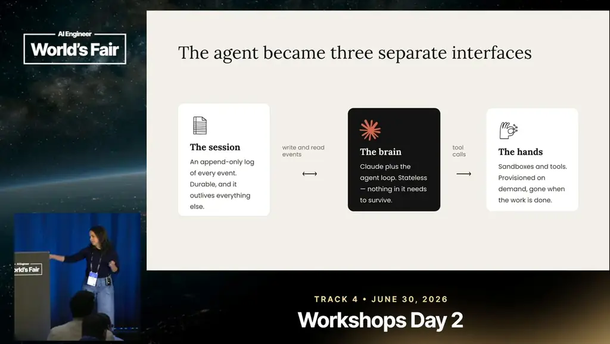
*[▶ 00:08:20](https://www.youtube.com/watch?v=Uv0nAf_7tyU&t=500s) · The agent became three separate interfaces*

Only the session needs protecting. A dead sandbox becomes a failed tool call that Claude retries on a fresh container. A dead harness is replaced by a new one that reads the event log and resumes.

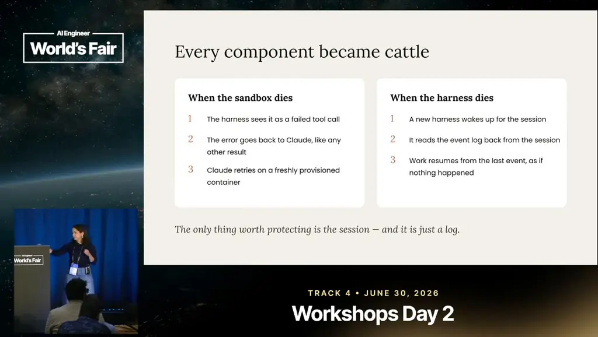
*[▶ 00:09:05](https://www.youtube.com/watch?v=Uv0nAf_7tyU&t=545s) · Every component became cattle*

## Keeping credentials out of the sandbox

[▶ 00:09:05](https://www.youtube.com/watch?v=Uv0nAf_7tyU&t=545s)

Previously, credentials sat inside the sandbox, so prompt injection could steal them.

Now tokens live in a vault outside the sandbox. When the sandbox needs to call something that requires a token, a proxy fetches the right credential and injects it before calling the external endpoint or MCP server.

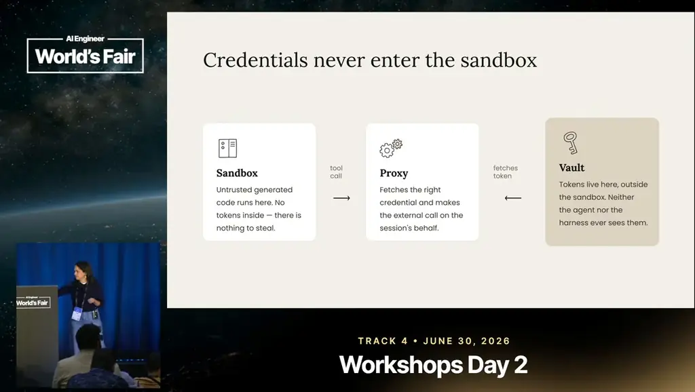
*[▶ 00:09:48](https://www.youtube.com/watch?v=Uv0nAf_7tyU&t=588s) · Credentials never enter the sandbox*

The model never sees the tokens, so prompt injection cannot make it print or write them.

## An append-only log keeps compaction flexible and first tokens fast

[▶ 00:09:49](https://www.youtube.com/watch?v=Uv0nAf_7tyU&t=589s)

The session is an append-only event log, so nothing is discarded. Compaction never edits the stream; the strategy picks a disposable view, such as summarizing the full log or keeping the last n events.

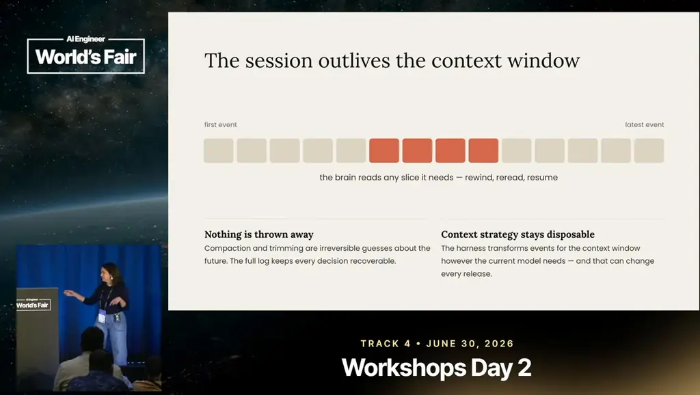
*[▶ 00:10:22](https://www.youtube.com/watch?v=Uv0nAf_7tyU&t=622s) · The session outlives the context window*

Decoupling cut p95 time-to-first-token by about 90%, and the median by roughly 60%. Inference starts immediately; the sandbox spins up only when needed.

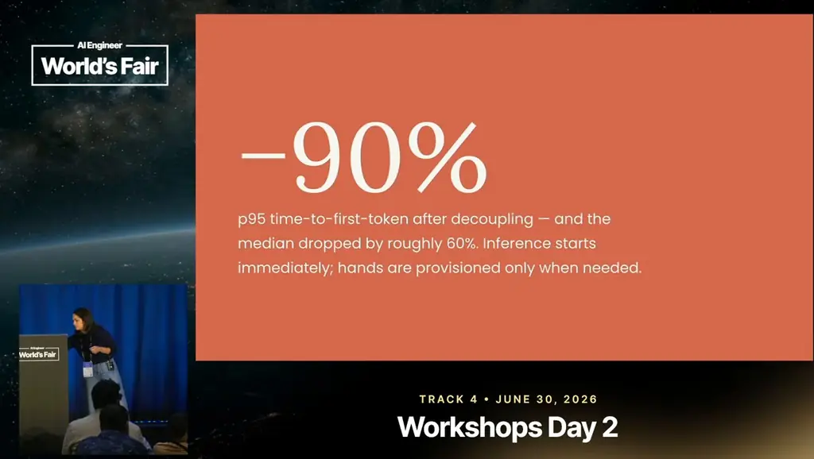
*[▶ 00:10:48](https://www.youtube.com/watch?v=Uv0nAf_7tyU&t=648s) · 90% lower p95 time-to-first-token*

## One brain, interchangeable hands

[▶ 00:10:49](https://www.youtube.com/watch?v=Uv0nAf_7tyU&t=649s)

With the brain decoupled, the agent loop or harness can call hands in different places: a sandbox container, a customer's VPC, or an MCP server.

Every hand uses the same tool interface: a name and input go in, a string comes out. Because the hands are interchangeable, you can plug in many of them, which makes the architecture much more flexible.

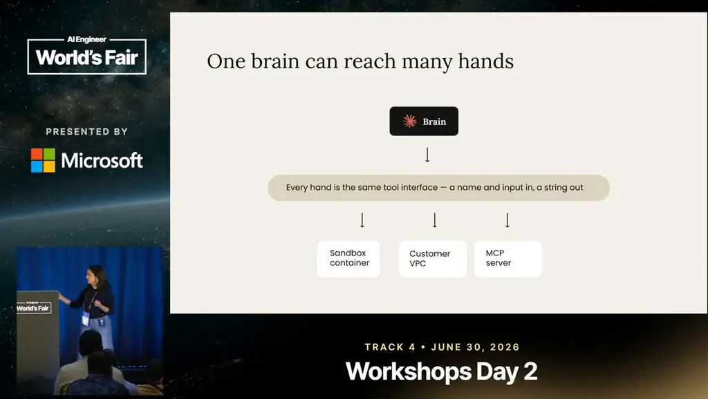
*[▶ 00:11:10](https://www.youtube.com/watch?v=Uv0nAf_7tyU&t=670s) · One brain can reach many hands*

## Stable interfaces outlast stale assumptions

[▶ 00:11:09](https://www.youtube.com/watch?v=Uv0nAf_7tyU&t=669s)

Harnesses encode assumptions, and assumptions go stale. Design interfaces that outlast them.

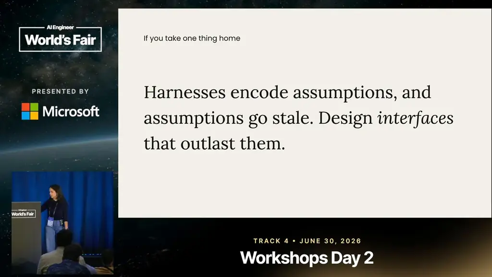
*[▶ 00:11:40](https://www.youtube.com/watch?v=Uv0nAf_7tyU&t=700s) · Takeaway: harnesses encode assumptions*

The team built the architecture around stable interfaces. That let them change the compaction strategy and swap out the harness completely, while the interface and architecture stayed the same. The result is a more pluggable system.

## Three interfaces built to outlast change

[▶ 00:12:24](https://www.youtube.com/watch?v=Uv0nAf_7tyU&t=744s)

Three interfaces were designed so the system keeps working as its parts change:

1. An **append-only session log** that records every event.
2. A **harness** that can be swapped out.
3. **Hands**, such as sandboxes and tool calls, that can be plugged in as the model needs them.

Plugging in hands is what makes the system more generic and extendable. The full log is what lets context strategy change: compaction and trimming can be revised later because every decision stays recoverable.

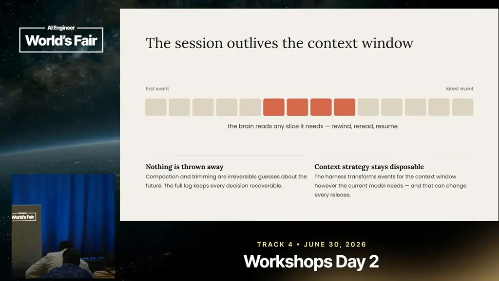
*[▶ 00:12:57](https://www.youtube.com/watch?v=Uv0nAf_7tyU&t=777s) · The session outlives the context window*

## Defining the sandbox template and the agent separately

[▶ 00:13:49](https://www.youtube.com/watch?v=Uv0nAf_7tyU&t=829s)

The environment is the sandbox template, with networking set to unrestricted or limited to specific domains or MCP servers. Create it once; reuse its ID. Each session gets a fresh container.

```python
env = client.beta.environments.create(
name="joke-teller-env" , config={ "type":
"cloud", "networking": {"type":
"unrestricted" }, }, )
```

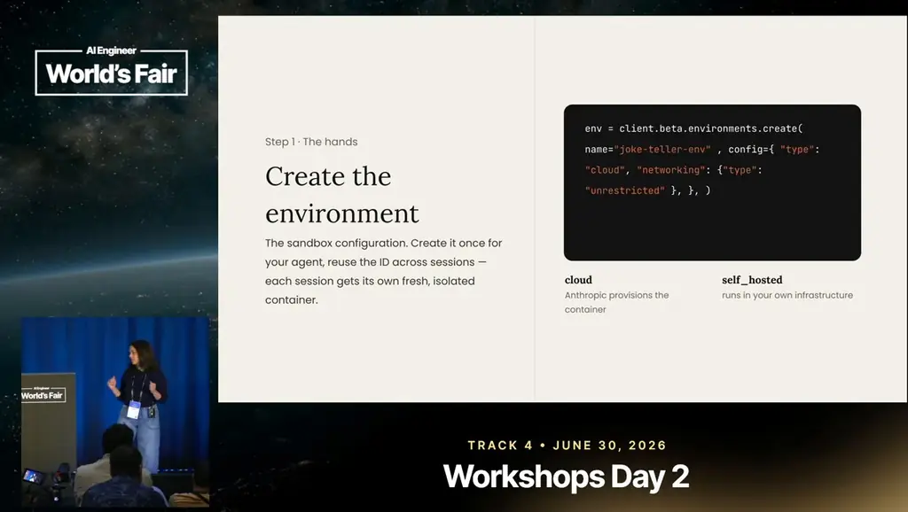
*[▶ 00:14:33](https://www.youtube.com/watch?v=Uv0nAf_7tyU&t=873s) · Step 1: Create the environment*

The agent is a reusable definition of model, system prompt, and tools, with no link to any environment. Its agent toolset (bash, read, write, grep) is one that almost all agents need.

```python
agent = client.beta.agents.create( name="Joke teller" , model={"id": "claude-opus-4-8" },
system= "You are a comedian. Find a fresh joke on the topic and deliver it well." ,
tools=[{"type": "agent_toolset_20260401" }],
)
```

*[▶ 00:15:18](https://www.youtube.com/watch?v=Uv0nAf_7tyU&t=918s) · Step 2: Create the agent*

## One event stream per session

[▶ 00:15:18](https://www.youtube.com/watch?v=Uv0nAf_7tyU&t=918s)

Creating a session binds an agent and an environment into one unit of work. It stays idle until you send an event.

```python
session = client.beta.sessions.create(
agent=agent.id, environment_id=env.id,
title="Open mic night" , )
```

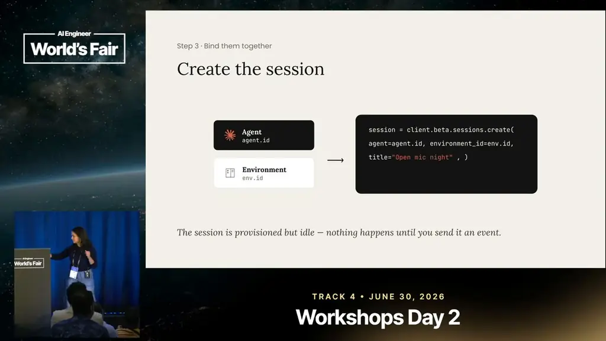
*[▶ 00:15:37](https://www.youtube.com/watch?v=Uv0nAf_7tyU&t=937s) · Step 3: Create the session*

The client and agent share one event stream. You POST events to `/v1/sessions/{id}/events` and read agent output from `GET /v1/sessions/{id}/stream`.

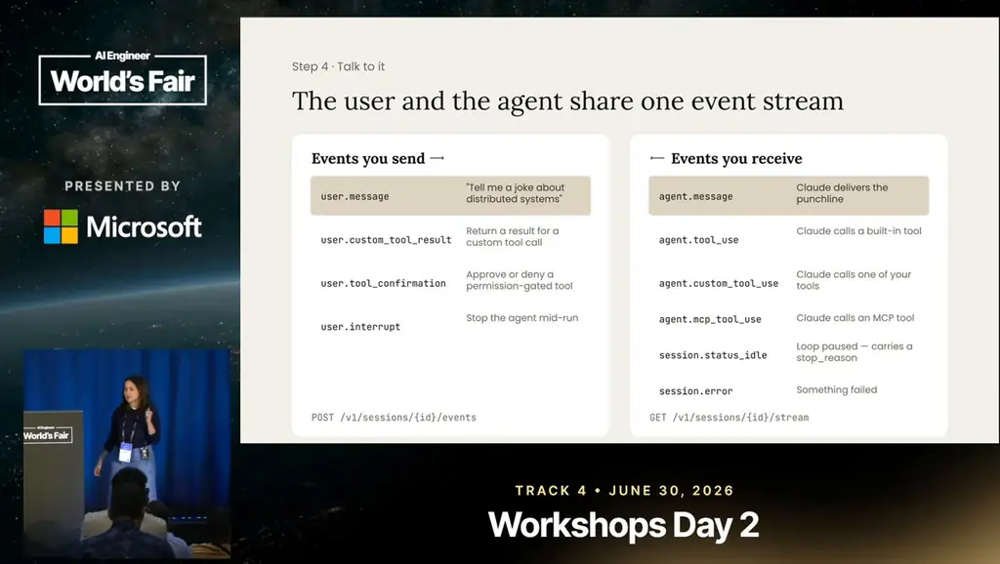
*[▶ 00:16:34](https://www.youtube.com/watch?v=Uv0nAf_7tyU&t=994s) · The user and the agent share one event stream*

`session.status_idle` means the loop has paused and carries a `stop_reason`. `session.error` signals that something failed.

## Starting from the Console Quickstart

[▶ 00:16:33](https://www.youtube.com/watch?v=Uv0nAf_7tyU&t=993s)

The ten beta Managed Agents features make up the full set; multiagent and memory get deeper coverage later in the workshop.

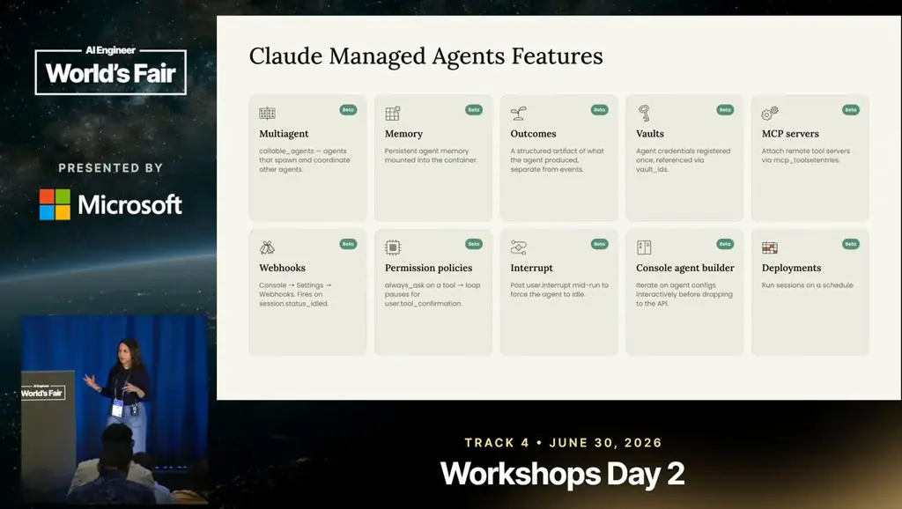
*[▶ 00:16:49](https://www.youtube.com/watch?v=Uv0nAf_7tyU&t=1009s) · Claude Managed Agents Features*

Clone the cwc-workshops repo, enter `research-desk`, and install dependencies.

```bash
git clone
https://github.com/anthropics/cwc-workshops/

cd research-desk

npm install / bun i
```

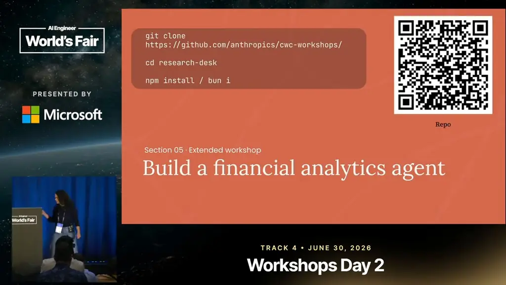
*[▶ 00:16:52](https://www.youtube.com/watch?v=Uv0nAf_7tyU&t=1012s) · Repo clone and install for financial analytics agent*

Vaults hold per-user credentials, registered once and referenced by `vault_ids`.

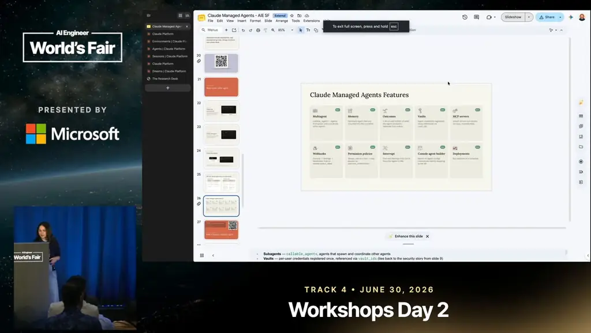
*[▶ 00:16:54](https://www.youtube.com/watch?v=Uv0nAf_7tyU&t=1014s) · Slide editor showing features slide and speaker notes*

The Console's Managed Agents Quickstart guides you through building a first agent, starting from a template or a description.

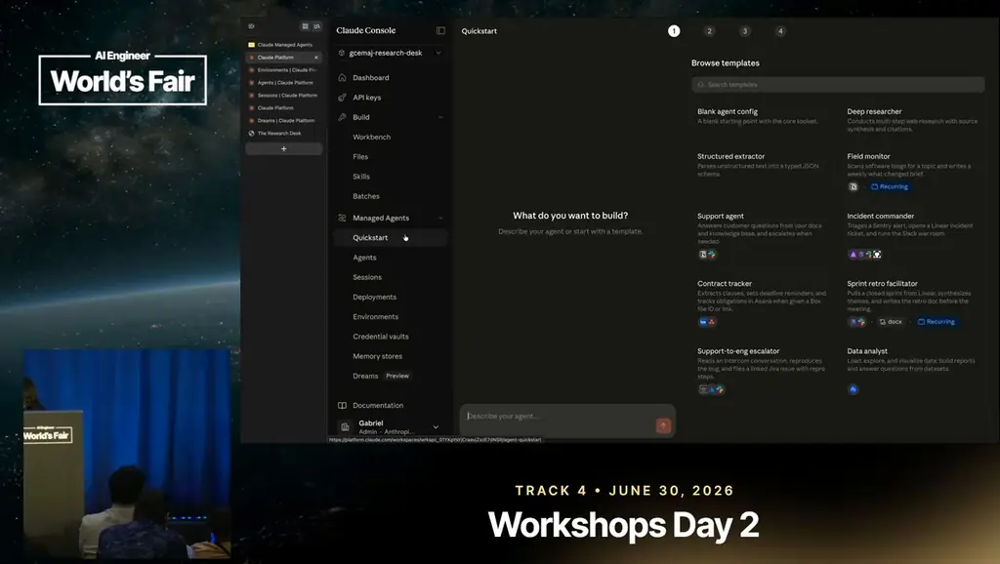
*[▶ 00:17:21](https://www.youtube.com/watch?v=Uv0nAf_7tyU&t=1041s) · Claude Console Quickstart template browser*

## Links & resources

- [Claude Managed Agents overview — official docs](https://platform.claude.com/docs/en/managed-agents/overview) — <https://platform.claude.com/docs/en/managed-agents/overview> · video description
- [Managed Agents engineering post — Anthropic](https://www.anthropic.com/engineering/managed-agents) — <https://www.anthropic.com/engineering/managed-agents> · video description
- [Speaker's GitHub profile (gcemaj)](https://github.com/gcemaj) — <https://github.com/gcemaj> · video description
- Slide deck — speaker said it would be shared at the end, URL not shown · mentioned [▶ 00:02:44](https://www.youtube.com/watch?v=Uv0nAf_7tyU&t=164s)
- Cloud platform credits sign-up via QR code, URL not shown · mentioned [▶ 00:11:54](https://www.youtube.com/watch?v=Uv0nAf_7tyU&t=714s)
