# Андрей Кулешов — Как Java-фреймворки ускоряются (на примере Quarkus)

*Как Java-фреймворки ускоряются на примере Quarkus*

Источник: [Андрей Кулешов — Как Java-фреймворки ускоряются (на примере Quarkus)](https://www.youtube.com/watch?v=Jpgl3qrUVE8) · Андрей Кулешов · Joker — Конференция о будущем разработки · 50 мин

## Коротко

Java-фреймворки, такие как Quarkus, ускоряют старт и производительность, перенося работу с runtime на build-time: анализ классов, генерация байт-кода, подготовка DI-контейнера до запуска. Quarkus использует индексацию классов через Jandex, инструменты вроде Gizmo и ASM для преобразования кода, устраняя рефлексию и сканирование классов. Это позволяет сократить время стартовой загрузки в 2 раза по сравнению с Spring Boot и улучшить пропускную способность.

## Главное

- Quarkus ускоряет старт приложения в 2 раза (2908 мс против 6734 мс) и повышает пропускную способность в 2.7 раза (19095 tps против 7093 tps) по сравнению с Spring Boot.
- Quarkus переносит работу с runtime на build-time: анализ классов, генерация байт-кода, подготовка DI-контейнера до запуска приложения.
- Для оптимизации используется индексация классов через Jandex, что позволяет избежать рефлексии и сканирования классов в runtime.
- Quarkus использует Gizmo и ASM для преобразования кода, например, создает подклассы с логикой интерцепции для beans с аннотацией @ApplicationScoped.
- ARC (ArC) — имплементация CDI — генерирует bean-конструкторы и удаляет ненужный код, что ускоряет старт приложения.
- GraalVM сокращает время стартовой загрузки до нуля, но Quarkus достигает высокой скорости даже без AOT, благодаря build-time оптимизациям.
- Процесс AOT-компиляции в Quarkus использует профилирование приложений во время интеграционных тестов для создания кэша, который ускоряет старт.
- Индивидуальные build-time оптимизации, такие как генерация кода и индексация, являются частью общего тренда в индустрии, который также поддерживается Spring и Project Leyden.

## Java-фреймворки: скорость и производительность

[▶ 00:00:00](https://www.youtube.com/watch?v=Jpgl3qrUVE8&t=0s)

Кваркус и Spring Boot сравниваются по стартовому времени и пропускной способности. Кваркус в два раза быстрее Spring Boot по стартовому времени (2908 мс против 6734 мс) и в 2.7 раза по пропускной способности (19095 tps против 7093 tps) в режиме JIT.

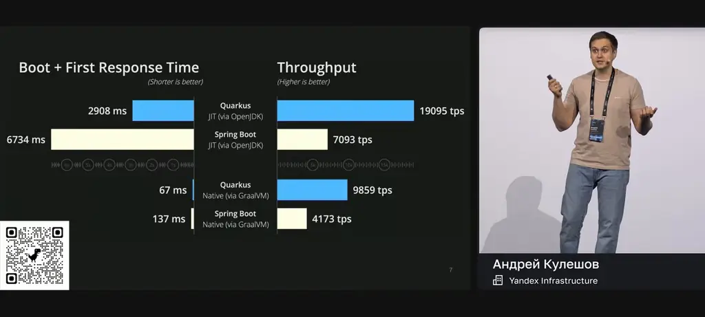
*[▶ 00:05:00](https://www.youtube.com/watch?v=Jpgl3qrUVE8&t=300s) · Boot + First Response Time, Throughput*

Нативное исполнение через GraalVM сокращает стартовое время до нуля для обоих фреймворков.

Кваркус использует концепцию build-time оптимизации, что позволяет ускорить фреймворки без изменения кода.

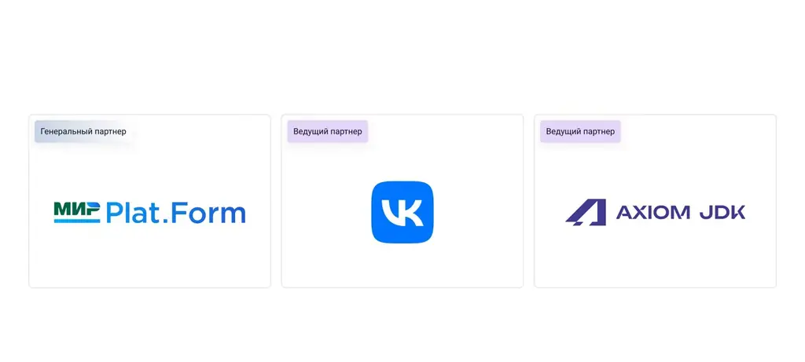
*[▶ 00:00:17](https://www.youtube.com/watch?v=Jpgl3qrUVE8&t=17s) · Partners: General and Leading*

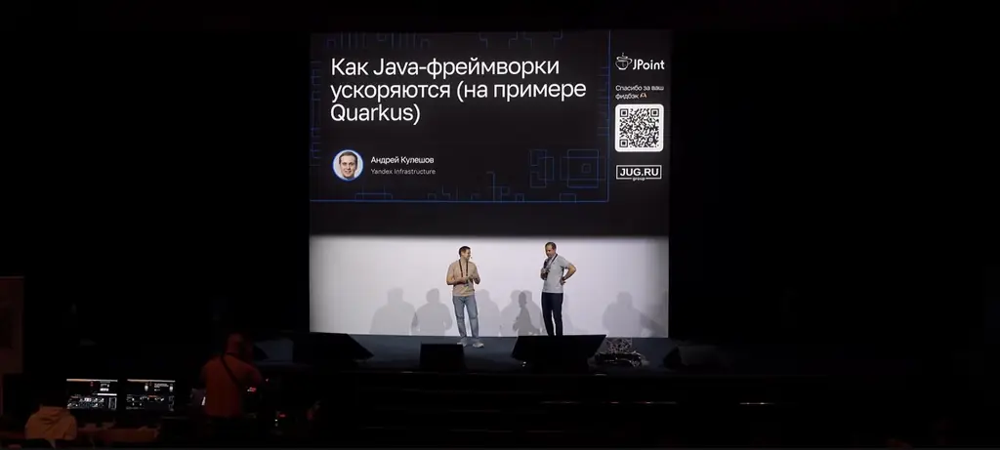
*[▶ 00:00:30](https://www.youtube.com/watch?v=Jpgl3qrUVE8&t=30s) · Как Java-фреймворки ускоряются (на примере Quarkus)*

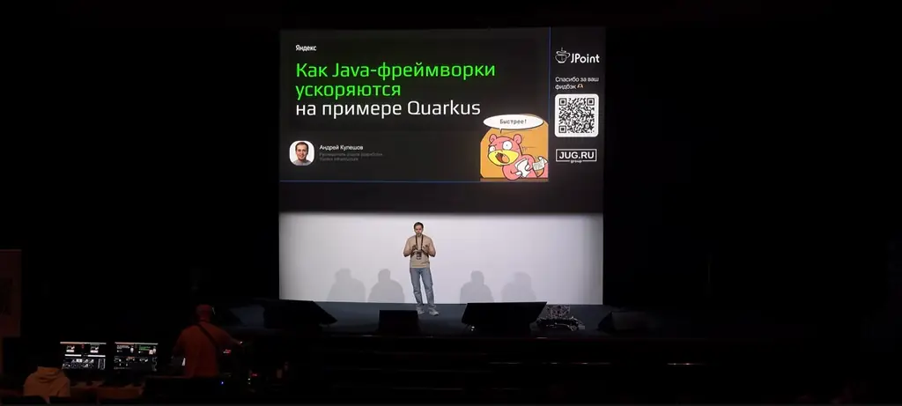
*[▶ 00:00:57](https://www.youtube.com/watch?v=Jpgl3qrUVE8&t=57s) · Как Java-фреймворки ускоряются на примере Quarkus*

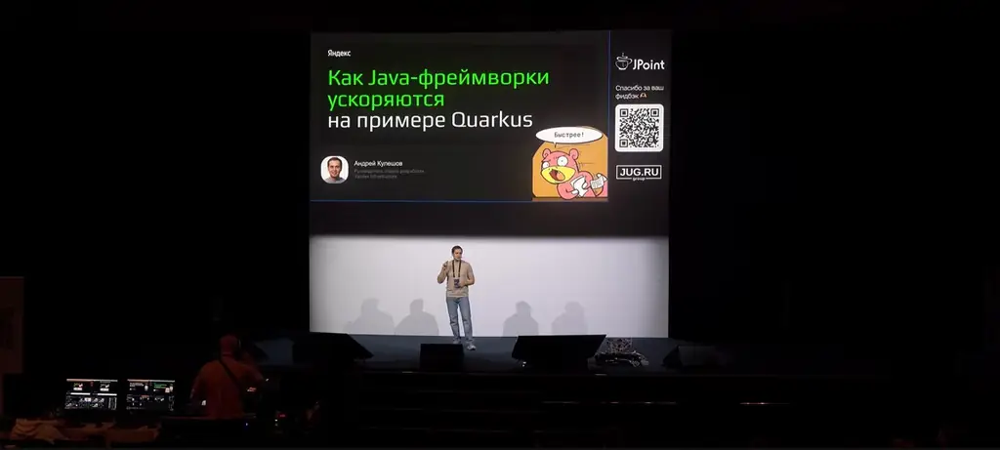
*[▶ 00:01:24](https://www.youtube.com/watch?v=Jpgl3qrUVE8&t=84s) · Как Java-фреймворки ускоряются на примере Quarkus*

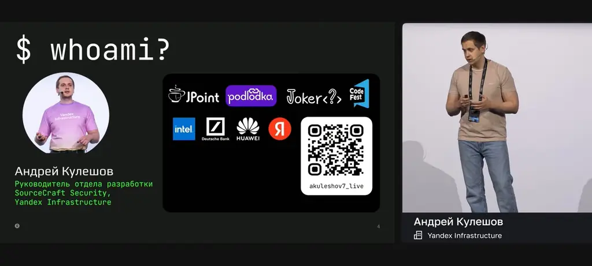
*[▶ 00:02:10](https://www.youtube.com/watch?v=Jpgl3qrUVE8&t=130s) · Whoami slide*

## My Story: Production Experience

[▶ 00:04:59](https://www.youtube.com/watch?v=Jpgl3qrUVE8&t=299s)

В рамках работы в SourceCraft (аналог GitHub от Яндекса) Андрей Кулешов разрабатывал сервис для обработки результатов анализа кода на Java с использованием gRPC и REST. Сравнивая Java с Go, он столкнулся с проблемами: медленный старт и высокое потребление памяти. После года эксплуатации Quarkus JVM-сервиса в PROD (50k строк кода, 60 gRPC-эндпоинтов, 10 REST-эндпоинтов) были достигнуты нулевые инциденты на стороне фреймворка и старт за ~3 секунды.

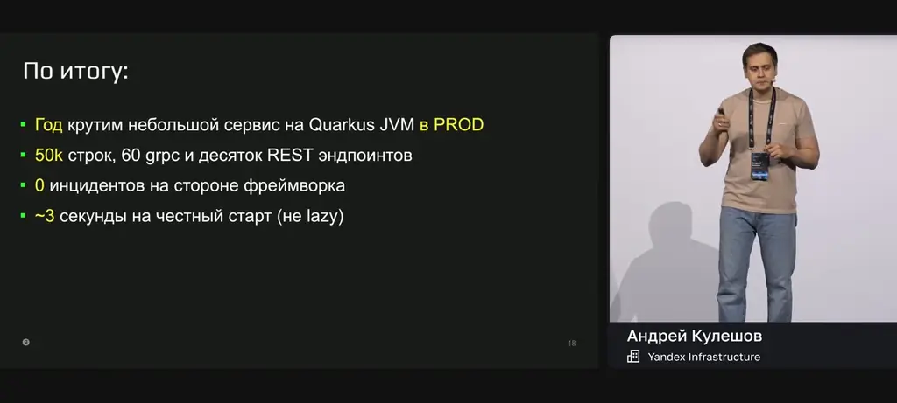
*[▶ 00:09:17](https://www.youtube.com/watch?v=Jpgl3qrUVE8&t=557s) · По итогу:*

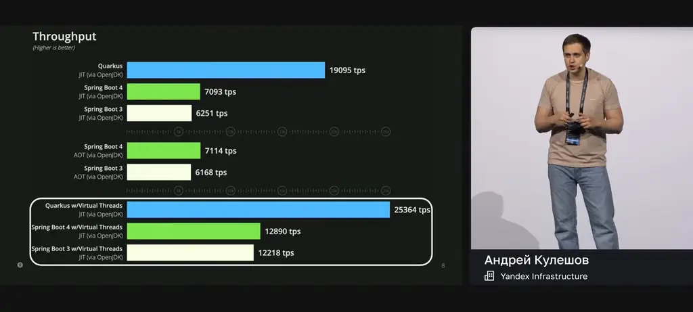
*[▶ 00:05:35](https://www.youtube.com/watch?v=Jpgl3qrUVE8&t=335s) · Throughput comparison chart*

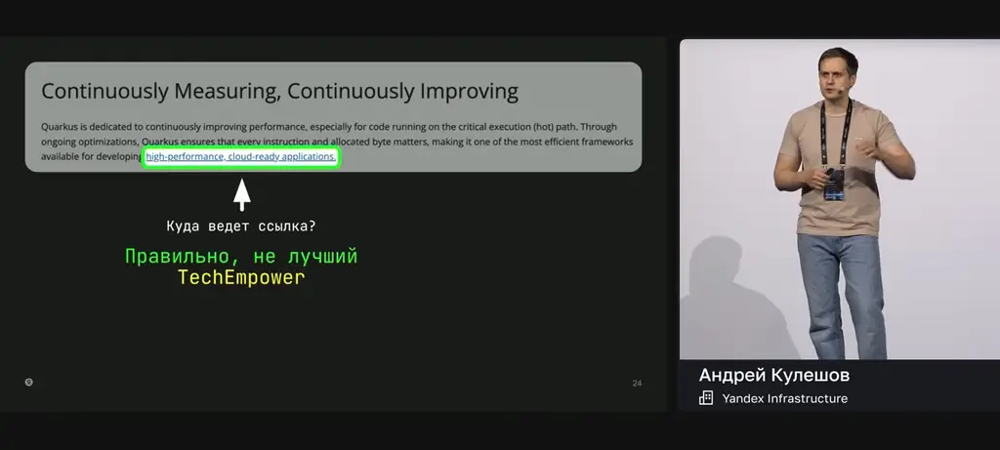
*[▶ 00:10:25](https://www.youtube.com/watch?v=Jpgl3qrUVE8&t=625s) · Continuously Measuring, Continuously Improving*

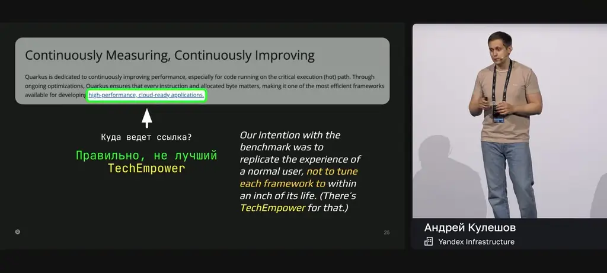
*[▶ 00:11:46](https://www.youtube.com/watch?v=Jpgl3qrUVE8&t=706s) · Continuously Measuring, Continuously Improving*

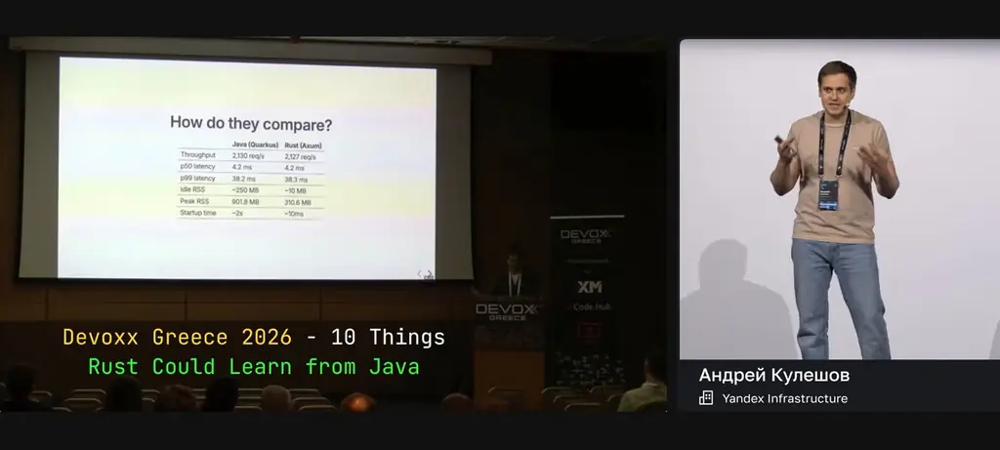
*[▶ 00:13:26](https://www.youtube.com/watch?v=Jpgl3qrUVE8&t=806s) · How do they compare?*

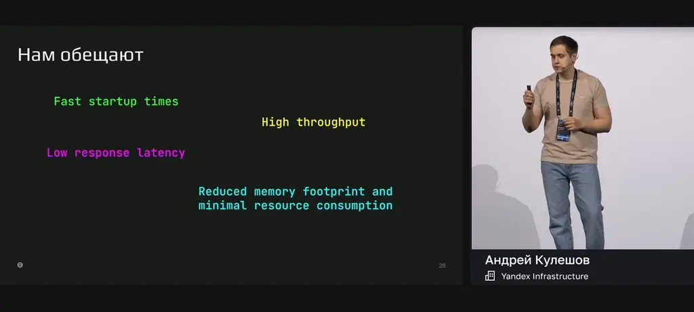
*[▶ 00:13:50](https://www.youtube.com/watch?v=Jpgl3qrUVE8&t=830s) · Fast startup times*

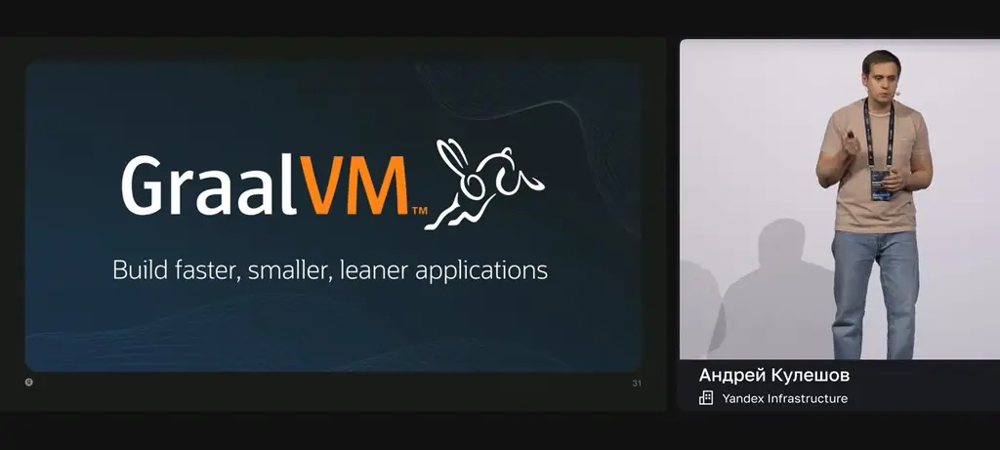
*[▶ 00:14:39](https://www.youtube.com/watch?v=Jpgl3qrUVE8&t=879s) · GraalVM: Build faster, smaller, leaner applications*

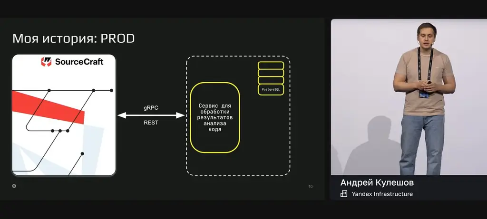
*[▶ 00:06:22](https://www.youtube.com/watch?v=Jpgl3qrUVE8&t=382s) · My story: PROD*

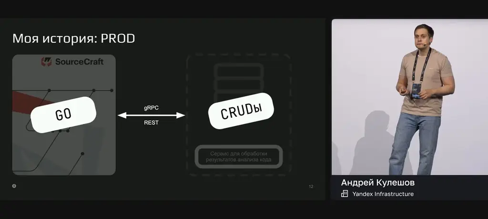
*[▶ 00:07:30](https://www.youtube.com/watch?v=Jpgl3qrUVE8&t=450s) · My story: PROD*

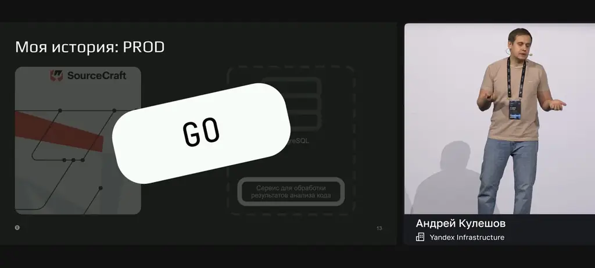
*[▶ 00:07:43](https://www.youtube.com/watch?v=Jpgl3qrUVE8&t=463s) · Моя история: PROD*

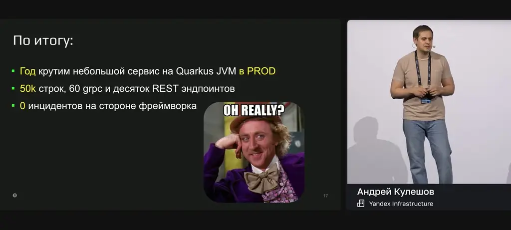
*[▶ 00:09:03](https://www.youtube.com/watch?v=Jpgl3qrUVE8&t=543s) · По итогу:*

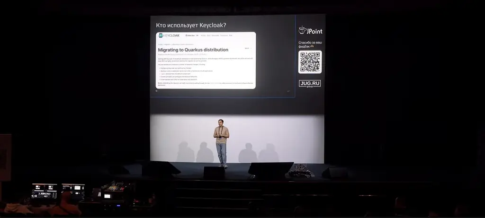
*[▶ 00:09:39](https://www.youtube.com/watch?v=Jpgl3qrUVE8&t=579s) · Кто использует Keycloak?*

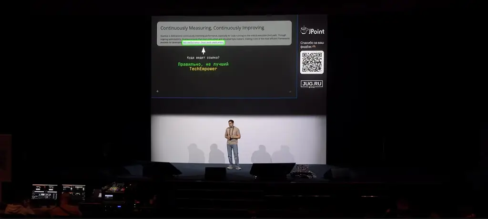
*[▶ 00:10:31](https://www.youtube.com/watch?v=Jpgl3qrUVE8&t=631s) · Continuously Measuring, Continuously Improving*

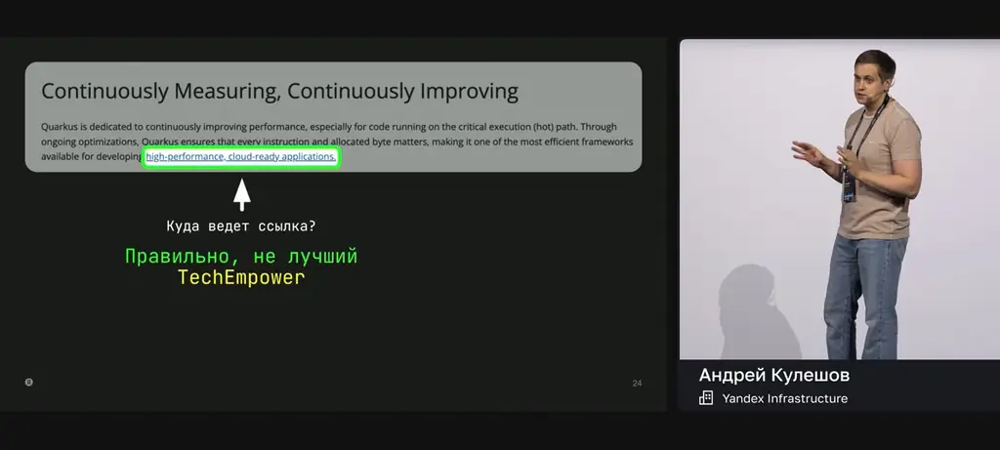
*[▶ 00:10:41](https://www.youtube.com/watch?v=Jpgl3qrUVE8&t=641s) · Continuously Measuring, Continuously Improving*

## GraalVM and Build-Time Optimization

[▶ 00:14:39](https://www.youtube.com/watch?v=Jpgl3qrUVE8&t=879s)

В Quarkus старт быстрее даже без AOT, потому что переносит работу с runtime на build-time. Старт приложения часто измеряют по фразе «Quarkus started in 0.002s», но это не реальный старт — приложение может долго обрабатывать первый запрос из-за ленивой инициализации. Quarkus решает это, генерируя код и вмешиваясь в байткод на этапе сборки: читает конфигурацию, сканирует аннотации, строит модели и индексы, удаляет ненужный код.

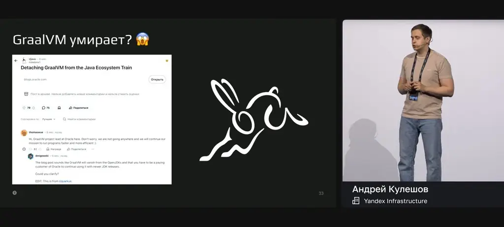
*[▶ 00:15:31](https://www.youtube.com/watch?v=Jpgl3qrUVE8&t=931s) · GraalVM умирает? 🥺*

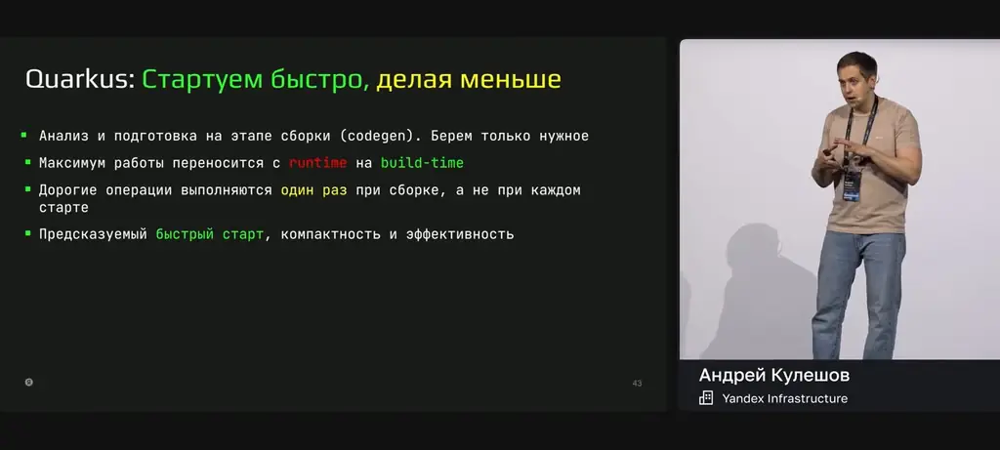
*[▶ 00:17:59](https://www.youtube.com/watch?v=Jpgl3qrUVE8&t=1079s) · Quarkus: Start fast, do less*

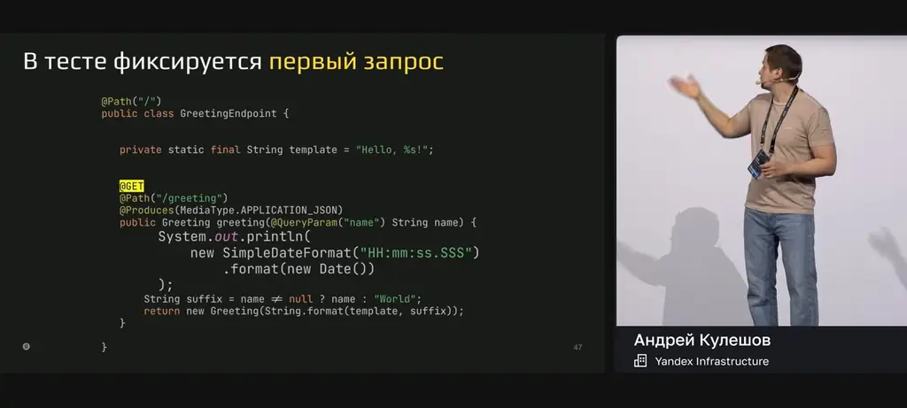
*[▶ 00:19:36](https://www.youtube.com/watch?v=Jpgl3qrUVE8&t=1176s) · GreetingEndpoint code example*

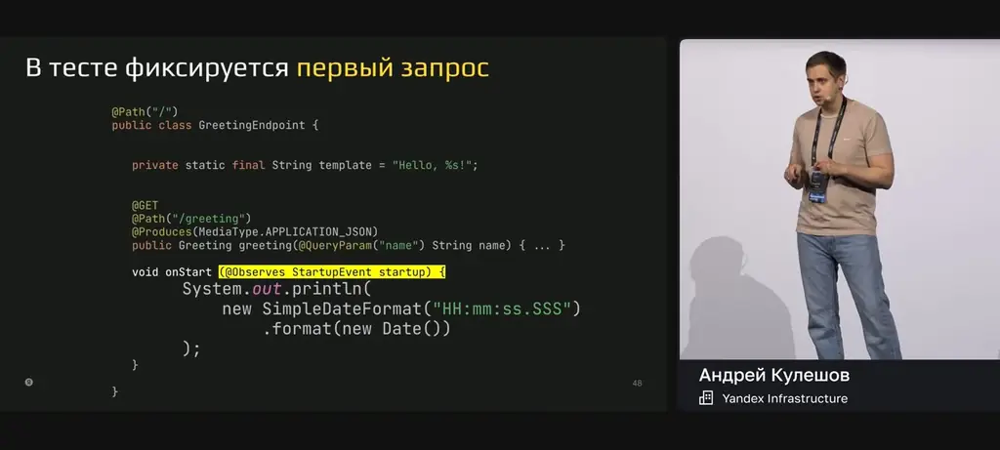
*[▶ 00:20:21](https://www.youtube.com/watch?v=Jpgl3qrUVE8&t=1221s) · First request in test*

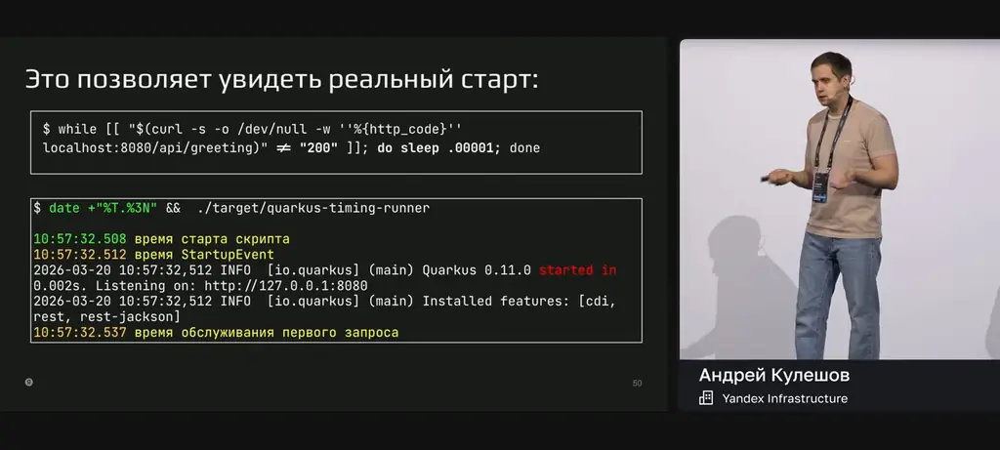
*[▶ 00:21:48](https://www.youtube.com/watch?v=Jpgl3qrUVE8&t=1308s) · Real start detection script*

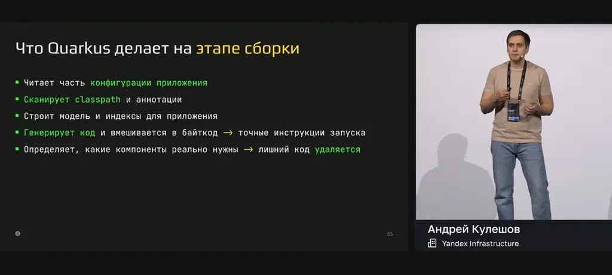
*[▶ 00:23:04](https://www.youtube.com/watch?v=Jpgl3qrUVE8&t=1384s) · Что Quarkus делает на этапе сборки*

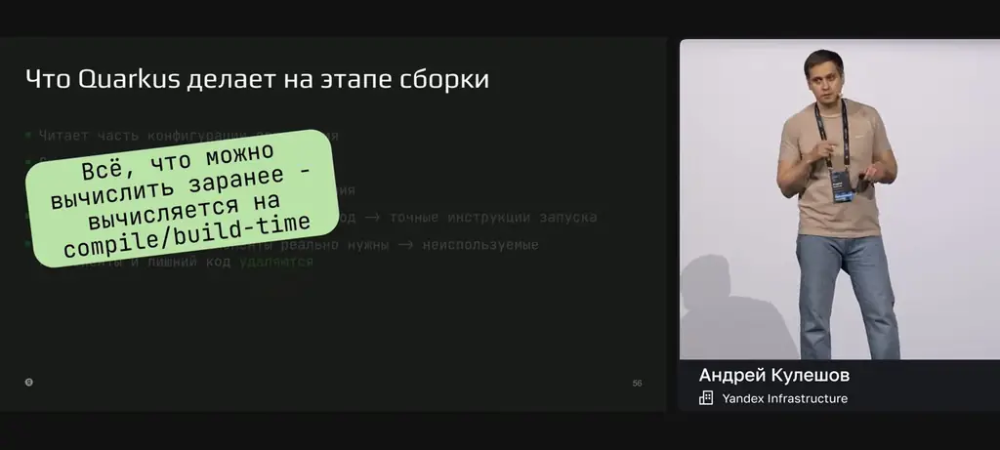
*[▶ 00:23:11](https://www.youtube.com/watch?v=Jpgl3qrUVE8&t=1391s) · Что Quarkus делает на этапе сборки*

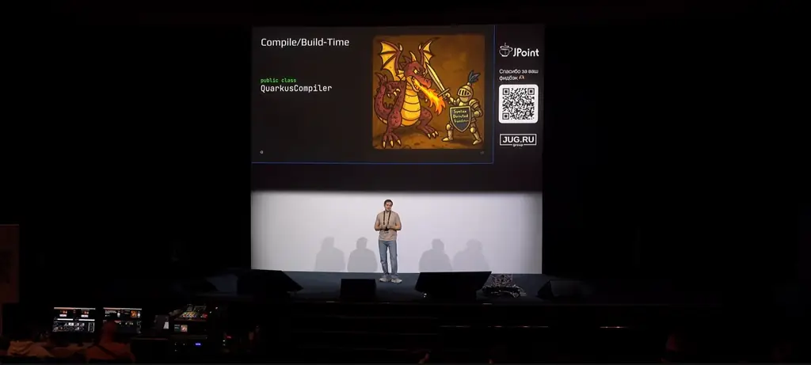
*[▶ 00:23:36](https://www.youtube.com/watch?v=Jpgl3qrUVE8&t=1416s) · Compile/Build-Time*

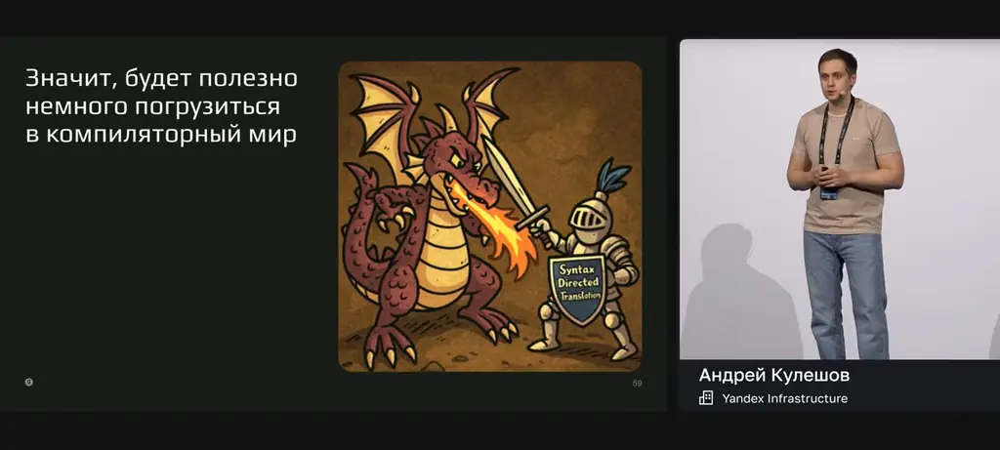
*[▶ 00:23:51](https://www.youtube.com/watch?v=Jpgl3qrUVE8&t=1431s) · Dragon vs. knight illustration*

## Compiler Internals and Bytecode Manipulation

[▶ 00:23:51](https://www.youtube.com/watch?v=Jpgl3qrUVE8&t=1431s)

The compiler's frontend transforms source code into intermediate representations (IR), such as bytecode or LLVM bitcode, enabling optimizations. To optimize frameworks like Quarkus, you can intervene at two points: during source code parsing (modifying the abstract syntax tree) or in the IR (bytecode). Tools like ASM allow direct bytecode manipulation without deep knowledge of its structure. The Class-File API (JEP 484) provides a standard way to modify bytecode, replacing internal ASM usage in OpenJDK.    For example, a `RemoveFieldClassVisitor` filters out fields named `removeMe` during bytecode processing.  This approach moves heavy runtime work to build time, enabling annotation scanning, configuration validation, dependency injection preparation, and code generation to avoid reflection.  Quarkus uses `ClassTransformingBuildStep` for such transformations, as seen in Hibernate Panache.

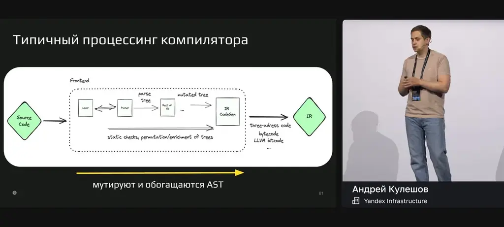
*[▶ 00:25:08](https://www.youtube.com/watch?v=Jpgl3qrUVE8&t=1508s) · Типичный процессинг компилятора*

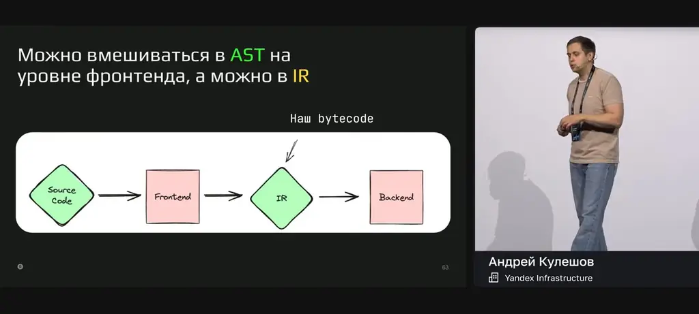
*[▶ 00:26:22](https://www.youtube.com/watch?v=Jpgl3qrUVE8&t=1582s) · AST and IR in bytecode*

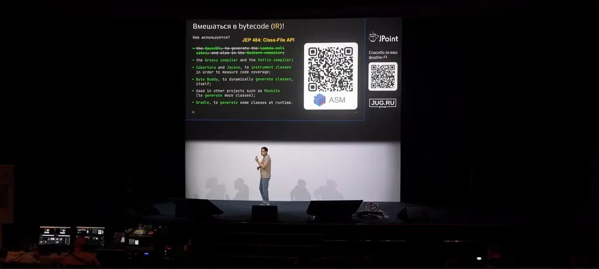
*[▶ 00:27:13](https://www.youtube.com/watch?v=Jpgl3qrUVE8&t=1633s) · Вмешательство в bytecode (IR)*

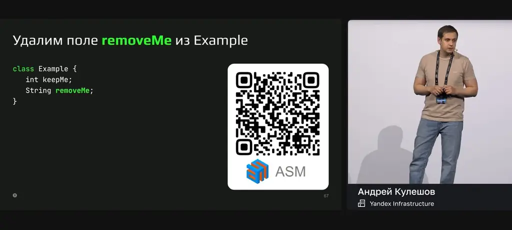
*[▶ 00:27:54](https://www.youtube.com/watch?v=Jpgl3qrUVE8&t=1674s) · Удалим поле removeMe из Example*

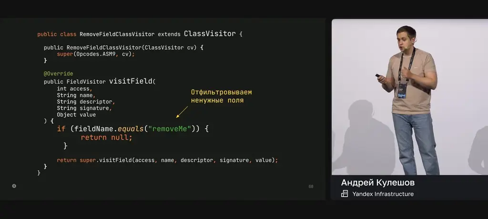
*[▶ 00:28:48](https://www.youtube.com/watch?v=Jpgl3qrUVE8&t=1728s) · Java class visitor code example*

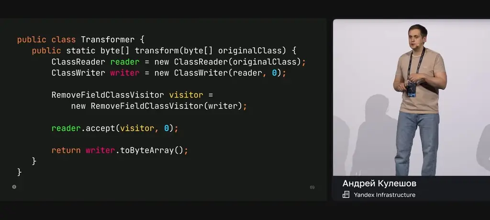
*[▶ 00:29:18](https://www.youtube.com/watch?v=Jpgl3qrUVE8&t=1758s) · Java class transformer code*

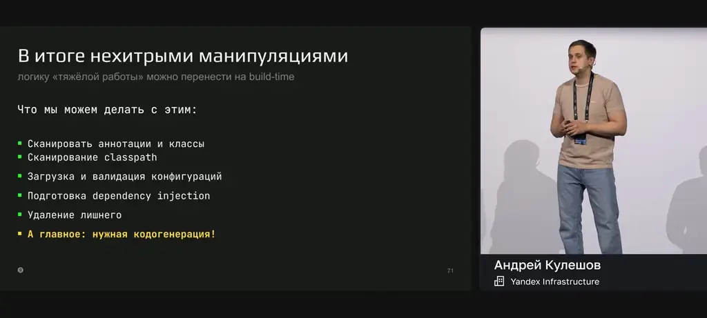
*[▶ 00:29:49](https://www.youtube.com/watch?v=Jpgl3qrUVE8&t=1789s) · В итоге нехитрыми манипуляциями*

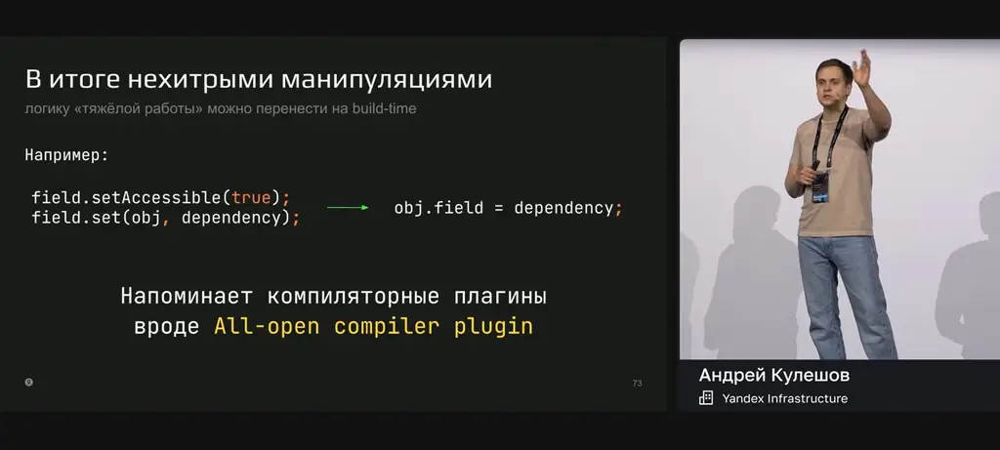
*[▶ 00:30:18](https://www.youtube.com/watch?v=Jpgl3qrUVE8&t=1818s) · Non-intrusive manipulations*

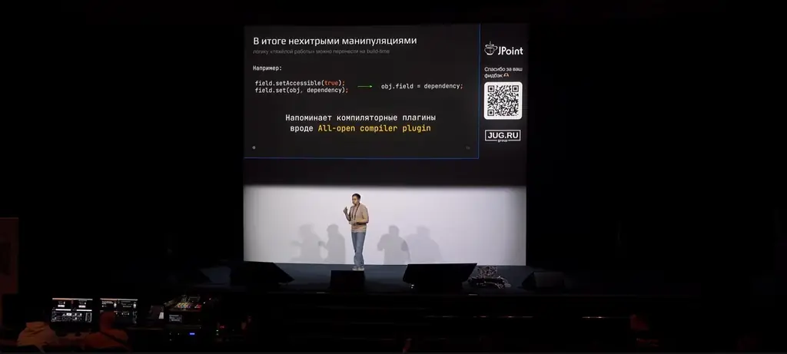
*[▶ 00:30:23](https://www.youtube.com/watch?v=Jpgl3qrUVE8&t=1823s) · Напоминание про компиляторные плагины*

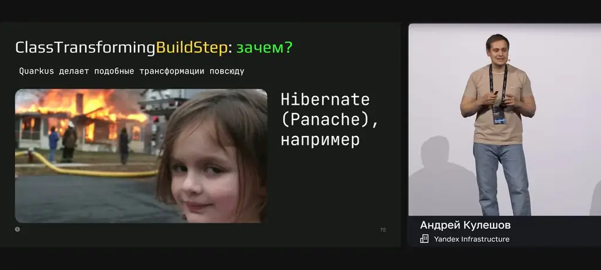
*[▶ 00:31:01](https://www.youtube.com/watch?v=Jpgl3qrUVE8&t=1861s) · ClassTransformingBuildStep: зачем?*

## Dependency Injection and Build-Time Processing

[▶ 00:30:59](https://www.youtube.com/watch?v=Jpgl3qrUVE8&t=1859s)

Quarkus uses **CDI** (Contexts and Dependency Injection) and **ARC** (ArC) for fast startup by shifting dependency injection to build time. ARC is a near-implementation of Jakarta CDI 4.1, leveraging **ASM** and **ClassFileApi** to generate code during compilation.

```java
// === Field или setter
@Inject
UserService userService;
```

*[▶ 00:32:54](https://www.youtube.com/watch?v=Jpgl3qrUVE8&t=1974s) · Contexts and Dependency Injection*

For example, a `@ApplicationScoped` bean like `UserService` (shown in) is transformed into a subclass with interceptor logic (e.g., `ProcessingService_Subclass` in). This subclass wraps business methods with runtime interception (e.g., transactional logic), ensuring interceptors execute before the original method.

```java
@ApplicationScoped
public class UserService {
  public User findById(Long id) {
    return new User(id, "John");
  }
}
```

*[▶ 00:32:33](https://www.youtube.com/watch?v=Jpgl3qrUVE8&t=1953s) · Contexts and Dependency Injection*

```java
public class ProcessingService_Subclass extends ProcessingService implements Subclass {
  public String persistResultToS3(String var1, Commit var2, EngineDescription var3, ReportType var4, Scan var5) {
    Object[] var6 = new Object[]{var1, var2, var3, var4, var5};
    if (this.arc$constructed) {
      try {
        InterceptedMethodMetadata var7 = this.arc$3;
        return (String)InvocationContexts.performAroundInvoke(target: this, var6, var7);
      } catch (RuntimeException var9) {
        throw (Throwable)var9;
      }
    } else {
      return this.persistResultToS3$superforward(var1, var2, var3, var4, var5);
    }
  }

  public void persistResultsToDb(Set var1, String var2) {
    Object[] var3 = new Object[]{var1, var2};
    if (this.arc$constructed) {
      try {

      } catch (RuntimeException var9) {
        throw (Throwable)var9;
      }
    } else {
      this.persistResultsToDb$superforward(var1, var2);
    }
  }
}
```

*[▶ 00:35:39](https://www.youtube.com/watch?v=Jpgl3qrUVE8&t=2139s) · Subclass — interceptors in logic*

ARC also generates **bean constructors** (e.g., `ProcessingService_Bean` in) to handle dependency injection during object creation. The `@Unremovable` annotation (discussed in) prevents beans from being removed if ARC behaves unexpectedly.

```java
public class ProcessingService_Bean implements InjectableBean, Supplier {
  private ProcessingService doCreate(CreationalContext var1) {
    Object var2 = this.interceptorProviderSupplier10.get();
    ProcessingService var5 = (ProcessingService)(new ProcessingService_Subclass(var1, InjectableInterceptor)var2);
    try {
      Object var3 = this.injectProviderSupplier1.get();
      CreationalContextImpl var4 = CreationalContextImpl.child((InjectableReferenceProvider)var3, var1);
      Object var6 = ((InjectableReferenceProvider)var3).get((CreationalContext)var4);
      var5.platformService = (PlatformService)var6;
    } catch (RuntimeException var48) {
      throw (Throwable)(new RuntimeException("Error injecting dev.sourcecraft.services.PlatformService dev.sour"));
    }
    try {
      Object var8 = this.injectProviderSupplier2.get();
      CreationalContextImpl var9 = CreationalContextImpl.child((InjectableReferenceProvider)var8, var1);
      Object var10 = ((InjectableReferenceProvider)var8).get((CreationalContext)var9);
      var5.repository4Artifact = (Repository4Artifact)var10;
    } catch (RuntimeException var47) {
      throw (Throwable)(new RuntimeException("Error injecting dev.sourcecraft.repositories.Repository4Artifact"));
    }
    return var5;
  }
}
```

*[▶ 00:36:06](https://www.youtube.com/watch?v=Jpgl3qrUVE8&t=2166s) · Bean-конструктор*

Quarkus uses **Gizmo**, a bytecode generation framework, to produce this code. Gizmo wraps tools like ASM and ClassFileApi, enabling precise control over generated bytecode (e.g.,).

```kotlin
@ApplicationScoped

class ProcessingService {
    fun persistResultToS3() {
        ...
    }
}
```

*[▶ 00:34:57](https://www.youtube.com/watch?v=Jpgl3qrUVE8&t=2097s) · Generated transformed bytecode*

To optimize startup, Quarkus leverages **Jandex** (a metadata index) to precompute annotations and types during build time. This avoids runtime reflection. For AOT (Ahead-of-Time) compilation, Quarkus integrates with **Project Leyden** (JEP 484), which profiles applications during integration tests (e.g., `./gradlew build quarkusIntTest`) to generate a cache that speeds up startup. This cache is embedded into the final image, reducing startup time from 3.5s to under 250ms in large applications.

```java
public class $serializer implements GeneratedSerializer {
  @NotNull
  public final A deserialize(@NotNull Decoder decoder) {
    while(var3) {
      int var4 = var7.decodeElementIndex(var2);
      switch (var4) {
        case 0:
          var6 = var7.decodeIntElement(var2, 0);
          var5 = 1;
          break;
        default:
          throw new UnknownFieldException(var4);
      }
    }
  }
}
```

*[▶ 00:38:16](https://www.youtube.com/watch?v=Jpgl3qrUVE8&t=2296s) · Десериализатор*

```text
./gradle build
-Dquarkus.package.jar.aot.enabled=true

./gradlew build quarkusIntTest
buildAotEnhancedImage
-Dquarkus.package.jar.aot.enabled=true

https://quarkus.io/guides/aot
```

*[▶ 00:43:04](https://www.youtube.com/watch?v=Jpgl3qrUVE8&t=2584s) · Quarkus AOT build steps*

Quarkus also uses **AOT-like** build steps (e.g., `./gradlew build -Dquarkus.package.jar.aot.enabled=true`) to train the AOT cache, ensuring the framework adapts to application-specific logic. This approach is part of a broader industry shift toward build-time optimization, as seen in Spring and Project Leyden.

## Ссылки и материалы

- [Quarkus — project site and docs](https://jug.ru) — <https://jug.ru> · на экране [▶ 00:00:57](https://www.youtube.com/watch?v=Jpgl3qrUVE8&t=57s)
- [Quarkus — project site and docs](https://blogs.oracle.com) — <https://blogs.oracle.com> · на экране [▶ 00:15:31](https://www.youtube.com/watch?v=Jpgl3qrUVE8&t=931s)
