# Рустам Курамшин — Мониторь это. Как писать свои метрики для Micrometer и Grafana

*Как писать метрики для Spring Boot с Micrometer и визуализировать их в Grafana*

Источник: [Рустам Курамшин — Мониторь это. Как писать свои метрики для Micrometer и Grafana](https://www.youtube.com/watch?v=i8Spd1b3AEY) · Рустам Курамшин · Joker — Конференция о будущем разработки · 48 мин

## Коротко

Метрики помогают быстро находить проблемы в продакшене, но неправильное их использование приводит к экспоненциальному росту временных рядов. В докладе объясняется, как писать метрики с Micrometer, избегать ошибок с тегами и правильно визуализировать данные в Grafana.

## Главное

- Micrometer — фасад для мониторинга, поддерживающий Prometheus, Datadog и другие системы, но теги с высокой кардинальностью (например, uri, userId) вызывают metric explosion.
- Counter — монотонно увеличивающийся счётчик, Gauge — текущее значение, Timer — измеряет время и количество событий, DistributionSummary — вычисляет статистику на стороне клиента.
- Метрики проходят через MeterRegistry: создаётся ID, фильтруется через MeterFilter, проверяется в хранилище, сохраняется.
- Используйте AOP-измерение через аннотации и аспекты вместо in-place измерения для масштабируемости.
- Для Grafana используйте rate() для latency и RPS, не используйте raw counters, избегайте high-cardinality labels в группировках.
- При измерении Kotlin suspend-функций используйте monotonicTime, так как стандартная аннотация @Timed не работает корректно.
- Percentiles должны рассчитываться через histograms, а не через средние значения.
- Важно понимать, что мониторинг — это не только инструменты, но и способ уменьшить когнитивный дискомфорт при расследовании инцидентов.

## Мониторь это

[▶ 00:00:00](https://www.youtube.com/watch?v=i8Spd1b3AEY&t=0s)

Всем привет. Доклад о написании метрик для мониторинга на стыке разработки и инфраструктуры. Метрики помогают разобраться в проблемах, когда инцидент происходит на проде. Важно понимать, что мониторинг — это не только инструменты, но и способ уменьшить когнитивный дискомфорт.

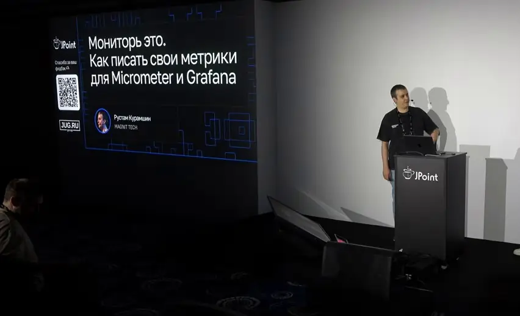
*[▶ 00:00:36](https://www.youtube.com/watch?v=i8Spd1b3AEY&t=36s) · Мониторь это. Как писать свои метрики*

Рустам Курамшин, Java Backend разработчик в MAGNET TECH, работает с Java, Kotlin, Spring, Linux и Kubernetes. Проводит доклады на конференциях JPoint, HighLoad++.

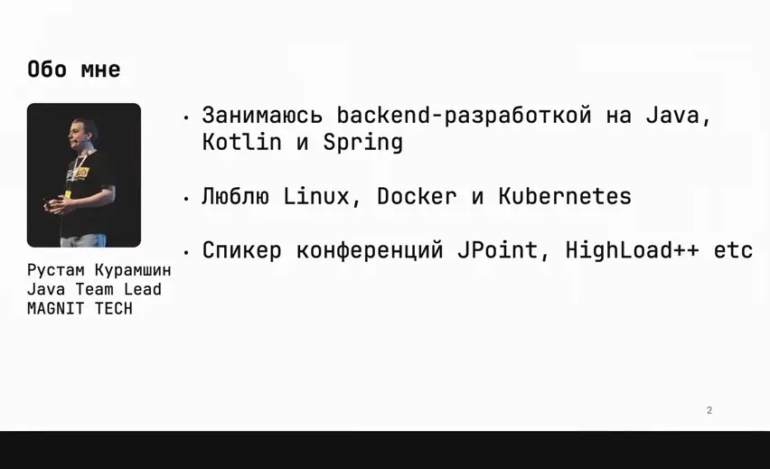
*[▶ 00:02:46](https://www.youtube.com/watch?v=i8Spd1b3AEY&t=166s) · About me*

## Spring Boot Monitoring Stack

[▶ 00:02:45](https://www.youtube.com/watch?v=i8Spd1b3AEY&t=165s)

Типовой стек мониторинга Spring Boot включает Micrometer (фасад для инструментирования, аналог SLF4J), Spring Boot Actuator (эндпоинты для мониторинга), Prometheus (хранилище метрик) и Grafana (визуализация). Micrometer формирует метрики, передавая их в MeterRegistry; Actuator интегрирует их с системой мониторинга. Основные метрики: Latency (задержка HTTP-запросов), RPS (количество запросов в секунду), статус-коды HTTP и логи. Логи можно анализировать как метрики через LogQL: например, парсинг JSON-логов с помощью `| json` и `| regexp` для извлечения `logger_name` и `short_message`, затем агрегация через `sum by(logger_name, short_message)`. Actuator предоставляет метрики для базы данных (spring_data_repository_invocations) и внешних HTTP-запросов (http_client_requests_seconds), что позволяет отслеживать задержки в составной латентности без дополнительной настройки.

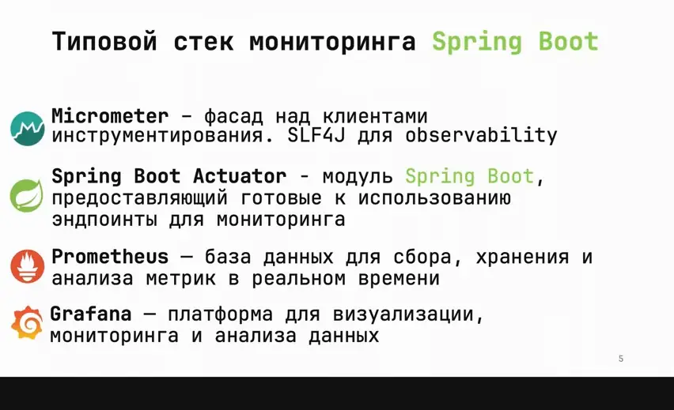
*[▶ 00:05:09](https://www.youtube.com/watch?v=i8Spd1b3AEY&t=309s) · Типовой стек мониторинга Spring Boot*

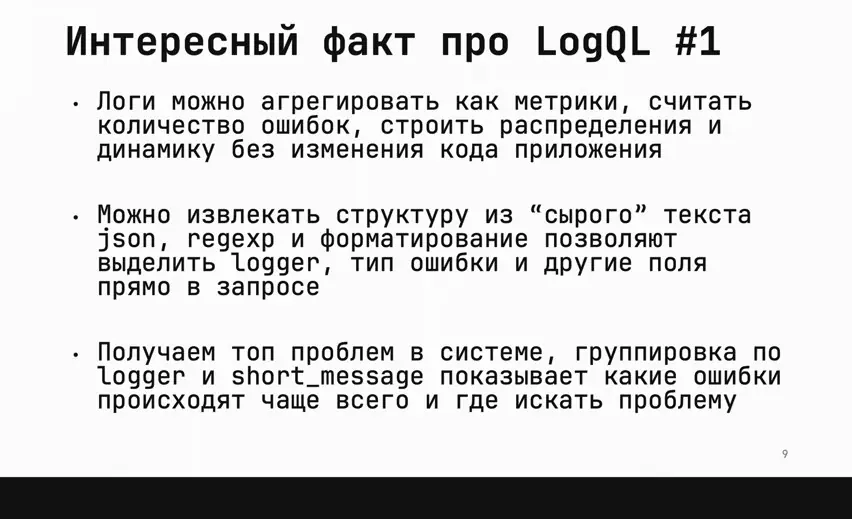
*[▶ 00:07:50](https://www.youtube.com/watch?v=i8Spd1b3AEY&t=470s) · Интересный факт про LogQL #1*

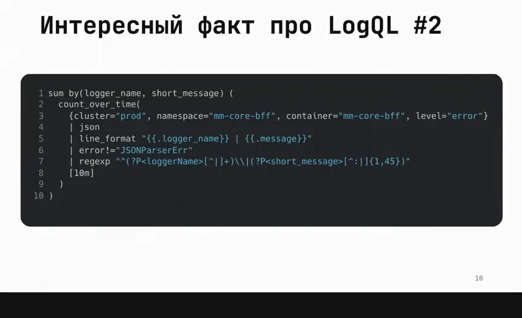
*[▶ 00:08:03](https://www.youtube.com/watch?v=i8Spd1b3AEY&t=483s) · LogQL query example*

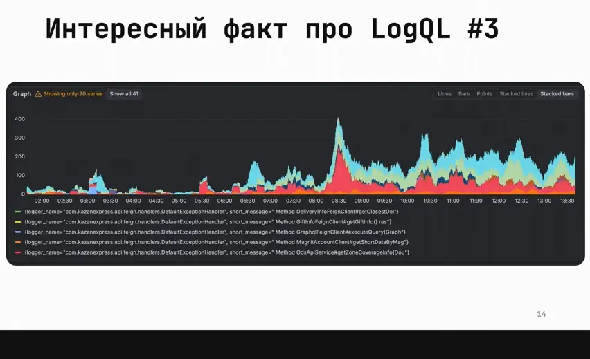
*[▶ 00:09:14](https://www.youtube.com/watch?v=i8Spd1b3AEY&t=554s) · LogQL chart with stacked lines*

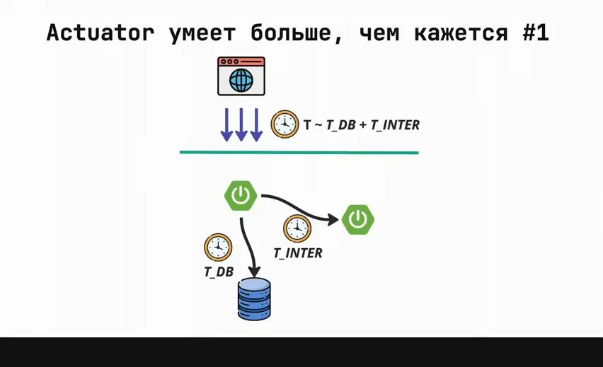
*[▶ 00:09:33](https://www.youtube.com/watch?v=i8Spd1b3AEY&t=573s) · Actuator vs. K8s #1*

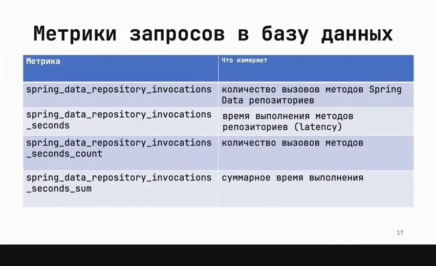
*[▶ 00:10:20](https://www.youtube.com/watch?v=i8Spd1b3AEY&t=620s) · Метрики запросов в базу данных*

## Micrometer API и метрики

[▶ 00:11:12](https://www.youtube.com/watch?v=i8Spd1b3AEY&t=672s)

Micrometer — vendor-neutral фасад для мониторинга, интегрируется с Spring, Quarkus, Micronaut и поддерживает Prometheus, Datadog, New Relic и др. [Spring Boot Metrics Docs](https://docs.spring.io/spring-boot/reference/actuator/metrics.html#actuator.metrics.supported).

```java
@RestController
public class HelloController {

    private final Timer responseTimer;

    public HelloController(MeterRegistry registry) {
        this.responseTimer = Timer.builder("hello.response.time")
            .description("Time taken to return a response")
            .register(registry);
    }

    @GetMapping("/hello")
    public String handleRequest() {
        return responseTimer.record(() -> {
            try {
                TimeUnit.MILLISECONDS.sleep(200); // задержка 200 мс
            } catch (InterruptedException e) {
                Thread.currentThread().interrupt();
            }
            return "hello";
        });
    }
}
```

*[▶ 00:22:59](https://www.youtube.com/watch?v=i8Spd1b3AEY&t=1379s) · Timer code example*

Метрики в Micrometer — временные ряды с тегами, создающие многомерное пространство. Теги опасны: каждый уникальный набор тегов создаёт отдельный временной ряд в Prometheus, вызывая **metric explosion**.

```java
@RestController
public class ListController {
    private List<String> list = Collections.synchronizedList(new LinkedList<>());
    public ListController(MeterRegistry registry) {
        Gauge.builder("list.size", list, List::size)
            .description("The size of the list")
            .register(registry);
    }
    @GetMapping("/add")
    public String addItem() {
        list.add("item");
        return "Added item, list size now " + list.size();
    }
    @GetMapping("/remove")
    public String removeItem() {
        if (!list.isEmpty()) {
            list.remove(0);
        }
        return "Removed item, list size now " + list.size();
    }
}
```

*[▶ 00:21:23](https://www.youtube.com/watch?v=i8Spd1b3AEY&t=1283s) · Gauge example code*

Основные типы метрик:
- **Counter** — монотонно увеличивающийся счётчик (например, `hello.requests.count`). Название должно содержать точки (DOT-separated naming).
- **Gauge** — текущее значение (например, размер списка). Требует передачи лямбды для вычисления.
- **Timer** — измеряет время событий и считает их количество, позволяет анализировать latency и RPS.
- **DistributionSummary** — вычисляет статистику (квантили, среднее, max) на стороне клиента, экономя ресурсы Prometheus.

```java
@RestController
public class HelloController {

    private final Counter counter;

    public HelloController(MeterRegistry registry) {
        this.counter = Counter.builder("hello.requests.count")
            .description("Total number of Hello requests")
            .tags("hello", "countexample")
            .register(registry);
    }

    @GetMapping("/hello")
    public String handleRequest() {
        counter.increment();
        return "hello";
    }
}
```

*[▶ 00:20:04](https://www.youtube.com/watch?v=i8Spd1b3AEY&t=1204s) · Counter code example*

Метрики проходят через **MeterRegistry**:
1. Создаётся ID метрики (имя, теги, описание).
2. Прогоняется через **MeterFilter** (может изменять имя, теги, baseUnit, отклонять метрику).
3. Проверяется наличие метрики в хранилище.
4. Создаётся backend-специфичная реализация.
5. Метрика сохраняется в хранилище.
6. Возвращается метрика приложению.

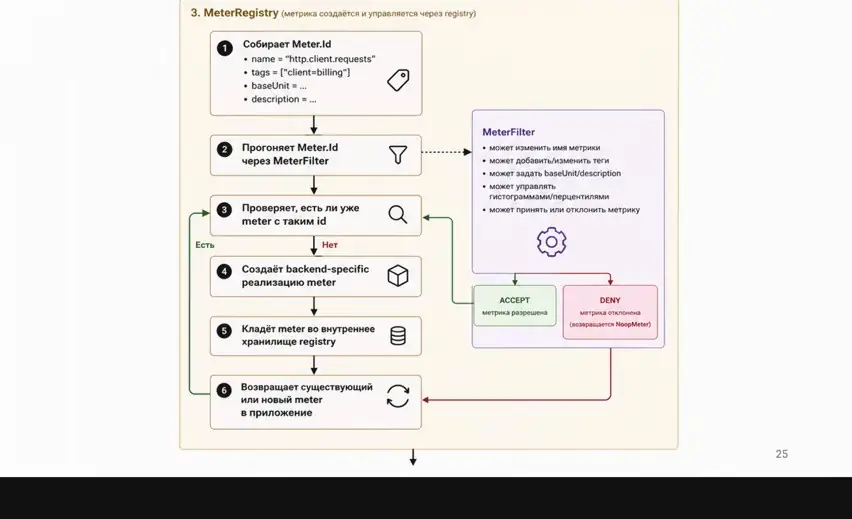
*[▶ 00:16:43](https://www.youtube.com/watch?v=i8Spd1b3AEY&t=1003s) · MeterRegistry workflow*

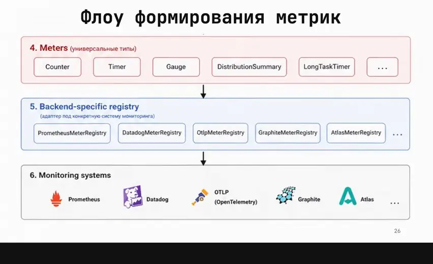
*[▶ 00:17:07](https://www.youtube.com/watch?v=i8Spd1b3AEY&t=1027s) · Флоу формирования метрик*

**Важно**: теги с высокой кардинальностью (например, `uri`, `userId`, `requestId`) вызывают экспоненциальный рост временных рядов. Не кладите в теги динамические значения (URI, ID заказов, email).

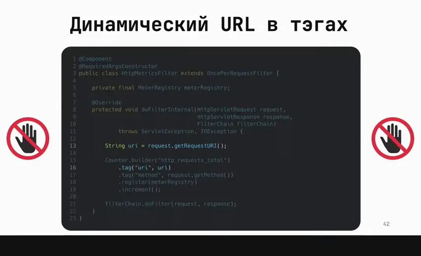
*[▶ 00:27:36](https://www.youtube.com/watch?v=i8Spd1b3AEY&t=1656s) · Динамический URL в тэгах*

**Пример**: использование `MeterFilter` для модификации метрик под разные системы мониторинга.

**Предупреждение**: `coordinated omission` (скоординированный пропуск) — измерение только при готовности системы, приводящее к завышенным метрикам. Micrometer компенсирует это через **pause detector**.

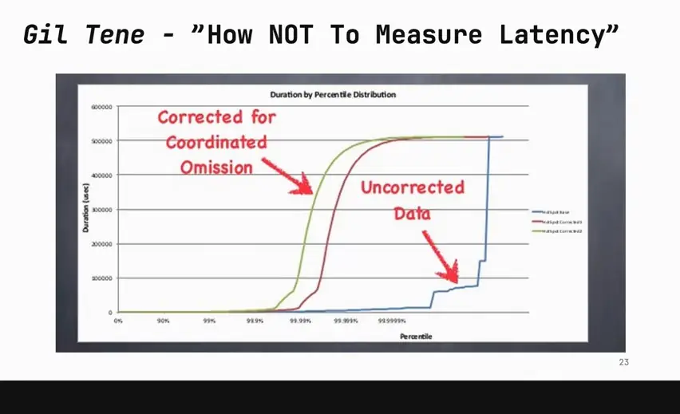
*[▶ 00:14:59](https://www.youtube.com/watch?v=i8Spd1b3AEY&t=899s) · Duration by Percentile Distribution*

## Spring Boot Actuator: Metrics and Drilldown

[▶ 00:28:34](https://www.youtube.com/watch?v=i8Spd1b3AEY&t=1714s)

Spring Boot Actuator provides production-ready metrics via HTTP or JMX endpoints, including built-in metrics like `DataSource` and `Spring Data Repository` (highlighted in red on-screen). Use the Grafana Drilldown (formerly Metric Explorer) to discover available metrics in your data source. Avoid writing metrics in-place; instead, use aspects and annotations for scalability. The official documentation lists all supported metrics at https://docs.spring.io/spring-boot/reference/actuator/metrics.html#actuator.metrics.supported.

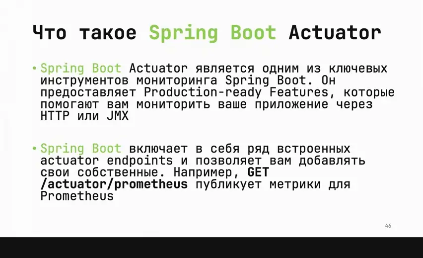
*[▶ 00:29:31](https://www.youtube.com/watch?v=i8Spd1b3AEY&t=1771s) · Что такое Spring Boot Actuator*

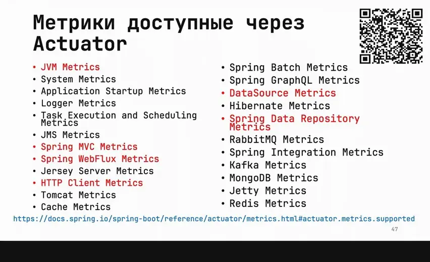
*[▶ 00:30:04](https://www.youtube.com/watch?v=i8Spd1b3AEY&t=1804s) · Метрики доступные через Actuator*

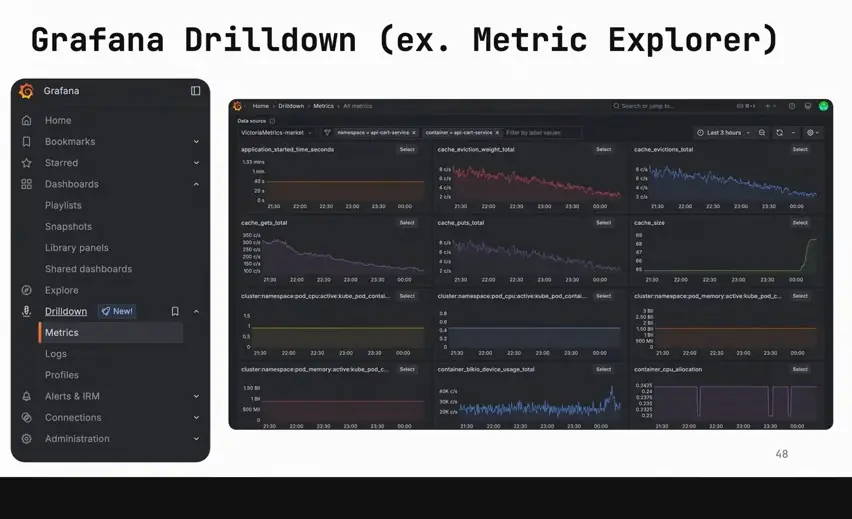
*[▶ 00:30:59](https://www.youtube.com/watch?v=i8Spd1b3AEY&t=1859s) · Grafana Drilldown (ex. Metric Explorer)*

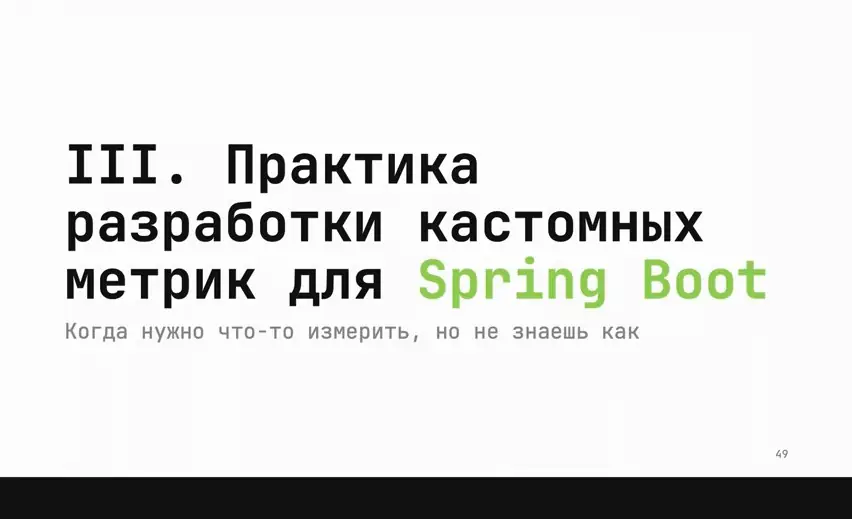
*[▶ 00:31:08](https://www.youtube.com/watch?v=i8Spd1b3AEY&t=1868s) · III. Практика разработки кастомных метрик для Spring Boot*


*[▶ 00:31:59](https://www.youtube.com/watch?v=i8Spd1b3AEY&t=1919s) · Считать метрику in-place*

## Custom Metrics Development

[▶ 00:31:33](https://www.youtube.com/watch?v=i8Spd1b3AEY&t=1893s)

В этом разделе обсуждается разработка пользовательских метрик с использованием аспектов и аннотаций в Spring Boot, что позволяет масштабируемо инструментировать приложения. Основные подходы: **in-place измерение** (прямое добавление Counter/Gauge/Timer в код) и **AOP-измерение** через аннотации и аспекты. Первый подход не масштабируется, второй — более гибкий и подходит для больших проектов.

Профайлинг и дампы памяти (например, heap dump) неэффективны для диагностики: приложение может быть слишком большим, а дампы — слишком крупными (20 ГБ), что затрудняет анализ. В таких случаях метрики помогают локализовать проблемы быстрее. Например, при расследовании OutOfMemoryError в API с множеством эндпоинтов, возвращающих списки сущностей, метрики показали, какие эндпоинты возвращают большие списки и кто к ним обращается.

Примеры реализации:
- Аннотация `@MeasureSizeOfList` для измерения размера списков в эндпоинтах.
- Аспект, измеряющий размер списков и отправляющий данные в Prometheus.
- Аспект для измерения длительности транзакционных методов через `@Transactional`.
- Аспект, использующий статистику Hibernate для измерения CRUD-операций.
- Обёртка для измерения длительности Kotlin suspend-функций с использованием `monotonicTime`.

```java
@Target(ElementType.METHOD)
@Retention(RetentionPolicy.RUNTIME)
public @interface MeasureSizeOfList {
}
```

*[▶ 00:35:57](https://www.youtube.com/watch?v=i8Spd1b3AEY&t=2157s) · Annotation for measuring list size*

```java
@Aspect
@Component
@RequiredArgsConstructor
public class AspectMeasuringSizeOfList {

    private final MeterRegistry meterRegistry;

    @Around("@annotation(MeasureSizeOfList)")
    public Object measureSizeOfList(ProceedingJoinPoint joinPoint) throws Throwable {
        Object result = joinPoint.proceed();

        if (result instanceof BaseListDto<?>) list) {
            HttpServletRequest request = ((ServletRequestAttributes)
                    RequestContextHolder.currentRequestAttributes()).getRequest();

            String sourceIp = request.getRemoteAddr();

            meterRegistry.counter("list_endpoints_size", "source_ip", sourceIp).increment(list.getItems().size())
        }

        return result;
    }
}
```

*[▶ 00:36:23](https://www.youtube.com/watch?v=i8Spd1b3AEY&t=2183s) · Aspect measuring list size*

```java
@Aspect
@Component
public class TransactionalTimerAspect {

    private final MeterRegistry meterRegistry;

    @Autowired
    public TransactionalTimerAspect(MeterRegistry meterRegistry) {
        this.meterRegistry = meterRegistry;
    }

    @Pointcut("@annotation(org.springframework.transaction.annotation.Transactional)")
    public void transactionalMethods() {
    }

    @Around("transactionalMethods()")
    public Object measureMethodExecutionTime(ProceedingJoinPoint pjp) throws Throwable {
        MethodSignature signature = (MethodSignature) pjp.getSignature();
        String methodName = signature.getMethod().getName();

        Timer.Sample sample = Timer.start(meterRegistry);
        try {
            return pjp.proceed();
        } finally {
            sample.stop(Timer.builder("transactions.timer")
                .description("Duration of transactional methods")
                .tags("method", methodName)
                .register(meterRegistry));
        }
    }
}
```

*[▶ 00:37:51](https://www.youtube.com/watch?v=i8Spd1b3AEY&t=2271s) · Aspect measuring transactional methods*

```java
@Aspect
@Component
public class HibernateStatisticsAspect {
    private final Statistics statistics;
    private final MeterRegistry meterRegistry;

    @Autowired
    public HibernateStatisticsAspect(SessionFactory sessionFactory, MeterRegistry meterRegistry) {
        this.statistics = sessionFactory.getStatistics();
        this.meterRegistry = meterRegistry;
    }

    @Pointcut("@annotation(transactional)")
    public void transactionalMethods(Transactional transactional) {
    }
```

*[▶ 00:38:21](https://www.youtube.com/watch?v=i8Spd1b3AEY&t=2301s) · Hibernate statistics aspect code*

```java
@Around("transactionalMethods(transactional)")
public Object recordStatistics(ProceedingJoinPoint joinPoint, Transactional transactional) throws Throwable {
    MethodSignature signature = (MethodSignature) joinPoint.getSignature();
    String methodName = signature.getMethod().getDeclaringClass().getSimpleName() + "." + signature.getMethod().getName();
    List<String> tags = Arrays.asList(Tag.of("method", methodName));

    long startEntityLoadCount = statistics.getEntityLoadCount();
    long startEntityInsertCount = statistics.getEntityInsertCount();
    long startEntityUpdateCount = statistics.getEntityUpdateCount();
    long startEntityDeleteCount = statistics.getEntityDeleteCount();

    try {
        return joinPoint.proceed();
    } finally {
        long endEntityLoadCount = statistics.getEntityLoadCount();
        long endEntityInsertCount = statistics.getEntityInsertCount();
        long endEntityUpdateCount = statistics.getEntityUpdateCount();
        long endEntityDeleteCount = statistics.getEntityDeleteCount();

        meterRegistry.counter("db.entity.load", tags).increment(endEntityLoadCount - startEntityLoadCount);
        meterRegistry.counter("db.entity.insert", tags).increment(endEntityInsertCount - startEntityInsertCount);
        meterRegistry.counter("db.entity.update", tags).increment(endEntityUpdateCount - startEntityUpdateCount);
        meterRegistry.counter("db.entity.delete", tags).increment(endEntityDeleteCount - startEntityDeleteCount);

        // statistics.clear();
    }
}
```

*[▶ 00:38:58](https://www.youtube.com/watch?v=i8Spd1b3AEY&t=2338s) · Aspect measuring CRUD operation duration*

```kotlin
coroutineMetrics(
  suspendFunc = suspend {
    anyApiCall.executeAsync(...).awaitSingle()
  },
  metricName = "api.call",
  moreTags = mapOf("method" to "anyApiCall", "entity" to "cat"),
  meterRegistry = meterRegistry
)
```

*[▶ 00:41:36](https://www.youtube.com/watch?v=i8Spd1b3AEY&t=2496s) · Suspendable metrics example*

```kotlin
suspend fun <T: Any> coroutineMetricsWithNullable(
    suspendFunc: suspend () -> T?,
    metricName: String,
    moreTags: Map<String, String> = emptyMap(),
    timeBuckets: Array<Duration> = DEFAULT_TIME_BUCKETS,
    meterRegistry: MeterRegistry
): T? {
    require(timeBuckets.isNotEmpty()) { "timeBuckets are mandatory to create latency distribution histogram" }
    val timer = statisticTimerBuilder(
        metricsLabelTag = metricName,
        moreTags = moreTags,
        timeBuckets = timeBuckets
    )
    .register(meterRegistry)
    val clock = meterRegistry.config().clock()
    val start = clock.monotonicTime()
    try {
        return suspendFunc.invoke()
    } finally {
        val end = clock.monotonicTime()
        timer.record(end - start, TimeUnit.NANOSECONDS)
    }
}
```

*[▶ 00:41:03](https://www.youtube.com/watch?v=i8Spd1b3AEY&t=2463s) · Method for measuring*

Для Kotlin-проектов важно использовать `monotonicTime` при измерении suspend-функций, так как стандартная аннотация `@Timed` не работает корректно из-за особенностей интеропа между Java и Kotlin.

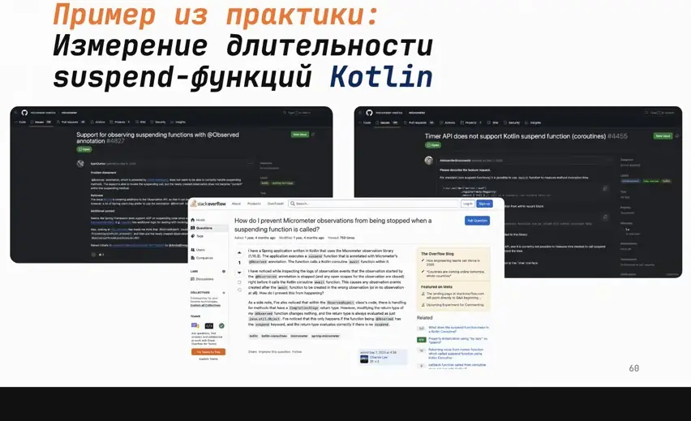
*[▶ 00:39:25](https://www.youtube.com/watch?v=i8Spd1b3AEY&t=2365s) · Measuring suspend function duration*

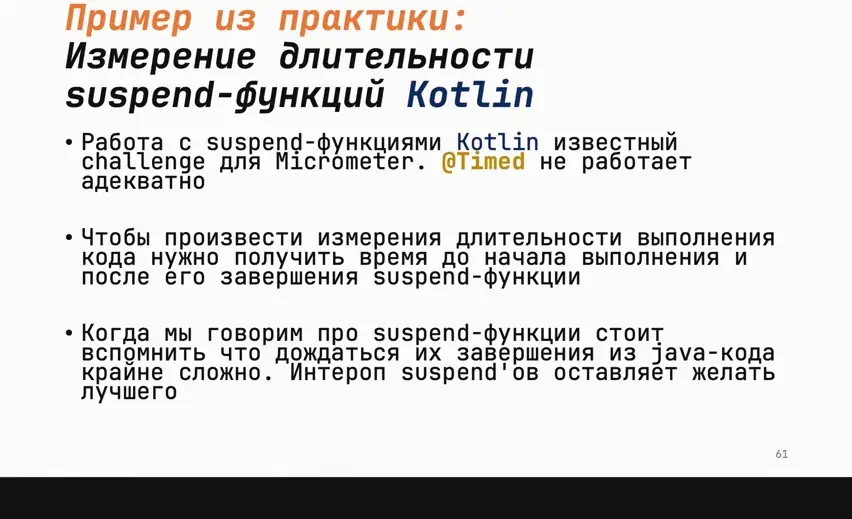
*[▶ 00:40:09](https://www.youtube.com/watch?v=i8Spd1b3AEY&t=2409s) · Измерение длительности suspend-функций Kotlin*

## Grafana and PromQL Best Practices

[▶ 00:42:26](https://www.youtube.com/watch?v=i8Spd1b3AEY&t=2546s)

PromQL queries must use `rate()` for metrics like latency and RPS, not raw counters. Directly plotting `*_count` or `*_total` metrics creates misleading graphs that only show growth. For latency, calculate `rate(timer_sum[10s]) / rate(timer_count[10s])`; for RPS, use `rate(timer_count[10s])`.

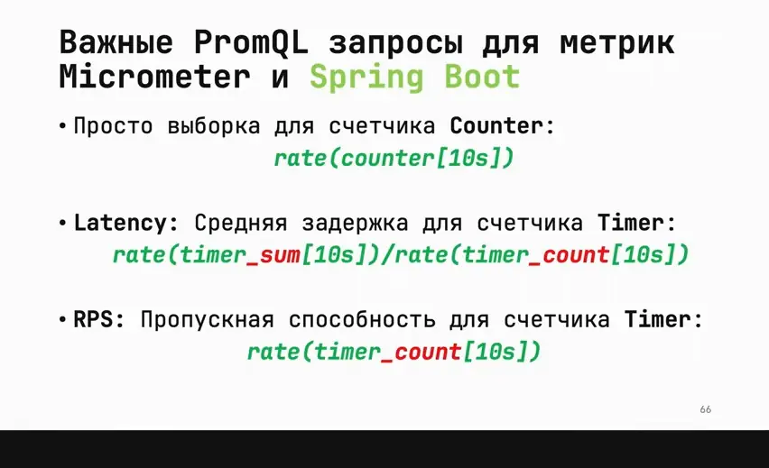
*[▶ 00:44:25](https://www.youtube.com/watch?v=i8Spd1b3AEY&t=2665s) · PromQL queries for Micrometer metrics*

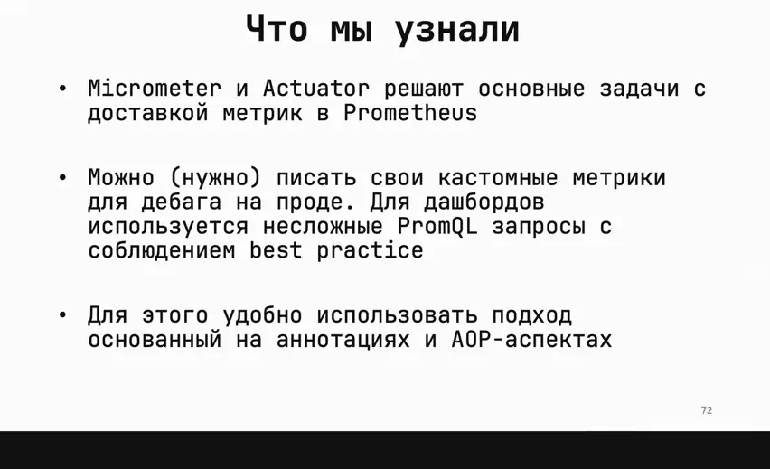
*[▶ 00:46:43](https://www.youtube.com/watch?v=i8Spd1b3AEY&t=2803s) · Что мы узнали*

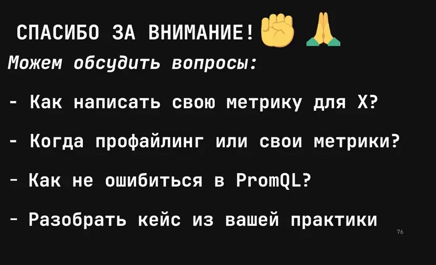
*[▶ 00:47:37](https://www.youtube.com/watch?v=i8Spd1b3AEY&t=2857s) · Questions slide*

Avoid high-cardinality labels in PromQL groupings (e.g., `sum by (userId, requestId)`), as they degrade Grafana readability and burden Prometheus.

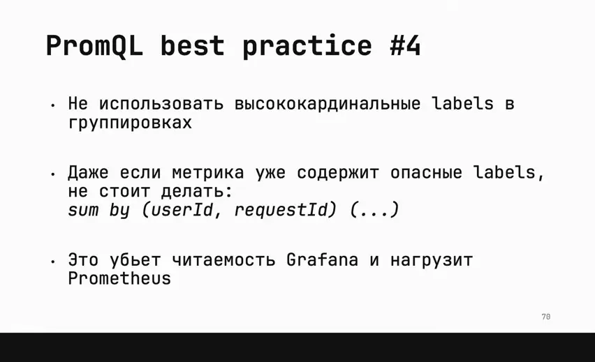
*[▶ 00:46:13](https://www.youtube.com/watch?v=i8Spd1b3AEY&t=2773s) · PromQL best practice #4*

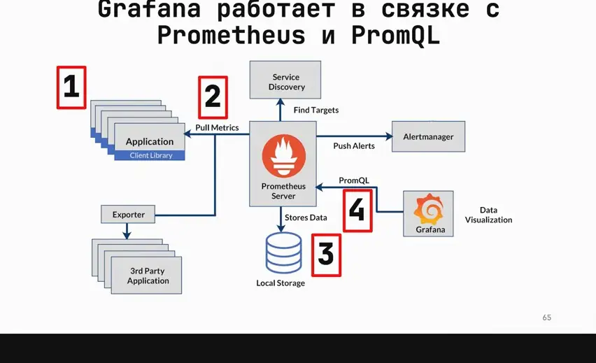
*[▶ 00:43:24](https://www.youtube.com/watch?v=i8Spd1b3AEY&t=2604s) · Grafana works with Prometheus and PromQL*

Use `rate()` for latency and throughput metrics; `increase()` is better for alerting systems to count events over time.

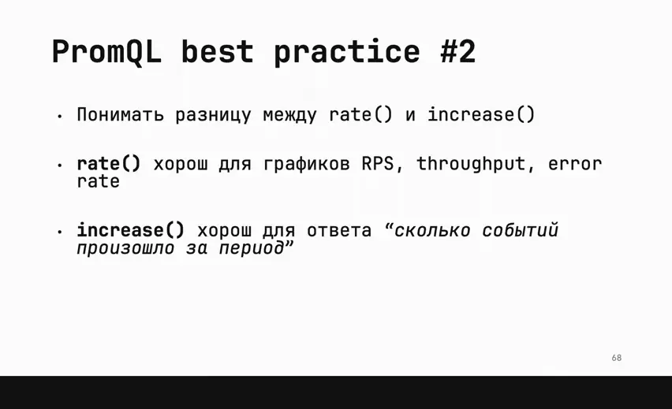
*[▶ 00:45:19](https://www.youtube.com/watch?v=i8Spd1b3AEY&t=2719s) · PromQL best practice #2*

Percentiles should be calculated via histograms, not averages.

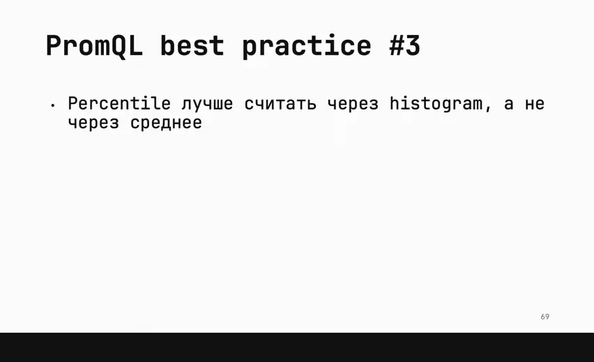
*[▶ 00:45:33](https://www.youtube.com/watch?v=i8Spd1b3AEY&t=2733s) · PromQL best practice #3*

Do not confuse raw counters with their rate of change—this is a common mistake that leads to incorrect metric interpretation.

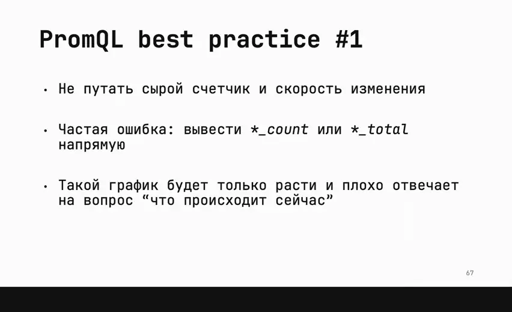
*[▶ 00:44:48](https://www.youtube.com/watch?v=i8Spd1b3AEY&t=2688s) · PromQL best practice #1*

## Ссылки и материалы

- [Spring Boot Metrics Docs — official documentation](https://docs.spring.io/spring-boot/reference/actuator/metrics.html#actuator.metrics.supported) — <https://docs.spring.io/spring-boot/reference/actuator/metrics.html#actuator.metrics.supported> · на экране [▶ 00:30:04](https://www.youtube.com/watch?v=i8Spd1b3AEY&t=1804s)
