# Работа с нештатными ситуациями в космической технике

*Из доклада о пилотируемой космонавтике: как классифицируют нештатные ситуации и как строят резервирование, контроль состояния и наземную отработку ПО.*

Источник: [Работа с нештатными ситуациями в космической технике](https://www.youtube.com/watch?v=q7BtbygIUcc) · Joker — Конференция о будущем разработки · 49 мин

## Коротко

Нештатные ситуации в космосе возникают из шести групп причин: отказы аппарата, ошибки ЦУПа и экипажа, внешние факторы, потеря работоспособности космонавта и сбои наземного контура. Главная идея в том, что отказ должен парироваться автоматически, без участия людей: через аппаратное и функциональное резервирование, контроль квитанциями, данными и лимитами и отработку каждой команды на наземном стенде. Так система переживает не только заранее предусмотренные отказы, но и нерасчётные ситуации, которые в полёте встречаются чаще, чем документированные. Это важно для любого, кто проектирует критичные системы: ошибки оператора и ПО реальны, а заранее спланированная защита и дисциплина проверок решают, перейдёт ли сбой в катастрофу.

## Главное

- Нештатная ситуация (НШС) — это состояние, не предусмотренное штатной программой, либо отклонение здоровья космонавта от нормы, и исход зависит от готовности к ней.
- Расчётная НШС имеет предусмотренные способы выхода, а нерасчётная — нет, и по словам докладчика она не должна происходить.
- Проектанты опираются на два принципа: один отказ не должен срывать программу полёта, а любые два подряд не должны угрожать экипажу или продолжению программы.
- Аппаратное резервирование дублирует прибор (например, два ИК-датчика вертикали на Союзе), а функциональное решает ту же задачу иначе и защищает от системной ошибики, поскольку два одинаковых датчика одного производителя могут отказать по одной причине.
- Контроль состояния (FDIR: обнаружение, изоляция, парирование) использует квитанции питания, проверки данных на 0, максимум и диапазон, а при трёх приборах два согласных значения побеждают третье, тогда как при двух виновного не найти.
- Пороги фильтров нужно подбирать за много полётов, поскольку слишком строгий фильтр может отбраковать исправные датчики, как это случилось на «Прогрессе».
- Критические функции должны работать независимо от бортового компьютера, а все команды сначала отрабатываются на наземном комплексе отладки программ (НКО), что ловит опечатки и ошибки вроде той, что погубила «Фобос».
- При возникновении НШС сначала оценивают оставшееся время: немедленно действуют только при угрозе жизни экипажа, потере работоспособности аппарата, перерасходе рабочего тела или срыве полёта, а при разгерметизации на МКС закрывают люк, если давление падает за 5 минут.

## Нештатная ситуация: определение, причины и расчётные случаи

[▶ 00:00:00](https://www.youtube.com/watch?v=q7BtbygIUcc&t=0s)

**Нештатная ситуация (НШС)** — состояние космического комплекса, его частей, привлекаемых средств или условий полёта, не предусмотренное программой штатного функционирования, либо отклонение здоровья космонавта от нормального. Исход зависит от готовности, как и при проколотом колесе: нужны запаска, домкрат и умение им пользоваться.

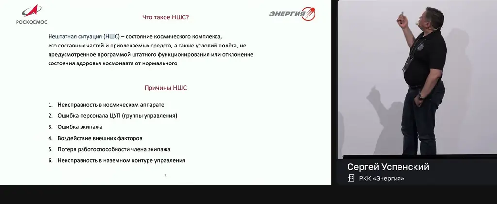
*[▶ 00:08:47](https://www.youtube.com/watch?v=q7BtbygIUcc&t=527s) · Что такое НШС?*

Причины делятся на шесть групп:

1. Неисправность космического аппарата, включая «детские болезни» — ошибки, не выявленные при испытаниях.
2. Ошибка персонала ЦУП.
3. Ошибка экипажа.
4. Внешние факторы, например космический мусор.
5. Потеря работоспособности члена экипажа.
6. Неисправность наземного контура: каналы связи, измерительные пункты.

Ошибки управления случаются. В одном случае ночное переключение прибора на Салюте-7 отменила утренняя смена, не разобравшись в причине, и команда вывела из строя бортовую радиотехническую систему. В другом на аппарате «Фобос» команда кодировалась в восьмеричной системе, но признак системы пропал из листинга, и визуальная проверка его не поймала. По мнению докладчика, одна команда не должна приводить к гибели аппарата, а проверка программы не должна зависеть от глаз человека.

Разработчики заранее определяют возможные отказы и предусматривают их парирование; испытания расширяют этот список. Так возникает деление на два типа:

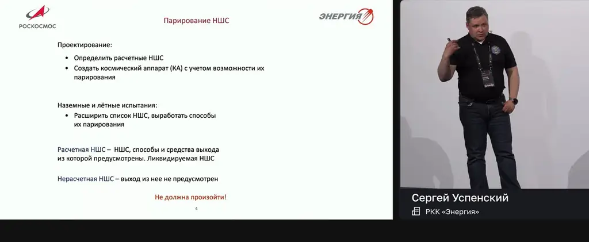
*[▶ 00:09:57](https://www.youtube.com/watch?v=q7BtbygIUcc&t=597s) · Парирование НШС: design and testing*

- **Расчётная НШС** — способы и средства выхода из неё предусмотрены.
- **Нерасчётная НШС** — выход не предусмотрен; по словам докладчика, она не должна произойти.

## Резервирование: аппаратное и функциональное

[▶ 00:09:30](https://www.youtube.com/watch?v=q7BtbygIUcc&t=570s)

Конструктор отвечает за НШС, которую он счёл нерасчётной, но которая всё же произошла. Рассмотренные НШС описаны в документации: признаки, причина, последствия, действия. В полёте же чаще встречаются нерассмотренные.

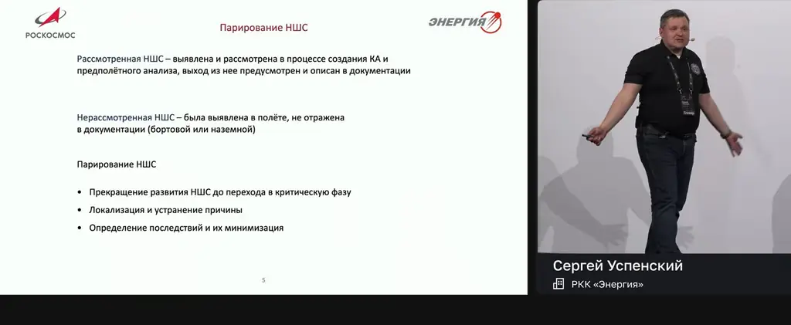
*[▶ 00:10:42](https://www.youtube.com/watch?v=q7BtbygIUcc&t=642s) · Парирование НШС: considered vs unconsidered*

Проектанты опираются на два принципа: один отказ не должен срывать программу полёта; любые два подряд не должны угрожать экипажу или продолжению программы.

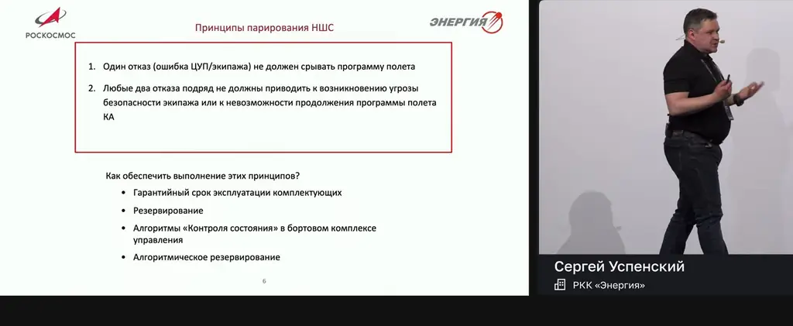
*[▶ 00:11:56](https://www.youtube.com/watch?v=q7BtbygIUcc&t=716s) · Принципы парирования НШС*

**Аппаратное** резервирование — дублирование: на Союзе два прибора инфракрасной вертикали, и при отказе одного работает второй. **Функциональное** резервирование решает ту же задачу иначе: космонавт с визиром ВСК-4 заменяет датчики при построении ориентации. Оно защищает от системной ошибки. Два одинаковых датчика одного предприятия могут отказать по одной причине, а спас датчик другого принципа — так было в карьере спикера.

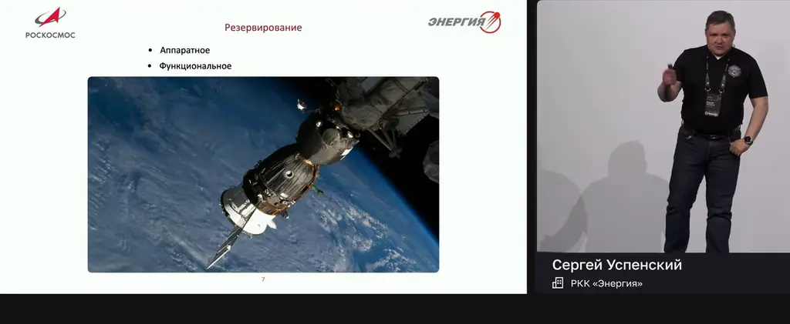
*[▶ 00:13:57](https://www.youtube.com/watch?v=q7BtbygIUcc&t=837s) · Резервирование: аппаратное и функциональное*

На Прогрессе восемь малых двигателей причаливания и ориентации дублируют большой маршевый СКД. Двигатели каждого блока питаются от независимых баков, то есть на корабле две независимые топливные системы.

Быстрые процессы, например коррекция орбиты, требуют автоматического переключения на резерв, которое заложено в бортовом ПО.

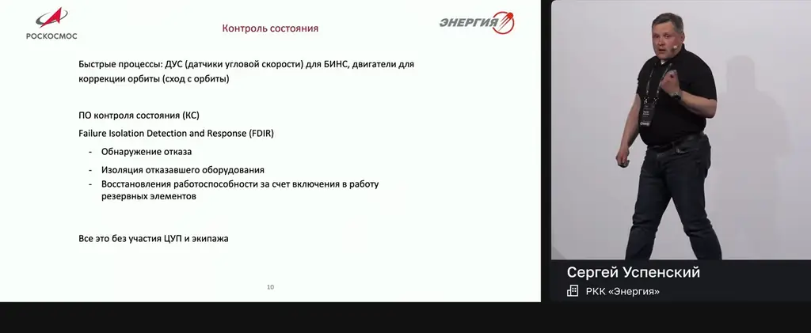
*[▶ 00:16:20](https://www.youtube.com/watch?v=q7BtbygIUcc&t=980s) · Контроль состояния (state monitoring)*

## Контроль состояния: отказ ловят по квитанциям, данным и лимитам

[▶ 00:15:38](https://www.youtube.com/watch?v=q7BtbygIUcc&t=938s)

Программа контроля состояния должна обнаружить отказ, изолировать его и парировать без участия людей, и быстро. В НАСА для этого есть термин FDIR (Detection, Isolation, Response).

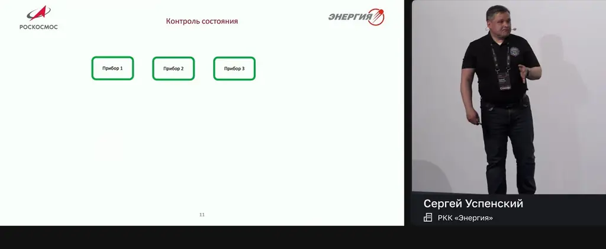
*[▶ 00:16:34](https://www.youtube.com/watch?v=q7BtbygIUcc&t=994s) · Контроль состояния: three devices*

**Квитанции питания.** Прибор на каждом такте сообщает компьютеру, что работает. Пропали квитанции, автоматика запрещает прибор и переключается на резервный. У аппаратов некоторых производителей этого нет.

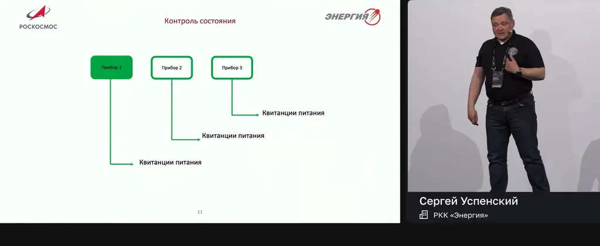
*[▶ 00:17:29](https://www.youtube.com/watch?v=q7BtbygIUcc&t=1049s) · Контроль состояния: квитанции питания по приборам*

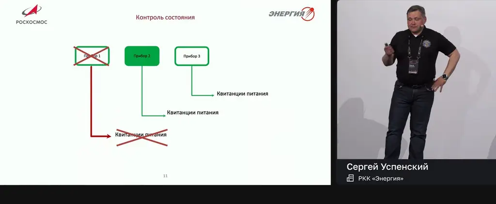
*[▶ 00:17:48](https://www.youtube.com/watch?v=q7BtbygIUcc&t=1068s) · Отказ прибора 1 по пропаданию квитанций*

**Анализ данных:**

- контроль на 0, на max и на допустимый диапазон;
- самоконтроль прибора;
- сравнение с эталоном или прогнозом;
- сравнение трёх приборов: два согласных значения побеждают третье. При двух приборах виновного не найти.

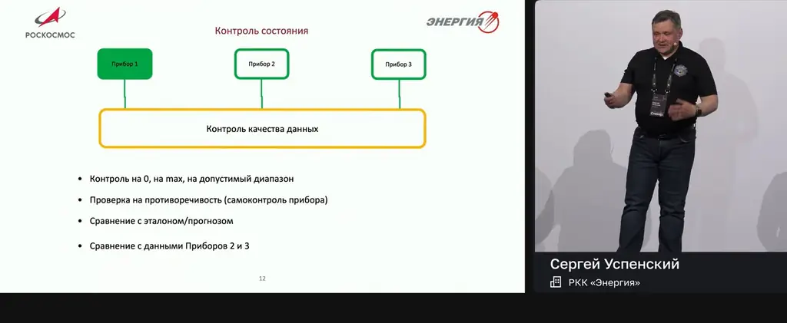
*[▶ 00:19:17](https://www.youtube.com/watch?v=q7BtbygIUcc&t=1157s) · Контроль качества данных по трём приборам*

Пороги отсекают и реальные значения. На новых изделиях фильтры срабатывают часто, границы подбираются за много полётов. Так, фильтр скорости вращения отбраковал исправные датчики «Прогресса» после взрыва при отделении, и двигатели в итоге оказались повреждены.

**Два отказа подряд** не должны угрожать экипажу или программе полёта:

- потеря двигателей при коррекции → нарушение стабилизации → отбой импульса;
- потеря всех ДУС → нет готовности БИНС → отбой динамического режима.

БКУ контролирует динамику: при развороте сверх допустимого импульс прекращается, причина неважна. Бит ГСО проверяется на каждом такте, и его исчезновение прерывает импульс.

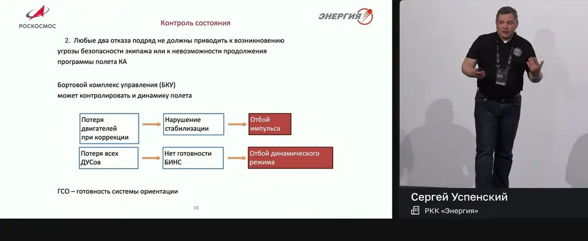
*[▶ 00:24:29](https://www.youtube.com/watch?v=q7BtbygIUcc&t=1469s) · Контроль состояния*

**Лимит топлива.** Станция ДОС в автоколебательном режиме за виток сожгла всё топливо. Бранец предложил задавать в бортовой компьютер «Союза» лимит расхода на операцию (BRO): BROT = GDOS + BRO. Операция прерывается при достижении лимита.

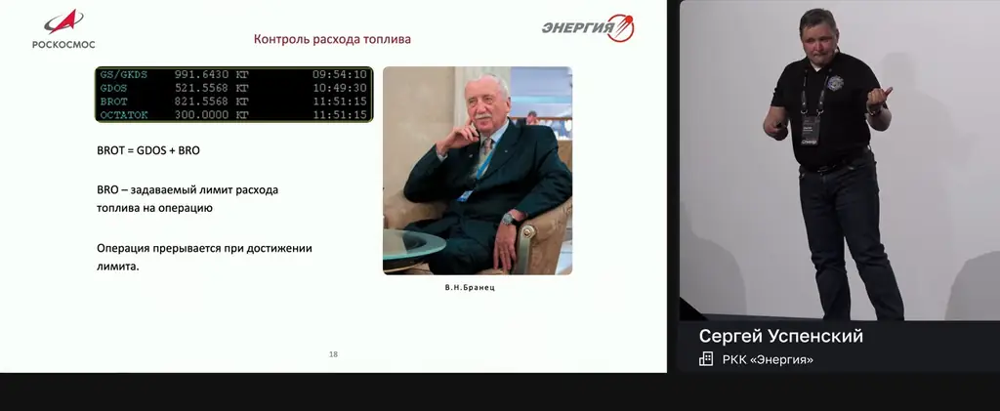
*[▶ 00:26:09](https://www.youtube.com/watch?v=q7BtbygIUcc&t=1569s) · Контроль расхода топлива*

## Алгоритмическое резервирование и наземная отработка ПО

[▶ 00:26:48](https://www.youtube.com/watch?v=q7BtbygIUcc&t=1608s)

Критические функции должны работать независимо от бортового компьютера. После перезапуска ПО не должно неожиданно включать двигатели. Например, отвод от станции при стыковке «Союза» нужно обеспечить отдельным компьютером, отдельной системой или хотя бы кнопкой у космонавта.

ПО на борту стареет физически: переполняются счётчики, в том числе заложенные по дате. Поэтому его обновляют. Служебный модуль МКС летает уже больше 26 лет.

Испытания проводят на промежуточных стендах между реальным изделием и цифровым двойником. Полный макет дорог и требует постоянного обслуживания, поэтому используют более простые варианты:

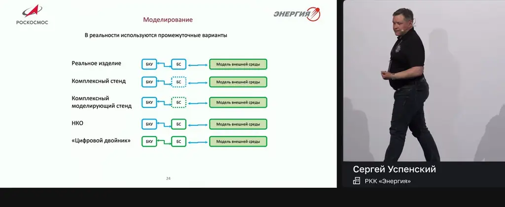
*[▶ 00:33:10](https://www.youtube.com/watch?v=q7BtbygIUcc&t=1990s) · Моделирование: промежуточные варианты стендов*

- **Комплексный стенд**: копия корабля, на которой можно имитировать поломки.
- **Комплексный моделирующий стенд**: часть систем виртуализирована.
- **НКО** (наземный комплекс отладки программ, с 1970-х): реальный бортовой компьютер и виртуальная периферия. Всё, что завтра уйдёт на борт, сначала отрабатывается здесь. Так ловят ошибки, подобные той, что погубила станцию «Фобос».
- **Цифровой двойник**: всё виртуально.

Модель всегда остаётся приближением, и из-за неё на практике возникали проблемы.

## Располагаемое время: сначала оценить, потом действовать

[▶ 00:33:55](https://www.youtube.com/watch?v=q7BtbygIUcc&t=2035s)

Документированные НШС разбирают по инструкции. С незнакомыми ситуациями сталкиваются регулярно, и первым делом нужно оценить оставшееся время.

Решение укладывается в располагаемое время за вычетом времени на парирование: последний шанс может быть через 3 минуты, а не через час.

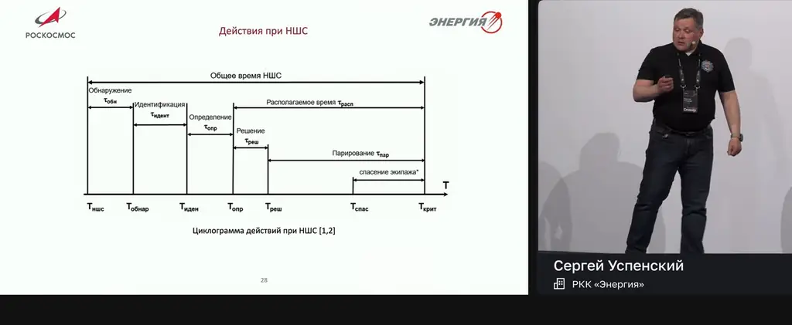
*[▶ 00:38:43](https://www.youtube.com/watch?v=q7BtbygIUcc&t=2323s) · Циклограмма действий при НШС*

При разгерметизации на МКС космонавты сначала оценивают темп падения давления: при 5 минутах закрывают люк, а не борются с утечкой.

Немедленно действуем только при угрозе жизни экипажа, потере работоспособности КА, перерасходе рабочего тела или срыве полёта. Иначе определяем резервное время и проводим углублённый анализ.

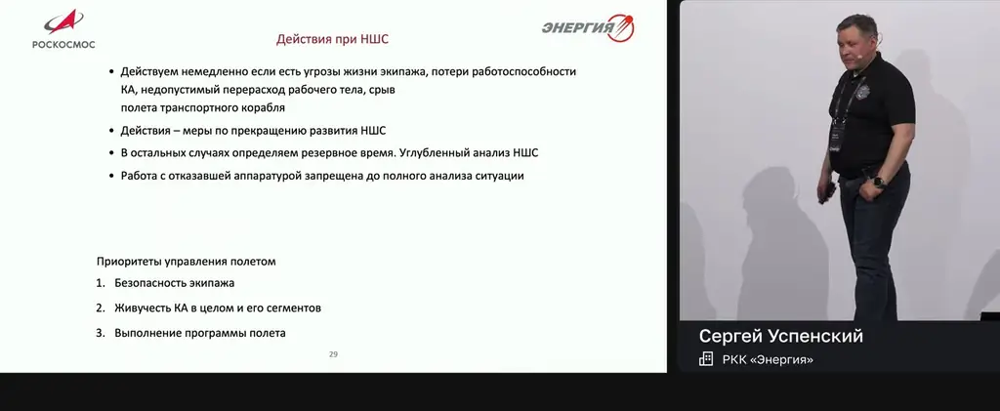
*[▶ 00:39:18](https://www.youtube.com/watch?v=q7BtbygIUcc&t=2358s) · Действия при НШС и приоритеты полёта*

## Уроки истории и когнитивные искажения

[▶ 00:39:05](https://www.youtube.com/watch?v=q7BtbygIUcc&t=2345s)

Три урока истории, «написанных кровью»:

- **ДОС №3**: после потери топлива группу управления перестроили так, что между оператором и лицом, принимающим решение, никого нет. В оперативном контуре отвечаешь за всё сам.
- **Салют-7**: не выдавать команды на отказавший прибор, пока не выяснена причина отказа.
- **Мир**: все команды сначала отыгрывать на НКО. Это ловит опечатки и перепутанность. При тяжёлой НШС команды иногда выдавали без отработки, но так делать не должно.

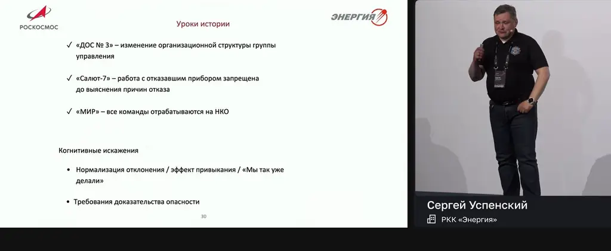
*[▶ 00:43:21](https://www.youtube.com/watch?v=q7BtbygIUcc&t=2601s) · Уроки истории и когнитивные искажения*

Главные когнитивные искажения: **нормализация отклонения** («мы так уже делали, ничего не случилось») и требование доказать опасность. Докладчик возражал коллегам из ЦУП Хьюстона, которые хотели сократить операторов: «Я боюсь того, чего не рассмотрели».

В истории с антенной МКС неоднозначность в методике привела к тому, что антенна пошла в упор. Модель на НКО не имела программных ограничений и пропустила её сквозь стену.

Литература: советует отчёты по катастрофам [Challenger](https://www.nasa.gov/history/rogersrep/genindex.htm) и [Columbia](https://www.nasa.gov/wp-content/uploads/2015/01/298870main_SP-2008-565.pdf), а также мемуары В.Н. Бранца о цифровой системе управления.

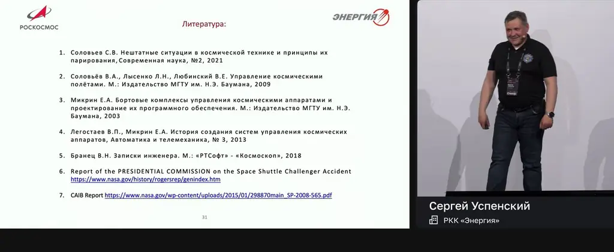
*[▶ 00:44:01](https://www.youtube.com/watch?v=q7BtbygIUcc&t=2641s) · Литература (reading list)*

## Ссылки и материалы

- [Отчёт комиссии Роджерса по катастрофе Challenger — индекс на сайте НАСА](https://www.nasa.gov/history/rogersrep/genindex.htm) — <https://www.nasa.gov/history/rogersrep/genindex.htm> · на экране [▶ 00:44:01](https://www.youtube.com/watch?v=q7BtbygIUcc&t=2641s)
- [Документ НАСА SP-2008-565 в PDF — из списка литературы](https://www.nasa.gov/wp-content/uploads/2015/01/298870main_SP-2008-565.pdf) — <https://www.nasa.gov/wp-content/uploads/2015/01/298870main_SP-2008-565.pdf> · на экране [▶ 00:44:01](https://www.youtube.com/watch?v=q7BtbygIUcc&t=2641s)
