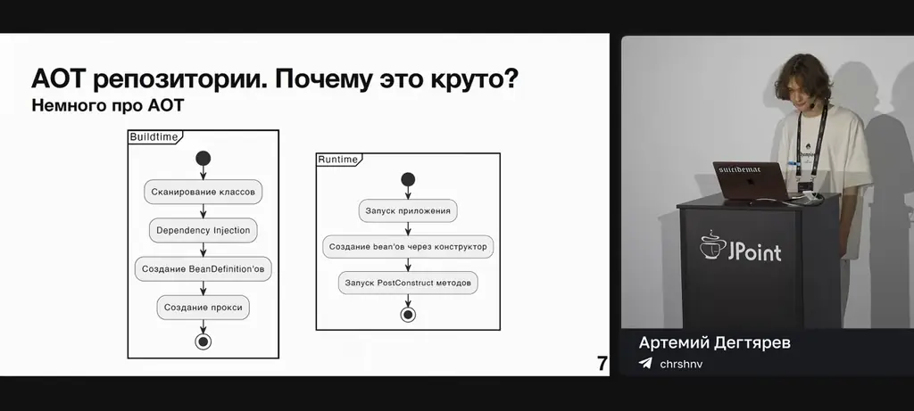
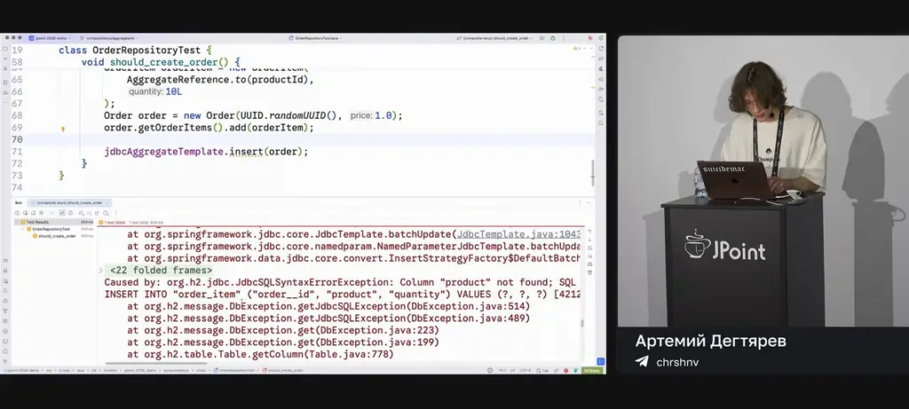
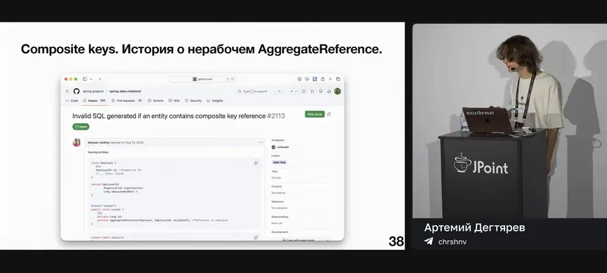
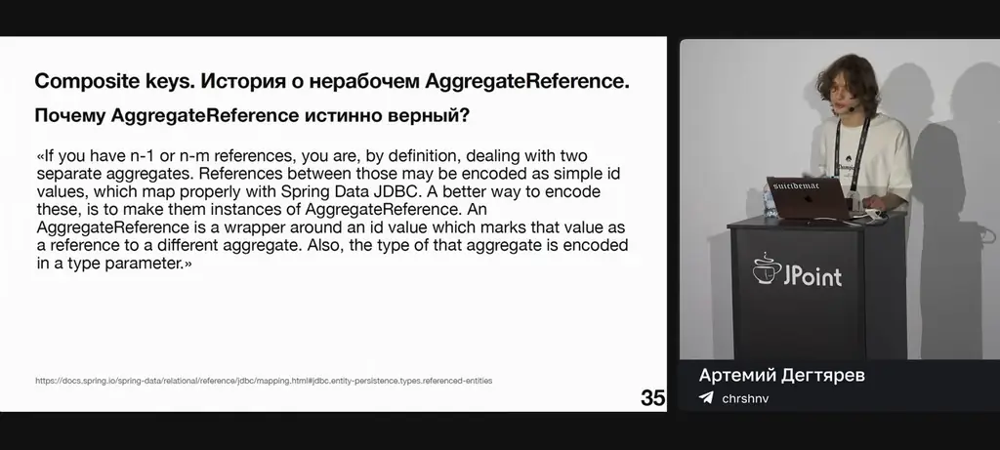
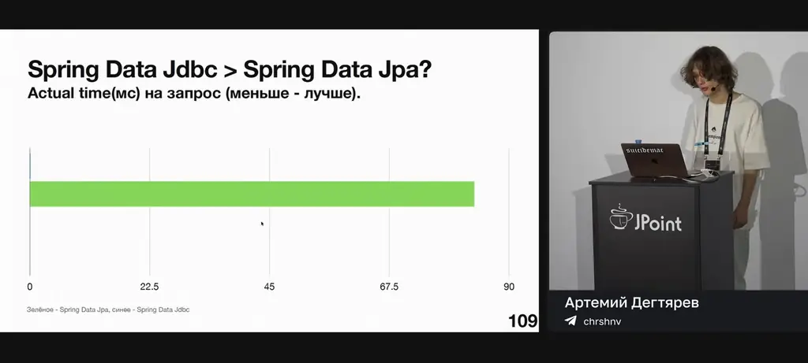
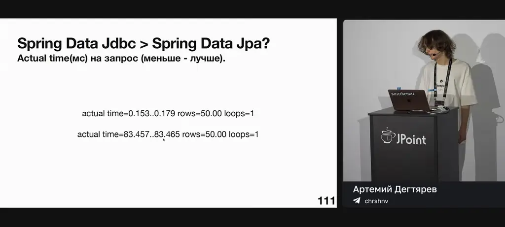
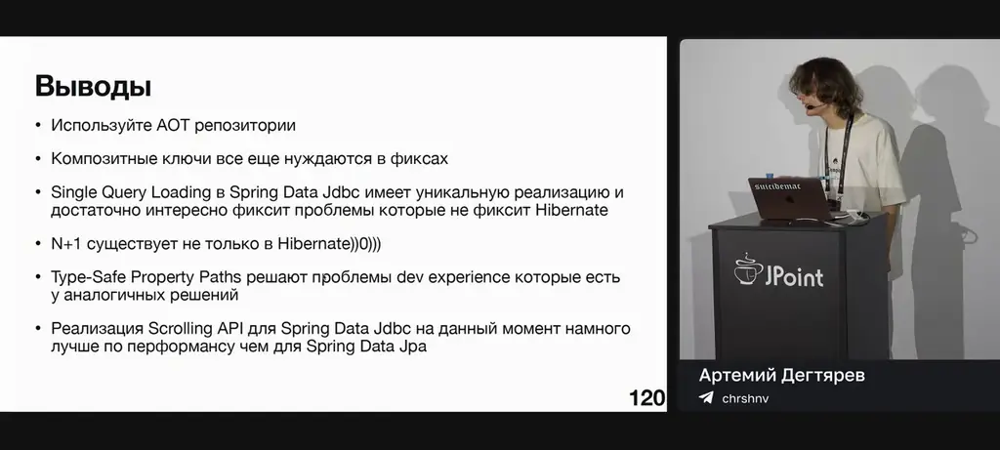
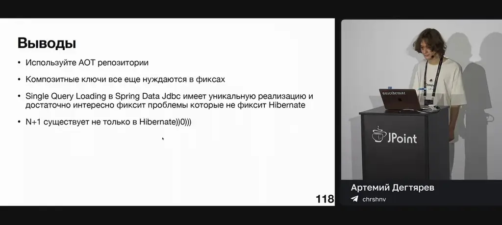

# Артемий Дегтярев — Spring Data JDBC: где мы находимся сейчас

*Spring Data JDBC: AOT-репозитории, композитные ключи, Single Query Loading и Scrolling API*

Источник: [Артемий Дегтярев — Spring Data JDBC: где мы находимся сейчас](https://www.youtube.com/watch?v=GblUTiS6cdE) · Артемий Дегтярев · Joker — Конференция о будущем разработки · 38 мин

## Коротко

Spring Data JDBC добавил AOT-репозитории для ускорения стартапа и проверки запросов на этапе сборки, поддерживает композитные ключи после шести лет ожидания, использует Single Query Loading для решения проблемы N+1 запросов, а Scrolling API обеспечивает эффективную пагинацию. Эти фичи улучшают производительность, предсказуемость и удобство разработки, но имеют ограничения, например, отсутствие поддержки кастомных запросов и проблем с `AggregateReference`.

## Главное

- AOT-репозитории генерируются на этапе сборки, что ускоряет стартап, проверяет запросы и упрощает отладку, но теряют кросс-базовый компатибилити.
- Композитные ключи поддерживаются после шести лет ожидания, но требуют правильного маппинга и не работают с `AggregateReference` в некоторых случаях.
- Single Query Loading решает проблему N+1 запросов, генерируя сложные SQL-запросы с `LEFT JOIN` и оконными функциями, но не поддерживает кастомные методы `@Query`.
- Scrolling API обеспечивает эффективную пагинацию с использованием offset и key-based подхода, но требует явного указания сортировки.
- Для включения AOT-репозиториев нужно установить `spring.aot.enabled` и настроить `JdbcDialect`.
- Композитные ключи в запросах `findByProductIn` пока не поддерживаются, ошибка отслеживается в GitHub.
- Single Query Loading не работает с `AggregateReference`, что приводит к ошибкам преобразования UUID.
- Тип-безопасные пути свойств решают проблемы удобства разработки, а AOT-репозитории рекомендуются как минимум с небольшими недостатками.

## Spring Data JDBC: AOT Repositories

[▶ 00:00:00](https://www.youtube.com/watch?v=GblUTiS6cdE&t=0s)

Введение в AOT-репозитории: Spring Data JDBC использует AOT (Ahead-of-Time) для ускорения стартапа, перенося сканирование классов, создание BeanDefinition и прокси из рантайма в билд-тайм. Обычные репозитории генерируются в рантайме, что увеличивает время стартапа и память, а также не проверяет derived-запросы при сборке. AOT-репозитории обеспечивают fail-fast проверку запросов на этапе сборки, упрощают отладку и повышают предсказуемость благодаря метаданным, сгенерированным в билд-тайме.


*[▶ 00:02:57](https://www.youtube.com/watch?v=GblUTiS6cdE&t=177s) · AOT repositories. Why is it cool?*


*[▶ 00:03:34](https://www.youtube.com/watch?v=GblUTiS6cdE&t=214s) · AOT репозитории. Почему это круто?*


*[▶ 00:04:05](https://www.youtube.com/watch?v=GblUTiS6cdE&t=245s) · AOT репозитории. Почему это круто?*


*[▶ 00:01:56](https://www.youtube.com/watch?v=GblUTiS6cdE&t=116s) · Введение whoami*


*[▶ 00:03:00](https://www.youtube.com/watch?v=GblUTiS6cdE&t=180s) · AOT репозитории. Почему это круто?*


*[▶ 00:03:15](https://www.youtube.com/watch?v=GblUTiS6cdE&t=195s) · AOT repositories. Why is it cool?*

## AOT Repositories Implementation and Benefits

[▶ 00:03:59](https://www.youtube.com/watch?v=GblUTiS6cdE&t=239s)

Spring Data JDBC AOT repositories generate repository implementations at build time, enabling debugging and query validation. They support derived queries, `@Query` methods, `@Modifying` methods returning `void`, `int`, or `long`, and return types like `Page`, `Slice`, `Stream`, and `Optional`. Native queries are not validated like HQL in Spring Data JPA. To enable AOT repositories, set `spring.aot.enabled` and configure `JdbcDialect` (e.g., Postgres-specific dialect). AOT repositories lose cross-database compatibility; switching databases requires rebuilding the app. Example: `PersonRepository` with `findByFirstNameIgnoreCase` uses Criteria API under the hood, while invalid native queries (e.g., `SEL * FRIM`) are not validated.

```java
package ltd.chrshnv.jpoint_2026_demo.aot.repository;

import ...

public interface PersonRepository extends ListCrudRepository<Person, Long> {
    Optional<Person> findByFirstNameIgnoreCase(String firstName);
    @Query("SEL * FRIM persons WHERE firstName = :firstName")
    Person invalidQuery(String firstName);
}
```

*[▶ 00:05:58](https://www.youtube.com/watch?v=GblUTiS6cdE&t=358s) · PersonRepository interface code*

```java
package ltd.chrshnv.jpoint_2026_demo.aot.repository;

import

public interface PersonRepository extends ListCrudRepository<Person, Long> {
    Optional<Person> findByFirstNameIgnoreCase(String firstName);
    @Query("SEL * FRIM persons WHERE firstName = :firstName")
    Person invalidQuery(String firstName);
}
```

*[▶ 00:06:13](https://www.youtube.com/watch?v=GblUTiS6cdE&t=373s) · PersonRepository interface code*

```java
package ltd.chrshnv.jpoint_2026_demo.aot.repository;

import ...

/**
 * AOT generated JDBC repository implementation for @link PersonRepository.
 */
@Generated
public class PersonRepositoryImpl_AotRepository extends AotRepositoryFragment {
    public PersonRepositoryImpl_AotRepository(JdbcAggregateOperations operations,
            RowMapperFactory rowMapperFactory,
            RepositoryFactoryBeanSupport.FragmentCreationContext context) {
        super(operations, rowMapperFactory, context);
    }

    /**
     * AOT generated implementation of @link PersonRepository#findByFirstNameIgnoreCase.
     */
    public Optional<Person> findByFirstNameIgnoreCase(String firstName) {
        no usage
        Criteria criteria = Criteria.where("firstName").is(firstName).ignore
        StatementFactory.SelectionBuilder builder = getStatementFactory().select(
                RowMapper rowMapper = getRowMapperFactory().create(Person.class);
                Object result = builder.executeWith((String sql, SqlParameterSource paramSource
                return (Optional) Optional.ofNullable(convertOne(result, Person.class));
    }
```

*[▶ 00:06:22](https://www.youtube.com/watch?v=GblUTiS6cdE&t=382s) · PersonRepositoryImpl_AotRepository.java*

```java
public class PersonRepositoryImpl_AotRepository extends AotRepositoryFragmentSupport {
  public Optional<Person> findByFirstNameIgnoreCase(String firstName) {
    return (Optional) Optional.ofNullable(convertOne(result, Person.class));
  }

  /**
   * AOT generated implementation of {@link PersonRepository#invalidQuery(java.lang.String)}.
   */
  public void invalidQuery(String firstName) {
    class ExpressionMarker {};
    String query = "SEL * FRIM persons WHERE firstName = :firstName";
    SqlParameterSource parameterSource = new MapSqlParameterSource();
    getBindableValue(ExpressionMarker.class.getEnclosingMethod(), firstName, parameterIndex: 0).bind
    RowMapper rowMapper = getRowMapperFactory().create(Person.class);
    Object result = queryForObject(query, parameterSource, rowMapper);
    return (Person) convertOne(result, Person.class);
  }
}
```

*[▶ 00:06:32](https://www.youtube.com/watch?v=GblUTiS6cdE&t=392s) · PersonRepositoryImpl_AotRepository.java*

```java
@Generated 1 usage
public class PersonRepositoryImpl__AotRepository extends AotRepositoryFragmentSupport {
  public PersonRepositoryImpl__AotRepository(JdbcAggregateOperations operations, 1 usage
      RowMapperFactory rowMapperFactory,
      RepositoryFactoryBeanSupport.FragmentCreationContext context) {
    super(operations, rowMapperFactory, context);
  }

  /**
   * AOT generated implementation of {@link PersonRepository#findByFirstNameIgnoreCase(java.lang
   */
  public Optional<Person> findByFirstNameIgnoreCase(String firstName) { no usages
    Criteria criteria = Criteria.where("column: firstName").is(firstName).ignoreCase(true);
    StatementFactory.SelectionBuilder builder = getStatementFactory().select(Person.class).filter
    RowMapper rowMapper = getRowMapperFactory().create(Person.class);
    Object result = builder.executeWith((String sql, SqlParameterSource paramSource) -> queryForObject
    return Optional.ofNullable(convertOne(result, Person.class));
  }

  /**
   * AOT generated implementation of {@link PersonRepository#invalidQuery(java.lang.String)}.
   */
  public Person invalidQuery(String firstName) { no usages
```

*[▶ 00:06:40](https://www.youtube.com/watch?v=GblUTiS6cdE&t=400s) · Generated repository implementation*

```java
package ltd.chrshnv.jpoint_2026_demo.aoi.repository;

import ...

@SpringBootTest
@Autoconfigured
class PersonRepositoryTest {
    @Autowired
    private PersonRepository personRepository;

    @Test
    void should_find_person_ignore_case() {
        Person person = new Person(
            "firstname",
            "lastname"
        );
        personRepository.save(person);

        Optional<Person> isHasPerson = personRepository
            .findByFirstNameIgnoreCase("FIRSTNaME");

        assertTrue(isHasPerson.isPresent());
    }
}
```

*[▶ 00:07:09](https://www.youtube.com/watch?v=GblUTiS6cdE&t=429s) · PersonRepositoryTest code*

```java
public class PersonRepositoryImpl__TestContext002_AotRepository extends AotRepositoryFragmentSuper {
  public PersonRepositoryImpl__TestContext002_AotRepository(JdbcAggregateOperations operations,
      super(operations, rowMapperFactory, context);
}

/**
 * AOT generated implementation of {@link PersonRepository#findByFirstNameIgnoreCase(java.lang.String)}.
 */
public Optional<Person> findByFirstNameIgnoreCase(String firstName) {
  Criteria criteria = Criteria.where("firstName").is(firstName).ignoreCase(true);
  StatementFactory.SelectionBuilder builder = getStatementFactory().select(Person.class).filter(criteria);
  RowMapper rowMapper = getRowMapperFactory().create(Person.class);
  Object result = builder.executeWith((String sql, SqlParameterSource paramSource) ->
      queryForObject(sql, rowMapper, paramSource), firstName);
  return Optional.ofNullable(convertOne(result, Person.class));
}

/**
 * AOT generated implementation of {@link PersonRepository#invalidQuery(java.lang.String)}.
 */
public Person invalidQuery(String firstName) {
  class ExpressionMarker{};
  String query = "SEL * FRIM persons WHERE firstName :=firstName";
  MapSqlParameterSource parameterSource = new MapSqlParameterSource();
  getBindableValue(ExpressionMarker.class, getEnclosingMethod(), firstName, parameterIndex: 0).bind
```

*[▶ 00:07:26](https://www.youtube.com/watch?v=GblUTiS6cdE&t=446s) · PersonRepositoryImpl_TestContext002_AotRepository code*

```java
public class PersonRepositoryImpl__TestContext002_AotRepository extends AotRepositoryFragmentSup
public PersonRepositoryImpl__TestContext002_AotRepository(JdbcAggregateOperations operations,
super(operations, rowMapperFactory, context);

/**
 * AOT generated implementation of @Link
 */
public Optional<Person> findByFirstName(
Criteria criteria = Criteria.where(col
StatementFactory.SelectionBuilder build

RowMapper rowMapper = getRowMapperFact
Object result = builder.executeWith(
return (Optional) Optional.ofNullable(
```

*[▶ 00:08:00](https://www.youtube.com/watch?v=GblUTiS6cdE&t=480s) · Spring Data JDBC repository demo*

## Composite Keys and Aggregate References

[▶ 00:08:01](https://www.youtube.com/watch?v=GblUTiS6cdE&t=481s)

Spring Data JDBC now supports composite keys after six years of waiting. Composite keys require careful mapping: `Product` uses `ProductId` (with `externalId` and `sku`), while `Order` references `OrderItem` with a composite key (`productId`, `quantity`). The demo shows a failing test where Spring Data JDBC couldn't map `AggregateReference<Product, ProductId>` to columns `externalId` and `sku`.


*[▶ 00:10:20](https://www.youtube.com/watch?v=GblUTiS6cdE&t=620s) · Spring Data JDBC test failure*

```java
package ltd.chrshnv.jpoint_2026_demo.compositekeys.product;

import org.springframework.data.relational.core.mapping.Column;
import java.util.UUID;

public record Product(
    @Column("external_id") String externalId,
    @Column("sku") String sku,
    @Column("price") BigDecimal price
) {}
```

*[▶ 00:09:12](https://www.youtube.com/watch?v=GblUTiS6cdE&t=552s) · Product record with composite key*

```java
package ltd.chrshnv.jpoint_2026_demo.compositekeys.order;

import ...

@Table("order_") 9 usages
public class Order {
    @Id
    @Column("id")
    private UUID id;

    @MappedCollection(idColumn = "order_id") 2 usages
    private Set<OrderItem> orderItems = new LinkedHashSet<>();

    @Column("price") 3 usages
    private Double price;

    public Order(UUID id, Double price) {
        this.id = id;
        this.price = price;
    }

    public UUID getId() { return id; }

    public void setId(UUID id) { this.id = id; }

    public Set<OrderItem> getOrderItems() {
        return orderItems;
    }
```

*[▶ 00:09:23](https://www.youtube.com/watch?v=GblUTiS6cdE&t=563s) · Order entity code*

```java
package ltd.chrshnv.jpoint_2026_demo.compositekeys.product;

import ...

@Table("product") 18 usages
public class Product {
    @Id
    private ProductId productId;

    @Column("title") 3 usages
    private String title;

    @Column("price") 3 usages
    private Double price;

    public Product(ProductId productId, String title, Double price) {
        this.productId = productId;
        this.title = title;
        this.price = price;
    }

    public ProductId getProductId() {
        return productId;
    }

    public void setProductId(ProductId productId) {
        this.productId = produc
```

*[▶ 00:09:46](https://www.youtube.com/watch?v=GblUTiS6cdE&t=586s) · Product class with composite keys*

```java
package ltd.chrshnv.jpoint_2026_demo.compositekeys.order;

import ...

@Table("order_item")
public class OrderItem {
    @Embedded.Empty(prefix = "product_") 3 usages
    private ProductId product;

    @Column("quantity") 3 usages
    private Long quantity;

    public OrderItem(ProductId productId, Long quantity) {
        this.product = productId;
        this.quantity = quantity;
    }

    public Long getQuantity() { return quantity; }
    public void setQuantity(Long quantity) { this.quantity = quantity; }
    public ProductId getProduct() { return product; }
    public void setProduct(ProductId product) { this.product = product; }
```

*[▶ 00:10:35](https://www.youtube.com/watch?v=GblUTiS6cdE&t=635s) · OrderItem class code*

```java
class OrderRepositoryTest {
    @AfterEach
    void tearDown() {
        orderRepository.deleteAll();
        productRepository.deleteAll();
    }

    @Test
    void should_not_find_order_item_in() {
        UUID productIdx2 = UUID.randomUUID();
        ProductId productId2 = new ProductId(
            productIdx2,
            sku: "test-sku-2"
        );

        Product product2 = new Product(
            productId2,
            title: "test-title-2",
            price: 10.0
        );
        jdbcAggregateTemplate.insert(product2);

        List<AggregateReference<Product, ProductId>> query = List.of(
            AggregateReference.to(
                new ProductId(
                    productIdx,
                    sku: "test-sku"
                )
            )
        );
```

*[▶ 00:12:51](https://www.youtube.com/watch?v=GblUTiS6cdE&t=771s) · OrderRepositoryTest code*

The recommended approach is `AggregateReference` for cross-aggregate references (per DDD), as it is type-safe and avoids partial key searches. `MappedCollection` is unsuitable for cross-aggregate links. The bug was fixed in [spring-projects/spring-data-relational/pull/2149](https://github.com/spring-projects/spring-data-relational/pull/2149), but a related issue remains unresolved.


*[▶ 00:12:18](https://www.youtube.com/watch?v=GblUTiS6cdE&t=738s) · Composite keys. Invalid SQL generated*

For queries like `findByProductIn`, Spring Data JDBC still struggles to map composite keys to SQL columns. A [GitHub issue](https://github.com/spring-projects/spring-data-relational/issues/2276) tracks this, with a fix pending merge.


*[▶ 00:12:04](https://www.youtube.com/watch?v=GblUTiS6cdE&t=724s) · Composite keys. AggregateReference history.*

## Single Query Loading и его проблемы

[▶ 00:13:58](https://www.youtube.com/watch?v=GblUTiS6cdE&t=838s)

Spring Data JDBC использует Single Query Loading для решения проблемы N+1 запросов при загрузке связанных сущностей. В тесте `PostRepositoryTest` сначала выполняется запрос на выборку постов, затем отдельные запросы на комментарии и фото для каждого поста, что приводит к N+1 проблеме. Для включения Single Query Loading нужно включить `singleQueryLoadingEnabled` в `JdbcMappingContext`.

```java
class PostRepositoryTest {
    @Autowired
    private PostRepository postRepository;

    @Test
    void should_find_all() {
        Post post = new Post(
            title: "test-post-title",
            content: "test-post-content"
        );
        postRepository.save(post);

        Post post2 = new Post(
            title: "test-post-title-2",
            content: "test-post-content-2"
        );

        postRepository.save(post2);

        postRepository.findAll();
    }

    @Configuration
    class JdbcMappingContextConfiguration {
        @Bean
    }
```

*[▶ 00:15:50](https://www.youtube.com/watch?v=GblUTiS6cdE&t=950s) · PostRepositoryTest class code*

```sql
SELECT
  case when rn_post_1 = rn THEN c_title_4 else null end as c_title_4,
  case when rn_post_1 = rn THEN c_content_5 else null end as c_content_5,
  case when rn_post_photo_7 = rn THEN c_title_11 else null end as c_title_11,
  case when rn_post_photo_7 = rn THEN c_content_12 else null end as c_content_12,
  key_post_photo_10,
  case when rn_comment_14 = rn THEN c_content_18 else null end as c_content_18,
  key_comment_17,
  c_id_3
```

*[▶ 00:19:44](https://www.youtube.com/watch?v=GblUTiS6cdE&t=1184s) · Single Query Loading. Silver bullet?*

После включения Single Query Loading генерируется сложный SQL-запрос с `LEFT JOIN` и оконными функциями (`row_number()`, `count(*) OVER`). Запрос решает проблему декартова произведения, используя условия, которые связывают комментарии и фото через номера строк. Например, для поста с 2 комментариями и 3 фото генерируется 3 строки результата, где каждая строка содержит данные поста, комментария и фото, если они существуют.


*[▶ 00:18:36](https://www.youtube.com/watch?v=GblUTiS6cdE&t=1116s) · Single Query Loading. Silver bullet?*

Пример SQL-запроса:

```sql
WHERE
(
  rn_post_photo_7 = rn_comment_14
  OR rn_post_photo_7 IS NULL
  OR rn_comment_14 IS NULL
  OR (
    rn_post_photo_7 > rc_comment_15
    AND rn_comment_14 = 1
  )
  OR (
    rn_comment_14 > rc_post_photo_8
    AND rn_post_photo_7 = 1
  )
)
```

*[▶ 00:18:00](https://www.youtube.com/watch?v=GblUTiS6cdE&t=1080s) · Single Query Loading. Silver bullet?*

Такой подход позволяет использовать пагинацию на основе offset и не теряет производительности, если добавлены индексы. Однако есть ограничения: не поддерживается для кастомных методов `@Query`, требуется поддержка оконных функций в СУБД, и не работает с `AggregateReference` (ошибка преобразования UUID в `AggregateReference`).

Пример ошибки с `AggregateReference`:

```java
class PostRepositoryTest {
  void should_find_all() {
    jdbcAggregateTemplate.insert(author);

    Post post = new Post(
        title: "test-post-title",
        content: "test-post-content",
        AggregateReference.to(id)
    );

    postRepository.save(post);
  }
}

Resetting read-only flag of JDBC Connection [HikariProxyConnection@1426061914 wrapping
Releasing JDBC Connection [HikariProxyConnection@1426061914 wrapping org.postgresql.
No converter found capable of converting from type [java.util.UUID] to type [org.spr
org.springframework.core.convert.ConverterNotFoundException Create breakpoint: No conver
at org.springframework.core.convert.support.GenericConversionService.handleConve
at org.springframework.core.convert.support.GenericConversionService.convert(Ger
at org.springframework.data.relational.core.conversion.MappingRelationalConverte
at org.springframework.data.relational.core.conversion.MappingRelationalConverte
at org.springframework.data.relational.core.conversion.MappingRelationalConverte
at org.springframework.data.relational.core.conversion.MappingRelationalConverte
```

*[▶ 00:21:48](https://www.youtube.com/watch?v=GblUTiS6cdE&t=1308s) · Spring Data JDBC test with AggregateReference*

Для решения проблемы с `AggregateReference` нужно использовать конфигурацию:

```java
class PostRepositoryTest {
  void should_find_all() {
    jdbcAggregateTemplate.insert(author);

    Post post = new Post(
        title: "test-post-title",
        content: "test-post-content",
        AggregateReference.to(id)
    );

    postRepository.save(post);

    postRepository.findAll();
  }
}

@Configuration
class JdbcMappingContextConfiguration {
  @Bean
  JdbcMappingContext jdbcMappingContext() {
    JdbcMappingContext jdbcMappingContext = new JdbcMappingContext();
    jdbcMappingContext.setSingleQueryLoadingEnabled(true);

    return jdbcMappingContext;
  }
}
```

*[▶ 00:21:52](https://www.youtube.com/watch?v=GblUTiS6cdE&t=1312s) · PostRepositoryTest and JdbcMappingContextConfiguration*

## Type-Safe Property Paths and Scrolling API

[▶ 00:25:00](https://www.youtube.com/watch?v=GblUTiS6cdE&t=1500s)

Spring Data JDBC's Scrolling API enables offset and key-based pagination with index-friendly queries. It requires explicitly sorted fields in the scroll position; otherwise, it throws an exception. The API's implementation for Spring Data JDBC outperforms JPA: query times are 0.153–0.179 ms (JDBC) versus 83.457–83.465 ms (JPA), as shown in performance charts .    The Spring Data JDBC Scrolling API pull request is available at https://github.com/spring-projects/spring-data-relational/pull/2149. Type-Safe Property Paths solve developer experience issues present in similar market solutions. AOT repositories are recommended, as they have minimal drawbacks. Composite keys still require fixes, and Single Query Loading in Spring Data JDBC uniquely addresses problems not fixed by Hibernate. N+1 issues are not exclusive to Hibernate.


*[▶ 00:26:49](https://www.youtube.com/watch?v=GblUTiS6cdE&t=1609s) · Spring Data Jdbc vs Jpa performance*


*[▶ 00:27:01](https://www.youtube.com/watch?v=GblUTiS6cdE&t=1621s) · Spring Data Jdbc vs Jpa performance*


*[▶ 00:27:09](https://www.youtube.com/watch?v=GblUTiS6cdE&t=1629s) · Scrolling API. Spring Data Jdbc > Spring Data Jpa?*


*[▶ 00:28:13](https://www.youtube.com/watch?v=GblUTiS6cdE&t=1693s) · Выводы*


*[▶ 00:28:23](https://www.youtube.com/watch?v=GblUTiS6cdE&t=1703s) · Scrolling API. Pull request*


*[▶ 00:29:32](https://www.youtube.com/watch?v=GblUTiS6cdE&t=1772s) · Laptop screen showing terminal command*


*[▶ 00:31:38](https://www.youtube.com/watch?v=GblUTiS6cdE&t=1898s) · Scrolling API. Pull request*


*[▶ 00:31:58](https://www.youtube.com/watch?v=GblUTiS6cdE&t=1918s) · Laptop screen with terminal command*


*[▶ 00:34:04](https://www.youtube.com/watch?v=GblUTiS6cdE&t=2044s) · Spring Data JDBC code example*


*[▶ 00:27:57](https://www.youtube.com/watch?v=GblUTiS6cdE&t=1677s) · Выводы*


*[▶ 00:36:42](https://www.youtube.com/watch?v=GblUTiS6cdE&t=2202s) · Spring Data JDBC discussion*

## Ссылки и материалы

- [Spring Data JDBC — project site and docs](https://github.com/spring-projects/spring-data-relational/issues/2276) — <https://github.com/spring-projects/spring-data-relational/issues/2276> · на экране [▶ 00:13:54](https://www.youtube.com/watch?v=GblUTiS6cdE&t=834s)
- [Spring Data JDBC — project site and docs](https://github.com/spring-projects/spring-data-relational/pull/2149) — <https://github.com/spring-projects/spring-data-relational/pull/2149> · на экране [▶ 00:28:23](https://www.youtube.com/watch?v=GblUTiS6cdE&t=1703s)
