# Михаил Поливаха — За пределами synchronized: на рубеже Thread Safety

*Как проверять потокобезопасность Java-кода инструментами Lincheck, JCStress и Fray и почему обычные тесты здесь не дают гарантий.*

Источник: [Михаил Поливаха — За пределами synchronized: на рубеже Thread Safety](https://www.youtube.com/watch?v=9rx6CIXzCE4) · Михаил Поливаха · Joker — Конференция о будущем разработки · 50 мин

## Коротко

Написать многопоточный код сложно, а проверить его ещё сложнее: стандартные тесты не ловят состояния гонки, а поведение зависит от планировщика и видимости памяти. В Java нет аннотации потокобезопасности, потому что thread safety зависит от контекста, поэтому ожидания от конкурентного кода удобнее записывать явно и тестировать. Докладчик на примере Axelix сравнивает три подхода: Lincheck (проверка линеаризуемости), JCStress (стресс-тесты отдельных микрогонок) и Fray (перебор чередований потоков). Это важно, потому что случай Knight Capital показал, что код, работающий штатно с точки зрения блокировок, может стоить компании около полумиллиарда долларов.

## Главное

- В Java нет аннотации @ThreadSafe как гарантии, потому что она выражает лишь мнение автора класса; практичнее явно записать ожидания от конкурентного кода и протестировать их.
- Unfair-блокировка (synchronized) работает быстрее fair-блокировки (new ReentrantLock(true)), но допускает голодание потоков, и это её штатное поведение, а не ошибка.
- В кейсе Knight Capital синхронизированные методы get и increment не защищали логику покупки целиком, поэтому гонка прошла тесты и попала в пятничный релиз, а компания потеряла около полумиллиарда долларов.
- Lincheck проверяет линеаризуемость: он ищет переплетение операций, которое совпадает с последовательным выполнением, и падает, если такого нет.
- Состояние теста для Lincheck должно быть маленьким, потому что он создаёт новый экземпляр на каждый сценарий; в докладе кэш на 256 записей упал с OutOfMemory, и вместимость уменьшили до трёх.
- JCStress вызывает каждый актор ровно один раз, требует явно задать допустимые конечные результаты и нуждается в annotation processor и отдельном исполняемом JAR.
- Fray инструментирует байткод, заменяет примитивы синхронизации на shadow lock и перебирает чередования потоков, но сам ловит только deadlock, исключения и ошибки assertion.
- Тяжёлые concurrency-тесты стоит переносить в nightly-сборки и исключать из обычного CI, а начинать лучше с Lincheck, так как Fray требует Java-агент и пропатченную JVM и пока не поддерживает JUnit 6 и виртуальные потоки.

## Почему в Java нет маркировки потокобезопасности

[▶ 00:00:00](https://www.youtube.com/watch?v=9rx6CIXzCE4&t=0s)

Многие рантаймы однопоточны по природе, например JavaScript и PHP. Java поддерживает потоки с первых версий, пусть и на нативных потоках ОС.

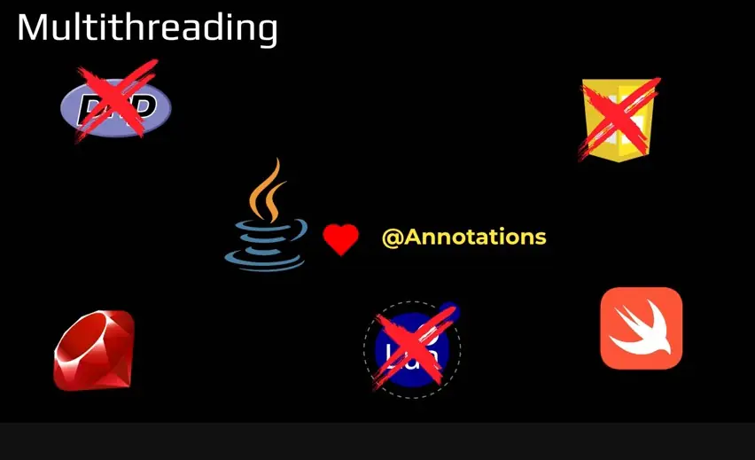
*[▶ 00:03:32](https://www.youtube.com/watch?v=9rx6CIXzCE4&t=212s) · Multithreading: which languages lack it*

На собеседованиях просят написать safe counter, но в языке нет маркировки, которая говорит, какие структуры потокобезопасны.

Для null-safety стандартные `@Nonnull` и `@Nullable` из JSR 305 не прижились, и индустрия выбрала JSpecify.

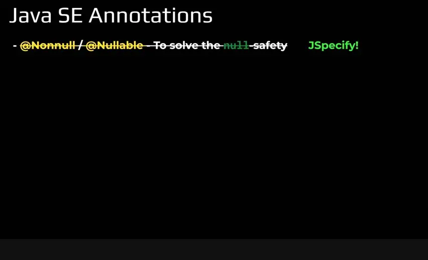
*[▶ 00:04:05](https://www.youtube.com/watch?v=9rx6CIXzCE4&t=245s) · Java SE Annotations: null-safety replaced by JSpecify*

Работают `@Deprecated` для эволюции API и `@Retention` с `@Target` для собственных аннотаций.

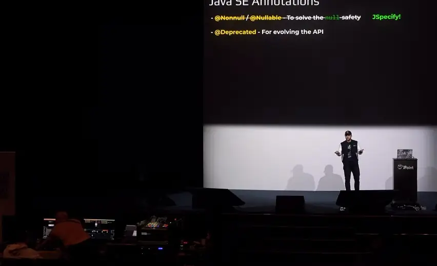
*[▶ 00:04:25](https://www.youtube.com/watch?v=9rx6CIXzCE4&t=265s) · Java SE Annotations: @Deprecated added*

В списке также есть `@ThreadSafe`, который, по словам докладчика, мало кто знает, в том числе он сам.

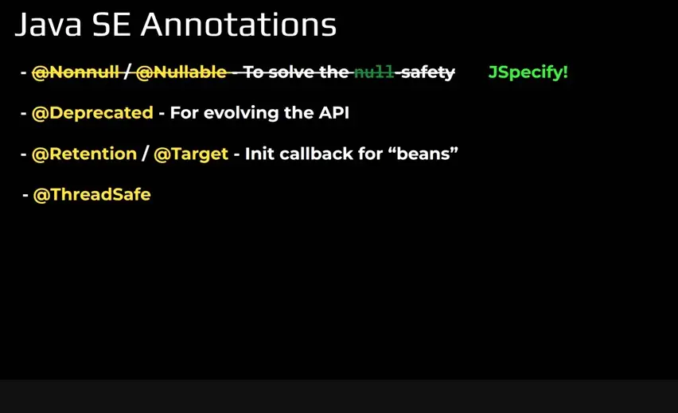
*[▶ 00:04:50](https://www.youtube.com/watch?v=9rx6CIXzCE4&t=290s) · Java SE Annotations: list with @ThreadSafe*

Брайан Гойтц, архитектор языка Java, считает, что аннотации конкурентности принесут больше путаницы, чем пользы. Слишком большой набор либо не будут использовать, либо применят неверно.

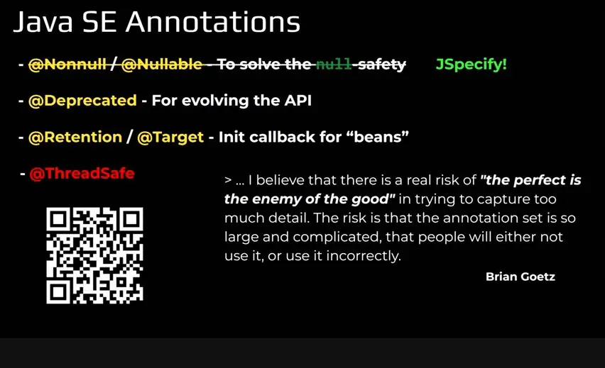
*[▶ 00:06:11](https://www.youtube.com/watch?v=9rx6CIXzCE4&t=371s) · Java SE Annotations: Brian Goetz quote on complexity*

Докладчик ставит вопрос: что на самом деле значит «thread safety»? Ответ разбирается в следующей главе.


*[▶ 00:06:29](https://www.youtube.com/watch?v=9rx6CIXzCE4&t=389s) · What Exactly is Thread Safety?*

## Knight Capital: цена unfair-блокировки и определение thread safety

[▶ 00:06:23](https://www.youtube.com/watch?v=9rx6CIXzCE4&t=383s)

Торговый компонент Buyer разбивал заказ на 300 акций NVDA на три заявки по 100 и отправлял их на биржу параллельно. Результат приходил асинхронно, в другом потоке.

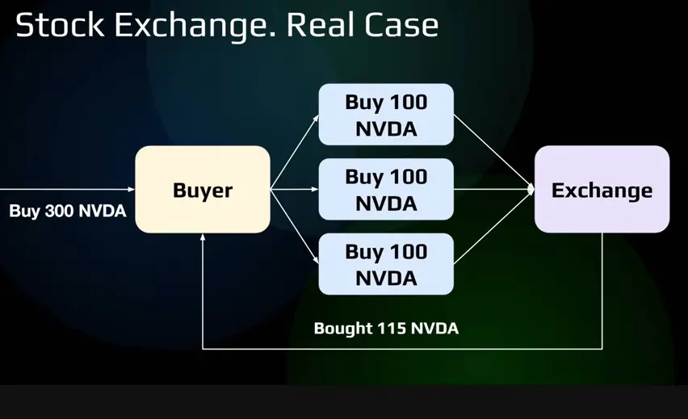
*[▶ 00:07:49](https://www.youtube.com/watch?v=9rx6CIXzCE4&t=469s) · Stock Exchange. Real Case*

Позиция хранилась в volatile-поле, доступ к ней шёл через synchronized-методы `get` и `increment`. Сами синхронизированные методы не защищали логику покупки.

```java
static class Buyer {

 private final int volumeToBuy; // Total position to acquire
 private volatile int currentPosition = 0; // Current position


 Buyer(int volume) {
   this.volumeToBuy = volume;
 }


 }

 private synchronized int get() { return currentPosition; }
 private synchronized void increment(int c) { currentPosition += c; }


}
```

*[▶ 00:08:41](https://www.youtube.com/watch?v=9rx6CIXzCE4&t=521s) · Buyer class with synchronized accessors*

Покупку выполняли 10 потоков, каждый крутился в цикле до нужного объёма. Callback по ответу биржи увеличивал позицию и останавливал покупателей, когда объём набран.

```java
static class Buyer {

 private final int volumeToBuy; // Total position to acquire
 private volatile int currentPosition = 0; // Current position
 private final Callable<Object> buyAction;
 private final Runnable completeOrderAction;

 Buyer(int volume) {
   this.volumeToBuy = volume;
   this.buyAction = Executors.callable(() -> {
     while (get() <= volumeToBuy) fireBuyOrder();
   });
   this.completeOrderAction = () -> {
     increment(getCompletedOrdersCount());
     if (get() > volumeToBuy) terminateAllBuyersThreads();
   };
 }

 private synchronized int get() { return currentPosition; }
 private synchronized void increment(int c) { currentPosition += c; }

 public void buy() throws InterruptedException {
   executorService.invokeAll(Collections.nCopies(10, () -> buyAction));
   executorService.submit(this.completeOrderAction);
 }
}
```

*[▶ 00:10:22](https://www.youtube.com/watch?v=9rx6CIXzCE4&t=622s) · Buyer class with buy logic and executor*

Код прошёл тесты и ушёл в релиз в пятницу. Цена акции Knight Capital Group упала примерно с 12 до менее 4 долларов США, а компания потеряла около полумиллиарда долларов.

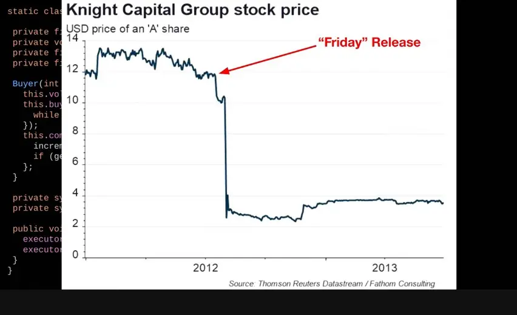
*[▶ 00:10:34](https://www.youtube.com/watch?v=9rx6CIXzCE4&t=634s) · Knight Capital Group stock price*

Fair-блокировка (`new ReentrantLock(true)`) гарантирует, что каждый поток рано или поздно получит доступ, но платит за это производительностью: каждое пробуждение берёт поток из головы очереди и требует переключения контекста. Unfair-блокировка (`synchronized`) работает значительно быстрее, потому что поток, уже работающий на ядре, может взять лок без переключения. Цена: голодание потоков. В высоконагруженной торговой системе поток, который должен остановить покупки, может оказаться в конце очереди.

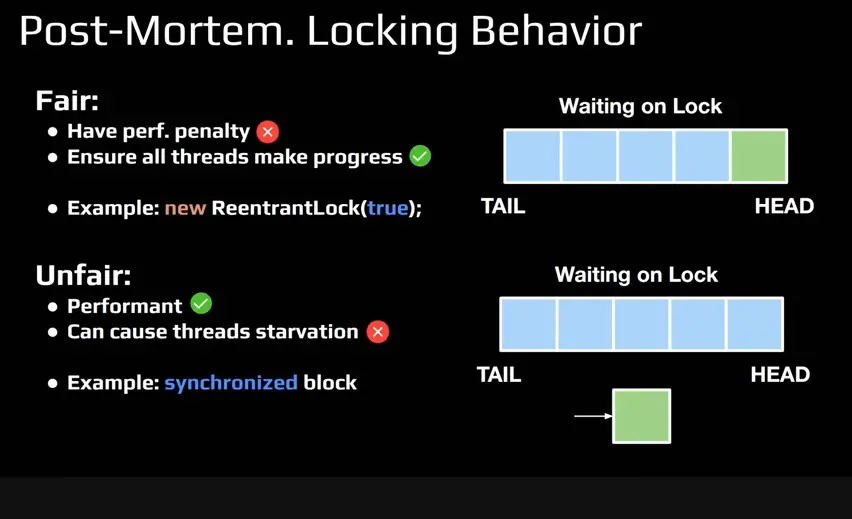
*[▶ 00:13:58](https://www.youtube.com/watch?v=9rx6CIXzCE4&t=838s) · Fair vs unfair locks*

Такое поведение unfair-блокировки — её штатная гарантия, а не ошибка. Поэтому около половины аудитории отвечает, что код небезопасен, хотя с точки зрения блокировок он работает ожидаемо.

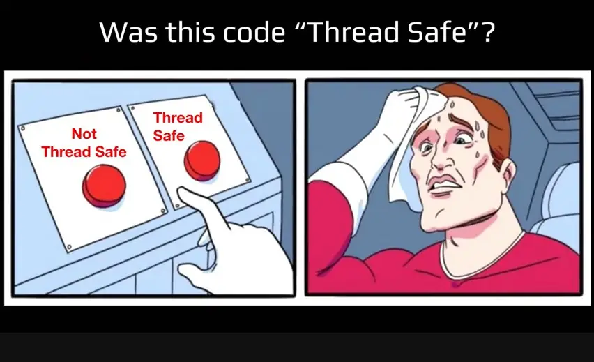
*[▶ 00:15:24](https://www.youtube.com/watch?v=9rx6CIXzCE4&t=924s) · Was this code "Thread Safe"?*

Аннотация thread-safe в Java отсутствует именно потому, что она выражает лишь мнение автора класса. Thread safety трудно определить глобально, она зависит от контекста. Практичнее явно записать ожидания от конкурентного кода и протестировать их, например, что сигнал от биржи придёт за разумное время.

## Декоратор кэша и проверка конкурентного доступа

[▶ 00:16:22](https://www.youtube.com/watch?v=9rx6CIXzCE4&t=982s)

Идея появилась в Axelix: `@Cacheable` на методе Spring Data-репозитория кэширует вызовы, но бэкенды (Caffeine, Couchbase и др.) отдают статистику по-разному. Нужна общая метрика — доля hits к total.

```java
public interface UserRepository extends ListCrudRepository<User, Long> {

    @Cacheable("users.cache")
    User findByName(String name) throws DataAccessException;
}
```

*[▶ 00:17:52](https://www.youtube.com/watch?v=9rx6CIXzCE4&t=1072s) · Spring Data UserRepository with @Cacheable*

Эту долю строят во времени. График в докладе упрощённый.

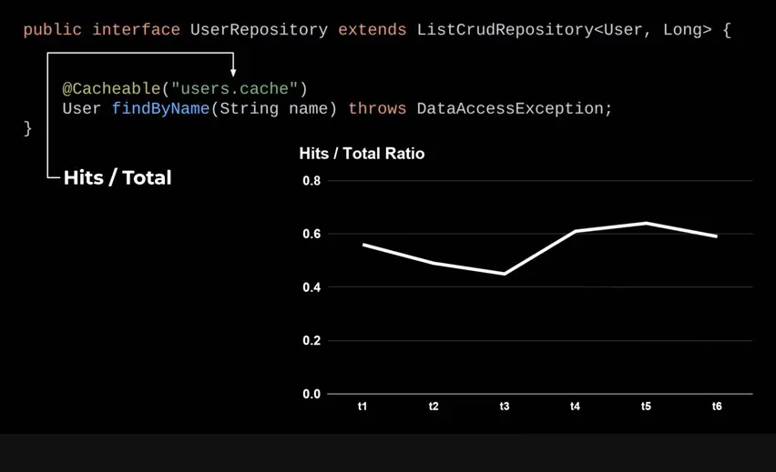
*[▶ 00:18:22](https://www.youtube.com/watch?v=9rx6CIXzCE4&t=1102s) · Cache Hits / Total Ratio over time*

Метрику собирает декоратор над нативным Spring-кэшем. `get` оборачивает `valueLoader`: если он вызван, это промах, иначе попадание. Результат пишется в sliding window. `put` делегирует напрямую.

```java
public class DecoratorCache {

    private final Cache delegate;
    private final SlidingWindow<CacheLookup> cacheLookupHistory;

    @Nullable
    public <T> T get(@NonNull Object key, @NonNull Callable<T> valueLoader) {
        T value = null;

        boolean[] miss = { false };

        value = delegate.get(key, () -> {
            miss[0] = true;
            return valueLoader.call();
        });

        cacheLookupHistory.put(miss[0]
            ? CacheLookup.miss()
            : CacheLookup.hit());

        return value;
    }

    @Override
    public void put(@NonNull Object key, @Nullable Object value) {
        delegate.put(key, value);
    }
}
```

*[▶ 00:20:00](https://www.youtube.com/watch?v=9rx6CIXzCE4&t=1200s) · DecoratorCache wrapping the native cache*

Кэш читают и пишут много потоков. Пример: три потока A, B, C дают 3 hits и 0 misses. Lincheck проверяет линеаризуемость: ищет переплетение операций, где порядок внутри каждого потока сохранён и результат совпадает с последовательным выполнением. Найденное переплетение — лишь допущение о корректности, и оно не всегда соответствует безопасности структуры.

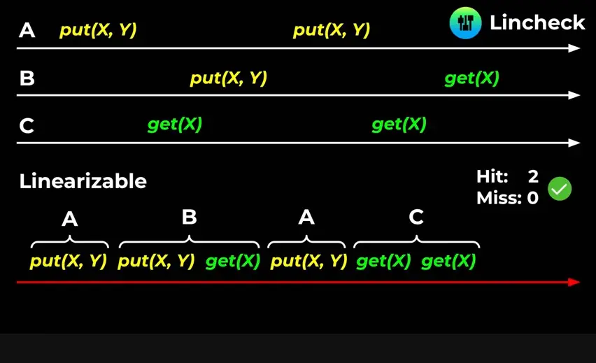
*[▶ 00:22:38](https://www.youtube.com/watch?v=9rx6CIXzCE4&t=1358s) · Lincheck linearizability check of three threads*

## Lincheck: проверка линеаризуемости тестового класса

[▶ 00:22:37](https://www.youtube.com/watch?v=9rx6CIXzCE4&t=1357s)

Lincheck — библиотека от JetBrains, которую в Axelix используют для тестов потокобезопасности. Тестируемый объект (`delegate`) и методы с `@Operation` описываются в тестовом классе, и Lincheck вызывает эти методы конкурентно.

```kotlin
@Param(name = "value", gen = StringGen::class)
@Param(name = "key", gen = StringGen::class, conf = "1:3")
class DecoratorCacheTest {

 val delegate = DecoratorCache(ConcurrentMapCache("test-cache"))

 @Operation
 fun put(
   @Param(name = "key") key: Any,
   @Param(name = "value") value: Any?) = delegate.put(key, value)

 @Operation
 fun getValueLoader(@Param(name = "key") key: Any) = delegate.get(key) { "load" }

 @Operation fun disable() = delegate.disable()

 @Operation fun enable() = delegate.enable()

 @Operation fun getHitsAndMisses() = delegate.getHitsAndMisses()

 @Test
 fun test_StressTesting() = StressOptions().check(DefaultEnhancedCacheTest::class.java)
}
```

Аргументы задаются через `@Param`. Для ключа `conf = "1:3"` даёт только три возможных значения, чтобы потоки бились за одни и те же ключи. Значения генерируются максимально разнообразно, чтобы поймать больше багов.

Итоговое состояние Lincheck определяет по операциям, которые что-то возвращают: здесь это `getValueLoader` (содержимое кэша) и `getHitsAndMisses` (статистика).

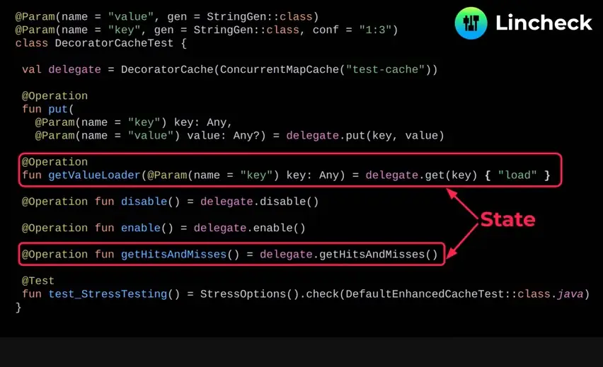
*[▶ 00:27:08](https://www.youtube.com/watch?v=9rx6CIXzCE4&t=1628s) · DecoratorCacheTest Lincheck test class*

Lincheck создаёт новый экземпляр теста на каждый сценарий, поэтому состояние теста должно быть маленьким. Дефолтный ConcurrentMapCache держит 256 записей, и запуск упал с OutOfMemory.

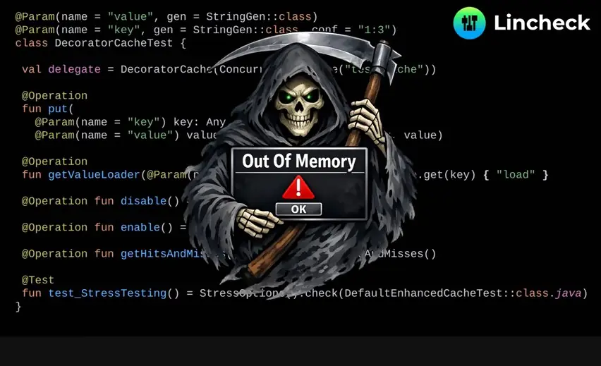
*[▶ 00:27:23](https://www.youtube.com/watch?v=9rx6CIXzCE4&t=1643s) · Out Of Memory error dialog over test code*

Решение — уменьшить вместимость до трёх записей:

```kotlin
@Param(name = "value", gen = StringGen::class)
@Param(name = "key", gen = StringGen::class, conf = "1:3")
class DecoratorCacheTest {

 val delegate = DecoratorCache(ConcurrentMapCache("test-cache"), ConcurrentHashMap(3))

 @Operation
 fun put(
   @Param(name = "key") key: Any,
   @Param(name = "value") value: Any?) = delegate.put(ke…

 @Operation
 fun getValueLoader(@Param(name = "key") key: Any) = delegat… …d" }

 @Operation fun disable() = delegate.disable()

 @Operation fun enable() = delegate.enable()

 @Operation fun getHitsAndMisses() = delegate.getHitsAndMi…

 @Test
 fun test_StressTesting() = StressOptions().check(DefaultEnhancedCacheTest::class.java)
}
```

*[▶ 00:28:35](https://www.youtube.com/watch?v=9rx6CIXzCE4&t=1715s) · Fixed test class with ConcurrentHashMap(3)*

Lincheck запускает операции в нескольких потоках (по умолчанию пять, настраивается) и ищет линеаризуемую последовательность, которая объясняет результат. Если её нет, тест падает. Других стратегий проверки консистентности докладчик не рассматривал.

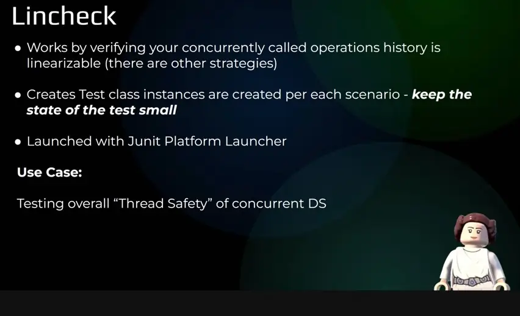
*[▶ 00:31:07](https://www.youtube.com/watch?v=9rx6CIXzCE4&t=1867s) · Lincheck overview*

По словам докладчика, Spring Boot starter-test уже тянет JUnit Platform Launcher, поэтому подключить Lincheck можно без дополнительной обвязки и annotation-процессоров.

## JCStress: стресс-тестирование отдельных микрогонок

[▶ 00:31:06](https://www.youtube.com/watch?v=9rx6CIXzCE4&t=1866s)

Стресс-тестирование запускает код под очень высоким контеншеном и по своей природе недетерминировано. Тест может пройти девять раз и упасть один раз в ночной сборке, а причину потом трудно найти. Поэтому он не гарантирует, что структура данных потокобезопасна.

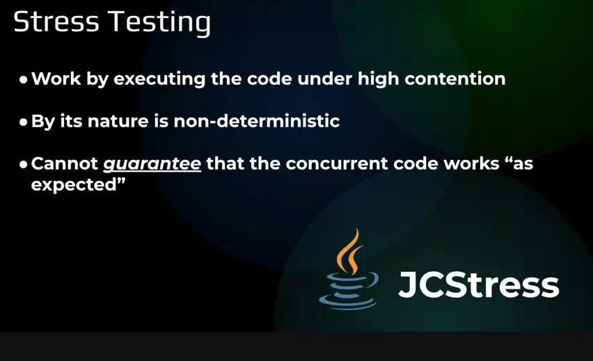
*[▶ 00:33:02](https://www.youtube.com/watch?v=9rx6CIXzCE4&t=1982s) · Stress Testing with JCStress*

Прародитель этого подхода — JCStress, экспериментальный проект OpenJDK. Он работает похоже на Lincheck, но отличается в главном:

- каждый актор — отдельный поток, который вызывается ровно один раз в рамках сценария; в Lincheck операция может вызываться несколько раз;
- разработчик сам задаёт, какое конечное состояние наблюдать и какие результаты допустимы;
- операционно сложнее: нужен annotation processor, а тесты собираются в отдельный исполняемый JAR, потому что JUnit Platform Launcher их не запускает.

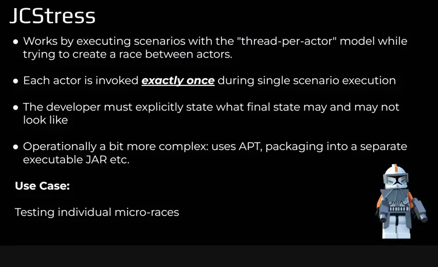
*[▶ 00:40:42](https://www.youtube.com/watch?v=9rx6CIXzCE4&t=2442s) · JCStress overview*

Пример: скользящее окно размером 1, в которое два потока одновременно вызывают `put`. Состояние `@State` пересоздаётся для каждого сценария.

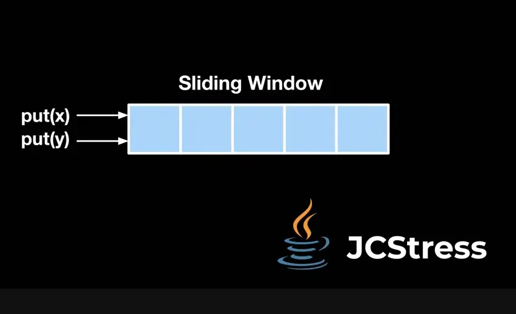
*[▶ 00:33:54](https://www.youtube.com/watch?v=9rx6CIXzCE4&t=2034s) · Sliding window with put(x) and put(y)*

Проверяется состояние окна после конкурентных операций.

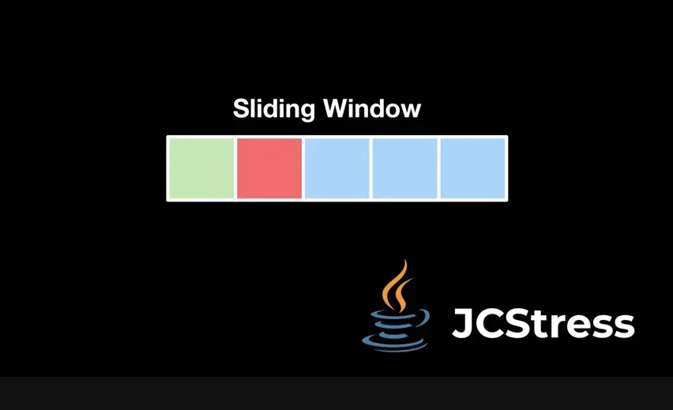
*[▶ 00:34:11](https://www.youtube.com/watch?v=9rx6CIXzCE4&t=2051s) · Sliding window with colored cells*

Арбитр передаёт размер окна и значение первого элемента. Допустимы размер 1 и значения `first` или `second`; всё остальное помечено как `FORBIDDEN`. JCStress форкает JVM в пятнадцати конфигурациях с разными флагами и выполняет огромное количество операций, чтобы создать максимальный контеншен.

```java
@JCStressTest
@Outcome(id = "1, first", expect = Expect.ACCEPTABLE)
@Outcome(id = "1, second", expect = Expect.ACCEPTABLE)
@Outcome(expect = Expect.FORBIDDEN)
@State
public class SlidingWindowJCStressTest {

    private final SlidingWindow<String> slidingWindow = new SlidingWindow<>(1);

    @Actor
    public void actor1() {
        slidingWindow.put("first");
    }

    @Actor
    public void actor2() {
        slidingWindow.put("second");
    }

    @Arbiter
    public void arbiter(LL_Result result) {
        List<String> values = slidingWindow.get();
        result.r1 = values.size();
        result.r2 = values.isEmpty() ? "" : values.get(0);
    }

}
```

*[▶ 00:38:21](https://www.youtube.com/watch?v=9rx6CIXzCE4&t=2301s) · JCStress test for SlidingWindow*

JCStress подходит для проверки отдельных микрогонок, например, что будет, если две операции `put` постоянно конкурируют за одну и ту же позицию, а не произвольные операции.

## Fray: перебор чередований потоков и выводы из практики

[▶ 00:40:42](https://www.youtube.com/watch?v=9rx6CIXzCE4&t=2442s)

Lincheck и JCStress покрывают stress testing, а Fray относится к model checking.

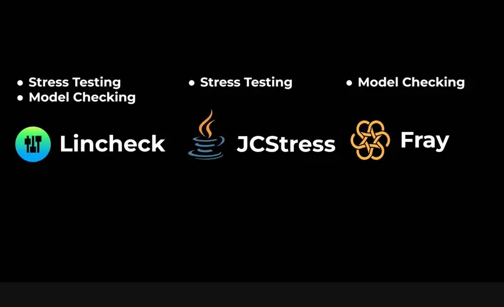
*[▶ 00:41:50](https://www.youtube.com/watch?v=9rx6CIXzCE4&t=2510s) · Lincheck, JCStress, Fray comparison*

Fray инструментирует байткод и заменяет примитивы синхронизации (synchronized, volatile, атомики, java.util.concurrent) на shadow lock, которыми управляет его планировщик. Каждая операция каждого потока получает свой shadow lock, и планировщик может выстроить любое чередование потоков.

В примере два потока выполняют PUT и GET в DefaultSlidingWindow: получается четыре shadow lock, и Fray перебирает порядок их захвата.

```java
public class DefaultSlidingWindow<E> implements SlidingWindow<E> {

    private final Deque<E> deque;
    private final int capacity;

    // constructor etc.
    @Override
    public void put(E element) {
        SHADOW_LOCK(Thread.currentThread(), PUT_SYNC);
        synchronized (this) {
            if (deque.size() == capacity) {
                deque.removeFirst();
                deque.offerLast(element);
            } else {
                deque.offerLast(element);
            }
        }
        SHADOW_UNLOCK(Thread.currentThread(), PUT_SYNC);
    }

    @Override
    public List<E> get() {
        SHADOW_LOCK(Thread.currentThread(), GET_SYNC);
        synchronized (this) {
            return new LinkedList<>(deque);
        }
        SHADOW_UNLOCK(Thread.currentThread(), GET_SYNC);
    }
}
```

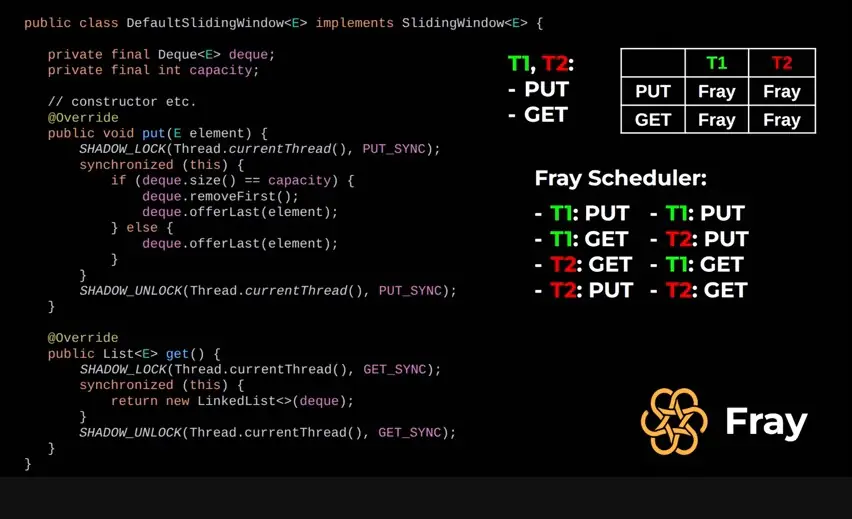
*[▶ 00:46:18](https://www.youtube.com/watch?v=9rx6CIXzCE4&t=2778s) · Shadow-locked DefaultSlidingWindow put/get code*

Fray опирается только на поимку deadlock, исключений и ошибок assertion и не проверяет корректность сам. Найдя сбой, он выдаёт сценарий воспроизведения с конкретным чередованием.

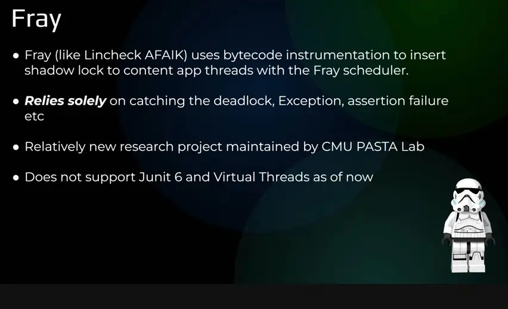
*[▶ 00:47:42](https://www.youtube.com/watch?v=9rx6CIXzCE4&t=2862s) · Fray: how it works and its limits*

Ограничения: нужен Java-агент и JVMTI, проект новый (около полугода по словам спикера), он поддерживает не JUnit 6 и не виртуальные потоки, что в Axelix стало проблемой.

Выводы из опыта Axelix:

- Чётко определяйте ожидания от API конкурентной структуры данных: что можно и что нельзя.
- Переносите тяжёлые concurrency-тесты в nightly-сборки и исключайте их из обычного CI.
- Начинайте с Lincheck: он проще в эксплуатации. Fray требует два агента и специально пропатченную JVM.
- Стресс-тестирование находит 80% concurrency-багов, поэтому начинать стоит с него.

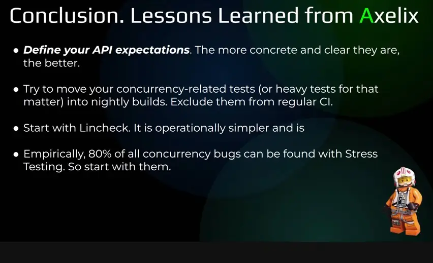
*[▶ 00:49:51](https://www.youtube.com/watch?v=9rx6CIXzCE4&t=2991s) · Conclusion: lessons learned from Axelix*

## Ссылки и материалы

- Обсуждение в Google-группе — QR-код на экране, URL не показан · упомянуто [▶ 00:05:33](https://www.youtube.com/watch?v=9rx6CIXzCE4&t=333s)
- Lincheck — библиотека JetBrains для проверки линеаризуемости, URL не показан · упомянуто [▶ 00:22:32](https://www.youtube.com/watch?v=9rx6CIXzCE4&t=1352s)
