# We Let Our Financial Planners Write the Agents — Matthew Ragone, Range

*How Range's financial planners built AI skills by capturing their own judgment, and the five steps they used to ship them without writing code.*

Source: [We Let Our Financial Planners Write the Agents — Matthew Ragone, Range](https://www.youtube.com/watch?v=gpmze-6ueGU) · Matthew Ragone · AI Engineer · 9 min

## TL;DR

Financial planners are constrained by being in one place at a time, so a chat box that rewrites client messages saves only minutes. Range's approach is to have agents draft client analyses, such as cash flow or insurance reviews, while the planner is on another call, with the planner reviewing everything before anything is sent. The agents work from a "skill" that combines the firm's systems, real client data, and the firm's method, built by planners without code. Six months in, the firm had 24 skills, and sales, product, and marketing adopted the approach on their own.

## Key takeaways

- Pick a workflow you repeat and can judge quickly, such as cash flow analysis or insurance reviews, because output you can't judge can't be tested or trusted.
- Teach a skill by showing the agent several real past cases and narrating why you open each file and what would make you stop to ask.
- A skill needs more than steps: define the questions it asks before starting (what to confirm rather than guess) and the limits it respects (such as never sending anything to a client alone).
- Package the judgment into a skill that combines the firm's systems, real client data, and the firm's own method, and build it without writing code.
- Test a skill 5–10 times on real cases before shipping it.
- Assign an owner to keep each skill current and a reviewer who is not the author.
- Expect experts to build niche skills and review them in the same way they review plans; the bottleneck becomes documenting, testing, and owning skills.
- Start with the chat-box stage only if needed, but aim for agents that work while the expert is elsewhere and leave review and sending to the human.

## Starting with a chat box

[▶ 00:00:00](https://www.youtube.com/watch?v=gpmze-6ueGU&t=0s)

Matthew Ragone, a certified financial planner, leads AI adoption for Range's planning team. The output is financial advice to real clients in a regulated business, so review is never optional.

The starting point was a chat box: paste in a client message, ask for a clearer or friendlier version. It saved minutes, but the work stayed manual.

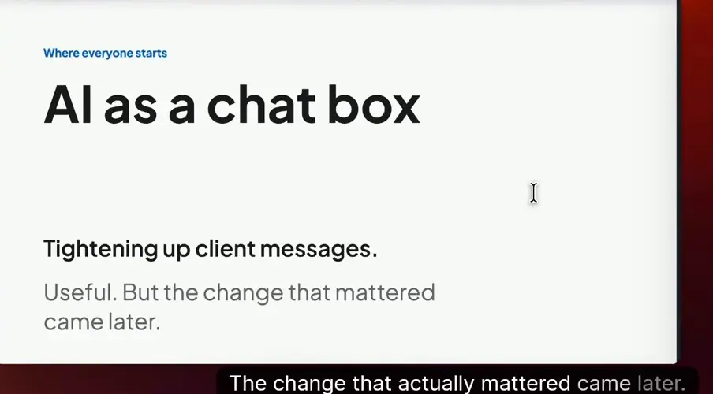
*[▶ 00:01:33](https://www.youtube.com/watch?v=gpmze-6ueGU&t=93s) · AI as a chat box*

## Agents work while the planner is elsewhere

[▶ 00:01:31](https://www.youtube.com/watch?v=gpmze-6ueGU&t=91s)

The planner's constraint is being in one place at a time, not typing speed.

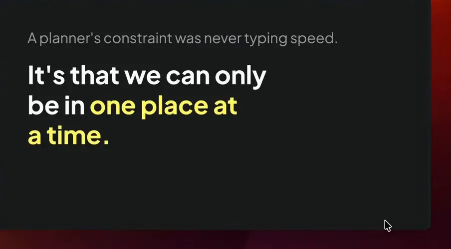
*[▶ 00:01:56](https://www.youtube.com/watch?v=gpmze-6ueGU&t=116s) · Planner's real constraint: one place at a time*

An agent drafts a cash flow or insurance analysis during another client's call. The planner reviews, adjusts and sends; the agent sends nothing.

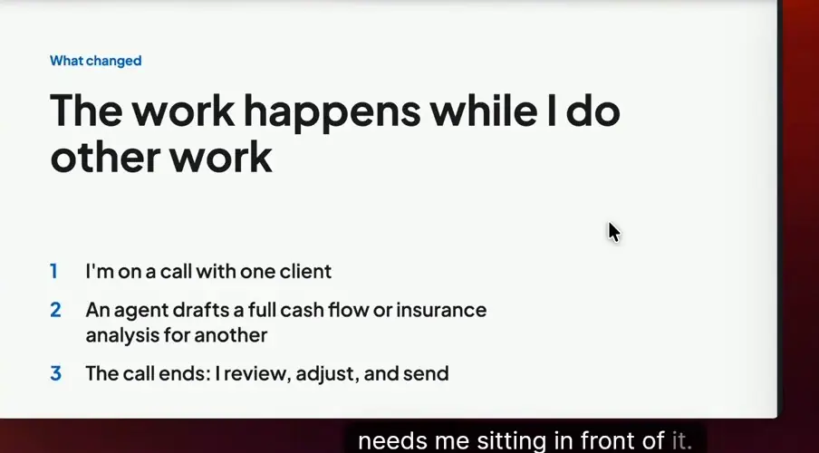
*[▶ 00:02:34](https://www.youtube.com/watch?v=gpmze-6ueGU&t=154s) · The work happens while I do other work*

It needs the firm's systems, real client data and the firm's own method. That pairing is a **skill**.

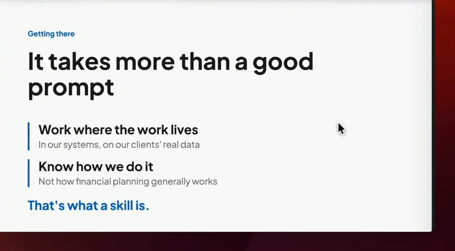
*[▶ 00:03:15](https://www.youtube.com/watch?v=gpmze-6ueGU&t=195s) · It takes more than a good prompt*

## Pick repeated work you can judge

[▶ 00:03:16](https://www.youtube.com/watch?v=gpmze-6ueGU&t=196s)

Building a skill has five steps: Pick, Teach, Pack, Test, Ship. None requires code, but each requires knowing the work well.

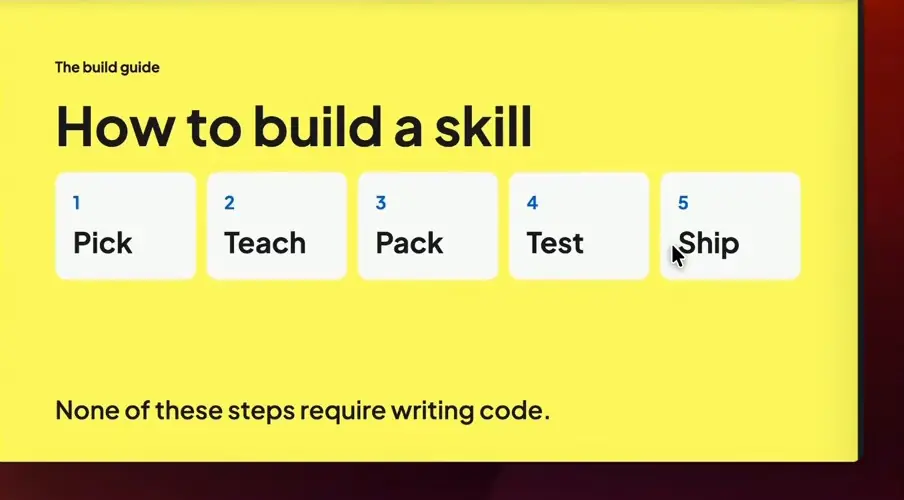
*[▶ 00:03:38](https://www.youtube.com/watch?v=gpmze-6ueGU&t=218s) · How to build a skill*

Pick a workflow you repeat and can judge quickly. Skip the flashiest work. Start with simple workflows that demand heavy manual effort, like cash flow analysis and insurance reviews. Output you can't judge quickly can't be tested or trusted.

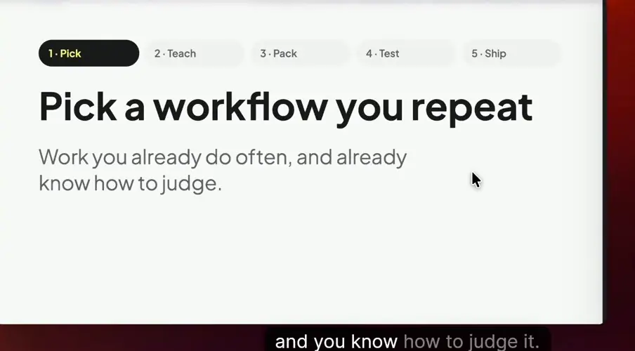
*[▶ 00:04:25](https://www.youtube.com/watch?v=gpmze-6ueGU&t=265s) · Pick a workflow you repeat*

## Narrate the judgment, then set the limits

[▶ 00:04:22](https://www.youtube.com/watch?v=gpmze-6ueGU&t=262s)

Show it several real past cases, narrating why you open each file and what would make you stop to ask.

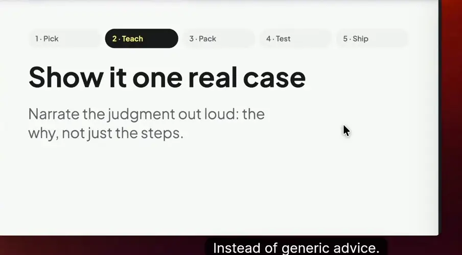
*[▶ 00:05:01](https://www.youtube.com/watch?v=gpmze-6ueGU&t=301s) · Show it one real case*

A skill needs more than steps. It needs:

- **Questions** it asks before starting: what it needs to know and what to confirm rather than guess.
- **Limits** it respects: what it never does alone, such as sending anything to a client.

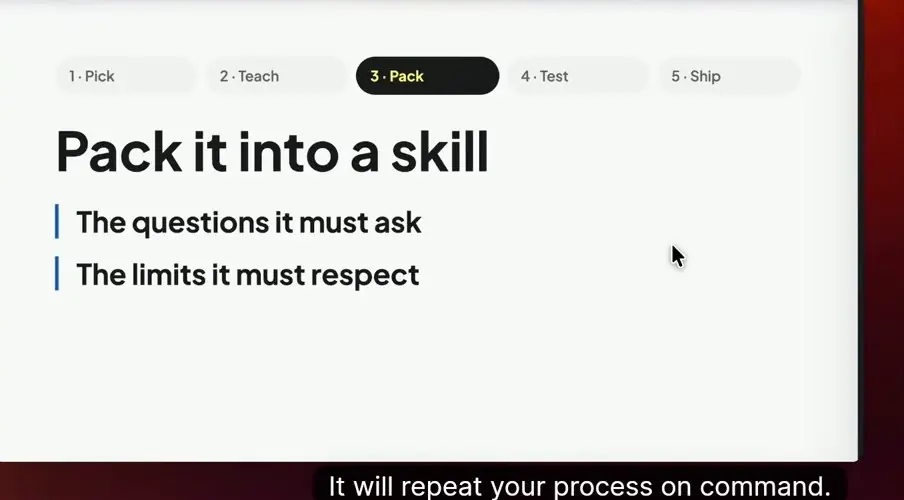
*[▶ 00:05:50](https://www.youtube.com/watch?v=gpmze-6ueGU&t=350s) · Pack it into a skill*

## Test on real cases, then name an owner and a reviewer

[▶ 00:05:51](https://www.youtube.com/watch?v=gpmze-6ueGU&t=351s)

Run a skill 5–10 times on real cases first.

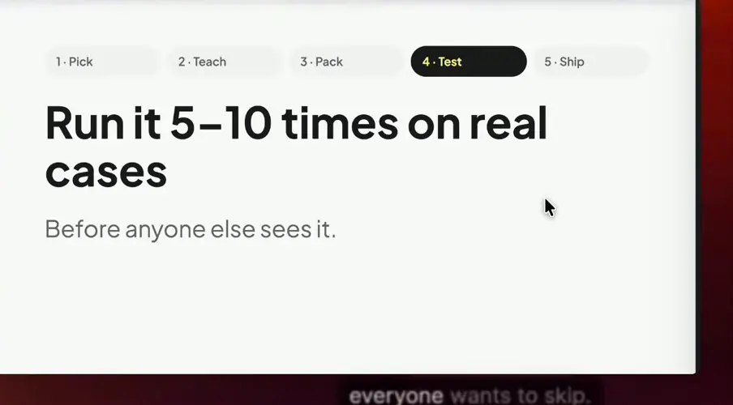
*[▶ 00:06:00](https://www.youtube.com/watch?v=gpmze-6ueGU&t=360s) · Run it 5–10 times on real cases*

Assign an **owner** to keep it current and a **reviewer** who isn't the author.

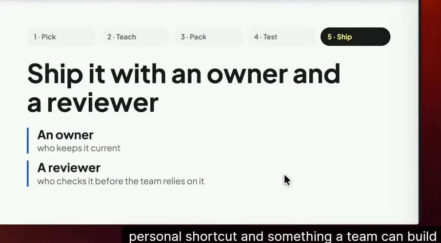
*[▶ 00:07:01](https://www.youtube.com/watch?v=gpmze-6ueGU&t=421s) · Ship it with an owner and a reviewer*

Six months in, 24 skills exist, and use spread to sales and marketing without a mandate.

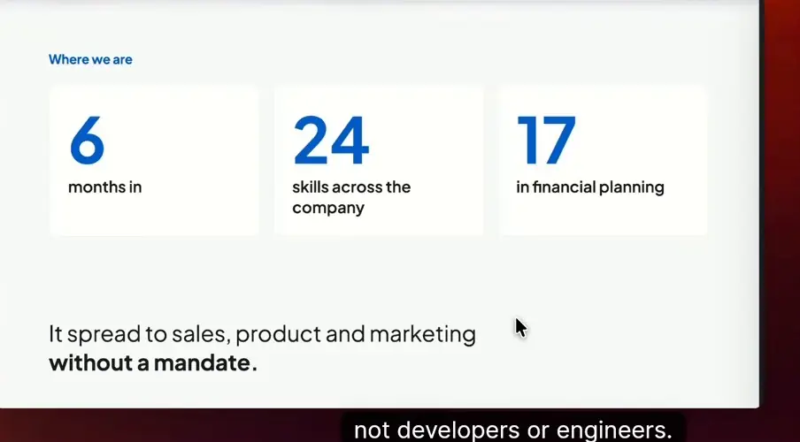
*[▶ 00:07:31](https://www.youtube.com/watch?v=gpmze-6ueGU&t=451s) · Where we are: 6 months in*

Experts now build niche skills, and reviewing them mirrors reviewing plans.

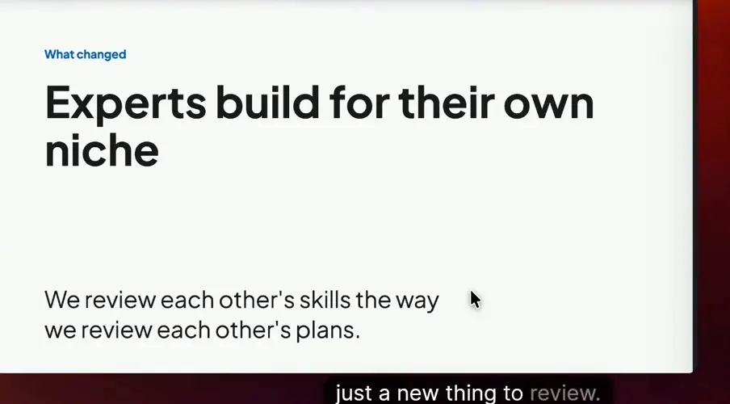
*[▶ 00:08:05](https://www.youtube.com/watch?v=gpmze-6ueGU&t=485s) · Experts build for their own niche*

The bottleneck is now documenting, testing and owning skills.

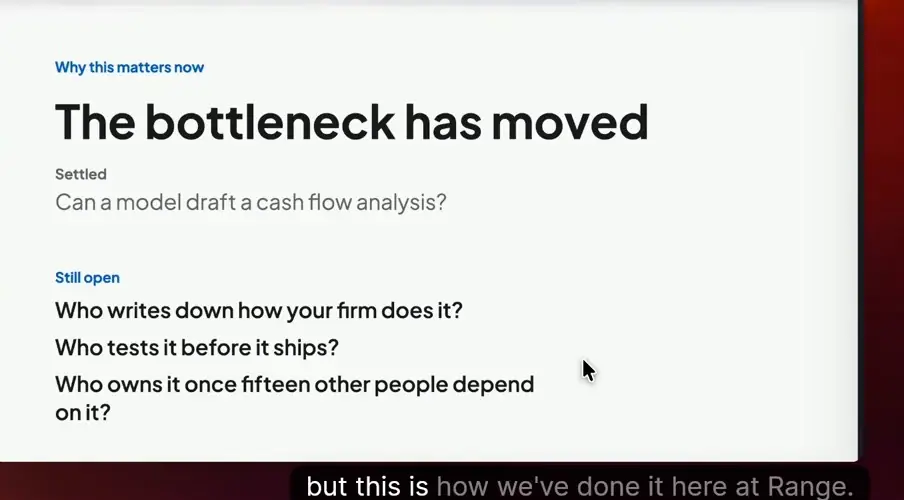
*[▶ 00:08:38](https://www.youtube.com/watch?v=gpmze-6ueGU&t=518s) · The bottleneck has moved*
