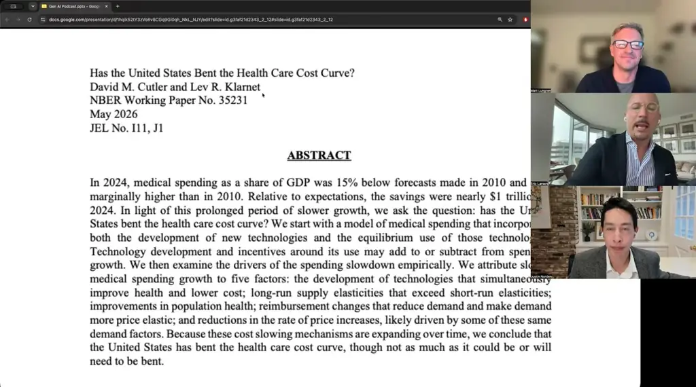

# AI in Healthcare Series: Have We Already Bent the Healthcare Cost Curve?

*Learn why a panel of Stanford and industry voices argues AI may already be bending U.S. health spending, and why they think incumbents may struggle to adapt.*

Source: [AI in Healthcare Series: Have We Already Bent the Healthcare Cost Curve?](https://www.youtube.com/watch?v=pUF0o57YdL8) · Justin Norden, Matt Lungren and Eric Larsen · Stanford Online · 40 min

## TL;DR

The debate asks whether autonomous AI will outperform AI-aided physicians, and whether health care's cost structure, built on scarce expertise, is already changing. The panel's physician argues that benchmarks cover narrow tasks and that the real question is how to redesign practice around AI. The panelists point to data showing U.S. health spending came in about $977 billion below a 2010 CMS forecast, and they argue that abundant cognition could make expertise cheaper and undermine hospital and institutional models. This matters because the speed of change, not today's snapshot, may determine whether incumbents adapt in time.

## Key takeaways

- Benchmarks showing AI beating radiologists at tasks like spotting pneumonia cover narrow tasks, and no benchmark yet covers the full set of clinical work.
- Human-plus-machine chess teams led from roughly 2005 to 2012, after which machines beat humans working alone, which the paper uses to argue that adding human judgment can lower AI accuracy in verifiable domains.
- AI's progression runs from verifiable tasks to codified knowledge to tacit knowledge, and a Stanford study suggests tacit knowledge is learnable, using autonomous driving as the example.
- Radiologists take 12 years to train, so supply cannot respond to demand, and if cognition becomes abundant, expertise gets cheaper while physicians carrying about $250,000 in academic debt would need compensation during the transition.
- CMS actuaries forecast in 2010 that U.S. health spending would reach 21.2% of GDP by 2024, but it reached 18%, a gap of $977 billion, with cumulative savings since 2010 totaling about $6.7 trillion according to David Cutler and Lev Klarnet's paper.
- Medicare's 2024 site-of-care shifts, including hip and knee procedures moving to outpatient settings, accounted for $94 billion of the $977 billion in savings.
- Hospitals are organized around scarcity: they are a $1.7 trillion sector with over $1 trillion in real estate and co-locate hyper-specialists, a structure that may be unnecessary if expertise becomes abundant.
- Health systems that build AI next to incumbents rather than pouring intelligence into existing systems may move faster, and even current tools could put leading organizations orders of magnitude ahead of the median health system, without waiting for better models.

## Autonomous AI versus AI-aided physicians

[▶ 00:01:05](https://www.youtube.com/watch?v=pUF0o57YdL8&t=65s)

The debate starts from a perspective by Ezekiel Emanuel, Neal Khosla and Vinod Khosla asking whether autonomous AI will outperform AI-aided physicians.

*[▶ 00:02:02](https://www.youtube.com/watch?v=pUF0o57YdL8&t=122s) · Paper title: Will Autonomous AI Exceed AI-Aided Physicians*

The paper builds on a pattern in comparative studies: AI alone often beats physicians, and physicians working with AI often do worse than AI alone. The authors take that evidence toward a provocative conclusion, that AI could deliver care on its own. The panel's physician calls the evidence selective but grounded in real trends.

The physician's main objection is that benchmarks reward narrow tasks. AI can beat radiologists at spotting pneumonia, which he says is about 1% of his work, and no benchmark yet covers the full set of clinical tasks. He argues the better question is how to redesign practice so AI expands access, knowledge and decisions while physicians cover what remains. He doubts that administrative work is the right focus on its own.

The chess history is offered as the core argument. Human-plus-machine teams led from roughly 2005 to 2012, and machines have beaten humans alone since. The paper contends that adding human judgment to a verifiable domain lowers AI accuracy. Critics have found methodological flaws, but the trajectory matters more: AI moves from verifiable tasks to codified knowledge to tacit knowledge, which a Stanford study suggests is learnable, using autonomous driving as the example.

The economic stakes follow. Health care's $6 trillion industry rests on scarce cognition. Radiologists take 12 years to train, so supply cannot respond to demand. If cognition becomes abundant, expertise gets cheaper, and the transition has to compensate physicians who carry about $250,000 in academic debt.

Speed is the other concern. One panelist, drawing on public health training, argues that the slope matters more than the current snapshot. Debates about cruise ships and flights came after the COVID exponential was already under way.

Elting Morison's 1955 account of technological change describes a sequence: society ignores the change, rebuts it, mocks its champions, and adapts only when a leader with enough moral authority pushes. The panel expects law, consulting, finance and medicine to follow it.

## The Trade-off Between Vision and Organizational Buy-In

[▶ 00:15:45](https://www.youtube.com/watch?v=pUF0o57YdL8&t=945s)

Pitching the future to health system leaders forces a trade-off: go too far and the audience is lost. Even a leader ready to move may be unable to convince the organization to fund investment at that pace. The panelists were asked to be unfiltered about where the field is going and what leaders need to hear.

## Why healthcare incumbents may not keep up

[▶ 00:16:58](https://www.youtube.com/watch?v=pUF0o57YdL8&t=1018s)

Small, AI-fluent teams are already outrunning large incumbents in less regulated industries. The Cursor example is the clearest case. Microsoft had OpenAI's IP, GitHub, and the leading IDE, yet a small team building a coding harness won. It focused on one use case, used the technology at every step, and had no legacy systems to carry.

Healthcare's institutions were built for scarce knowledge and expertise. Medical training, evidence generation, and peer review all assume slow-changing information. A paper is often outdated when it is published, and by the time a use case is implemented, a better model exists.

One speaker draws these implications:

- **Build next to incumbents, not on top of them.** Pouring intelligence into existing systems is harder than building in parallel.
- **Hospitals are organized around scarcity.** They are a $1.7 trillion sector with over $1 trillion in real estate, and they co-locate hyper-specialists. If cognitive expertise becomes abundant, that aggregation may not be needed.
- **LLMs give individuals access to expertise.** Corporations exist to aggregate and coordinate experts, so individuals equipped with AI erode that role.
- **Incumbency is a head start, not a law.** Healthcare's regulation and litigiousness give incumbents time to adapt, but only if they use it.
- **Systems of record may need to serve agents.** Epic or Oracle could treat agents, not humans clicking buttons, as their main users. The speaker does not know whether any system of record can do this.

Regulators are engaging insurgents as well as incumbents. Even with no further model improvement, the speakers argue, current tools would put leading organizations orders of magnitude ahead of the median health system. Waiting for better models is not necessary.

## Spending has already bent below forecast

[▶ 00:33:15](https://www.youtube.com/watch?v=pUF0o57YdL8&t=1995s)

David Cutler and Lev Klarnet's paper argues US health spending has already slowed. CMS actuaries forecast in 2010 that health care would reach 21.2% of GDP by 2024. It hit 18%.

*[▶ 00:33:33](https://www.youtube.com/watch?v=pUF0o57YdL8&t=2013s) · Paper title and abstract (Cutler and Klarnet)*

The gap is $977 billion; cumulative savings since 2010 total about $6.7 trillion. He had projected 500–700 basis points could come off GDP share; the paper suggests it happened.

## Early Evidence That the Cost Curve Can Bend

[▶ 00:36:16](https://www.youtube.com/watch?v=pUF0o57YdL8&t=2176s)

The U.S. is now bending its cost curve relative to other OECD countries. Technology explains about 14% of the change, all of it pre-AI.

GLP-1s are inflationary first, then deflationary: adherent employees saw total health costs drop 5% amid 10% medical inflation (unpublished).

Medicare's 2024 site-of-care shifts, including hip and knee moving outpatient, accounted for $94 billion in savings out of $977 billion.

Read the dense 84-page NBER Working Paper 35231.

## Links & resources

- [Stanford link from the video description (event or series page)](https://stanford.io/3NEt7uE) — <https://stanford.io/3NEt7uE> · video description
- [Matthew Lungren — speaker profile at Stanford](https://profiles.stanford.edu/matthew-lungren) — <https://profiles.stanford.edu/matthew-lungren> · video description
- [Justin Norden — speaker profile at Stanford](https://profiles.stanford.edu/justin-norden) — <https://profiles.stanford.edu/justin-norden> · video description
