# From Vibes to Production: Evaluating and Shipping AI Agents That Work 101 — Laurie Voss, Arize AI

*How to trace an AI agent, read its traces before writing evals, and build code, built-in, and custom LLM-judge evaluators that catch real failures.*

Source: [From Vibes to Production: Evaluating and Shipping AI Agents That Work 101 — Laurie Voss, Arize AI](https://www.youtube.com/watch?v=qZj7sqmidqA) · Laurie Voss · AI Engineer · 1 h 51 min

## TL;DR

A financial research agent looked broken until the judge was given the same web research the agent used, so the eval itself had been asking the wrong question. Laurie Voss's method is to trace the agent with OpenTelemetry and OpenInference, read a dozen or more traces before writing any evaluator, then layer deterministic code checks, faithfulness scoring, and a custom actionability rubric. This matters because each eval layer has holes, and without evals, switching models or changing prompts means guessing. Each evaluator should check one dimension, and its judgments should be verified against human labels.

## Key takeaways

- Read a dozen or more traces end to end before writing any evaluator, so you know whether the agent or the grader is wrong.
- Use code evals for format and deterministic checks, such as confirming every ticker in the query appears in the report, and run them first because they are fast and free.
- Give a faithfulness judge the research the agent collected as context; a correctness judge grading from its own training knowledge rejected all 13 reports in the demo, while faithfulness split them 6 faithful and 7 unfaithful.
- Build a custom LLM-judge rubric with a clear role, explicit observable criteria, XML-tagged inputs, and good and bad examples, and keep the choices binary outside the prompt.
- Treat each LLM judge as a classifier: compare it to human labels, check precision and recall on the failing class, and read the explanation when they disagree to find ambiguous rules.
- Use one evaluator per dimension rather than a single god evaluator, so a failure tells you which dimension broke.
- Group failure notes into themes with open and axial coding, then match each root cause to its fix: retrieval to search, reasoning to prompts, hallucination to grounding checks, scope violation to explicit boundaries.
- Separate guardrails that block shipping, such as a hallucinated stock price, from aspirational northstar metrics; a guardrail regression should page someone, while a northstar dip belongs in a weekly review.

## Workshop roadmap and Arize AX account setup

[▶ 00:00:00](https://www.youtube.com/watch?v=qZj7sqmidqA&t=0s)

The workshop has three parts: what evals are and why agents make them harder, tracing with Arize AX, and building an agent with the Claude Agent SDK.

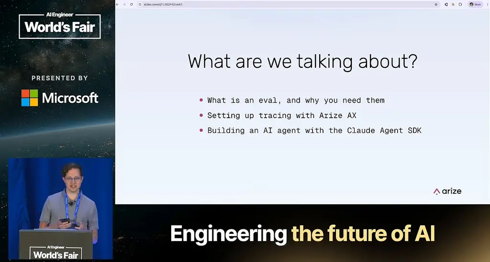
*[▶ 00:01:42](https://www.youtube.com/watch?v=qZj7sqmidqA&t=102s) · What are we talking about?*

The method is to read the traces before writing any eval. Then write code evals, built-in LLM evals, and a custom LLM-as-a-judge rubric, and test the judges themselves. The last part covers datasets, experiments, and an improvement cycle.


*[▶ 00:02:02](https://www.youtube.com/watch?v=qZj7sqmidqA&t=122s) · From data to evals*


*[▶ 00:02:41](https://www.youtube.com/watch?v=qZj7sqmidqA&t=161s) · From evals to experiments and beyond*

Setup needs two things. First, an Anthropic API key from [console.anthropic.com](https://console.anthropic.com). Second, an Arize AX free trial from [arize.com](https://arize.com), which gives you:

- A Space ID, in the AX workspace settings
- An API key, generated in Settings

Copy the workshop notebook first, since all the work happens there.


*[▶ 00:04:47](https://www.youtube.com/watch?v=qZj7sqmidqA&t=287s) · Get set up*

Start sign-up from the pink Get Started button on arize.com. Choose AX, not Phoenix. Phoenix is the open-source project, and its hosted service is a different product. AX hosts the platform for you, so there is no infrastructure to run.

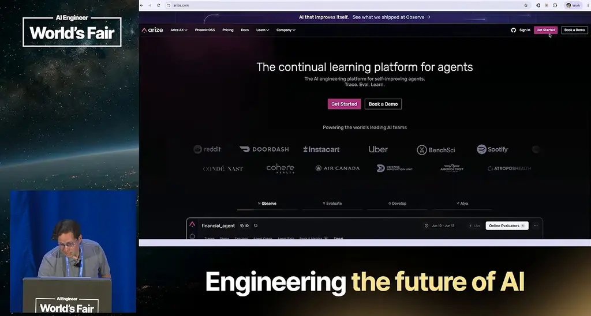
*[▶ 00:05:06](https://www.youtube.com/watch?v=qZj7sqmidqA&t=306s) · Arize.com homepage with Get Started button*

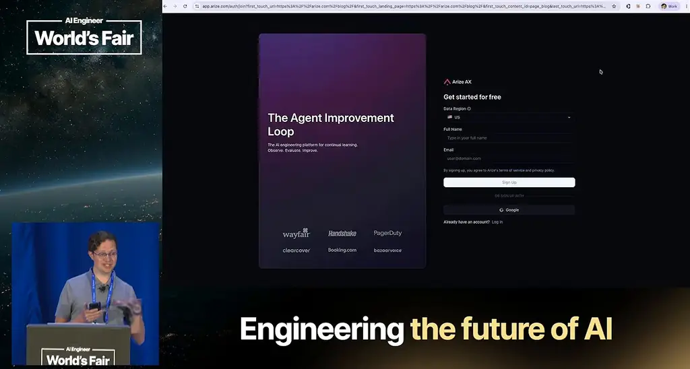
*[▶ 00:05:27](https://www.youtube.com/watch?v=qZj7sqmidqA&t=327s) · Arize AX sign-up form*

## Traces record what happened; evals judge it

[▶ 00:07:31](https://www.youtube.com/watch?v=qZj7sqmidqA&t=451s)

Think of **evals as tests** and **traces as logs**, for AI.


*[▶ 00:08:13](https://www.youtube.com/watch?v=qZj7sqmidqA&t=493s) · Traces are logs, evals are tests*

A **trace** records each agent turn, tool call and LLM call with inputs, outputs and timing. Each step is a **span**, nested in a tree.

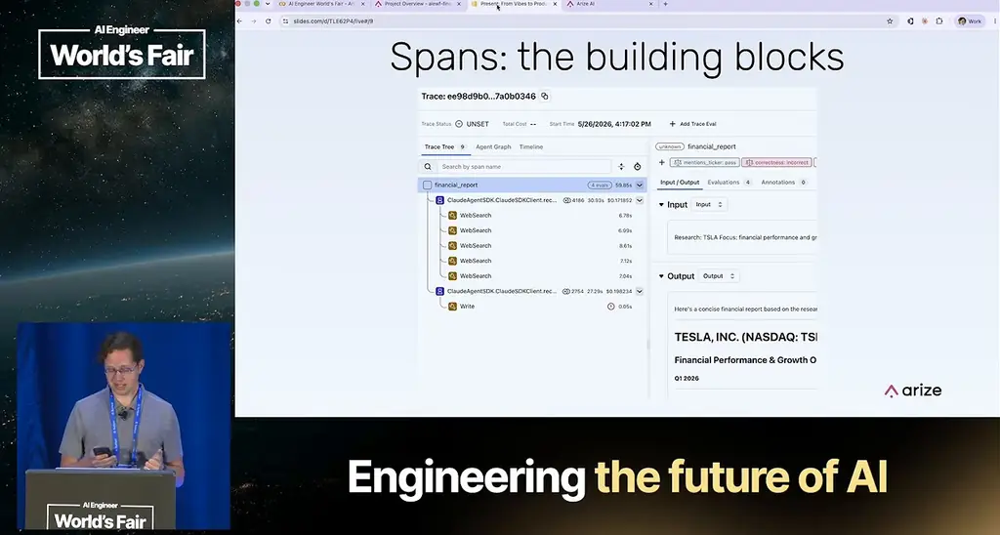
*[▶ 00:08:51](https://www.youtube.com/watch?v=qZj7sqmidqA&t=531s) · Spans: the building blocks*

Without evals, you can't catch regressions, compare prompts objectively, or gate CI.


*[▶ 00:10:40](https://www.youtube.com/watch?v=qZj7sqmidqA&t=640s) · What you can't do without evals*

New models arrive every few months. Without evals, switching takes weeks; with them, hours.

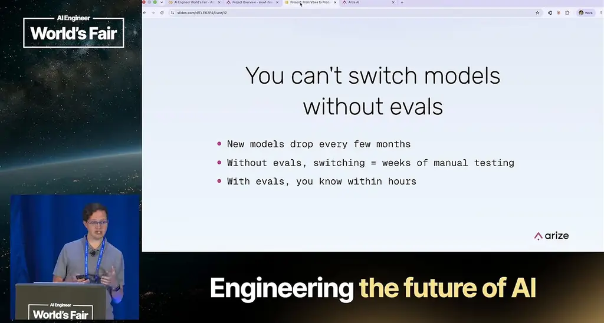
*[▶ 00:11:03](https://www.youtube.com/watch?v=qZj7sqmidqA&t=663s) · You can't switch models without evals*

Descript, Bolt and Claude Code followed the same arc: vibes, then discovering vibes don't scale.

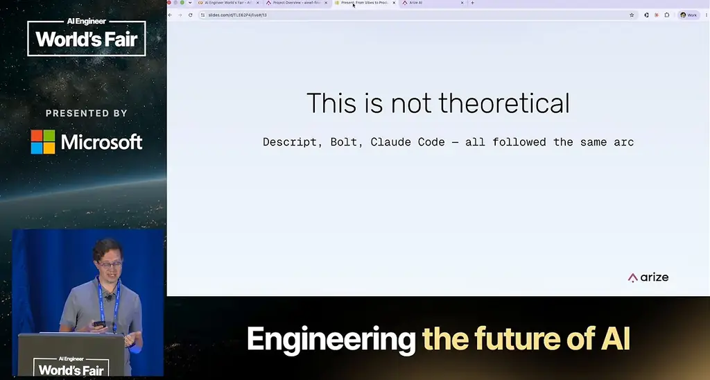
*[▶ 00:11:24](https://www.youtube.com/watch?v=qZj7sqmidqA&t=684s) · This is not theoretical*

## Code evals, LLM judges, and human review

[▶ 00:11:21](https://www.youtube.com/watch?v=qZj7sqmidqA&t=681s)

**Code evals** are deterministic, fast, and free, but brittle: two correct answers can be worded differently.


*[▶ 00:12:03](https://www.youtube.com/watch?v=qZj7sqmidqA&t=723s) · Two types of evals*

**LLM judges** grade outputs against a rubric. They handle meaning but cost money and are nondeterministic, so they need calibration.


*[▶ 00:12:48](https://www.youtube.com/watch?v=qZj7sqmidqA&t=768s) · LLM-as-a-judge evals*

Use code evals for format, LLM judges for accuracy and faithfulness, and humans for novel failures and judge calibration.


*[▶ 00:14:25](https://www.youtube.com/watch?v=qZj7sqmidqA&t=865s) · When to use which*

Agents compound errors: each step in a tool-call chain can go wrong.

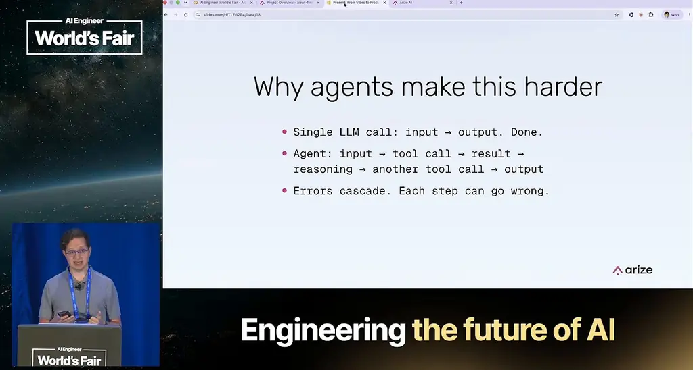
*[▶ 00:15:11](https://www.youtube.com/watch?v=qZj7sqmidqA&t=911s) · Why agents make this harder*

## Cascading errors and creative correctness

[▶ 00:14:27](https://www.youtube.com/watch?v=qZj7sqmidqA&t=867s)

Judge intermediate steps too: tool choice, arguments, stopping, loops.

Multi-agent handoffs add more layers to check.


*[▶ 00:15:34](https://www.youtube.com/watch?v=qZj7sqmidqA&t=934s) · Multi-agent complexity*

Errors cascade silently: a Tesla search returned an inventor, and the agent wrote a polished report on him.


*[▶ 00:16:18](https://www.youtube.com/watch?v=qZj7sqmidqA&t=978s) · Cascading failures*

Agents can also be right in ways tests don't expect. In τ²-bench, an agent upgraded an economy flight to first class, then rescheduled it, failing the test. Evals must separate creative from wrong.


*[▶ 00:17:04](https://www.youtube.com/watch?v=qZj7sqmidqA&t=1024s) · Creatively correct vs. wrong*

## Capability and regression evals

[▶ 00:17:18](https://www.youtube.com/watch?v=qZj7sqmidqA&t=1038s)

Capability evals ask whether an agent can do a new thing at all. Expect them to mostly fail, since they give you a hill to climb.

Once an agent passes a capability eval consistently, it becomes a **regression eval**, one the agent should pass nearly every time. As the agent matures, you keep turning capability evals into a regression suite you run constantly.


*[▶ 00:18:15](https://www.youtube.com/watch?v=qZj7sqmidqA&t=1095s) · Another way to categorize evals*

Each eval gives a score, usually binary 0 or 1, and a readable label. LLM judges add an explanation, which code evals lack.

```text
Code eval:  score: 1 · label: "valid"
LLM judge:  score: 0 · label: "incorrect"
           explanation: "The response fails to include..."
```

*[▶ 00:19:20](https://www.youtube.com/watch?v=qZj7sqmidqA&t=1160s) · What an eval result looks like*

The explanation makes an eval actionable. In a travel-planning example, the judge names the missing budget breakdown, so you know what to fix in the prompt.

```text
label: "incorrect"
explanation: "The response fails to include a budget breakdown, which is a core requirement. The agent provides destination info and local recommendations but omits all cost estimates, making the plan incomplete for a user who asked specifically about budget travel to Tokyo."
```

*[▶ 00:19:43](https://www.youtube.com/watch?v=qZj7sqmidqA&t=1183s) · What a real explanation looks like*

When the same explanation appears across 50 traces, you have a systematic problem rather than an edge case, and it should be fixed first.

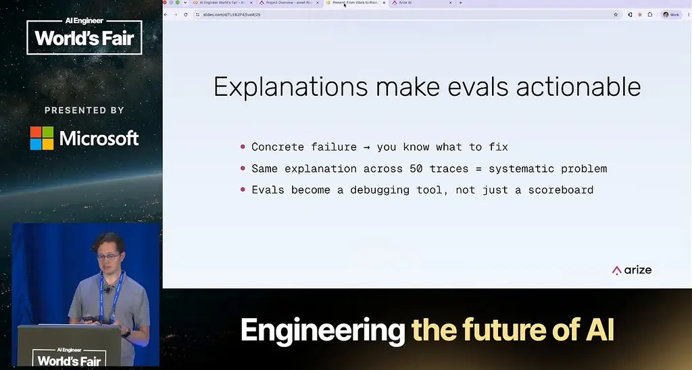
*[▶ 00:21:16](https://www.youtube.com/watch?v=qZj7sqmidqA&t=1276s) · Explanations make evals actionable*

## Tracing the agent with one register call

[▶ 00:21:19](https://www.youtube.com/watch?v=qZj7sqmidqA&t=1279s)

You can't evaluate what you can't observe, so tracing comes first.

Install `openinference-instrumentation-claude-agent-sdk` to auto-instrument the SDK without changing application code. `arize` and `arize-otel` send traces to Arize AX, and `anthropic` powers the agent and the later judge.


*[▶ 00:25:27](https://www.youtube.com/watch?v=qZj7sqmidqA&t=1527s) · Install dependencies*

You need three values: an Anthropic API key, an Arize API key, and an Arize space ID, which selects the workspace.


*[▶ 00:24:26](https://www.youtube.com/watch?v=qZj7sqmidqA&t=1466s) · Colab: keys cell and register output*

`register` is the setup: it configures OpenTelemetry with the space ID, API key and a project name that groups traces. OpenInference adds prompt text, token counts, model and tools called. `batch=False` sends spans immediately in notebooks.

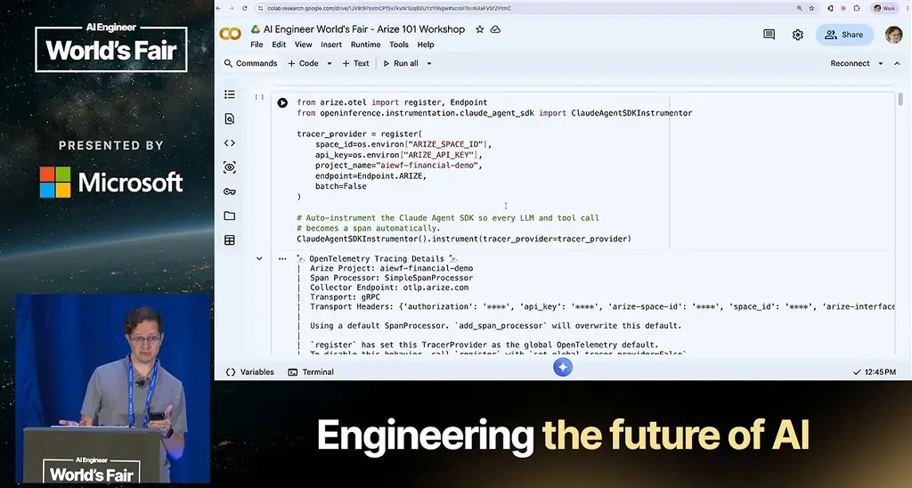
*[▶ 00:27:04](https://www.youtube.com/watch?v=qZj7sqmidqA&t=1624s) · Colab: register Arize tracing for Claude SDK*

The instrument call emits a span for every LLM call and tool invocation. OpenTelemetry is a standard that SDKs already emit, so the app only points at a collector.

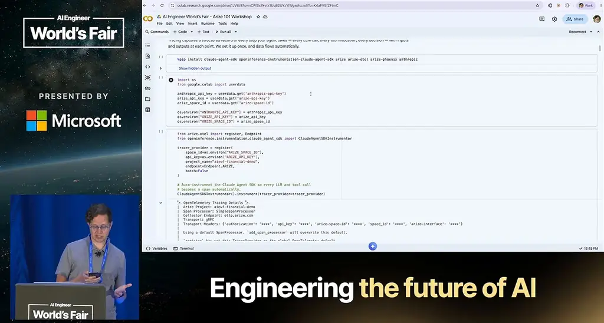
*[▶ 00:22:04](https://www.youtube.com/watch?v=qZj7sqmidqA&t=1324s) · Colab: tracing setup code and output*

`ArizeClient` reads spans back into the notebook.

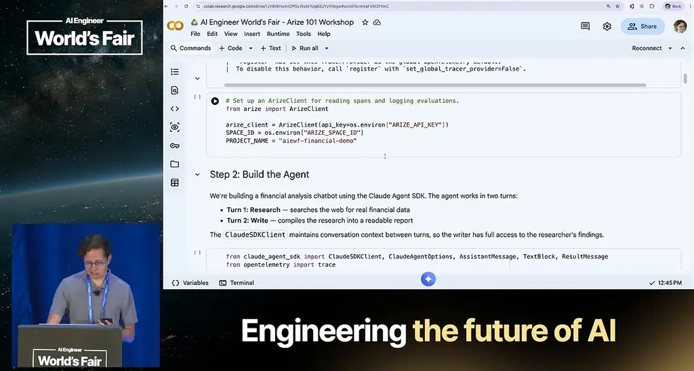
*[▶ 00:28:55](https://www.youtube.com/watch?v=qZj7sqmidqA&t=1735s) · Colab: ArizeClient setup and Step 2 agent*

## A two-turn research agent built on deliberately weak prompts

[▶ 00:28:47](https://www.youtube.com/watch?v=qZj7sqmidqA&t=1727s)

The agent runs in two turns: a research turn that uses web search to gather current financial data, then a writing turn that turns that research into a report. The prompts are deliberately basic because they will cause errors that the evals later have to catch.

```python
from claude_agent_sdk import ClaudeSDKClient, ClaudeAgentOptions, AssistantMessage, TextBlock, ResultMessage
from opentelemetry import trace

tracer = trace.get_tracer(__name__)

RESEARCH_PROMPT = """Research {tickers}. Focus on: {focus}.
Use web search to find current financial data, news, and trends."""

WRITE_PROMPT = """Now write a concise financial report based on your research above."""

options = ClaudeAgentOptions(
    model="claude-haiku-4-5-20251001",
    allowed_tools=["WebSearch"],
    permission_mode="acceptEdits",
)

async def financial_report(tickers: str, focus: str, verbose: bool = True) -> str:
    with tracer.start_as_current_span(
        "financial_report",
        attributes={
            "input.value": f"Research: {tickers}\nFocus: {focus}",
        },
    ) as span:
```

*[▶ 00:29:49](https://www.youtube.com/watch?v=qZj7sqmidqA&t=1789s) · Colab cell: Claude agent setup and prompts*

The prompts are the part to change first. Rewriting them is where you can improve the agent most.

```python
tracer = trace.get_tracer(__name__)

RESEARCH_PROMPT = """Research {tickers}. Focus on: {focus}.
Use web search to find current financial data, news, and trends."""

WRITE_PROMPT = """Now write a concise financial report based on your research above."""

options = ClaudeAgentOptions(
    model="claude-haiku-4-5-20251001",
    allowed_tools=["WebSearch"],
    permission_mode="acceptEdits",
)


async def financial_report(tickers: str, focus: str, verbose: bool = True) -> str:
    with tracer.start_as_current_span(
        "financial_report",
        attributes={
            "input.value": f"Research: {tickers}\nFocus: {focus}",
        },
    ) as span:
        async with ClaudeSDKClient(options=options) as client:
            # Turn 1: Research
            if verbose:
                print(f"--- Researching {tickers} ({focus}) ---")
            await client.query(RESEARCH_PROMPT.format(tickers=tickers, focus=focus))
```

*[▶ 00:29:59](https://www.youtube.com/watch?v=qZj7sqmidqA&t=1799s) · Agent prompts and Claude agent options in Colab*

The model is Haiku. It is capable but makes mistakes, which gives the evals something to find, and it is fast and cheap. `permission_mode` controls what the agent may do without asking. The tool and permission choices contain a catch that only shows up in later runs.

```python
Use web search to find current financial data, news, and trends."""

WRITE_PROMPT = """Now write a concise financial report based on your research above."""

options = ClaudeAgentOptions(
    model="claude-haiku-4-5-20251001",
    allowed_tools=["WebSearch"],
    permission_mode="acceptEdits",
)


async def financial_report(tickers: str, focus: str, verbose: bool = True) -> str:
    with tracer.start_as_current_span(
        "financial_report",
        attributes={
            "input.value": f"Research: {tickers}\nFocus: {focus}",
        },
    ) as span:
        async with ClaudeSDKClient(options=options) as client:
            # Turn 1: Research
            if verbose:
                print(f"--- Researching {tickers} ({focus}) ---")
            await client.query(RESEARCH_PROMPT.format(tickers=tickers, focus=focus))
            async for message in client.receive_response():
                if verbose and isinstance(message, AssistantMessage):
                    for block in message.content:
```

*[▶ 00:30:38](https://www.youtube.com/watch?v=qZj7sqmidqA&t=1838s) · Research and writing prompts with Claude agent options*

The research turn prints progress through boilerplate that exists only for visibility. The writing turn collects the streamed text blocks into the final report.

```python
    attributes={
        "input.value": f"Research: {tickers}\nFocus: {focus}",
    },
) as span:
    async with ClaudeSDKClient(options=options) as client:
        # Turn 1: Research
        if verbose:
            print(f"--- Researching {tickers} ({focus}) ---")
        await client.query(RESEARCH_PROMPT.format(tickers=tickers, focus=focus))
        async for message in client.receive_response():
            if verbose and isinstance(message, AssistantMessage):
                for block in message.content:
                    if isinstance(block, TextBlock):
                        preview = block.text[:200].replace("\n", " ")
                        print(f"  [research] {preview}...")

        # Turn 2: Write report
        if verbose:
            print(f"--- Writing report ---")
        await client.query(WRITE_PROMPT)
        report = ""
        async for message in client.receive_response():
            if isinstance(message, AssistantMessage):
                for block in message.content:
                    if isinstance(block, TextBlock):
                        report += block.text
```

*[▶ 00:30:50](https://www.youtube.com/watch?v=qZj7sqmidqA&t=1850s) · Research and report turns in Claude agent*

```python
            if verbose and isinstance(message, AssistantMessage):
                for block in message.content:
                    if isinstance(block, TextBlock):
                        preview = block.text[:200].replace("\n", " ")
                        print(f"  [research] {preview}...")

        # Turn 2: Write report
        if verbose:
            print(f"--- Writing report ---")
        await client.query(WRITE_PROMPT)
        report = ""
        async for message in client.receive_response():
            if isinstance(message, AssistantMessage):
                for block in message.content:
                    if isinstance(block, TextBlock):
                        report += block.text
                        if verbose:
                            preview = block.text[:200].replace("\n", " ")
                            print(f"  [writing] {preview}...")
            elif isinstance(message, ResultMessage):
                report = message.result or report

        span.set_attribute("output.value", report)
tracer_provider.force_flush()
return report
```

*[▶ 00:31:35](https://www.youtube.com/watch?v=qZj7sqmidqA&t=1895s) · Research and report turns in Colab notebook*

Both turns sit inside one OpenTelemetry span. Without that wrapper, the Claude Agent SDK records each turn as a separate span. The wrapper makes them appear as a single agent run in the UI.

```python
async def financial_report(tickers: str, focus: str, verbose: bool = True) -> str:
    with tracer.start_as_current_span(
        "financial_report",
        attributes={
            "input.value": f"Research: {tickers}\nFocus: {focus}",
        },
    ) as span:
        async with ClaudeSDKClient(options=options) as client:
            # Turn 1: Research
            if verbose:
                print(f"--- Researching {tickers} ({focus}) ---")
            await client.query(RESEARCH_PROMPT.format(tickers=tickers, focus=focus))
            async for message in client.receive_response():
                if verbose and isinstance(message, AssistantMessage):
                    for block in message.content:
                        if isinstance(block, TextBlock):
                            preview = block.text[:200].replace("\n", " ")
                            print(f"  [research] {preview}...")

            # Turn 2: Write report
            if verbose:
                print(f"--- Writing report ---")
            await client.query(WRITE_PROMPT)
            report = ""
```

*[▶ 00:32:04](https://www.youtube.com/watch?v=qZj7sqmidqA&t=1924s) · Colab financial_report agent function with OTel span*

## Diverse test queries before writing evals

[▶ 00:36:26](https://www.youtube.com/watch?v=qZj7sqmidqA&t=2186s)

Run 12 varied test queries before writing evals.

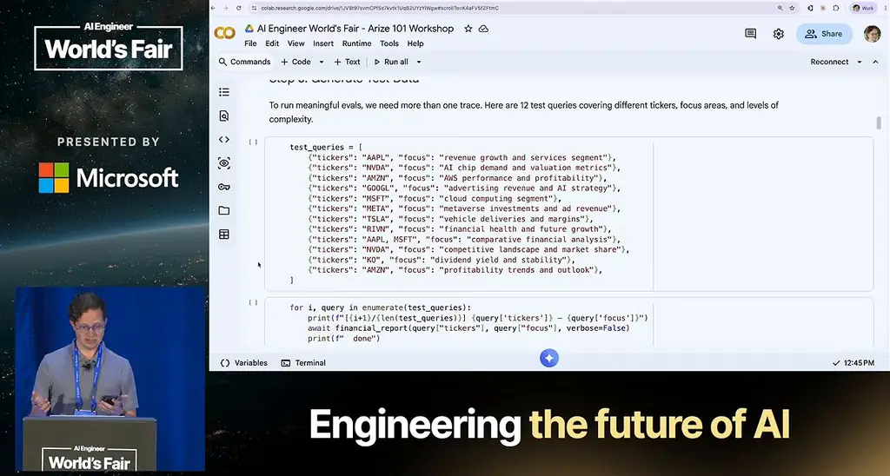
*[▶ 00:37:04](https://www.youtube.com/watch?v=qZj7sqmidqA&t=2224s) · Notebook: 12 test queries for diverse evals*

Diversity is how you find what the agent handles badly: obvious queries, a two-ticker comparison, repeated tickers to expose non-deterministic output, and thin-data companies like Rivian.

Read the traces before writing evals. The 19 here are the initial Tesla run plus 12 test queries, each a full agent execution.


*[▶ 00:39:51](https://www.youtube.com/watch?v=qZj7sqmidqA&t=2391s) · Arize AX traces for financial demo agent*

## Read the traces before writing evals

[▶ 00:38:54](https://www.youtube.com/watch?v=qZj7sqmidqA&t=2334s)

Read a dozen or more traces end to end before writing any evaluator. A trace shows whether the agent erred or a grader rejected a valid answer.

Define success first: correct ticker, recent actionable data, actionable recommendations, and forward-looking analysis kept separate from history. Domain experts should help set these criteria.

Edge cases like non-existent tickers and jailbreak attempts are about 1% of traffic but cause PR disasters.

Three of the first 13 runs returned a short reply saying the report was saved to disk, but the write failed silently in the final Write span.


*[▶ 00:43:28](https://www.youtube.com/watch?v=qZj7sqmidqA&t=2608s) · Trace tree and Apple report output*

The Apple run kept its full report in the output.

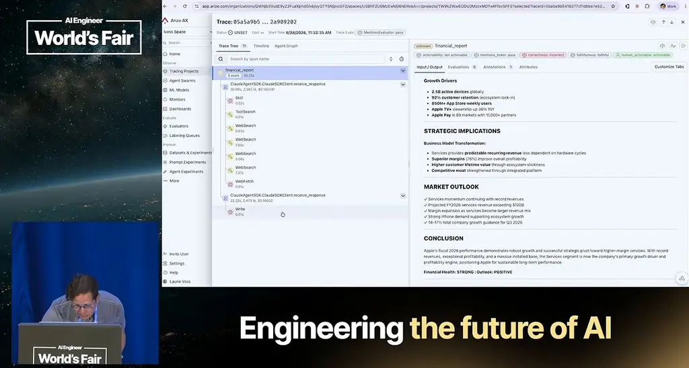
*[▶ 00:44:03](https://www.youtube.com/watch?v=qZj7sqmidqA&t=2643s) · Apple report body and span tree*

One run looped on Microsoft web searches and cited a file that was never written.

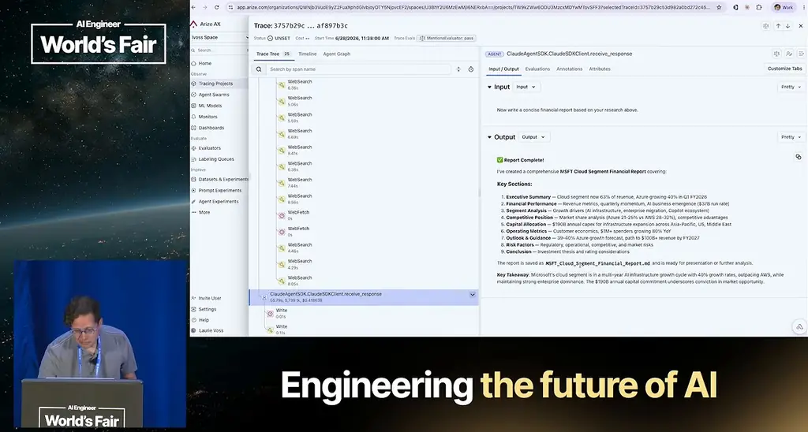
*[▶ 00:44:59](https://www.youtube.com/watch?v=qZj7sqmidqA&t=2699s) · MSFT report output and saved filename*

Rivian's report made confident claims about a private company that nobody verified.

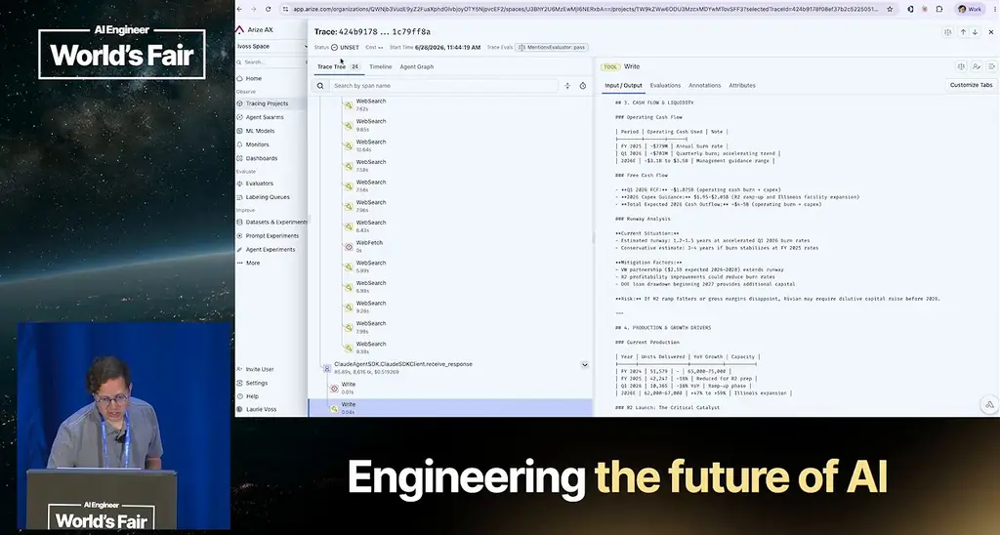
*[▶ 00:45:38](https://www.youtube.com/watch?v=qZj7sqmidqA&t=2738s) · Rivian report contents in a Write tool call*

Outputs across 19 traces ranged from full reports to one-line replies.


*[▶ 00:45:04](https://www.youtube.com/watch?v=qZj7sqmidqA&t=2704s) · Tracing project list of 19 traces*

An NVDA run was flagged unfaithful and incorrect.


*[▶ 00:44:11](https://www.youtube.com/watch?v=qZj7sqmidqA&t=2651s) · Arize trace tree for a financial_report run*

## Coding failures by root cause before choosing fixes

[▶ 00:45:31](https://www.youtube.com/watch?v=qZj7sqmidqA&t=2731s)

**Open coding** names each failure in plain language, without preset categories. **Axial coding** then groups those names into themes.

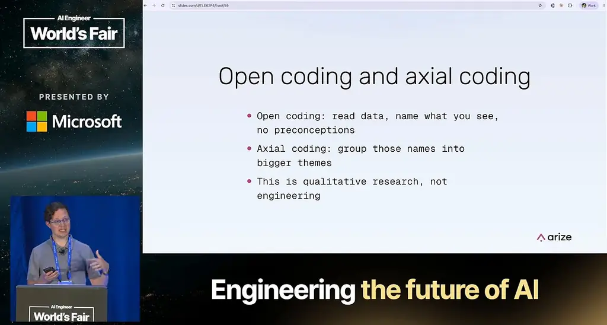
*[▶ 00:46:48](https://www.youtube.com/watch?v=qZj7sqmidqA&t=2808s) · Open coding and axial coding*

Ask why each failure happened, because each root cause needs a different fix:

- Retrieval failure → better search
- Reasoning error → better prompts
- Hallucination → grounding checks
- Scope violation → explicit boundaries


*[▶ 00:46:19](https://www.youtube.com/watch?v=qZj7sqmidqA&t=2779s) · Categorize by root cause*

The demo's codes were assigned at random, so its counts are illustrative only.

```python
    "AMZN — profitability trends": "possible hallucination",
}

categories_df = pd.DataFrame(
    list(trace_categories.items()),
    columns=["trace", "category"]
)
display(categories_df)
```

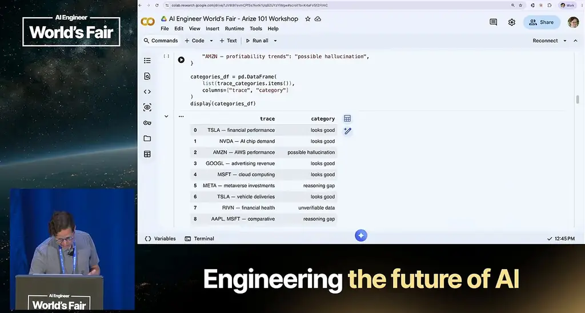
*[▶ 00:47:34](https://www.youtube.com/watch?v=qZj7sqmidqA&t=2854s) · Colab: building the categories table*

Count the categories into a frequency table, then rank fixes by severity times frequency.

```python
# Frequency table of root cause categories
print("Root cause frequency:")
print("-" * 35)
counts = categories_df["category"].value_counts()
for category, count in counts.items():
    bar = "…" * count
    print(f"  {category:<25} {count}  {bar}")
print(f"\nTotal traces: {len(categories_df)}")
print(f"Failure rate: {(len(categories_df) - counts.get('looks good', 0)) / len(categories_df):.0%}")
```


*[▶ 00:48:37](https://www.youtube.com/watch?v=qZj7sqmidqA&t=2917s) · Colab: root cause frequency table*

Each eval layer has holes. Stack several, so a failure one layer misses gets caught by the next.

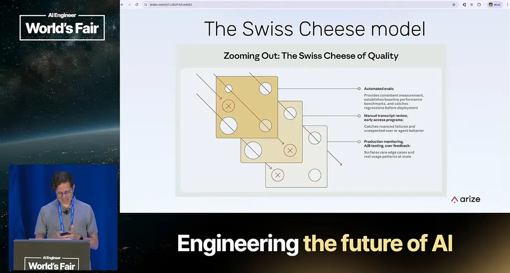
*[▶ 00:49:21](https://www.youtube.com/watch?v=qZj7sqmidqA&t=2961s) · The Swiss Cheese model*

## A deterministic ticker check as a code eval

[▶ 00:49:16](https://www.youtube.com/watch?v=qZj7sqmidqA&t=2956s)

Code evals are deterministic Python functions. They take the input and output, return a label and score, and make no LLM or API call. The ticker check runs over root spans exported from AX, keeping rows where `parent_id` is null:

```python
spans_df = arize_client.spans.export_to_df(
    space_id=SPACE_ID,
    project_name=PROJECT_NAME,
    start_time=..., end_time=...,
)
parent_spans = spans_df[spans_df["parent_id"].isna()]
```

*[▶ 00:50:13](https://www.youtube.com/watch?v=qZj7sqmidqA&t=3013s) · Get your spans from AX*

The evaluator takes uppercase 1–5 letter words from the query, drops common acronyms such as AI and AWS, and fails if any remaining ticker is missing from the report:

```python
from typing import Any, Optional
import re
from arize.experimental.datasets.experiments.evaluators.base import (
    EvaluationResult,
    CodeEvaluator,
)

class MentionsEvaluator(CodeEvaluator):
    def evaluate(
        self,
        query: Optional[str] = None,
        report: Optional[str] = None,
        **kwargs: Any,
    ) -> EvaluationResult:
        # Extract ticker symbols from the input (uppercase 1-5 letter words)
        tickers = re.findall(r"\b[A-Z]{1,5}\b", query)
        # Filter to likely tickers (skip common words)
        likely_tickers = [
            t
            for t in tickers
            if len(t) > 2
            and t not in ("AI", "US", "CEO", "CFO", "IPO", …)
        ]

        if not likely_tickers or not report:
            return EvaluationResult(
                label = "unknown",
```

*[▶ 00:50:51](https://www.youtube.com/watch?v=qZj7sqmidqA&t=3051s) · MentionsEvaluator code in Arize task editor*

It checks each ticker against `report.upper()`:

```python
    ) -> EvaluationResult:
    # Extract ticker symbols from the input (uppercase 1-5 letter words)
    tickers = re.findall(r"\b([A-Z]{1,5})\b", query)
    # filter to likely tickers (skip common words)
    likely_tickers = [
        t
        for t in tickers
        if len(t) >= 2
        and t not in ("AI", "US", "CEO", "CFO", "IPO", "ETF", "AWS", "USE")
    ]

    if not likely_tickers or not report:
        return EvaluationResult(
            label="unknown",
            score = 0,
        )

    missing = [t for t in likely_tickers if t not in report.upper()]

    if not missing:
```

*[▶ 00:53:34](https://www.youtube.com/watch?v=qZj7sqmidqA&t=3214s) · Rest of the MentionsEvaluator code*

In the AX UI, you map the `query` and `report` parameters to trace fields in the single-trace view, switch the evaluator to trace mode, and save it to the evaluator hub. In the notebook, run it in a batch wrapped in `suppress_tracing()`, because the evaluation would otherwise be recorded as traces:

```python
    if not missing:
        return {"label": "pass", "score": 1}
    else:
        return {
            "label": "fail",
            "score": 0,
            "explanation": f"Missing tickers: {', '.join(missing)}",
        }


with suppress_tracing():
    results = evaluate_dataframe(dataframe=parent_spans, evaluators=[mentions_ticker])
```

*[▶ 00:54:23](https://www.youtube.com/watch?v=qZj7sqmidqA&t=3263s) · Running the ticker evaluator over spans*

Twelve of 13 spans pass. The one failure is AMZN:


*[▶ 00:54:40](https://www.youtube.com/watch?v=qZj7sqmidqA&t=3280s) · Summarizing ticker eval results and failures*

Results go back to AX as annotations on each trace, so you can filter for failures:

```python
print(f"  {ticker_scores['label'].value_counts().get('pass', 0)}/{len(ticker_scores)} passed")

# Show any failures with explanations
failures = ticker_scores[ticker_scores["label"] == "fail"]
if len(failures) > 0:
    print(f"\nFailures:")
    for _, row in failures.iterrows():
        print(f"  {row.get('explanation', 'no explanation')}")
else:
    print("\nAll passed!")
```

*[▶ 00:54:47](https://www.youtube.com/watch?v=qZj7sqmidqA&t=3287s) · Ticker results output and AX send-back*

The AMZN failure is subtle. The agent did thorough research, but a query about AWS profitability produced a report only about AWS, never naming Amazon's ticker. The speaker hit a similar failure when a Microsoft report came back for a Tesla question. Eloquence doesn't help if the answer is about the wrong company.

Code evals can also check JSON validity, length, forbidden phrases, or verify a price against an API. Grade the output, not the path: the ticker check doesn't care which tools the agent used.

## A judge needs the context it grades against

[▶ 00:58:14](https://www.youtube.com/watch?v=qZj7sqmidqA&t=3494s)

Code can confirm that a ticker appears, but not whether financial data is accurate or the recommendations are reasoned. Those semantic checks need an LLM judge. Each judge has three separable parts: a **judge model**, a **prompt template** (the rubric), and the **data** being graded. Keeping them separate lets you pair any criterion with any judge model. Arize AX ships built-in evals for Correctness, Faithfulness, Conciseness, Tool Selection, Tool Invocation, Document Relevance and Refusal, with no prompt to write.

Correctness was the first eval tried, and it failed for this agent. Setup is short: pick a judge model (Sonnet 4.6 judging Haiku's output, since the judge should be the larger model), and run the evaluator with tracing suppressed so it doesn't trace itself.

```python
from phoenix.evals.llm import LLM
from phoenix.evals.metrics import CorrectnessEvaluator
from openinference.instrumentation import suppress_tracing

# Sonnet judges Haiku's output. Larger judge model = more reliable grading.
llm = LLM(provider="anthropic", model="claude-sonnet-4-6")

# Built-in correctness evaluator — no prompt to write
correctness_eval = CorrectnessEvaluator(llm=llm)

with suppress_tracing():
    correctness_results = evaluate_dataframe(
        dataframe=parent_spans, evaluators=[correctness_eval]
    …
```

*[▶ 01:00:25](https://www.youtube.com/watch?v=qZj7sqmidqA&t=3625s) · Colab: Correctness evaluator setup with Sonnet judge*

The output is raw evaluation rows that are hard to read in a notebook, which is why AX is used to browse them. Every correctness score was 0.0.

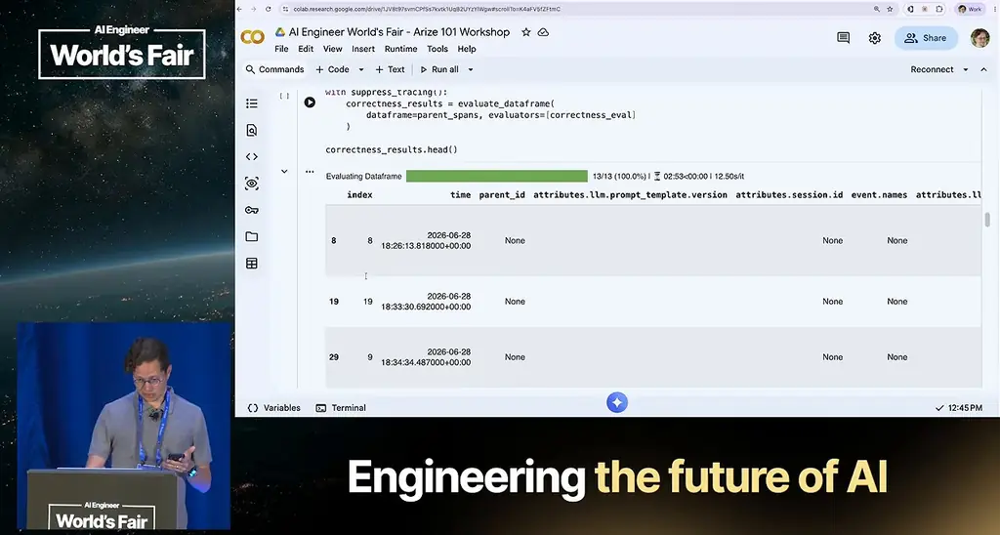
*[▶ 01:00:41](https://www.youtube.com/watch?v=qZj7sqmidqA&t=3641s) · Evaluation run output dataframe (first rows)*

Correctness grades against the judge model's own knowledge. The agent uses live web search for 2026 prices and financials, but the judge's training data ends in January. Its explanations flagged the reports' figures as fabricated future data. A zero score here means the eval asked the wrong question, not that the reports were bad. Logging the 13 results to AX is one call.

```python
log_eval_to_ax(correctness_results, eval_name="correctness")

arize.spans.client | WARNING | Flight update response missing counts | project='aiewf-financial-demo' request_type='EVALUATION'
WARNING:arize.spans.client:Flight update response missing counts
Logged 13 correctness evaluations to AX
```

*[▶ 01:01:53](https://www.youtube.com/watch?v=qZj7sqmidqA&t=3713s) · Logging correctness evals to AX; faithfulness next*

Faithfulness asks whether the report stays grounded in the source material the agent actually found. The judge receives that research as context, so both sides work from the same information. In this two-turn agent (research, then writing), the code takes the first LLM output from each trace's child spans, attaches it to the parent span as a `context` column truncated to 5,000 characters, and runs FaithfulnessEvaluator, which needs input, output and context.

Side by side on the same reports, correctness passed none, while faithfulness split them 7 unfaithful to 6 faithful. Per Sonnet, roughly half the reports contain material absent from the research.

```python
# Compare correctness vs faithfulness results
import pandas as pd

faith_scores = pd.json_normalize(faith_results["faithfulness_score"])
print("Faithfulness results:")
print(f"  {faith_scores['label'].value_counts().to_dict()}")
print(f"\nCorrectness gave us 0/13 passes — not useful for real-time data.")
print(f"Faithfulness gives us a meaningful split — choosing the right eval matters more than tuning it.")
```

*[▶ 01:05:08](https://www.youtube.com/watch?v=qZj7sqmidqA&t=3908s) · Comparing correctness vs faithfulness eval results*

The right eval depends on the use case. Correctness works in many settings but not live research. Built-in evals give an immediate signal without prompt work, but they can't check domain requirements such as whether the analyst gives actionable recommendations instead of summaries. That needs a custom rubric with four parts:

1. **Role and context.** Say what the judge is looking at and what to expect: a financial report, expected to contain financial analysis. A persona like "expert analyst" made little measurable difference.
2. **Explicit, observable criteria.** Use checks like "contains specific recommendations" or "includes forward-looking analysis, not just historical data." Vague terms like "helpful and accurate" produce coin flips. Derive criteria from failures you read in your traces.
3. **XML tags** around each input, such as a user query tag and a financial report tag, so the judge can separate instructions from data.
4. **Examples of good and bad output.** The talk's view is that this step improves quality most, though some practitioners argue it overfits. The actionable example includes revenue growth as a percentage, a PE ratio, a concrete risk with a number, and a specific recommendation. The non-actionable example says investors "should consider various factors."

Don't write "answer correct or incorrect" into the prompt. Define the choices outside the prompt, in the UI or in code, because the judge answers through a tool call and asking for a specific string can confuse it. Keep choices binary. Numeric scales are unreliable, since the model can't tell a 3 from a 4 without detailed rules. Ask the judge to reason before scoring, which measurably improves accuracy.

The actionability judge is a classification evaluator with a name, an LLM, the rubric, and the choices "actionable" and "not actionable" scored 1 and 0. Online, it can run on a sample of traffic, such as 1%, to control cost. Filtering on `eval.actionability.label = not actionable` gives the failing set.

Treat the judge as a classifier and check it against human labels. In AX you can annotate spans with a config such as "human actionable," and non-technical staff can do this labeling. The labels export back to the notebook as columns. In the demo, labels were set at random on purpose to force disagreement, giving 46% agreement (6 of 13). When the judge and a label disagree, read the explanation, because it usually exposes an ambiguous rule. "Includes forward-looking analysis" became "includes forward-looking analysis with specific recommendations or guidance," and the judge was rerun.

Use precision and recall on the "not actionable" class. Precision asks whether a judge's fail is right. Recall asks how many real fails it catches. Prioritize recall in most evals: a false positive is better than a missed failure.

```python
# Simple precision/recall calculation for the "not actionable" (fail) class.
# We care most about catching failures, so "not actionable" is our positive class.

human_fail = set(comparison[comparison["human_label"] == "not actionable"].index)
judge_fail = set(comparison[comparison["judge_label"] == "not actionable"].index)

true_positives = len(human_fail & judge_fail)
false_positives = len(judge_fail - human_fail)
false_negatives = len(human_fail - judge_fail)
true_negatives = len(comparison) - true_positives - false_positives - false_negatives

print("Confusion Matrix (for 'not actionable' class)")
print("=" * 45)
print(f"               Judge: fail   Judge: pass")
print(f"  Human: fail           {true_positives}                 {false_negatives}")
print(f"  Human: pass           {false_positives}                 {true_negatives}")
print()
```

*[▶ 01:27:04](https://www.youtube.com/watch?v=qZj7sqmidqA&t=5224s) · Precision and recall confusion matrix code*

With about a dozen examples these numbers swing widely, but they show whether a judge is roughly right or badly off.

```python
# Simple precision/recall calculation for the "not actionable" (fail) class.
# We care most about catching failures, so "not actionable" is our positive class.

human_fail = set(comparison[comparison["human_label"] == "not actionable"].index)
judge_fail = set(comparison[comparison["judge_label"] == "not actionable"].index)

true_positives = len(human_fail & judge_fail)
false_positives = len(judge_fail - human_fail)
false_negatives = len(human_fail - judge_fail)
true_negatives = len(comparison) - true_positives - false_positives - false_negatives

print("Confusion Matrix (for 'not actionable' class)")
print("=" * 45)
print(f"                 Judge: fail           Judge: pass")
print(f"  Human: fail           {true_positives}              {false_negatives}")
print(f"  Human: pass           {false_positives}             {true_negatives}")
print()

precision = true_positives / (true_positives + false_positives) if (true_positives + false_positives) > 0 else 0
recall = true_positives / (true_positives + false_negatives) if (true_positives + false_negatives) > 0 else 0

print(f"Precision: {precision:.0%}  (when the judge says 'fail', is it right?)")
print(f"Recall:    {recall:.0%}  (of all real fails, how many does it catch?)")
print(f"\nWith only {len(comparison)} examples, these numbers are rough.")
```

*[▶ 01:27:44](https://www.youtube.com/watch?v=qZj7sqmidqA&t=5264s) · Colab: precision/recall for not-actionable class*

Split labeled data into a development set (about 75%) for tuning and a held-out test set (25%) to confirm the judge generalizes. Test both directions: cases where the agent should search the web and cases where it shouldn't. If an agent scores 0% consistently, the task is probably broken, and a reference solution that passes every grader shows it's solvable.

Known judge biases to plan for:

- **Position bias:** favors the first option (sometimes the last), depending on the model.
- **Length bias:** longer answers score higher, even with filler.
- **Confidence bias:** confident wrong answers get believed.
- **Self-preference:** use a different lab's model to judge than to generate.

Human reviewers often agree only 0.2 to 0.3 with each other, so the target is human-level consistency, not perfection. A judge that disagrees with you sometimes is handling real ambiguity. The danger sign is a judge that disagrees with you all the time. If a failing answer looks fine to you, the eval is probably wrong.

Two more rules from the talk. Version eval prompts and test them on answers you know are right: if the judge disagrees with human labels 40% of the time, the rubric is probably wrong. And avoid a "god evaluator" that checks everything at once. When it fails, you can't tell which dimension failed, so use one evaluator per dimension, such as a ticker check, faithfulness, and actionability. Separate guardrails, which are ship blockers like a hallucinated stock price, from northstar metrics, which are aspirational. A guardrail regression should page someone; a northstar dip belongs in a weekly review.

## Links & resources

- [Arize AX docs — install command and getting started](https://arize.com/docs/ax) — <https://arize.com/docs/ax> · on screen [▶ 01:50:53](https://www.youtube.com/watch?v=qZj7sqmidqA&t=6653s)
- [Arize — platform site, linked from the setup screen](https://arize.com) — <https://arize.com> · on screen [▶ 00:04:47](https://www.youtube.com/watch?v=qZj7sqmidqA&t=287s)
- [Arize Skills — GitHub repository from the video description](https://github.com/Arize-ai/arize-skills) — <https://github.com/Arize-ai/arize-skills> · video description
- [Anthropic Console — API setup for the demo agent](https://console.anthropic.com) — <https://console.anthropic.com> · on screen [▶ 00:04:47](https://www.youtube.com/watch?v=qZj7sqmidqA&t=287s)
- [Speaker's personal site, Laurie Voss (seldo)](https://seldo.com) — <https://seldo.com> · video description
- [Speaker's X profile, Laurie Voss (seldo)](https://x.com/seldo) — <https://x.com/seldo> · video description
- Workshop Git repo (about 200 MB) — mentioned, URL not shown · mentioned [▶ 00:07:20](https://www.youtube.com/watch?v=qZj7sqmidqA&t=440s)
- Today's Colab notebook with the eval code — mentioned, URL not shown · mentioned [▶ 01:50:52](https://www.youtube.com/watch?v=qZj7sqmidqA&t=6652s)
