# Stanford CME295 Transformers & LLMs | Autumn 2026 | Lecture 1 - Transformers

*How tokenization, word embeddings, RNNs, and self-attention lead to the Transformer, with a full walkthrough of one sentence through the model.*

Source: [Stanford CME295 Transformers & LLMs | Autumn 2026 | Lecture 1 - Transformers](https://www.youtube.com/watch?v=114i2Kz-LZA) · Afshine Amidi and Shervine Amidi · Stanford Online · 1 h 44 min

## TL;DR

Modern LLMs are built on the Transformer, which replaced recurrent models with self-attention so every token can interact directly with every other token. Before that, models needed a separate design per task, and RNNs struggled with long-range dependencies and sequential training. The Transformer's core is the attention formula softmax(QKᵀ/√d_k)V, plus positional encodings that restore word order. Understanding this architecture is the foundation for the rest of the course, which covers training, applications, and limitations of LLMs.

## Key takeaways

- Tokenization splits text into tokens; subword methods such as BPE are the most popular because they share word roots and keep sequences shorter than character-level tokenization.
- Word2vec learns token embeddings through a proxy task: CBOW predicts a word from its context, while Skip-gram predicts the surrounding words from a given word.
- Word2vec gives each word one fixed vector, so it ignores context (as with 'bank') and word order.
- RNNs carry a hidden state across tokens, but they struggle with long-range dependencies and must process tokens sequentially, which makes training slow.
- In self-attention, each token's query is compared with every token's key, and the output is a weighted average of the values, computed for all tokens at once with softmax(QKᵀ/√d_k)V.
- Positional encodings are added to token embeddings because self-attention alone loses word order; fixed sinusoidal encodings can extend beyond the training sequence length, unlike learned positions.
- The encoder produces one context-aware representation per token, while the decoder generates one token at a time using masked self-attention and cross-attention to the encoder output, until it emits [EOS].
- Most of the Transformer's parameters sit in the feed-forward layers, while attention is the core mechanism; residual connections, layer normalization, and dropout stabilize training.

## What the course covers and who it suits

[▶ 00:00:00](https://www.youtube.com/watch?v=114i2Kz-LZA&t=0s)

The course explains how LLMs work, centered on the Transformer, and how they are trained, applied, and where they fall short.

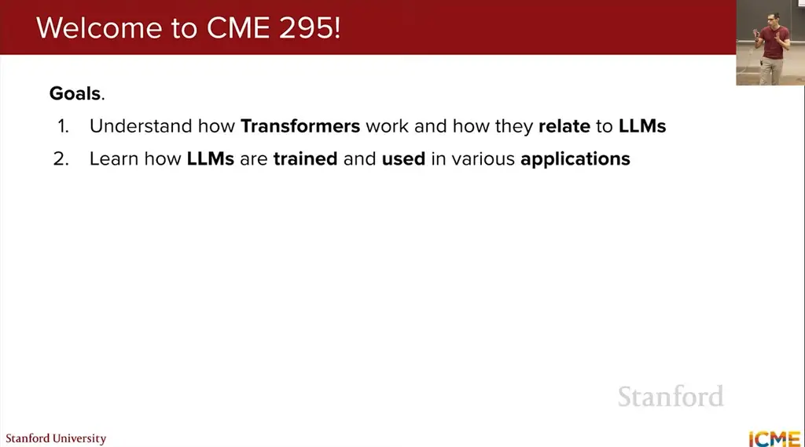
*[▶ 00:01:48](https://www.youtube.com/watch?v=114i2Kz-LZA&t=108s) · Welcome to CME 295! Goals*

Three groups fit:

- Researchers who want a broad view of techniques and applications.
- Builders of personal projects, since coding agents are everywhere and their limits matter.
- Anyone seeking AI literacy.

Prerequisites: linear algebra (matrices, multiplication) and basic ML, such as loss functions and neural networks.

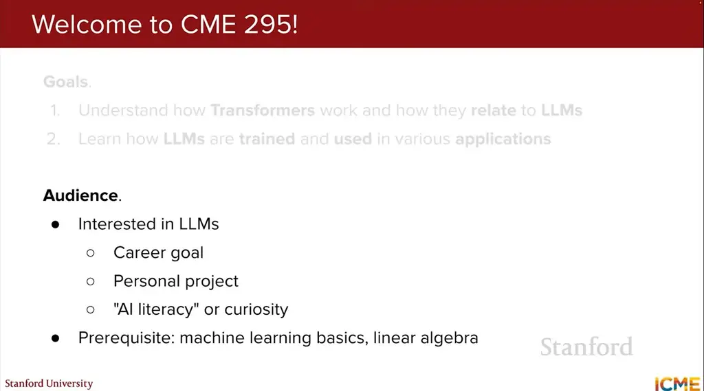
*[▶ 00:02:19](https://www.youtube.com/watch?v=114i2Kz-LZA&t=139s) · Audience and prerequisites*

## Why this year's course differs from the recording

[▶ 00:03:43](https://www.youtube.com/watch?v=114i2Kz-LZA&t=223s)

Last year's lectures were recorded, but the field has moved fast, so the course now adds recent advances: post-training (such as on-policy distillation), AI agents (such as coding agents), and diffusion LLMs, which depart from predicting tokens one at a time.

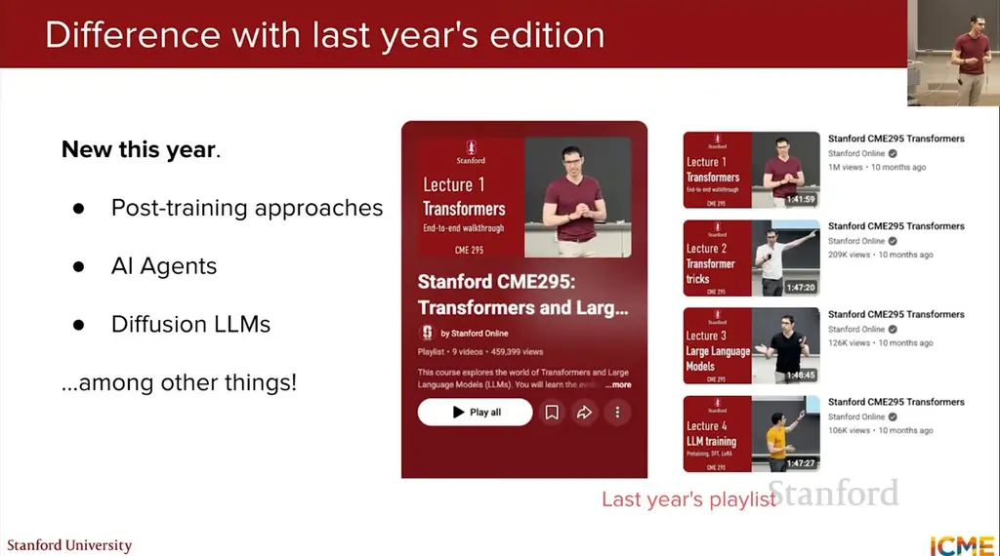
*[▶ 00:04:59](https://www.youtube.com/watch?v=114i2Kz-LZA&t=299s) · Difference with last year's edition*

For exam preparation, use this year's lectures, which differ substantially from last year's playlist.

## Format, exams, and study materials

[▶ 00:05:01](https://www.youtube.com/watch?v=114i2Kz-LZA&t=301s)

The class meets Fridays from 3:30 to 5:20pm for 2 units, graded as a letter or Credit/No credit. Lectures are recorded and posted within two days, and there are no homeworks.

Two exams each count for 50%. The midterm on October 23 covers the first four lectures, and the final on December 9 covers the last five. Past exams are on the [class website](https://cme295.stanford.edu), and anything said in class can appear on the exam.

*[▶ 00:05:55](https://www.youtube.com/watch?v=114i2Kz-LZA&t=355s) · Logistics: class details and exams*

Slides are posted the day before each lecture, so you can annotate them. The textbook is *Super Study Guide: Transformers & Large Language Models*.

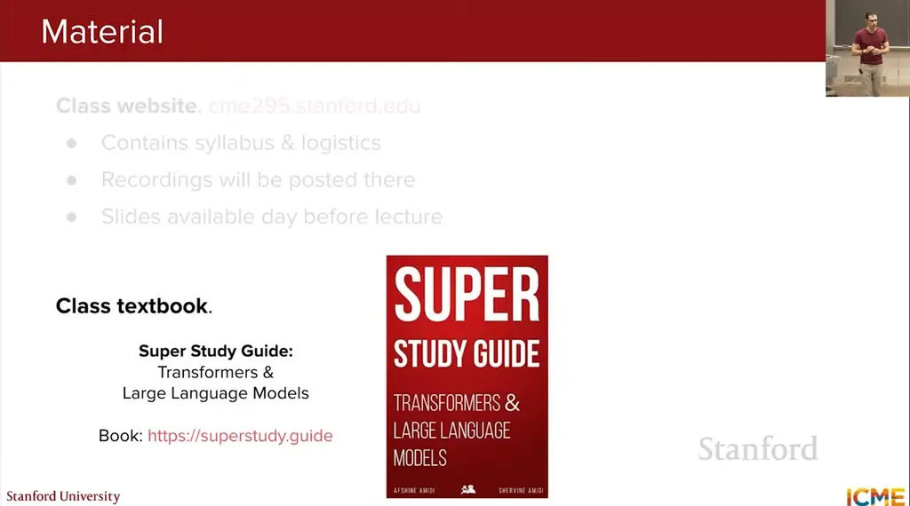
*[▶ 00:08:15](https://www.youtube.com/watch?v=114i2Kz-LZA&t=495s) · Material: class website and textbook*

The [VIP Cheatsheet](https://github.com/afshinea/stanford-cme-295-transformers-large-language-models) covers the whole course concisely, which makes it a good review before each exam.

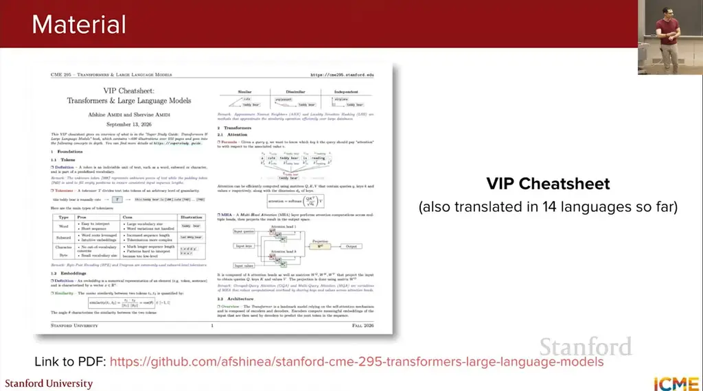
*[▶ 00:09:18](https://www.youtube.com/watch?v=114i2Kz-LZA&t=558s) · Material: VIP Cheatsheet and PDF link*

Each slide lists its source at the bottom for deeper reading.

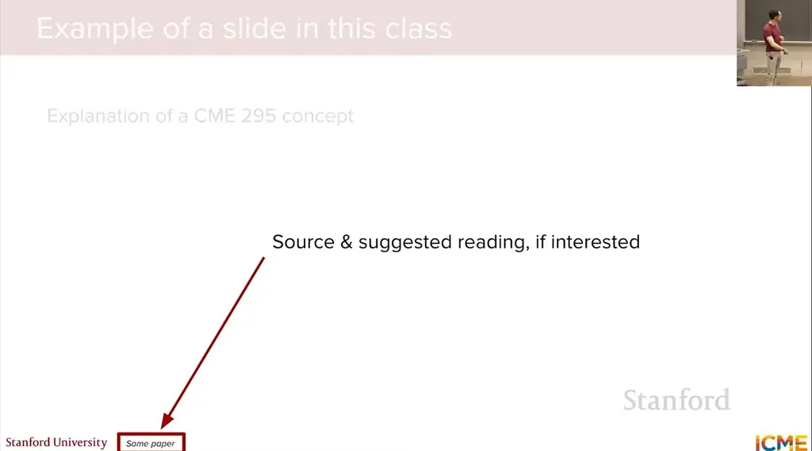
*[▶ 00:09:44](https://www.youtube.com/watch?v=114i2Kz-LZA&t=584s) · Example of a slide in this class*

Expect many abbreviations, which can feel overwhelming at first.

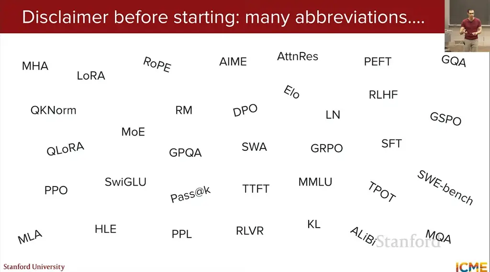
*[▶ 00:12:30](https://www.youtube.com/watch?v=114i2Kz-LZA&t=750s) · Disclaimer before starting: many abbreviations*

They fall into six groups, and by the end of the course you should be able to map each one to its concept.

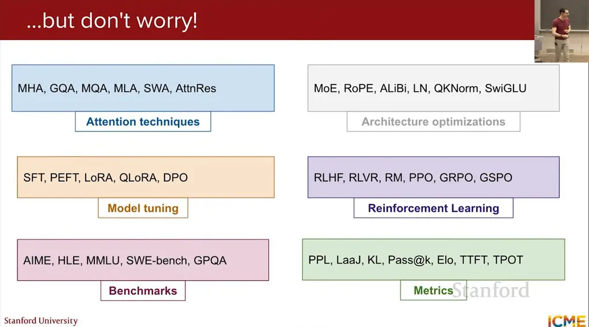
*[▶ 00:12:41](https://www.youtube.com/watch?v=114i2Kz-LZA&t=761s) · ...but don't worry! Abbreviation groups*

## From task-specific models to the Transformer

[▶ 00:12:42](https://www.youtube.com/watch?v=114i2Kz-LZA&t=762s)

In the 2010s, each use case had its own model, usually an RNN, such as for sentiment extraction.

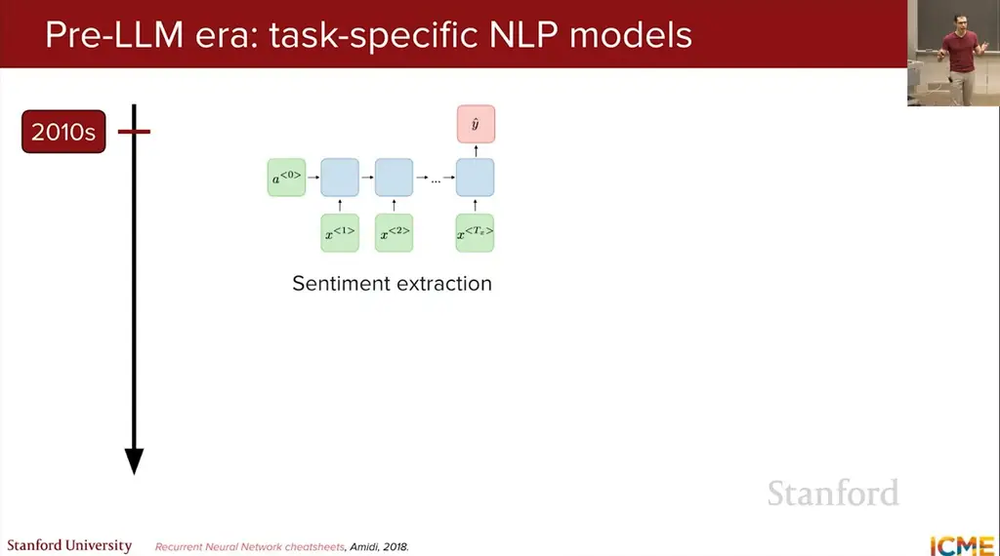
*[▶ 00:12:49](https://www.youtube.com/watch?v=114i2Kz-LZA&t=769s) · Pre-LLM era: task-specific NLP models*

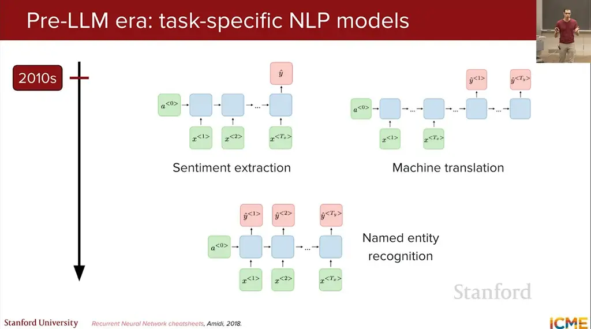
*[▶ 00:13:55](https://www.youtube.com/watch?v=114i2Kz-LZA&t=835s) · Pre-LLM era: task-specific NLP models*

In 2017, the **Transformer** from *Attention Is All You Need* scaled with data, compute and parameters, with far larger gains than before.

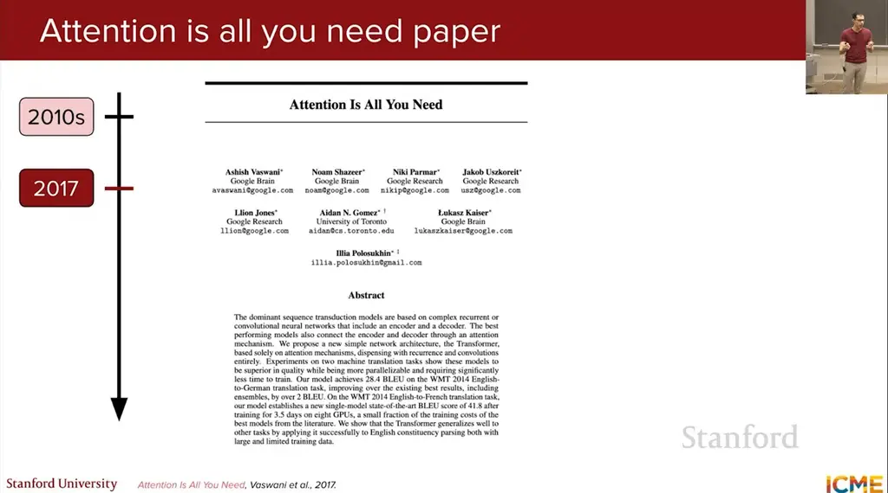
*[▶ 00:14:15](https://www.youtube.com/watch?v=114i2Kz-LZA&t=855s) · Attention Is All You Need paper*

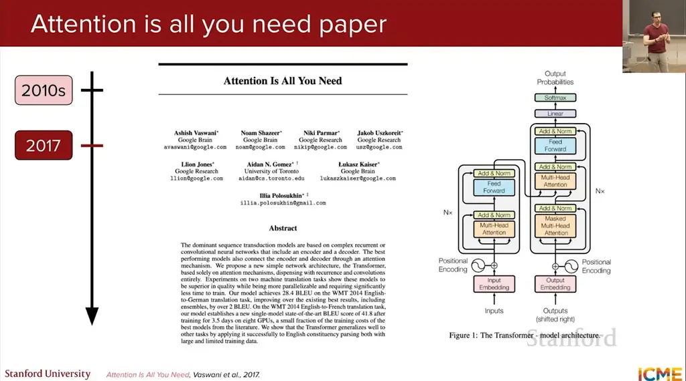
*[▶ 00:14:55](https://www.youtube.com/watch?v=114i2Kz-LZA&t=895s) · Transformer model architecture figure*

Scaling it in model size and training tokens produced modern LLMs.

ChatGPT's November 2022 launch made chat interfaces mainstream.

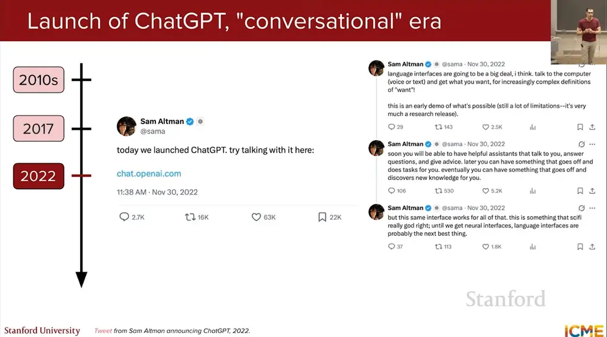
*[▶ 00:15:38](https://www.youtube.com/watch?v=114i2Kz-LZA&t=938s) · Launch of ChatGPT, "conversational" era*

Its launch thread even shipped a typo, "god" for "got".

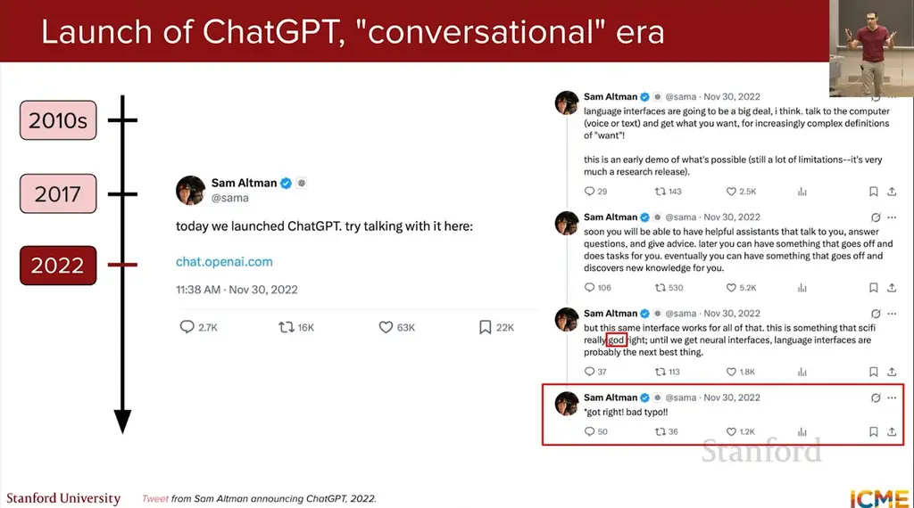
*[▶ 00:16:02](https://www.youtube.com/watch?v=114i2Kz-LZA&t=962s) · Launch tweet with typo correction*

## Tokenization: splitting text into units a model can index

[▶ 00:16:56](https://www.youtube.com/watch?v=114i2Kz-LZA&t=1016s)

Models only process numbers, so text is first split into **tokens**, indivisible units that each map to a vector. The **vocabulary** V lists the tokens the model allows.

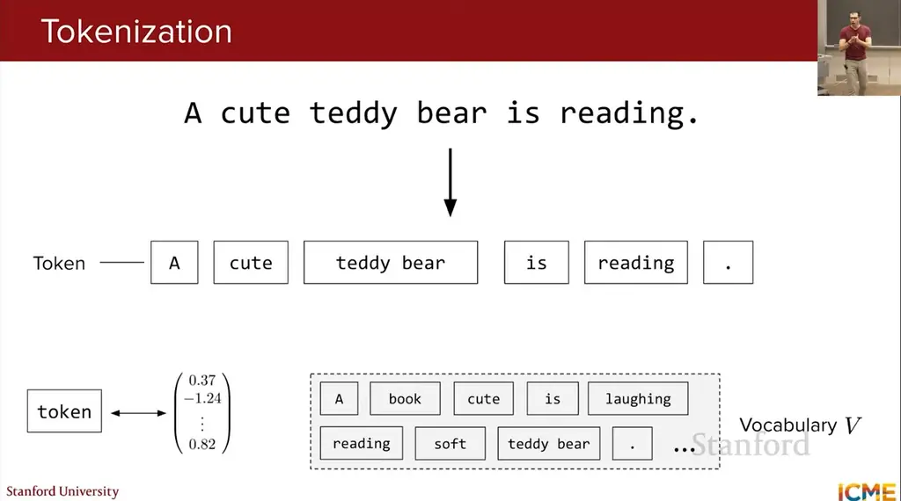
*[▶ 00:18:57](https://www.youtube.com/watch?v=114i2Kz-LZA&t=1137s) · Tokenization: text to tokens and vocabulary*

The tokenizer sets the **sequence length** n, the number of tokens a text becomes. Vocabulary size and sequence length are tightly linked, so this choice matters.

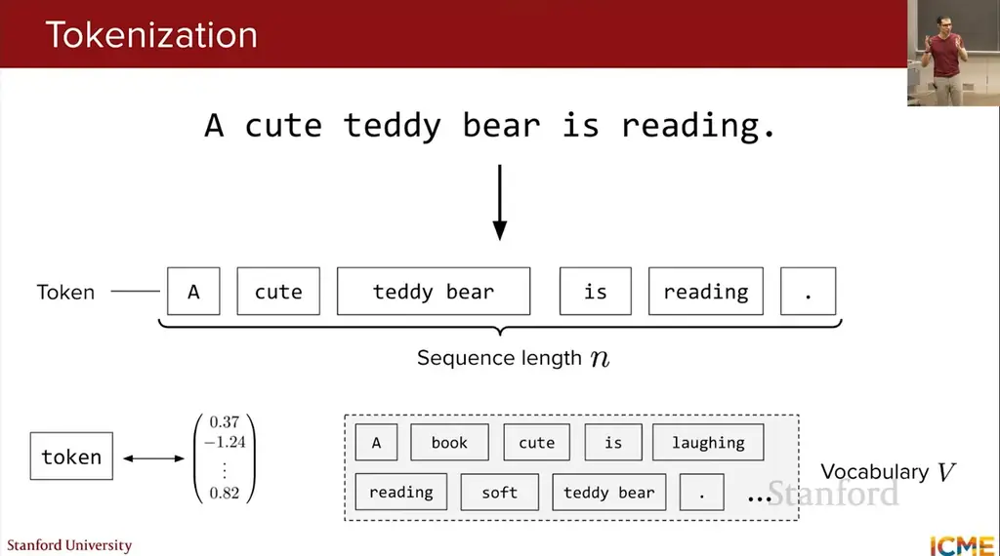
*[▶ 00:19:25](https://www.youtube.com/watch?v=114i2Kz-LZA&t=1165s) · Tokenization: sequence length n*

**Word-level** tokenization splits on spaces. It is simple and interpretable, but:

- The vocabulary grows large, since singular, plural and gendered forms are separate tokens.
- "bear" and "bears" get no guarantee of similar representations, and shared roots are not exploited.
- Words unseen in training become out-of-vocabulary at inference.

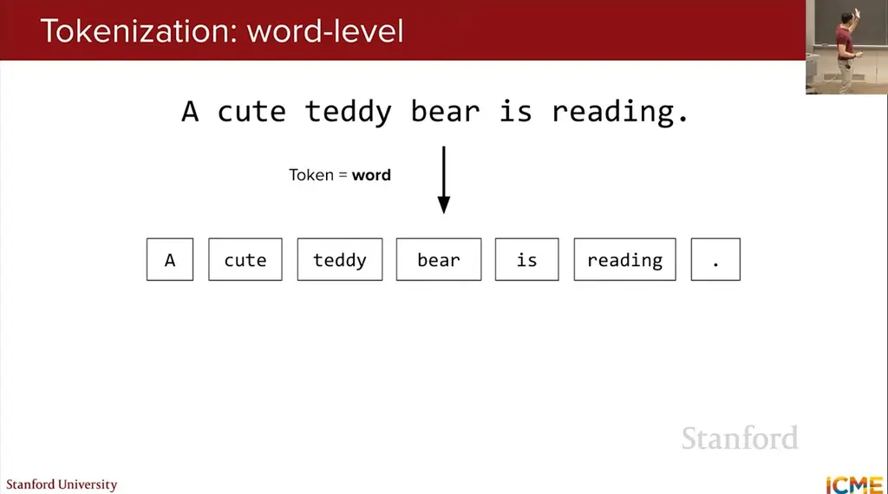
*[▶ 00:20:08](https://www.youtube.com/watch?v=114i2Kz-LZA&t=1208s) · Tokenization: word-level*

Applied to the example sentence, this gives seven tokens, including the period.

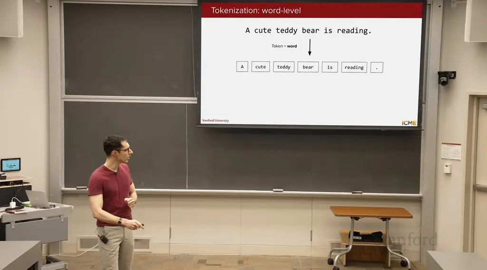
*[▶ 00:20:15](https://www.youtube.com/watch?v=114i2Kz-LZA&t=1215s) · Tokenization: word-level (example)*

**Character-level** tokenization uses single characters. It has a small vocabulary, no out-of-vocabulary risk, and handles casing and misspellings well. The cost is length: sequences get much longer, model complexity grows with sequence length, computation slows, and embeddings are less interpretable.

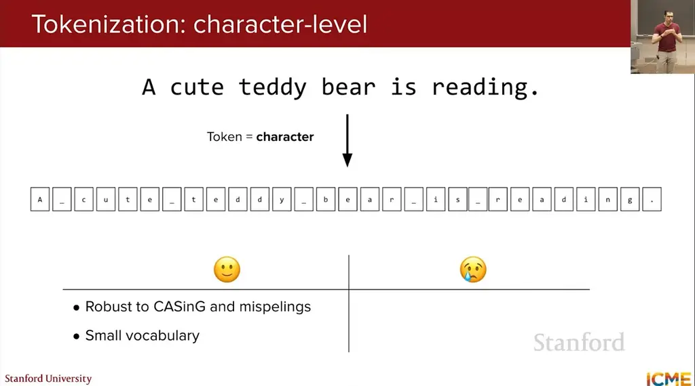
*[▶ 00:24:13](https://www.youtube.com/watch?v=114i2Kz-LZA&t=1453s) · Tokenization: character-level (example)*

**Subword** tokenization sits between the two. It learns frequent letter sequences from a corpus, so "read" and "ing" can each be a token. It is the most popular option: it shares word roots and shortens sequences, but needs extra work and depends on its training data.

The common algorithm is **BPE** (Byte Pair Encoding). It starts from an initial set such as the alphabet, merges the most frequent adjacent pair into a new token, and repeats until the target vocabulary size. For multilingual use, train on a corpus covering every target language.

Out-of-vocabulary text maps to **[UNK]**. With a four-token vocabulary, "tedi" is unknown, so "tedi bear" becomes [UNK] followed by "bear".

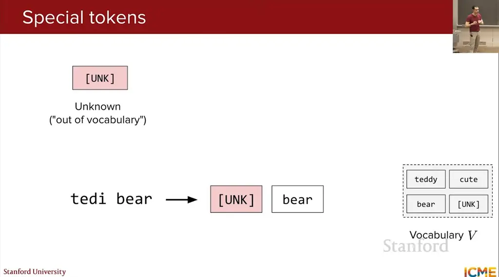
*[▶ 00:32:50](https://www.youtube.com/watch?v=114i2Kz-LZA&t=1970s) · Unknown token example with vocabulary*

**[BOS]** and **[EOS]** mark sequence start and end, mostly for generation: the model starts from BOS and emits EOS when done. **Padding** equalizes lengths so batches fit into tensors, which hardware favors. Conventions vary, and chat roles such as user and assistant are also marked with special tokens.

Modern LLM vocabularies have hundreds of thousands of tokens (around 200,000), usually built with BPE.

## Word2vec: learning token embeddings

[▶ 00:37:27](https://www.youtube.com/watch?v=114i2Kz-LZA&t=2247s)

One-hot vectors are mutually orthogonal, so every dot product is zero and no similarity is captured. Useful representations place related tokens close together, such as "teddy bear" near "soft" and far from "book".

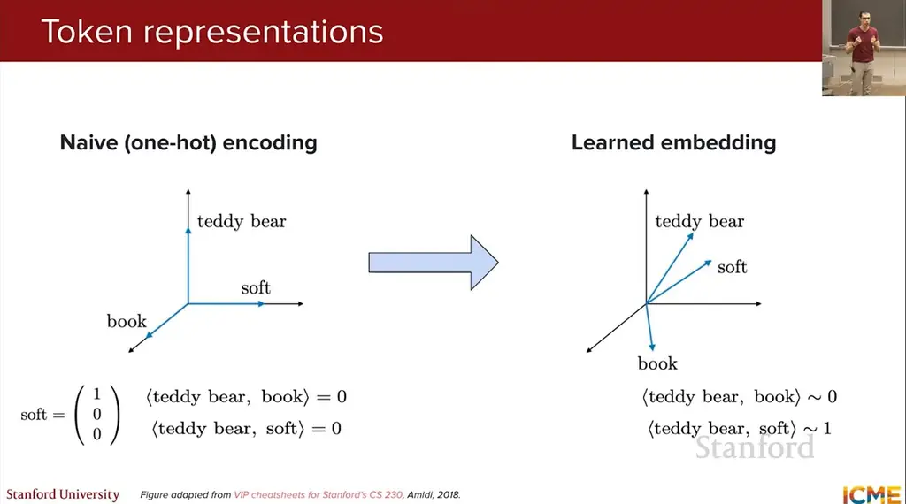
*[▶ 00:39:03](https://www.youtube.com/watch?v=114i2Kz-LZA&t=2343s) · One-hot vs learned embedding*

**Word2vec** learns these embeddings through a **proxy task**: a task that is not the end goal but produces useful representations along the way. Two variants exist:

- **CBOW** predicts a word from its surrounding context words.
- **Skip-gram** predicts the words surrounding a given word.

The worked example predicts "cute" from "A". The one-hot input (size V) is multiplied into a hidden layer of size d, a tunable value much smaller than V, then mapped back to size V.

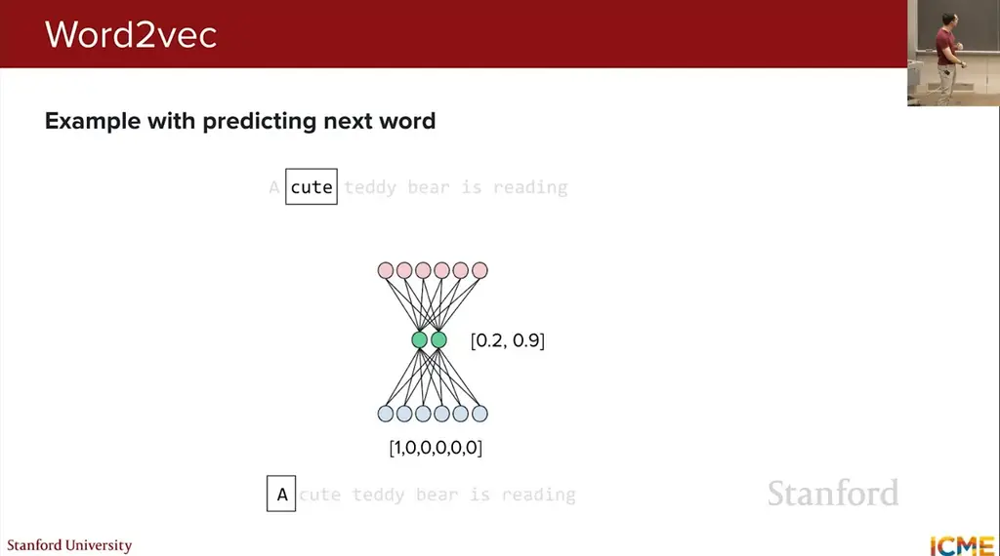
*[▶ 00:41:56](https://www.youtube.com/watch?v=114i2Kz-LZA&t=2516s) · Word2vec: input one-hot and hidden state*

Softmax turns the outputs into probabilities. A cross-entropy loss penalizes the distance from the one-hot target, the weights update, and the process repeats over the corpus.

*[▶ 00:42:12](https://www.youtube.com/watch?v=114i2Kz-LZA&t=2532s) · Word2vec: output probabilities over vocabulary*

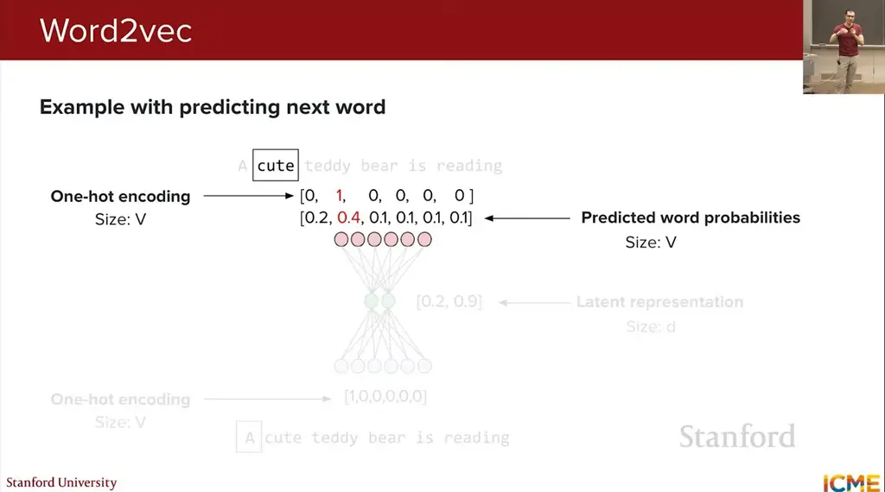
*[▶ 00:42:51](https://www.youtube.com/watch?v=114i2Kz-LZA&t=2571s) · Word2vec: one-hot target vs predicted probabilities*

The same step runs for "cute" predicting "teddy bear".

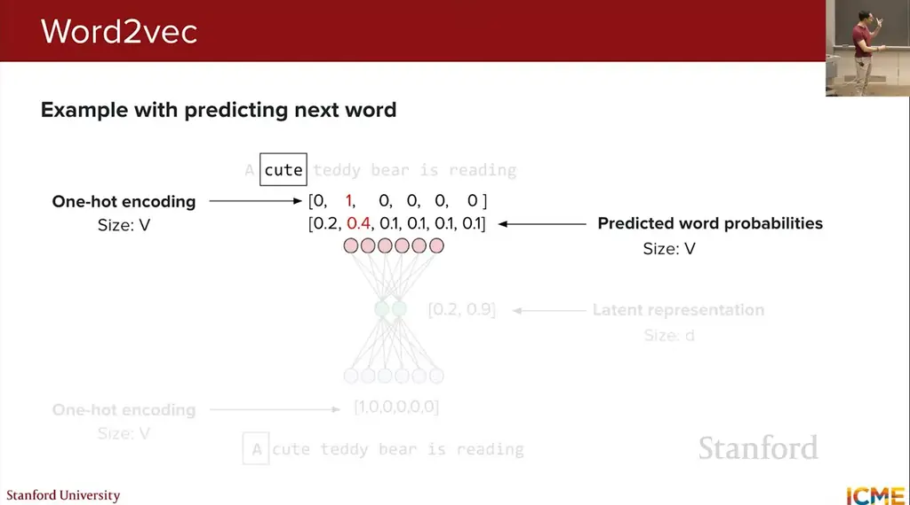
*[▶ 00:43:59](https://www.youtube.com/watch?v=114i2Kz-LZA&t=2639s) · Word2vec network: predicted word probabilities*

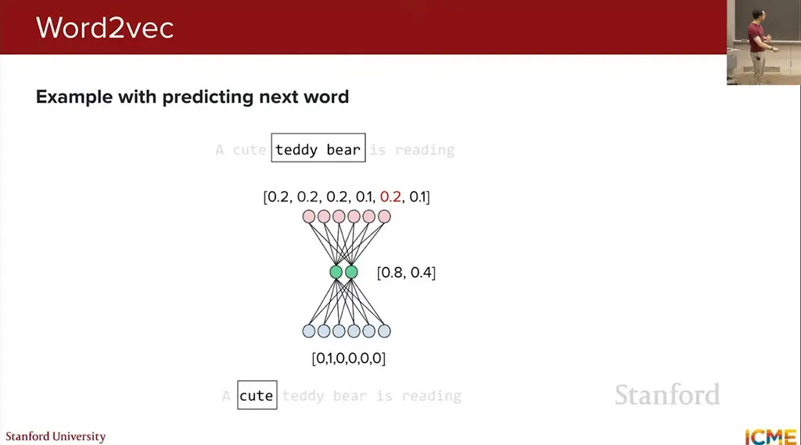
*[▶ 00:44:23](https://www.youtube.com/watch?v=114i2Kz-LZA&t=2663s) · Word2vec network: predicting teddy bear*

The hidden-layer vectors are the payoff: related words get similar vectors, which supports analogies such as Paris is to France as Berlin is to Germany. The method has limits:

- A word gets one vector regardless of context, as with "bank".
- Word order is ignored, so "the child is hugging the teddy bear" and its reverse get identical embeddings.
- Words not seen in training have no representation.

## RNNs and LSTMs: sequence memory and its limits

[▶ 00:48:26](https://www.youtube.com/watch?v=114i2Kz-LZA&t=2906s)

Word2vec gives each word one fixed vector, ignoring context and word order. RNNs carry a hidden state that summarizes the sequence so far, processing one token at a time.

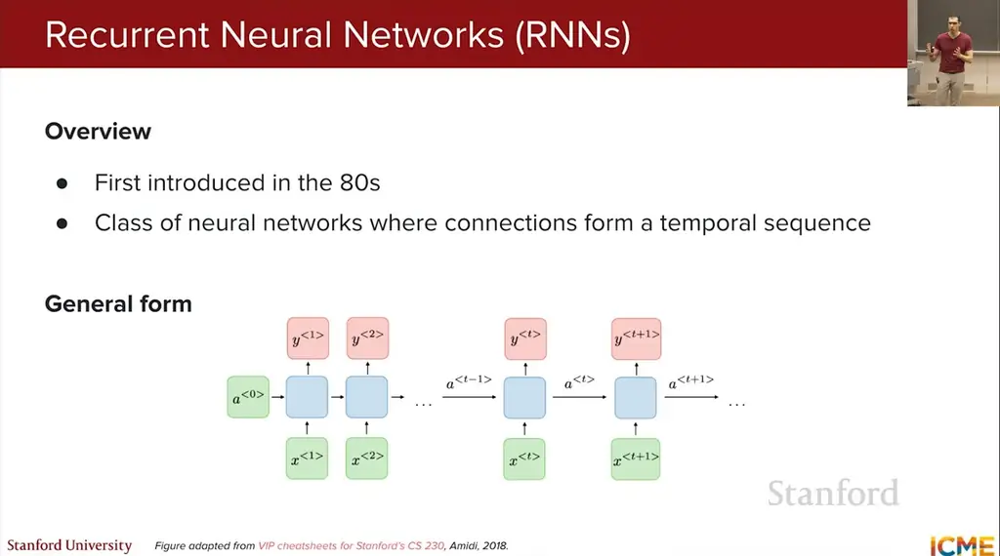
*[▶ 00:48:43](https://www.youtube.com/watch?v=114i2Kz-LZA&t=2923s) · Recurrent Neural Networks (RNNs) general form*

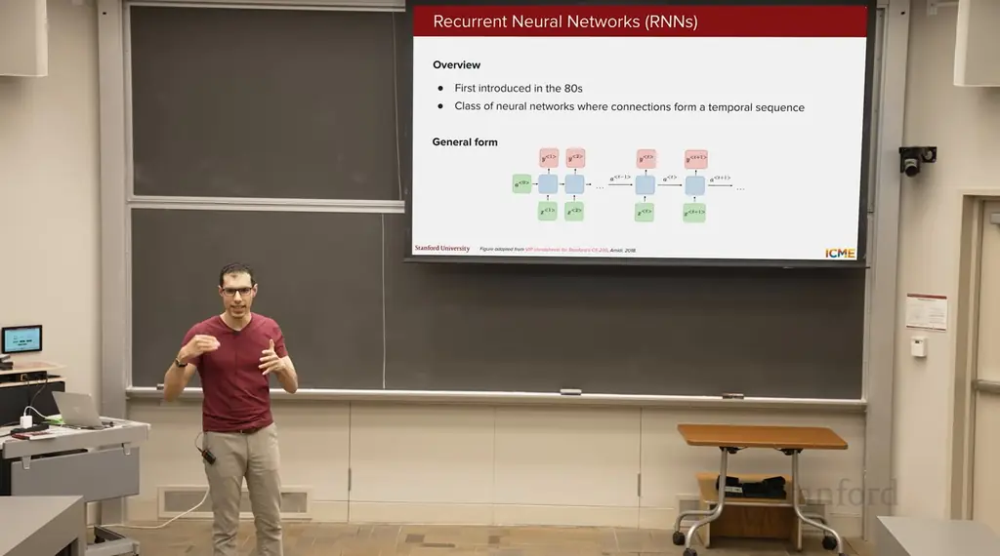
*[▶ 00:49:03](https://www.youtube.com/watch?v=114i2Kz-LZA&t=2943s) · RNN overview and general form*

RNNs were used for sentiment classification, per-word tagging, and translation.

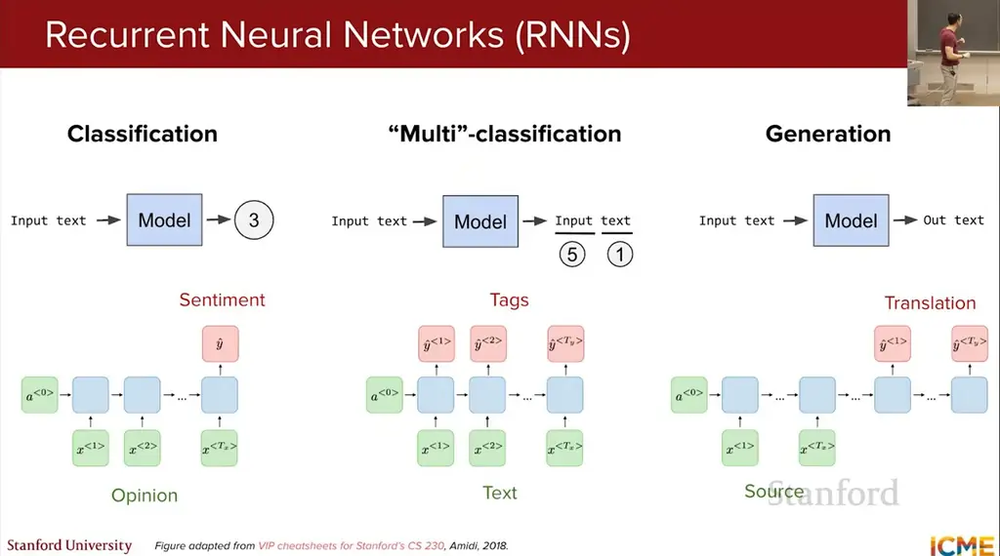
*[▶ 00:51:35](https://www.youtube.com/watch?v=114i2Kz-LZA&t=3095s) · Recurrent Neural Networks (RNNs) task types*

The weakness is long-range dependency. In "my Teddy bear is so cute. It is 3 feet tall," the hidden state must recall a distant referent, and the transcript ties this to the vanishing gradient problem. LSTM, introduced in 1997, adds a cell state to carry information longer, but it still has limits.

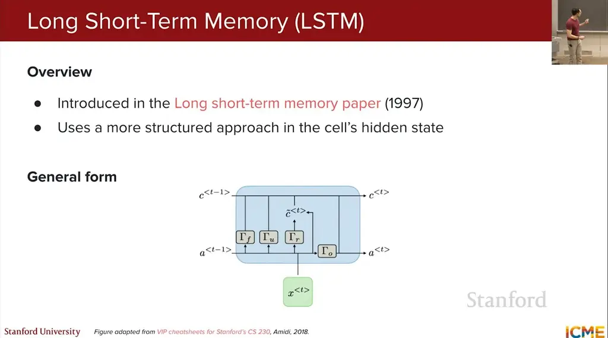
*[▶ 00:53:03](https://www.youtube.com/watch?v=114i2Kz-LZA&t=3183s) · Long Short-Term Memory (LSTM) general form*

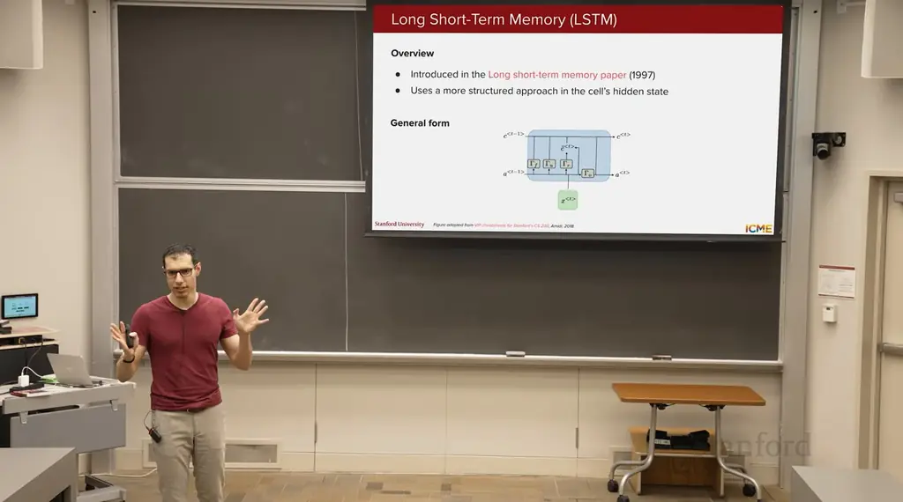
*[▶ 00:53:14](https://www.youtube.com/watch?v=114i2Kz-LZA&t=3194s) · Long Short-Term Memory (LSTM)*

RNNs are also slow to train, since tokens must be processed sequentially.

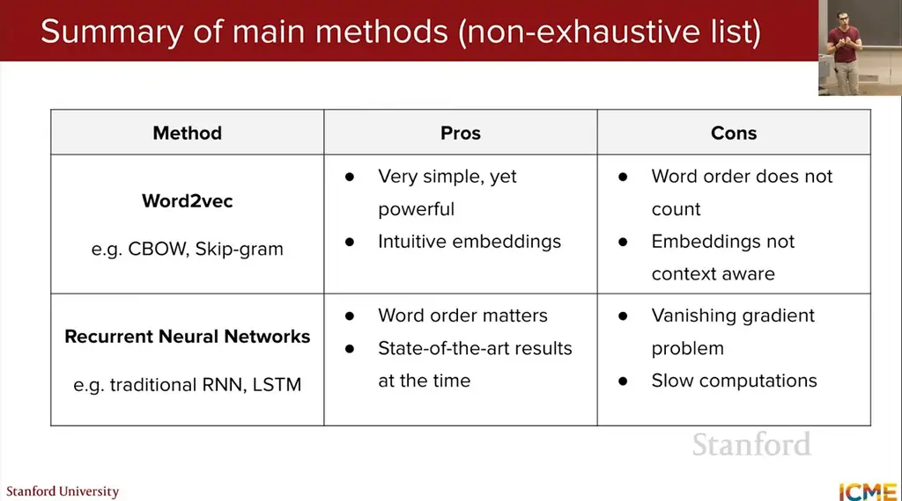
*[▶ 00:53:37](https://www.youtube.com/watch?v=114i2Kz-LZA&t=3217s) · Summary of main methods (non-exhaustive list)*

## Attention: direct links to past tokens

[▶ 00:55:18](https://www.youtube.com/watch?v=114i2Kz-LZA&t=3318s)

Seq2seq models must rely on a hidden state alone to remember the input, which breaks down on long-term dependencies in translation.

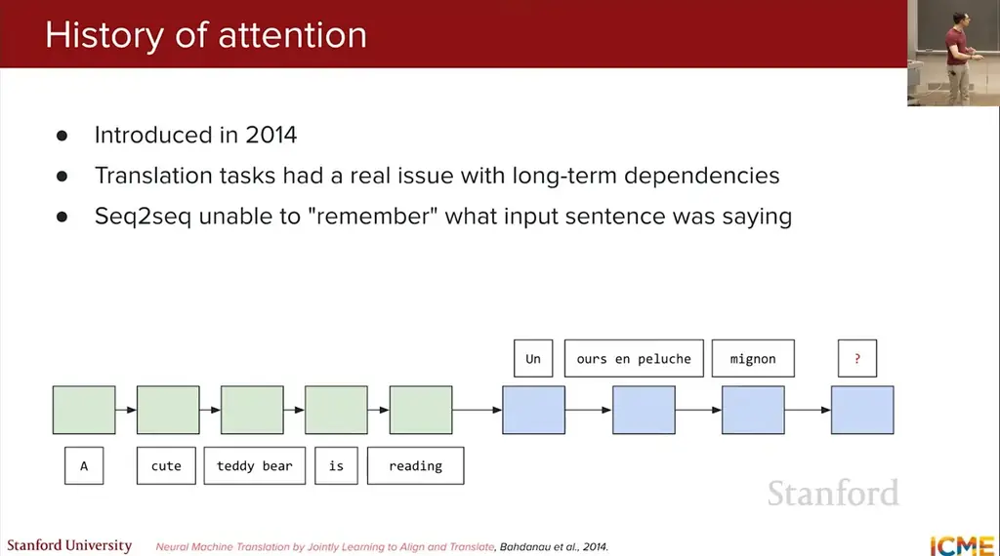
*[▶ 00:55:40](https://www.youtube.com/watch?v=114i2Kz-LZA&t=3340s) · History of attention*

Attention, introduced in 2014, adds direct connections from the current prediction to past tokens, and the model learns which ones matter for predicting the next token.

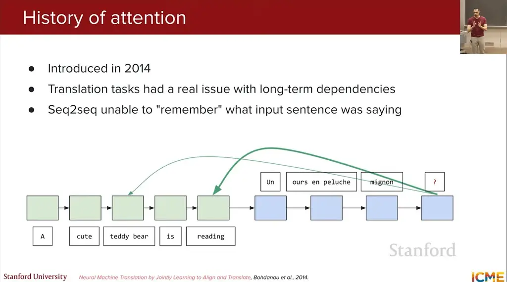
*[▶ 00:55:55](https://www.youtube.com/watch?v=114i2Kz-LZA&t=3355s) · History of attention*

## Self-attention: each token is computed from the whole sequence

[▶ 00:57:16](https://www.youtube.com/watch?v=114i2Kz-LZA&t=3436s)

Self-attention, "attention on steroids," is the mechanism behind the 2017 *Attention is All You Need* paper.

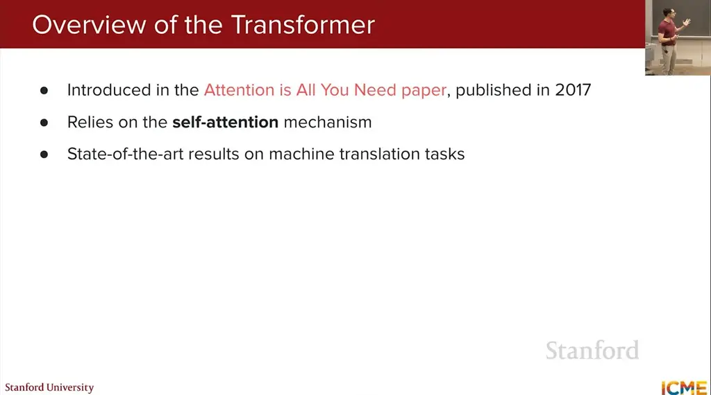
*[▶ 00:57:47](https://www.youtube.com/watch?v=114i2Kz-LZA&t=3467s) · Overview of the Transformer*

A token's representation is no longer built from a hidden state summarizing the sequence so far. It is a function of all the other tokens in the sequence.

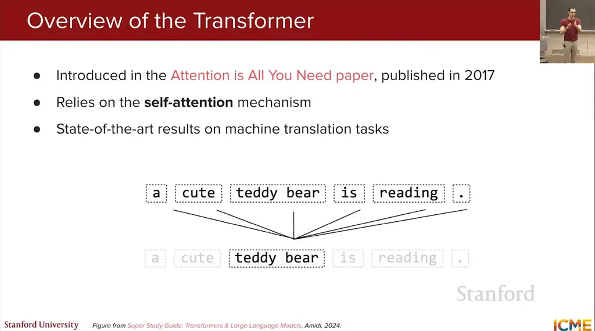
*[▶ 00:58:15](https://www.youtube.com/watch?v=114i2Kz-LZA&t=3495s) · Overview of the Transformer with self-attention figure*

The trade-off: when every token interacts directly with every other token, word order is lost. Positional information is added back later.

## Query, key, and value in attention

[▶ 00:59:54](https://www.youtube.com/watch?v=114i2Kz-LZA&t=3594s)

A token's **query** searches the sequence for tokens useful to its representation, scoring each token by comparing the query with that token's **key**.

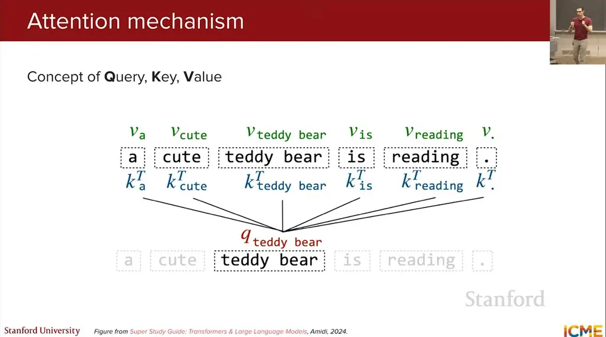
*[▶ 01:01:21](https://www.youtube.com/watch?v=114i2Kz-LZA&t=3681s) · Query, key, value vectors per token*

The output is a weighted average of the **values**, with weights set by query-key similarity.

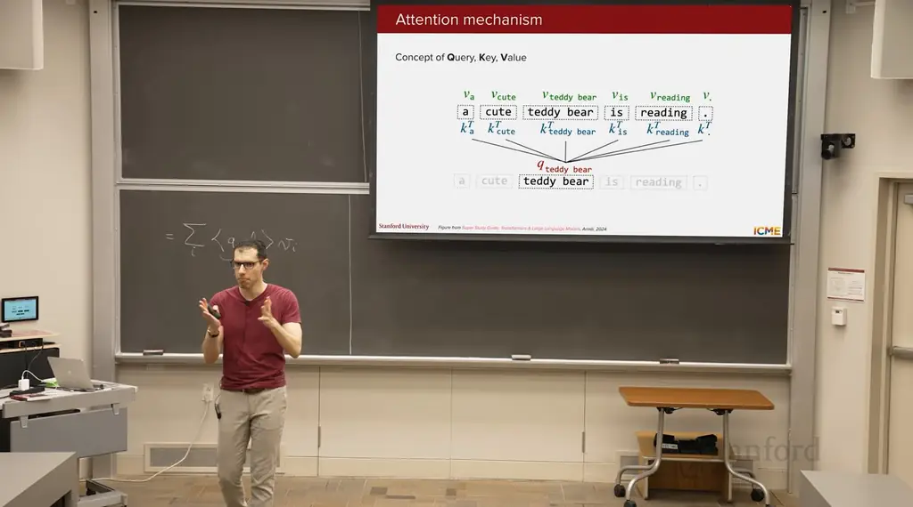
*[▶ 01:02:54](https://www.youtube.com/watch?v=114i2Kz-LZA&t=3774s) · Query, key, value vectors with board formula*

For "teddy bear," asking what best describes it, "cute" scores high, so its representation leans heavily on "cute."

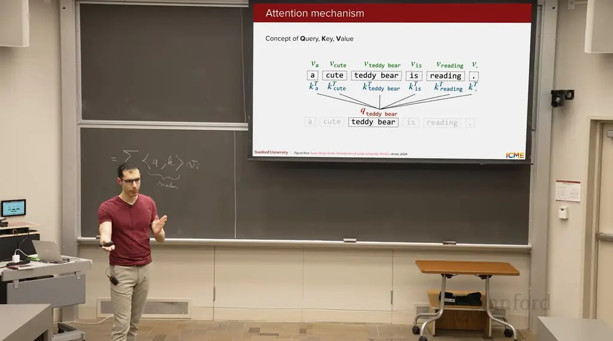
*[▶ 01:03:45](https://www.youtube.com/watch?v=114i2Kz-LZA&t=3825s) · Query, Key, Value concept diagram*

Matrices compute this for all tokens at once.

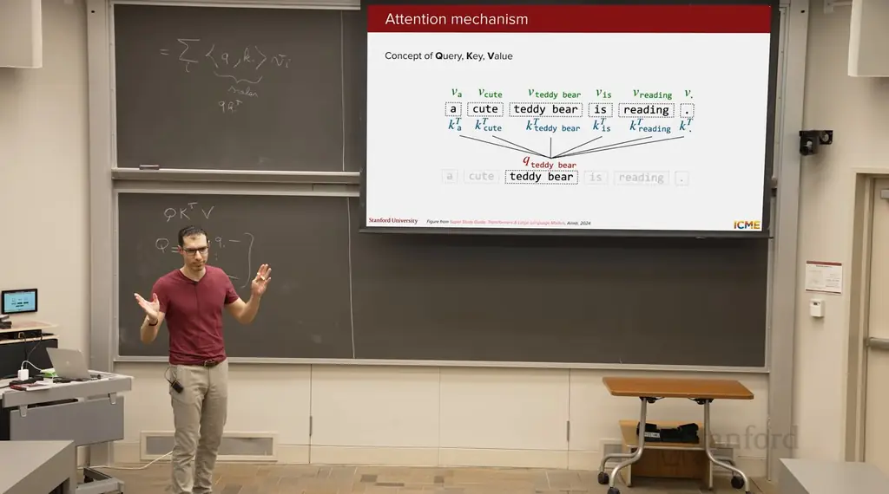
*[▶ 01:06:07](https://www.youtube.com/watch?v=114i2Kz-LZA&t=3967s) · Concept of Query, Key, Value for one token*

Queries, keys, and values come from learned projection matrices applied to each token's representation.

Stacked into matrices, the result is softmax(QKᵀ/√d_k)V. QKᵀ holds all query-key dot products, and the softmax makes the weights sum to 1.

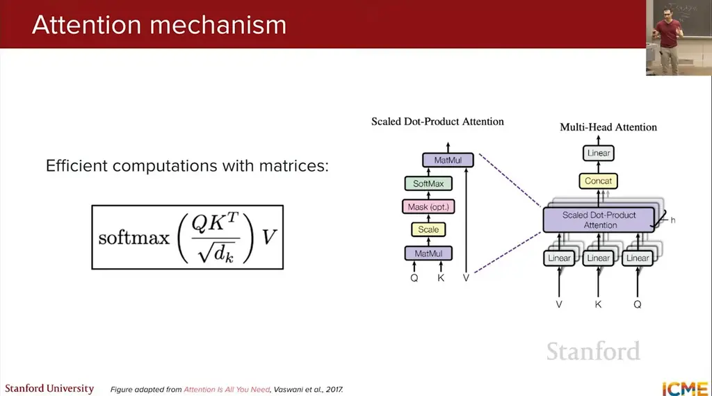
*[▶ 01:05:07](https://www.youtube.com/watch?v=114i2Kz-LZA&t=3907s) · Matrix form of attention and Transformer attention blocks*

The speaker says this formula will recur and may be on the midterm.

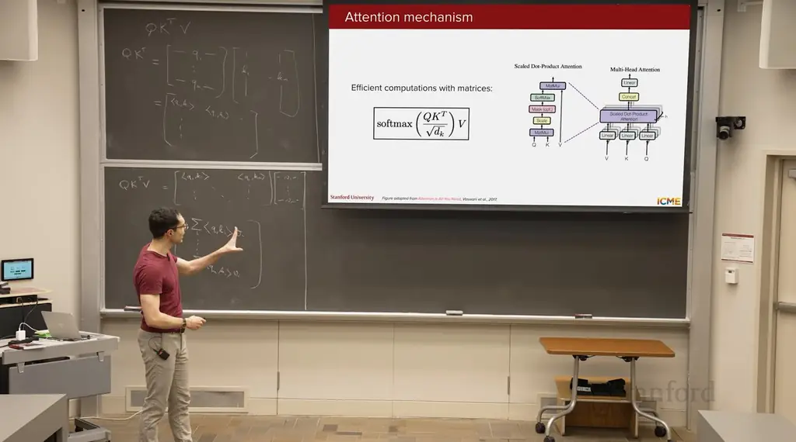
*[▶ 01:09:13](https://www.youtube.com/watch?v=114i2Kz-LZA&t=4153s) · Attention mechanism: softmax(QKᵀ/√dₖ)V*

## Encoder and decoder built on self-attention

[▶ 01:09:35](https://www.youtube.com/watch?v=114i2Kz-LZA&t=4175s)

Recurrent models passed a hidden state along tokens; the Transformer uses self-attention, letting tokens interact directly.

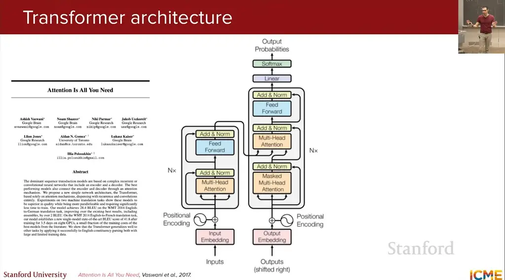
*[▶ 01:10:20](https://www.youtube.com/watch?v=114i2Kz-LZA&t=4220s) · Transformer architecture: paper and full diagram*

It was released for translation, e.g., English to French.

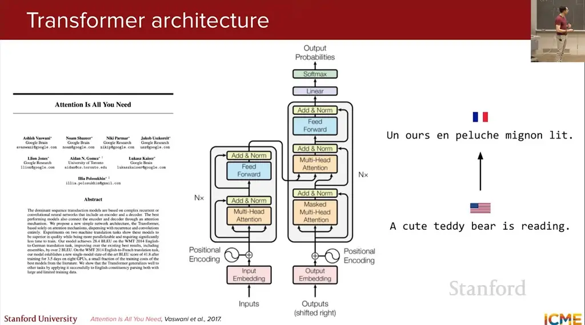
*[▶ 01:11:00](https://www.youtube.com/watch?v=114i2Kz-LZA&t=4260s) · Transformer architecture: translation example*

The encoder computes meaningful source representations.

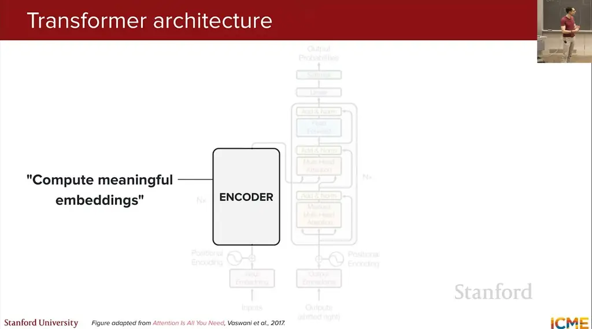
*[▶ 01:11:20](https://www.youtube.com/watch?v=114i2Kz-LZA&t=4280s) · Transformer architecture: encoder highlighted*

The decoder uses those and its own embeddings to generate the next token.

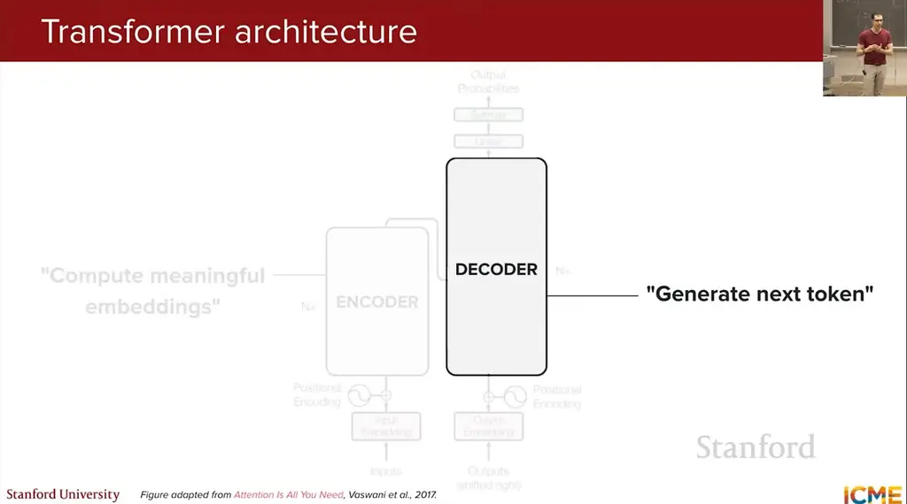
*[▶ 01:11:39](https://www.youtube.com/watch?v=114i2Kz-LZA&t=4299s) · Transformer architecture: encoder and decoder roles*

Visualize the attention formula as matrix multiplies; it is the most important one.

## Token embeddings plus positional encoding

[▶ 01:12:19](https://www.youtube.com/watch?v=114i2Kz-LZA&t=4339s)

Tokens are mapped to learned embeddings that depend only on the token, not its context. Parameters: V (vocabulary size) and d_model (embedding dimensions).

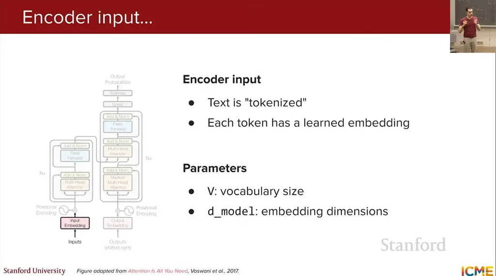
*[▶ 01:12:39](https://www.youtube.com/watch?v=114i2Kz-LZA&t=4359s) · Encoder input: tokenization and embeddings*

Since embeddings carry no position, a positional encoding is added to each token embedding.

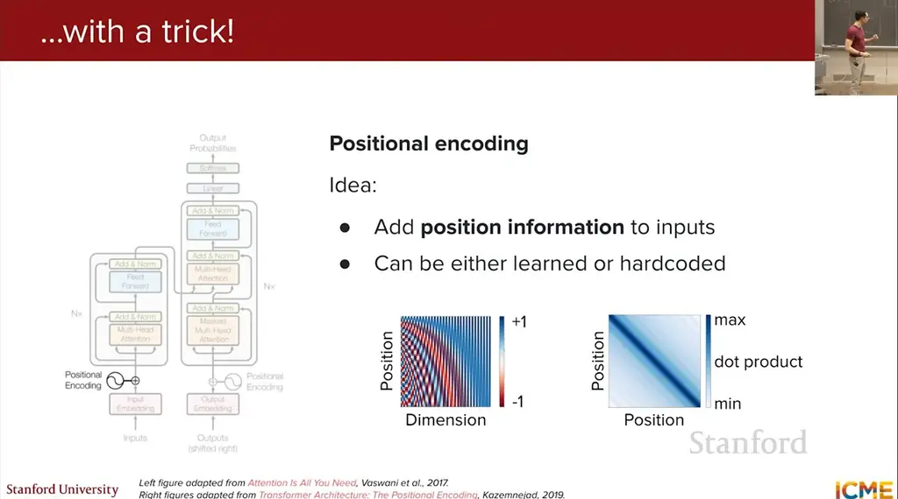
*[▶ 01:13:44](https://www.youtube.com/watch?v=114i2Kz-LZA&t=4424s) · Positional encoding: adding position information*

- Learned positions are simple but cannot cover sequences longer than those seen in training.
- Fixed sinusoids at different frequencies, like a watch's hands, extend past training length; nearby positions get similar vectors.

## Transformer Encoder: Contextual Token Representations

[▶ 01:16:27](https://www.youtube.com/watch?v=114i2Kz-LZA&t=4587s)

The **encoder** computes meaningful representations of tokens. Its key layer is **self-attention**, which computes each token as a function of all others, using learned projections into queries, keys and values. A feedforward network then projects representations into higher dimensions with an activation function, learning nonlinearities. The output is one meaningful representation per token, depending on the whole sequence.

## Decoder generates one token at a time

[▶ 01:18:19](https://www.youtube.com/watch?v=114i2Kz-LZA&t=4699s)

Generation starts with the [BOS] token, plus its position encoding, as decoder input.

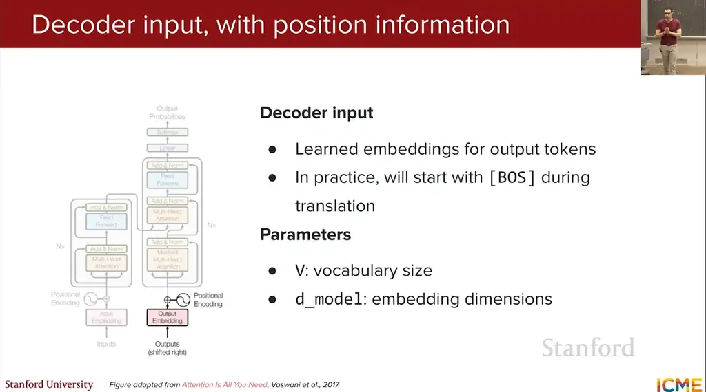
*[▶ 01:18:39](https://www.youtube.com/watch?v=114i2Kz-LZA&t=4719s) · Decoder input, with position information*

Each layer runs masked self-attention over generated tokens, then encoder-decoder attention, then a feed-forward network.

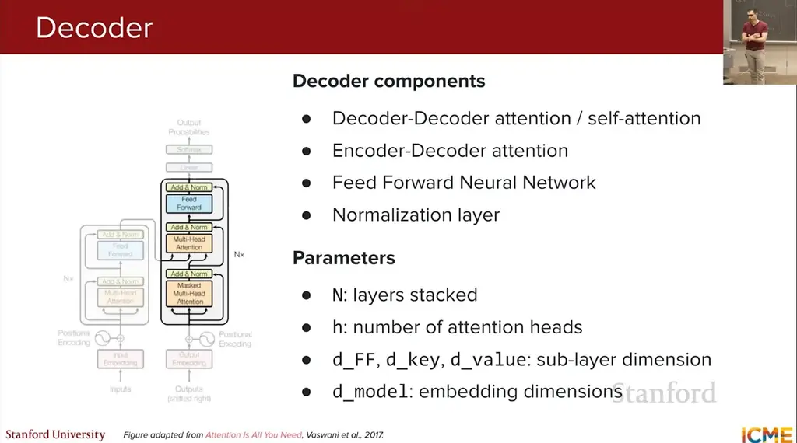
*[▶ 01:19:11](https://www.youtube.com/watch?v=114i2Kz-LZA&t=4751s) · Decoder components and parameters*

Encoder-decoder attention takes queries from the decoder and keys and values from the encoder.

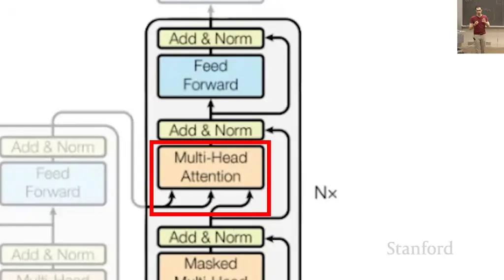
*[▶ 01:20:13](https://www.youtube.com/watch?v=114i2Kz-LZA&t=4813s) · Transformer decoder block with multi-head attention highlighted*

A linear projection and softmax give next-token probabilities over the vocabulary; the chosen token is fed back in.

*[▶ 01:21:17](https://www.youtube.com/watch?v=114i2Kz-LZA&t=4877s) · Output: decoder projection to vocabulary*

## Training tricks that stabilize and regularize the model

[▶ 01:22:16](https://www.youtube.com/watch?v=114i2Kz-LZA&t=4936s)

Residual connections, from ResNet, add a layer's input to its output, so sublayers modify the input rather than replace it, aiding backpropagation.

*[▶ 01:22:41](https://www.youtube.com/watch?v=114i2Kz-LZA&t=4961s) · Computational trick: residual connections*

Layer normalization keeps activation scales consistent across layers, speeding convergence.

*[▶ 01:24:09](https://www.youtube.com/watch?v=114i2Kz-LZA&t=5049s) · Computational trick: layer normalization*

Masking (causal self-attention) hides undecoded tokens during training; all operations stay vectorized.

*[▶ 01:24:30](https://www.youtube.com/watch?v=114i2Kz-LZA&t=5070s) · Computational trick: masking*

Multi-head attention runs several self-attention layers in parallel with different projections, like multiple convolutional filters.

*[▶ 01:24:40](https://www.youtube.com/watch?v=114i2Kz-LZA&t=5080s) · Computational trick: multi-head attention*

Dropout randomly drops units during training to aid generalization.

*[▶ 01:25:39](https://www.youtube.com/watch?v=114i2Kz-LZA&t=5139s) · Computational tricks: Dropout*

Label smoothing mixes noise into true labels to curb overconfidence, improving BLEU.

*[▶ 01:26:19](https://www.youtube.com/watch?v=114i2Kz-LZA&t=5179s) · Computational tricks: Label smoothing*

## Running one sentence through the full Transformer

[▶ 01:27:35](https://www.youtube.com/watch?v=114i2Kz-LZA&t=5255s)

The walkthrough takes "A cute teddy bear is reading." through the whole model. Tokenization splits the text into atomic units, and [BOS] and [EOS] mark the sequence boundaries. Each token is looked up in a learnable embedding table, and a sinusoidal position vector of the same length, d_model, is added to it.

The encoder's self-attention layer projects this position-aware matrix into queries, keys and values with W_Q, W_K and W_V. The attention output has the same shape as V.

*[▶ 01:31:32](https://www.youtube.com/watch?v=114i2Kz-LZA&t=5492s) · Self-attention from Q, K, V and softmax*

Shape rules matter for the matrix products. The input is n × d_model, and each projection maps d_model to d_q, d_k or d_v. Queries, keys and values all have n rows. d_q must equal d_k so that QKᵀ is defined.

*[▶ 01:32:36](https://www.youtube.com/watch?v=114i2Kz-LZA&t=5556s) · Projection matrices W_Q, W_K, W_V applied to input*

*[▶ 01:33:11](https://www.youtube.com/watch?v=114i2Kz-LZA&t=5591s) · Shapes of Q, K, V after projection*

QKᵀ gives an n × n matrix of dot-product similarities. A softmax over each row gives a probability distribution over keys, which weights the values. Dividing by √d_k normalizes the variance that grows with dimension.

Attention runs in h heads in parallel. The heads are concatenated and W_O projects the result back to d_model. Each block's feed-forward network expands to d_ff and returns to d_model. The encoder stacks this N times; N is 6 in the original paper. The output is one context-aware embedding per token.

*[▶ 01:36:06](https://www.youtube.com/watch?v=114i2Kz-LZA&t=5766s) · Multi-head attention inside the encoder*

*[▶ 01:37:20](https://www.youtube.com/watch?v=114i2Kz-LZA&t=5840s) · Encoder outputs context-aware encoded embeddings*

The decoder starts from [BOS]. Its masked self-attention is causal: each token attends only to itself and earlier tokens, since masked scores of minus infinity become 0 after softmax. Cross-attention takes queries from the decoder and keys and values from the encoder output. A linear layer and softmax then give a distribution over the vocabulary. Decoding here picks the maximum, feeds it back in, and repeats until [EOS].

*[▶ 01:39:21](https://www.youtube.com/watch?v=114i2Kz-LZA&t=5961s) · Softmax output over vocabulary*

The speaker's takeaway: attention and the feed-forward network are the core. Most parameters sit in the feed-forward layers, and the rest are refinements.

## Links & resources

- [CME295 syllabus — course outline on the class website](https://cme295.stanford.edu/syllabus/) — <https://cme295.stanford.edu/syllabus/> · video description
- [CME295 class website — slides, recordings, and course materials](https://cme295.stanford.edu) — <https://cme295.stanford.edu> · on screen [▶ 00:07:16](https://www.youtube.com/watch?v=114i2Kz-LZA&t=436s)
- [CME295 lecture recordings playlist — linked in video description](https://youtube.com/playlist?list=PLakGfbKCei80&si=HF2tNywj7nXIQq8X) — <https://youtube.com/playlist?list=PLakGfbKCei80&si=HF2tNywj7nXIQq8X> · video description
- [VIP Cheatsheet and PDF — Transformers and LLMs study guide on GitHub](https://github.com/afshinea/stanford-cme-295-transformers-large-language-models) — <https://github.com/afshinea/stanford-cme-295-transformers-large-language-models> · on screen [▶ 00:09:18](https://www.youtube.com/watch?v=114i2Kz-LZA&t=558s)
- Byte Pair Encoding paper — linked at bottom of slide, URL not shown · mentioned [▶ 00:28:09](https://www.youtube.com/watch?v=114i2Kz-LZA&t=1689s)
