# Stanford CME295 Transformers & LLMs | Autumn 2026 | Lecture 2 - Large Language Models

*How tokenization, attention, the Transformer encoder and decoder variants, mixture of experts, position encoding and decoding choices fit together in modern LLMs.*

Source: [Stanford CME295 Transformers & LLMs | Autumn 2026 | Lecture 2 - Large Language Models](https://www.youtube.com/watch?v=GaIeu3npx04) · Afshine Amidi and Shervine Amidi · Stanford Online · 1 h 43 min

## TL;DR

RNNs forget earlier inputs, so the 2017 Transformer replaced recurrence with direct attention between tokens, which made it the base for LLMs. The article walks through the encoder-only (BERT), decoder-only (GPT) and encoder-decoder designs, and explains why decoder-only models became the common choice. It then covers the scaling rules, sparse mixture-of-experts layers, position encodings such as RoPE, and memory-saving attention methods. It closes with decoding strategies and context limits, which determine how LLMs behave when they are used.

## Key takeaways

- Subword tokenization is the common choice because it balances vocabulary size against sequence length.
- BERT keeps only the Transformer encoder, is pretrained with masked language modeling and next sentence prediction, and is finetuned by projecting the [CLS] embedding onto target classes.
- Decoder-only models use causal attention throughout and were found to beat encoder-decoder designs on text-to-text tasks because they are simpler.
- Hoffmann et al. (2022) found that most models were undertrained, with a smaller model trained on about 1.4T tokens beating a larger one at equal compute, and a rule of thumb of about 20 tokens per parameter.
- Sparse mixture-of-experts layers replace the feed-forward network, with a learned router picking top-k experts, and an auxiliary load-balancing loss counters routing collapse.
- RoPE is the default position method today: it rotates queries and keys by position-dependent angles so their dot product depends only on relative distance, with nothing learned.
- GQA shares key and value heads within groups of query heads to shrink the KV cache during decoding, with MQA as the extreme case of one shared head.
- Greedy decoding, beam search and sampling (top-k, top-p) trade determinism against quality, and guided decoding enforces valid structured output such as JSON, while longer context can degrade retrieval (context rot).

## Recap: tokens, attention and the Transformer

[▶ 00:00:00](https://www.youtube.com/watch?v=GaIeu3npx04&t=0s)

Text is split into tokens first. Subword tokenization is the common choice because it balances vocabulary size against sequence length.

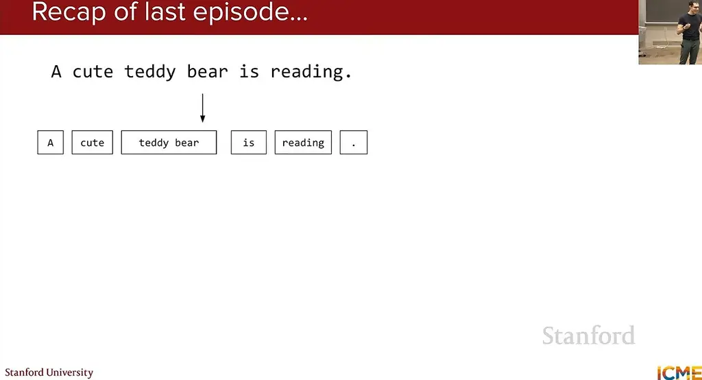
*[▶ 00:00:53](https://www.youtube.com/watch?v=GaIeu3npx04&t=53s) · Recap: tokenizing a sentence*

RNNs forget earlier inputs. The 2017 paper "Attention Is All You Need" dropped recurrence in favor of direct connections between tokens. Query, key and value vectors decide which tokens each token attends to.

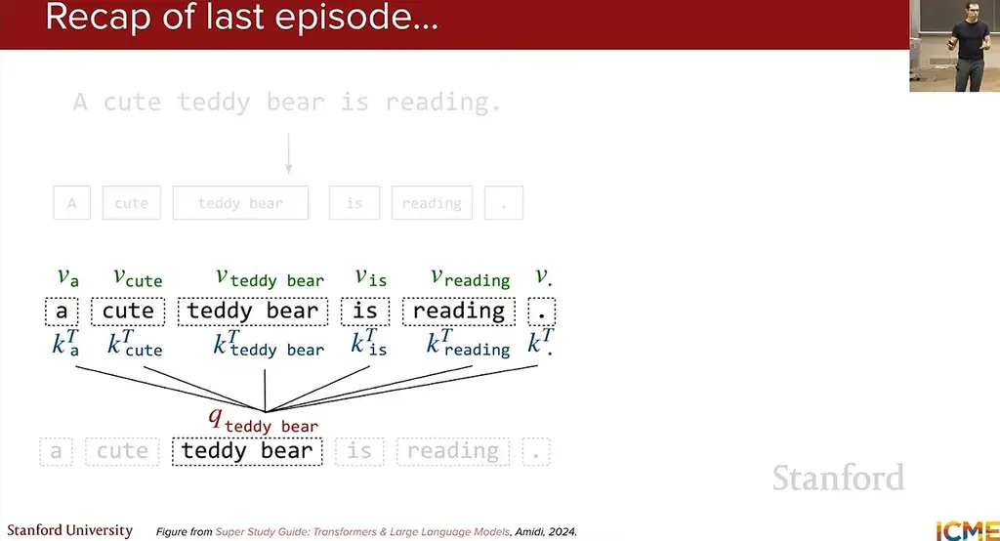
*[▶ 00:02:06](https://www.youtube.com/watch?v=GaIeu3npx04&t=126s) · Recap: attention over tokens for "teddy bear"*

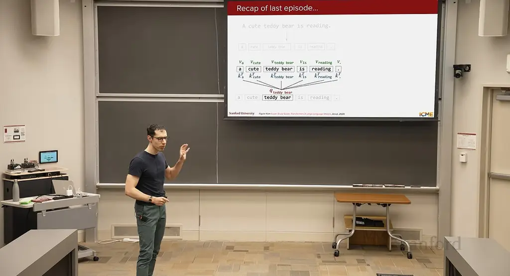
*[▶ 00:02:20](https://www.youtube.com/watch?v=GaIeu3npx04&t=140s) · Recap: attention over tokens for 'teddy bear'*

The Transformer was first built for machine translation, where it performed well. Can its gains transfer to other domains?

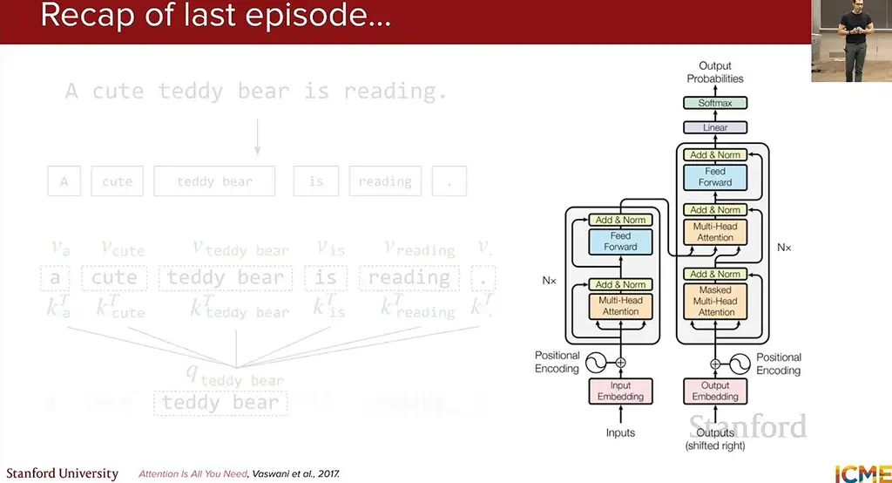
*[▶ 00:02:56](https://www.youtube.com/watch?v=GaIeu3npx04&t=176s) · Recap: original Transformer architecture*

## Encoder and decoder roles, and the encoder-only variant

[▶ 00:03:43](https://www.youtube.com/watch?v=GaIeu3npx04&t=223s)

The original Transformer has two parts. The **encoder** computes meaningful embeddings of the input, such as the source text in machine translation. The **decoder** generates output one token at a time, autoregressively, attending to its predicted tokens and the encoder's embeddings.

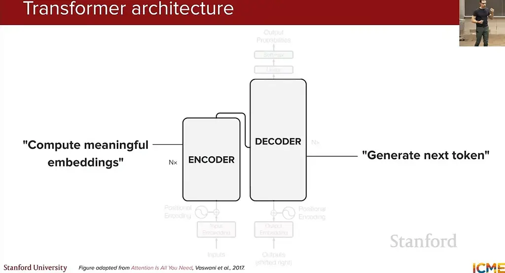
*[▶ 00:04:02](https://www.youtube.com/watch?v=GaIeu3npx04&t=242s) · Transformer architecture*

Dropping the decoder leaves an encoder-only variant, which computes embeddings and uses them for a downstream task.

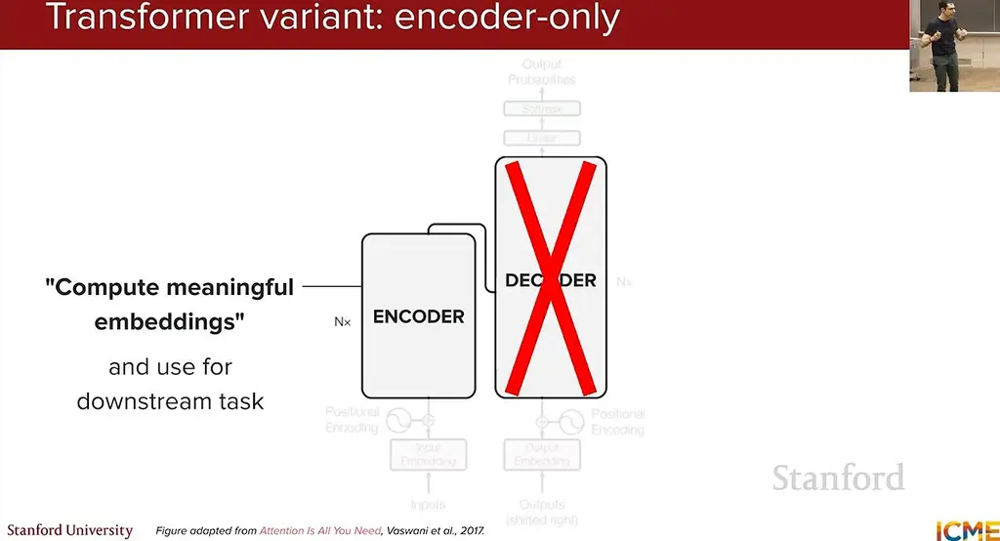
*[▶ 00:05:00](https://www.youtube.com/watch?v=GaIeu3npx04&t=300s) · Transformer variant: encoder-only*

## BERT: encoder-only pretraining and finetuning

[▶ 00:05:01](https://www.youtube.com/watch?v=GaIeu3npx04&t=301s)

BERT keeps only the transformer encoder. Self-attention lets every token attend to every other, so the [CLS] token at the start of the sequence carries a summary of the input. Its embedding feeds a classifier, such as sentiment.

![BERT encoder with highlighted [CLS] embedding](images/s017.jpg)
*[▶ 00:06:10](https://www.youtube.com/watch?v=GaIeu3npx04&t=370s) · BERT encoder with highlighted [CLS] embedding*


*[▶ 00:07:25](https://www.youtube.com/watch?v=GaIeu3npx04&t=445s) · BERT and encoder-only models: encoded embeddings*

Training has two steps. Pretraining uses proxy tasks to learn how text is written. **Masked language modeling (MLM)** masks random tokens and predicts them from context.

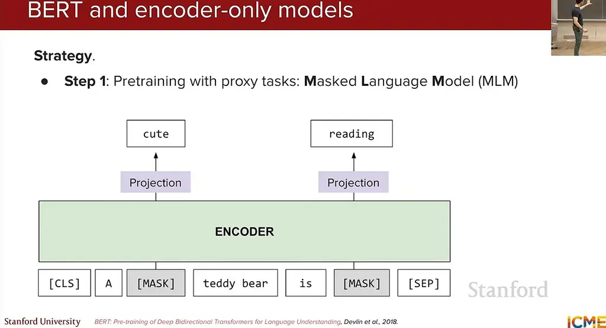
*[▶ 00:09:14](https://www.youtube.com/watch?v=GaIeu3npx04&t=554s) · BERT masked language model (MLM) pretraining*

**Next sentence prediction (NSP)** asks whether two sentences follow each other, which teaches document-level structure.

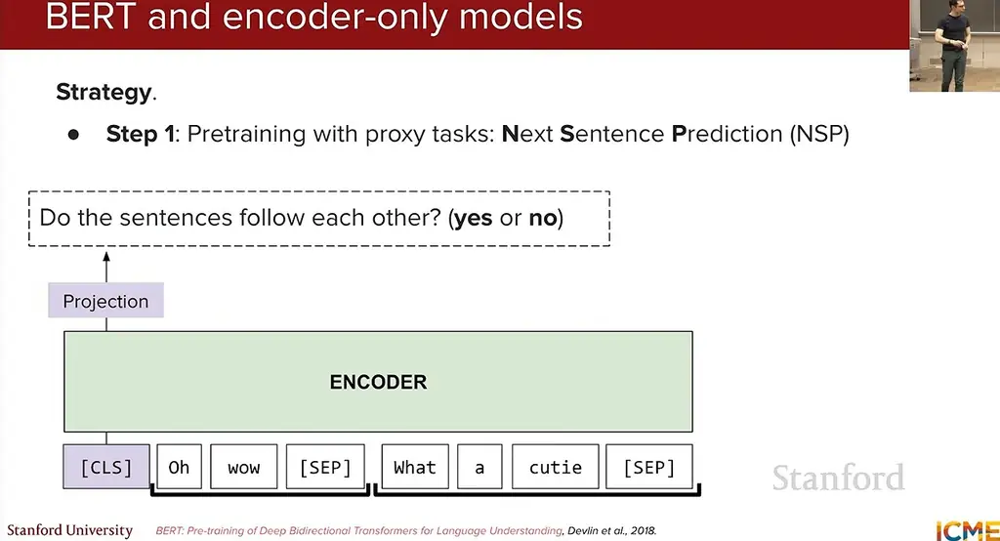
*[▶ 00:11:08](https://www.youtube.com/watch?v=GaIeu3npx04&t=668s) · BERT next sentence prediction (NSP) classifier*

Second, finetuning adapts the model to a task.

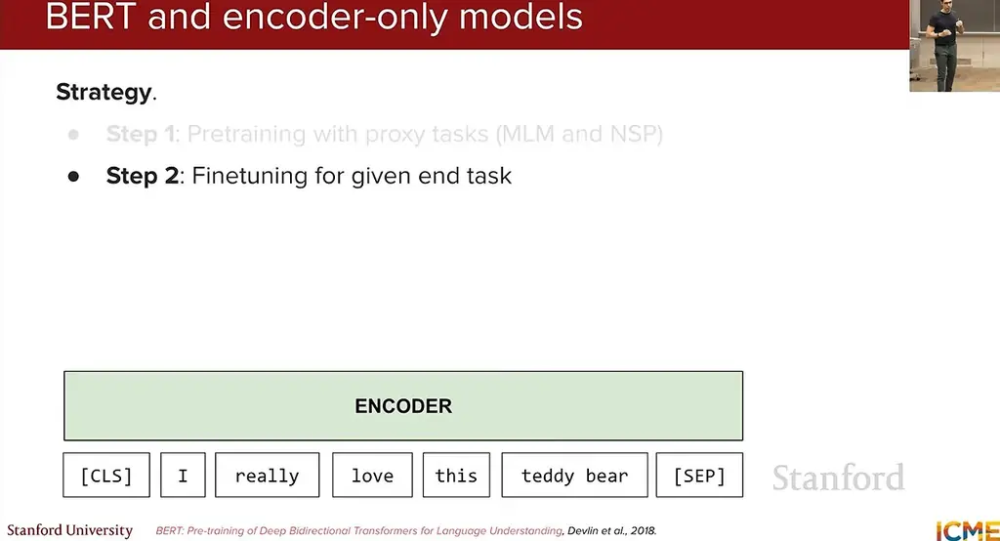
*[▶ 00:11:22](https://www.youtube.com/watch?v=GaIeu3npx04&t=682s) · BERT strategy: pretraining then finetuning*

A projection on [CLS] maps the sentence representation to target classes, such as positive or negative. Only a small labeled set is needed to tune its weights.

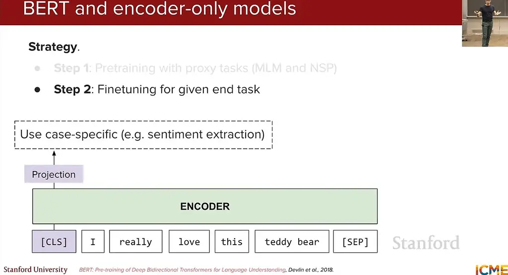
*[▶ 00:12:13](https://www.youtube.com/watch?v=GaIeu3npx04&t=733s) · Finetuning with a projection head on CLS*

## Dropping the encoder for decoder-only models

[▶ 00:12:42](https://www.youtube.com/watch?v=GaIeu3npx04&t=762s)

Encoder-only models need fine-tuning and seem unable to generate text, though Lecture 8 shows they can.

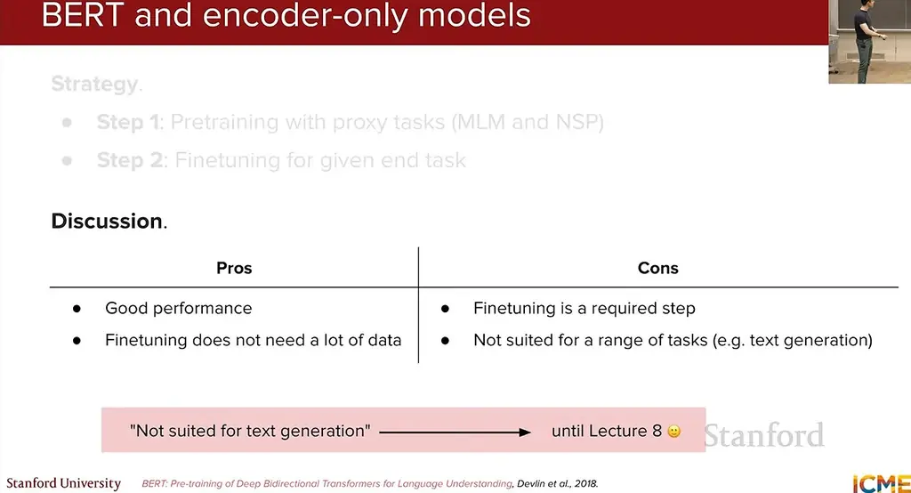
*[▶ 00:13:45](https://www.youtube.com/watch?v=GaIeu3npx04&t=825s) · Encoder-only text generation callout*

Dropping the encoder gives GPT's decoder-only design, which predicts the next token one at a time, with input shifted by BOS.

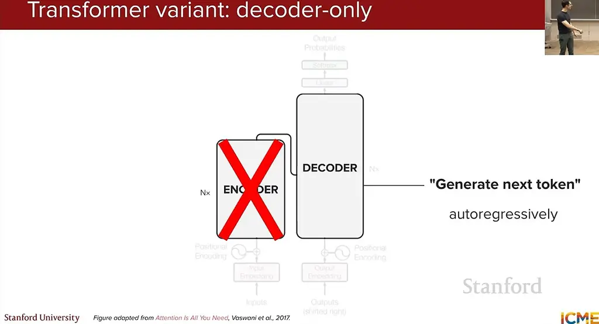
*[▶ 00:14:09](https://www.youtube.com/watch?v=GaIeu3npx04&t=849s) · Transformer variant: decoder-only*

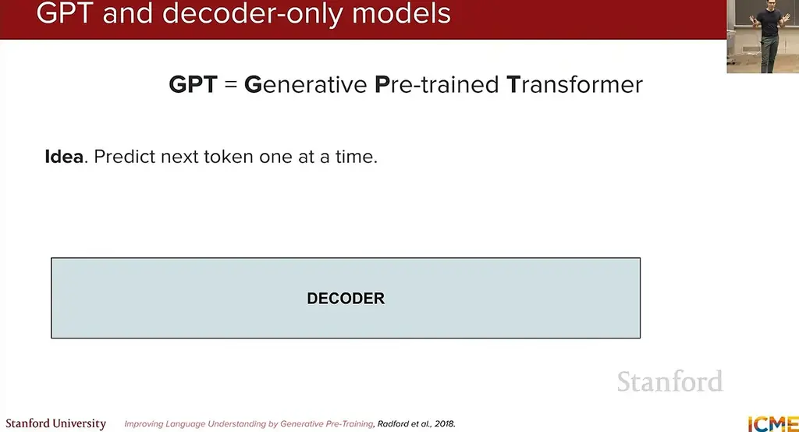
*[▶ 00:14:29](https://www.youtube.com/watch?v=GaIeu3npx04&t=869s) · GPT and decoder-only models*


*[▶ 00:15:27](https://www.youtube.com/watch?v=GaIeu3npx04&t=927s) · Next-token prediction with a decoder*

Both generate autoregressively, but encoder-decoder gives input bidirectional attention, while decoder-only uses causal attention throughout.

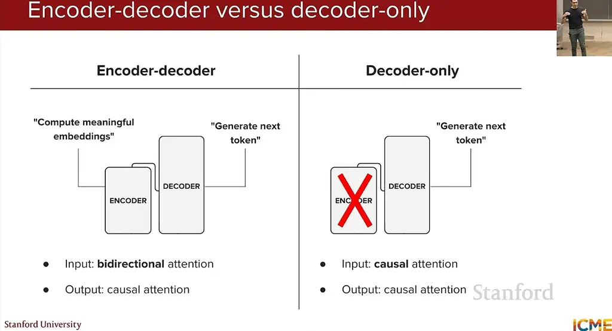
*[▶ 00:16:33](https://www.youtube.com/watch?v=GaIeu3npx04&t=993s) · Encoder-decoder vs decoder-only*

## Decoder-only models, compute-optimal scaling and mixture of experts

[▶ 00:16:56](https://www.youtube.com/watch?v=GaIeu3npx04&t=1016s)

Decoder-only models use causal attention on both input and output, so each token sees only itself and earlier tokens. Encoder-decoder models instead need a separate encoder with bidirectional input attention. Decoder-only treats all input the same and is simpler, and it won out when both designs were tried on text-to-text tasks.


*[▶ 00:19:22](https://www.youtube.com/watch?v=GaIeu3npx04&t=1162s) · Encoder-decoder versus decoder-only*

The decoder-only backbone keeps causal multi-head attention, where tokens interact, and a feed-forward network, where most of the compute happens. The encoder and cross-attention are removed.

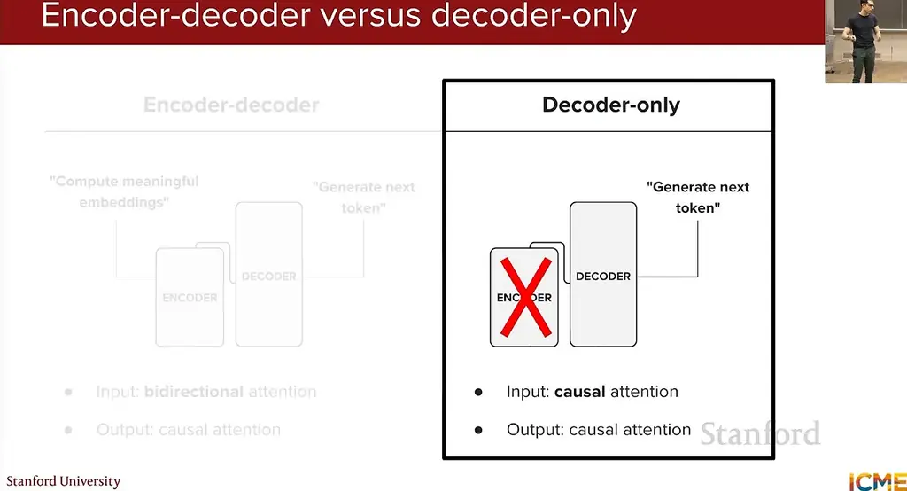
*[▶ 00:18:54](https://www.youtube.com/watch?v=GaIeu3npx04&t=1134s) · Decoder-only architecture highlighted*

A 2020 paper showed loss falling predictably as data, parameters and compute grow. Bigger models are also more token-efficient, reaching a given loss with fewer training tokens.

For a fixed compute budget, Hoffmann et al. (2022) found a sweet spot between parameters and tokens, and that most 2022 models were undertrained, too large for the tokens they saw. A smaller model trained on about 1.4T tokens beat a larger one at equal compute.

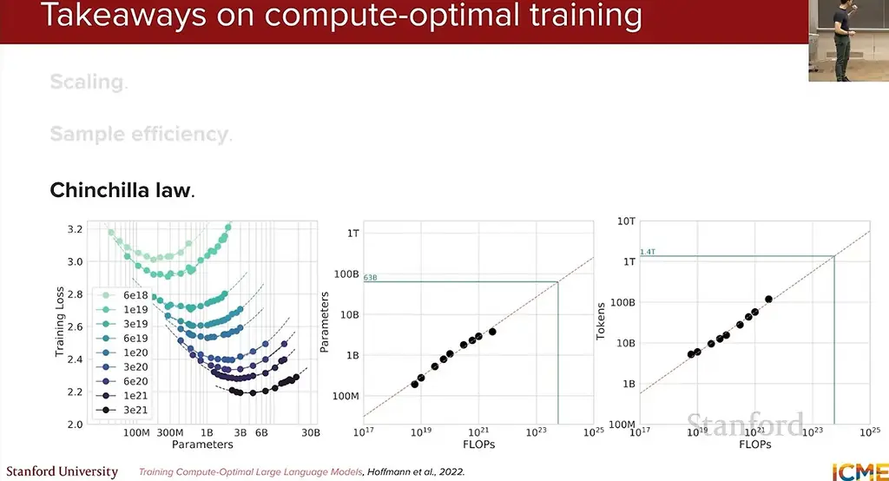
*[▶ 00:23:38](https://www.youtube.com/watch?v=GaIeu3npx04&t=1418s) · Chinchilla law: compute-optimal training plots*

The rule of thumb is about 20 tokens per parameter, which people use to check whether a model is compute-optimal.

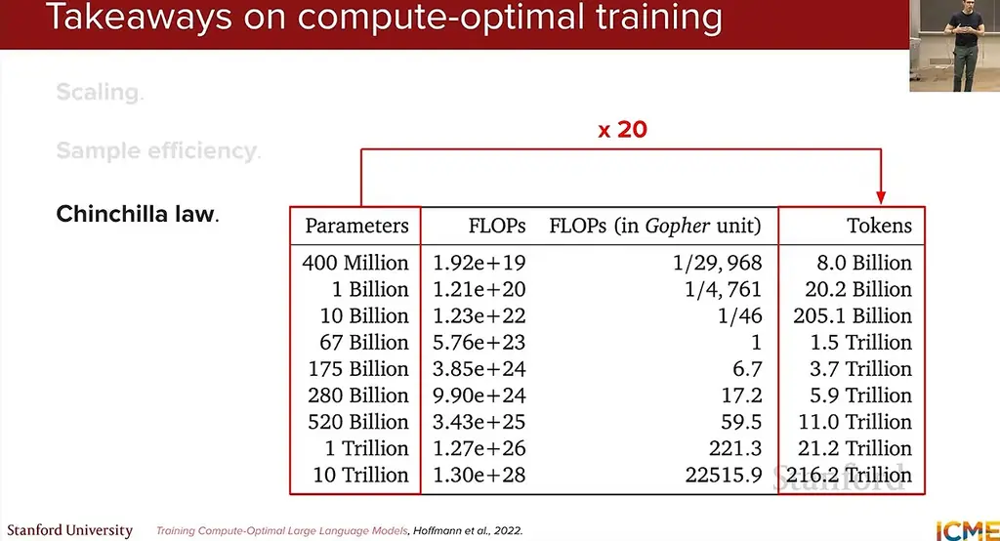
*[▶ 00:25:48](https://www.youtube.com/watch?v=GaIeu3npx04&t=1548s) · Chinchilla law compute-optimal table*

Optimal parameters and tokens both grow with compute, so model size and data should scale together.

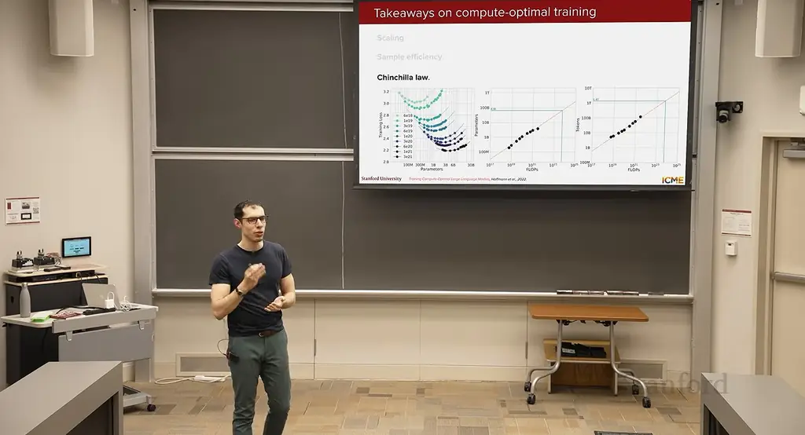
*[▶ 00:26:19](https://www.youtube.com/watch?v=GaIeu3npx04&t=1579s) · Compute-optimal scaling curves (three plots)*

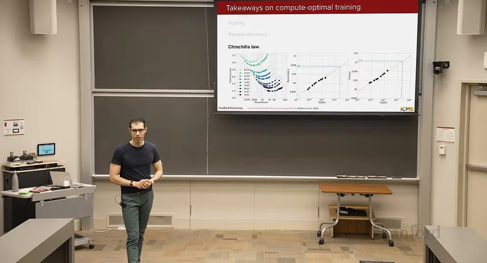
*[▶ 00:26:46](https://www.youtube.com/watch?v=GaIeu3npx04&t=1606s) · Compute-optimal scaling curves (three plots)*

Lowercase FLOPs measures training compute, around 10^25 for an LLM. Uppercase FLOPS or FLOP/s measures hardware speed. The two are easy to confuse.

An LLM is a language model that assigns probabilities to token sequences, trained to predict the next token with cross-entropy. "Large" means billions to hundreds of billions of parameters, now even trillions, trained on hundreds of billions to tens of trillions of tokens.

Since an input does not need every parameter, a **mixture of experts** activates only some of them, chosen by a router. Dense MoE weights all experts, so it still runs everything. Sparse MoE, used in LLMs, keeps the top-k experts and sums their gated outputs. It replaces the feed-forward network, not attention, and the router is learned by backpropagation.

The risk is **routing collapse**: experts chosen early get trained most and dominate, so the effective model is smaller than its parameter count.

## Balancing MoE experts and restoring token position

[▶ 00:37:27](https://www.youtube.com/watch?v=GaIeu3npx04&t=2247s)

Mixture-of-experts training has **routing collapse**, where one expert is picked most of the time. The remedy is an auxiliary load-balancing loss that pushes the fraction of tokens sent to each expert toward uniform. Routing happens per token. The fraction term is treated as a constant (stop-gradient), so gradients flow through the routing probabilities instead.

Mixtral's layer colors show tokens spread across many experts.

```python
class MoeLayer(nn.Module):
    def __init__(self, experts: List[nn.Module], …
        super().__init__()
        assert len(experts) > 0
        self.experts = nn.ModuleList(experts)
        self.gate = gate
        self.args = moe_args

    def forward(self, inputs: torch.Tensor):
        inputs_squashed = inputs.view(-1, inputs.…
        gate_logits = self.gate(inputs_squashed)
        weights, selected_experts = torch.topk(
            gate_logits, self.args.num_experts_pe…
        )
        weights = nn.functional.softmax(
            weights,
            dim=1,
            dtype=torch.float,
        ).type_as(inputs)
        results = torch.zeros_like(inputs_squashe…
        for i, expert in enumerate(self.experts):
            batch_idx, nth_expert = torch.where(s…
            results[batch_idx] += weights[batch_id…
                inputs_squashed[batch_idx]
            )
        return results.view_as(inputs)
```

*[▶ 00:39:57](https://www.youtube.com/watch?v=GaIeu3npx04&t=2397s) · Interpreting experts: Mixtral MoE layer code, colored by expert*

Recent models add **shared experts** that run for every token, so routed experts don't relearn common computation.

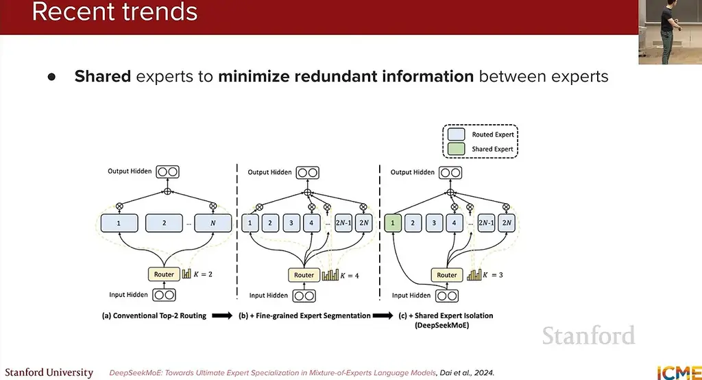
*[▶ 00:40:25](https://www.youtube.com/watch?v=GaIeu3npx04&t=2425s) · Shared experts: DeepSeekMoE routing diagrams*

Models also use many finer experts, dozens to hundreds rather than 8 or 16.

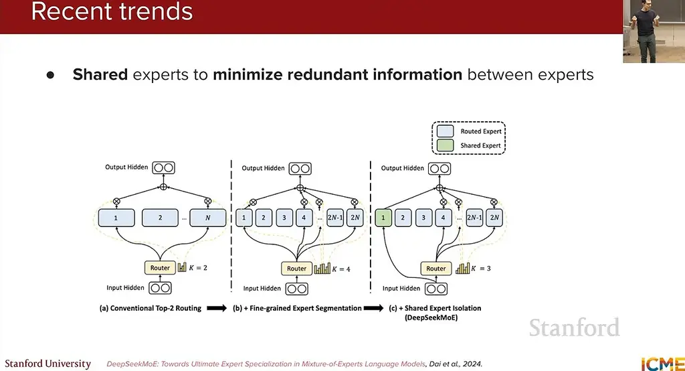
*[▶ 00:40:49](https://www.youtube.com/watch?v=GaIeu3npx04&t=2449s) · Routed vs. shared expert architecture diagrams*

In DeepSeekMoE's benchmarks, finer experts with one shared expert score higher on every metric.

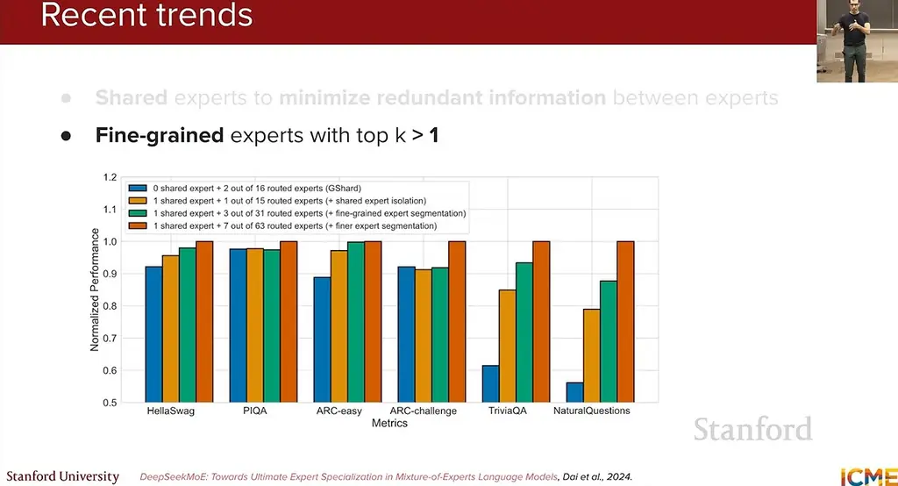
*[▶ 00:41:26](https://www.youtube.com/watch?v=GaIeu3npx04&t=2486s) · Normalized performance for fine-grained expert configurations*

Top open-weight models have hundreds of experts.

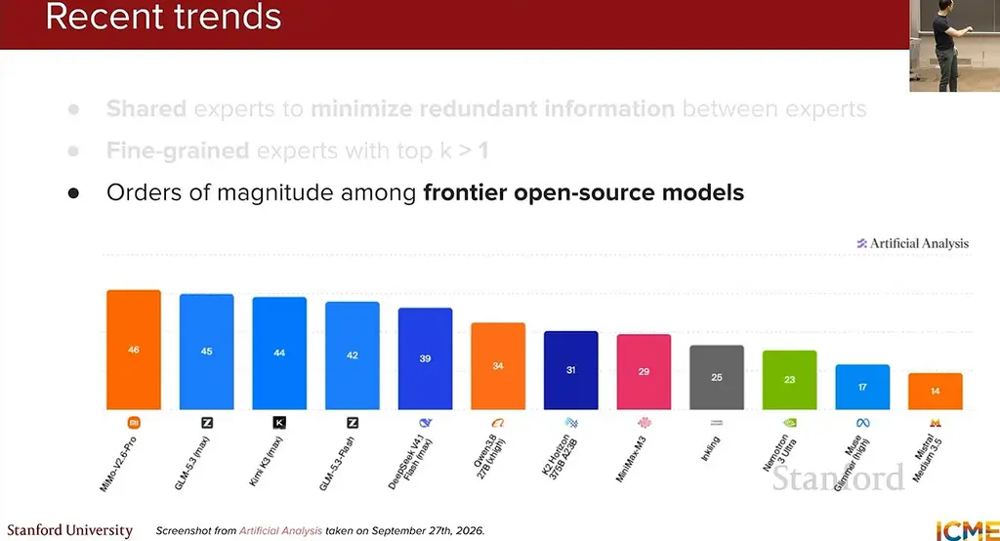
*[▶ 00:41:59](https://www.youtube.com/watch?v=GaIeu3npx04&t=2519s) · Orders of magnitude among frontier open-source models*

MiMo-V2.6 Pro has 384 experts, 8 routed, no shared expert, and 1.02T parameters. GLM-5 has 256 experts, 8 routed and one shared, at 744B. DeepSeek V4.1 Flash has 384 experts, 6 routed and one shared, at 552B.

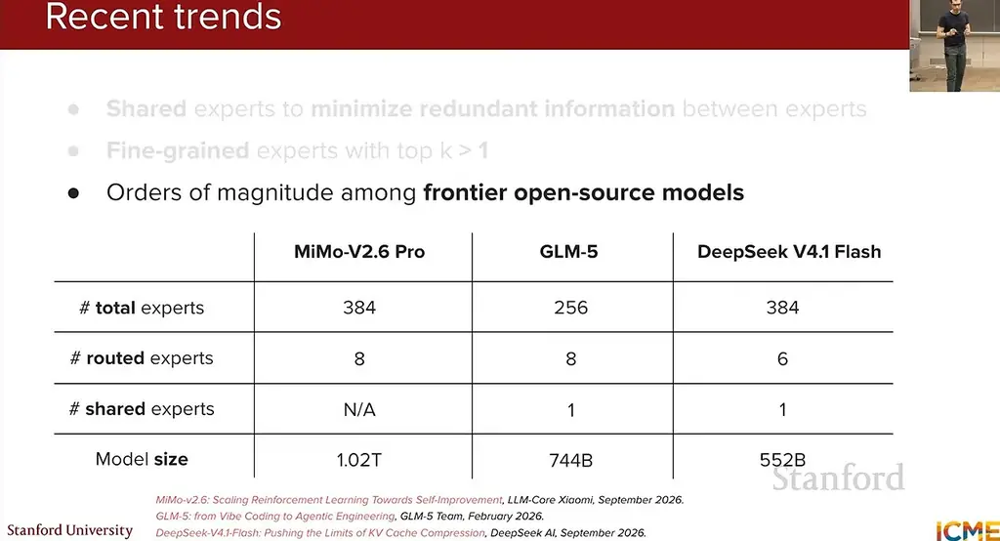
*[▶ 00:42:19](https://www.youtube.com/watch?v=GaIeu3npx04&t=2539s) · Recent trends: frontier open-source MoE models*

Self-attention discards token positions. Learned position embeddings cannot cover lengths beyond training, while the original paper's deterministic formula can generalize.

## Sinusoidal position embeddings

[▶ 00:48:26](https://www.youtube.com/watch?v=GaIeu3npx04&t=2906s)

Fixed sinusoidal encodings handle longer sequences without training on them, and perform roughly as well as learned embeddings. Each position gets a hardcoded vector that identifies it, and nearby positions score as more similar.

A watch's hour, minute and second hands turn at different speeds, so together they give the exact time.

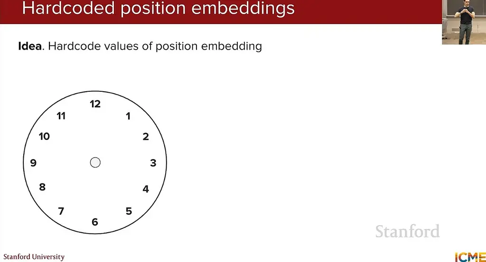
*[▶ 00:49:07](https://www.youtube.com/watch?v=GaIeu3npx04&t=2947s) · Hardcoded position embeddings*

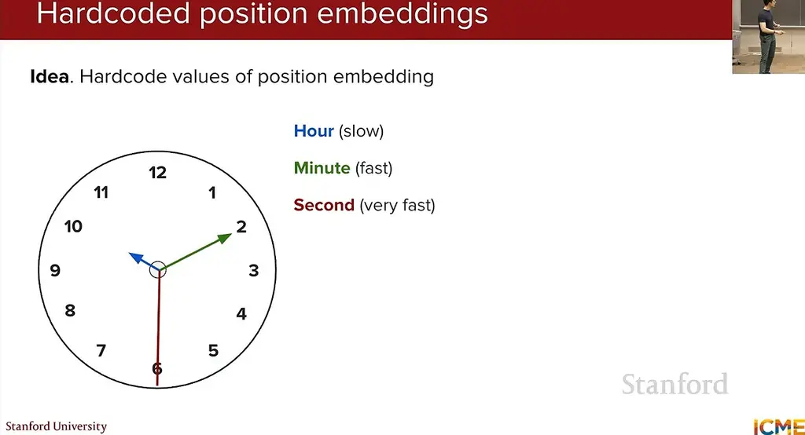
*[▶ 00:50:33](https://www.youtube.com/watch?v=GaIeu3npx04&t=3033s) · Clock hands as multi-frequency position signals*

Each index pair 2i and 2i+1 holds a sine and a cosine of the position, with frequency set by i: low i means high frequency.

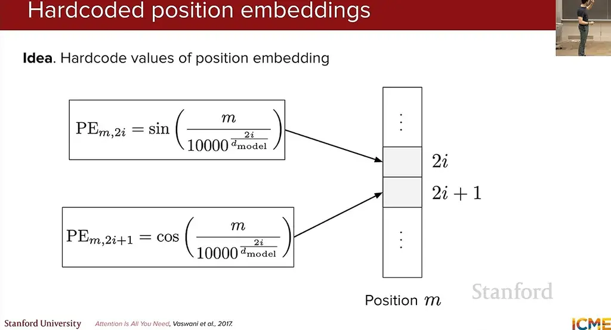
*[▶ 00:51:45](https://www.youtube.com/watch?v=GaIeu3npx04&t=3105s) · Sinusoidal position embedding formulas*


*[▶ 00:51:58](https://www.youtube.com/watch?v=GaIeu3npx04&t=3118s) · Sinusoidal position embedding formulas*

Low indices vary fast across positions, high indices slowly.

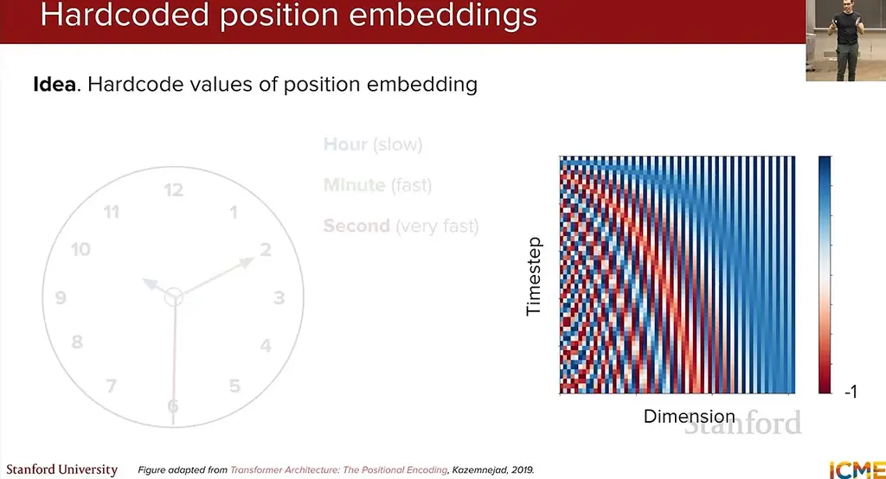
*[▶ 00:50:54](https://www.youtube.com/watch?v=GaIeu3npx04&t=3054s) · Positional encoding heatmap over timestep and dimension*

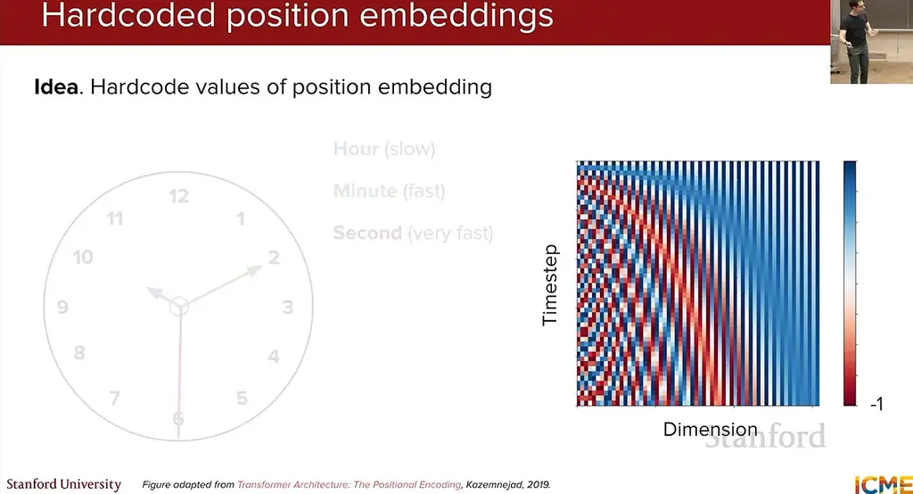
*[▶ 00:52:18](https://www.youtube.com/watch?v=GaIeu3npx04&t=3138s) · Clock analogy and position embedding heatmap*

Dot products between positions reduce to cos(ω_i(m−n)) terms, so similarity depends on the offset m−n.

## Hardcoded position embeddings encode relative distance

[▶ 00:55:18](https://www.youtube.com/watch?v=GaIeu3npx04&t=3318s)

The dot product of two position embeddings depends only on the offset m − n. Cosine peaks at zero, so similarity is highest when positions match.

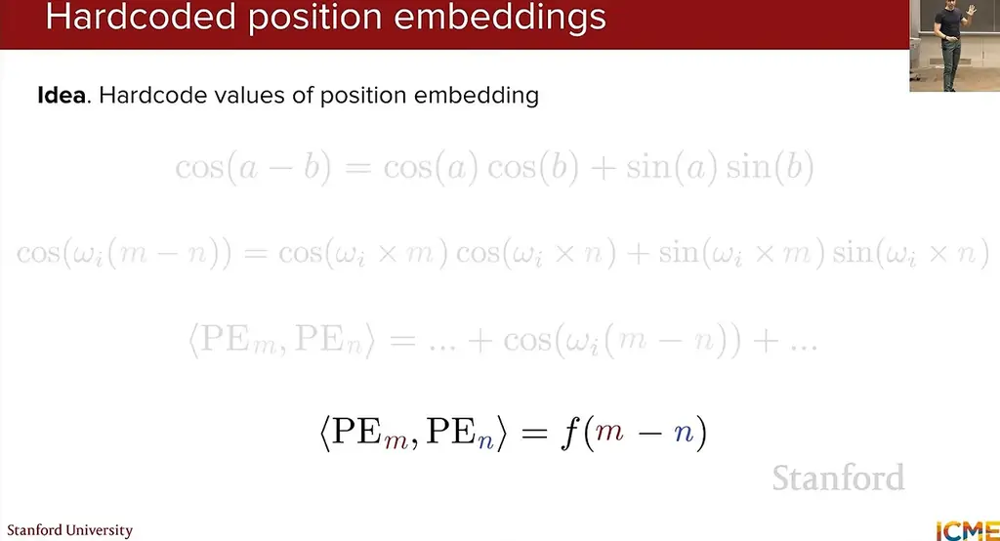
*[▶ 00:55:32](https://www.youtube.com/watch?v=GaIeu3npx04&t=3332s) · Hardcoded position embeddings: similarity as f(m − n)*

Nearby positions are more similar than distant ones.

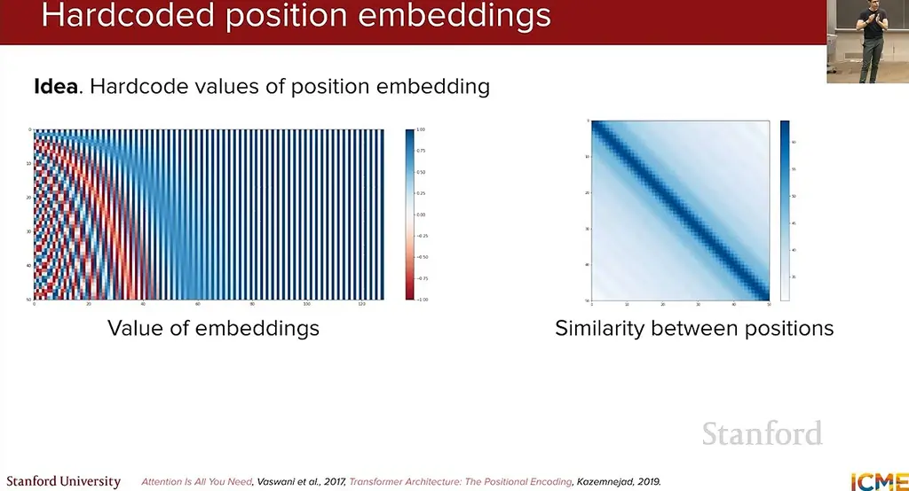
*[▶ 00:56:11](https://www.youtube.com/watch?v=GaIeu3npx04&t=3371s) · Hardcoded embeddings: values and position similarity*

The plots make this less intimidating.

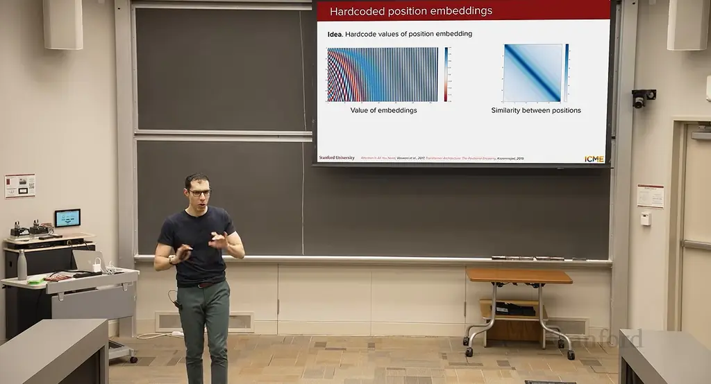
*[▶ 00:56:40](https://www.youtube.com/watch?v=GaIeu3npx04&t=3400s) · Hardcoded embeddings: values and position similarity (speaker view)*

Hardcoded embeddings aren't used today, because attention needs relative position: what matters is where tokens are relative to each other.

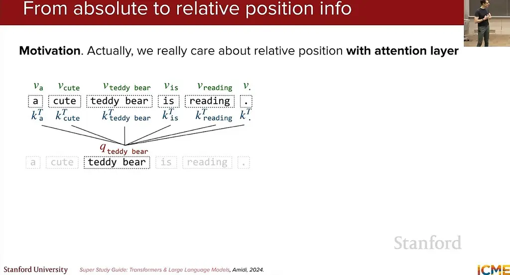
*[▶ 00:57:09](https://www.youtube.com/watch?v=GaIeu3npx04&t=3429s) · From absolute to relative position info*

## Injecting position into attention, not the input

[▶ 00:57:16](https://www.youtube.com/watch?v=GaIeu3npx04&t=3436s)

Position matters mainly in attention, where tokens exchange information, so the fix targets that layer rather than every layer.

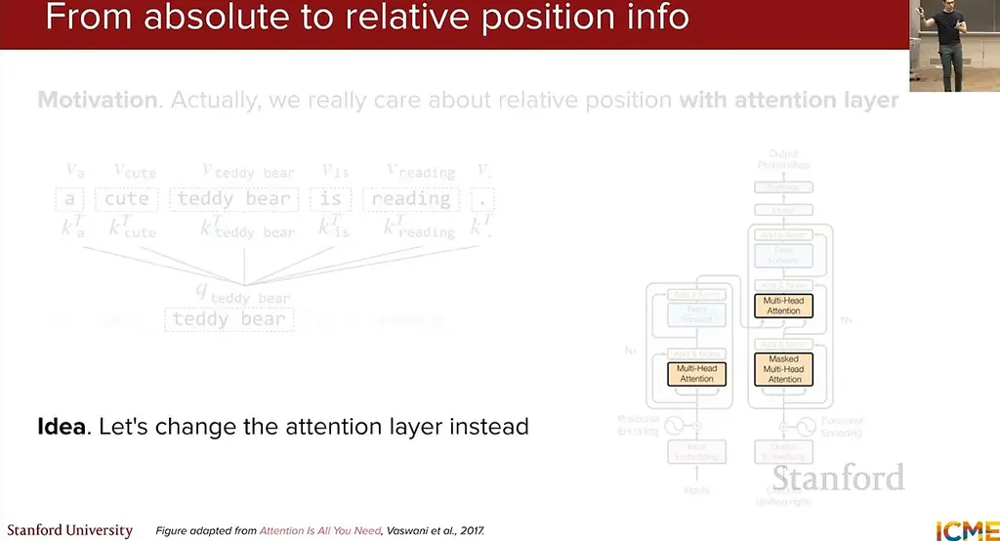
*[▶ 00:57:49](https://www.youtube.com/watch?v=GaIeu3npx04&t=3469s) · From absolute to relative position info*

Distant tokens stay directly connected and are merely less relevant, not cut off, so the model can still let them interact.

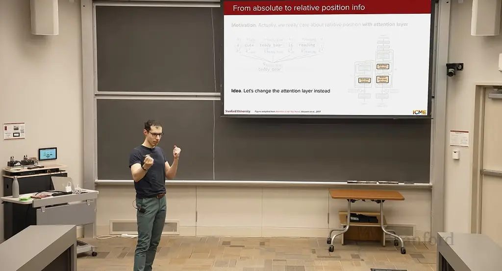
*[▶ 00:58:04](https://www.youtube.com/watch?v=GaIeu3npx04&t=3484s) · From absolute to relative position info*

Hardcoded sinusoidal encodings make similarity fall off with distance.

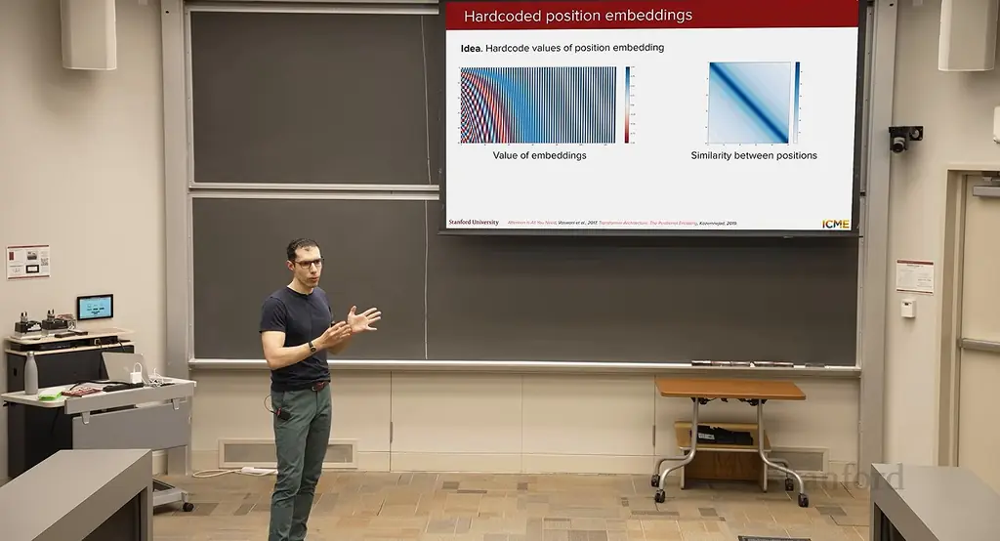
*[▶ 00:58:48](https://www.youtube.com/watch?v=GaIeu3npx04&t=3528s) · Hardcoded position embeddings*

Adding position embeddings to token embeddings pushes absolute position through all layers, though feed-forward networks don't need it.

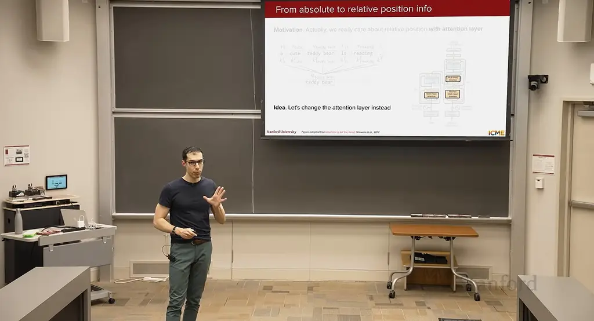
*[▶ 00:59:16](https://www.youtube.com/watch?v=GaIeu3npx04&t=3556s) · From absolute to relative position info*


*[▶ 01:00:01](https://www.youtube.com/watch?v=GaIeu3npx04&t=3601s) · From absolute to relative position info*

## Position through rotation, not bias

[▶ 00:59:54](https://www.youtube.com/watch?v=GaIeu3npx04&t=3594s)

Some methods change the attention layer itself. **T5 bias** learns a per-head bias from the distance m−n, but it must be trained, may inherit biases in the training data, and does not generalize to all distances. **ALiBi** (attention with linear biases) uses a fixed bias that is linear in n−m.

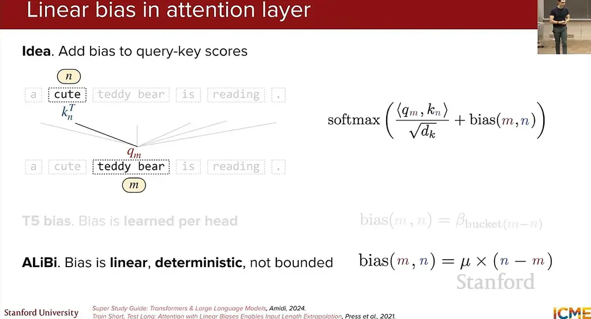
*[▶ 01:01:57](https://www.youtube.com/watch?v=GaIeu3npx04&t=3717s) · Linear bias in attention layer*

**RoPE** (rotary position embeddings) is the default today. It adds no bias. It rotates each query and key with a 2D rotation matrix, by an angle set by its position.

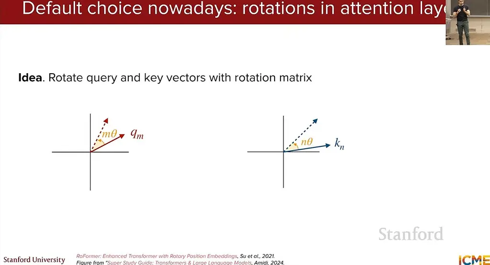
*[▶ 01:02:41](https://www.youtube.com/watch?v=GaIeu3npx04&t=3761s) · Rotating query and key vectors*

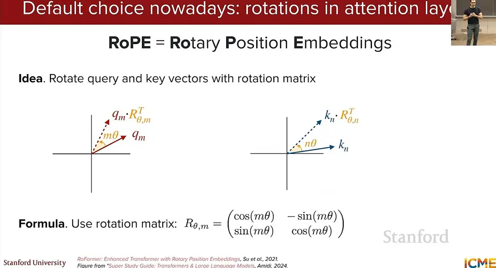
*[▶ 01:02:24](https://www.youtube.com/watch?v=GaIeu3npx04&t=3744s) · RoPE: rotary position embeddings*

Rotating q_m by mθ and k_n by nθ makes their dot product depend on n−m, with nothing learned. Higher dimensions rotate 2D blocks, each at its own index-based angle.

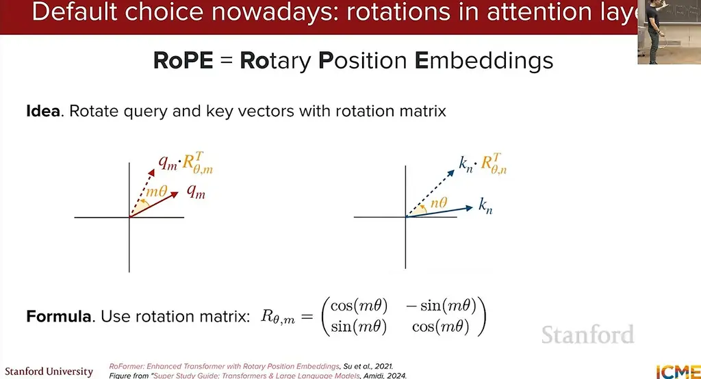
*[▶ 01:07:33](https://www.youtube.com/watch?v=GaIeu3npx04&t=4053s) · RoPE: rotating query and key vectors*

Query-key dot products tend to shrink as tokens move apart, which fits the goal of weighting distant tokens less.

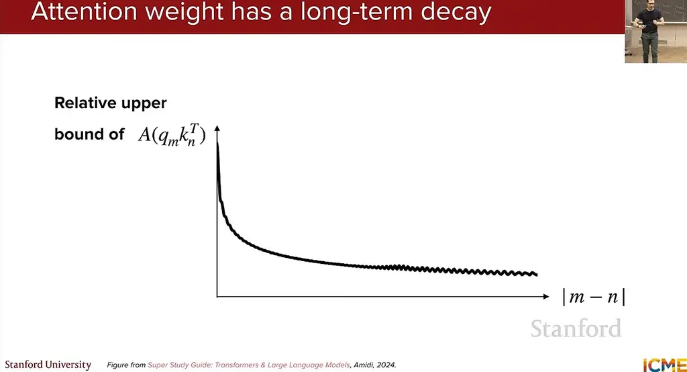
*[▶ 01:08:52](https://www.youtube.com/watch?v=GaIeu3npx04&t=4132s) · Attention weight long-term decay*

The original Transformer added position embeddings to its inputs; RoPE replaces that. Sparse attention, as in Longformer, asks whether every token must attend to every other.

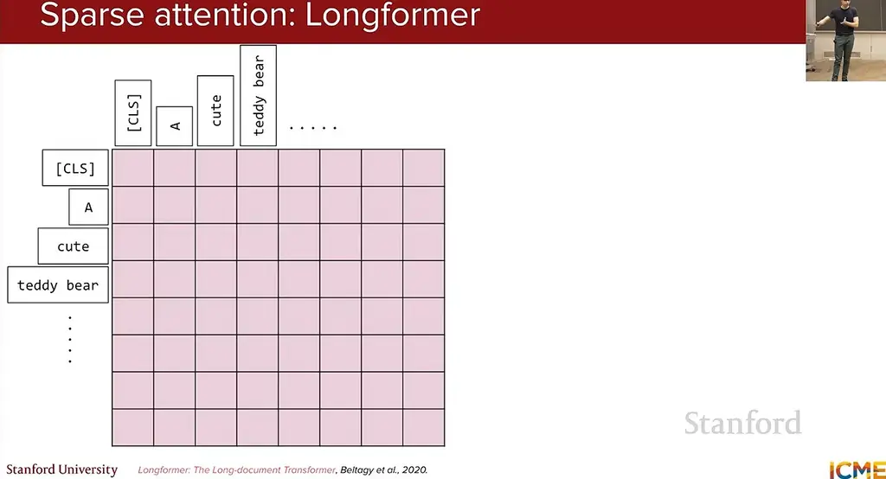
*[▶ 01:09:48](https://www.youtube.com/watch?v=GaIeu3npx04&t=4188s) · Sparse attention: Longformer*

## Sparse and sliding-window attention

[▶ 01:09:35](https://www.youtube.com/watch?v=GaIeu3npx04&t=4175s)

Attending to everything at every layer is costly; sparser attention is an option.

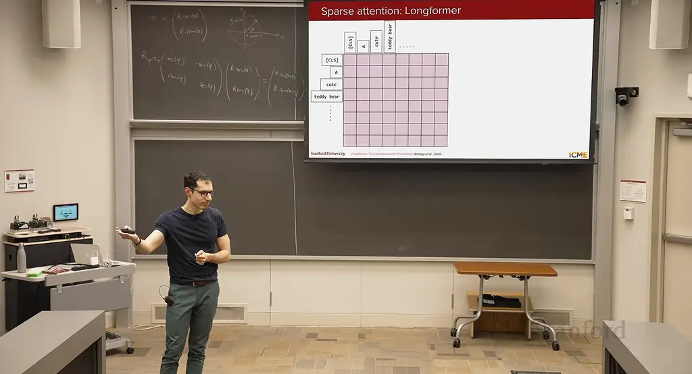
*[▶ 01:10:00](https://www.youtube.com/watch?v=GaIeu3npx04&t=4200s) · Sparse attention: Longformer*

**Sliding window attention** (SWA) restricts each token to positions within a set distance, also called local attention.

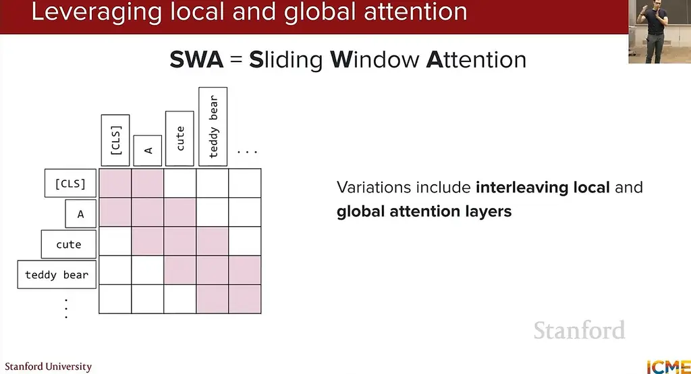
*[▶ 01:10:25](https://www.youtube.com/watch?v=GaIeu3npx04&t=4225s) · Leveraging local and global attention*


*[▶ 01:10:37](https://www.youtube.com/watch?v=GaIeu3npx04&t=4237s) · Sliding window attention mask with local and global variations*

Stacked blocks extend reach: a token indirectly sees representations from beyond its window.

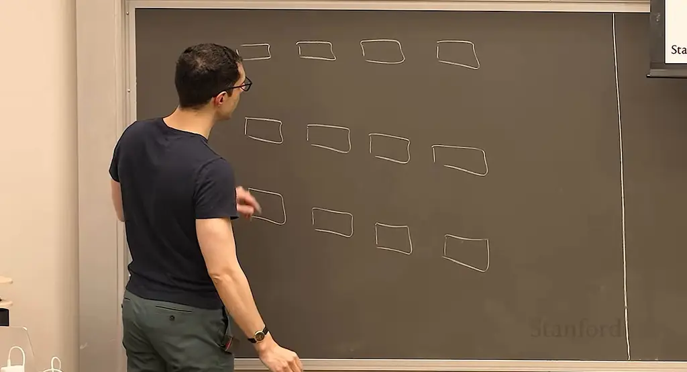
*[▶ 01:11:40](https://www.youtube.com/watch?v=GaIeu3npx04&t=4300s) · Blackboard token boxes in layered rows*

Mistral 7B stacks this across layers.

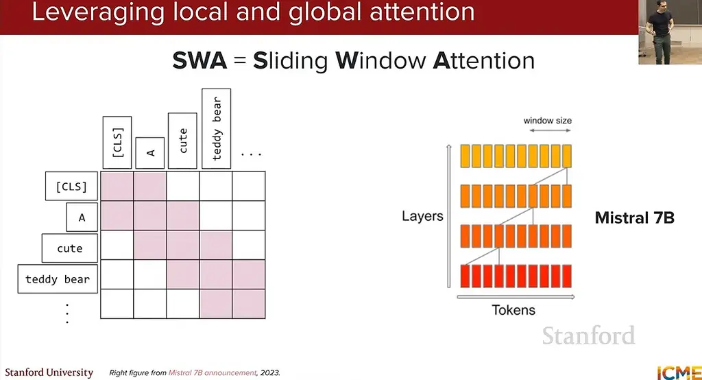
*[▶ 01:10:48](https://www.youtube.com/watch?v=GaIeu3npx04&t=4248s) · SWA mask and Mistral 7B layer window diagram*

Variations interleave local and global attention layers.

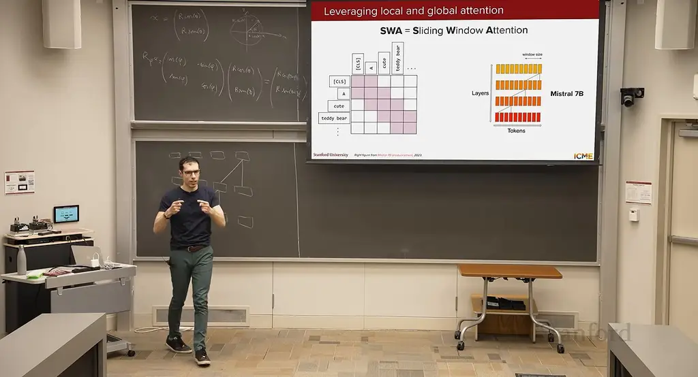
*[▶ 01:12:32](https://www.youtube.com/watch?v=GaIeu3npx04&t=4352s) · Leveraging local and global attention: SWA*

## Stacking reaches farther; sharing key/value heads saves memory

[▶ 01:12:19](https://www.youtube.com/watch?v=GaIeu3npx04&t=4339s)

Stacked attention blocks reach beyond the local window, much like receptive fields in convolutional networks.

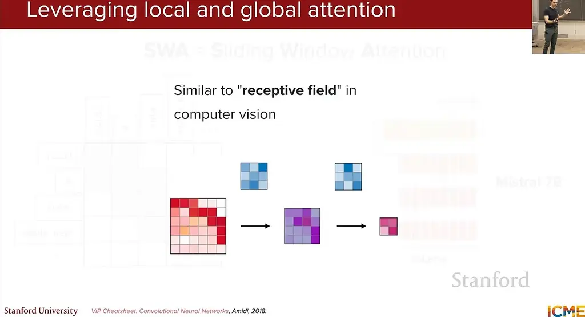
*[▶ 01:13:08](https://www.youtube.com/watch?v=GaIeu3npx04&t=4388s) · Receptive field analogy to convolutions*

While decoding, each new token attends to all earlier keys, so those keys are saved rather than recomputed.

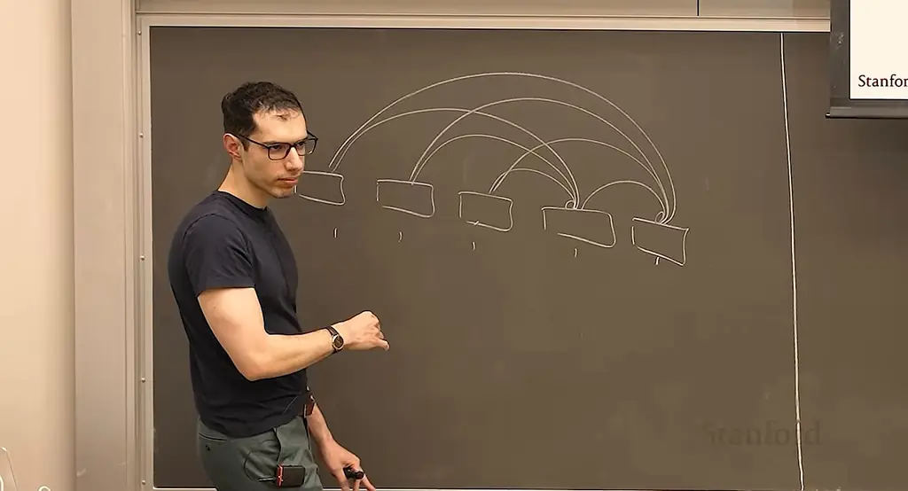
*[▶ 01:14:43](https://www.youtube.com/watch?v=GaIeu3npx04&t=4483s) · Causal attention arcs between tokens*

Keys take memory that grows with output length, and multi-head attention multiplies them, so the goal is fewer keys and values per token.


*[▶ 01:16:04](https://www.youtube.com/watch?v=GaIeu3npx04&t=4564s) · Sharing attention heads: key/value groups idea*

Sharing key and value heads within groups of query heads does this.


*[▶ 01:13:43](https://www.youtube.com/watch?v=GaIeu3npx04&t=4423s) · Sharing attention heads*

## Sharing keys and values across heads

[▶ 01:16:27](https://www.youtube.com/watch?v=GaIeu3npx04&t=4587s)

Decoding keeps keys and values for every past token, straining memory. Sharing projection matrices cuts that. **MQA** uses one key and value head for all query heads.


*[▶ 01:16:42](https://www.youtube.com/watch?v=GaIeu3npx04&t=4602s) · G = 1: Multi-Query Attention (MQA)*


*[▶ 01:17:20](https://www.youtube.com/watch?v=GaIeu3npx04&t=4640s) · Sharing attention heads: MQA (G = 1)*

**GQA** shares keys and values within G groups and is the more common choice. MHA (G = h) gives each head its own.


*[▶ 01:16:53](https://www.youtube.com/watch?v=GaIeu3npx04&t=4613s) · 1 < G < h: Group-Query Attention (GQA)*


*[▶ 01:17:06](https://www.youtube.com/watch?v=GaIeu3npx04&t=4626s) · G = h: Multi-Head Attention (MHA)*


*[▶ 01:18:06](https://www.youtube.com/watch?v=GaIeu3npx04&t=4686s) · Sharing attention heads: MQA vs GQA*

**Post-norm** applies LayerNorm after the residual addition.


*[▶ 01:18:31](https://www.youtube.com/watch?v=GaIeu3npx04&t=4711s) · Different kinds of layer normalization: Post-Norm*

## Pre-Norm, RMSNorm, and next-token generation

[▶ 01:18:19](https://www.youtube.com/watch?v=GaIeu3npx04&t=4699s)

**Post-Norm** normalizes after the residual addition, which hinders gradient flow.


*[▶ 01:19:02](https://www.youtube.com/watch?v=GaIeu3npx04&t=4742s) · Different kinds of layer normalization: Post-Norm*

**Pre-Norm** normalizes before the sublayer and is common.


*[▶ 01:19:33](https://www.youtube.com/watch?v=GaIeu3npx04&t=4773s) · Different kinds of layer normalization*


*[▶ 01:19:40](https://www.youtube.com/watch?v=GaIeu3npx04&t=4780s) · Pre-norm vs post-norm diagram (speaker shot)*

**RMSNorm** rescales with one learned factor and skips recentering, performing as well as LayerNorm, so it is preferred.


*[▶ 01:20:36](https://www.youtube.com/watch?v=GaIeu3npx04&t=4836s) · Normalization now: LayerNorm vs RMSNorm*

Generation is **autoregressive**: from BOS, the model predicts one token at a time.


*[▶ 01:21:48](https://www.youtube.com/watch?v=GaIeu3npx04&t=4908s) · Next token prediction*

A linear layer projects onto the vocabulary, then softmax gives probabilities.


*[▶ 01:22:08](https://www.youtube.com/watch?v=GaIeu3npx04&t=4928s) · Predicting next token: transformer decoder*

## Greedy decoding, beam search, and sampling

[▶ 01:22:16](https://www.youtube.com/watch?v=GaIeu3npx04&t=4936s)

Greedy decoding takes the most probable next token, but local choices can miss the best full sequence.


*[▶ 01:23:10](https://www.youtube.com/watch?v=GaIeu3npx04&t=4990s) · Greedy decoding: highest-probability next token*

Beam search keeps the k most likely paths at each step, avoiding full joint-probability search, and ends each path at [EOS].


*[▶ 01:23:28](https://www.youtube.com/watch?v=GaIeu3npx04&t=5008s) · Beam search: keep k most likely paths*


*[▶ 01:23:46](https://www.youtube.com/watch?v=GaIeu3npx04&t=5026s) · Beam search: expanding candidate paths*


*[▶ 01:23:57](https://www.youtube.com/watch?v=GaIeu3npx04&t=5037s) · Beam search: pruned tree ending at EOS*

Beam search costs more compute and is deterministic, which can make chatbots feel robotic.


*[▶ 01:25:02](https://www.youtube.com/watch?v=GaIeu3npx04&t=5102s) · Predicting next token with beam search*

Sampling draws the next token from the distribution instead.


*[▶ 01:26:53](https://www.youtube.com/watch?v=GaIeu3npx04&t=5213s) · Predicting next token with sampling*

Top-k samples among the k most probable tokens; top-p samples among the smallest set whose cumulative probability reaches p.

## Determinism, structured output and context limits

[▶ 01:27:35](https://www.youtube.com/watch?v=GaIeu3npx04&t=5255s)

With temperature 0, output should still be deterministic, but inference engines batch your request with others, and results can change. The cause is floating-point non-associativity: changing the order of additions changes the result. Determinism suits tasks like summarization and LLM-as-a-judge ratings; elsewhere sampling is often more useful.

Temperature divides the scores before softmax. Above 1 the distribution flattens; small values concentrate probability on the top token. Determinism is a continuous setting, not a switch.


*[▶ 01:30:35](https://www.youtube.com/watch?v=GaIeu3npx04&t=5435s) · Temperature allows to tweak output probabilities*

Prompting for JSON usually works but is not reliable. **Guided decoding** restricts the tokens allowed at each step to those the target syntax permits.

```json
{
    "first_name": "teddy",
    "last_name": "bear",
    "age": 33,
    "hobby": "reading"
}
```

*[▶ 01:34:42](https://www.youtube.com/watch?v=GaIeu3npx04&t=5682s) · Desired JSON output for the teddy bear prompt*

Each generated token is fed back as input, so the context window holds prompt and output together. Inputs reach about 1M tokens and outputs about 100K. Google's Gemini 4 Argon raised its output limit from 64K to 1M tokens. A token is about 3/4 of a word, so 100K tokens is roughly a book.


*[▶ 01:38:06](https://www.youtube.com/watch?v=GaIeu3npx04&t=5886s) · Gemini 4 Argon output token limit*

More input is not always better. In needle-in-a-haystack tests, GPT-4 128K started to degrade at large context lengths when the fact sat 10%–50% into the document.


*[▶ 01:39:24](https://www.youtube.com/watch?v=GaIeu3npx04&t=5964s) · Needle In A Haystack retrieval heatmap for GPT-4*

This is context rot: more noise makes retrieval harder, so compact context and start new chats.


*[▶ 01:39:36](https://www.youtube.com/watch?v=GaIeu3npx04&t=5976s) · Pressure testing GPT-4 needle-in-a-haystack heatmap*

In-context learning puts examples in the prompt to teach format without changing weights. It can overfit to the examples and adds input tokens, raising cost and latency, so handcrafted instructions often replace examples.

Chain of thought shows reasoning steps in examples. **Self-consistency** samples several reasoning paths and keeps the majority answer.


*[▶ 01:42:55](https://www.youtube.com/watch?v=GaIeu3npx04&t=6175s) · Self-consistency: aggregate over reasoning paths*

## Links & resources

- [CME295 course syllabus — project site, linked in description](https://cme295.stanford.edu/syllabus/) — <https://cme295.stanford.edu/syllabus/> · video description
- [CME295 lecture playlist on YouTube — full course series](https://youtube.com/playlist?list=PLakGfbKCei80&si=HF2tNywj7nXIQq8X) — <https://youtube.com/playlist?list=PLakGfbKCei80&si=HF2tNywj7nXIQq8X> · video description
- Lecture slides — speaker copies content from them, URL not shown · mentioned [▶ 01:05:14](https://www.youtube.com/watch?v=GaIeu3npx04&t=3914s)
- Horace He blog (captioned as Horus Haye) — recommended by speaker, URL not shown · mentioned [▶ 01:32:00](https://www.youtube.com/watch?v=GaIeu3npx04&t=5520s)
