# Continual Learning: How AI Agents Get Better With Every Use | Arjun Karanam, Trajectory

*Learn how production agent traces, corrective feedback, replayable tasks, and a system-wide training loop can make AI agents improve from real use.*

Source: [Continual Learning: How AI Agents Get Better With Every Use | Arjun Karanam, Trajectory](https://www.youtube.com/watch?v=eYrMF9Cht8A) · Arjun Karanam · Sequoia Capital · 22 min

## TL;DR

Frontier models keep gaining IQ but not experience, so every agent session still feels like a new hire's first day. Production agents already generate about 100 trillion tokens a day of real-world signal, and most of it is thrown away. The talk's answer is to keep full traces, turn corrections and retries into training signal, and optimize the whole system (weights, harness, and context) rather than weights alone. This matters because the economy pays most for experience, so capturing it is how agents get better with each use.

## Key takeaways

- Trace the entire run, including sub-agents and tool calls, because dropping them makes learning from the full trajectory hard.
- Capture corrections such as edits, undos, and retries rather than relying on thumbs up/down, since users often accept output and undo it later.
- Make every task rollable so real production sessions can be replayed, and grade agents in the actual production harness rather than a variant.
- Build harnesses from primitives like search or private data and let the agent orchestrate them instead of enforcing fixed flows, and make anything a user can do in the UI a tool call.
- Make tool responses informative, since a bare "done" gives an agent nothing to learn from.
- Keep facts that change, such as a delisted company, in context rather than model weights, and sort feedback by scope: tool failures belong in the model, while a user's "never use the sub-agent" belongs in context.
- Feedback without a correct answer (thumbs-downs, angry messages, dropped sessions) only lets the system penalize behavior, while successful retries and user corrections give a stronger reward signal.
- Avoid training directly on customer data: sample its distributions, generate synthetic data, and check that the synthetic data matches the real distribution before using it.

## Experience is already being generated, then thrown away

[▶ 00:00:00](https://www.youtube.com/watch?v=eYrMF9Cht8A&t=0s)

Frontier models gain IQ but no experience: they act like a brilliant new hire on day one. The economy pays most for experience, so the gap is the problem to close.

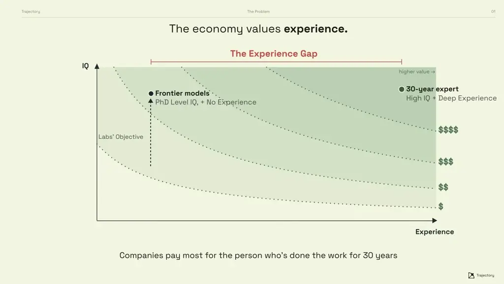
*[▶ 00:01:56](https://www.youtube.com/watch?v=eYrMF9Cht8A&t=116s) · The economy values experience*

Production agents already produce this experience, about 100 trillion tokens a day of real-world signal, and most of it is discarded.

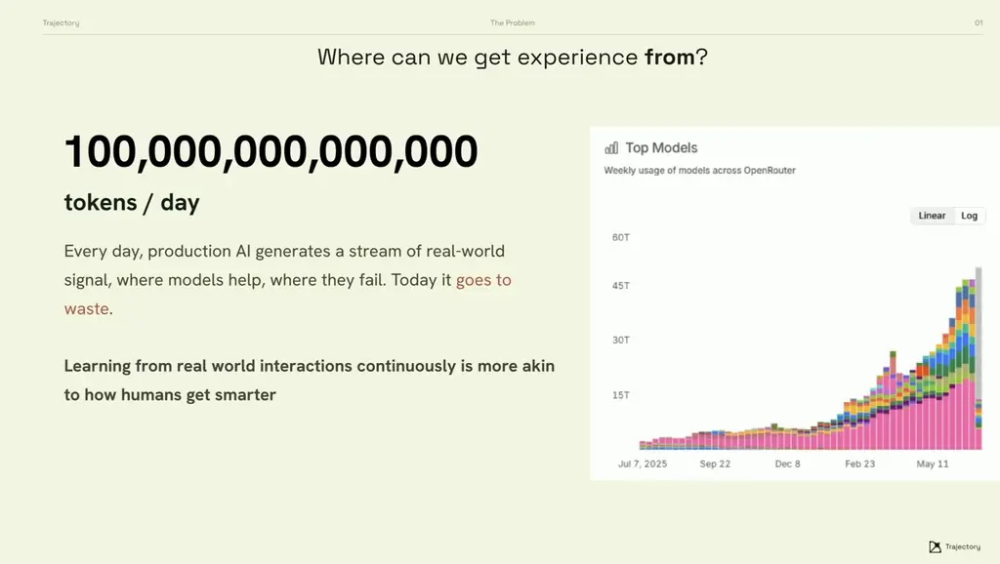
*[▶ 00:02:10](https://www.youtube.com/watch?v=eYrMF9Cht8A&t=130s) · Where can experience come from*

Traceability comes first: full traces plus product telemetry. Traces feed a model behavior spec, with evals that cover the full distribution of tasks and outcomes.

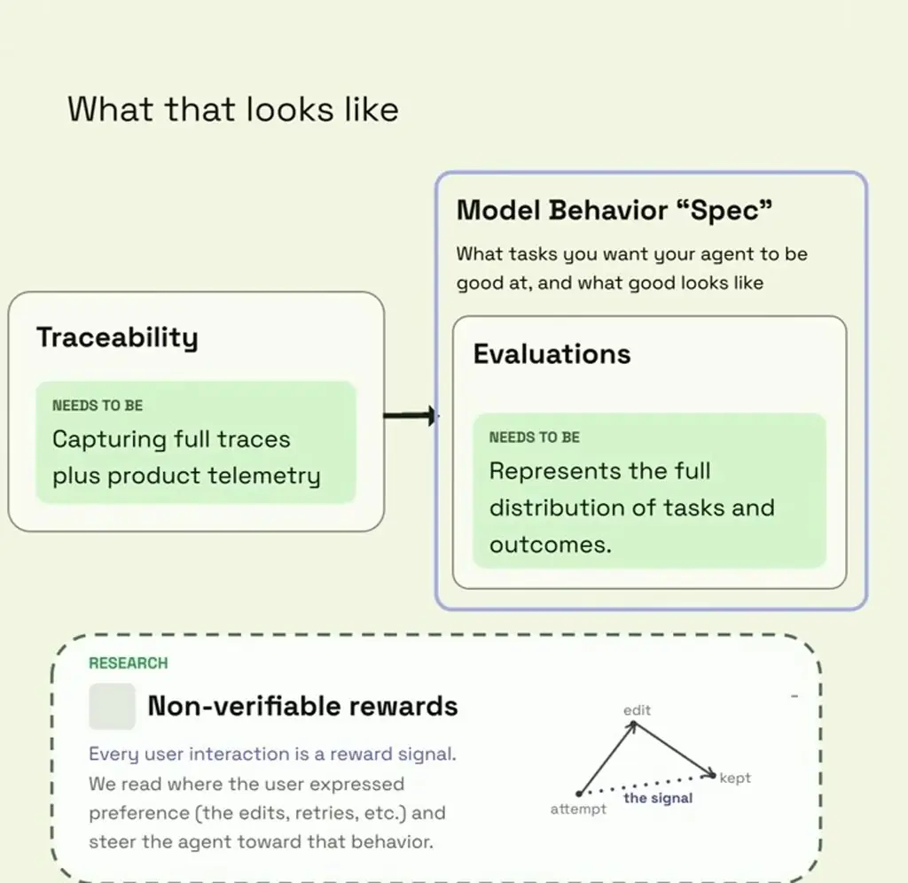
*[▶ 00:04:06](https://www.youtube.com/watch?v=eYrMF9Cht8A&t=246s) · What that looks like: traceability to specs*

RL can then improve models from full traces. The speaker cites SDPO, which scores every token instead of giving one scalar reward per trajectory.

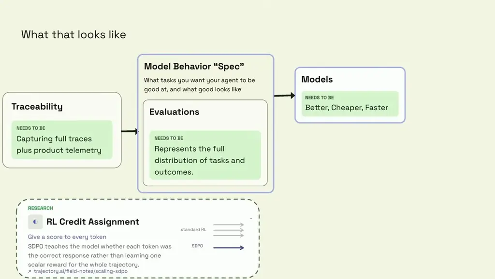
*[▶ 00:04:24](https://www.youtube.com/watch?v=eYrMF9Cht8A&t=264s) · What that looks like: traceability to models*

Harnesses take what models shouldn't memorize. A fact like a delisted company belongs in context, not weights. The harness co-evolves with the model and holds your domain knowledge.

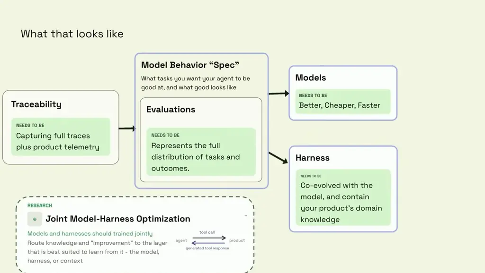
*[▶ 00:04:49](https://www.youtube.com/watch?v=eYrMF9Cht8A&t=289s) · What that looks like: adding harness branch*

The full pipeline ends in one-click deploy.

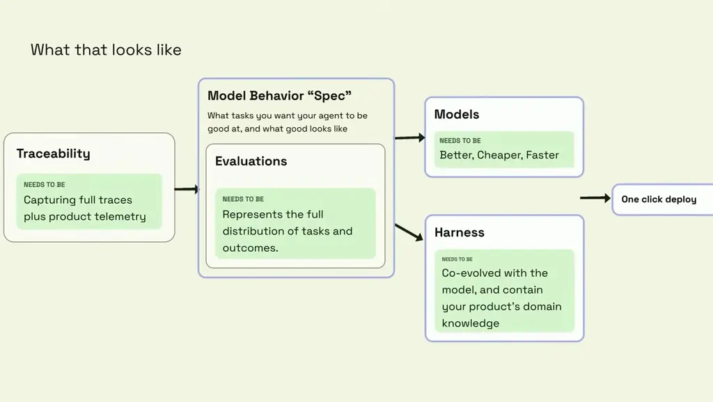
*[▶ 00:05:13](https://www.youtube.com/watch?v=eYrMF9Cht8A&t=313s) · What that looks like*

Wish one is about traceability, in two parts:

1. Trace the whole tree, sub-agents and tool calls included. Dropping them makes learning from the full run hard.
2. Capture corrections, not just ratings. Thumbs up/down is noisy: users accept everything, then undo five commits later. Edits, undos and retries carry the real preference signal.

## Replayable Tasks, Primitive Harnesses, Owned Weights

[▶ 00:08:03](https://www.youtube.com/watch?v=eYrMF9Cht8A&t=483s)

Most teams lack evals, so make every task **rollable** to replay real sessions, and grade agents in the real production harness, not a variant.

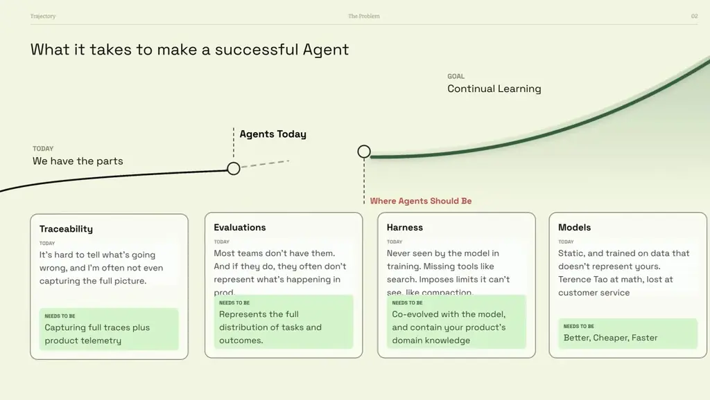
*[▶ 00:11:42](https://www.youtube.com/watch?v=eYrMF9Cht8A&t=702s) · What it takes to make a successful Agent (full slide)*

Build harnesses from **primitives** like search or private data, letting the agent orchestrate them instead of enforcing fixed flows. Make anything a user can do in the UI a tool call. Make tool responses informative; "done" gives an agent nothing to learn from.

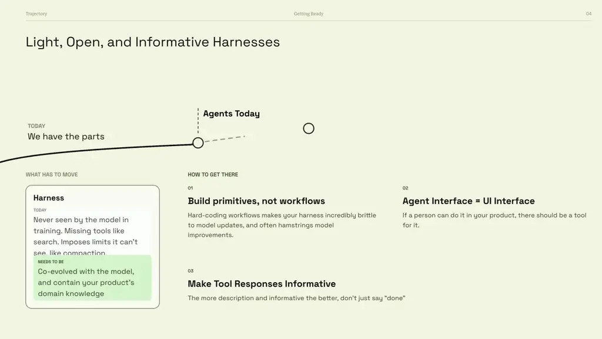
*[▶ 00:08:58](https://www.youtube.com/watch?v=eYrMF9Cht8A&t=538s) · Light, Open, and Informative Harnesses*

Open weights raise security and access questions, but they let you own and keep improving your weights. Route by task, not vendor.

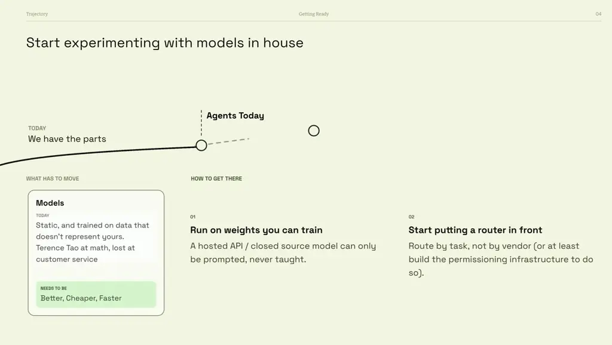
*[▶ 00:11:07](https://www.youtube.com/watch?v=eYrMF9Cht8A&t=667s) · Start experimenting with models in house*

## Owning Your Models and Learning From Use

[▶ 00:11:51](https://www.youtube.com/watch?v=eYrMF9Cht8A&t=711s)

Owning your intelligence shouldn't be consulted away. Trajectory aims to let any company own its models and learn from real interactions. Frontier customers such as Harvey and Mercor are already running agents in production.

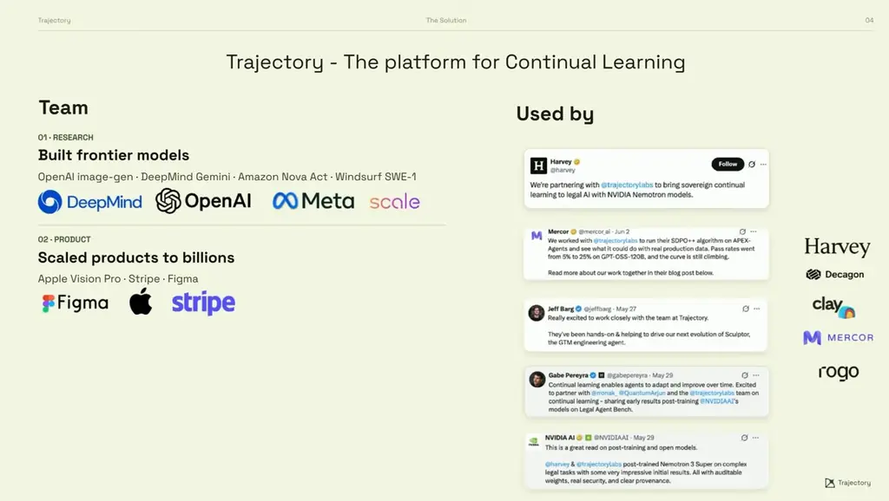
*[▶ 00:12:30](https://www.youtube.com/watch?v=eYrMF9Cht8A&t=750s) · Trajectory - The platform for Continual Learning*

Importing [Harvey LAB](https://github.com/harvey/harvey-labs)'s 1,760 tasks was easy.

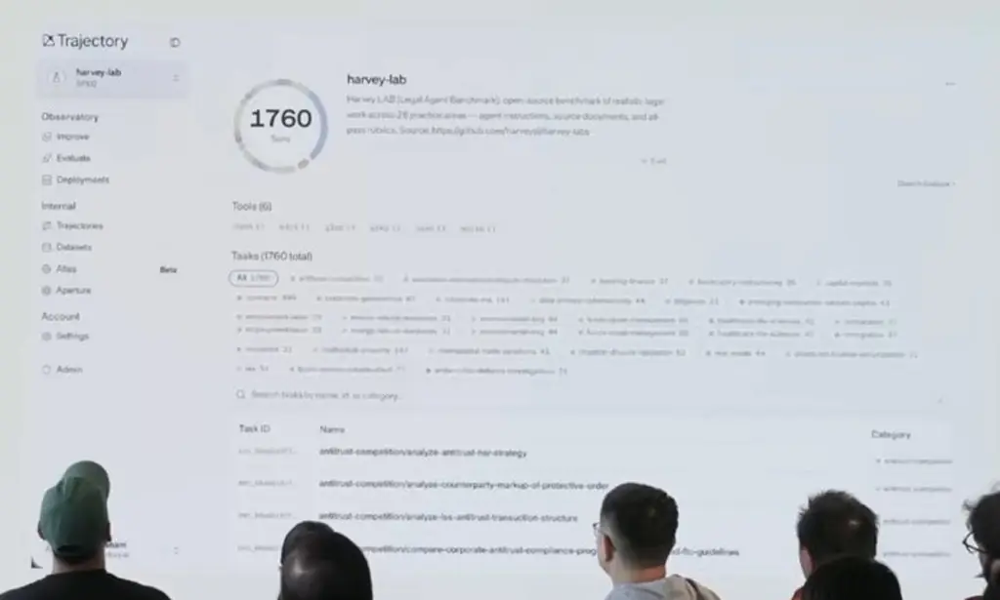
*[▶ 00:12:40](https://www.youtube.com/watch?v=eYrMF9Cht8A&t=760s) · Beta: harvey-lab dashboard on projected screen*

Tasks filter by category.

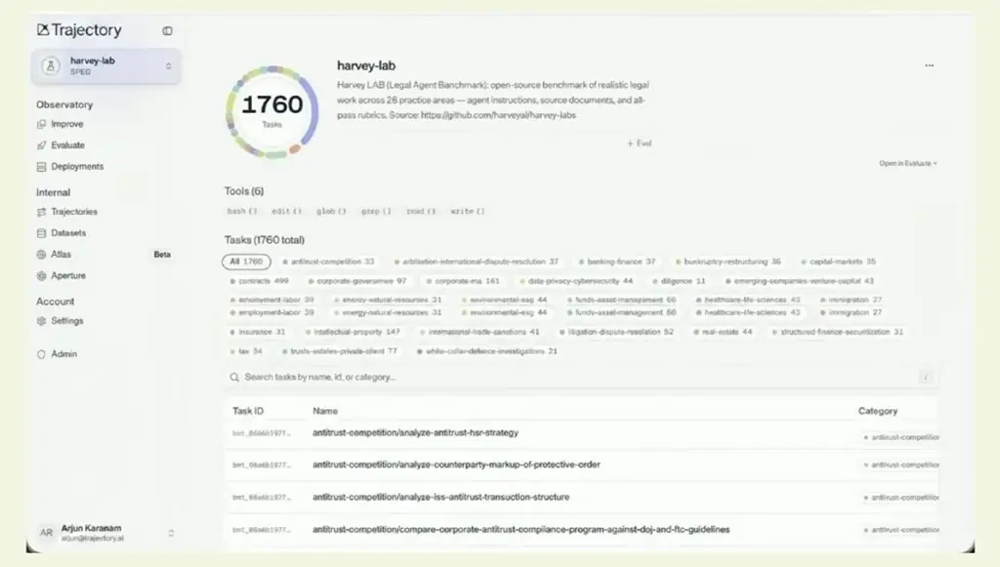
*[▶ 00:13:04](https://www.youtube.com/watch?v=eYrMF9Cht8A&t=784s) · Trajectory beta: harvey-lab benchmark dashboard*

Training's agent sets most post-training knobs and exposes only a few, such as output tokens and tool call limits.

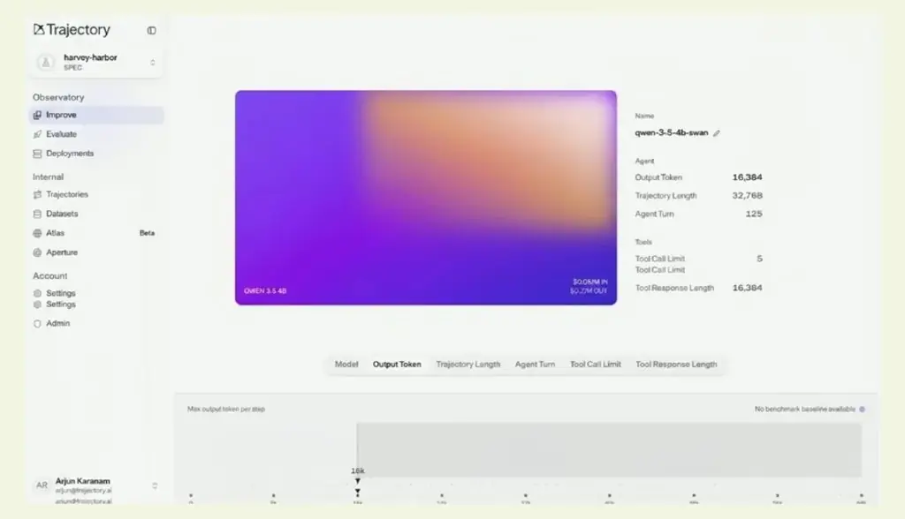
*[▶ 00:13:53](https://www.youtube.com/watch?v=eYrMF9Cht8A&t=833s) · Trajectory model config and agent settings*

Training runs track reward and held-out eval per step.

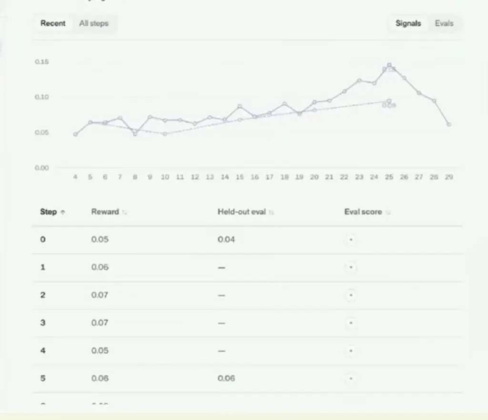
*[▶ 00:13:56](https://www.youtube.com/watch?v=eYrMF9Cht8A&t=836s) · Training run reward and held-out eval*

Evaluation compares checkpoints to the base model. Nemotron Nano at step 120 scored 0.21 against GPT-5 Mini's 0.11, which guides the deploy decision.

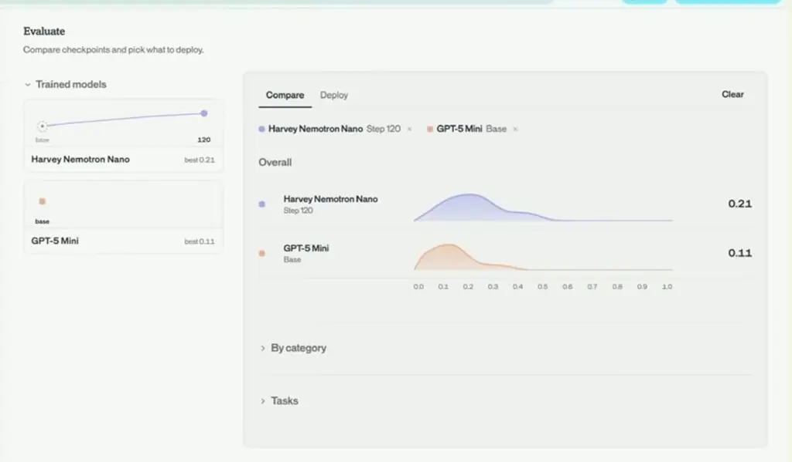
*[▶ 00:14:02](https://www.youtube.com/watch?v=eYrMF9Cht8A&t=842s) · Evaluate: compare checkpoints against base model*

Continual learning should optimize the whole system (weights, harness, context), updating whatever the new information requires.

Avoid training on customer data. Instead, sample its distributions, generate synthetic data, and compare distributions to confirm your data is on-distribution.

## Sorting feedback by signal and scope

[▶ 00:17:13](https://www.youtube.com/watch?v=eYrMF9Cht8A&t=1033s)

Feedback comes in two kinds. Thumbs-downs, angry messages or dropped sessions say something went wrong but give no correct answer, so the system can only penalize the behavior. Retries that succeed or user corrections give a confident reward.

Scope matters too. A tool that keeps failing is relevant to everyone and belongs in the model. A user saying "never use the sub-agent" belongs in context, not weights. Org- and customer-level preferences fall in between.

The biggest payoff is at the frontier. Tasks the model barely handles get learned in training, so users can then do what they couldn't before.

## Links & resources

- [Scaling SDPO field notes on Trajectory's site (traceability to models)](https://trajectory.ai/field-notes/scaling-sdpo) — <https://trajectory.ai/field-notes/scaling-sdpo> · on screen [▶ 00:04:24](https://www.youtube.com/watch?v=eYrMF9Cht8A&t=264s)
- [harvey-labs repository on GitHub (harvey-lab dashboard beta)](https://github.com/harvey/harvey-labs) — <https://github.com/harvey/harvey-labs> · on screen [▶ 00:12:40](https://www.youtube.com/watch?v=eYrMF9Cht8A&t=760s)
