# Garry Tan: Own Your Intelligence

*How to build a personal AI agent that compounds your knowledge, using markdown skill files and a repo you control.*

Source: [Garry Tan: Own Your Intelligence](https://www.youtube.com/watch?v=eRrc1pUY5oU) · Garry Tan · Y Combinator · 42 min

## TL;DR

Most people rent AI through chatbot subscriptions that reset, so their knowledge and workflows never accumulate. Garry Tan argues for a personal agent running on your own machine, with memory and skill files you own. He says the leverage comes from context, meaning what you write down, how it is linked, and when it reaches the agent. Keeping that context in a repo you control means the work and judgment stay with you.

## Key takeaways

- Personal AGI means general intelligence for one person, running on memory you own, so the setup compounds instead of resetting like a chatbot subscription.
- Leverage comes from context: what you give the agent, how relevant it is, and when it arrives.
- Split work between latent space (judgment and taste, kept in the model and steered by a markdown file) and deterministic space (arithmetic, SQL, scripts, which go to tools).
- Start with a small markdown library on your projects, people, and companies, and add a resolver.md that routes each task to the skill file that owns it.
- Write each skill file to do one job, explained clearly enough that a smart intern could follow it, then correct its mistakes.
- Keep provenance on every fact, check new information against old, and prune, because an uncurated brain is just a garbage dump with great search.
- Schedule recurring skill-file jobs so the day stops being the unit of work, and skillify any task you have asked for twice.
- Own your skills in a repo you control from day one, because a skill file kept in a company's repo leaves with you only if you own it.

## Conatus: Striving Despite the Cost of Ideas

[▶ 00:00:00](https://www.youtube.com/watch?v=eRrc1pUY5oU&t=0s)

Einstein, asked if he believed in God, answered: Spinoza's God, the lawful order of the world.


*[▶ 00:00:56](https://www.youtube.com/watch?v=eRrc1pUY5oU&t=56s) · Einstein quote: Spinoza's God*

The Amsterdam Jewish community excommunicated him in 1656, at age 23, with a curse that has never been lifted.

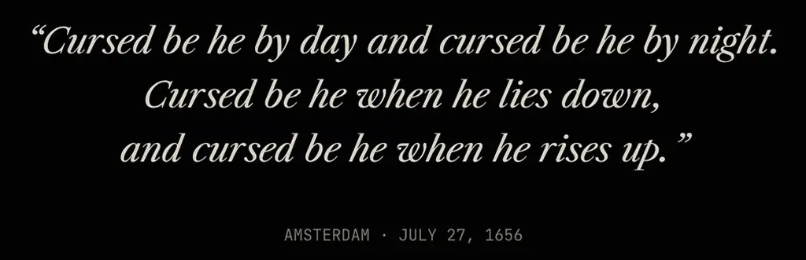
*[▶ 00:01:49](https://www.youtube.com/watch?v=eRrc1pUY5oU&t=109s) · Spinoza excommunication curse quote*

They offered him a thousand guilders a year to stay silent. He refused, wanting truth, not comfort.

He ground lenses by day and wrote a dangerous book by night.


*[▶ 00:02:52](https://www.youtube.com/watch?v=eRrc1pUY5oU&t=172s) · Engraved portrait of Benedictus de Spinoza*

His word for the drive to keep going is conatus: your striving.

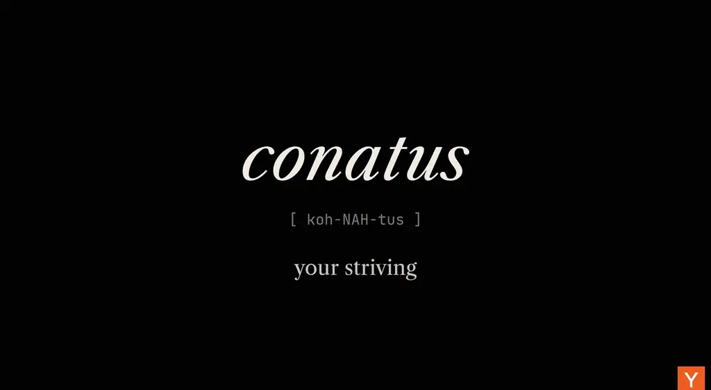
*[▶ 00:04:45](https://www.youtube.com/watch?v=eRrc1pUY5oU&t=285s) · Conatus definition slide*

## AGI Arrives Diffused, and One Person Gets the Leverage

[▶ 00:04:46](https://www.youtube.com/watch?v=eRrc1pUY5oU&t=286s)

AGI won't arrive as one event. It's already spread across ordinary tools: a terminal, markdown files, and background jobs.

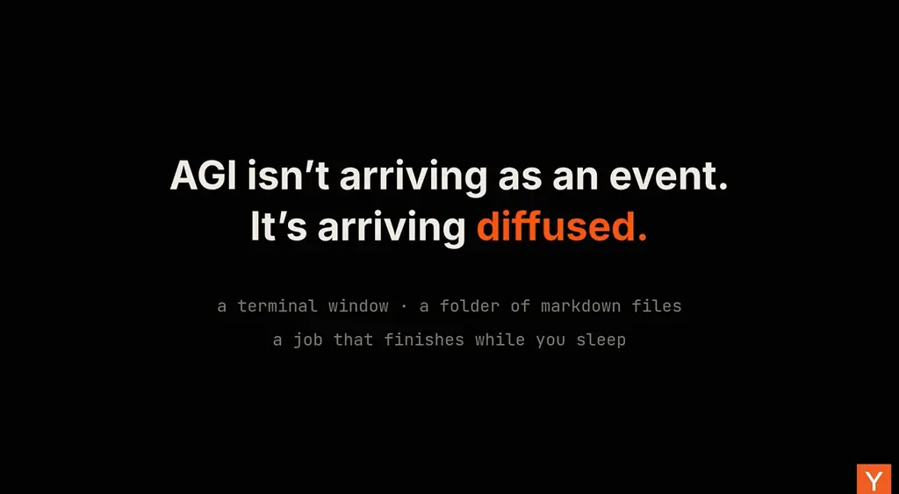
*[▶ 00:06:07](https://www.youtube.com/watch?v=eRrc1pUY5oU&t=367s) · AGI arrives diffused, not as an event*

**Personal AGI** is general intelligence for one person, running on memory you own. A chatbot subscription resets; a personal agent compounds.

The speaker's output rose from about 14 useful lines a day in 2013 to roughly 400x that in 2026, with the same hours. After heavy penalties, the floor is 8x.

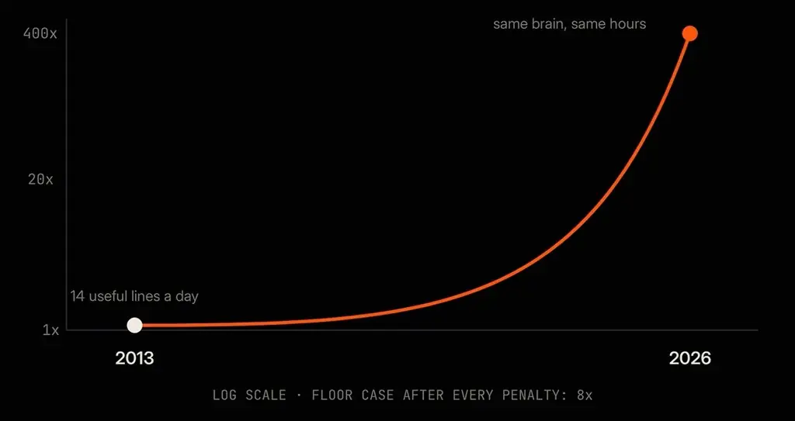
*[▶ 00:08:31](https://www.youtube.com/watch?v=eRrc1pUY5oU&t=511s) · Output growth chart, 2013 to 2026*

Leverage lies in context: what you give the agent, how relevant it is, and when it arrives.

Spinoza defined **joy** as your power of acting increasing. An afternoon that does a week of your work produces it.

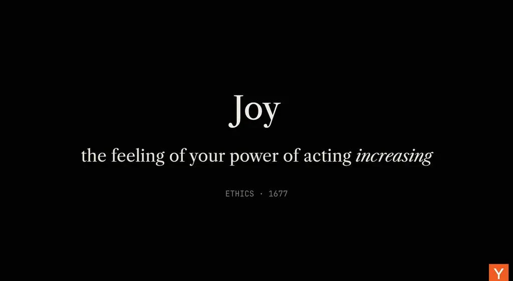
*[▶ 00:10:53](https://www.youtube.com/watch?v=eRrc1pUY5oU&t=653s) · Joy: power of acting increasing*

**Sadness** is the reverse: your power of acting decreasing.

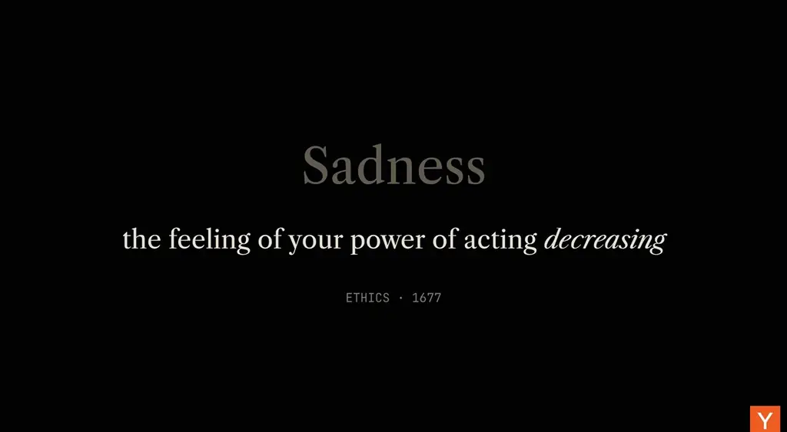
*[▶ 00:10:59](https://www.youtube.com/watch?v=eRrc1pUY5oU&t=659s) · Sadness: power of acting decreasing*

Formula: a rented frontier model + owned context + a harness (OpenClaw, Hermes agent, Claude Code, or Codex) = an agent that acts like a very fast you.

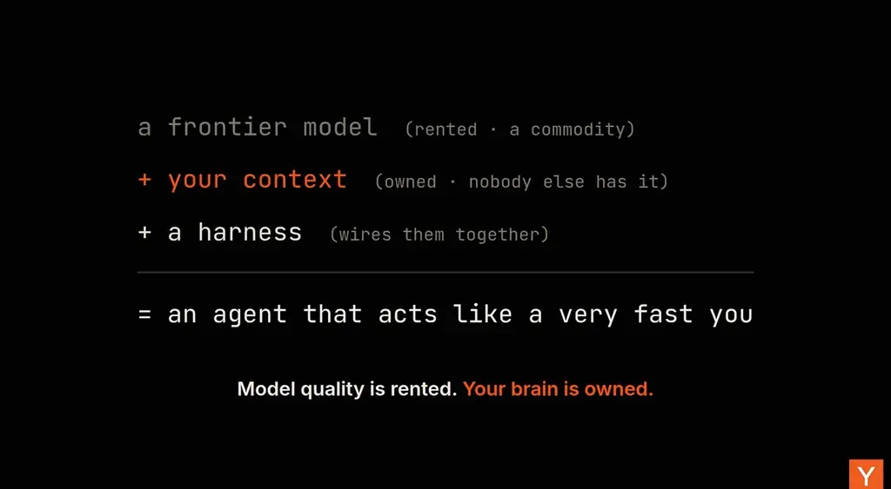
*[▶ 00:11:47](https://www.youtube.com/watch?v=eRrc1pUY5oU&t=707s) · Frontier model plus context plus harness equation*

Paul Graham's rules still hold, but agents multiply "do things that don't scale."

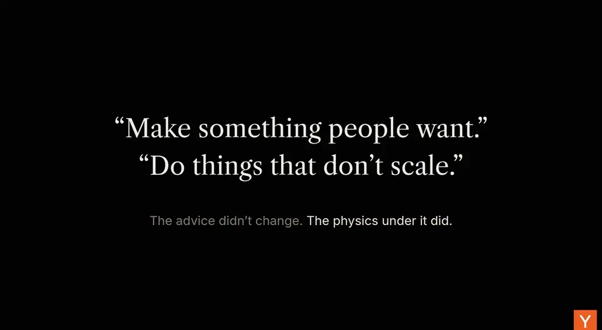
*[▶ 00:12:17](https://www.youtube.com/watch?v=eRrc1pUY5oU&t=737s) · Paul Graham advice and changed physics*

## Skill Files: Markdown as Code

[▶ 00:12:29](https://www.youtube.com/watch?v=eRrc1pUY5oU&t=749s)

Human working memory holds about seven items, plus or minus two. Institutions like checklists and org charts are prosthetics for that limit.

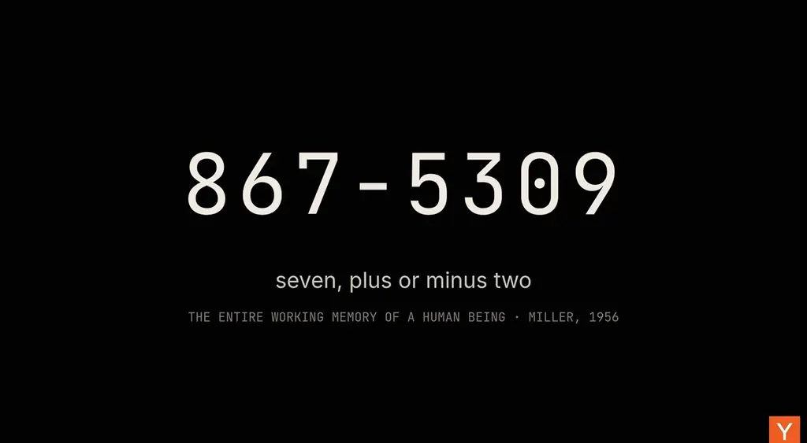
*[▶ 00:13:02](https://www.youtube.com/watch?v=eRrc1pUY5oU&t=782s) · Working memory: seven plus or minus two*

An agent holds about 1,000,000 tokens, roughly a thousand pages at once.

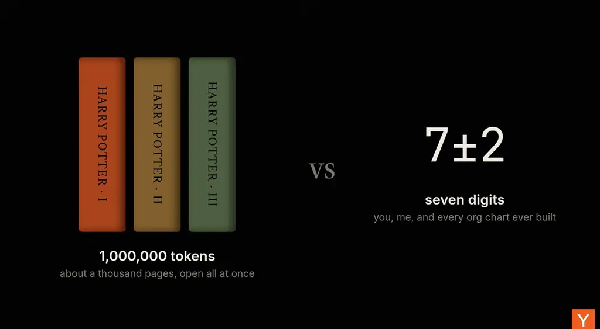
*[▶ 00:13:53](https://www.youtube.com/watch?v=eRrc1pUY5oU&t=833s) · Tokens versus working memory comparison*

In his setup, the agent triages his inbox overnight and delivers a morning briefing of priorities and deadlines.

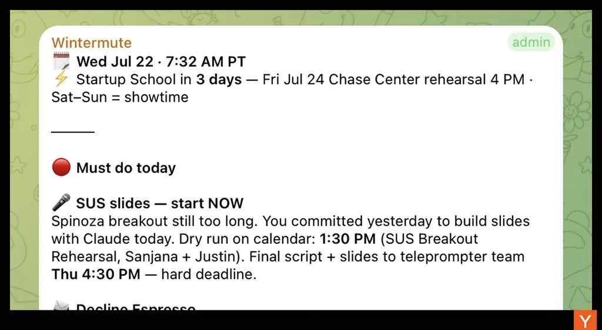
*[▶ 00:15:09](https://www.youtube.com/watch?v=eRrc1pUY5oU&t=909s) · Agent morning briefing message in Telegram*

His agent coding framework, GStack, has 123,424 GitHub stars.

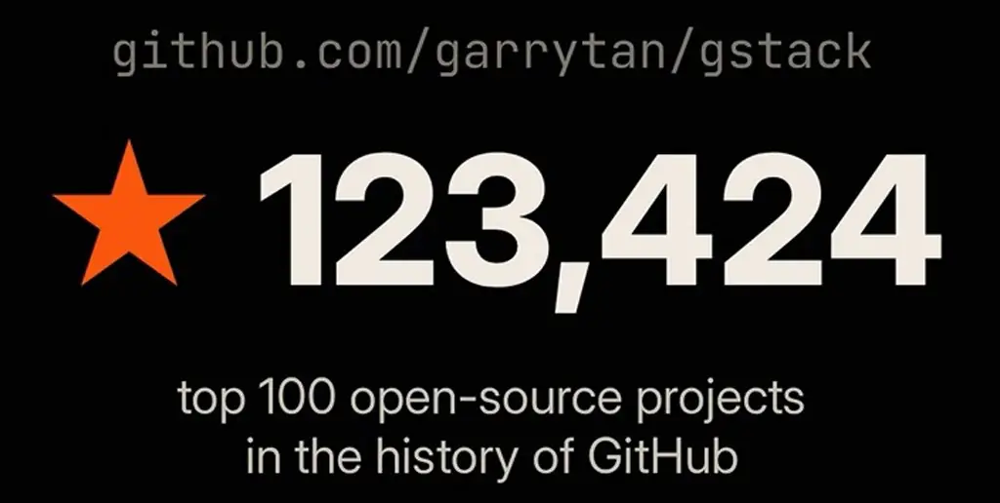
*[▶ 00:16:52](https://www.youtube.com/watch?v=eRrc1pUY5oU&t=1012s) · GStack repo star count*

Most of it is skill files: pages of English. If a smart intern could follow one, an agent can run it.

```markdown
---
name: meeting-ingestion
description: Canonical pipeline for every meeting recording.
triggers: ["meeting transcript received", "granola webhook fires"]
---

### Step 2 — Save the raw transcript
Transcribe with speaker labels. Keep the raw file forever.

### Step 3 — Create the meeting page
Pull out every commitment made, who made it and the deadline.

### Step 4 — Enrich every named person
Search the library for each person named. **Every person we actually met gets a page.** Back-link both directions, every time.

### Step 4.5 — Claim verification gate
Summaries are two lossy layers deep: transcription, then summary. **Both layers confabulate.** Never write a role change or a major life event without verbatim transcript support. If anything contradicts something we already believe, flag it — don't overwrite it.

…steps 5–6: company enrichment, signal pass…

### Step 7 — Gold-standard audit  (hard gate: fix, then re-audit)
### Step 8 — Commit, push, report
```

*[▶ 00:17:30](https://www.youtube.com/watch?v=eRrc1pUY5oU&t=1050s) · meeting-ingestion SKILL.md steps*

Markdown is code, and the compiler is a language model.

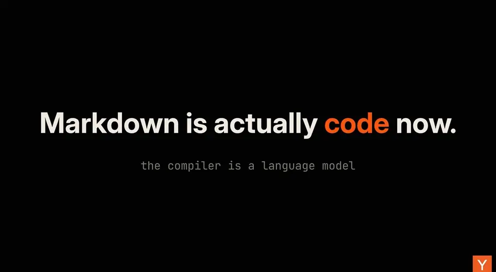
*[▶ 00:17:55](https://www.youtube.com/watch?v=eRrc1pUY5oU&t=1075s) · Markdown is actually code now.*

Non-programmers at YC, including a finance manager who built an app from about a hundred Excel workbooks, now write skill files.

## Judgment in the Model, Arithmetic in Code

[▶ 00:18:20](https://www.youtube.com/watch?v=eRrc1pUY5oU&t=1100s)

Computation falls into one of two places: **latent space** (taste, judgment, reading what a human wants) or **deterministic space** (arithmetic, SQL queries, seating charts). Confusing them causes agent failures.

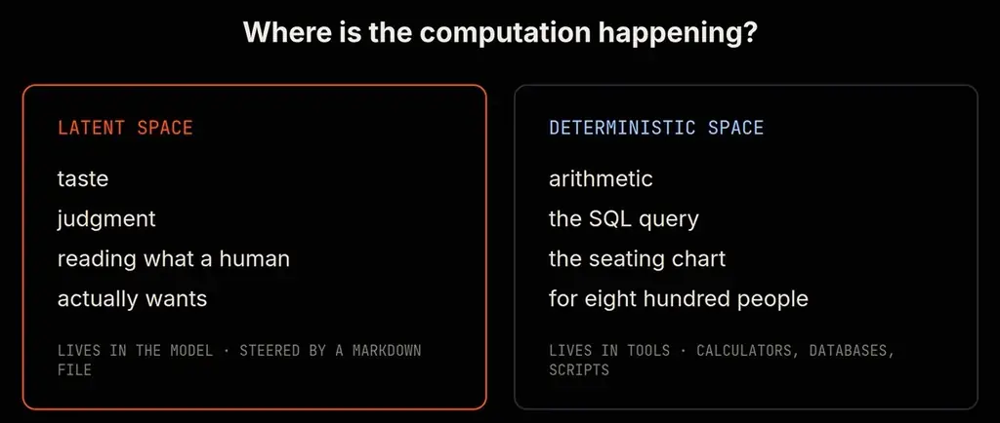
*[▶ 00:19:04](https://www.youtube.com/watch?v=eRrc1pUY5oU&t=1144s) · Where is the computation happening?*

Latent work stays in the model, steered by a markdown file. Deterministic work goes to tools such as calculators, databases, and scripts. Seating five people is latent work; scheduling 6,000 needs code.

In his example, an agent read three Spinoza biographies overnight and produced a chronology, a list of disagreements, cited quotes, and ranked story beats. He calls this a compendium skill. Its output is a folder of plain files:

```text
spinoza-compendium/
  └ chronology.md — his life, dated, cross-checked
  └ disagreements.md — where the three biographers conflict
  └ quotes.md — verbatim, with chapter citations
  └ tellable-moments.md — ranked, with delivery notes
  └ sources/ — nadler · goldstein · stewart · ~1,500 pages
```

*[▶ 00:20:22](https://www.youtube.com/watch?v=eRrc1pUY5oU&t=1222s) · Spinoza compendium folder structure in terminal*

Start with one shelf, not a warehouse: a few markdown files on projects, people, and companies.

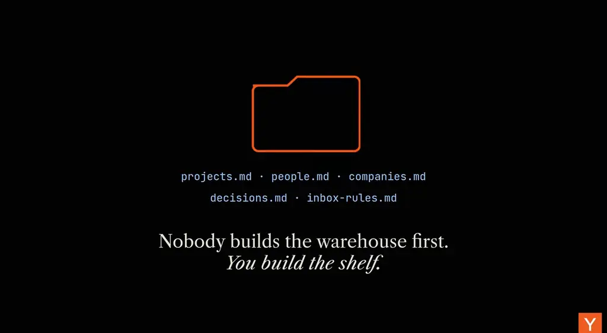
*[▶ 00:21:17](https://www.youtube.com/watch?v=eRrc1pUY5oU&t=1277s) · Nobody builds the warehouse first*

`resolver.md` routes each task to the skill file that owns it. Each skill file has one job, written clearly enough for a newcomer to execute.

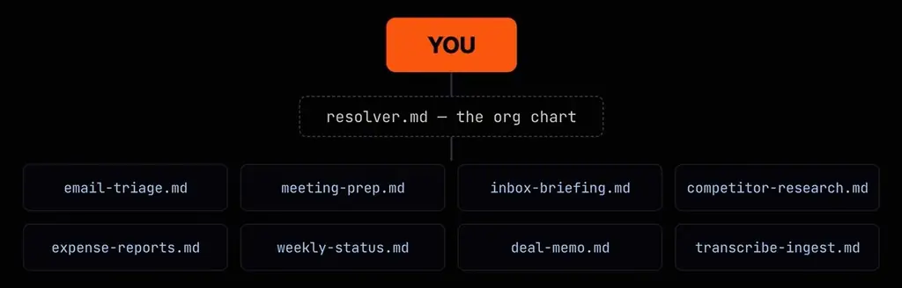
*[▶ 00:22:03](https://www.youtube.com/watch?v=eRrc1pUY5oU&t=1323s) · Resolver org chart of markdown agents*

An uncurated brain is a garbage dump with great search. Keep provenance on every fact, check new information against old, and prune.

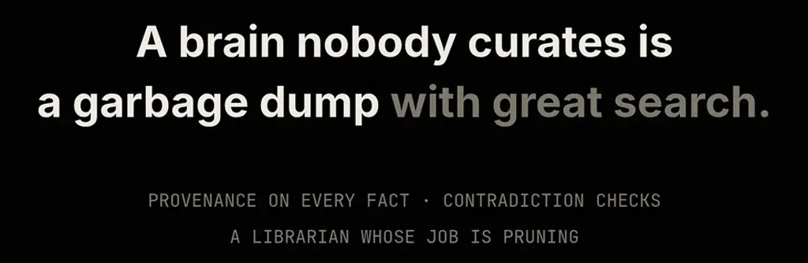
*[▶ 00:23:52](https://www.youtube.com/watch?v=eRrc1pUY5oU&t=1432s) · Curated brain vs garbage dump*

## Five Steps to Build Your Personal AGI

[▶ 00:24:16](https://www.youtube.com/watch?v=eRrc1pUY5oU&t=1456s)

Tonight, run an agent on your own machine with any harness.

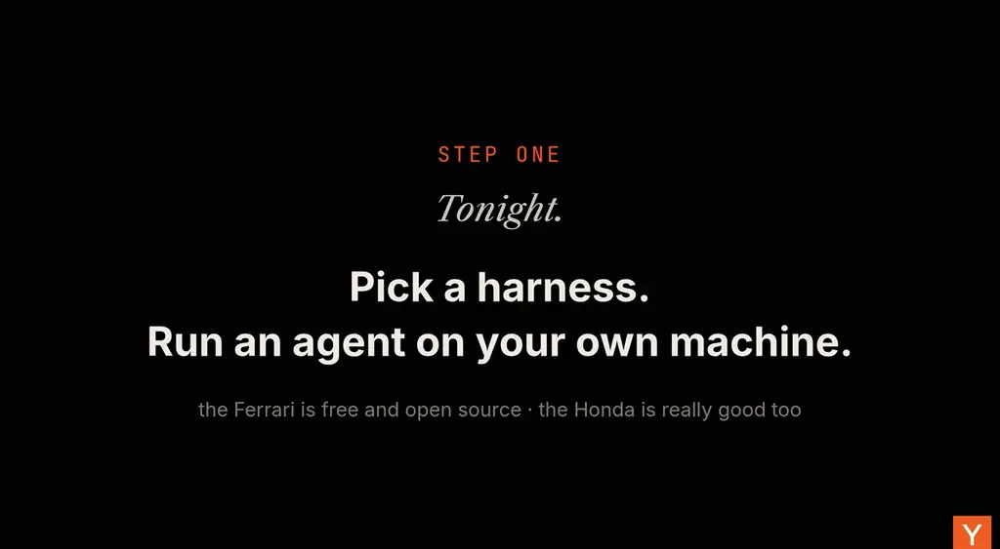
*[▶ 00:24:43](https://www.youtube.com/watch?v=eRrc1pUY5oU&t=1483s) · Step one: pick a harness*

This weekend, build a **markdown library**: one folder of markdown files on your projects and people, covering what you know and what they said last time.

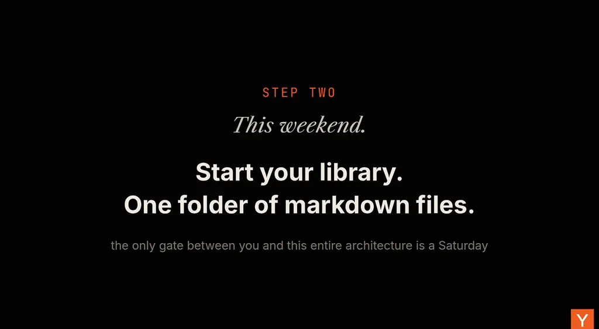
*[▶ 00:25:21](https://www.youtube.com/watch?v=eRrc1pUY5oU&t=1521s) · Step two: start your library*

Then write a **skill file** for your most hated weekly task, explaining it like to a smart intern, and correct its mistakes.

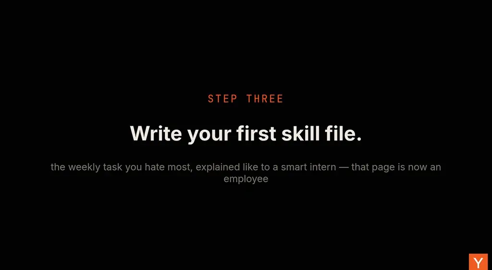
*[▶ 00:26:27](https://www.youtube.com/watch?v=eRrc1pUY5oU&t=1587s) · Step three: write your first skill file*

Schedule it as a **recurring job**, and the day stops being the unit of work.

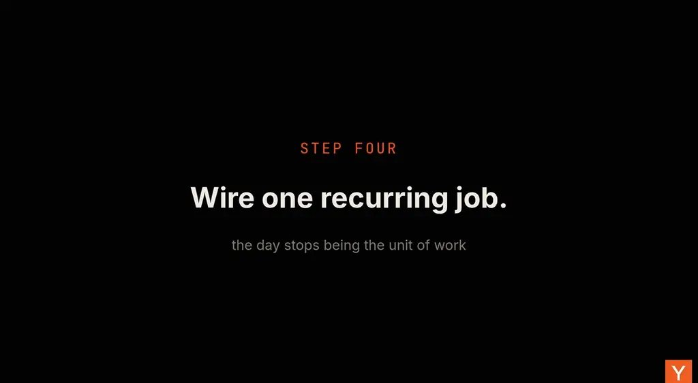
*[▶ 00:26:57](https://www.youtube.com/watch?v=eRrc1pUY5oU&t=1617s) · Step four: wire one recurring job*

If you ask for something twice, you failed; skillify every task.


*[▶ 00:27:26](https://www.youtube.com/watch?v=eRrc1pUY5oU&t=1646s) · Step five: never do one-off work*

## Skill Files Decide Who Keeps Your Judgment

[▶ 00:27:58](https://www.youtube.com/watch?v=eRrc1pUY5oU&t=1678s)

Early progress is flat, and most people quit by week two. By week four the agent answers with your context. By week twelve, a dozen skill files run the parts of your week you used to dread.

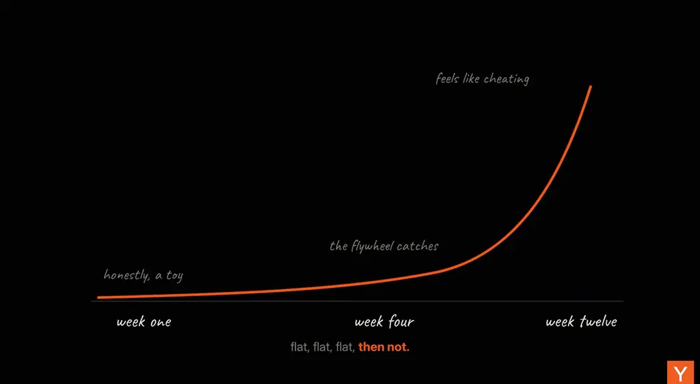
*[▶ 00:28:37](https://www.youtube.com/watch?v=eRrc1pUY5oU&t=1717s) · Compounding curve from week one to twelve*

A skill file is externalized cognition. Who controls it decides the outcome.

Maya builds 40 skill files over two years, covering P0 triage, churn de-escalation, and postmortems. In her own repo they travel with her. In the company's repo she leaves with nothing, and they keep running without her.

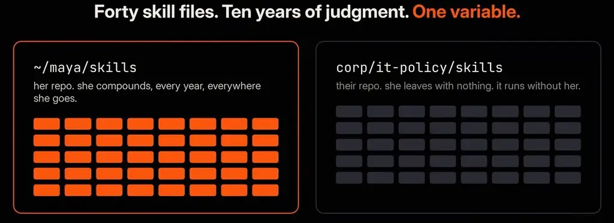
*[▶ 00:30:32](https://www.youtube.com/watch?v=eRrc1pUY5oU&t=1832s) · Forty skill files, two repo ownership models*

The doctrine is: own your skills, or your job becomes a skill file.


*[▶ 00:31:08](https://www.youtube.com/watch?v=eRrc1pUY5oU&t=1868s) · Closing slogan: own your skills*

## Owning Your Intelligence Means Owning Your Context

[▶ 00:32:24](https://www.youtube.com/watch?v=eRrc1pUY5oU&t=1944s)

Personal AI means controlling your own cognitive abilities: keep your brain and skills in a repo you control from day one.

Better models don't make the harness obsolete. They move the differentiator to context: a smarter reader extracts more from the same library.

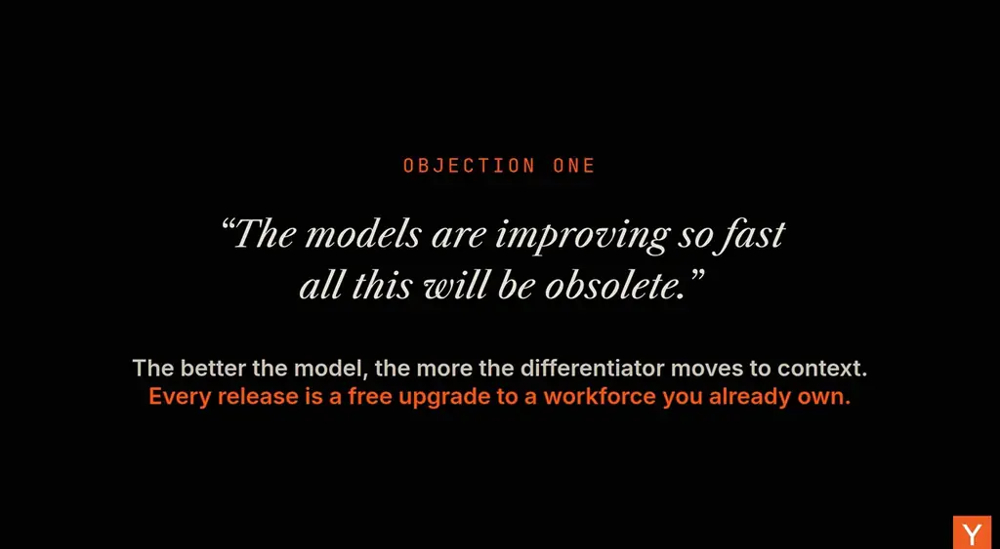
*[▶ 00:33:59](https://www.youtube.com/watch?v=eRrc1pUY5oU&t=2039s) · Objection one: models improving too fast*

Retrieval is easy. Being worth retrieving from is the product: what gets written down, how it is linked, what is promoted to hot memory, and who settles conflicting facts.

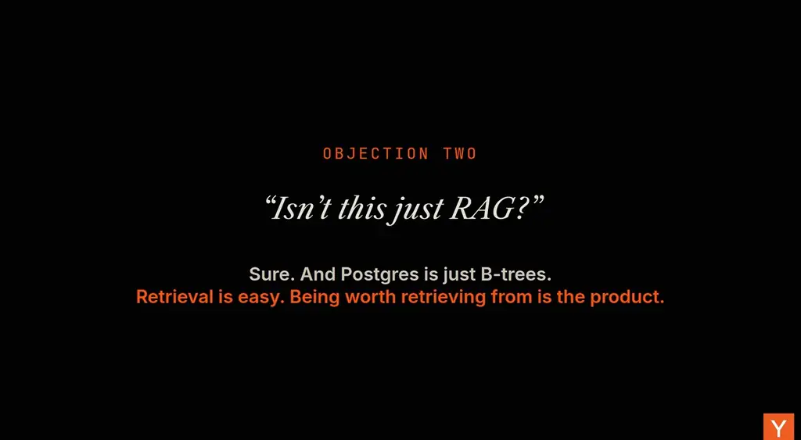
*[▶ 00:34:48](https://www.youtube.com/watch?v=eRrc1pUY5oU&t=2088s) · Objection two: isn't this just RAG?*

Against leaks, custody is the security model. The default is a life spread across ten clouds, searchable by everyone except you.

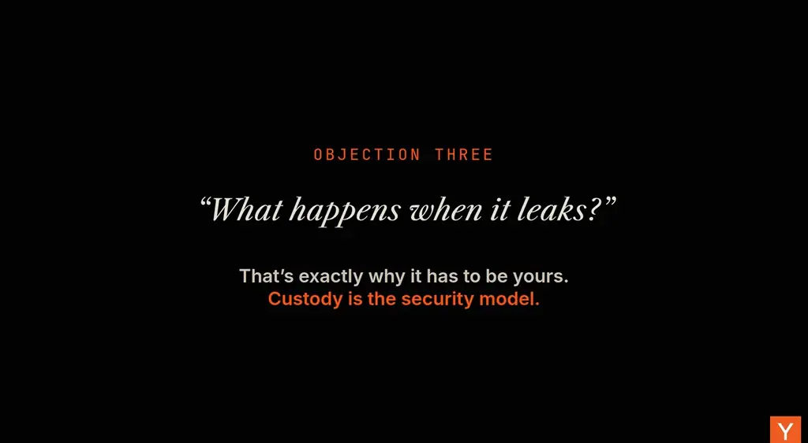
*[▶ 00:35:05](https://www.youtube.com/watch?v=eRrc1pUY5oU&t=2105s) · Objection three: what happens when it leaks?*

Leverage has always started private, then gets given away. Kept private, it becomes a priesthood; shared, a renaissance. His creed: do the things other people won't.

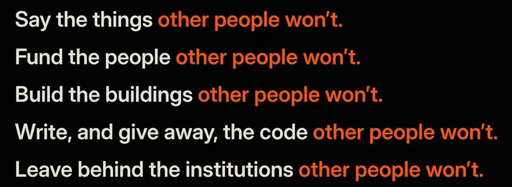
*[▶ 00:37:19](https://www.youtube.com/watch?v=eRrc1pUY5oU&t=2239s) · The creed: other people won't*

Building in public draws a predictable arc: first they quote tweet you, then they git clone you.

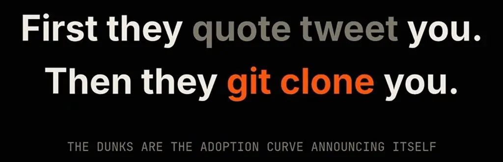
*[▶ 00:38:08](https://www.youtube.com/watch?v=eRrc1pUY5oU&t=2288s) · First they quote tweet you*

A friend whose son has a rare epilepsy built a repo of 80,000 cross-linked markdown files: specialist visits, papers, seizure logs, drug interactions. When a doctor proposes an idea, he knows in minutes whether it was tried.

Spinoza closed the Ethics with "All things excellent are as difficult as they are rare." The difficulty of excellent work has collapsed; the rarity is now up to you.

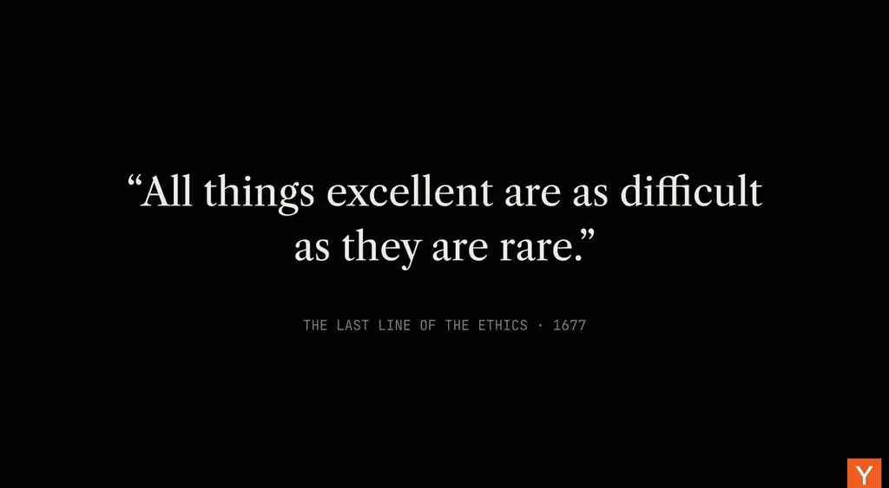
*[▶ 00:41:56](https://www.youtube.com/watch?v=eRrc1pUY5oU&t=2516s) · Spinoza quote on black slide*

## Links & resources

- [Garry Tan: Own Your Intelligence — talk page on YC Root Access](https://www.ycrootaccess.com/p/garry-tan-own-your-intelligence) — <https://www.ycrootaccess.com/p/garry-tan-own-your-intelligence> · video description
- [GStack — open-source GitHub repo, top 100 projects](https://github.com/garrytan/gstack) — <https://github.com/garrytan/gstack> · on screen [▶ 00:16:52](https://www.youtube.com/watch?v=eRrc1pUY5oU&t=1012s)
- GBrain — personal knowledge repo tool with skillify skill; URL not shown · mentioned [▶ 00:27:38](https://www.youtube.com/watch?v=eRrc1pUY5oU&t=1658s)
