# How Companies Are Building Their Own Intelligence | Sonya Huang, Sequoia Capital

*Why companies are owning their model weights, the four forces behind it, and a framework for deciding what to own versus rent.*

Source: [How Companies Are Building Their Own Intelligence | Sonya Huang, Sequoia Capital](https://www.youtube.com/watch?v=bMMv0bZzONg) · Sonya Huang · Sequoia Capital · 17 min

## TL;DR

Companies that depend entirely on closed APIs for their core intelligence face rising costs, slower iteration, and reliance on outside labs. Sonya Huang argues that owning intelligence down to the weights is now practical because open-weight models are near the frontier, so ownership can be a performance edge rather than a sacrifice. She gives four drivers (cost, speed, performance, and control over destiny) and a framework for choosing which capabilities to own versus rent. This matters because the competitive battleground is shifting from the application UI to the intelligence layer itself.

## Key takeaways

- Sovereign AI means owning your intelligence down to the model weights, though it does not mean dropping closed APIs for tools like coding agents or desktop work.
- Four forces drive ownership: cost (AI COGS rise with success), speed (a small distilled model can beat a large general one in coding and security), performance (open models can beat closed ones in your domain), and destiny (independence beyond Anthropic and OpenAI).
- Decide own-versus-rent per capability by weighing cost, latency, performance, and proprietary data: coding agents stay rented because performance matters more than latency, while tab autocomplete runs on owned models to cut the cost of very frequent calls.
- Define evals early, even though they are unglamorous, because they pay off later in a roadmap that runs strategy, evals, routing and harnesses, post-training, and then a loop that feeds live customer data back into the model.
- Start from a near-frontier open-weight base and then exceed it with post-training, prompt and harness engineering, and online learning, since open weights are malleable.
- Separate the production stack (a harness on a model that serves users) from the development stack (evals, domain data for post-training, and online learning that make the intelligence good).
- Staff the work for its type: research-leaning leaders for fundamental work and engineering-leaning leaders for applied work, rather than folding it into a platform team that serves product teams.
- Publish research with high taste, because buyers hearing similar pitches are choosing an AI champion and published work makes your capability legible.

## Sovereign AI: Owning Intelligence Down to the Weights

[▶ 00:00:00](https://www.youtube.com/watch?v=bMMv0bZzONg&t=0s)

Sovereign AI means owning your intelligence down to the weights, without external dependencies. It doesn't mean dropping closed APIs for coding agents or desktop work. The alternative to centralized intelligence is decentralized: a shared core, with each company building on its own data.

Alex Karp and Satya have backed companies owning their intelligence, and Jensen Huang's [open-models letter](https://images.nvidia.com/pdf/Open-Weigh) makes the same case.

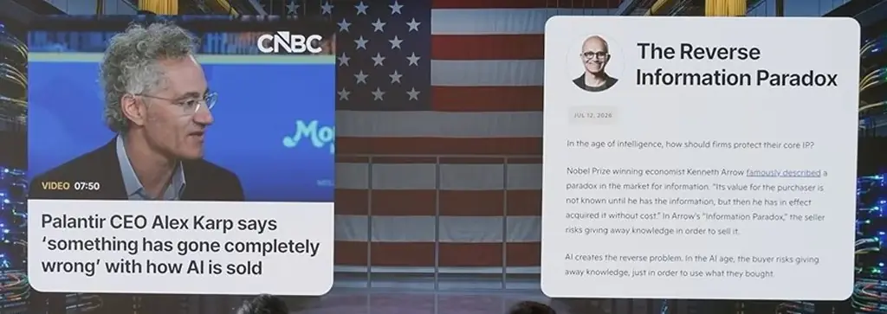
*[▶ 00:01:26](https://www.youtube.com/watch?v=bMMv0bZzONg&t=86s) · Reverse Information Paradox and Karp video*

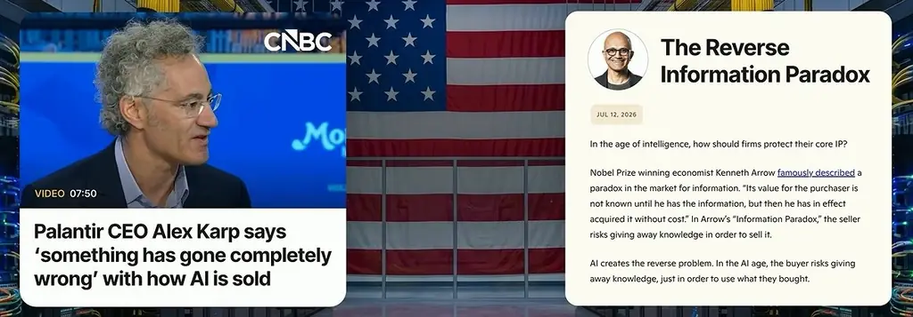
*[▶ 00:01:53](https://www.youtube.com/watch?v=bMMv0bZzONg&t=113s) · Jensen Huang post on open models*

Four reasons companies are moving:

- **Cost**: AI COGS rise with success, which makes ownership a must for low-margin companies.
- **Speed**: in coding and security, a small distilled model can beat a large general one.
- **Performance**: open models can now beat closed ones in your domain.
- **Destiny**: independent footing beyond Anthropic and OpenAI.

Just as crypto's "not your keys, not your coins" argued for custody, a product isn't truly yours without control of its weights.

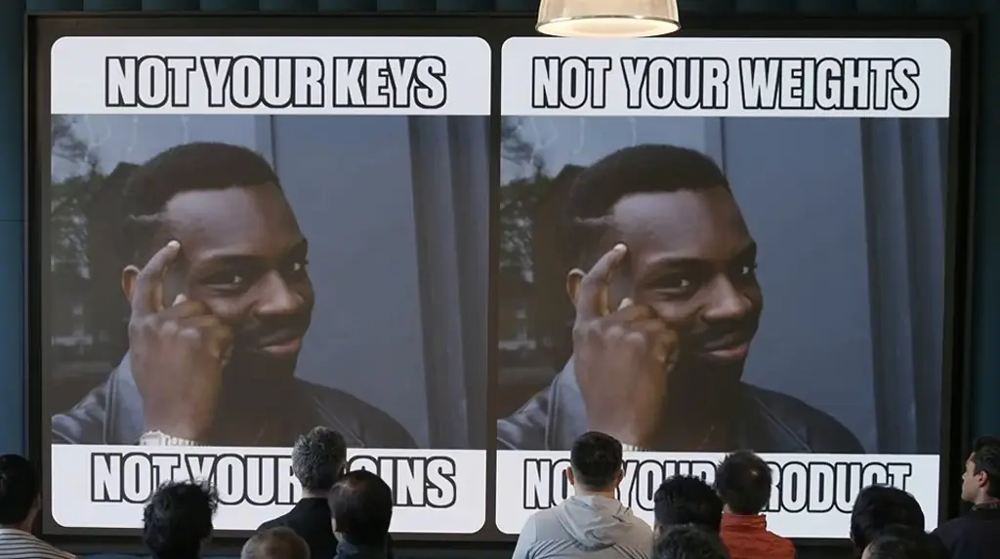
*[▶ 00:04:35](https://www.youtube.com/watch?v=bMMv0bZzONg&t=275s) · Meme: not your weights, not your product*

Labs and application companies race toward the same application layer from opposite ends.

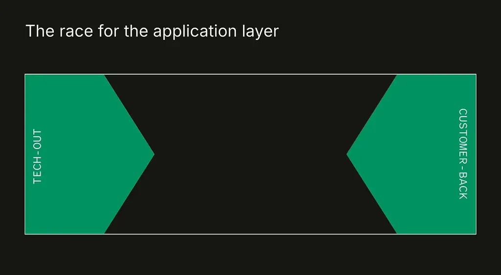
*[▶ 00:04:51](https://www.youtube.com/watch?v=bMMv0bZzONg&t=291s) · The race for the application layer*

The battleground is shifting to the **intelligence layer**: owning the model, not just the UI.

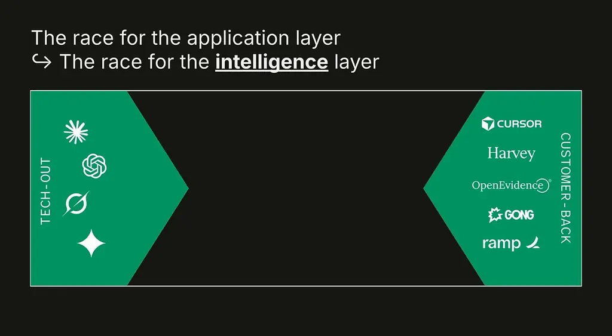
*[▶ 00:05:34](https://www.youtube.com/watch?v=bMMv0bZzONg&t=334s) · The race for the intelligence layer*

Application companies are therefore the newest neo labs, with applied research at Harvey, Factory, Glean, OpenEvidence, Semgrep and Ramp.

The framework starts by deciding which capabilities to own versus rent.

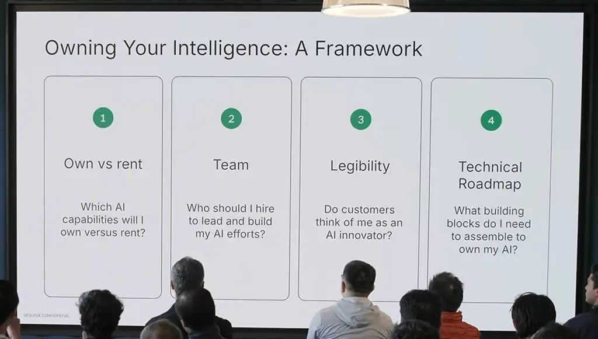
*[▶ 00:06:57](https://www.youtube.com/watch?v=bMMv0bZzONg&t=417s) · Owning Your Intelligence: A Framework (audience view)*

## Own only what cost, latency, performance, and data justify

[▶ 00:07:05](https://www.youtube.com/watch?v=bMMv0bZzONg&t=425s)

Owning versus renting isn't binary. Weigh each capability on **cost**, **speed/latency**, **performance**, and **proprietary data**. Coding agents stay rented because performance matters more than latency, while tab autocomplete runs on owned models to cut the cost of very frequent calls.

Staff for the work: research-leaning leaders suit fundamental work, and engineering-leaning leaders suit applied work. Don't shoehorn the AI platform team into this. Platform teams serve product teams, but this work needs people playing offense on frontier research. [Harvey](https://harvey.ai/research) published a lot of research with a team of seven.

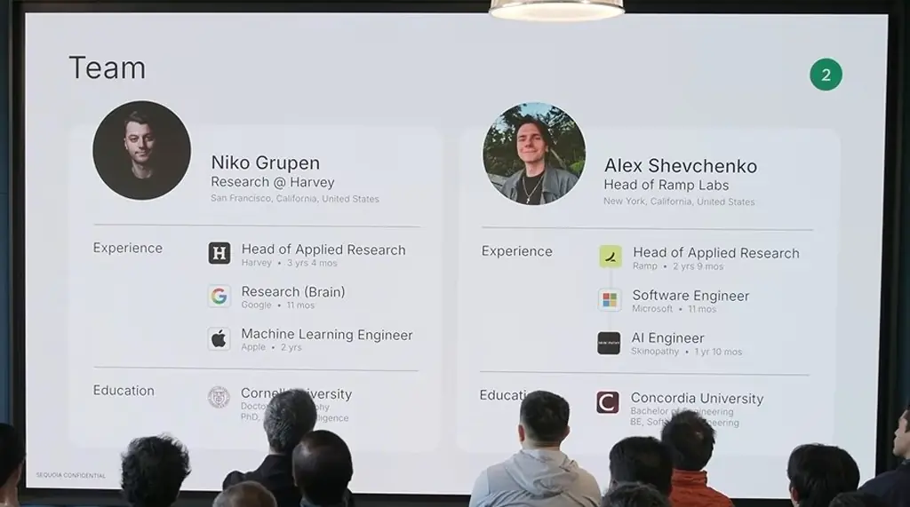
*[▶ 00:09:25](https://www.youtube.com/watch?v=bMMv0bZzONg&t=565s) · Team: two lab leader profiles*

Legibility matters because buyers hear the same pitch and are choosing an AI champion. Publish research with high taste.

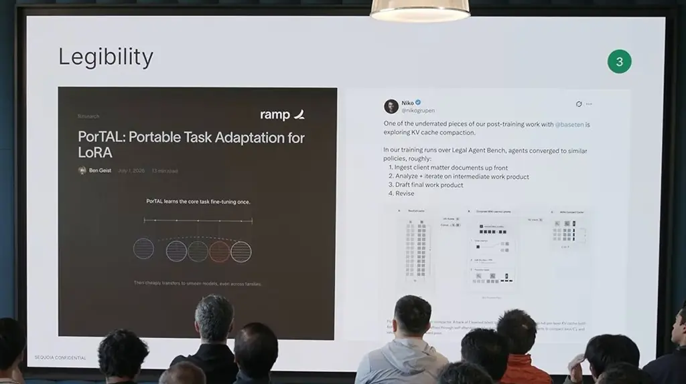
*[▶ 00:10:54](https://www.youtube.com/watch?v=bMMv0bZzONg&t=654s) · Legibility: PorTAL paper and tweet*

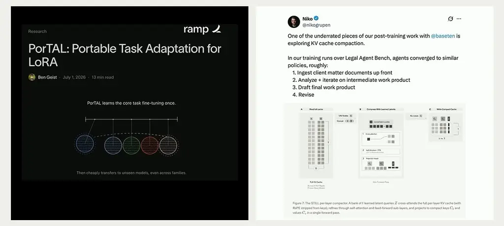
*[▶ 00:11:17](https://www.youtube.com/watch?v=bMMv0bZzONg&t=677s) · Legibility: PorTAL paper and tweet*

The roadmap runs roughly in this order:

1. Set strategy.
2. Define evals. It is unglamorous, but it pays off later.
3. Add routing and harnesses.
4. Post-train, and only rarely move into mid- or pre-training.
5. Feed live customer data into a loop so the model improves with each interaction.

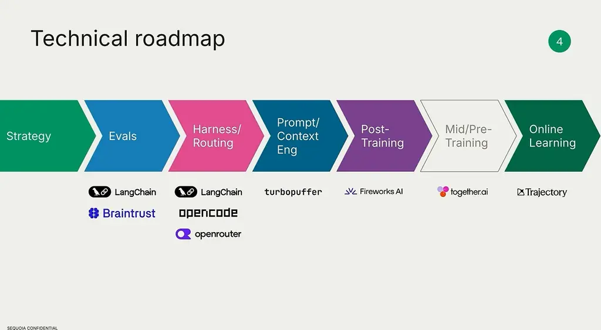
*[▶ 00:12:50](https://www.youtube.com/watch?v=bMMv0bZzONg&t=770s) · Technical roadmap: stages and example tools*

Open weights are malleable, so you start near frontier and can exceed it with post-training, prompt/harness engineering, and online learning.

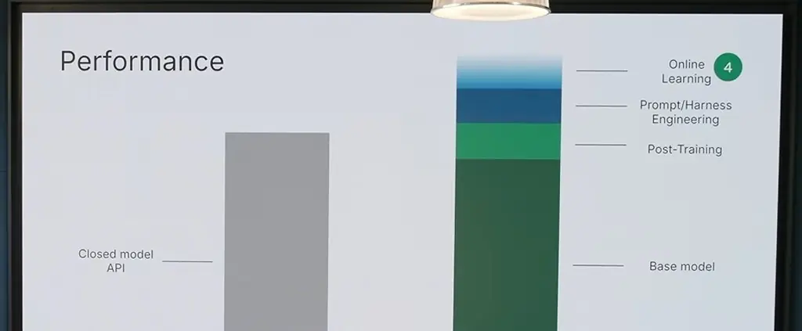
*[▶ 00:13:11](https://www.youtube.com/watch?v=bMMv0bZzONg&t=791s) · Performance: closed model vs own stack*

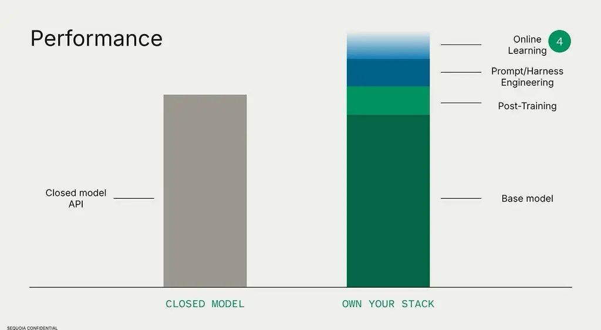
*[▶ 00:13:30](https://www.youtube.com/watch?v=bMMv0bZzONg&t=810s) · Performance: closed model vs own stack*

## Production vs. development stacks

[▶ 00:13:56](https://www.youtube.com/watch?v=bMMv0bZzONg&t=836s)

The production stack serves users: a harness on a model. The development stack makes that intelligence good.

Closed models are simpler: higher floor, lower ceiling, and no way to learn from your data.

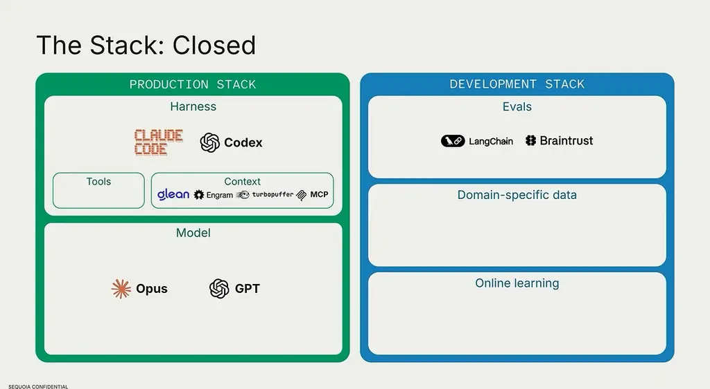
*[▶ 00:14:40](https://www.youtube.com/watch?v=bMMv0bZzONg&t=880s) · The Stack: Closed (full slide)*

Owning intelligence opens Pandora's box: pick an open base, post-train it, configure an open harness.

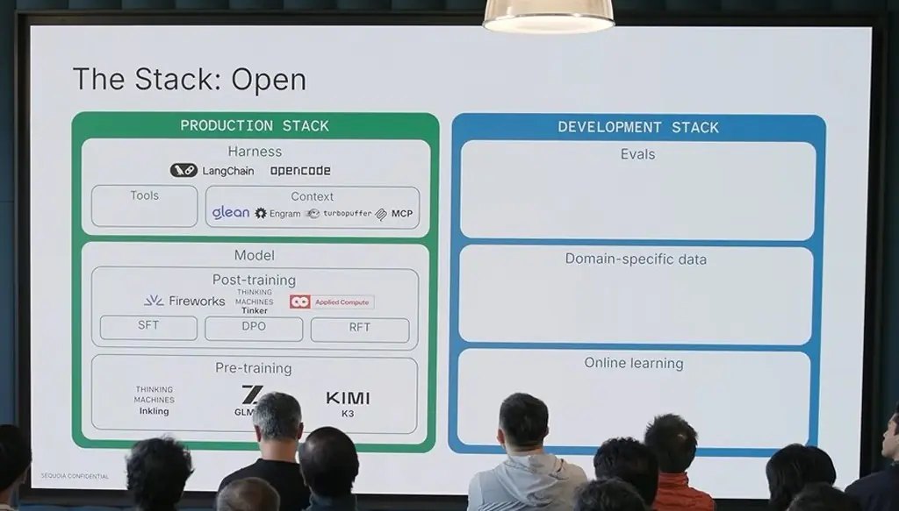
*[▶ 00:15:26](https://www.youtube.com/watch?v=bMMv0bZzONg&t=926s) · The Stack: Open*

Context drives performance: vector stores like turbopuffer, knowledge graphs like glean, MCP.

Development needs evals, domain data for post-training, and online learning.

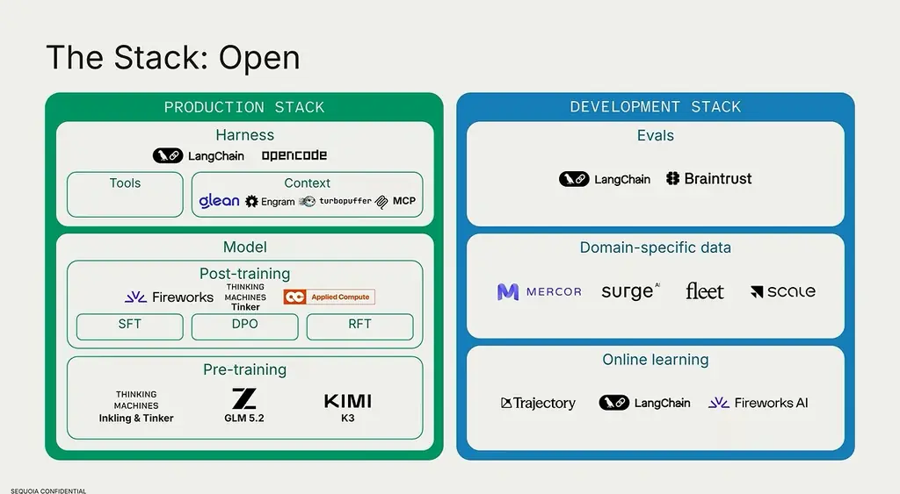
*[▶ 00:16:32](https://www.youtube.com/watch?v=bMMv0bZzONg&t=992s) · The Stack: Open (clean slide)*

[Harvey Research](https://harvey.ai/research) lists neolabs and inference providers among its research partners.

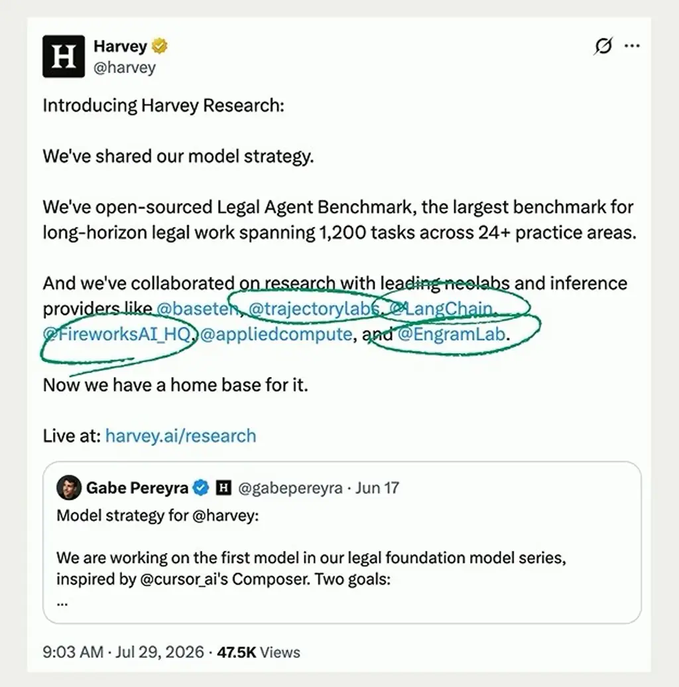
*[▶ 00:17:17](https://www.youtube.com/watch?v=bMMv0bZzONg&t=1037s) · Harvey Research announcement tweet*

## Links & resources

- [Jensen Huang post on open models](https://images.nvidia.com/pdf/Open-Weigh) — <https://images.nvidia.com/pdf/Open-Weigh> · on screen [▶ 00:01:53](https://www.youtube.com/watch?v=bMMv0bZzONg&t=113s)
- [Together AI — example tools for the technical roadmap stages](https://together.ai) — <https://together.ai> · on screen [▶ 00:12:50](https://www.youtube.com/watch?v=bMMv0bZzONg&t=770s)
- [Harvey Research — announcement tweet](https://harvey.ai/research) — <https://harvey.ai/research> · on screen [▶ 00:17:17](https://www.youtube.com/watch?v=bMMv0bZzONg&t=1037s)
