# How to Write Your First AI Eval - SallyAnn DeLucia, Arize AI

*Learn what an AI eval is, how to write pass/fail criteria for an agent, and how to build and test an LLM-as-a-judge.*

Source: [How to Write Your First AI Eval - SallyAnn DeLucia, Arize AI](https://www.youtube.com/watch?v=gv4w23xYj-0) · SallyAnn DeLucia · AI Engineer · 35 min

## TL;DR

Vibe checks don't scale: a prompt change that looks better can break a use case within a week, and without evals you can't catch regressions, compare versions objectively, or gate CI on quality. An AI eval is not a unit test, because it must judge many valid outputs against a definition of good rather than match one correct output. The workshop's approach is to read traces to find what matters, turn vague goals like "helpful" into concrete pass/fail criteria, build a dataset from span-level data, and iterate on an LLM judge in a prompt playground. This matters because teams that own a definition of "good" can measure agent quality and track it in production.

## Key takeaways

- Replace vague words like "helpful" or "good response" with checkable criteria, such as answering the follow-up first or keeping totals within the stated budget.
- Write each criterion with a one-line task, a one-sentence success and failure definition, one quality to judge, and up to three pass and three fail bullets, since those bullets become the LLM judge's prompt.
- Judge one quality per eval, because LLM-as-a-judge handles a single criterion well.
- Read a trace top-down: the root span holds the overall input and final output, and each child span is an agent, tool, or LLM call with its own inputs and outputs.
- Pick the span you want to judge (agent, tool, or retriever), filter traces to it, save those spans as a dataset, and run the evaluator on that dataset.
- In a prompt playground, reference data as {input} and {output} and map them to dataset columns, then run the dataset, adjust the prompt where you disagree with the labels, and rerun until the judge agrees with you.
- Use decision models and code checks (regex, JSON, ROUGE/BLEU) for fast, cheap checks, and reserve LLM-as-a-judge for criteria that need a rubric and an explanation.
- After alignment, run the judge on sampled production traces as online evals, track pass rate, and alert on drops.

## Why vibe checks and unit tests fall short for agents

[▶ 00:00:00](https://www.youtube.com/watch?v=gv4w23xYj-0&t=0s)

The goal is a clear definition of an eval, your own criteria for an agent, and a working LLM-as-a-judge in Arize AX.

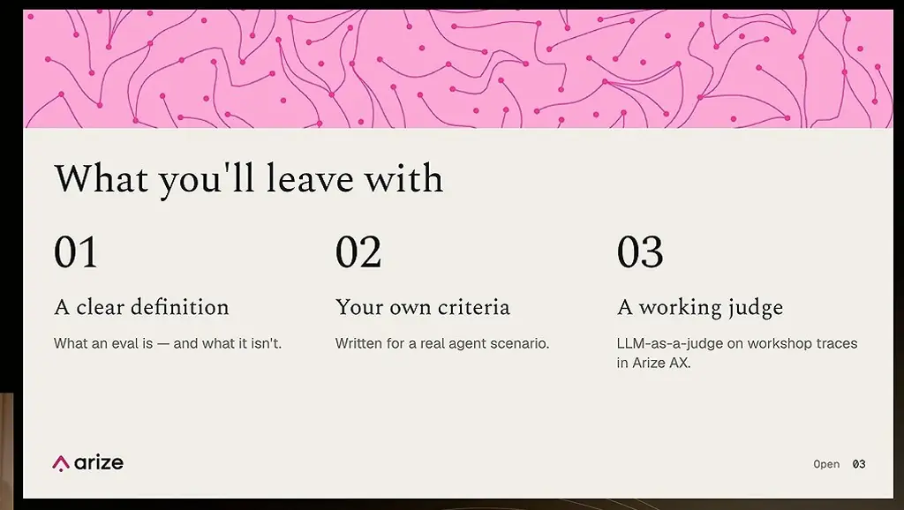
*[▶ 00:01:07](https://www.youtube.com/watch?v=gv4w23xYj-0&t=67s) · What you'll leave with*

Vibe checks don't scale. A prompt change that feels better on Monday can break a use case by the next week, and nobody can prove what regressed.

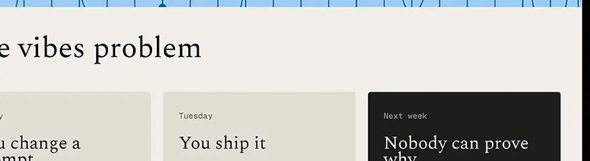
*[▶ 00:02:39](https://www.youtube.com/watch?v=gv4w23xYj-0&t=159s) · The vibes problem*

Without evals you can't catch regressions, compare prompt or model versions objectively, or gate CI on quality.

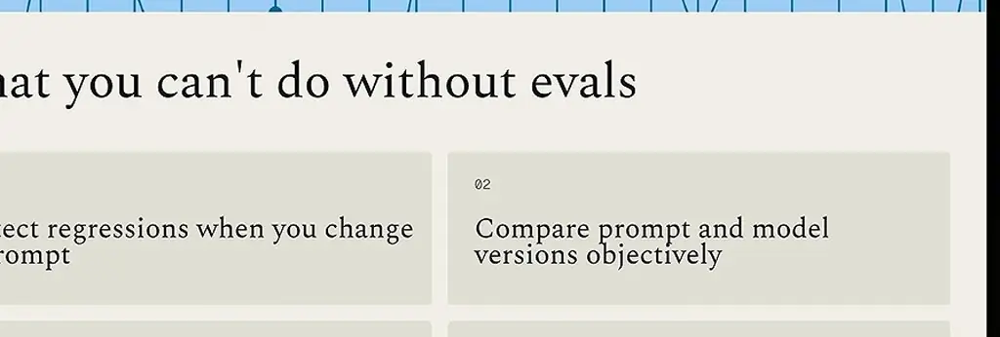
*[▶ 00:03:04](https://www.youtube.com/watch?v=gv4w23xYj-0&t=184s) · What you can't do without evals*

The session is built for newcomers and experienced eval writers alike.

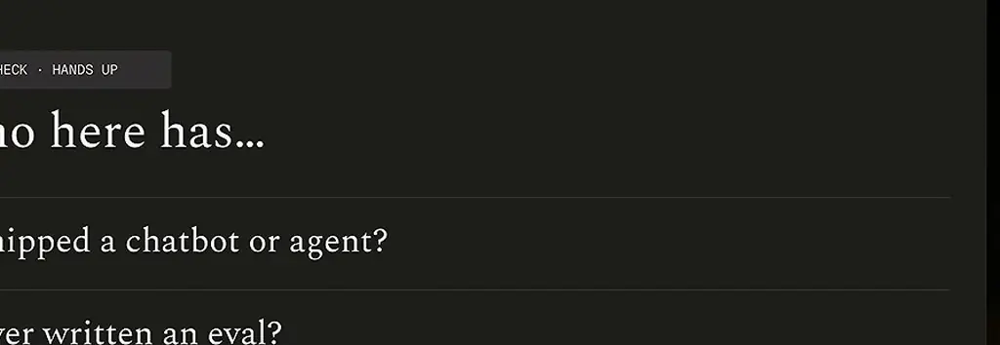
*[▶ 00:02:04](https://www.youtube.com/watch?v=gv4w23xYj-0&t=124s) · Room check: hands-up questions*

An eval isn't a unit test. A software test checks one input against one correct output; an AI eval must judge many valid outputs against a definition of good.

```python
assert total(cart) == 42.00
```

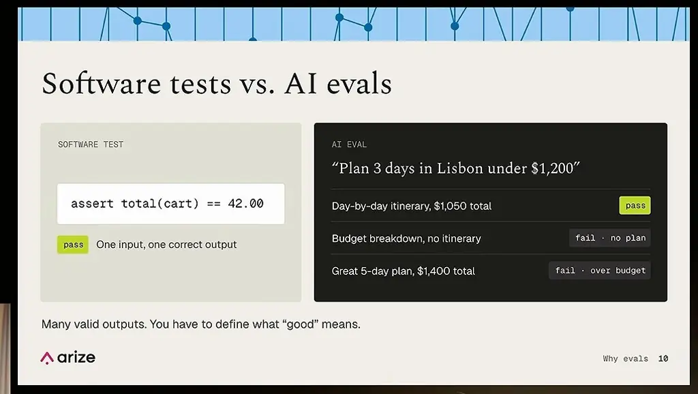
*[▶ 00:03:29](https://www.youtube.com/watch?v=gv4w23xYj-0&t=209s) · Software tests vs. AI evals*

Traces are logs for AI; evals are tests. Agents are trees of agents, tools and model calls, and errors cascade into polished answers.

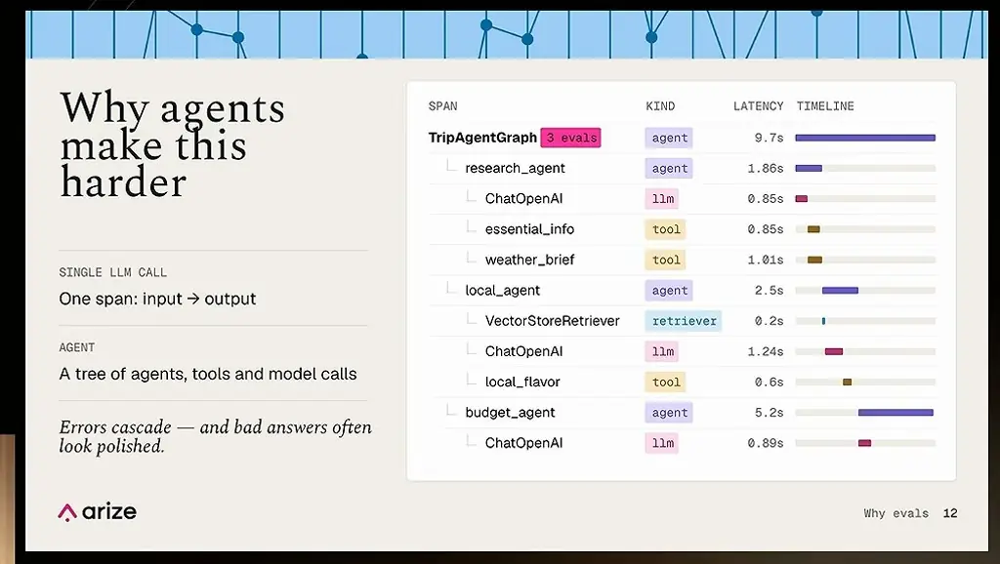
*[▶ 00:05:14](https://www.youtube.com/watch?v=gv4w23xYj-0&t=314s) · Why agents make this harder: trace span tree*

## LLM-as-a-judge and the lab setup

[▶ 00:05:15](https://www.youtube.com/watch?v=gv4w23xYj-0&t=315s)

LLM-as-a-judge, this chapter's focus, has a secondary LLM grade your agent against a rubric and return a label plus an explanation.

Other types: **decision models** (fast, cheap, usually no explanation), **code checks** (regex, JSON, ROUGE/BLEU), **annotations** (golden datasets, sometimes synthetic), and **agent-as-a-judge** (complex success criteria). **User feedback** and **business metrics** suit production. The first four work across development and production, so evals can grow with your use case.

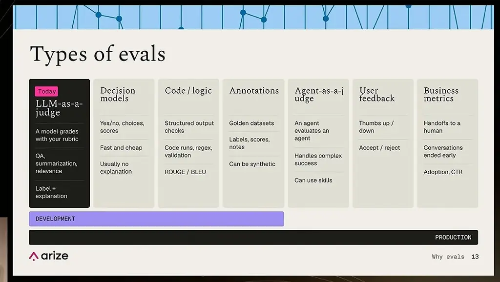
*[▶ 00:06:59](https://www.youtube.com/watch?v=gv4w23xYj-0&t=419s) · Types of evals comparison slide*

Setup needs an Arize AX account (a free trial works), an AI provider key so the judge has a model, and the `arize-demo-llm-travel-agent` project under Traces.

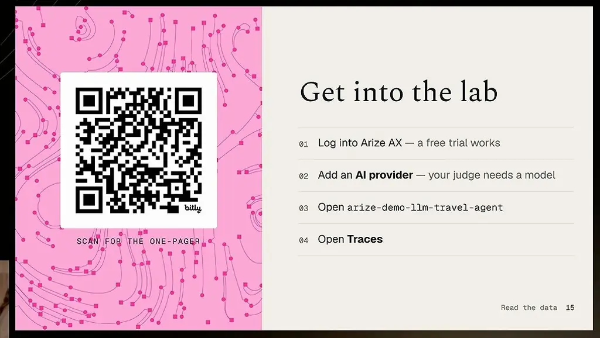
*[▶ 00:07:59](https://www.youtube.com/watch?v=gv4w23xYj-0&t=479s) · Get into the lab setup steps*

The QR code links to a one-pager with the full instructions.

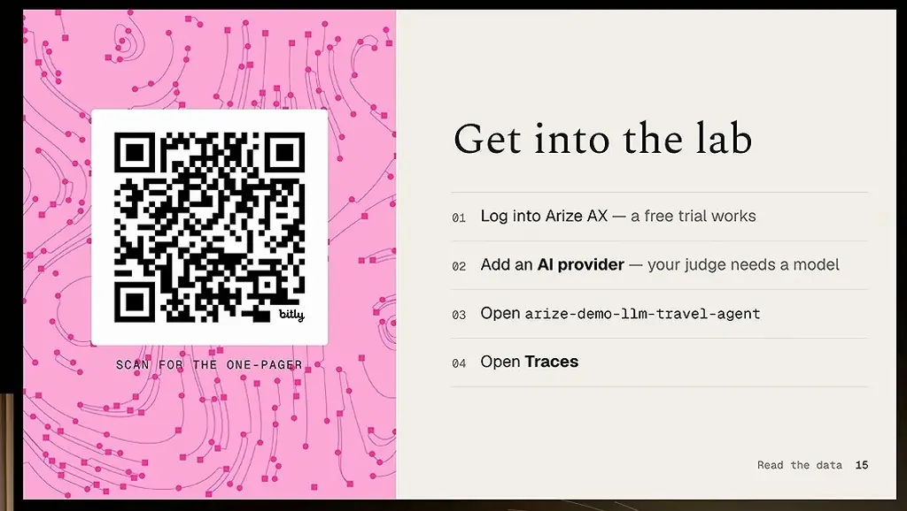
*[▶ 00:08:30](https://www.youtube.com/watch?v=gv4w23xYj-0&t=510s) · Get into the lab*

Open Settings and find AI Providers under Account Settings.

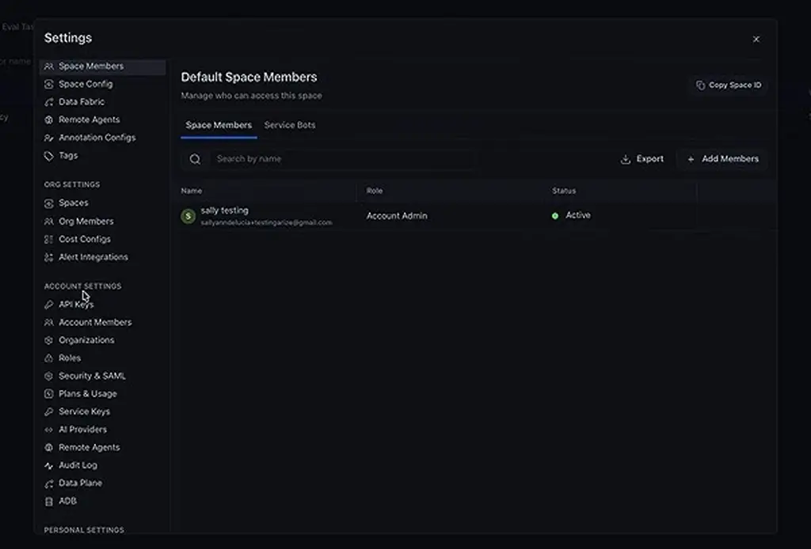
*[▶ 00:08:54](https://www.youtube.com/watch?v=gv4w23xYj-0&t=534s) · Arize settings: Space Members page*

Pick any provider and use the test integration button to confirm the key works.

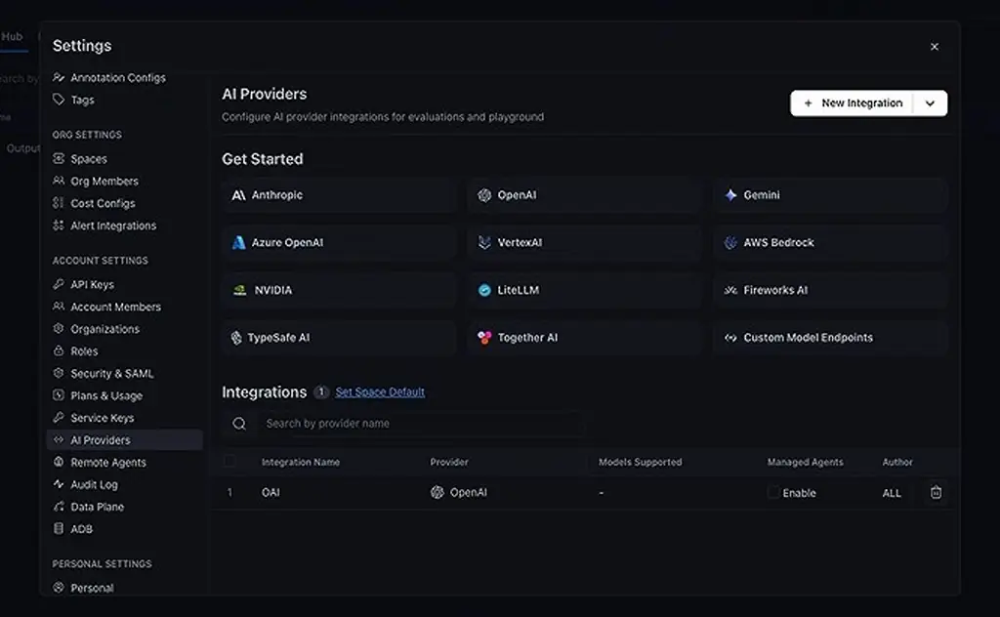
*[▶ 00:09:26](https://www.youtube.com/watch?v=gv4w23xYj-0&t=566s) · Arize AI Providers settings page*

The demo project also appears on the tracing page.

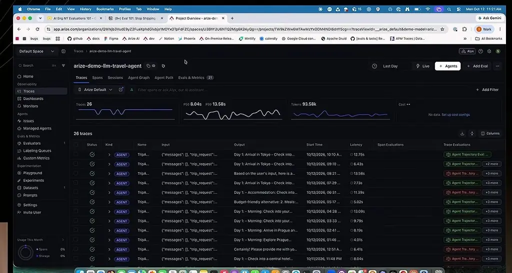
*[▶ 00:10:14](https://www.youtube.com/watch?v=gv4w23xYj-0&t=614s) · Arize trace list for travel agent demo*

## Reading traces to find what to measure

[▶ 00:10:16](https://www.youtube.com/watch?v=gv4w23xYj-0&t=616s)

A good answer addresses the follow-up and respects the trip's days and budget.

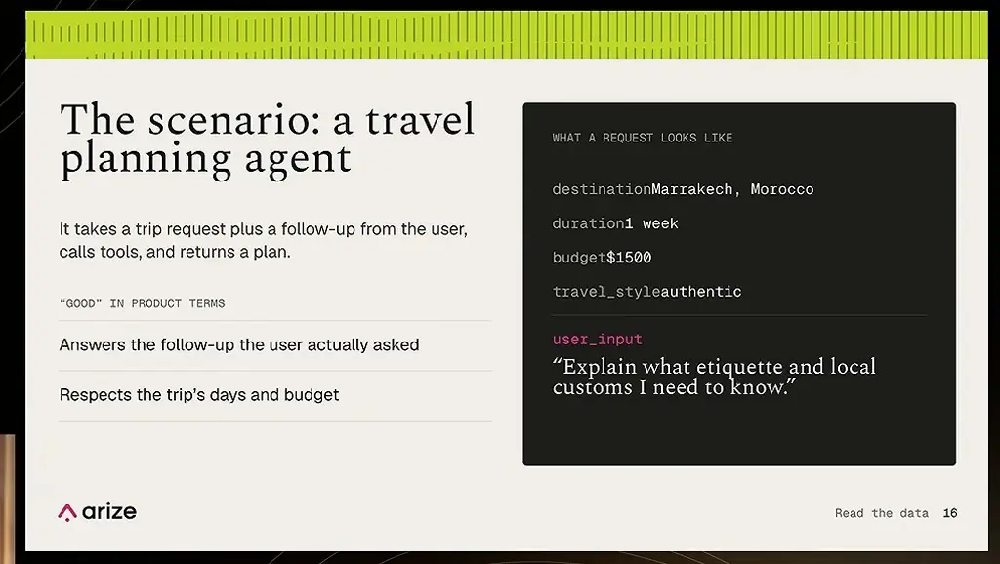
*[▶ 00:10:50](https://www.youtube.com/watch?v=gv4w23xYj-0&t=650s) · The scenario: a travel planning agent*

Check plans against the request: this Prague trip has 3 days and $800, and day one totals $50.

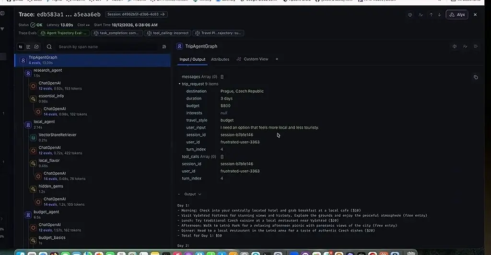
*[▶ 00:11:44](https://www.youtube.com/watch?v=gv4w23xYj-0&t=704s) · Trace detail for Prague trip plan*

A **trace** records every step for one request; selecting a span shows its input and output.

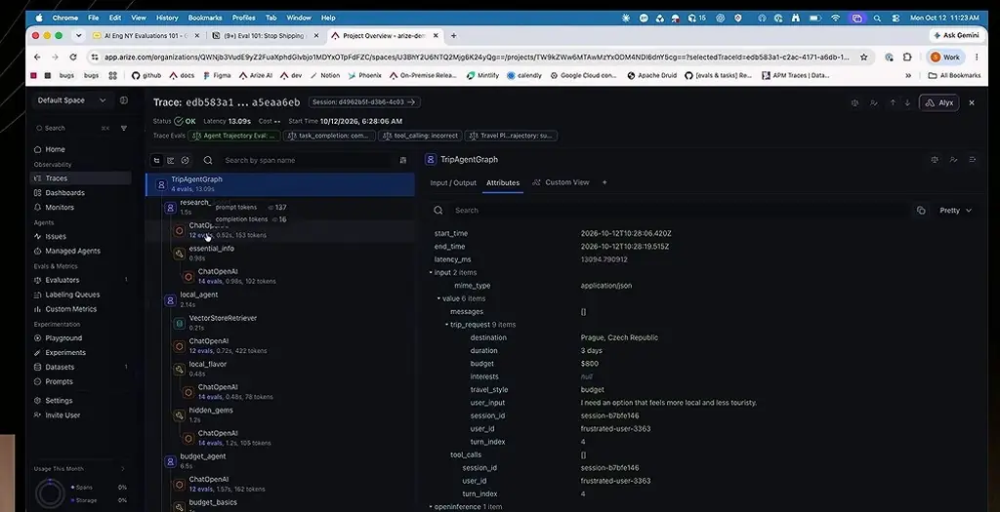
*[▶ 00:12:15](https://www.youtube.com/watch?v=gv4w23xYj-0&t=735s) · Arize trace tree and span attributes*

The ChatOpenAI span shows what the model received and returned, including tool calls.

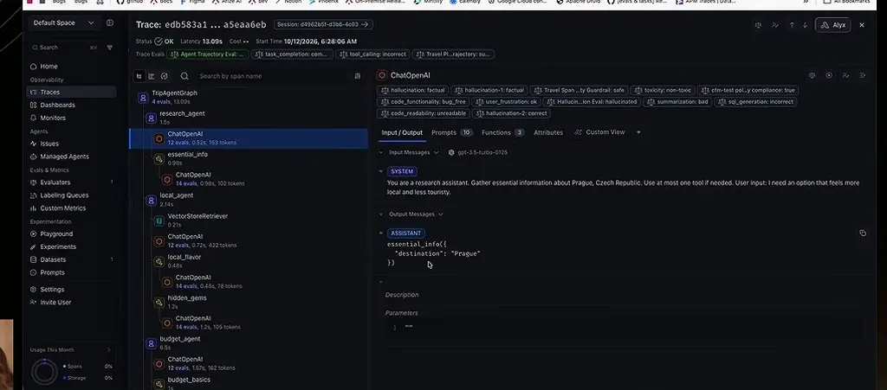
*[▶ 00:12:28](https://www.youtube.com/watch?v=gv4w23xYj-0&t=748s) · Arize trace tree and ChatOpenAI span input/output*

Judge success like a stakeholder: what counts as good, what would stop shipping, where to look.

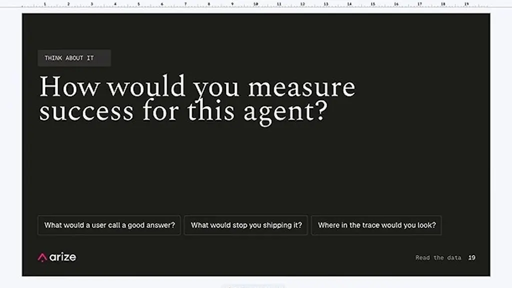
*[▶ 00:13:35](https://www.youtube.com/watch?v=gv4w23xYj-0&t=815s) · Think about it: how would you measure success*

Span timings show where time goes: budget_agent takes 6.07s of this Tokyo trace's 12.75s.

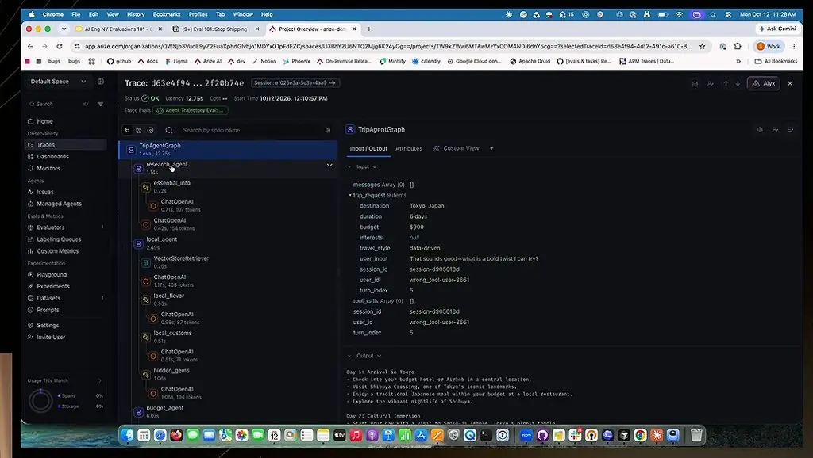
*[▶ 00:14:39](https://www.youtube.com/watch?v=gv4w23xYj-0&t=879s) · Arize trace view: TripAgentGraph span tree*

## Reading traces and defining good

[▶ 00:14:20](https://www.youtube.com/watch?v=gv4w23xYj-0&t=860s)

The **root span** has no parent and holds the overall input and final output. Every other span is a unit of work: an agent, a tool, or an LLM call.

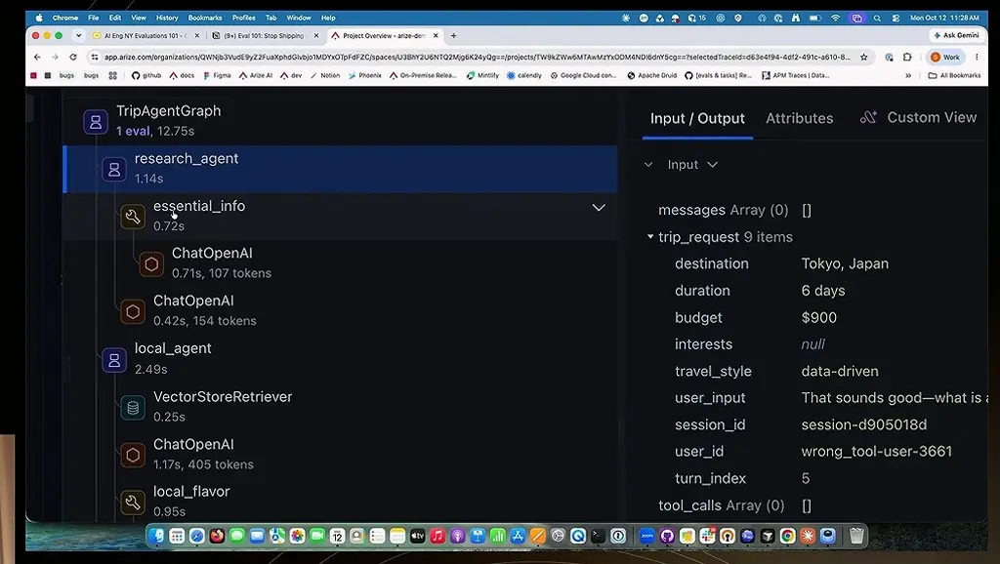
*[▶ 00:15:07](https://www.youtube.com/watch?v=gv4w23xYj-0&t=907s) · Arize trace tree for TripAgentGraph*

Read the tree top-down. Instrumentation can split one decision across spans: the first LLM span chose the `essential_info` tool, and the second summarized its output.

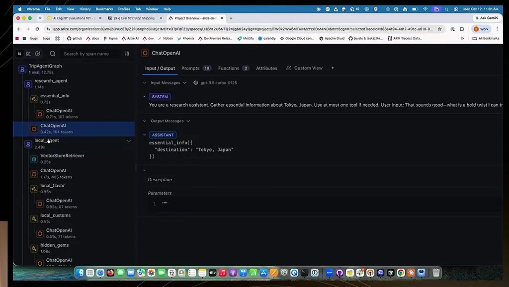
*[▶ 00:17:29](https://www.youtube.com/watch?v=gv4w23xYj-0&t=1049s) · Arize trace tree with ChatOpenAI span details*

Each span shows its own inputs and outputs. `local_agent` receives the full trip request and returns Tokyo suggestions.

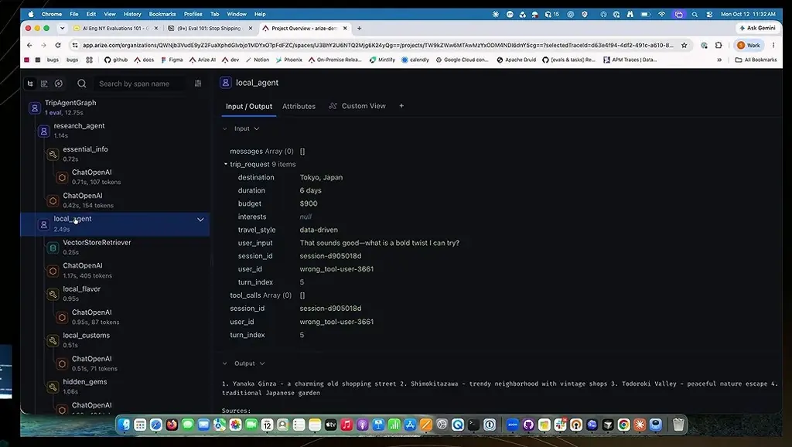
*[▶ 00:17:45](https://www.youtube.com/watch?v=gv4w23xYj-0&t=1065s) · local_agent input and output in trace viewer*

The root output is the itinerary, and its Day 3 café is the "bold twist" the user asked for.

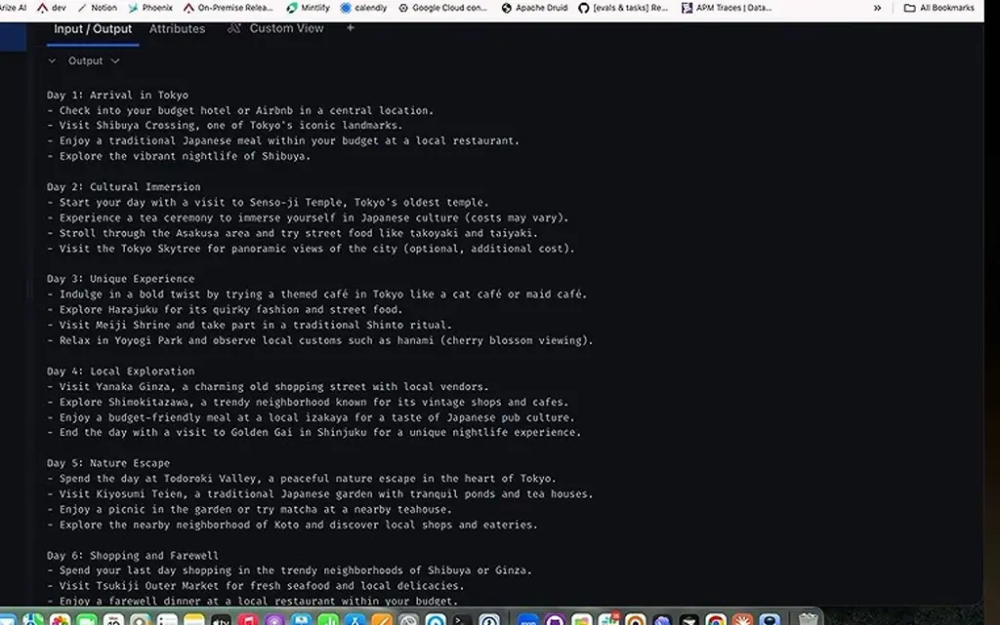
*[▶ 00:16:46](https://www.youtube.com/watch?v=gv4w23xYj-0&t=1006s) · Generated six-day Tokyo itinerary output*

Use **concrete, testable criteria**, not "helpful," "accurate," or "good response." For this app: answer the follow-up first, match the requested number of days, and keep totals within budget.

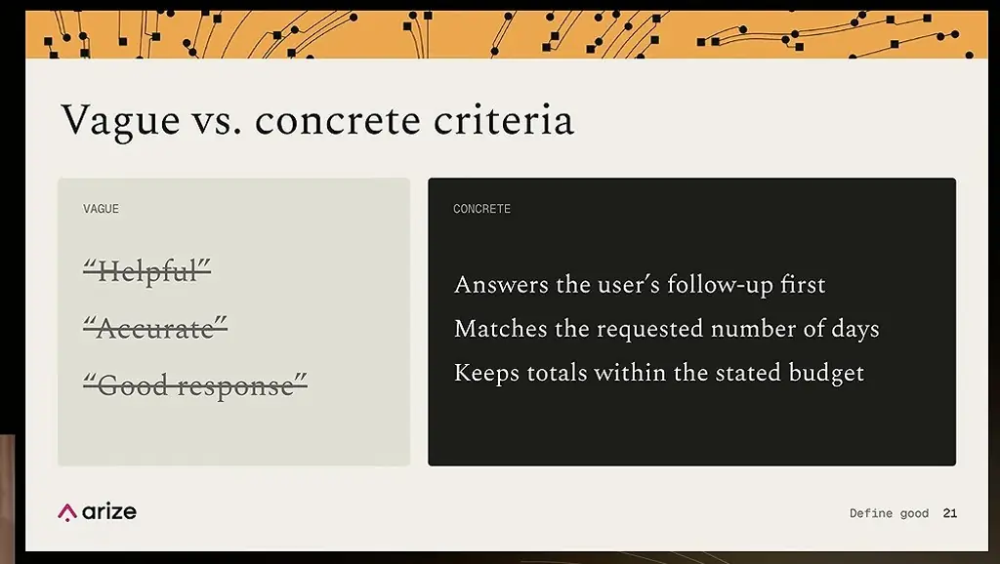
*[▶ 00:19:51](https://www.youtube.com/watch?v=gv4w23xYj-0&t=1191s) · Vague vs. concrete criteria*

Judge one quality per eval. LLM-as-a-judge handles one criterion well. Decision models and agent-as-a-judge can sometimes check several.

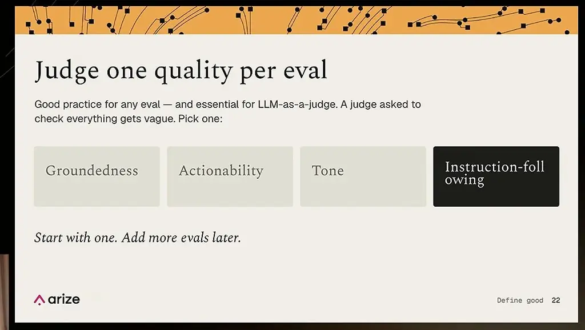
*[▶ 00:21:20](https://www.youtube.com/watch?v=gv4w23xYj-0&t=1280s) · Judge one quality per eval*

Start with a few criteria and add evals over time. Alex, the agent in Arize, started with QA correctness, user frustration, and jailbreak and toxicity checks; it now runs 32 evals.

## Concrete criteria first, then a dataset from spans

[▶ 00:22:02](https://www.youtube.com/watch?v=gv4w23xYj-0&t=1322s)

Replace vague words like "helpful" or "good response" with checkable criteria, such as answering the follow-up first or keeping totals within the stated budget.


*[▶ 00:22:52](https://www.youtube.com/watch?v=gv4w23xYj-0&t=1372s) · Vague vs. concrete criteria*

Write each criterion as six fields: a one-line task, a one-sentence success, a one-sentence failure, one quality to judge, and up to three pass bullets and three fail bullets.

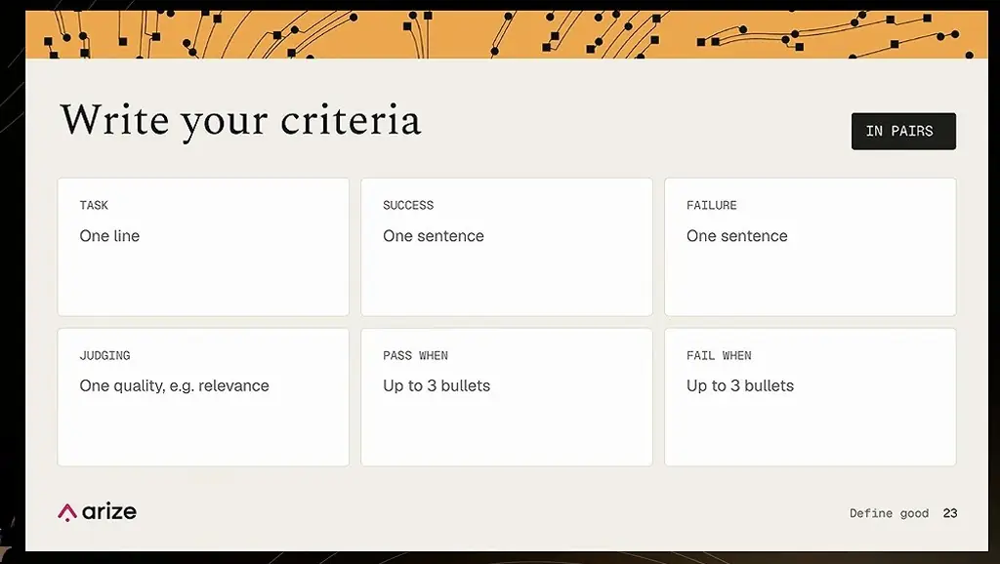
*[▶ 00:24:05](https://www.youtube.com/watch?v=gv4w23xYj-0&t=1445s) · Write your criteria template*

The bullets matter because they become the LLM-as-a-judge prompt. Describe the behavior as you would to a stakeholder, and cut anything extra. For a travel agent follow-up, a response that leads with a budget breakdown nobody asked for fails.

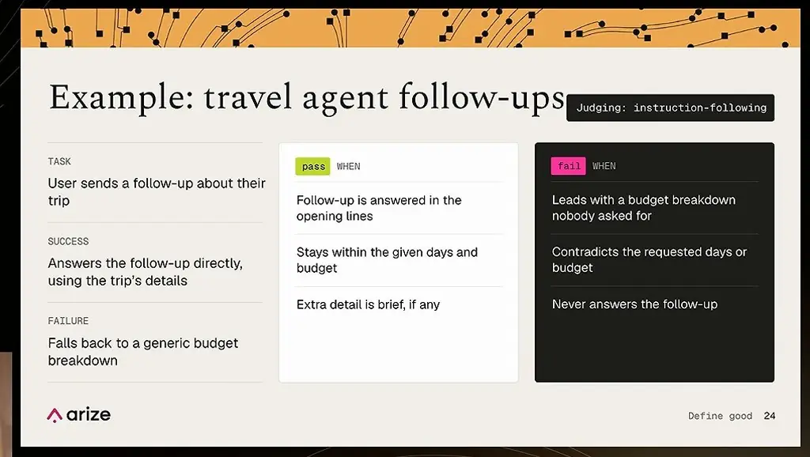
*[▶ 00:25:06](https://www.youtube.com/watch?v=gv4w23xYj-0&t=1506s) · Example: travel agent follow-ups*

Pairs then debrief on what they cut to make the criteria concrete, since the criteria become the eval prompt.


*[▶ 00:25:13](https://www.youtube.com/watch?v=gv4w23xYj-0&t=1513s) · Debrief: what did you cut to make it concrete?*

Every eval today is span-level, so pick the span you want to judge: agent, tool, or retriever.

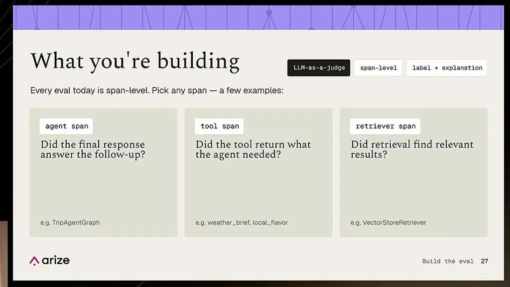
*[▶ 00:25:24](https://www.youtube.com/watch?v=gv4w23xYj-0&t=1524s) · What you're building: span-level evals*

Open a trace and check a tool span's input and output. For example, `essential_info` takes a destination and returns weather, sights, and etiquette.

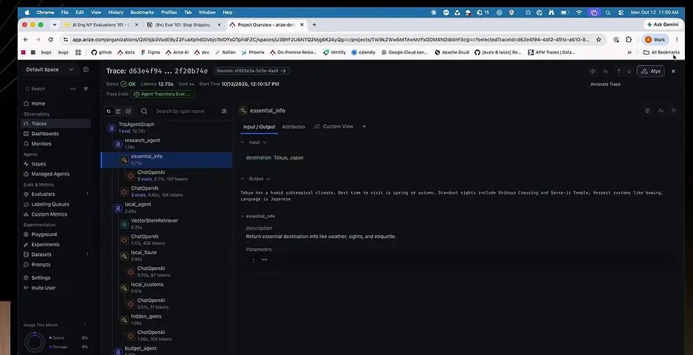
*[▶ 00:25:58](https://www.youtube.com/watch?v=gv4w23xYj-0&t=1558s) · Arize trace view with essential_info span*

Filter spans by name, or select root spans with parent ID equals null, then add the selected spans to a new dataset.

## Building and testing an LLM judge

[▶ 00:26:53](https://www.youtube.com/watch?v=gv4w23xYj-0&t=1613s)

Build the judge in a **Prompt Playground**. Filter traces to the span you're judging, save those spans as a dataset, and run the evaluator on it.

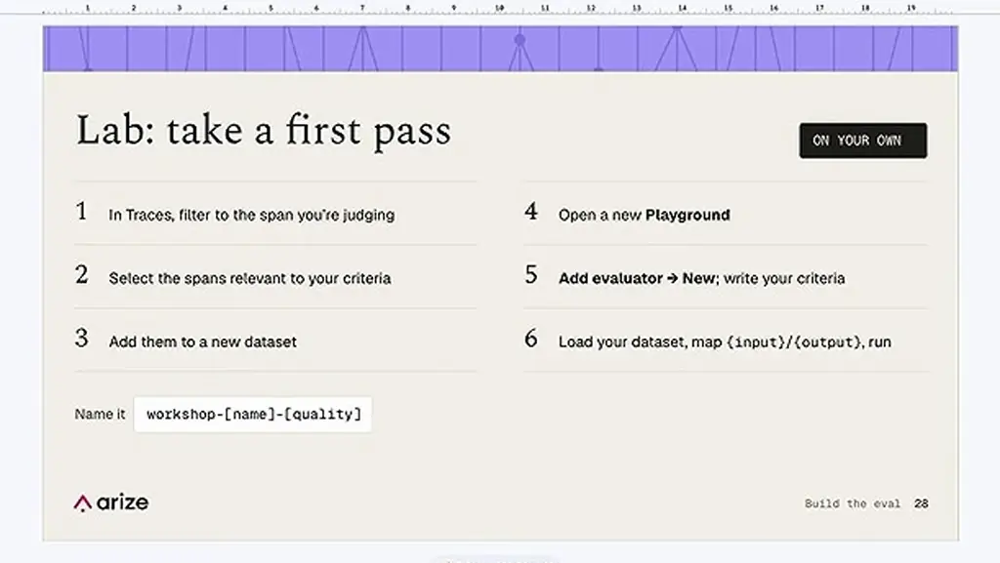
*[▶ 00:27:04](https://www.youtube.com/watch?v=gv4w23xYj-0&t=1624s) · Lab: take a first pass (on your own)*

Frame the judge's task, then turn your criteria into checks such as destination, property type, traveler count, and dates. Mark Incorrect for wrong or invented details.

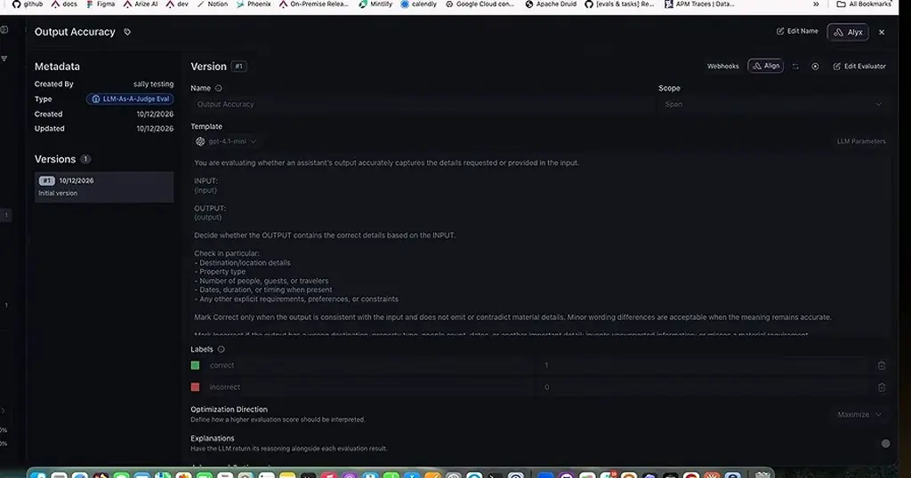
*[▶ 00:28:10](https://www.youtube.com/watch?v=gv4w23xYj-0&t=1690s) · Output Accuracy LLM-as-judge evaluator template*

Reference the data as {input} and {output}. Variable mapping connects them to your dataset columns, so a renamed column means updating the mapping, not every eval.

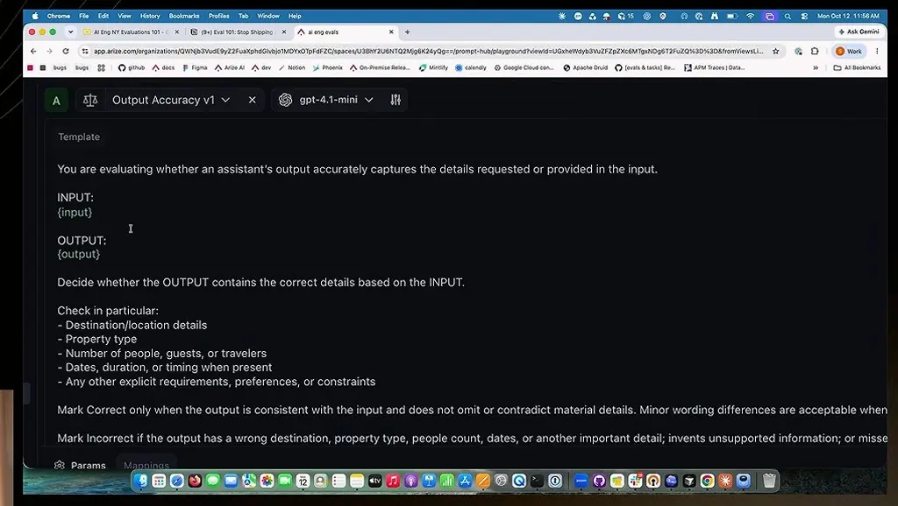
*[▶ 00:29:10](https://www.youtube.com/watch?v=gv4w23xYj-0&t=1750s) · Output accuracy prompt template in Arize playground*

The judge returns one label, such as correct or incorrect. Explanations give the reasoning behind each verdict.

Run the dataset, adjust the prompt where you disagree, and rerun. **Save Evaluator** makes it reusable across the platform.

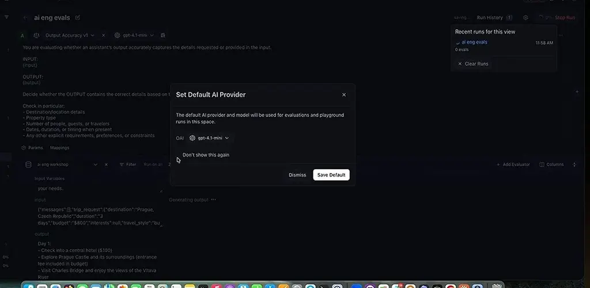
*[▶ 00:31:18](https://www.youtube.com/watch?v=gv4w23xYj-0&t=1878s) · Arize playground with output accuracy evaluator*

After a first pass, Alyx can run the playground, review results, and update the prompt.

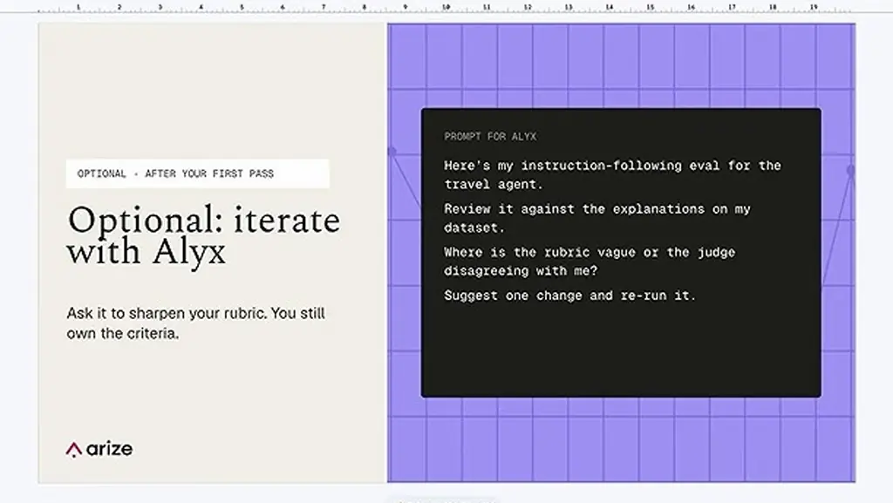
*[▶ 00:32:32](https://www.youtube.com/watch?v=gv4w23xYj-0&t=1952s) · Optional: iterate with Alyx*

Signal, the next loop step, reads traces and evals to find issues and propose fixes.

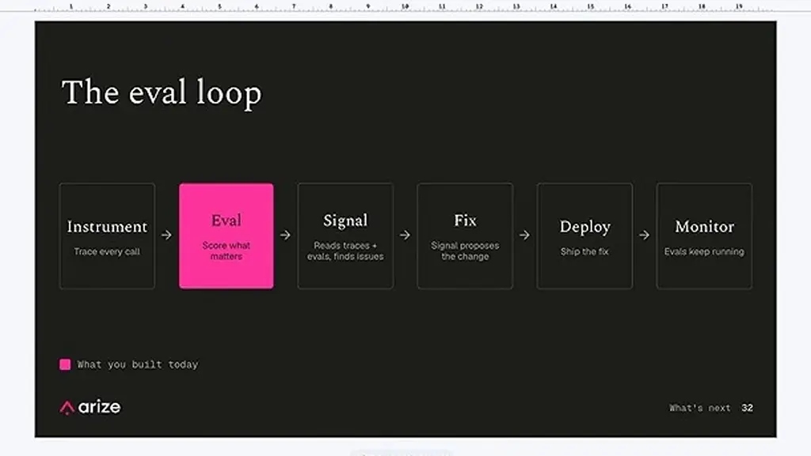
*[▶ 00:32:55](https://www.youtube.com/watch?v=gv4w23xYj-0&t=1975s) · The eval loop: six-step cycle*

Teams then do three things:

- **Alignment:** relabel examples and rerun the judge until it agrees with you.
- **Online evals:** run the judge on sampled production traces.
- **Monitoring:** track pass rate and alert on drops.

Everyone who owns an outcome should help define "good."

## Links & resources

- One-pager with all the talk's resources, via QR code on screen (URL not shown) · mentioned [▶ 00:07:36](https://www.youtube.com/watch?v=gv4w23xYj-0&t=456s)
- Arize product docs the speaker links to, URL not shown · mentioned [▶ 00:18:41](https://www.youtube.com/watch?v=gv4w23xYj-0&t=1121s)
