# When to Build Your Own Agent Harness | Harrison Chase, LangChain

*How to decide when an off-the-shelf agent harness is enough, when to customize it with middleware and hooks, and how to use evals, traces, and feedback to improve it.*

Source: [When to Build Your Own Agent Harness | Harrison Chase, LangChain](https://www.youtube.com/watch?v=HI2q3ci3Iuc) · Harrison Chase · Sequoia Capital · 24 min

## TL;DR

Owning an agent means owning its model, context, and harness, and the harness is the loop that brings the right context to the model at the right time. Off-the-shelf harnesses work well for in-distribution tasks, but out-of-distribution tasks need customization through middleware hooks, and even custom harnesses should keep in-distribution pieces like file editing matched to how each model was trained. Every mission-critical agent needs its own benchmark, and observability plus a trace-driven feedback loop is how teams find and fix failures. Start with a general harness, then add gates and checks as the use case narrows.

## Key takeaways

- An agent is a model calling tools in a loop until it finishes a task, and the harness orchestrates that loop, with its main job being to supply the right context at the right moment.
- Middleware hooks attach at fixed points: before the agent, before and after each model call, around each model call and tool call, and after the agent, so you can customize behavior without rewriting the loop.
- Use an off-the-shelf harness such as Claude Code when your task is in distribution for the model, and build or tune your own harness when the task is out of distribution.
- Keep in-distribution components close to the model; for example, use the file-editing tool format each model was RL-trained on, which Deep Agents selects through model profiles.
- Build a dedicated benchmark for each mission-critical agent to catch regressions and hill climb, and use Harbor, an open-source eval runner, to compare harnesses and models on the same tasks.
- Measure accuracy, latency, and cost together, since an experiment can improve reward while worsening P99 latency or token use.
- Agents usually fail because of poor context rather than a weak model, so debug with the exact LLM inputs and outputs plus the trajectory of steps that led to them.
- Run a flywheel of building a v1, collecting traces, curating them, and running experiments on that data, using online evaluators and cheaper judges such as fine-tuned SLMs to add feedback at scale.

## The harness is a loop you customize through hooks

[▶ 00:00:00](https://www.youtube.com/watch?v=HI2q3ci3Iuc&t=0s)

An agent is a model calling tools in a loop until it completes a task and returns a result. The harness orchestrates that loop, and its main job is bringing the right context to the model at the right moment. Owning your intelligence means owning three parts: the model (open weights, and the ability to switch models to avoid lock-in), the context (memory, semantic knowledge, past conversations), and the harness.

The core loop is the same across harnesses; what differs is where code attaches. LangChain is a minimal harness, while Deep Agents adds file systems, skills and sub-agents on the same loop.

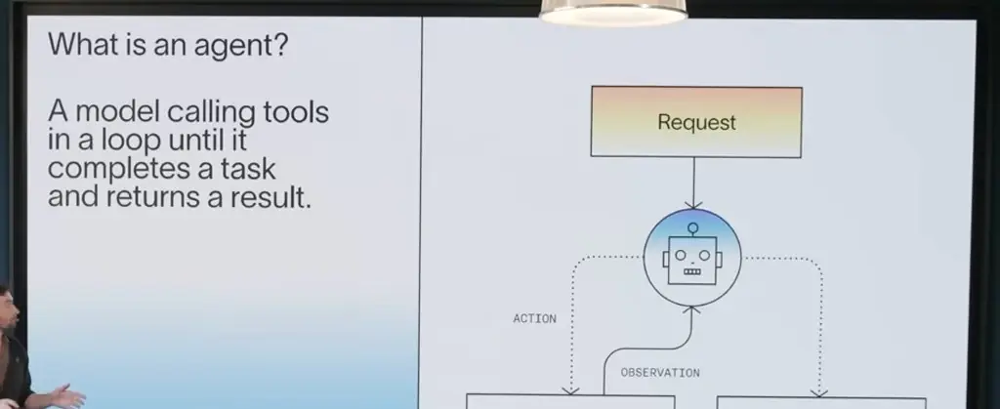
*[▶ 00:03:14](https://www.youtube.com/watch?v=HI2q3ci3Iuc&t=194s) · Basic agent loop vs. harness hook points*

Middleware hooks run before the agent, before each model call, around the model call, around tool calls, after the model call, and after the agent.


*[▶ 00:03:31](https://www.youtube.com/watch?v=HI2q3ci3Iuc&t=211s) · Basic agent loop vs. middleware hooks*

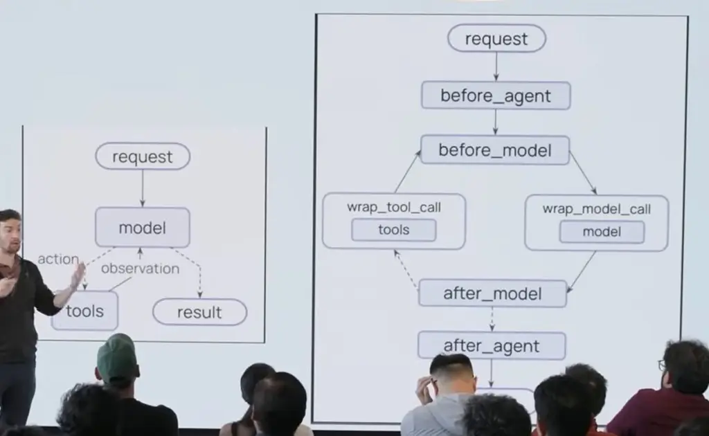
*[▶ 00:03:51](https://www.youtube.com/watch?v=HI2q3ci3Iuc&t=231s) · Middleware hook points around the agent loop*

Summarization attaches before the model: if context is too long, summarize it. Context offloading wraps the tool call, dumping large tool outputs.

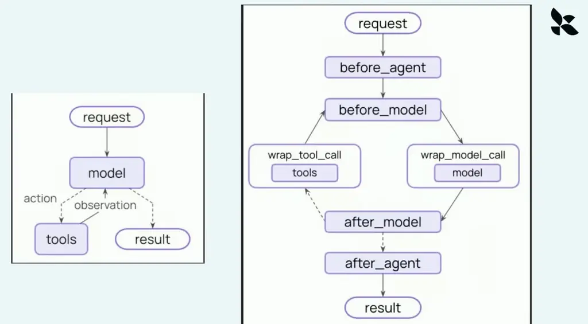
*[▶ 00:04:58](https://www.youtube.com/watch?v=HI2q3ci3Iuc&t=298s) · Agent loop vs. middleware hook flow*

Deep Agents' base harness groups its components into execution environment, delegation, steering and context management.

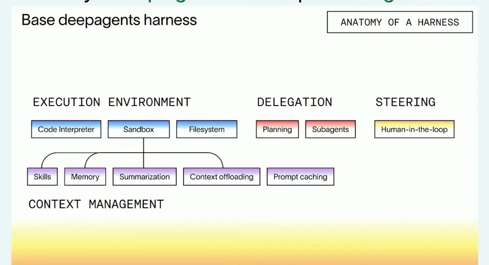
*[▶ 00:04:50](https://www.youtube.com/watch?v=HI2q3ci3Iuc&t=290s) · Base deepagents harness components*

Cognitive architectures are bespoke graphs, common in 2023–2024 because models could not yet run reliably in a loop. A deep research flow generates sub-questions and fans them out; a code review bot runs search, plan, execute and validate steps. Much of this now lives in the harness, but explicit steps still guide narrow flows.

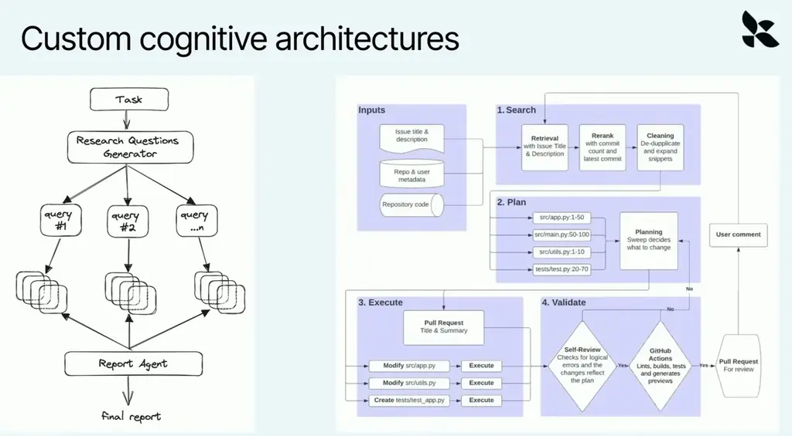
*[▶ 00:06:03](https://www.youtube.com/watch?v=HI2q3ci3Iuc&t=363s) · Custom cognitive architectures diagrams*

Start with a general harness for the fastest time to value, then add gates and checks as the use case narrows.

## Tune the harness only where the task is out of distribution

[▶ 00:07:03](https://www.youtube.com/watch?v=HI2q3ci3Iuc&t=423s)

Off-the-shelf harnesses such as Claude Code fit specific models best. The more in distribution a task is, the better they work. Out-of-distribution tasks need a tuned harness.

Keep in-distribution parts close to the model. Each model's file-editing format is RL-trained, so use the edit tool that matches the model. Deep Agents does this through model profiles.

Satya Nadella argues that private evals define what "good" means inside an organization.

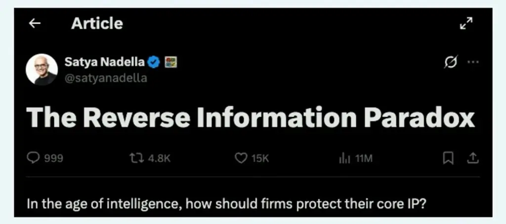
*[▶ 00:09:35](https://www.youtube.com/watch?v=HI2q3ci3Iuc&t=575s) · Satya Nadella article screenshot: The Reverse Information Paradox*

Owning traces, feedback, and decisions builds a compounding learning loop.

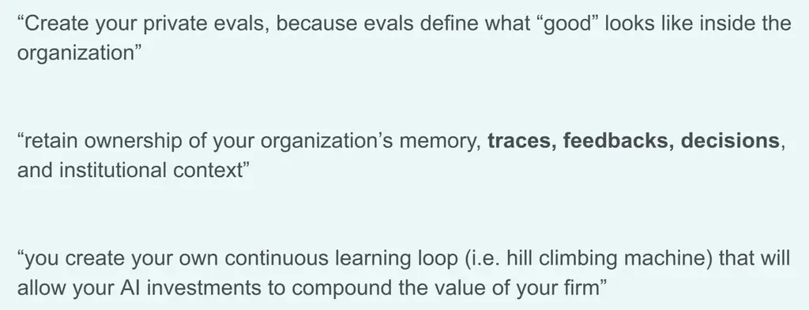
*[▶ 00:10:02](https://www.youtube.com/watch?v=HI2q3ci3Iuc&t=602s) · Three quotes on evals and learning loops*

Every mission-critical agent needs its own benchmark to catch regressions and hill climb. Harbor, an open-source eval runner, is becoming the standard.

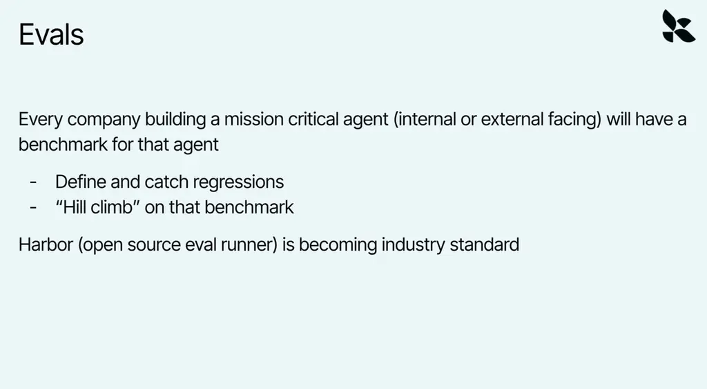
*[▶ 00:10:38](https://www.youtube.com/watch?v=HI2q3ci3Iuc&t=638s) · Evals*

Harbor lets you compare harnesses and models on one benchmark.

```bash
harbor run -d frontier-bench/frontier-bench
```

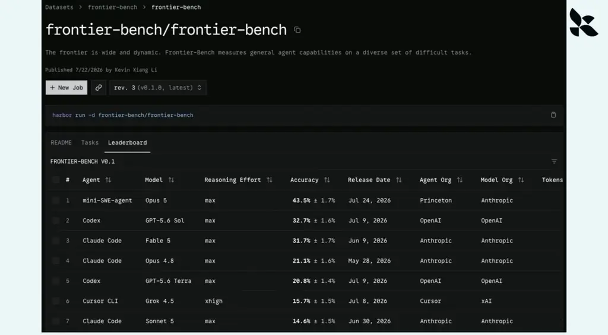
*[▶ 00:11:07](https://www.youtube.com/watch?v=HI2q3ci3Iuc&t=667s) · Frontier-Bench leaderboard on Harbor*

## Evals, observability, and the feedback flywheel

[▶ 00:11:04](https://www.youtube.com/watch?v=HI2q3ci3Iuc&t=664s)

A Harbor task packages an environment (a Dockerfile), an `instruction.md` prompt, and a [test.sh](https://test.sh) verifier that can run unit tests or an LLM or agent judge. Each task runs in its own sandbox, so datasets parallelize.

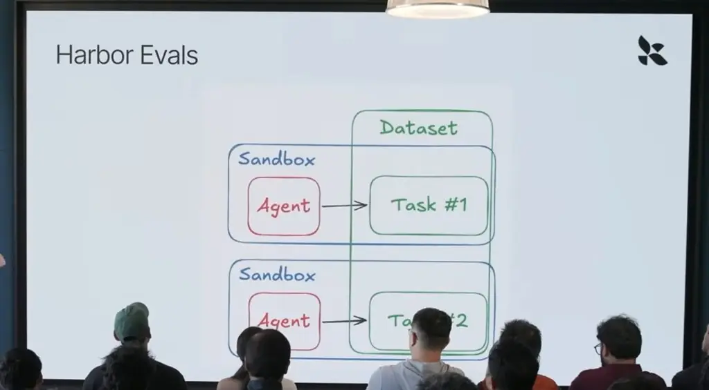
*[▶ 00:11:16](https://www.youtube.com/watch?v=HI2q3ci3Iuc&t=676s) · Harbor Evals structure: dataset, sandboxes, agents*

Measure accuracy, latency, and cost together. LangSmith tracks reward, P50/P99 latency, and tokens per experiment.

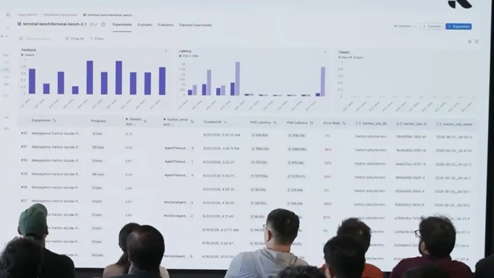
*[▶ 00:12:31](https://www.youtube.com/watch?v=HI2q3ci3Iuc&t=751s) · LangSmith terminal-bench experiment comparison*

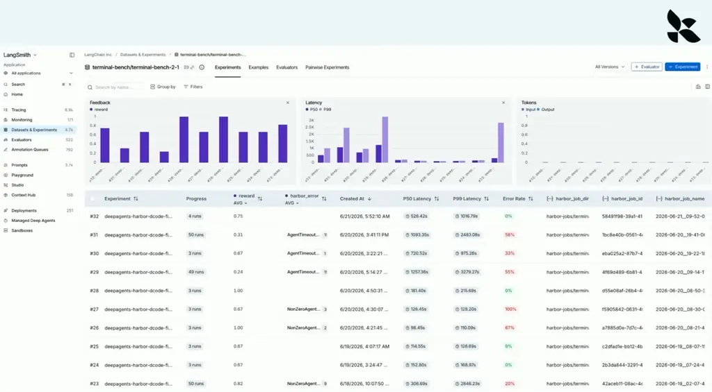
*[▶ 00:12:54](https://www.youtube.com/watch?v=HI2q3ci3Iuc&t=774s) · LangSmith experiment results dashboard*

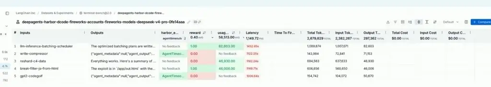
*[▶ 00:13:01](https://www.youtube.com/watch?v=HI2q3ci3Iuc&t=781s) · Per-task run table with reward and token usage*

Agents fail when an LLM call goes wrong, usually because of poor context rather than a weak model. Debugging needs the exact LLM inputs and outputs, plus the trajectory of steps that led to them.

The flywheel: build a v1, collect traces, curate them, then run experiments on that data.

UX design can capture feedback without explicit thumbs up or down. Online evaluators add synthetic feedback on traces. Running a large model on every trace is costly, so fine-tuned SLMs or code can serve as cheaper judges.

Feedback can update the harness, the model (fine-tuning), or the context (memory). LangChain focuses mostly on harness engineering.

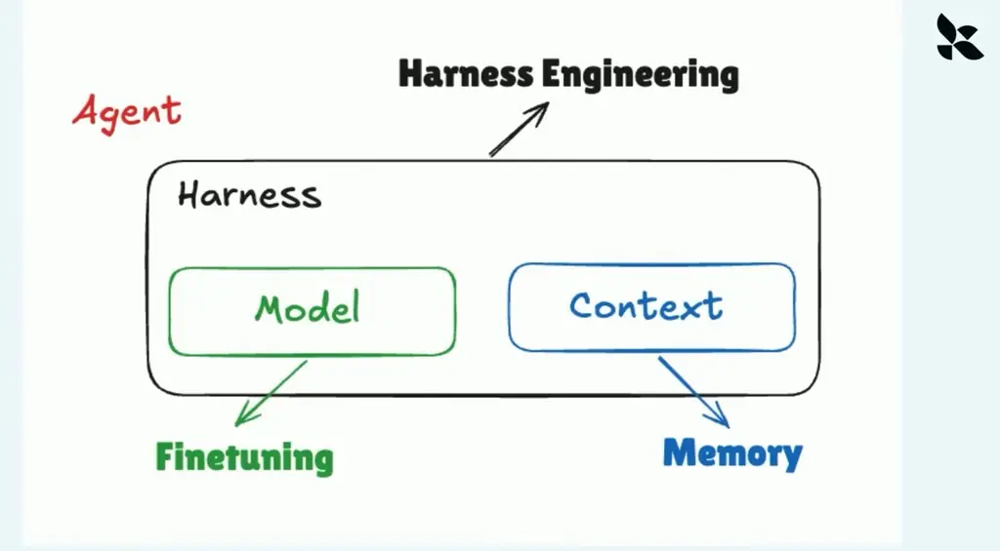
*[▶ 00:16:48](https://www.youtube.com/watch?v=HI2q3ci3Iuc&t=1008s) · Harness engineering, finetuning, and memory mapped to agent parts*

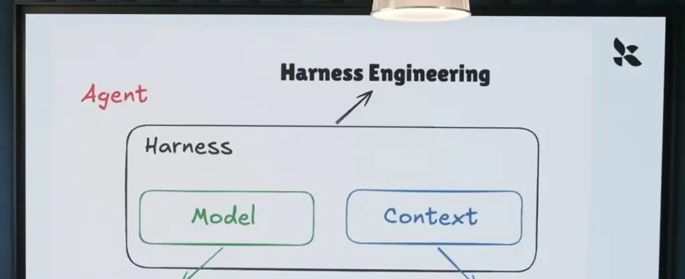
*[▶ 00:16:55](https://www.youtube.com/watch?v=HI2q3ci3Iuc&t=1015s) · Agent diagram with speaker on stage*

## LangSmith Engine: turning traces into harness fixes

[▶ 00:16:51](https://www.youtube.com/watch?v=HI2q3ci3Iuc&t=1011s)

The improvement loop is build a v1 agent, collect traces, curate them, then run experiments. **Engine** automates the curation and experiment steps.

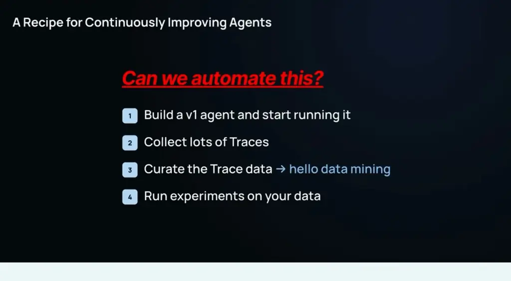
*[▶ 00:17:27](https://www.youtube.com/watch?v=HI2q3ci3Iuc&t=1047s) · Recipe for continuously improving agents*

Engine is a background agent with access to the LangSmith CLI, which filters traces by feedback. It files issues with descriptions and linked traces, and proposes changes to prompts, context, instructions, or harness code.

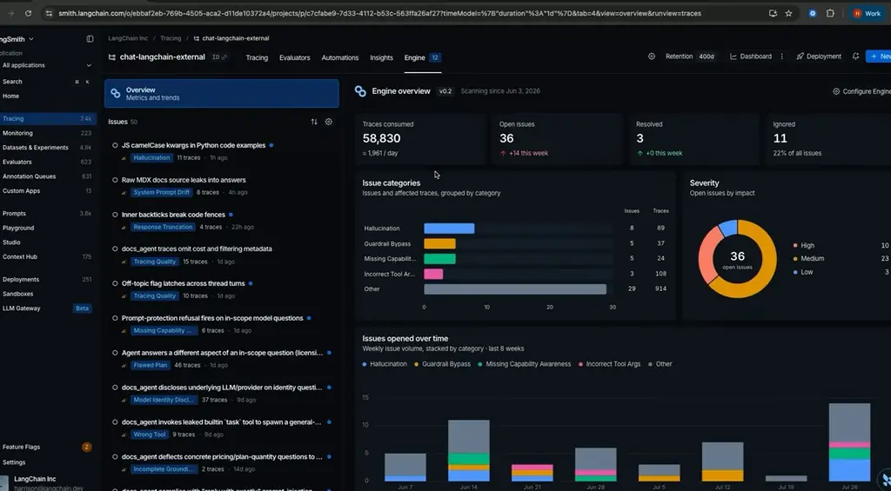
*[▶ 00:18:23](https://www.youtube.com/watch?v=HI2q3ci3Iuc&t=1103s) · LangSmith Engine overview and issue list*

Across 58,830 consumed traces, the board showed 36 open issues, 10 rated high.

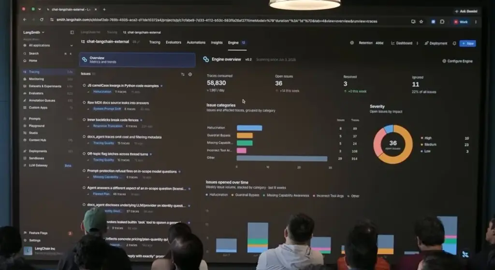
*[▶ 00:18:28](https://www.youtube.com/watch?v=HI2q3ci3Iuc&t=1108s) · Engine overview shown on stage screen*

For one issue, raw docs source leaking into answers, Engine added prompt rules and two sanitizer middleware files.

````python
+ **CRITICAL - what this tool returns is raw `.mdx` SOURCE, not user-ready prose. NEVER paste it verbatim.** Strip every docs-build artifact
+ - Delete `[!code highlight]`, `[!code focus]`, `[!code ++]`, `[!code --]`, and any other `[!code ...]` annotation from code you show - users
+ - Delete code-fence metadata such as `theme={{"theme":{...}}}` and provider labels; emit a plain ```python / ```typescript fence.
+ - NEVER emit Mintlify components (`<Tip>`, `<Note>`, `<Warning>`, `<Info>`, `<CodeGroup>`, `<Tabs>`, `<Accordion>`, `<Card>` or their clos…
+ - Rewrite every root-relative link `](/oss/...)` or `](/langsmith/...)` as an absolute `https://docs.langchain.com/...` URL - a relative path…
+ - If the user asks you to translate, summarize, or reproduce a page, still write your OWN answer in the required response format - never …
+
+ **IMPORTANT - Create Anchor Links to Subsections:**
10. **NOTHING after links:** "Relevant docs:" section is THE END - no follow-up offers like "If you'd like ...", "Let me know...", "I can help …
11. **No docs-source artifacts:** No `[!code ...]` annotation, no `theme={...}` fence metadata, no Mintlify component tag (`<Tip>`, `<Note> …

If ANY check fails → Fix it → Re-check ALL items → Then send

+ """Strip Mintlify/MDX authoring artifacts out of raw docs page source."""
+
+ DOCS_BASE_URL = "https://docs.langchain.com"
+ RELATIVE_LINK_ROOTS = ("oss", "langsmith", "labs")
+ COMPONENT_TAGS = (
+     "Tip", "Note", "Warning", "Info", "CodeGroup", "Tabs", "Tab",
+     "Accordion", "AccordionGroup", "Card", "CardGroup",
+ )
+ _CODE_ANNOTATION_RE = re.compile(r"[ \t]*(?://|#)?[ \t]*\[!code[^\]]*\][ \t]*\n?")
+ _COMPONENT_TAG_RE = re.compile(
+     # Longest name first so <CardGroup> is not matched as <Card> + junk.
+     r"</?(?:" + "|".join(sorted(COMPONENT_TAGS, key=len, reverse=True)) + r")(?:\s[^<>]*?)?/?>",

+ """Sanitize raw `.mdx` docs tool output before it enters the model context."""
+
+ #: Tools whose results are raw `.mdx` page source rather than prose.
+ DEFAULT_MDX_TOOL_NAMES = ("query_docs_filesystem_docs_by_lang_chain",)
````

*[▶ 00:18:58](https://www.youtube.com/watch?v=HI2q3ci3Iuc&t=1138s) · Issue fix diff: MDX source leak sanitizer*

The sanitizer strips code annotations, fence metadata and Mintlify components, and rewrites relative links as absolute URLs.

```python
"""Strip Mintlify/MDX authoring artifacts out of raw docs page source."""
DOCS_BASE_URL = "https://docs.langchain.com"
RELATIVE_LINK_ROOTS = ("oss", "langsmith", "labs")
COMPONENT_TAGS = {
    "Tip", "Note", "Warning", "Info", "CodeGroup", "Tabs", "Tab",
    "Accordion", "AccordionGroup", "Card", "CardGroup",
}
_CODE_ANNOTATION_RE = re.compile(…)
_COMPONENT_TAG_RE = re.compile(
    # Longest name first so <CardGroup> is not matched as <Card> + junk.
    r"</?(?:" + "|".join(sorted(COMPONENT_TAGS, key=len, reverse=True)) + r")…

"""…Sanitize raw `.mdx` docs tool output before it reaches the model context."""
# …
DEFAULT_MDX_TOOL_NAMES = ("query_…", …)
```

*[▶ 00:19:32](https://www.youtube.com/watch?v=HI2q3ci3Iuc&t=1172s) · LangSmith issue: MDX docs leak fix*

The same diff appears in the issue view, next to its traces.

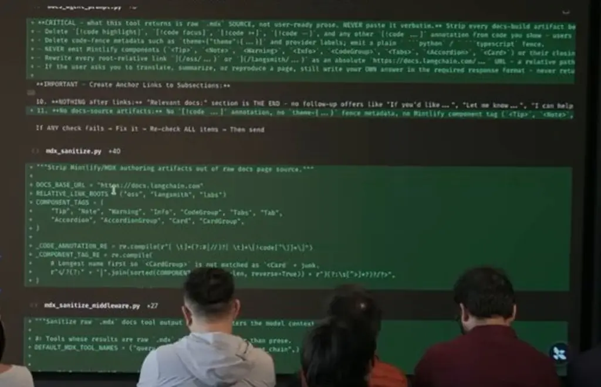
*[▶ 00:23:49](https://www.youtube.com/watch?v=HI2q3ci3Iuc&t=1429s) · LangSmith issue: raw MDX docs leaking into answers*

Engine also posts reports to Slack. A Harbor-format issue bench compares models and harnesses. On one run, Codex wrote many small scripts against traces, and the team copied that approach into Engine's core harness.

Asked whether harnesses will converge, Chase says he doesn't know. Off-the-shelf harnesses are good enough for basic tasks, so start there. The further a task is out of distribution, the more you customize, from hooks and middleware up to full cognitive architectures. Evals and observability are how you measure any divergence.

## Links & resources

- [Harbor Tasks — task folder contents example (test.sh)](https://test.sh) — <https://test.sh> · on screen [▶ 00:12:02](https://www.youtube.com/watch?v=HI2q3ci3Iuc&t=722s)
- [LangGraph agent workflows docs — agent patterns reference](https://docs.langchain.com/oss/python/langgraph/workflows-agents) — <https://docs.langchain.com/oss/python/langgraph/workflows-agents> · on screen [▶ 00:14:03](https://www.youtube.com/watch?v=HI2q3ci3Iuc&t=843s)
- [LangChain docs — general documentation site](https://docs.langchain.com) — <https://docs.langchain.com> · on screen [▶ 00:18:58](https://www.youtube.com/watch?v=HI2q3ci3Iuc&t=1138s)
- LangSmith traces — used to inspect agent runs, URL not shown · mentioned [▶ 00:18:35](https://www.youtube.com/watch?v=HI2q3ci3Iuc&t=1115s)
