# Why Own Your Intelligence? Harrison Chase Keynote | Interrupt London

*How a team can own its agents by building the model, harness, and context into a system that is open, compounding, and governed, with LangSmith tooling for each part.*

Source: [Why Own Your Intelligence? Harrison Chase Keynote | Interrupt London](https://www.youtube.com/watch?v=XOUSuxY074U) · Harrison Chase · LangChain · 35 min

## TL;DR

Agents depend on the harness around the model (skills, tools, context, controls, memory, model routing), not the LLM alone, and uncontrolled agent systems let costs escalate fast. Harrison Chase argues teams should own that system through three pillars: open (model optionality and a controllable harness), compounding (improvement through observability and memory), and governed (knowing whom agents act for and what they cost). He shows how LangSmith supplies the infrastructure, trace observability, and an Engine that proposes, tests, and deploys fixes. This matters because the data and context a team builds into its harness are what separate its agents from anyone else's.

## Key takeaways

- Agent = Model + Harness: the harness (skills, tools, context, controls, fine-tuning, system prompt, memory, model routing) is what makes an agent work, not the LLM alone.
- Uncontrolled agentic systems drive costs up quickly; the article cites Uber burning its entire 2026 AI budget in four months.
- Owning intelligence means being open (model optionality, controllable harness, context from any source), compounding (improving over time via observability or memory), and governed (knowing whom agents act for and what they cost).
- Agent building is a flywheel: build a version, test it quickly, deploy to a small group, monitor, then feed learnings back into the build.
- Managed Deep Agents merges the harness and infrastructure layers so teams define only business logic, and cloud agents need a runtime, authenticated tool access, sandboxes, and an LLM gateway.
- Agent traces are a new data type (deeply nested, large payloads, mixed modalities), and RBAC can let engineers see trace skeletons like tools, tokens, and latency without the input and output content.
- Jev, a decision model that answers typed questions instead of generating text, can serve as a judge 20–200x faster and 40–400x cheaper than frontier-model judges.
- LangSmith Engine runs a monitor-build-test-deploy loop on traces, and agents can call self_reporter_tool() to attach annotations about failures to traces so Engine picks them up later.

## Why the system around the model makes agents work

[▶ 00:00:00](https://www.youtube.com/watch?v=XOUSuxY074U&t=0s)

2023 was the year of prototypes. In 2024, LLM applications appeared, but they were simple: a single call, a chain of calls, or a chatbot.

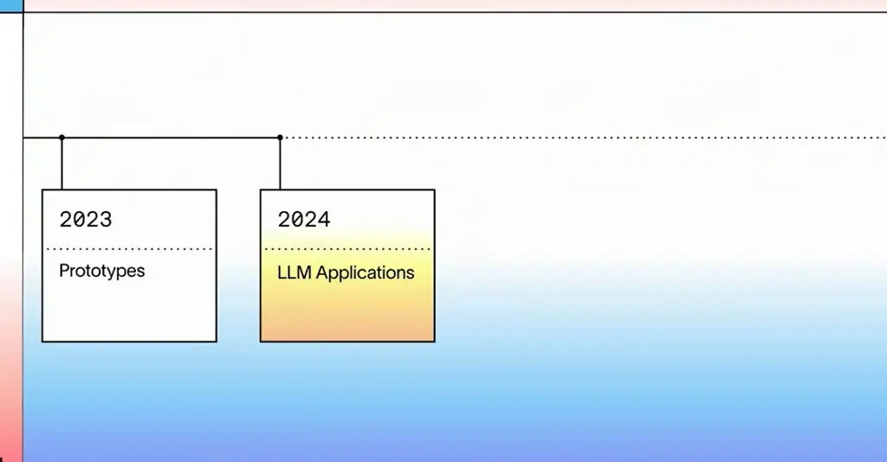
*[▶ 00:01:25](https://www.youtube.com/watch?v=XOUSuxY074U&t=85s) · Agent timeline: 2023 and 2024*

Agents were explored in 2025 and began transforming the application layer in 2026.

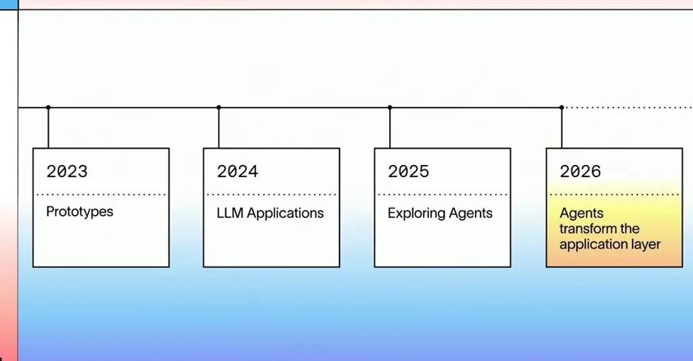
*[▶ 00:01:45](https://www.youtube.com/watch?v=XOUSuxY074U&t=105s) · Agent timeline: 2023 to 2026*

The LLM alone does not make an agent work. The harness around it does.

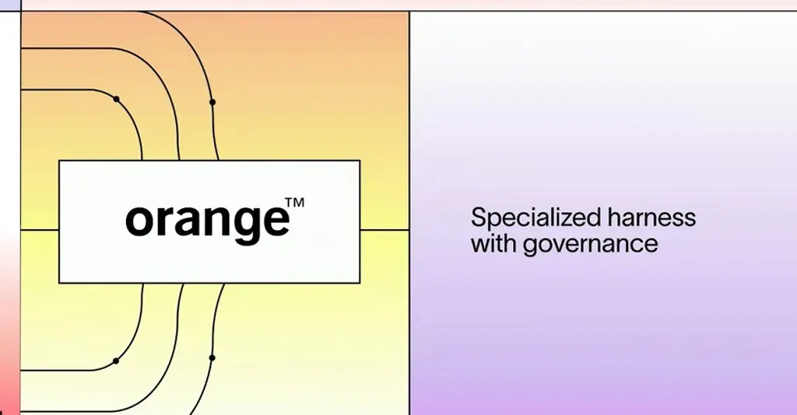
*[▶ 00:02:45](https://www.youtube.com/watch?v=XOUSuxY074U&t=165s) · Specialized harness with governance (Orange)*

That harness includes skills, tools, context, controls, fine-tuning, system prompt, memory and model routing.

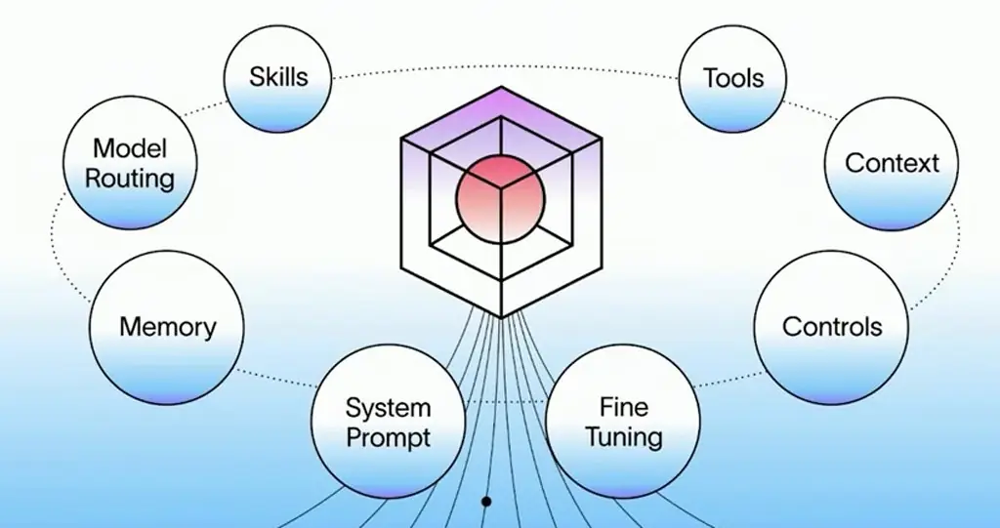
*[▶ 00:03:05](https://www.youtube.com/watch?v=XOUSuxY074U&t=185s) · Harness components around the model*

Three trends make owning that system matter:

- **Cost:** without control over the agentic system, costs escalate. Uber burned its entire 2026 AI budget in four months.
- **Open models:** NVIDIA, Kimi and DeepSeek offer cheap open-weight models you can post-train.
- **Data:** the data and context you bring to the harness differentiate you from anyone using ChatGPT or Claude.

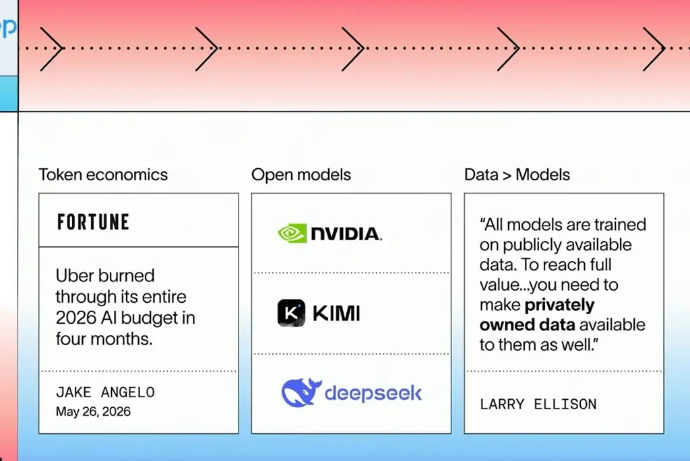
*[▶ 00:04:35](https://www.youtube.com/watch?v=XOUSuxY074U&t=275s) · Token economics, open models, Data > Models*

LangChain's three pillars of owning intelligence are:

- **Open:** model optionality, a controllable harness, and context from any source.
- **Compounding:** improvement over time through observability or memory.
- **Governed:** knowing whom agents act for and what they cost.

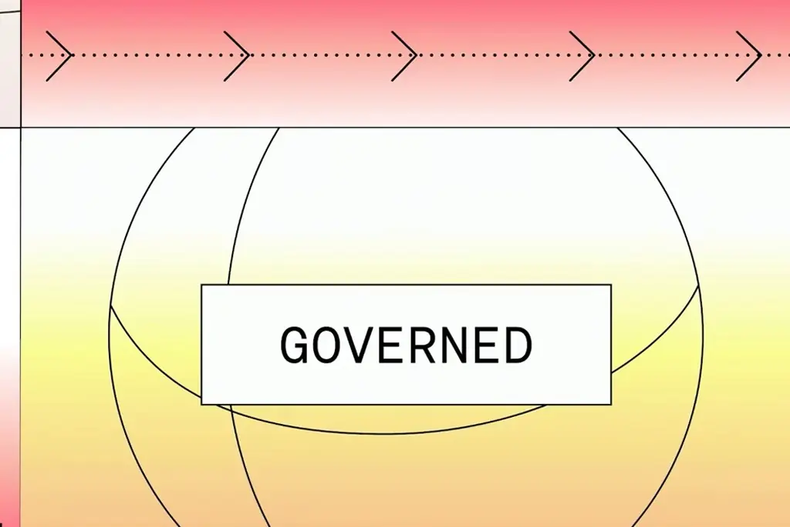
*[▶ 00:06:46](https://www.youtube.com/watch?v=XOUSuxY074U&t=406s) · GOVERNED pillar graphic*

## Organizing people, process, and technology around agents

[▶ 00:06:59](https://www.youtube.com/watch?v=XOUSuxY074U&t=419s)

Owning intelligence takes platform engineers who build the core technology, agent engineers in business units who make agents work for specific use cases, and non-technical builders who define what good looks like in their domain.

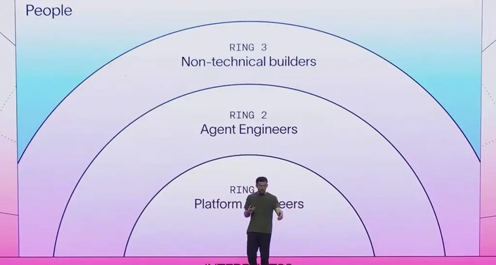
*[▶ 00:08:06](https://www.youtube.com/watch?v=XOUSuxY074U&t=486s) · People: three rings of personas*

Agent building is iterative. Build a version, test it quickly, deploy it to a small set of users, monitor it, then feed the learnings back into build. The fastest teams spin this flywheel quickly.

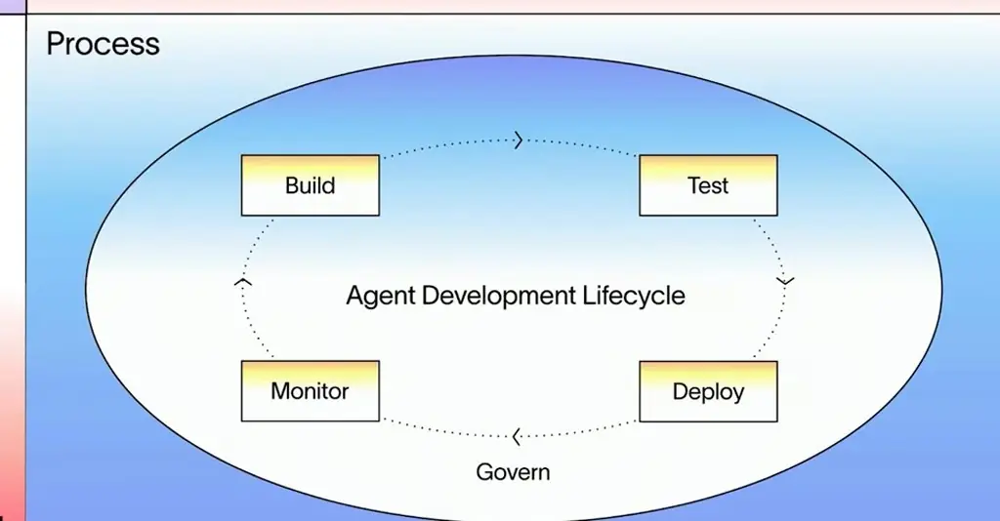
*[▶ 00:08:51](https://www.youtube.com/watch?v=XOUSuxY074U&t=531s) · Process: agent development lifecycle loop*

The technology is a runtime for building and deploying agents, plus observability and evals, which drive the compounding loop.

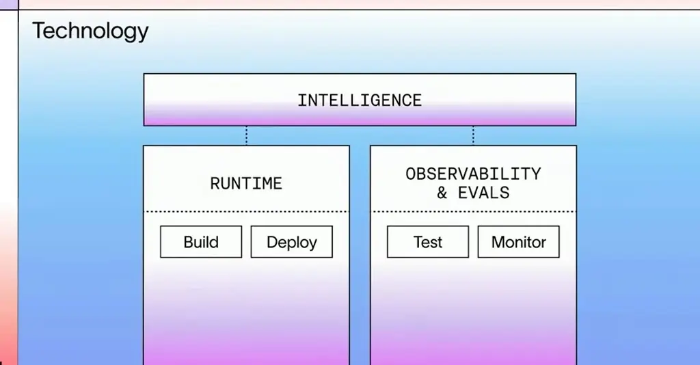
*[▶ 00:09:38](https://www.youtube.com/watch?v=XOUSuxY074U&t=578s) · Technology: runtime and observability stack*

**Business logic** (instructions, tools, skills, hooks) is domain-specific and runs on a **harness**, which runs on infrastructure.

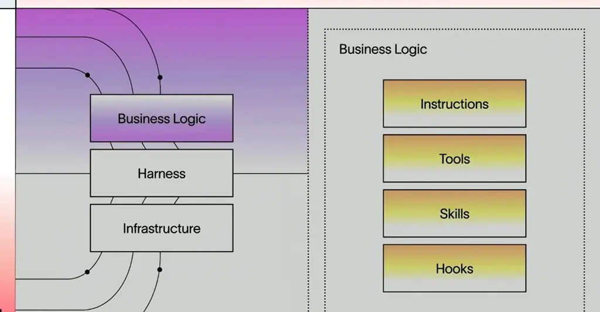
*[▶ 00:10:31](https://www.youtube.com/watch?v=XOUSuxY074U&t=631s) · Business logic, harness, and infrastructure layers*

Agent = Model + Harness. Deep Agents is the open-source base harness: an execution environment, context management, steering through human-in-the-loop, and delegation through planning and subagents.

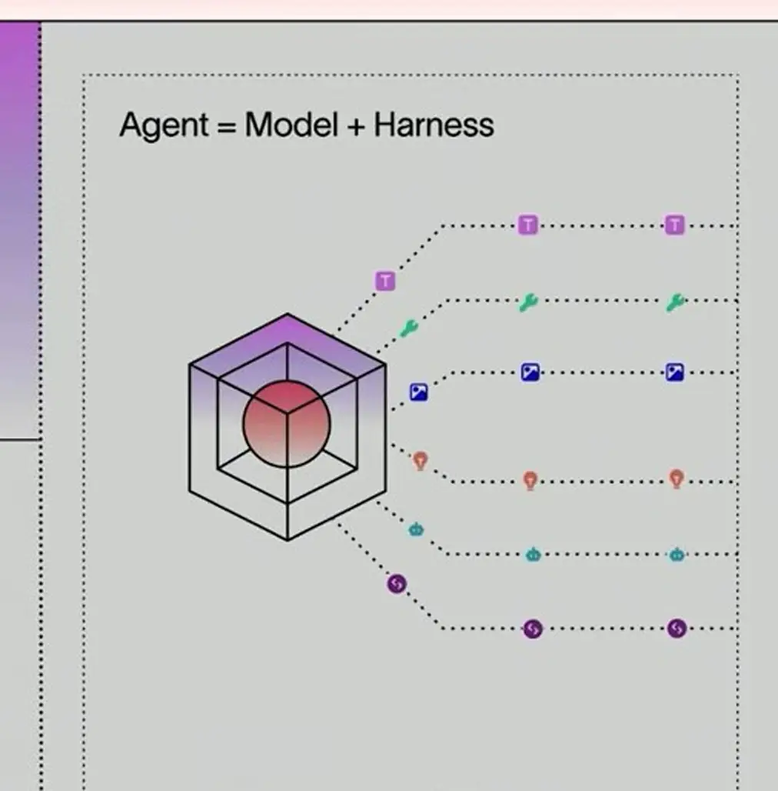
*[▶ 00:10:48](https://www.youtube.com/watch?v=XOUSuxY074U&t=648s) · Agent = Model + Harness*

The harness connects the model to tools and external systems.

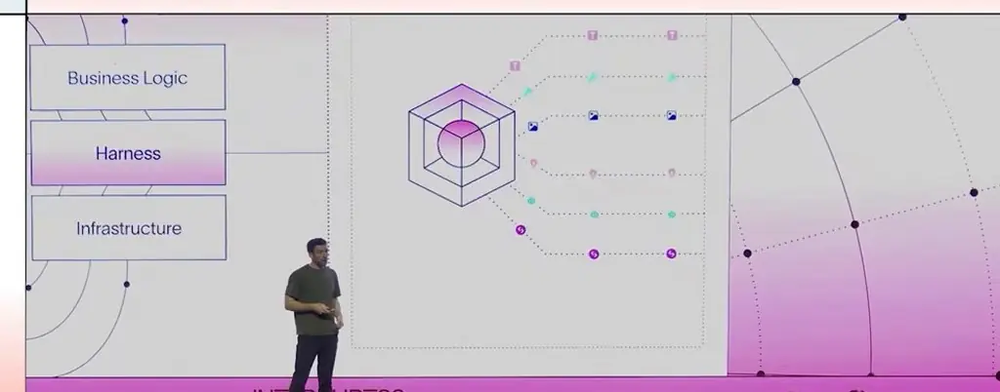
*[▶ 00:10:55](https://www.youtube.com/watch?v=XOUSuxY074U&t=655s) · Layered agent diagram on projected screen*

## Cloud agents need a full infrastructure stack

[▶ 00:12:04](https://www.youtube.com/watch?v=XOUSuxY074U&t=724s)

Cloud agents need a runtime, authenticated tool access, sandboxes for running code, and an LLM gateway. [LangSmith](https://www.langchain.com/langsmith) provides each:

- **Deployments:** streaming, secrets storage, checkpointer, task queue
- **Tool server:** MCP, auth handler, audit log
- **Sandboxes:** a secret proxy keeps credentials away from the agent
- **LLM gateway:** fallbacks and cost controls

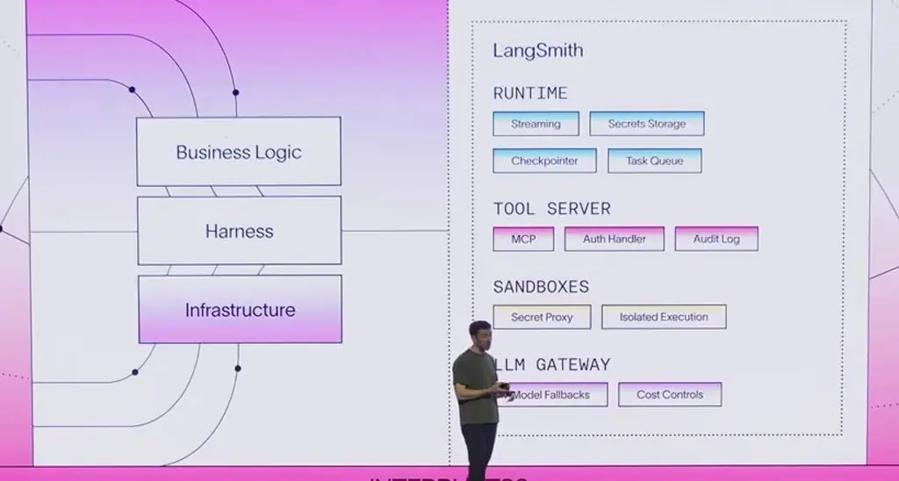
*[▶ 00:12:57](https://www.youtube.com/watch?v=XOUSuxY074U&t=777s) · LangSmith stack: layers and components*

[Managed Deep Agents](https://docs.langchain.com/langsmith/python/managed-deep-agents-overview) merges the harness and infrastructure layers, so you define only business logic.

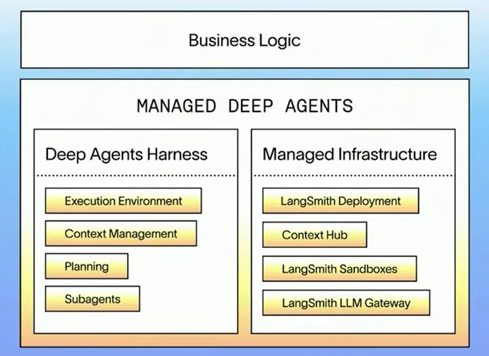
*[▶ 00:14:00](https://www.youtube.com/watch?v=XOUSuxY074U&t=840s) · Managed Deep Agents: harness and infrastructure layers*

It covers three needs: building fast, deploying in one command, and governing at scale.

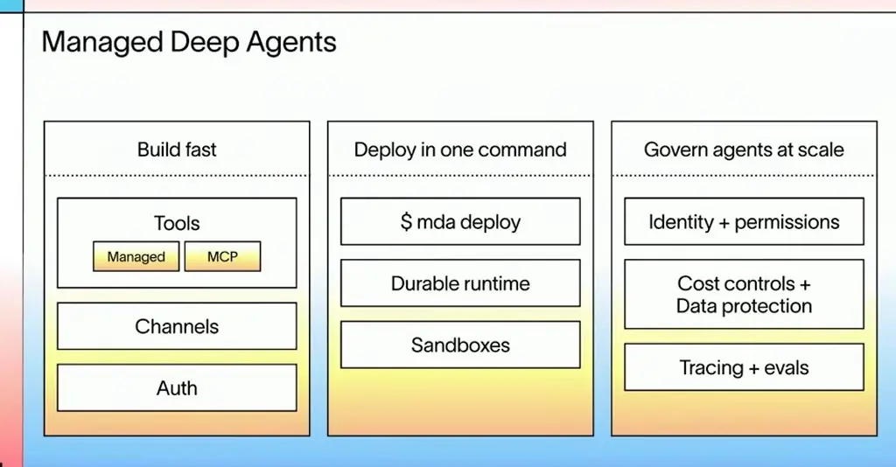
*[▶ 00:15:54](https://www.youtube.com/watch?v=XOUSuxY074U&t=954s) · Managed Deep Agents: build, deploy, govern*

Deployment is one command:

```bash
$ mda deploy
```

The speaker recommends running the agent outside the sandbox and connecting the sandbox as a tool.

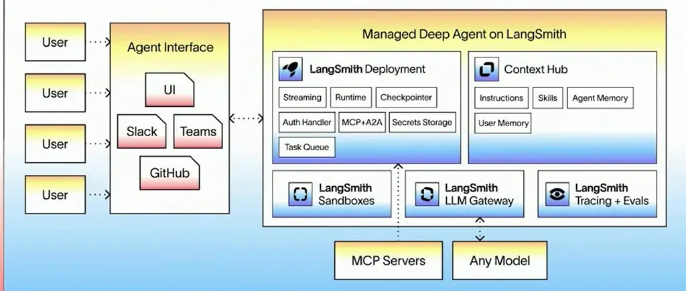
*[▶ 00:16:04](https://www.youtube.com/watch?v=XOUSuxY074U&t=964s) · Managed Deep Agent architecture on LangSmith*

Business users will build many internal agents; LangChain's include a sales copilot and a security reviewer.

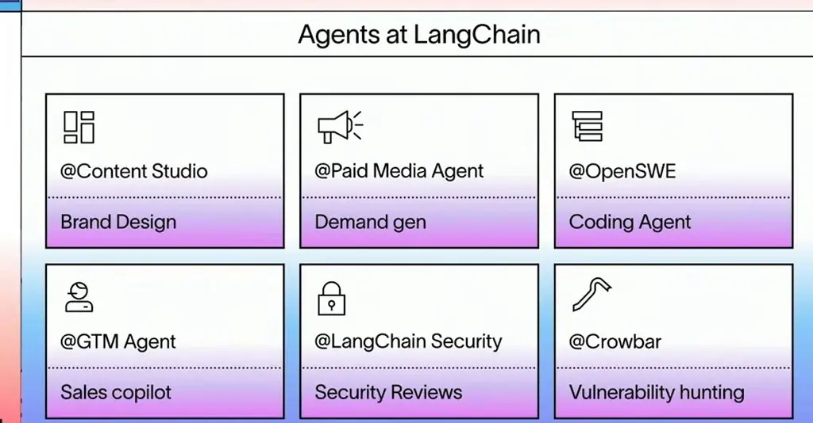
*[▶ 00:17:26](https://www.youtube.com/watch?v=XOUSuxY074U&t=1046s) · Agents at LangChain*

## Agent traces as a new data type, and cheaper judges with Jev

[▶ 00:16:49](https://www.youtube.com/watch?v=XOUSuxY074U&t=1009s)

LangChain's internal GTM Agent runs on automations, pings users, researches, does outreach, and creates sandbox artifacts.

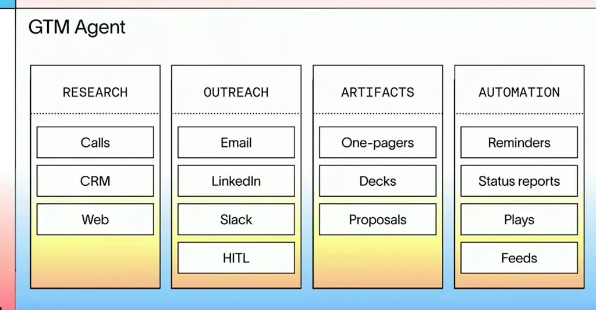
*[▶ 00:17:55](https://www.youtube.com/watch?v=XOUSuxY074U&t=1075s) · GTM Agent capabilities by category*

Governance sits between its runtime and systems like Salesforce and Gmail.

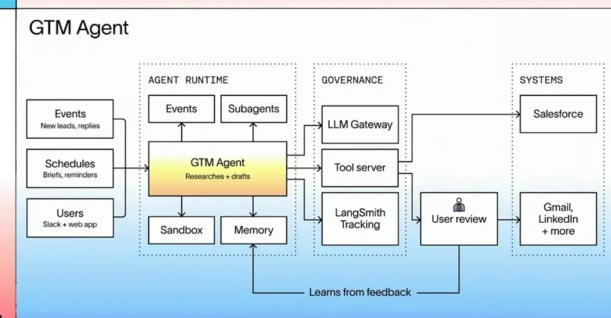
*[▶ 00:18:22](https://www.youtube.com/watch?v=XOUSuxY074U&t=1102s) · GTM Agent architecture diagram*

Agent traces are a new data type: deeply nested, with large payloads and mixed modalities. Their natural language reveals user intent, logic failures, and improper usage.

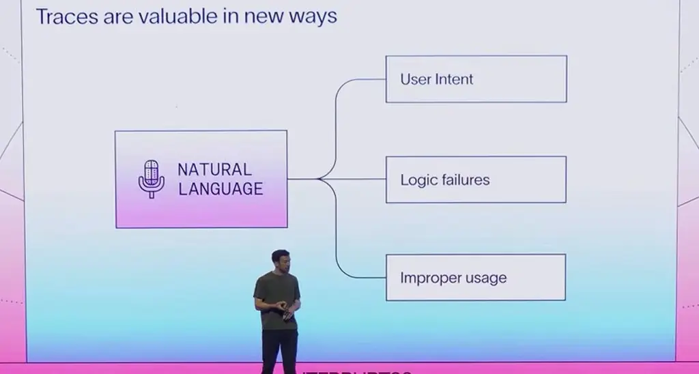
*[▶ 00:18:58](https://www.youtube.com/watch?v=XOUSuxY074U&t=1138s) · Traces are valuable in new ways*

Online evals run LLM, code, or judge evaluators over traces.

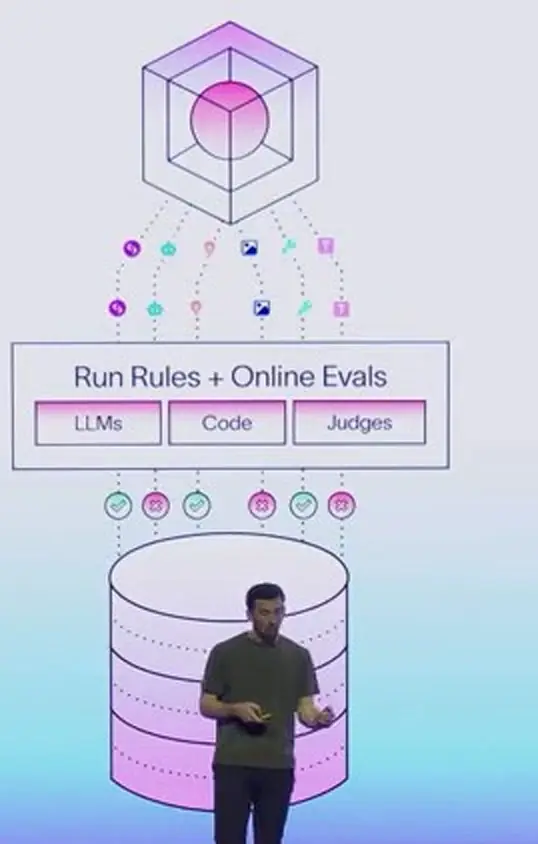
*[▶ 00:20:13](https://www.youtube.com/watch?v=XOUSuxY074U&t=1213s) · Run rules and online evals pipeline*

**Jev** is a decision model from TypeSafeAI. It picks answers to typed questions instead of generating text, so it runs 20–200x faster and 40–400x cheaper than frontier-model judges.

```json
{
  "state": "Hi, I've been trying to connect   my Stripe...",
  "model": "jev-latest",
  "questions": {
    "is_urgent": {
      "type": "noul",
      "instructions": "The message conveys urgency or time-sensitivity"
    }
  }
}

{
  "model": "jev-1.13.0",
  "answers": {
    "is_urgent": {
      "type": "noul",
      "noul": 0.999
    }
  }
}
```

*[▶ 00:20:33](https://www.youtube.com/watch?v=XOUSuxY074U&t=1233s) · What is Jev: request and typed response*

Jev as a Judge in [LangSmith](https://www.langchain.com/langsmith) offers true/false checks, single-choice picks, and scores on a scale.

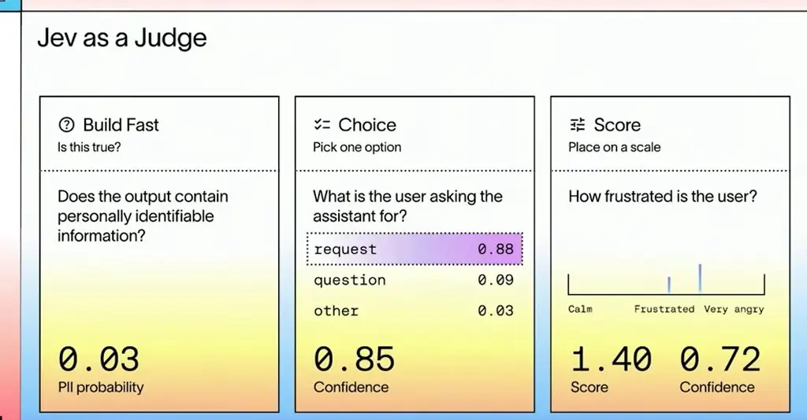
*[▶ 00:21:25](https://www.youtube.com/watch?v=XOUSuxY074U&t=1285s) · Jev as a Judge: three evaluator card types*

## Protecting sensitive traces and making them searchable

[▶ 00:21:27](https://www.youtube.com/watch?v=XOUSuxY074U&t=1287s)

Agent traces hold far more sensitive data than logs, so SmithDB can run in cloud, on-prem, or BYOC, where data stays with you and LangSmith keeps the control plane.

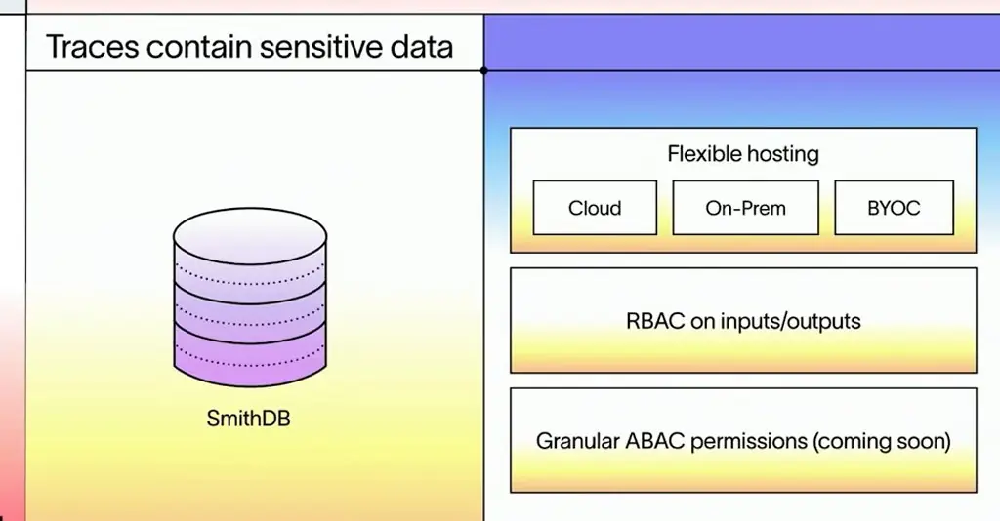
*[▶ 00:22:45](https://www.youtube.com/watch?v=XOUSuxY074U&t=1365s) · Traces contain sensitive data: storage and access options*

**RBAC on inputs and outputs** lets engineers see the trace skeleton (tools, tokens, latency) for system health without the content. Granular ABAC, using trace metadata and group policies, is coming soon.

**Trajectories** show traces as a list of messages, which speeds debugging, lets subject-matter experts annotate, and matches post-training formats.

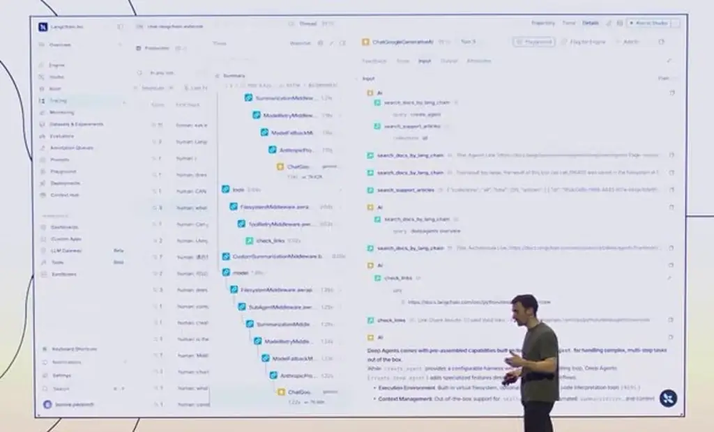
*[▶ 00:23:28](https://www.youtube.com/watch?v=XOUSuxY074U&t=1408s) · LangSmith tracing UI with nested agent calls*

Failures hide in the semantics of usage, not in logs. **AI Search** runs a natural-language prompt, such as "user got confused by agent response," over results, scoring confidence and highlighting evidence.

Annotation queues let reviewers score answers against a rubric.

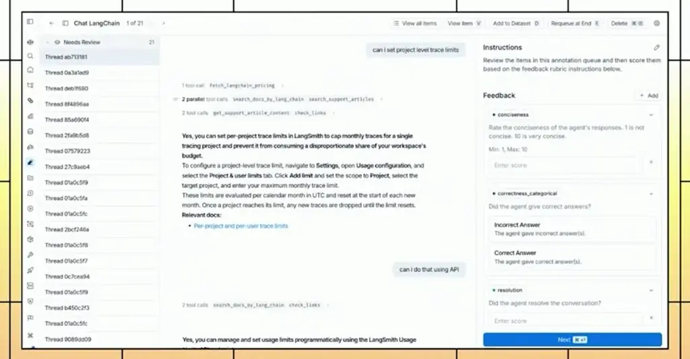
*[▶ 00:26:21](https://www.youtube.com/watch?v=XOUSuxY074U&t=1581s) · LangSmith annotation queue reviewing agent chat*

**Custom Apps** turn a request into a saved, governed view for domain work like legal or finance review.

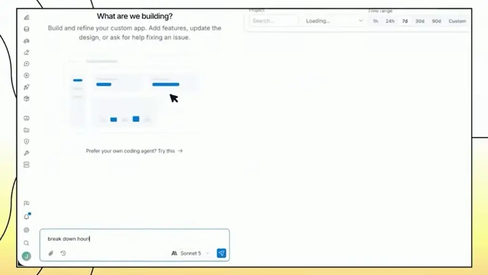
*[▶ 00:26:35](https://www.youtube.com/watch?v=XOUSuxY074U&t=1595s) · LangSmith custom app builder prompt*

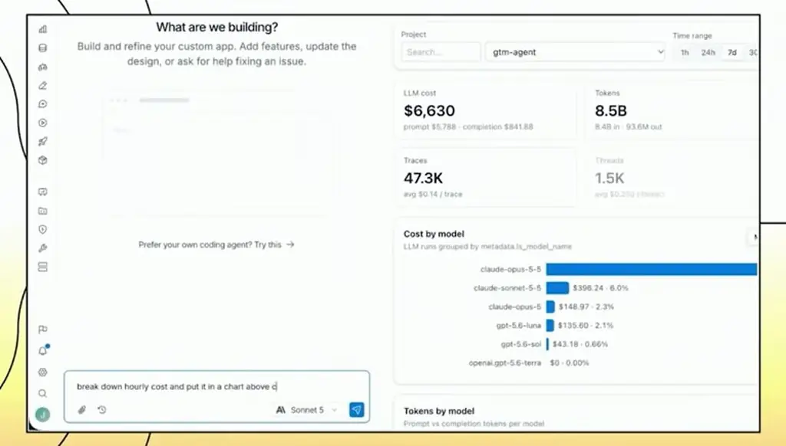
*[▶ 00:26:38](https://www.youtube.com/watch?v=XOUSuxY074U&t=1598s) · LangSmith app builder generating a cost chart*

The goal is LangSmith as the data platform for trace data.

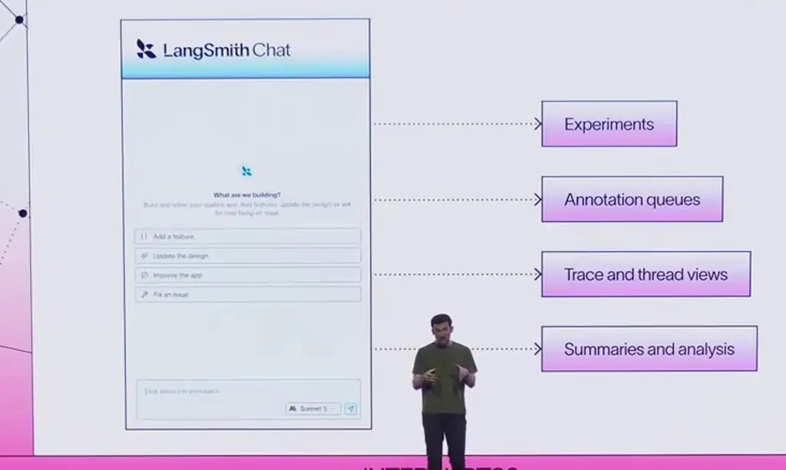
*[▶ 00:27:34](https://www.youtube.com/watch?v=XOUSuxY074U&t=1654s) · LangSmith Chat and its four capabilities*

## Automating the fix loop and letting agents self-report

[▶ 00:27:38](https://www.youtube.com/watch?v=XOUSuxY074U&t=1658s)

Finding issues in traces is like finding needles in a haystack. Fixing them is harder: you must tell whether the fault is in the prompt, context, model or retrieval, and avoid regressions when the prompt changes later.

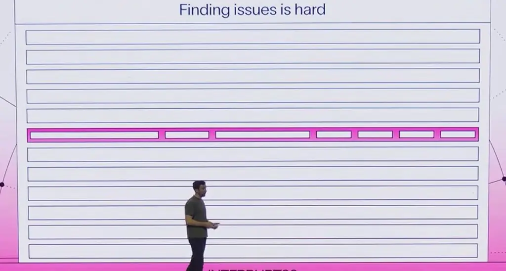
*[▶ 00:27:58](https://www.youtube.com/watch?v=XOUSuxY074U&t=1678s) · Finding issues is hard*

[LangSmith Engine](https://www.langchain.com/langsmith/engine) runs in the background on traces as a proactive agent engineer, in a loop:

- **Monitor:** cluster and diagnose issues.
- **Build:** propose a fix via PR.
- **Test:** create evals and add them to eval datasets.
- **Deploy:** ship tested changes.

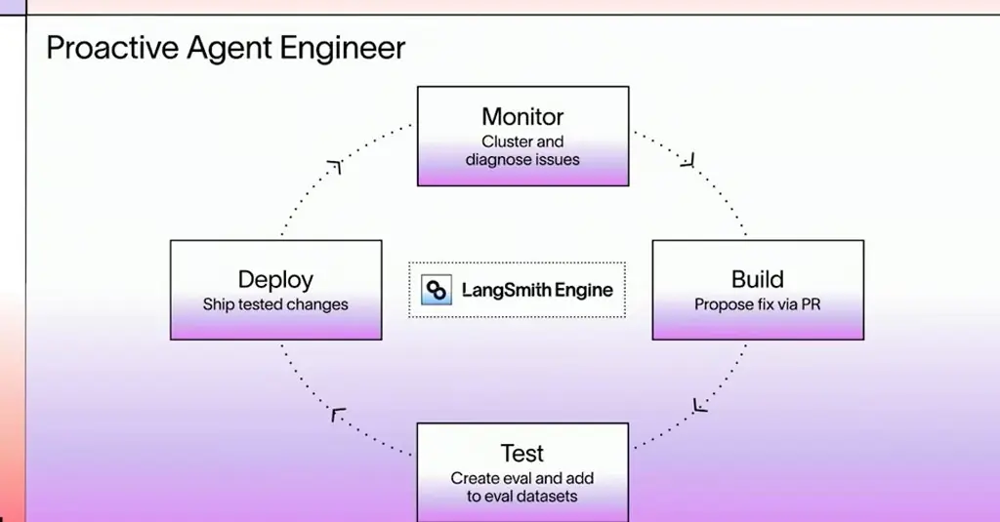
*[▶ 00:29:01](https://www.youtube.com/watch?v=XOUSuxY074U&t=1741s) · Proactive Agent Engineer improvement loop*

Engine also tests fixes before they ship. On LangSmith Deployments, it creates a preview deployment and checks whether the issues still occur.

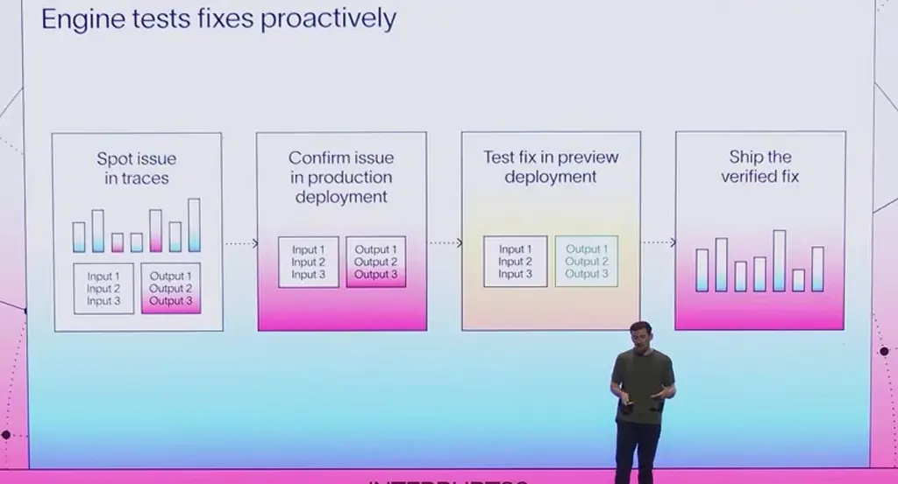
*[▶ 00:29:32](https://www.youtube.com/watch?v=XOUSuxY074U&t=1772s) · Engine tests fixes proactively*

Red teaming goes beyond traces. Engine generates probes, sends them to the agent, and reports observed versus expected output along with the judge's reasoning.

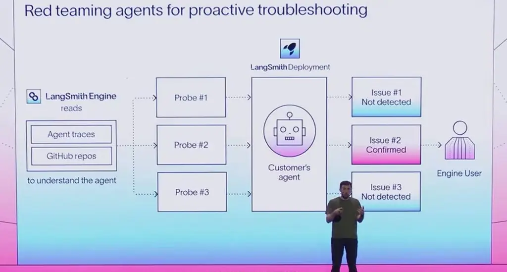
*[▶ 00:29:47](https://www.youtube.com/watch?v=XOUSuxY074U&t=1787s) · Red teaming agents for proactive troubleshooting*

Agents can self-report. A `self_reporter_tool()` call attaches an annotation and reasoning about what went wrong to the trace, keyed by session_id, trace_id and run_id. Engine picks this up later that night instead of rediscovering the problem.

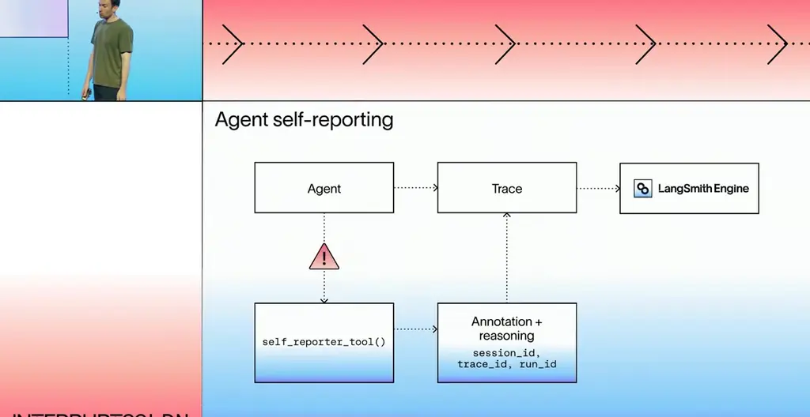
*[▶ 00:31:19](https://www.youtube.com/watch?v=XOUSuxY074U&t=1879s) · Agent self-reporting flow to LangSmith Engine*

Observability and evals are positioned as the best data platform for agent traces, which need different ingest, query, storage and visualization.

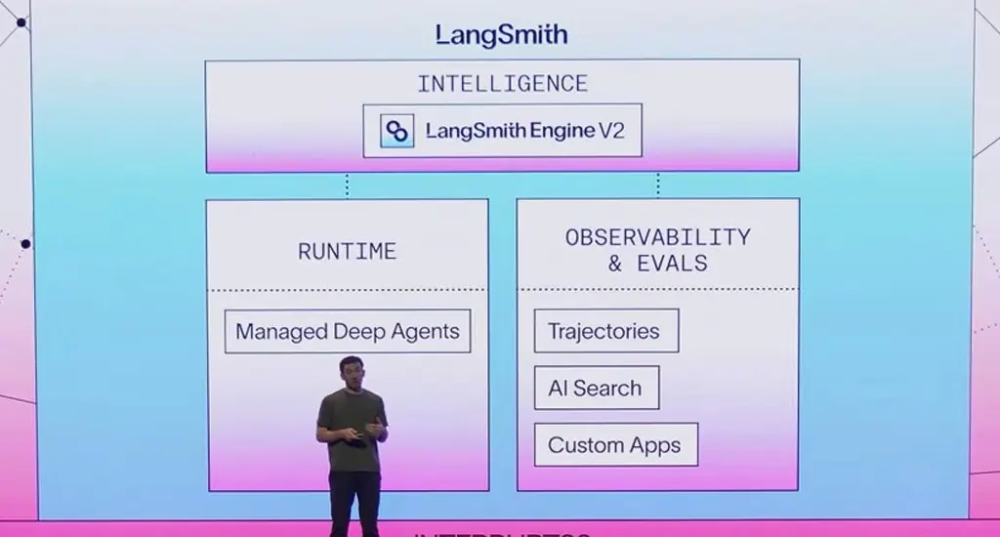
*[▶ 00:33:04](https://www.youtube.com/watch?v=XOUSuxY074U&t=1984s) · LangSmith platform architecture (full view)*

## Links & resources

- [LangSmith Engine — product page](https://www.langchain.com/langsmith/engine) — <https://www.langchain.com/langsmith/engine> · video description
- [Managed Deep Agents — docs overview](https://docs.langchain.com/langsmith/python/managed-deep-agents-overview) — <https://docs.langchain.com/langsmith/python/managed-deep-agents-overview> · video description
- [Agent traces and AI search — LangSmith blog post](https://www.langchain.com/blog/agent-traces-ai-search-langsmith) — <https://www.langchain.com/blog/agent-traces-ai-search-langsmith> · video description
- [LangSmith — product site](https://www.langchain.com/langsmith) — <https://www.langchain.com/langsmith> · video description
- [Interrupt conference — event site](https://interrupt.langchain.com) — <https://interrupt.langchain.com> · video description
- self_reporter_tool — agent self-report endpoint launched with this talk, no URL shown · mentioned [▶ 00:30:43](https://www.youtube.com/watch?v=XOUSuxY074U&t=1843s)
