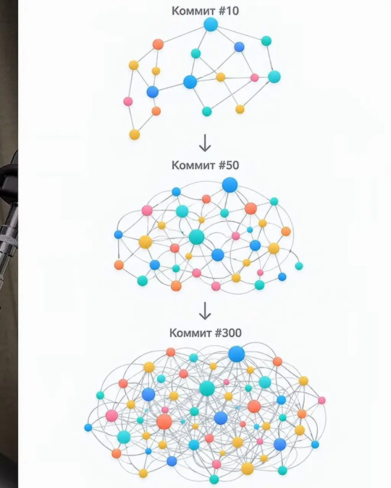
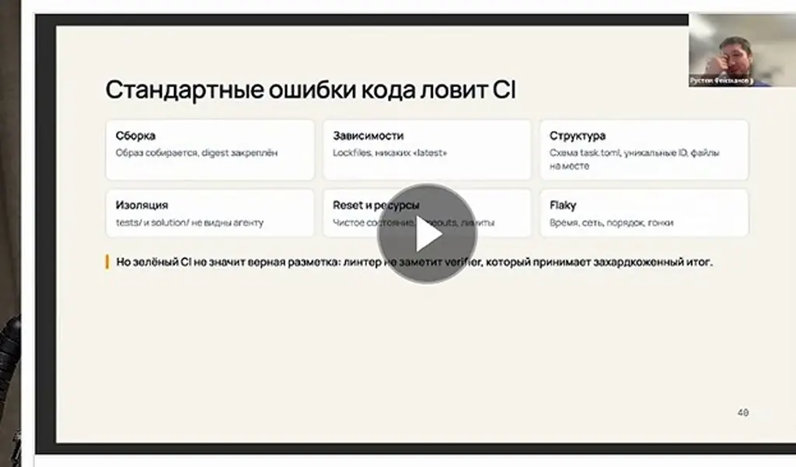
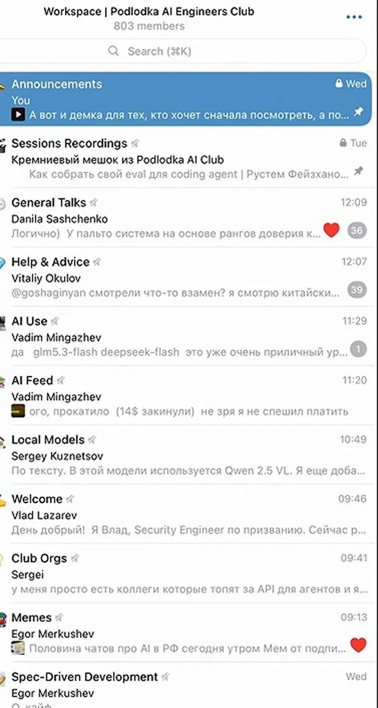
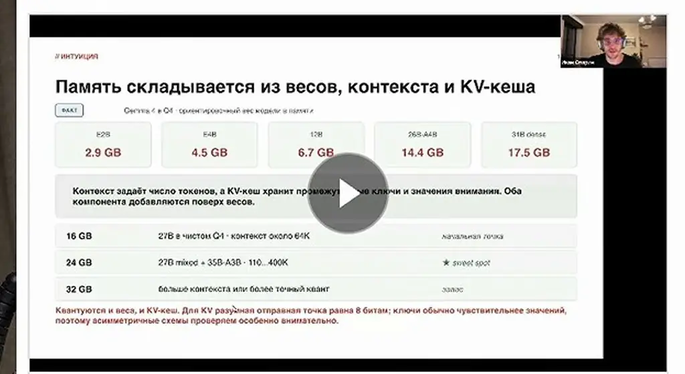
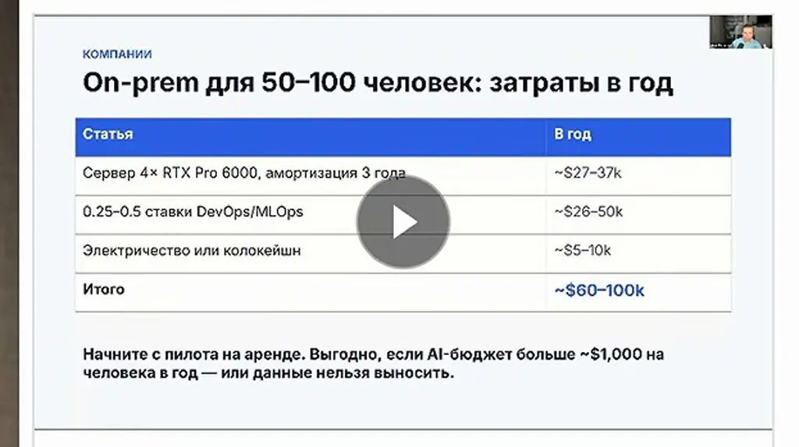

# Локальный AI для программирования | DeepSeek, Qwen, ИИ агенты | Podlodka Podcast #501

*Какие локальные модели годятся для агентной разработки, сколько стоит железо под них и как запустить первого агента на своей модели.*

Источник: [Локальный AI для программирования | DeepSeek, Qwen, ИИ агенты | Podlodka Podcast #501](https://www.youtube.com/watch?v=v_W6F-HLdeo) · Иван Опарин и Егор Толстой · Podlodka · 2 ч 16 мин

## Коротко

Подписка на облачного кодинг-агента стоит около 100 долларов в месяц, поэтому логично спросить, зачем покупать GPU и запускать модель самому. Иван Опарин из Wildberries отвечает, что облачные лимиты урезаются, а стоимость интеллекта быстро падает, так что гибридная работа с частью задач на своём железе становится реалистичной. Локальные модели уже годятся для части задач, например для задач из бэклога и техдолга, и отстают в основном по времени: задача, которую облачная модель решит за час, у локальной может занять 10 часов. Проверять пригодность стоит собственными эвалами на своём стеке, а начинать можно с небольшой модели и llama.cpp, даже на ноутбуке.

## Главное

- Локальная модель в определении выпуска — та, что помещается в багажник, работает от обычной розетки и выдаёт токены примерно со скоростью 5–10 токенов в секунду; запуск с диска при 0,05–0,1 токена в секунду для работы не годится.
- Четырёхбитные динамические кванты считаются стандартом для локального запуска: Qwen на 27 млрд параметров по словам гостя помещается в 5 ГБ оперативной памяти, но агрессивный квант может сохранить код и плохо общаться, и наоборот, поэтому его нужно проверять на своей задаче.
- Ключи KV-кеша чувствительны к квантизации и их лучше квантовать менее агрессивно, а значения можно сжимать сильнее.
- Сравнивать локальную и облачную модель стоит собственными эвалами: одну задачу решают обе модели, а результат проверяет сильная модель-ревьюер, что показывает, какие задачи можно делегировать локальной.
- Архитектурное проектирование гость оставляет облачным топ-моделям, а для самого кодинга в агентском цикле с верификацией хватит более простой модели.
- По железу на 27B-модель в 4-битном кванте хватает одной RTX 3090 примерно за 2000 долларов с урезанным контекстом, а RTX 6000 Pro выгоднее, чем RTX 5090 с докупкой; старую 3090 гость советует не брать.
- Для первого запуска можно взять llama.cpp, поднять OpenAI-совместимый сервер, подключить минималистичную агентскую среду и довести задачу до конца; домашнее задание из выпуска — запустить модель без интернета.
- Логи агентной работы с open-weight моделью можно очистить и использовать как датасет для дообучения небольшой модели, но это гипотеза гостя, а не проверенный результат.

## Зачем локальные модели, если подписки дешевеют

[▶ 00:00:00](https://www.youtube.com/watch?v=v_W6F-HLdeo&t=0s)

Ведущие открывают выпуск идеей: локальная модель, в которой собрано много человеческих знаний, помещается на обычном железе. Один из участников добавляет, что для агентских циклов миллион токенов в день нужен не всем.

**В:** Зачем локальные модели, если подписка стоит около 100 долларов в месяц? (Егор Толстой)

**О:** Иван Опарин (Wildberries, агентская инфраструктура) признаёт, что сейчас трудно конкурировать с подписками. Но стоимость интеллекта быстро падает: по его словам, Haiku 5.5 качественнее прошлогоднего Opus и стоит примерно в 300 раз дешевле.

**В:** Какие сценарии развития возможны?

**О:** Иван называет три. Все получают токены для лучших моделей, и собственное железо теряет смысл. Токены дорожают, и компания без собственного инференса теряет конкурентное преимущество. Реалистичнее гибридная работа, часть которой идёт на своём железе.

## Сначала гардрейлы, потом скорость

[▶ 00:06:05](https://www.youtube.com/watch?v=v_W6F-HLdeo&t=365s)

Коммиты без дизайна запутывают кодовую базу, и с агентами то же самое.

*[▶ 00:06:44](https://www.youtube.com/watch?v=v_W6F-HLdeo&t=404s) · Commit graph growth at #10, #50, #300*

Сначала замедлиться: выстроить гардрейлы и процессы команды, чтобы код можно было «оунить».

*[▶ 00:09:01](https://www.youtube.com/watch?v=v_W6F-HLdeo&t=541s) · Стандартные ошибки кода ловит CI*

Закрытое сообщество Podlodka AI Engineers: эксперты, чат, комната по локальным моделям.

*[▶ 00:08:01](https://www.youtube.com/watch?v=v_W6F-HLdeo&t=481s) · Club Telegram workspace chat list*

В библиотеке уже 100 записей, в том числе про эвалы для кодинговых агентов.

*[▶ 00:08:34](https://www.youtube.com/watch?v=v_W6F-HLdeo&t=514s) · Codex terminal: skill evals prompt*

Про выбор железа под локальную модель тоже есть запись.

*[▶ 00:09:07](https://www.youtube.com/watch?v=v_W6F-HLdeo&t=547s) · Память: веса, контекст и KV-кеш*

*[▶ 00:09:21](https://www.youtube.com/watch?v=v_W6F-HLdeo&t=561s) · On-prem cost for 50–100 people per year*

## Подписки дорожают, интеллект дешевеет

[▶ 00:09:34](https://www.youtube.com/watch?v=v_W6F-HLdeo&t=574s)

**В:** Почему люди жалуются на лимиты подписок, если это уже не главное?

**О:** Лимиты по-прежнему важны. Экономика AI-продуктов плохо сходится: API-вызовы дорогие, а пользователи не готовы платить 20–30 долларов в месяц за очередной SaaS. Собеседник видит выход в том, чтобы запускать продукт на собственной видеокарте.

**В:** Что происходит с подписками?

**О:** По наблюдениям за лето, вычислений в подписке стало в 3–5 раз меньше, затем это подтвердили официальные анонсы. Подписка за 200 долларов теперь даёт вдвое меньше вычислений, а прежний объём стоит 500 долларов. Провайдеры либо урезают подписки, либо предлагают менее сильные модели. В октябре, по словам собеседника, квоты пока сохранены и добавлены токены.

**В:** Если токены дешевеют, почему подписки дорожают?

**О:** Дешевеет интеллект: модель, которая год назад стоила около 70 долларов за миллион выходных токенов, уступает сегодняшней модели, стоящей центы. При этом появляются более сильные модели, за которые просят больше. Собеседники расходятся в прогнозе: один видит пессимистичный сценарий с потерей работы, другой ждёт новой работы в совместном творчестве человека и ИИ.

**В:** Зачем нужны суверенные локальные модели?

**О:** Европейские компании и госорганы не хотят отправлять документы и персональные данные за границу. Поэтому компетенции в настройке суверенного инференса будут всё востребованнее. Локальный и суверенный инференс тесно связаны. Опасение: если перестанут выпускать открытые модели, эта возможность исчезнет.

## Что считать локальной моделью

[▶ 00:18:03](https://www.youtube.com/watch?v=v_W6F-HLdeo&t=1083s)

**В:** Какой у тебя сетап и на что уходят токены?

**О:** Иван вместе с напарником Алексеем две недели назад запустил внутреннюю альфа-версию, которая объединяет агентов через канал связи. Одновременно работало до пяти оркестраторов, у каждого свои субагенты. За две недели набралось около 3 600 агентских часов, а при сохранении темпа это порядка 7 000 в месяц. Токены пока в основном уходят в облачные модели. Упираются уже в подписки и железо, а также в тесты, которые приходится переосмысливать.

**В:** Что считать локальной моделью и чем она отличается от открытых весов?

**О:** Иван предлагает три критерия: модель помещается в багажник, работает от обычной розетки и генерирует токены со скоростью, приемлемой для рабочего процесса, ориентировочно от 5–10 токенов в секунду. Скорость важна, но узкое место не в ней, а в выстроенном рабочем процессе. Почти любую модель можно запустить на любом железе, подгружая веса с диска, но при 0,05–0,1 токена в секунду для работы это не годится. Аренда стойки в дата-центре локальной моделью не считается. Она окупается примерно за год, но у неё есть легитимные применения, например файнтюнинг. Термин «открытые веса» шире: их выкладывают с марта 2023 года, после утечки весов LLaMA. Сейчас модели исчисляются триллионами параметров, поэтому термин «локальная» к ним плохо подходит.

## Словарь локальных моделей: веса, квантизация, KV-кеш и движки

[▶ 00:26:33](https://www.youtube.com/watch?v=v_W6F-HLdeo&t=1593s)

**В:** Что такое веса модели и зачем нужна квантизация?

**О:** Модель — это набор чисел. У модели на 27 млрд параметров на диске лежат 27 млрд чисел, упакованных в матрицы и слои. **Квантизация** — это снижение точности этих чисел, например, с 16-битных чисел с плавающей точкой. Модель становится меньше и проще для железа, но сохраняет большую часть способностей. Аналогия: первые цветные телефоны с 256 цветами были «больше, чем достаточно». Точность снижают неравномерно: **динамические кванты** оставляют важное в исходной точности, а остальное сжимают. Сейчас стандартом для локального запуска называют четырёхбитные динамические кванты. Вендоры тоже выпускают официальные кванты: например, [Gemma](https://ai.google.dev/gemma/docs/core) получает дообучение уже после квантизации. По словам говорящего, Qwen на 27 млрд параметров помещается в 5 ГБ оперативной памяти. Подход к динамическим квантам описан в [блоге Unsloth](https://unsloth.ai/blog/dynamic-v2).

**В:** Как понять, что после сжатия модель не «сломалась»?

**О:** Универсального алгоритма нет, это во многом искусство. Вендоры публикуют бенчмарки и отклонение от оригинала, но говорящий советует проверять модель на своей задаче или на визуальных промптах, например, попросить написать анимацию кодом. В соцсетях показывали, что шестибитный квант рисовал дерево лучше восьмибитного, хотя восьмибитный считается самым близким к оригиналу. Понимание возможностей модели — острая проблема и для облачных моделей.

**В:** Если квант хорошо рисует, будет ли он хорошо писать код?

**О:** Не обязательно. Агрессивный квант может сохранить код, но почти не уметь общаться, и наоборот. Говорящий признаётся, что в этом искусстве пока не преуспел.

**В:** Что такое KV-кеш?

**О:** Текст чата модель переводит в своё векторное представление, похоже на компиляцию исходника под архитектуру. Этот результат нельзя переиспользовать с другой моделью, но его накапливают: на новый вопрос пересчитывается только новая часть. Кеш тоже квантуют, и ключи, и значения. Ключи — это указатели на место хранения информации: при сильном снижении точности модель может взять не ту информацию. Значения, то есть содержимое, ужимать безопаснее.

**В:** Что такое inference-движок и какие бывают?

**О:** Движок превращает матричные умножения в токены. Кроссплатформенный стандарт — [llama.cpp](https://github.com/ggml-org/llama.cpp): он запустит почти любую модель на любом железе, но не всегда быстрее всех. Для серверных NVIDIA-карт заточены [vLLM](https://github.com/vllm-project/vllm) и [SGLang](https://github.com/sgl-project/sglang). Появляются и движки под одну модель, например [DS4](https://github.com/antirez/ds4) и стартап [Mirai](https://trymirai.com), который пишет свой движок и свои кванты. Говорящий видит тенденцию к замкнутой системе: от квантизации весов через движок до агентской системы.

**В:** Почему движки делают стартапы, а не сами вендеры моделей?

**О:** Говорящий называет это магией открытой экосистемы: без Qwen и DeepSeek такие работы остались бы в закрытых кругах. Вендоры тоже этим занимаются, например, DeepSeek недавно выпустил свой инференс-движок. Конкуренция создаёт почву, где можно получить долю рынка и работу.

**В:** Что находится после движка и какие там проблемы?

**О:** Токены нужно передать клиенту через сервер, обычно совместимый с OpenAI или Anthropic API; у OpenAI уже несколько версий интерфейса. Серверы оптимизированы под облако, поэтому локально многое ломается. Например, если промпт обрабатывается 15 минут, соединение server-sent events может протухнуть, и агент никогда не получит ответ. Серверная часть пока не зрелая.

**В:** Работают ли привычные практики работы с агентами на локальных моделях?

**О:** В целом да, компетенция та же, но с оговорками. Инструкции, важные для локальной модели, могут быть не нужны облачной, и наоборот; подбор идёт методом проб и ошибок. Говорящий советует пересматривать накопленные за девять месяцев agents.md, потому что всё быстро меняется.

## Насколько локальные модели тянут агентный кодинг

[▶ 00:47:15](https://www.youtube.com/watch?v=v_W6F-HLdeo&t=2835s)

**В:** Насколько локальные модели готовы работать с агентами для кодинга и сильно ли они уступают фронтиру?

**О:** Общего ответа нет: всё зависит от задач, стека и того, что считать качеством. Измерить можно только собственными эвалами, которые сравнивают, как облачная и локальная модель решили вашу задачу. Без них остаётся «авось Opus всё решит», а это становится дорого. Такие эвалы нужны каждой команде уже сейчас, и почти без изменений они переносятся на локальную модель. Разница часто во времени: задача, которую облачная модель решит за час, у локальной может занять 10 часов. Это приемлемо для задач из бэклога или техдолга, где жалко тратить токены облачной модели.

**В:** Работает ли локальная модель в повседневности?

**О:** Гость перешёл на [Qwen3.8-27B](https://huggingface.co/Qwen/Qwen3.8-27B) в августе и говорит, что ощущение было почти как у фронтира, только медленнее. По бенчмаркам модель близка к Opus, и её можно запустить даже на 4–16 ГБ памяти с агрессивными квантами. Для обработки разговорных транскриптов Qwen иногда может слегка подгаллюционировать, а [Gemma](https://ai.google.dev/gemma/docs/core) упускает нюансы, но не выдумывает. Многие ждут Qwen 4 на новых датасетах.

**В:** Может ли слабая модель с хорошими инструкциями в agents.md и скиллами решать ограниченный класс задач так же, как топовая?

**О:** Гость согласен: в принципе да. На простых кодинг-задачах качество моделей падает при избыточном reasoning. Фронтир сильнее в длинном контексте, проектировании архитектуры и разборе задачи с разных сторон. Сам кодинг гость считает в основном решённой задачей: большая часть работы — рутинный перенос решений между стеками.

**В:** А что с более крупными открытыми моделями?

**О:** По словам гостя, [GLM-5.3-Flash](https://huggingface.co/zai-org/GLM-5.3-Flash) по уровню близка к Opus июльской версии. Её можно запустить дома на двух DGX Spark или на одном Mac Studio, пусть и не очень быстро.

## Что не отдавать локальным моделям: архитектура и безопасность

[▶ 00:56:11](https://www.youtube.com/watch?v=v_W6F-HLdeo&t=3371s)

**В:** Какие задачи вы пока не стали бы отдавать локальным моделям?

**О:** Архитектурное проектирование. Идея вызревает неделями в spec-driven development и визуализациях, затем рой агентов под главным оркестратором несколько часов ищет слабые места в общей комнате и проверяет результаты друг друга. За это гость готов платить облачным топ-моделям. Ведущий уточнил, что для самого кодинга хватит модели попроще при агентском цикле с верификацией.

**В:** Почему безопасность особенно чувствительна?

**О:** Модели достигли уровня, при котором взломать можно почти что угодно. Код прозрачен для модели, и она находит сочетания уязвимостей, которых человек не увидит. Гость приводит недавние уязвимости в Python, Linux и PHP.

**В:** Что было бы без open-weight моделей?

**О:** Одни государства получили бы преимущество в эксплуатации, а остальные остались бы беззащитными. Поэтому нужны продвинутые открытые модели: грань между security-исследованием и взломом, по словам гостя, отчасти неразличима.

**В:** Как гость столкнулся с отказами облачных моделей?

**О:** Оркестратор жаловался, что агент отказывается от обычной задачи без признаков взлома. Облачная модель отказалась проверять менеджер агентских контекстов на уязвимости, а Qwen 27B без блокировок безопасности провёл ревью. Позже модель сама указала на слабости прежнего ревью и предложила лучшее. Теперь гость использует этот паттерн: локальная модель готовит security research, а облачной модели его передают для советов.

## Снятие ограничений у open-weight моделей

[▶ 01:04:06](https://www.youtube.com/watch?v=v_W6F-HLdeo&t=3846s)

Ограничения в open-weight моделях задаются постобучением: вендор учит модель отказываться от части запросов. Тем же способом их можно снять, причём выборочно: например, разрешить поиск уязвимостей, но оставить запрет на вред людям.

Модели без ограничений доступны на Hugging Face, куда кто угодно может выложить модель. Один из участников собирает такие версии и допускает, что открытые веса со временем начнут регулировать.

## Сколько стоит поднять фронтирную модель дома

[▶ 01:07:30](https://www.youtube.com/watch?v=v_W6F-HLdeo&t=4050s)

**В:** Сколько стоит запустить модный Qwen дома на компактной железке?

**О:** Самый модный Qwen — [Qwen3.8-27B](https://huggingface.co/Qwen/Qwen3.8-27B) с 27 млрд параметров. Всё семейство доходит примерно до 2,4 трлн параметров. Запуск такой модели на RTX 6000 Pro он оценивает примерно в 600–700 тыс. долларов, оговариваясь, что цены сильно различаются по регионам. Запустить её на видеокартах дома он считает невозможным.

**В:** Что если собрать большую модель на Mac Studio?

**О:** Связка из четырёх Mac Studio с 512 ГБ памяти стоит около 80 тыс. долларов, помещается в багажник и не требует огромной мощности. Ожидается около 30 токенов в секунду и несколько параллельных потоков. Вариант с одной-двумя машинами, около 40 тыс. долларов, он называет стоимостью хорошей новой машины.

**В:** Что станет узким местом, если дать фронтир всем?

**О:** Электроэнергия, а не чипы. По его оценке, чтобы давать каждому агентский цикл на миллион токенов в день, понадобилось бы строить электростанции около 10 лет.

**В:** Какую карту брать для Qwen 27B?

**О:** В 4-битной динамической квантизации модель помещается на одну RTX 3090 (около 2000 долларов на российском рынке), но контекст придётся урезать. Обработка промпта в 50 тыс. токенов занимает минуты. Для пула памяти берут две–четыре карты. RTX 5090 стоит около 5 тыс. долларов, в дефицит — до 10 тыс. По его расчёту, выгоднее сразу взять RTX 6000 Pro (примерно 20–30 тыс.), чем 5090 с докупкой. Старую 3090 он советует не брать, лучше дороже карту с 32 ГБ.

**В:** А unified memory?

**О:** Mac с M5 Max стоит около 10 тыс. долларов, почти как 5090. По скорости обработки запросов он близок к 3090, но даёт больше памяти. Агрессивные кванты вроде [Qwen3.8-Flash-Next](https://huggingface.co/Qwen/Qwen3.8-Flash-Next) запускаются на машинах до 64 ГБ. Через год, по его словам, MacBook с 64–128 ГБ сможет запускать серьёзные модели.

## Покупать ли видеокарту: свобода доступа и цена вопроса

[▶ 01:19:30](https://www.youtube.com/watch?v=v_W6F-HLdeo&t=4770s)

**В:** Стоит ли сейчас покупать видеокарту или подождать, пока модели станут легче для запуска или чипы подешевеют?

**О:** Гость не даёт советов про кредиты и покупку «прямо сейчас»: решение за каждым. На горизонте в несколько месяцев можно примерно прогнозировать, дальше — нет.

**В:** Зачем своё железо, если токены в облаке дешевле?

**О:** Главный довод — суверенитет: устройство, которое запускает модель даже при отключённом облаке, полезно для бытовых и рабочих задач. По деньгам около 10 000 долларов могут покрыть годы покупки токенов дешёвой модели (в пример приведён DeepSeek Flash), но облако платно по счётчику, а доступ могут закрыть. Гость вспоминает истории о банах аккаунтов Claude. Тогда остаются другие подписки, вероятно дороже и хуже.

**В:** Не приведёт ли это к неравенству доступа к интеллекту?

**О:** По словам гостя, большинство знает ИИ по бесплатным чатботам, около 0,2% гоняют агентские циклы на миллионных контекстах (ссылка на твит Карпати), а доступ к ультрафронтир-моделям есть у нескольких тысяч человек. Гость благодарен авторам открытых моделей.

**В:** Нужен ли миллион токенов в день всем?

**О:** Гость соглашается, что не всем, но считает, что доступ важен для всех. Его мать уже использует агентские циклы для новых бизнес-идей, а образование может выйти на новый уровень. OpenClaw, по его мнению, — система, вокруг которой будут строиться новые рабочие процессы.

## Как дотянуть слабую локальную модель

[▶ 01:30:04](https://www.youtube.com/watch?v=v_W6F-HLdeo&t=5404s)

**В:** Если на 3090 запущен слабый квант и результаты на нашей кодовой базе хуже, чем у облачных моделей, есть ли техники, которые доводят модель до рабочего уровня?

**О:** Готовых рецептов сверх того, что все уже знают, нет. Основной инструмент — скиллы и агентский контекст, которые направляют модель в сторону того, что повышает эффективность работы над конкретным проектом.

**В:** А RAG и системы памяти?

**О:** Долговременная память нужна агентским циклам, но это пока нерешённая задача. Миллионный контекст локально нереалистичен даже на 3090, а в облаке он дорог и медленный. Практический предел гость видит примерно в 200k токенов, и он, скорее всего, будет меньше. Сжатие контекста быстро развивается: по словам гостя, DeepSeek за год сжал его в 30 раз. Рабочий процесс должен строиться так, чтобы сессия считалась кешем: её можно закрыть и открыть новую с той же главы. Потери и повторный прогрев неизбежны, но цель — сохранить как можно больше контекста.

**В:** Что с файнтюном?

**О:** Гость считает файнтюн небольших моделей недоисследованным направлением. Провайдеры больших моделей свернули файнтюн, потому что он экономически невыгоден, и индустрия ушла в in-context learning, RAG и работу с контекстом. Пример: Coinbase дообучил Qwen на 9 млрд параметров под классификацию фрода и отказался от облачной модели. По словам гостя, файнтюн такой модели стоит копейки и укладывается в несколько часов аренды GPU.

**В:** Как это связано с нашим агентским стеком?

**О:** Гипотеза гостя: логи агентной работы с open-weight моделями можно превратить в датасет. Облачные модели скрывают цепочку рассуждений (chain of thought), а у открытых её можно логировать. Идея такая:
- собрать логи работы агента на своём проекте;
- очистить их, например убрать ложные вызовы инструментов;
- синтезировать новые данные через большую open-weight модель;
- дообучать модель поменьше, например Qwen 27B, под каждый новый релиз.

Цель — убрать из контекста обвязку (скиллы, MCP-серверы, описания CLI), которая, по прикидке гостя, занимает 50–80k токенов, то есть около 30% эффективного контекста. Гость подчеркнул, что это его гипотеза, а не проверенный результат.

**В:** Зачем файнтюнить, если можно взять самую маленькую модель и дообучить её на своём датасете?

**О:** Нужен баланс между базовым качеством модели и тем, что даёт дообучение. Результаты могут ухудшиться, и модель может потерять часть способностей, но если они не нужны в вашем стеке, это приемлемо. Нужно экспериментировать. Гость упомянул мобильные варианты [Gemma](https://ai.google.dev/gemma/docs/core): в его личном опыте маленькая модель правильно распознала блюдо на фото, а облачная GPT — нет. При хорошем датасете эксперименты дешёвые: можно пробовать модели на 30B, 12B и 4B параметров.

**В:** Не лучше ли держать одну общую модель на всю компанию?

**О:** Да, это выгоднее, чем держать отдельную простаивающую ноду у каждой команды. Общая модель доступна всем, а у каждого разработчика может работать своя модель под его стек на его железе.

**В:** Каково будущее локального инференса?

**О:** Гость считает, что будущее за гибридным инференсом. Роутер направляет задачи в облако или на локальную модель с учётом качества, стоимости и времени. Главное узкое место локально — prefill на длинном контексте: он требует много вычислений, а декод забирает ресурсы у него. Скорость генерации на контексте 8k мало что говорит, на 100–200k она заметно падает. Даже Mac с широкой шиной памяти медленно делает prefill. Вариант: облако делает prefill и отправляет KV-кеш клиенту, а локальное железо генерирует токены. Гость упомянул статью Nvidia (август) и коленочные реализации, которые позволяют передавать KV-кеш между моделями разного размера. Ещё дальше, по его словам, идёт стартап, который передаёт латентное пространство между большой и маленькой моделью. Гость ожидает, что в следующем году появятся open-weight модели крупных провайдеров, возможно встроенные в их харнесы.

## Как вкатиться в локальные модели: от первого запуска до агента

[▶ 01:57:00](https://www.youtube.com/watch?v=v_W6F-HLdeo&t=7020s)

**В:** Какой путь от подкаста до первой задачи агента на локальной модели?

**О:** Иван Опарин называет главный барьер психологическим: облачная подписка даёт лучшие модели, а локальная медленнее и слабее. Но локальный запуск учит понимать веса, квантизацию, серверы и параметры запуска, без чего, по его словам, нельзя быть хорошим инженером агентских систем. Начать можно на любом железе, даже с маленькой моделью: опыт переносится на большие почти один к одному. Домашнее задание: запустить модель без интернета.

**В:** Что делать, если подписка закончилась, покупать железо не на что, а есть MacBook 2024 года с 24 ГБ памяти?

**О:** Иван предлагает идти по тем же ступеням, что и в терминологии: веса, движок, квантизация, агентская среда.

1. Выбрать на Hugging Face веса, которые помещаются в память с запасом под систему. Контекст тоже занимает гигабайты.
2. Взять [llama.cpp](https://github.com/ggml-org/llama.cpp) как базовый движок: он кроссплатформенный и без экспериментальных шумов.
3. Квантовать ключи менее агрессивно, значения чуть агрессивнее, так как ключи чувствительнее к квантизации.
4. Запустить OpenAI-совместимый сервер и подключить его к минималистичной агентской среде, где меньше чужих системных промптов.
5. Работать с теми же контекстами и проверить, доведёт ли модель задачу до конца. Иван уверен, что это будет дольше, но задача будет завершена.

**В:** Как организовать работу дальше, когда модели и подписки меняются?

**О:** Нужна оркестрация: агент ведёт общий контекст, субагенты выполняют задачи, а задача не считается закрытой без проверки ревьюером, обычно более сильной моделью. Нужен и роутер между облачными и локальными моделями. Смена модели сбрасывает кеш, поэтому при закончившейся подписке локальная модель должна продолжить с уже накопленного контекста и definition of done. Иван упомянул, что его команда обещает выложить свою систему оркестрации в open source, а Microsoft недавно показала роутинг между локальными и облачными моделями.

**В:** Как понять, насколько локальная модель годится для задач?

**О:** Одну задачу нужно выполнить разными моделями и сравнить результаты, проверяя их сильной моделью-ревьюером. Так видно, на уровне какой облачной модели работает локальная в вашем стеке и какие задачи ей можно делегировать.

## Ссылки и материалы

- [Podlodka — сайт подкаста и клуба с деталями](https://podlodka.ai) — <https://podlodka.ai> · описание видео
- [Qwen3.8-27B — открытая модель на Hugging Face](https://huggingface.co/Qwen/Qwen3.8-27B) — <https://huggingface.co/Qwen/Qwen3.8-27B> · описание видео
- [Qwen3.8-27B GGUF от Unsloth — квантизации для локального запуска](https://huggingface.co/unsloth/Qwen3.8-27B-GGUF) — <https://huggingface.co/unsloth/Qwen3.8-27B-GGUF> · описание видео
- [Qwen3.8-Flash-Next — модель на Hugging Face](https://huggingface.co/Qwen/Qwen3.8-Flash-Next) — <https://huggingface.co/Qwen/Qwen3.8-Flash-Next> · описание видео
- [GLM-5.3-Flash — модель zai-org на Hugging Face](https://huggingface.co/zai-org/GLM-5.3-Flash) — <https://huggingface.co/zai-org/GLM-5.3-Flash> · описание видео
- [DeepSeek-V4.1-Flash-1017 — модель DeepSeek на Hugging Face](https://huggingface.co/deepseek-ai/DeepSeek-V4.1-Flash-1017) — <https://huggingface.co/deepseek-ai/DeepSeek-V4.1-Flash-1017> · описание видео
- [Gemma — документация моделей Google](https://ai.google.dev/gemma/docs/core) — <https://ai.google.dev/gemma/docs/core> · описание видео
- [Unsloth Dynamic v2 — блог о динамической квантизации](https://unsloth.ai/blog/dynamic-v2) — <https://unsloth.ai/blog/dynamic-v2> · описание видео
- [llama.cpp — локальный инференс моделей](https://github.com/ggml-org/llama.cpp) — <https://github.com/ggml-org/llama.cpp> · описание видео
- [vLLM — сервер инференса LLM](https://github.com/vllm-project/vllm) — <https://github.com/vllm-project/vllm> · описание видео
- [SGLang — сервер инференса LLM](https://github.com/sgl-project/sglang) — <https://github.com/sgl-project/sglang> · описание видео
- [ds4 от antirez — проект из обсуждения](https://github.com/antirez/ds4) — <https://github.com/antirez/ds4> · описание видео
- [DeepInfer от DeepSeek — репозиторий инференса](https://github.com/deepseek-ai/DeepInfer) — <https://github.com/deepseek-ai/DeepInfer> · описание видео
- [Mirai — сайт платформы для инференса на устройстве](https://trymirai.com) — <https://trymirai.com> · описание видео
- [uzu от Mirai — репозиторий движка инференса](https://github.com/trymirai/uzu) — <https://github.com/trymirai/uzu> · описание видео
- [Coinbase: серия «Owning Intelligence», часть третья](https://www.coinbase.com/blog/part-three-owning-intelligence-series) — <https://www.coinbase.com/blog/part-three-owning-intelligence-series> · описание видео
- [Статья arXiv 2608.03893](https://arxiv.org/abs/2608.03893) — <https://arxiv.org/abs/2608.03893> · описание видео
- [vllm-cross-model-kv — кросс-модельный KV-кеш для vLLM](https://github.com/alesha-pro/vllm-cross-model-kv) — <https://github.com/alesha-pro/vllm-cross-model-kv> · описание видео
- [Microsoft: локальные модели и песочница для инструментов в Windows](https://commandline.microsoft.com/local-models-sandboxed-tools-github-windows/) — <https://commandline.microsoft.com/local-models-sandboxed-tools-github-windows/> · описание видео
- [Блог Windows: построение Windows для гибридного интеллекта](https://blogs.windows.com/windowsexperience/2026/10/07/building-windows-for-hybrid-intelligence/) — <https://blogs.windows.com/windowsexperience/2026/10/07/building-windows-for-hybrid-intelligence/> · описание видео
- [hybrid-inference-paper — репозиторий статьи о гибридном инференсе](https://github.com/relux-works/hybrid-inference-paper) — <https://github.com/relux-works/hybrid-inference-paper> · описание видео
- [Твит Karpathy о локальных моделях](https://x.com/karpathy/status/2109361546505966046) — <https://x.com/karpathy/status/2109361546505966046> · описание видео
- [Китайское эссе о ядрах DeepSeek (разбор на WeChat)](https://mp.weixin.qq.com/s/zk0KxuLzhmMJ4LPYW_OHMA) — <https://mp.weixin.qq.com/s/zk0KxuLzhmMJ4LPYW_OHMA> · описание видео
- [Саммари эссе о ядре DeepSeek на LessWrong](https://www.lesswrong.com/posts/o8roRrdisBAjngHJN/a-summary-of-a-viral-chinese-essay-on-what-a-deepseek-kernel) — <https://www.lesswrong.com/posts/o8roRrdisBAjngHJN/a-summary-of-a-viral-chinese-essay-on-what-a-deepseek-kernel> · описание видео
- [Видео на YouTube, связанное с выпуском (mWyUI_wZMGU)](https://www.youtube.com/watch?v=mWyUI_wZMGU) — <https://www.youtube.com/watch?v=mWyUI_wZMGU> · описание видео
