# Make Your AI Agents Predictable With Graph Engineering - Zachary Blumenfeld, Neo4j

*Learn how to turn agent skills and past decision traces into explicit graphs that make agent runs more predictable, governable, and portable.*

Source: [Make Your AI Agents Predictable With Graph Engineering - Zachary Blumenfeld, Neo4j](https://www.youtube.com/watch?v=g_NgCLTibiM) · Zachary Blumenfeld · AI Engineer · 21 min

## TL;DR

Agents left to route themselves through plain text can take different paths on the same task, so their behavior is hard to predict and audit. Graph engineering fixes this by modeling agent work as an explicit graph, where nodes do work and edges route state. Skills and memory can be compiled into such graphs, and a successful run can be compiled into a deterministic graph-shaped skill. In the talk's loan-approval demo, this approach makes the path, checks, and decisions explicit and inspectable, and it reduces cost and time per run.

## Key takeaways

- Graph engineering means designing agent work as an explicit graph in which nodes do work and edges route state between them.
- Three graph types matter: execution graphs (what runs next), context graphs (what is known and why), and procedure graphs (what to do, repeatably).
- Compiling a skill turns its SKILL.md, scripts, references, and assets into a graph of typed decision, routing, and script nodes that the agent must follow.
- On SkillsBench (27 tasks, 5 trials each), compiling skills into graphs raised mean reward from 0.599 to 0.705 and pass rate from 53.3% to 67.4%, even with a smaller model.
- Without an explicit graph, the same loan case took 22 steps in one run and 16 in another, and approve or deny decisions carried uncalibrated confidence scores.
- Compiling successful runs, even inconsistent ones, into one deterministic YAML graph skill holds steps, scripts, assets, and policy sources in a single reviewable artifact.
- Persisting each run in the graph lets you see which branches it took and which decisions were approved or denied, and governance views can flag overridden decisions, failing steps, and router branches no run used.
- In the demo, the procedure-based runs were cheaper and faster than the no-procedure run: Fable alone took 7.4 minutes at $1.03, Fable with the procedure took 2.7 minutes at $1.31, and Haiku with the procedure took 2.0 minutes at $0.02, while authoring the procedure took 20 minutes and $9.70 once.

## Graph engineering: agent work as an explicit graph

[▶ 00:00:00](https://www.youtube.com/watch?v=g_NgCLTibiM&t=0s)

Graph engineering designs agent work as an explicit graph: **nodes do work**, and **edges route state** between them. The name is new; the mechanisms are not.

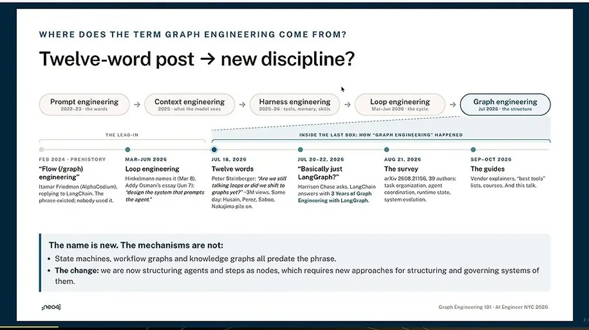
*[▶ 00:01:17](https://www.youtube.com/watch?v=g_NgCLTibiM&t=77s) · Where the term graph engineering came from*

Three graph types matter: execution (what runs next), context (what is known, and why), and procedure (what to do, repeatably).

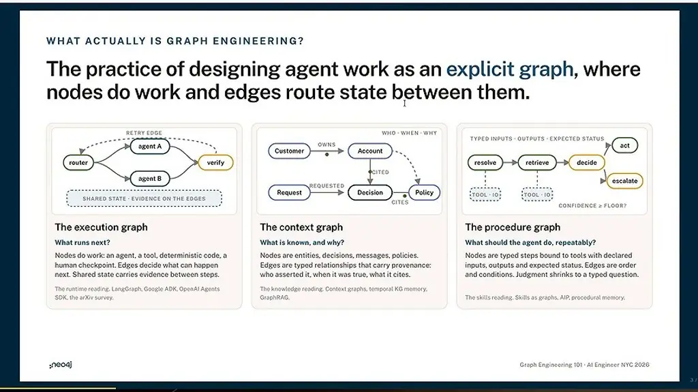
*[▶ 00:02:41](https://www.youtube.com/watch?v=g_NgCLTibiM&t=161s) · Three kinds of graph in agent work*

Context and procedure graphs convey much of the execution graph's job, more portably, so the talk focuses on them.

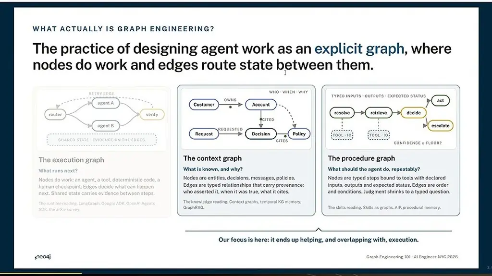
*[▶ 00:02:55](https://www.youtube.com/watch?v=g_NgCLTibiM&t=175s) · Focus on context and procedure graphs*

Explicit graphs add predictability, governance, and portability.

In runtimes like LangGraph, Google ADK, and the OpenAI Agents SDK, the graph is the orchestration.

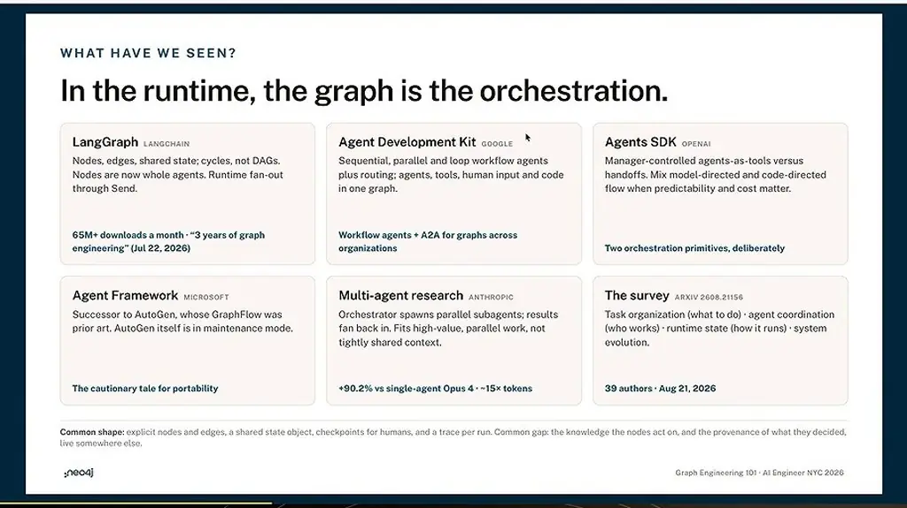
*[▶ 00:04:14](https://www.youtube.com/watch?v=g_NgCLTibiM&t=254s) · In the runtime, the graph is the orchestration*

Neo4j proposes a knowledge layer between systems of record and any runtime, holding ontology, memory, and skills.

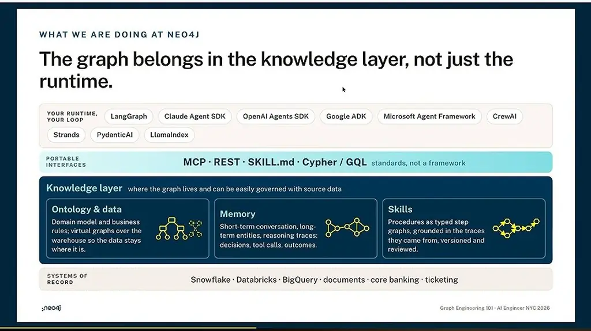
*[▶ 00:05:12](https://www.youtube.com/watch?v=g_NgCLTibiM&t=312s) · The graph belongs in the knowledge layer*

Neo4j's database and AI tools sit beneath it.

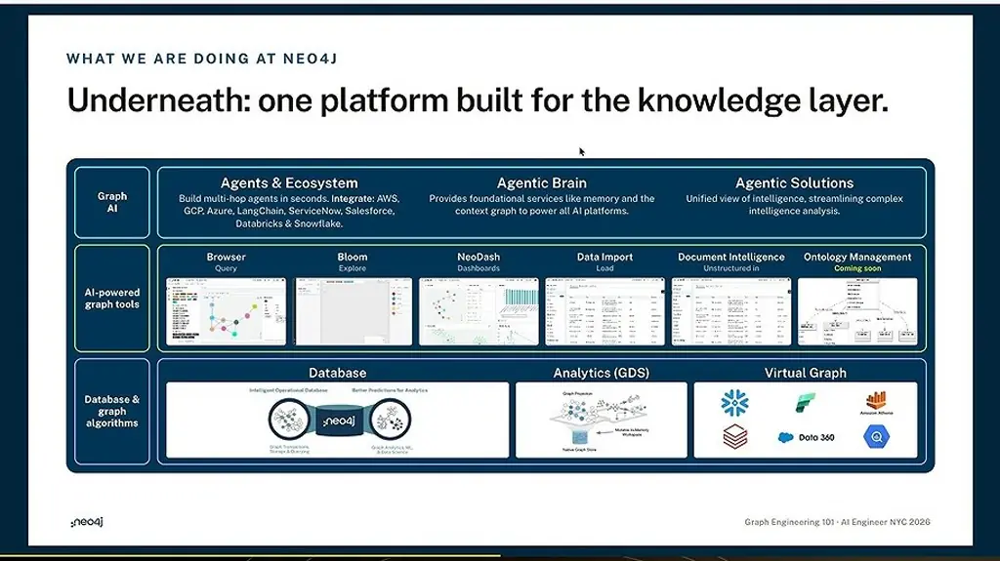
*[▶ 00:05:59](https://www.youtube.com/watch?v=g_NgCLTibiM&t=359s) · Underneath: one platform built for the knowledge layer.*

## Skills and memory as auditable graphs

[▶ 00:06:03](https://www.youtube.com/watch?v=g_NgCLTibiM&t=363s)

Context graphs hold short-term memory (conversation history), long-term memory (extracted entities) and reasoning traces.

Compiling a skill turns its SKILL.md, scripts, references and assets into a graph of typed decision, routing and script nodes, which the agent must run. Task reward rose on hard tasks, even with a smaller model.

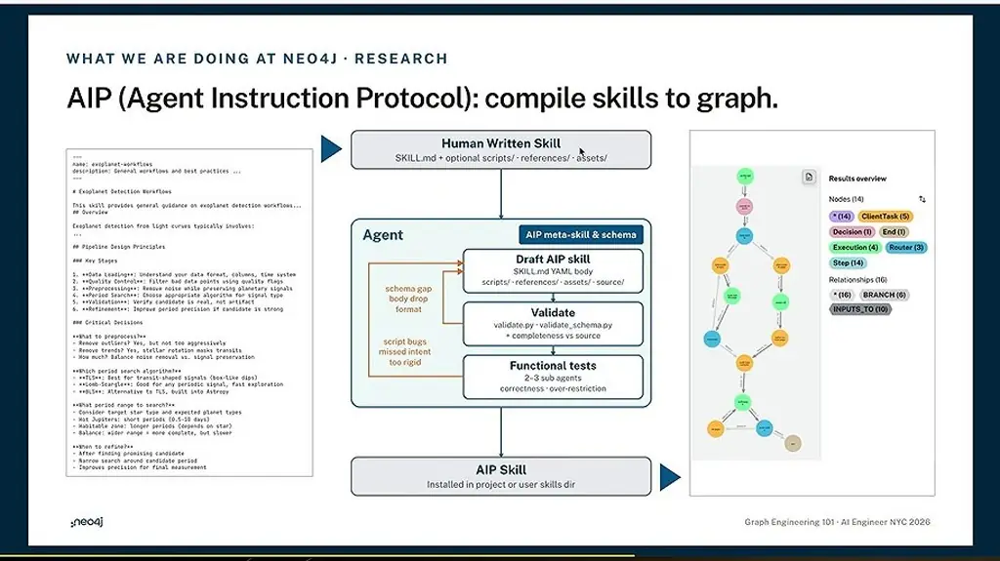
*[▶ 00:06:42](https://www.youtube.com/watch?v=g_NgCLTibiM&t=402s) · AIP (Agent Instruction Protocol): compile skills to graph.*

```markdown
---
name: exoplanet-workflows
description: General workflows and best practices ...
---

# Exoplanet Detection Workflows

This skill provides general guidance on exoplanet detection workflows....
## Overview
Exoplanet detection from light curves typically involves:
...

## Pipeline Design Principles

### Key Stages

1. **Data Loading**: Understand your data format, columns, time system
2. **Quality Controls**: Filter bad data points using quality flags
3. **Preprocessing**: Remove noise while preserving planetary signals
4. **Period Search**: Choose appropriate algorithm for signal type
5. **Validation**: Verify candidate is real, not artifact
6. **Refinement**: Improve period precision if candidate is strong

### Critical Decisions

**What to preprocess?**
- Remove outliers? Yes, but not too aggressively
- Remove trends? Yes, stellar rotation masks transits
- How much? Balance noise removal vs. signal preservation

**Which period search algorithm?**
- **TLS**: Best for transit-shaped signals (box-like dips)
- **Lomb-Scargle**: Good for any periodic signal, fast exploration
- **BLS**: Alternative to TLS, built into Astropy

**What period range to search?**
- Consider target star type and expected planet types
- Hot Jupiters: short periods (0.5-10 days)
- Habitable zone: longer periods (depends on star)
- Balance: wider range = more complete, but slower

**When to refine?**
- After finding promising candidate
- Narrow search around candidate period
- Improves precision for final measurement
```

On SkillsBench (27 tasks, 5 trials each), mean reward rose from 0.599 to 0.705 and pass rate from 53.3% to 67.4%.

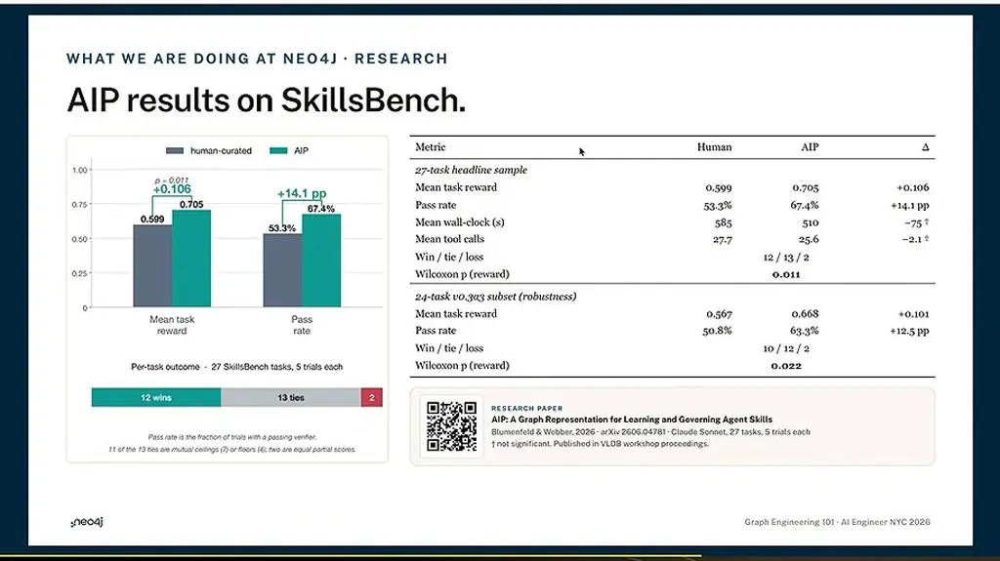
*[▶ 00:08:08](https://www.youtube.com/watch?v=g_NgCLTibiM&t=488s) · AIP results on SkillsBench*

Distilling from memory keeps each step linked to past decision traces, with provenance and versioning for tracking drift. NAMS (Neo4j Agent Memory Service) is the reference architecture, and the resulting skill runs on any harness.

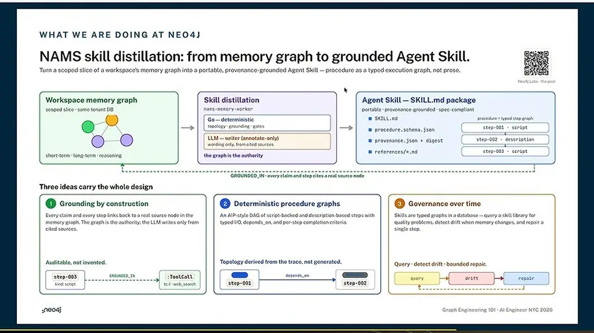
*[▶ 00:09:19](https://www.youtube.com/watch?v=g_NgCLTibiM&t=559s) · NAMS skill distillation: memory graph to Agent Skill*

Arhasi uses this for compliance reporting across sources; its ROI figures are its own estimates.

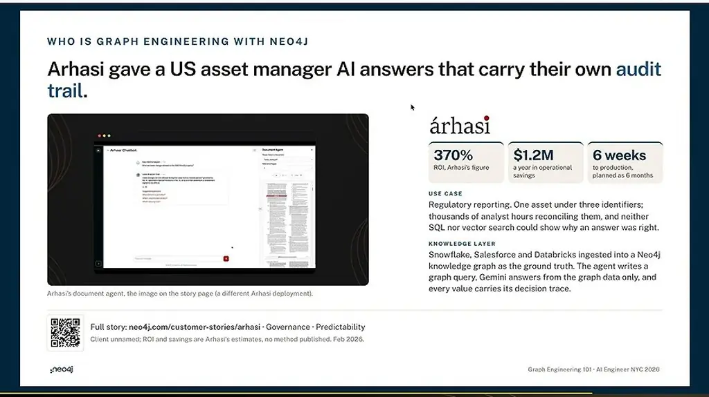
*[▶ 00:09:56](https://www.youtube.com/watch?v=g_NgCLTibiM&t=596s) · Arhasi: AI answers with an audit trail*

Uber's config rules became relationships that validation agents traverse, catching bad configs before they ship.

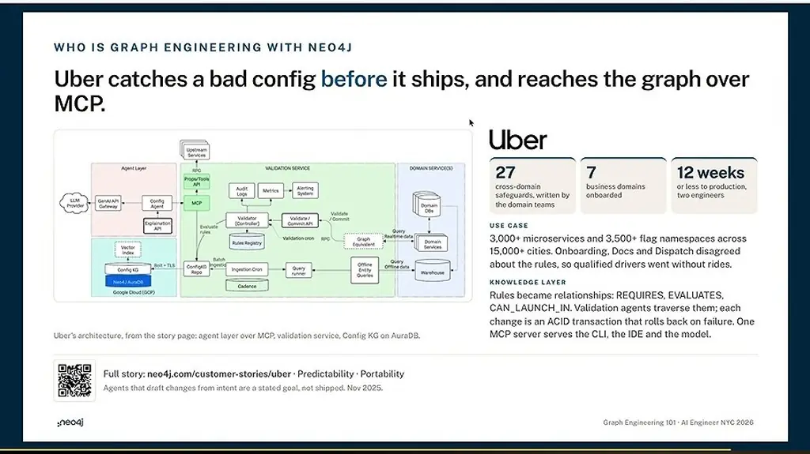
*[▶ 00:10:27](https://www.youtube.com/watch?v=g_NgCLTibiM&t=627s) · Uber: bad configs caught before they ship*

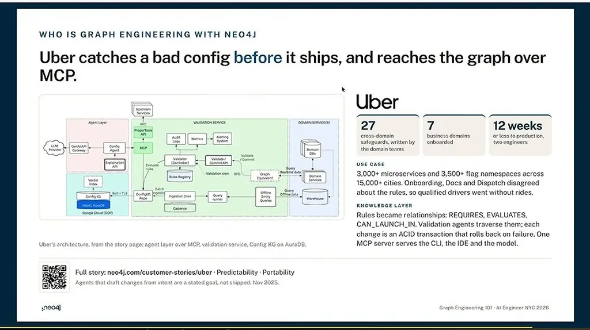
*[▶ 00:10:45](https://www.youtube.com/watch?v=g_NgCLTibiM&t=645s) · Uber config-validation architecture over MCP*

The loan demo exposes a gap: nothing forces the agent onto an exact path. Two runs of one loan took 22 and 16 steps, and approve or deny decisions carry uncalibrated confidence scores.

## Compiling runs into a graph skill, then observing it

[▶ 00:14:30](https://www.youtube.com/watch?v=g_NgCLTibiM&t=870s)

Successful runs, even inconsistent ones, compile into one graph-shaped skill: a deterministic YAML that holds steps, scripts, assets and policy sources.

```yaml
"false": No owner holds another business with us; or every connected facility is current; or the connected balance is small next to the business's own exposure and nothing in the notes ties it to the funds
outcome:
  type: choice
  instructions: >-
    Approve, counter or decline? The policy said review, so this is the judgment. Approve when the rule that
    fired is answered by the business's own record: coverage inside the 1.00 to 1.25 band and strong balances, …
  criteria:
    approve: Lend the full amount at the requested term; the fired review rule is answered by the business's own record and the notes about it.
    counter: Lend a smaller amount or a shorter term; capacity is the problem and the business covers a smaller payment.
    declines: Do not lend now; the figures and the record do not support it, and the rationale names what a reapplication would rest on.
  thresholds:
    risk_tier: 0.6
    connected_exposure_material: 0.3
    outcomes: 0.6
  inputs_to: precedents

- name: precedents
  kinds: execution
  description: Look up filed decisions on the same product and band with loan precedents; settle the outcome for the automatic bands, set confidence and needs_human (a decline under G1), and build the evidence di…
  inputs:
    - name: application_id
      type: string
    - name: policy_outcome
      type: string
      descriptions: auto_approve | auto_decline | review.
```

*[▶ 00:15:29](https://www.youtube.com/watch?v=g_NgCLTibiM&t=929s) · SKILL.md loan-review skill in YAML*

The agent doesn't route itself. It calls a small CLI, an execution step checks the hard rules, and a decision step sets risk tier, exposure and outcome.

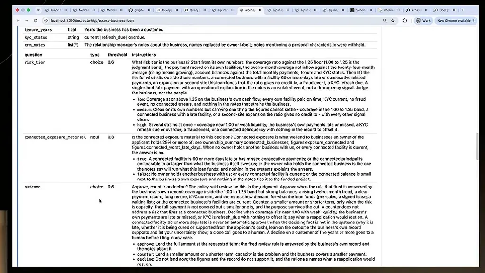
*[▶ 00:16:48](https://www.youtube.com/watch?v=g_NgCLTibiM&t=1008s) · Inspector: business-loan question specs*

Each run persists in the graph, so you can see which branches it took and what was approved or denied.

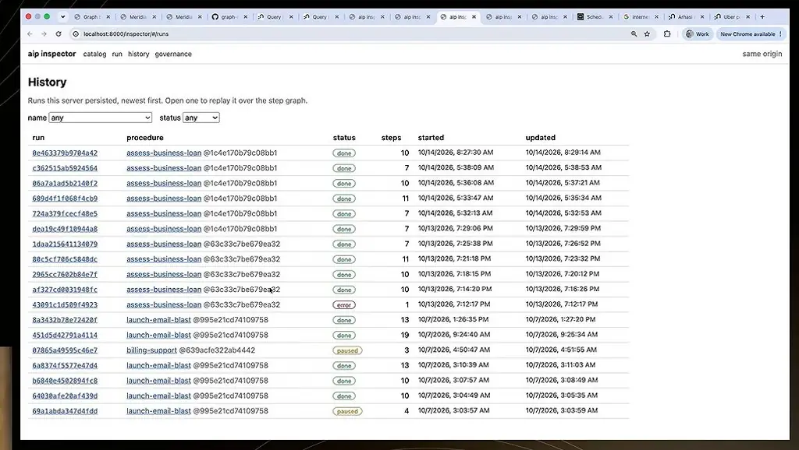
*[▶ 00:18:11](https://www.youtube.com/watch?v=g_NgCLTibiM&t=1091s) · aip inspector run history page*

Governance views flag overridden decisions, failing steps and router branches that no run took.

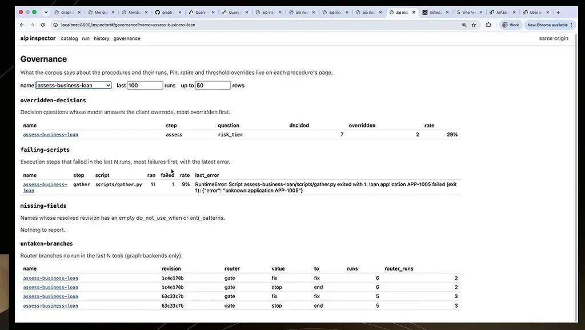
*[▶ 00:18:52](https://www.youtube.com/watch?v=g_NgCLTibiM&t=1132s) · aip inspector governance page for assess-business-loan*

Fable alone took 7.4 min wall clock at $1.03. Fable with the procedure took 2.7 min at $1.31. Haiku with the procedure took 2.0 min at $0.02. Authoring the procedure cost $9.70 and 20 minutes, once.

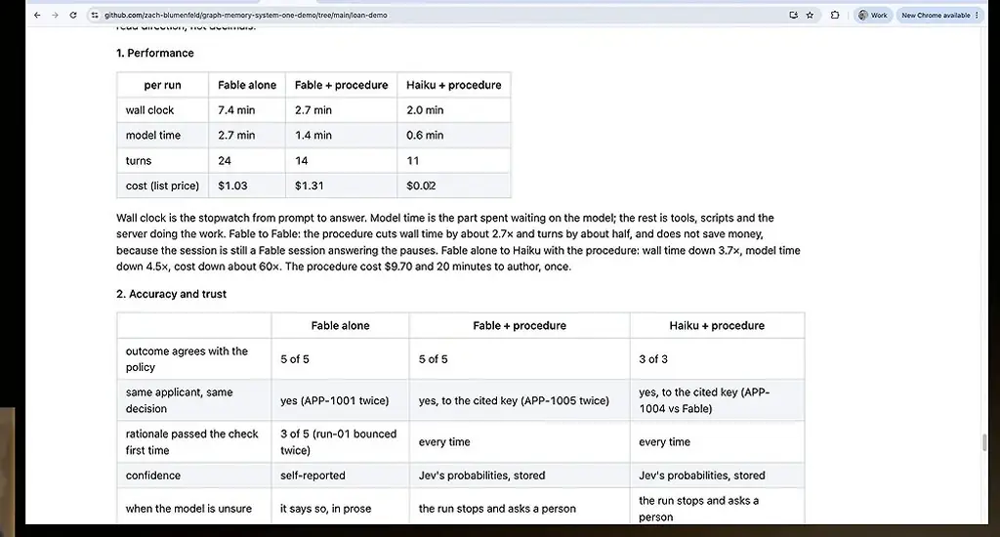
*[▶ 00:19:45](https://www.youtube.com/watch?v=g_NgCLTibiM&t=1185s) · Fable vs Haiku performance and accuracy comparison*

Loan demo: [graph-memory-system-one-demo](https://github.com/zach-blumenfeld/graph-memory-system-one-demo). AIP: [aip](https://github.com/zach-blumenfeld/aip).

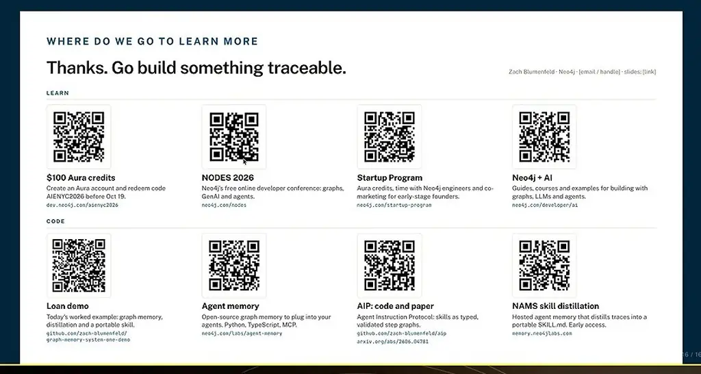
*[▶ 00:20:27](https://www.youtube.com/watch?v=g_NgCLTibiM&t=1227s) · Where do we go to learn more*

## Links & resources

- [Neo4j — project site from the video description](https://neo4j.com) — <https://neo4j.com> · video description
- [Neo4j Labs Agent Memory — memory and context as one graph](https://neo4j.com/labs/agent-memory) — <https://neo4j.com/labs/agent-memory> · on screen [▶ 00:06:25](https://www.youtube.com/watch?v=g_NgCLTibiM&t=385s)
- Reference architecture for this approach — QR code, URL not shown · mentioned [▶ 00:08:57](https://www.youtube.com/watch?v=g_NgCLTibiM&t=537s)
- [Arhasi customer story — AI answers with an audit trail](https://neo4j.com/customer-stories/arhasi) — <https://neo4j.com/customer-stories/arhasi> · on screen [▶ 00:09:56](https://www.youtube.com/watch?v=g_NgCLTibiM&t=596s)
- [Uber customer story — bad configs caught before they ship](https://neo4j.com/customer-stories/uber) — <https://neo4j.com/customer-stories/uber> · on screen [▶ 00:10:27](https://www.youtube.com/watch?v=g_NgCLTibiM&t=627s)
- [Graph memory and distillation demo — speaker's GitHub repository](https://github.com/zach-blumenfeld/graph-memory-system-one-demo) — <https://github.com/zach-blumenfeld/graph-memory-system-one-demo> · on screen [▶ 00:11:23](https://www.youtube.com/watch?v=g_NgCLTibiM&t=683s)
- [AI Engineering NYC 2026 — Neo4j resources page](https://dev.neo4j.com/aienyc2026) — <https://dev.neo4j.com/aienyc2026> · on screen [▶ 00:20:27](https://www.youtube.com/watch?v=g_NgCLTibiM&t=1227s)
- [Neo4j Nodes — conference event page](https://neo4j.com/nodes) — <https://neo4j.com/nodes> · on screen [▶ 00:20:27](https://www.youtube.com/watch?v=g_NgCLTibiM&t=1227s)
- [Neo4j Startup Program — free access for startups](https://neo4j.com/startup-program) — <https://neo4j.com/startup-program> · on screen [▶ 00:20:27](https://www.youtube.com/watch?v=g_NgCLTibiM&t=1227s)
- [Neo4j developer AI hub — docs and tools for AI apps](https://neo4j.com/developer/ai) — <https://neo4j.com/developer/ai> · on screen [▶ 00:20:27](https://www.youtube.com/watch?v=g_NgCLTibiM&t=1227s)
- [AIP — speaker's GitHub repository](https://github.com/zach-blumenfeld/aip) — <https://github.com/zach-blumenfeld/aip> · on screen [▶ 00:20:27](https://www.youtube.com/watch?v=g_NgCLTibiM&t=1227s)
- [Paper on arXiv — graph engineering for agents](https://arxiv.org/abs/2606.04781) — <https://arxiv.org/abs/2606.04781> · on screen [▶ 00:20:27](https://www.youtube.com/watch?v=g_NgCLTibiM&t=1227s)
- [Graph memory service — neo4jlabs memory site](https://memory.neo4jlabs.com) — <https://memory.neo4jlabs.com> · on screen [▶ 00:20:27](https://www.youtube.com/watch?v=g_NgCLTibiM&t=1227s)
