# The Future Of The Internet Isn't Open For Your Agent. Muse, Dots And Claude Duet Will Find Out.

*How website authorization, signed agent credentials and business-published facts will decide which AI agents can complete tasks online, and how to choose one that gets through.*

Source: [The Future Of The Internet Isn't Open For Your Agent. Muse, Dots And Claude Duet Will Find Out.](https://www.youtube.com/watch?v=c3HHFL_lsLM) · AI News & Strategy Daily | Nate B Jones · 28 min

## TL;DR

After Black October made it easier to break into websites with AI, sites are tightening access against agents, so agents will get uneven access. Whether an agent gets through depends less on model intelligence than on whether each site authorizes it, since agent clicks look identical to human clicks. Signed agent credentials, payment tokens and businesses publishing agent-readable facts are the emerging tools, but no shared standard exists yet. Before recommending an agent to others, check that the specific tasks they care about actually work reliably.

## Key takeaways

- Expect uneven agent access in 2027: some websites will open to agents, some will stay shut, and the same agent may hit both on one delegated task.
- A smarter model cannot open a closed door, because blocking agents also blocks customers, so authorization rather than intelligence decides access.
- A completed agent transaction needs three parties to agree: the business confirms an authorized customer, the payment provider confirms what can be charged, and the assistant protects the account.
- Cloudflare's signed agents let websites verify request signatures and set agent-traffic rules, while Google's AP2 defines signed records of instructions and purchases, and Stripe's shared payment tokens limit credentials by seller, maximum amount or expiry.
- Businesses must publish agent-readable facts such as cancellation terms and prices, not just large photos, because recognition alone does not decide whether an agent can compare or act.
- The three likely agent zones are partnership (accepted routes like Shop Pay checkout), aspiring actor (agents working through a site as a person would, often stalling on account checks), and no-go (outright refusal).
- Do not recommend agents broadly: reliable uses today are some shopping sites, travel, knowledge work and coding, and schedule and email, while everything else is a question mark.
- Limit agents to sites you trust and give them a project folder you can monitor, since a poisoned agent can plant malicious files such as an instruction file found in a customer's downloads folder.

## Uneven website access and a five-agent split

[▶ 00:00:00](https://www.youtube.com/watch?v=c3HHFL_lsLM&t=0s)

Black October made breaking into websites easier with AI, so sites are tightening against agents. Expect uneven access: some doors open, some stay shut.

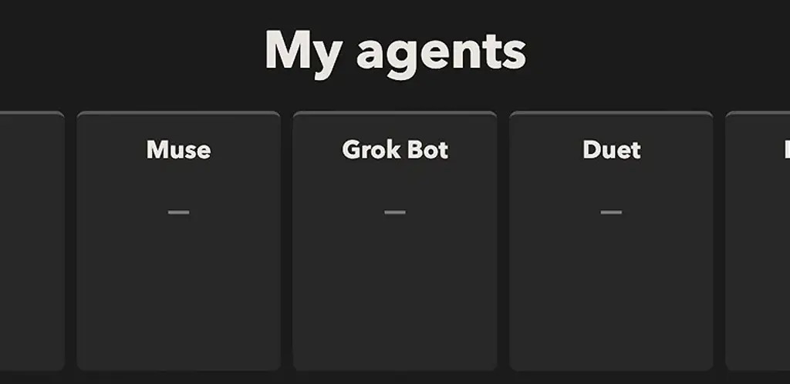
*[▶ 00:00:39](https://www.youtube.com/watch?v=c3HHFL_lsLM&t=39s) · Uneven access: open and closed doors*

Grok Bot takes tough coding and builds, where bots coordinate directly, so he needn't relay discoveries between workers.

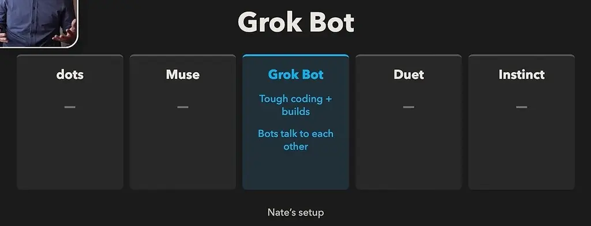
*[▶ 00:01:20](https://www.youtube.com/watch?v=c3HHFL_lsLM&t=80s) · Grok Bot agent role comparison*

dots carries context from his Codex setup and handles calendar and email. It is slower, but it remembers projects and decisions.

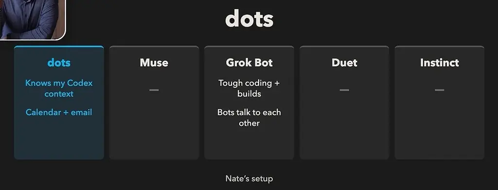
*[▶ 00:01:43](https://www.youtube.com/watch?v=c3HHFL_lsLM&t=103s) · dots agent role highlighted*

Muse handles shopping, gifting and bookings such as restaurants and yoga classes, and buys from websites through Link's Stripe partnership.

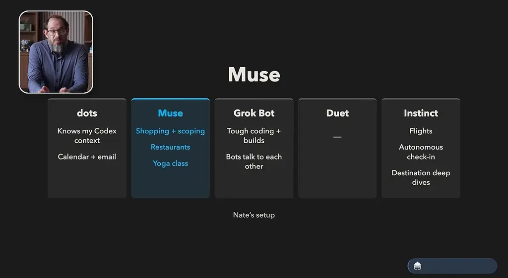
*[▶ 00:02:40](https://www.youtube.com/watch?v=c3HHFL_lsLM&t=160s) · Muse comparison of agent setups*

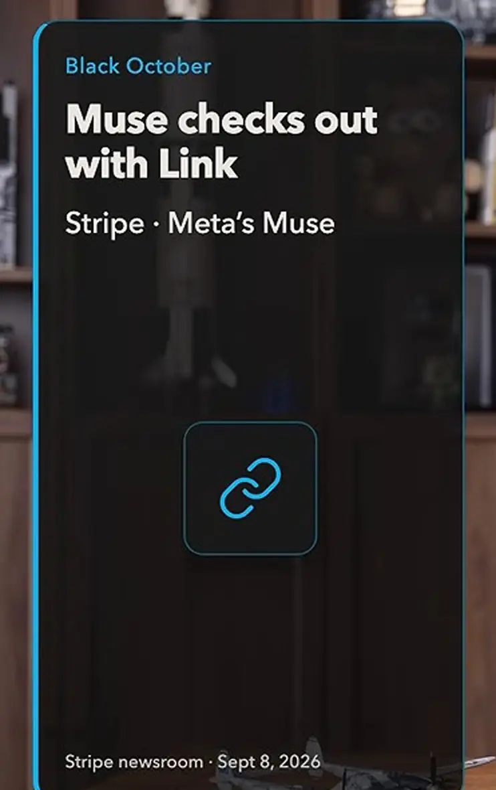
*[▶ 00:02:51](https://www.youtube.com/watch?v=c3HHFL_lsLM&t=171s) · Link card: Muse checks out with Link*

Instinct covers travel, with texting on the go and autonomous check-in.

Duet and dots are proactive, by his estimate about 50–75% of the time; dots caught a double-booked flight, which he got refunded.

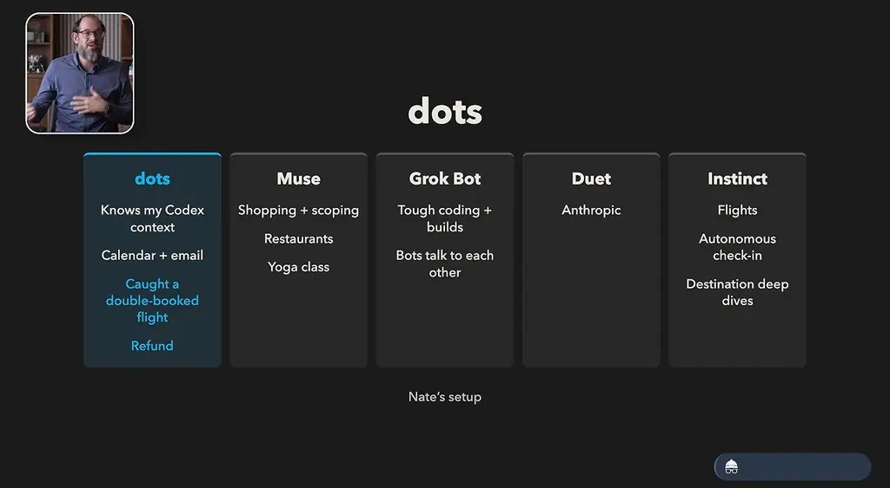
*[▶ 00:03:57](https://www.youtube.com/watch?v=c3HHFL_lsLM&t=237s) · Nate's personal agent setup by product*

## Authorization, not intelligence, decides agent access

[▶ 00:04:48](https://www.youtube.com/watch?v=c3HHFL_lsLM&t=288s)

A smarter model can't open a closed door: agents still freeze at hotel booking pages, and blocking them blocks customers too.

Attackers use agents as well, so banks struggle to tell them apart from customers. Agent clicks and human clicks look identical.

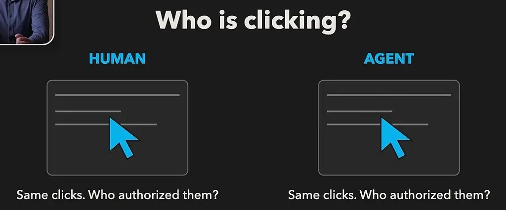
*[▶ 00:07:25](https://www.youtube.com/watch?v=c3HHFL_lsLM&t=445s) · Who is clicking?*

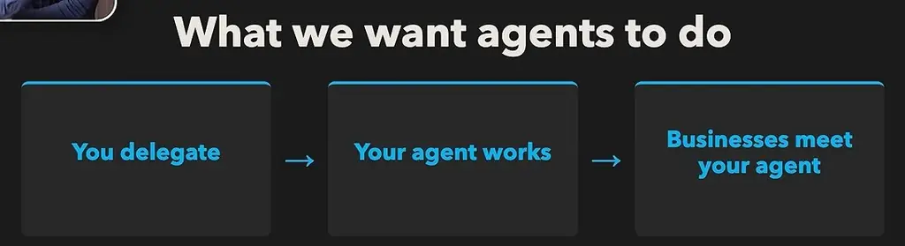
*[▶ 00:07:56](https://www.youtube.com/watch?v=c3HHFL_lsLM&t=476s) · What we want agents to do*

Delegated tasks span several sites: homework on the school portal, events on the school calendar, travel on hotel sites.

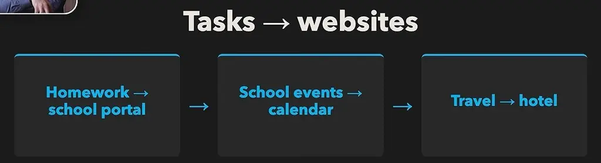
*[▶ 00:08:37](https://www.youtube.com/watch?v=c3HHFL_lsLM&t=517s) · Tasks to websites*

Each site must judge whether an agent is a legitimate customer or an attack.

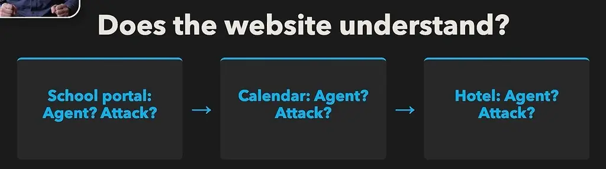
*[▶ 00:08:55](https://www.youtube.com/watch?v=c3HHFL_lsLM&t=535s) · Does the website understand?*

A completed transaction needs three parties to agree: the business confirms an authorized customer, the payment provider confirms what can be charged, and the assistant protects the account.

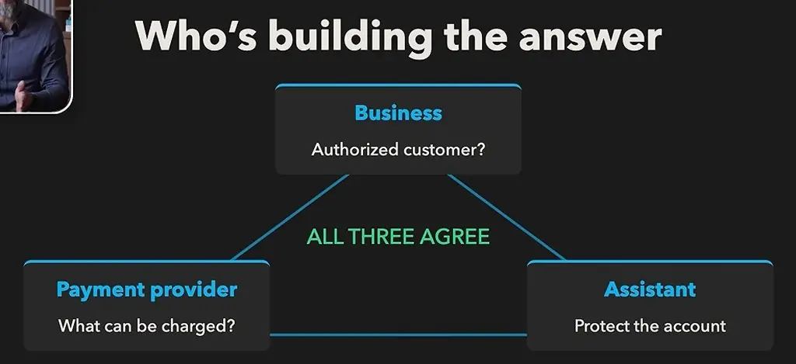
*[▶ 00:09:27](https://www.youtube.com/watch?v=c3HHFL_lsLM&t=567s) · Who's building the answer*

The October 20 Visa, BILL and Billtrust pilot applies this to B2B invoices. A buyer approves a bill, a registered BILL agent pays through the supplier's portal, and Billtrust marks it paid.

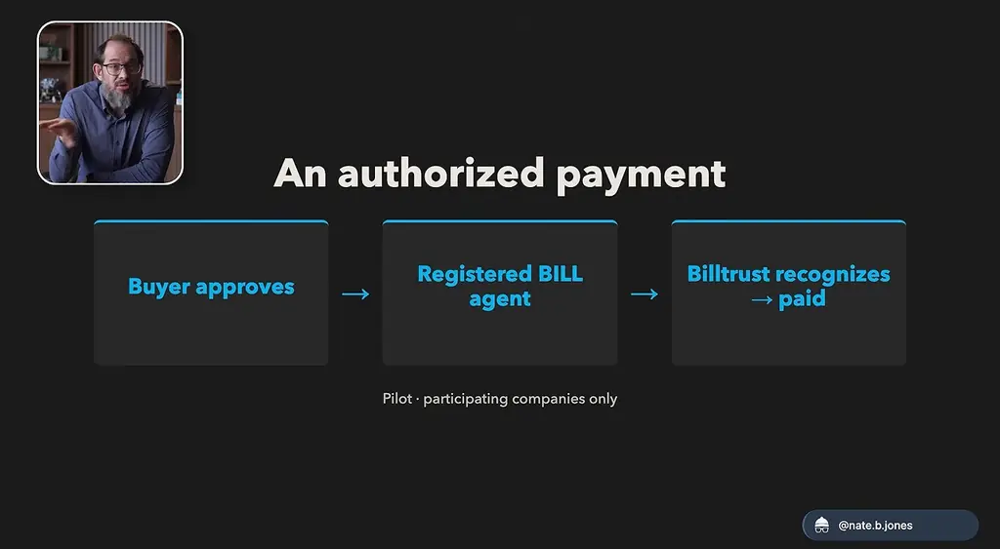
*[▶ 00:10:18](https://www.youtube.com/watch?v=c3HHFL_lsLM&t=618s) · An authorized payment flow*

## Signed agent credentials and agent-readable business facts

[▶ 00:10:59](https://www.youtube.com/watch?v=c3HHFL_lsLM&t=659s)

Cloudflare's signed agents let websites verify request signatures and set agent-traffic rules. Recognition still leaves businesses deciding whether visitors can read prices, see reservations or cancel.

Google's AP2 defines signed records of instructions and purchases.

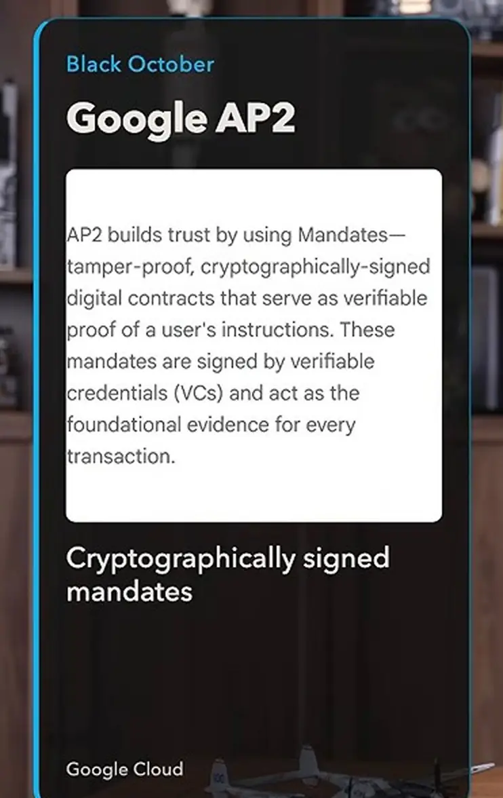
*[▶ 00:12:27](https://www.youtube.com/watch?v=c3HHFL_lsLM&t=747s) · Google AP2 cryptographically signed mandates*

Stripe shared payment tokens limit payment credentials by seller, maximum amount or expiry.

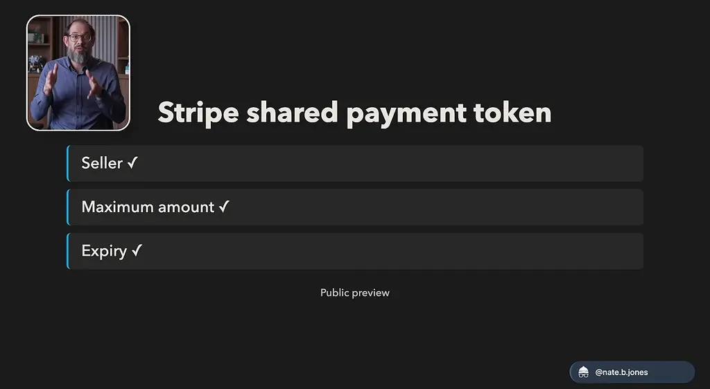
*[▶ 00:13:09](https://www.youtube.com/watch?v=c3HHFL_lsLM&t=789s) · Stripe shared payment token*

No shared schema for agent rules exists yet. Whether one winner emerges or a Google-Stripe patchwork forms is unresolved.

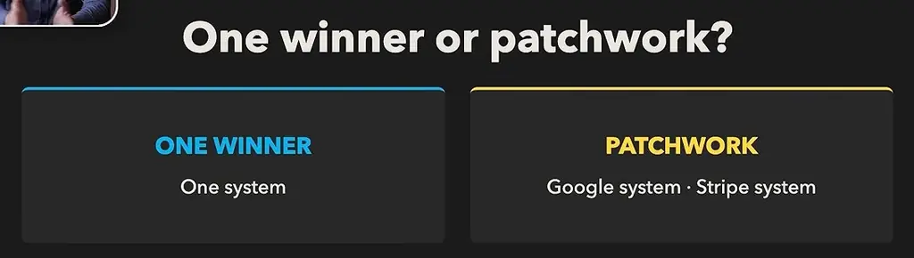
*[▶ 00:13:27](https://www.youtube.com/watch?v=c3HHFL_lsLM&t=807s) · One winner or patchwork?*

So "supporting agents" is ambiguous: a service may allow research but stop at payment, or accept one payment type but not another.

Businesses must publish what agents compare, like cancellation terms, not just big photos.

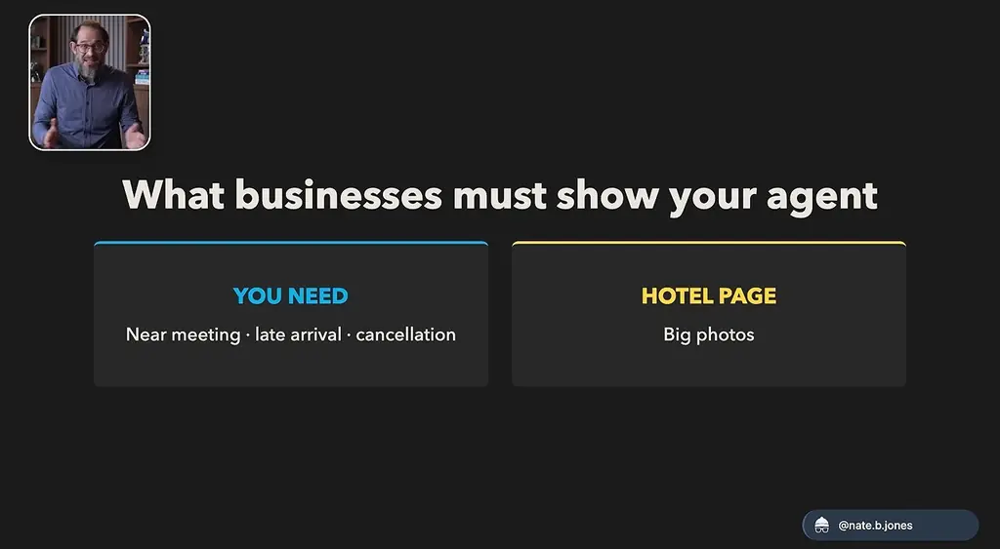
*[▶ 00:14:49](https://www.youtube.com/watch?v=c3HHFL_lsLM&t=889s) · What businesses must show your agent*

Shopify's October 28 expansion lets merchants publish agent-facing facts, and Shop Pay appears in Muse, Claude Duet and Instinct.

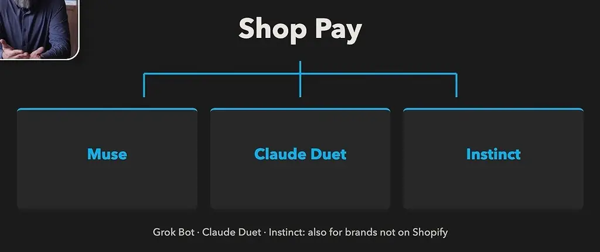
*[▶ 00:16:12](https://www.youtube.com/watch?v=c3HHFL_lsLM&t=972s) · Shop Pay in Muse, Claude Duet, Instinct*

Many-to-many: one person can have many agents, one business many agents, and one agent many businesses.

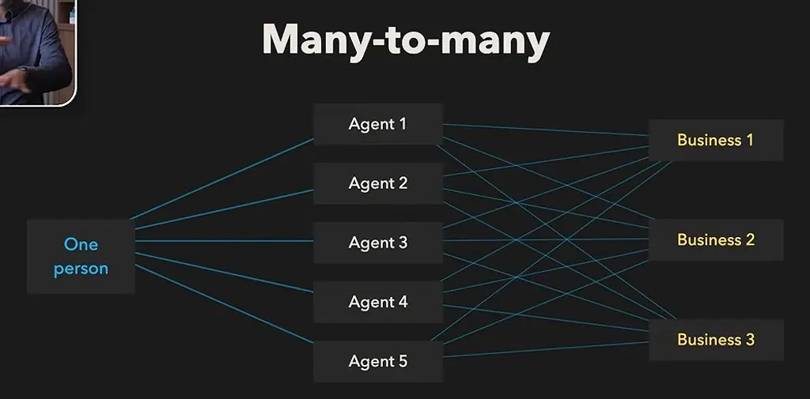
*[▶ 00:17:55](https://www.youtube.com/watch?v=c3HHFL_lsLM&t=1075s) · Many-to-many agent marketplace diagram*

## Three agent zones and the trusted middle

[▶ 00:18:08](https://www.youtube.com/watch?v=c3HHFL_lsLM&t=1088s)

Agents will face three zones online in 2027.

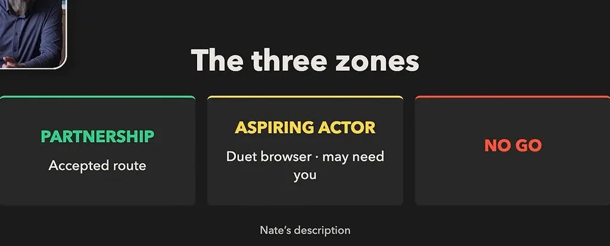
*[▶ 00:18:33](https://www.youtube.com/watch?v=c3HHFL_lsLM&t=1113s) · The three zones*

**Partnership** is an accepted route, like Shop Pay checkout, and many assistants can use it.

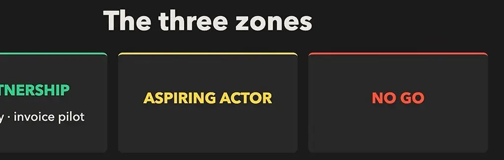
*[▶ 00:18:21](https://www.youtube.com/watch?v=c3HHFL_lsLM&t=1101s) · The three zones*

**Aspiring actor** means an agent working through a site as a person would. It may stall on an account check or a step that needs you.

**No go** is outright refusal. Amazon's dispute with Muse centers on who owns the customer relationship.

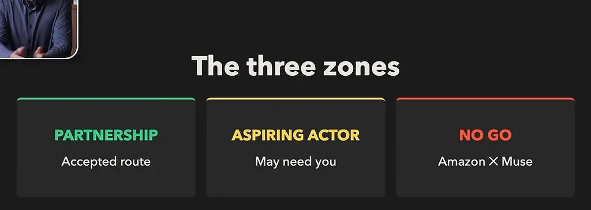
*[▶ 00:19:04](https://www.youtube.com/watch?v=c3HHFL_lsLM&t=1144s) · The three zones*

Businesses must separate desired agent access from undesired, a skill most lack in-house.

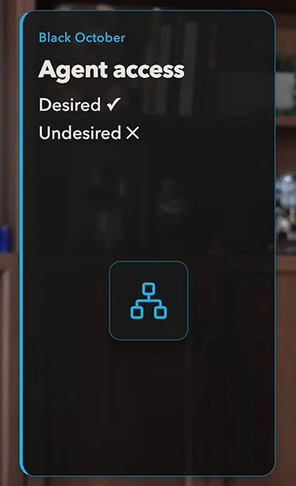
*[▶ 00:20:08](https://www.youtube.com/watch?v=c3HHFL_lsLM&t=1208s) · Agent access: desired vs undesired*

So connection providers gain power: businesses want protection, and assistants want to finish the job.

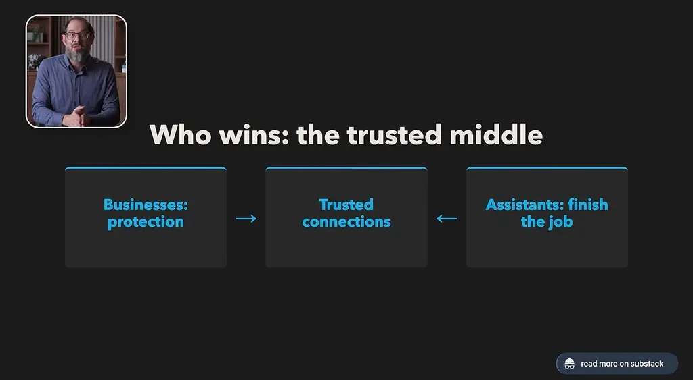
*[▶ 00:20:21](https://www.youtube.com/watch?v=c3HHFL_lsLM&t=1221s) · Who wins: the trusted middle*

Amazon earned trust in the 1990s with secure checkout. Agents are at that stage now.

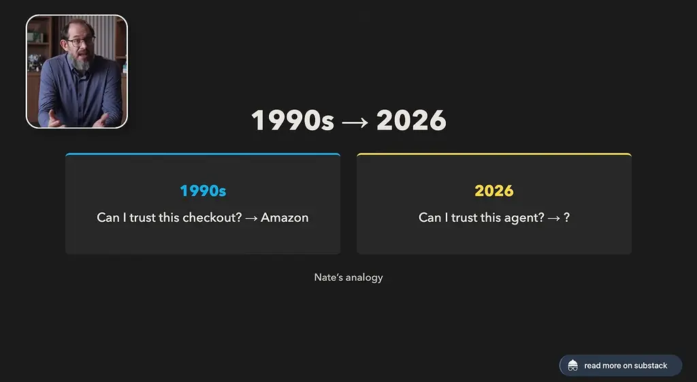
*[▶ 00:21:24](https://www.youtube.com/watch?v=c3HHFL_lsLM&t=1284s) · 1990s → 2026 trust analogy*

## Talking about agents without overselling them

[▶ 00:23:14](https://www.youtube.com/watch?v=c3HHFL_lsLM&t=1394s)

Before recommending an agent, check that the use cases friends and family care about, such as holiday gift shopping, actually work. In 2026 they don't work reliably for non-technical users across the web, and won't until open protocols arrive. The same goes for Muse, dots, Duet and Grok Bot.

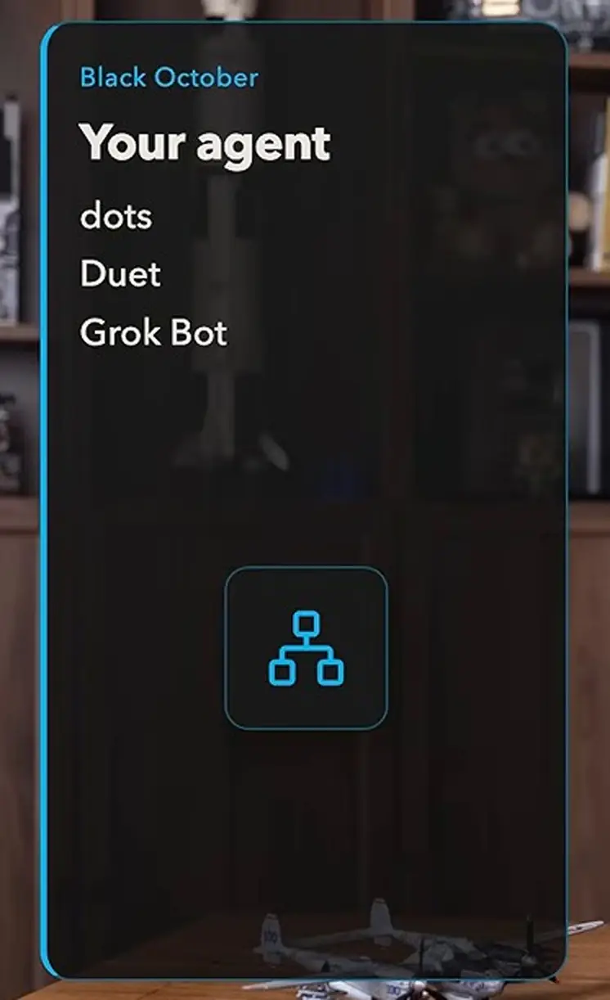
*[▶ 00:23:59](https://www.youtube.com/watch?v=c3HHFL_lsLM&t=1439s) · Black October: your agent options*

Black October reset companies' security priorities, and a poisoned agent can plant malicious files. The speaker cites a malicious instruction file found in an end customer's downloads folder. Limit agents to sites you trust, and give them a project folder you can monitor.

Don't promise relatives that agents are trustworthy in general. Recommend the reliable buckets: some shopping sites, travel, knowledge work and coding, and schedule and email. Anything beyond them is a question mark.

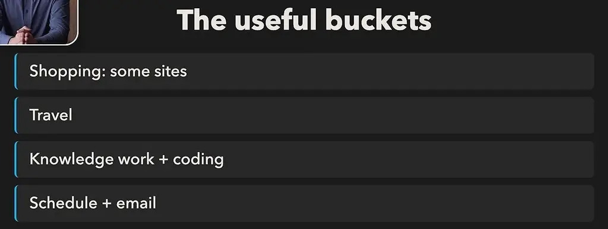
*[▶ 00:26:16](https://www.youtube.com/watch?v=c3HHFL_lsLM&t=1576s) · The useful buckets*

Three takeaways:

- The internet splinters over agent access next year.
- Protocol builders gain power, and open protocols are easier to engage with, as Cloudflare, Google and Stripe efforts show.
- Describe agents specifically to less technical people to earn trust.

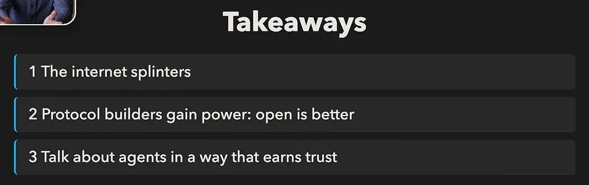
*[▶ 00:26:43](https://www.youtube.com/watch?v=c3HHFL_lsLM&t=1603s) · Takeaways*

## Links & resources

- [AI agents and website access — Nate's newsletter article on the talk's topic](https://natesnewsletter.substack.com/p/ai-agents-website-access?utm_source=youtube&utm_medium=video&utm_campaign=ai-agents-website-access-launch&utm_content=description) — <https://natesnewsletter.substack.com/p/ai-agents-website-access?utm_source=youtube&utm_medium=video&utm_campaign=ai-agents-website-access-launch&utm_content=description> · video description
- [How to connect Nate's library — unlock-ai guide](https://unlock-ai.natebjones.com/guides/how-to-connect-nates-library?utm_source=youtube&utm_medium=video&utm_campaign=ai-agents-website-access-launch&utm_content=description) — <https://unlock-ai.natebjones.com/guides/how-to-connect-nates-library?utm_source=youtube&utm_medium=video&utm_campaign=ai-agents-website-access-launch&utm_content=description> · video description
- [Nate's Newsletter — speaker's Substack home page](https://natesnewsletter.substack.com/?utm_source=youtube&utm_medium=video&utm_campaign=ai-agents-website-access-launch&utm_content=description) — <https://natesnewsletter.substack.com/?utm_source=youtube&utm_medium=video&utm_campaign=ai-agents-website-access-launch&utm_content=description> · video description
