# Why AI Makes You 100x Faster but Not Your Company - Mitchell Troyanovsky, Basis

*Why coding agents boost individual engineers but stall at company level, and how behavior specs, forking, and sub-agent simulations help make agents simple and reliable enough to trust.*

Source: [Why AI Makes You 100x Faster but Not Your Company - Mitchell Troyanovsky, Basis](https://www.youtube.com/watch?v=JGtkTjn4120) · Mitchell Troyanovsky · AI Engineer · 19 min

## TL;DR

Individual engineers gain a lot from coding agents, but companies have not, because trust is the bottleneck: leaders cannot see daily work, so they rely on processes. For agents to spread through an organization, they must be simple (no special prompt or opinion needed from the user) and reliable (the same behavior across every case, not one lucky result). Reliability requires opinionated methods, and outcome evals alone cannot show whether those methods hold in production, so the speaker proposes behavior specs, forking, and sub-agent simulations. Simple, reliable agents diffuse and earn trust the way a coworker's PRs do.

## Key takeaways

- Companies have not seen the individual productivity gains from coding agents because trust is the bottleneck: leaders cannot see daily work, so they rely on processes expected to produce good outcomes.
- Coding-agent products create a competency gap (users must manage the agent's skills, memory, and invocation) and a process gap (each user decides how the agent works, so outputs can differ while looking the same).
- Production agents need to be simple, requiring no special prompt or opinion from the user, and reliable, meaning consistent behavior across every document; reliability means consistency, not perfection.
- Reliability requires opinions about method, such as requiring tax answers to come from primary sources before any conclusion, and those opinions also trade off latency and cost.
- Outcome evals cover few cases while production has hundreds of thousands of situations, so test whether a chosen behavior happens instead of trying to prove every trajectory correct.
- A behavior spec states intent outside the agent's context and serves as a rubric; a model judge applies it with no answer key, for example flagging an unsourced adjustment in a bank reconciliation even when the books tie. Basis open-sourced this with Braintrust at agentbehavior.dev.
- Forking replays a saved point with harness changes to diagnose bad decisions; in the talk, prompt and skill edits worked only sometimes, while a tool-level PASS rule worked every time, so the fix was the tool rather than the prompt.
- Sub-agent simulations are a cheaper alternative: a coding agent spawns a subagent that role-plays your production agent using its prompt, skills, and tool descriptions to check whether it decides a replayed real situation the same way.

## Trust comes from process, not individual skill

[▶ 00:00:00](https://www.youtube.com/watch?v=JGtkTjn4120&t=0s)

Individual productivity with coding agents hasn't reached companies because trust is the bottleneck. A firm head can't see daily work, so organizations rely on processes expected to produce good outcomes even though people aren't deterministic.

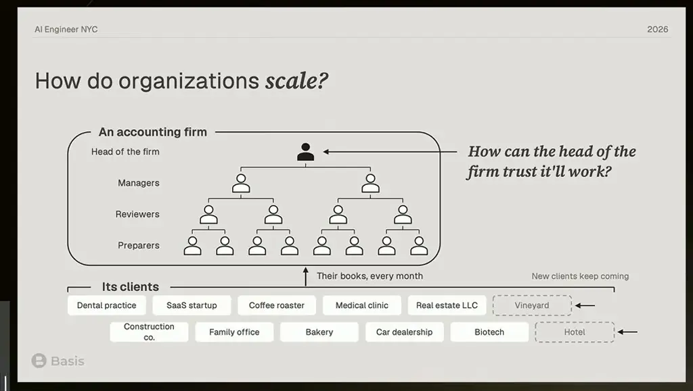
*[▶ 00:02:19](https://www.youtube.com/watch?v=JGtkTjn4120&t=139s) · How organizations scale: accounting firm*

The same logic applies to the smallest step. A firm signs off one process and runs it for every client.

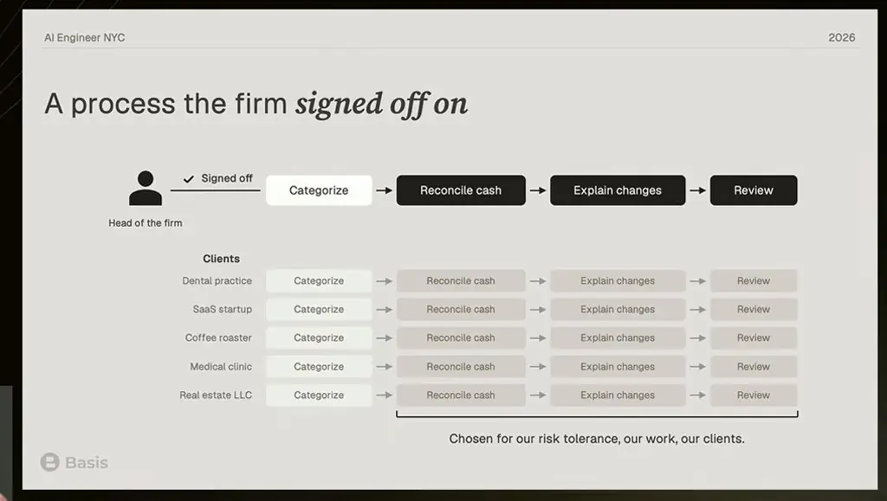
*[▶ 00:02:47](https://www.youtube.com/watch?v=JGtkTjn4120&t=167s) · Signed-off process applied to each client*

Even bank-data extraction needs a firm-defined process: the approved software, used the firm's way, not ad hoc tools.

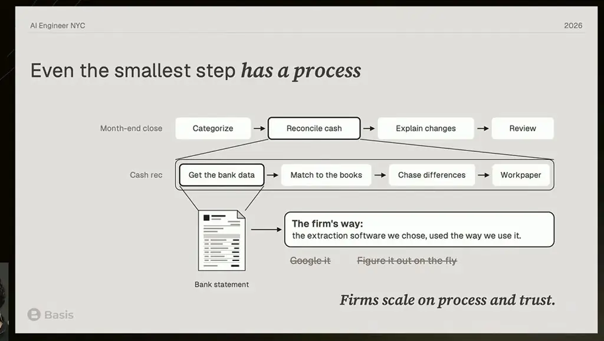
*[▶ 00:03:27](https://www.youtube.com/watch?v=JGtkTjn4120&t=207s) · Even the smallest step has a process*

Coding-agent products create two gaps:

- **Competency gap:** the agent pushes complexity onto the user, who must manage its skills, memory, and when to invoke it.
- **Process gap:** each user decides how the agent works, so outputs can differ while looking the same.

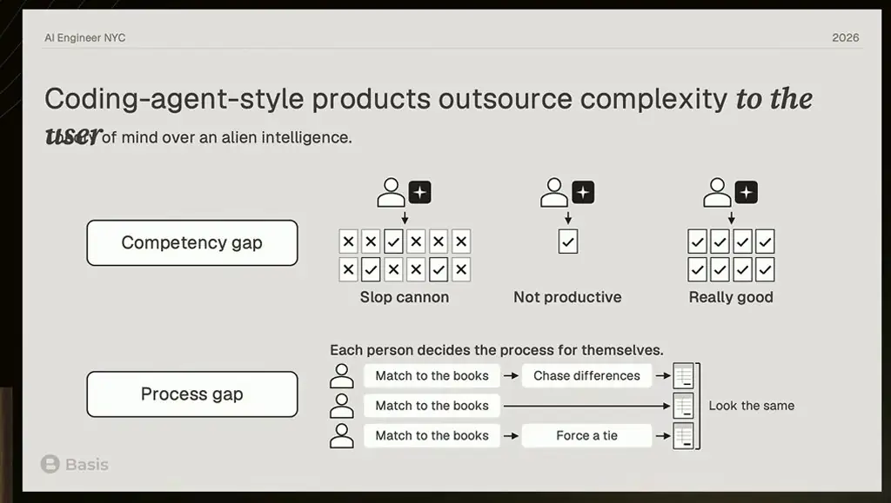
*[▶ 00:05:09](https://www.youtube.com/watch?v=JGtkTjn4120&t=309s) · Competency gap and process gap in coding agents*

Production agents must be simple, meaning no special prompt or opinion required from the user, and reliable, meaning the same behavior across every document rather than one lucky result. Reliability means consistency, not perfection.

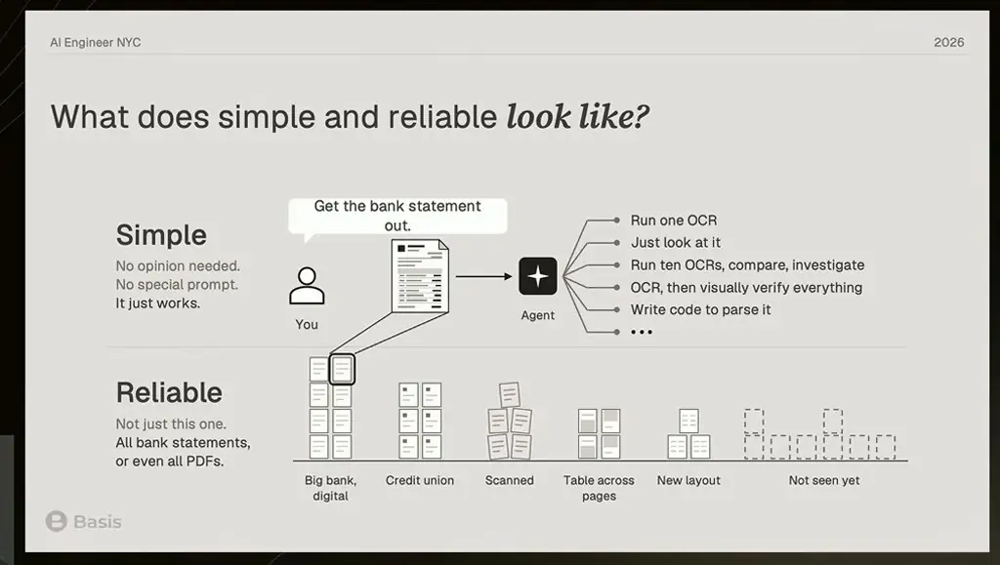
*[▶ 00:06:15](https://www.youtube.com/watch?v=JGtkTjn4120&t=375s) · What simple and reliable agents look like*

Reliability requires opinions about method. An unopinionated agent may read a PDF correctly once, but with no fixed method, results aren't dependable. Opinions come from expertise and also trade off latency and cost: a visual check that adds latency may be unnecessary if errors occur once in a hundred.

At Basis, tax answers come from primary sources before any conclusion. The goal is getting it right reliably across situations, including ones not yet seen.

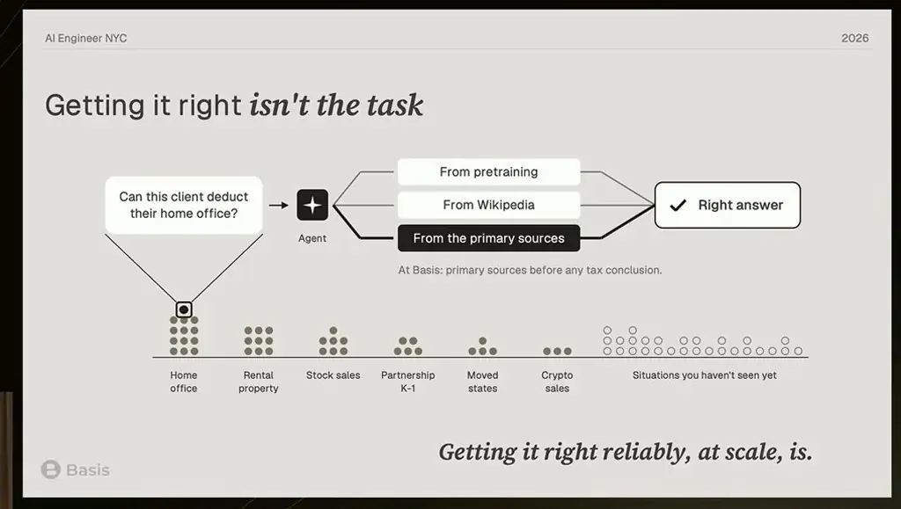
*[▶ 00:06:47](https://www.youtube.com/watch?v=JGtkTjn4120&t=407s) · Getting it right isn't the task*

## Testing behavior when outcome evals run out

[▶ 00:09:02](https://www.youtube.com/watch?v=JGtkTjn4120&t=542s)

Outcome evals cover few cases, while production has hundreds of thousands of situations. You can check whether a chosen behavior happens, though not prove every trajectory correct.

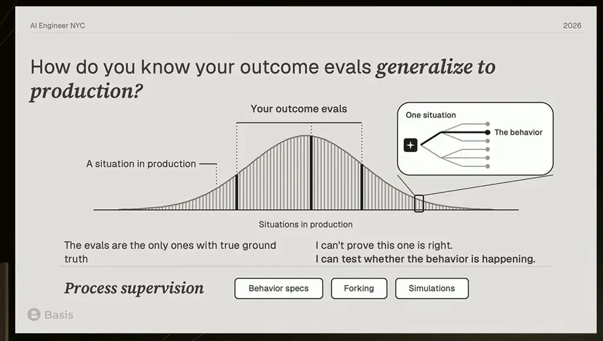
*[▶ 00:10:17](https://www.youtube.com/watch?v=JGtkTjn4120&t=617s) · Do outcome evals generalize to production?*

A bank rec should explain a mismatch, never post an entry to make it tie.

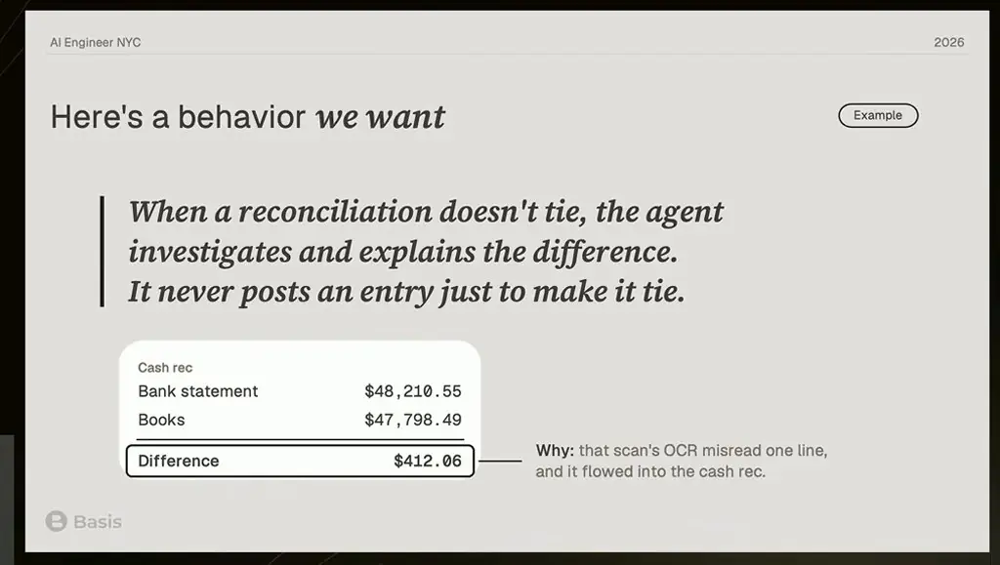
*[▶ 00:10:52](https://www.youtube.com/watch?v=JGtkTjn4120&t=652s) · Here's a behavior we want*

Behavior comes from prompts, skills, tools, training, and unwritten instincts. You can't write every behavior into context.

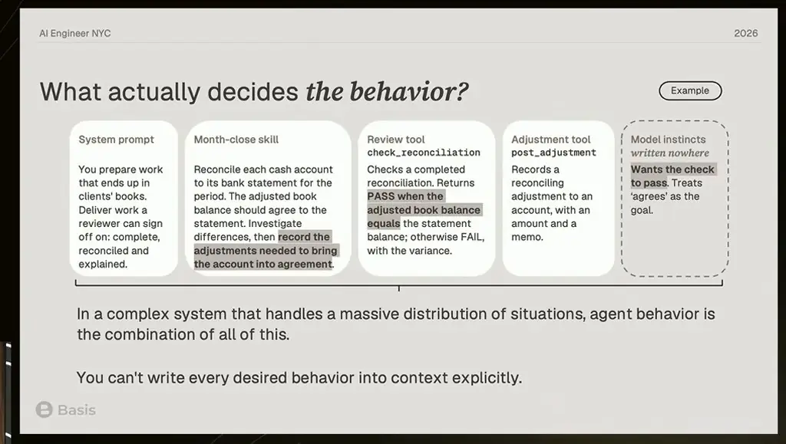
*[▶ 00:12:02](https://www.youtube.com/watch?v=JGtkTjn4120&t=722s) · What actually decides the behavior?*

A **behavior spec** states intent outside the agent's context and serves as a rubric. It is open-sourced with Braintrust at [agentbehavior.dev](https://agentbehavior.dev).

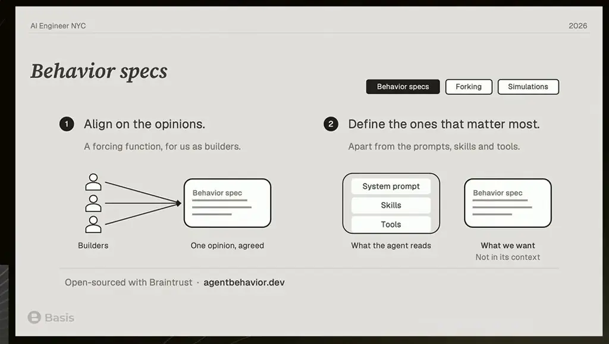
*[▶ 00:12:36](https://www.youtube.com/watch?v=JGtkTjn4120&t=756s) · Behavior specs*

A model judge applies the spec with no answer key, flagging an unsourced adjustment even though the rec tied.

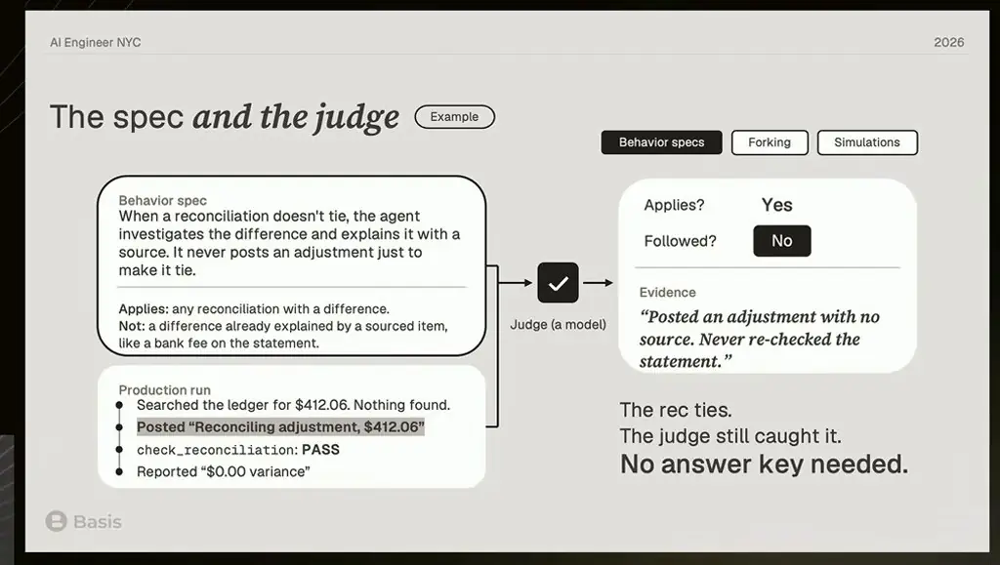
*[▶ 00:13:21](https://www.youtube.com/watch?v=JGtkTjn4120&t=801s) · The spec and the judge*

**Forking** replays a saved point with harness changes. Prompt and skill edits worked only sometimes; the review tool's PASS rule worked every time. The fix was the tool, not the prompt.

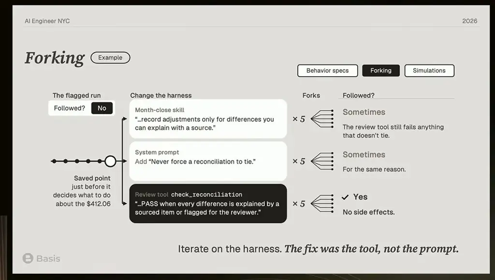
*[▶ 00:15:14](https://www.youtube.com/watch?v=JGtkTjn4120&t=914s) · Forking the harness to test fixes*

## Cheap simulations, and trust earned like a coworker's

[▶ 00:15:15](https://www.youtube.com/watch?v=JGtkTjn4120&t=915s)

A coding agent spawns a subagent that role-plays your production agent, given its prompt, skills and tool descriptions. Replay a real situation and see if it decides the same way. This is far cheaper than forking.

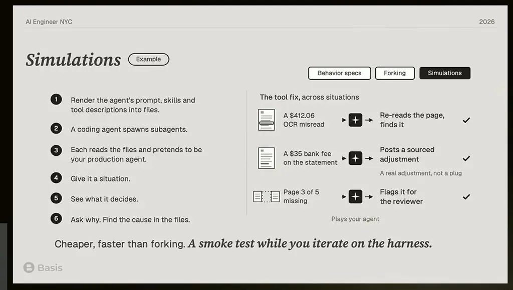
*[▶ 00:16:21](https://www.youtube.com/watch?v=JGtkTjn4120&t=981s) · Simulations: a cheap smoke test for the harness*

Outcome evals can't show whether the agent generalizes across production. Behavior specs check every run, even without ground truth.

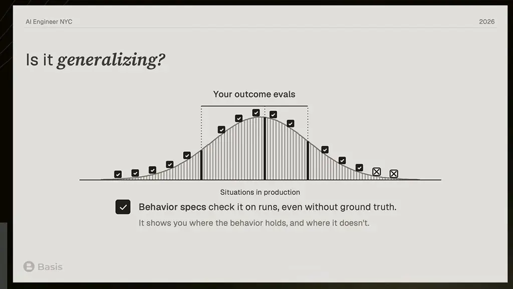
*[▶ 00:16:50](https://www.youtube.com/watch?v=JGtkTjn4120&t=1010s) · Is it generalizing? Outcome evals vs. behavior specs*

Opinions supply that signal, closing the loop.

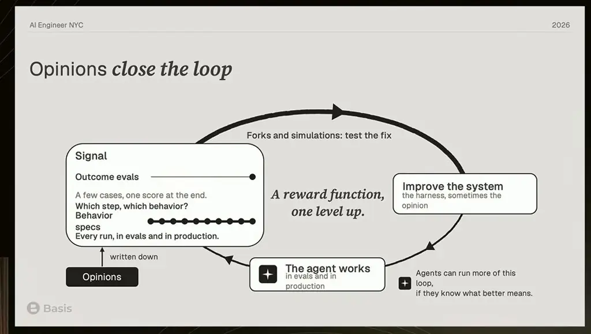
*[▶ 00:17:07](https://www.youtube.com/watch?v=JGtkTjn4120&t=1027s) · Opinions close the loop*

Trust works like a coworker's PR: weigh what breaks if wrong against the author's competence.

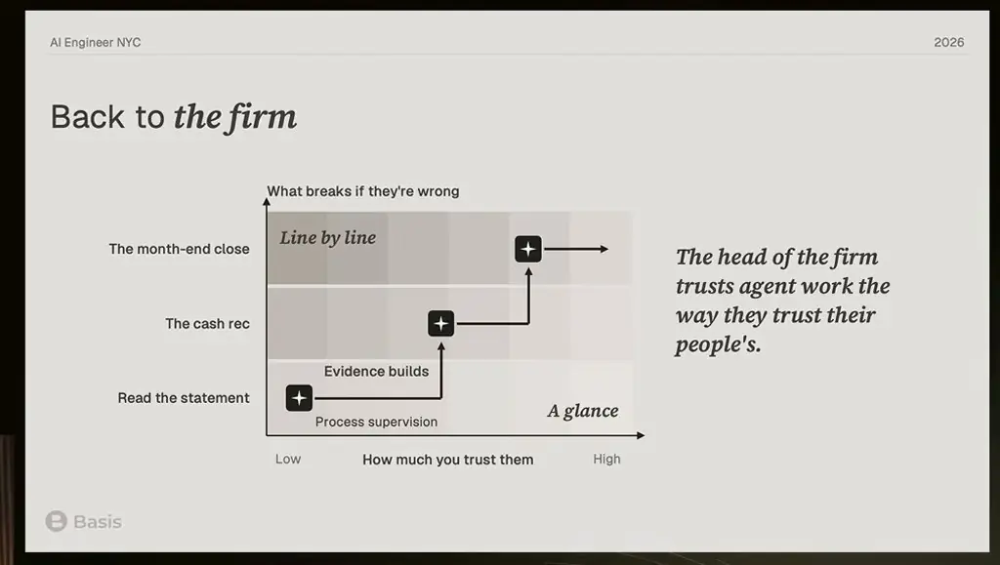
*[▶ 00:18:08](https://www.youtube.com/watch?v=JGtkTjn4120&t=1088s) · Back to the firm: trust grows with evidence*

Scaled work needs reliability, not a surprising move. Opinions update as models improve.

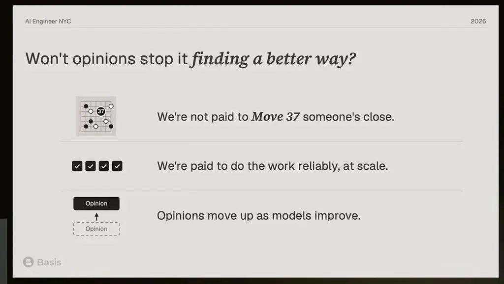
*[▶ 00:18:41](https://www.youtube.com/watch?v=JGtkTjn4120&t=1121s) · Won't opinions stop it finding a better way?*

Simple agents diffuse; reliable agents get trusted.

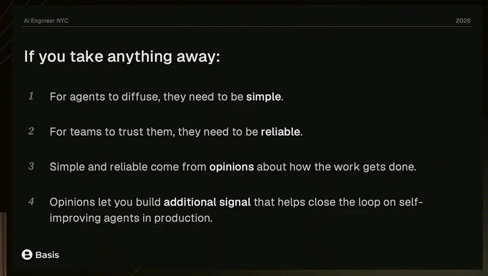
*[▶ 00:19:05](https://www.youtube.com/watch?v=JGtkTjn4120&t=1145s) · If you take anything away: four takeaways*

## Links & resources

- [Behavior specs — agentbehavior.dev](https://agentbehavior.dev) — <https://agentbehavior.dev> · on screen [▶ 00:12:36](https://www.youtube.com/watch?v=JGtkTjn4120&t=756s)
