# You've Never Lost $19 Billion. So Why Are You Playing It Safer Than Zuckerberg?

*How Meta's Muse team built a personal AI agent, and three choices you can copy without Meta's budget: who you hire, the details you polish, and how you swing again after a miss.*

Source: [You've Never Lost $19 Billion. So Why Are You Playing It Safer Than Zuckerberg?](https://www.youtube.com/watch?v=JFoDdKuRmSk) · AI News & Strategy Daily | Nate B Jones · 22 min

## TL;DR

Meta's Reality Labs lost $19.2 billion in 2025, yet the company kept betting on new products, and its Muse personal agent reached about 10 million users within six weeks. The talk argues that Muse's success came from practical choices rather than from Meta's resources: a small team with a single owner, attention to polish that users notice over long use, and clear visibility into what the agent is doing. Muse was an uncertain bet that could have failed, so the lessons apply to anyone who is held back by fear of public failure. Because AI has lowered the cost of attempts, ideas that once needed money or specialists are now worth testing again.

## Key takeaways

- After a public miss, change something specific (how you understand customers, your design judgment, who you work with, or your approach) instead of repeating the same assumptions.
- Keep the team small: Muse's model and product team had fewer than 200 people, which kept hard decisions out of consensus compromises.
- Give one person ownership of the whole user experience so that different parts do not follow different rules that users have to work around.
- Invest in polish that appears after launch, such as small details that look minor in a demo but become irritating during long use.
- Show the agent's state at a glance: Muse displays Marvin typing on a laptop to signal work in progress, which answers whether it is doing the task, waiting on the user, or finished.
- Test specific agent behaviors before launch; Muse's team tested over a hundred behaviors so the model would not misjudge when to involve the user.
- Bring in a collaborator who understands the hard parts better than you do, dig deeper with customers, and invest in polish rather than stopping at an MVP.
- Revisit ideas you dropped because the first version was unaffordable, since AI has lowered the cost of attempts, and pick work you are excited about rather than work that avoids public embarrassment.

## Swing again after every miss

[▶ 00:00:00](https://www.youtube.com/watch?v=JFoDdKuRmSk&t=0s)

Zuckerberg lost $19.2 billion in Reality Labs in 2025 alone and kept swinging rather than retreating. The lesson: after you miss, swing again.

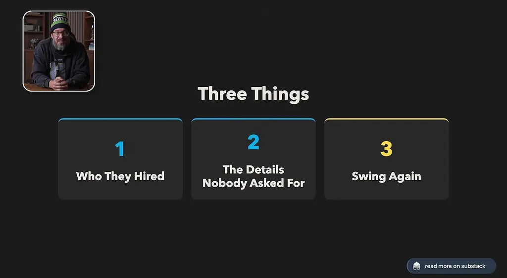
*[▶ 00:00:54](https://www.youtube.com/watch?v=JFoDdKuRmSk&t=54s) · Three Things*

Agency is the practical side. The speaker's Muse assistant, Marvin, cancelled $1,285 a year in subscriptions, a job he had put off.

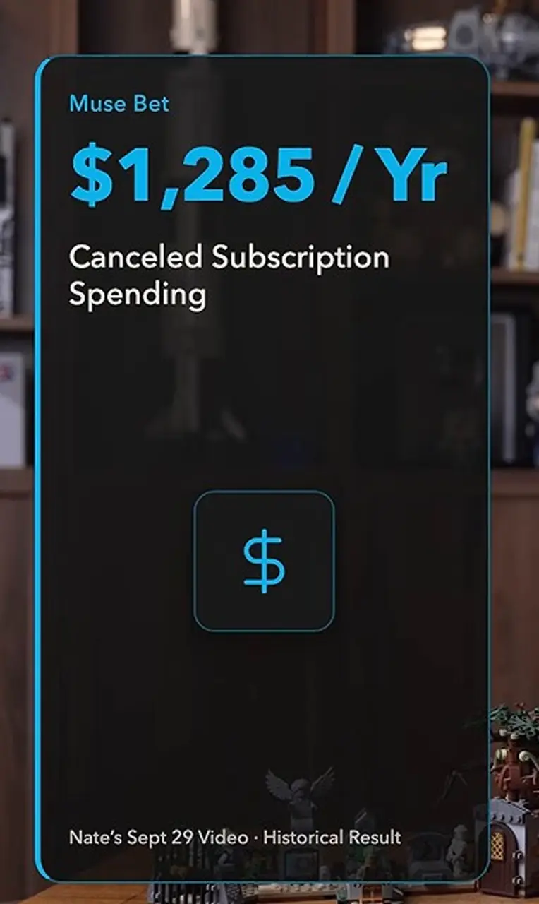
*[▶ 00:01:09](https://www.youtube.com/watch?v=JFoDdKuRmSk&t=69s) · Muse Bet: $1,285/Yr Canceled Subscription Spending*

Meta's apps reach billions, but they run on operating systems other companies control.

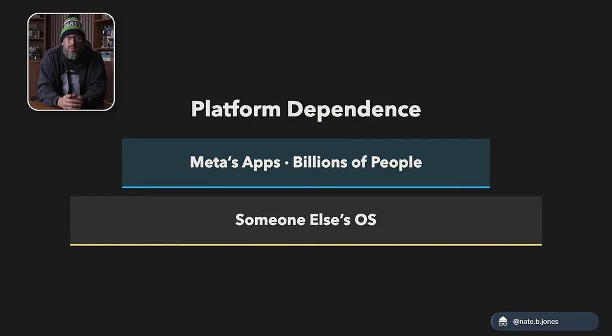
*[▶ 00:01:48](https://www.youtube.com/watch?v=JFoDdKuRmSk&t=108s) · Platform Dependence*

Zuckerberg wrote in 2024 that Apple's rules constrain what Meta can build.

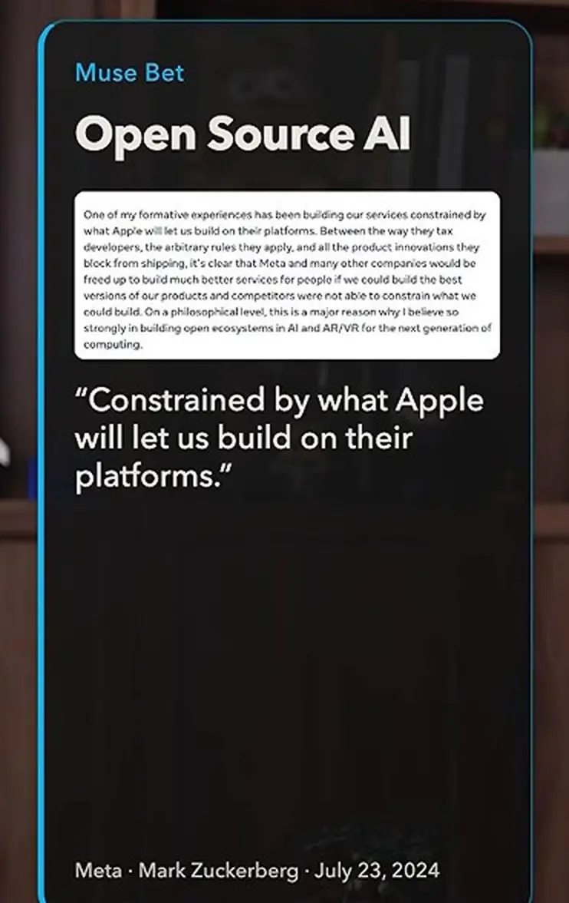
*[▶ 00:02:02](https://www.youtube.com/watch?v=JFoDdKuRmSk&t=122s) · Muse Bet: Open Source AI quote card*

Facebook bought Oculus in 2014 and renamed itself Meta in 2021.

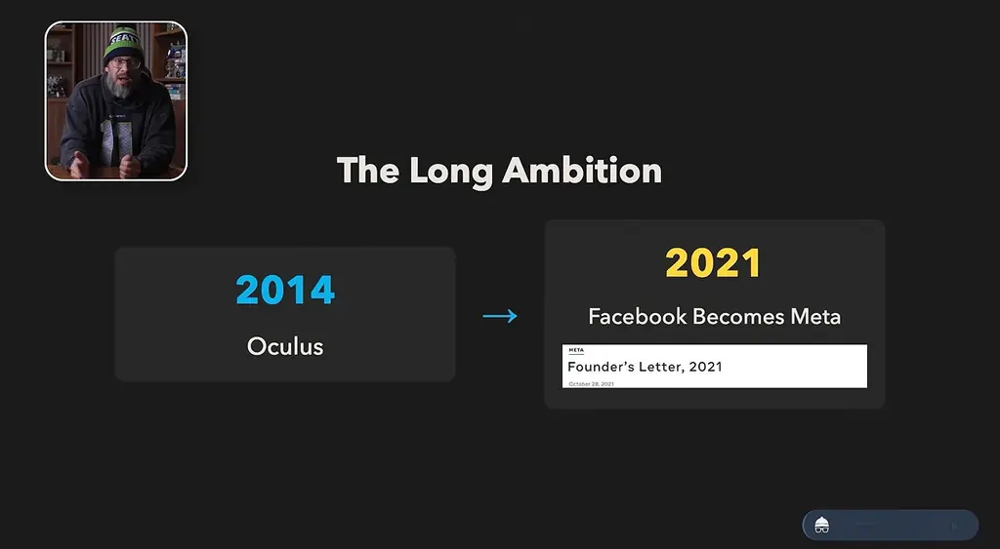
*[▶ 00:02:30](https://www.youtube.com/watch?v=JFoDdKuRmSk&t=150s) · The Long Ambition*

Changing course can feel like admitting everyone was right, yet Zuckerberg did not abandon the bet.

Users judge only the first thing you ask them to do. If it doesn't make their life better, the larger vision is never heard.

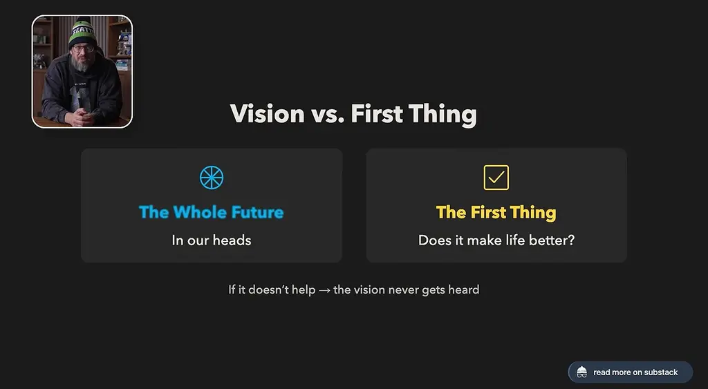
*[▶ 00:05:23](https://www.youtube.com/watch?v=JFoDdKuRmSk&t=323s) · Vision vs. First Thing*

## Small Teams, Single Owners, and Visible Care

[▶ 00:05:49](https://www.youtube.com/watch?v=JFoDdKuRmSk&t=349s)

Meta's Muse team had fewer than 200 people across model and product, per Alexander Wang. The size kept hard decisions out of consensus.

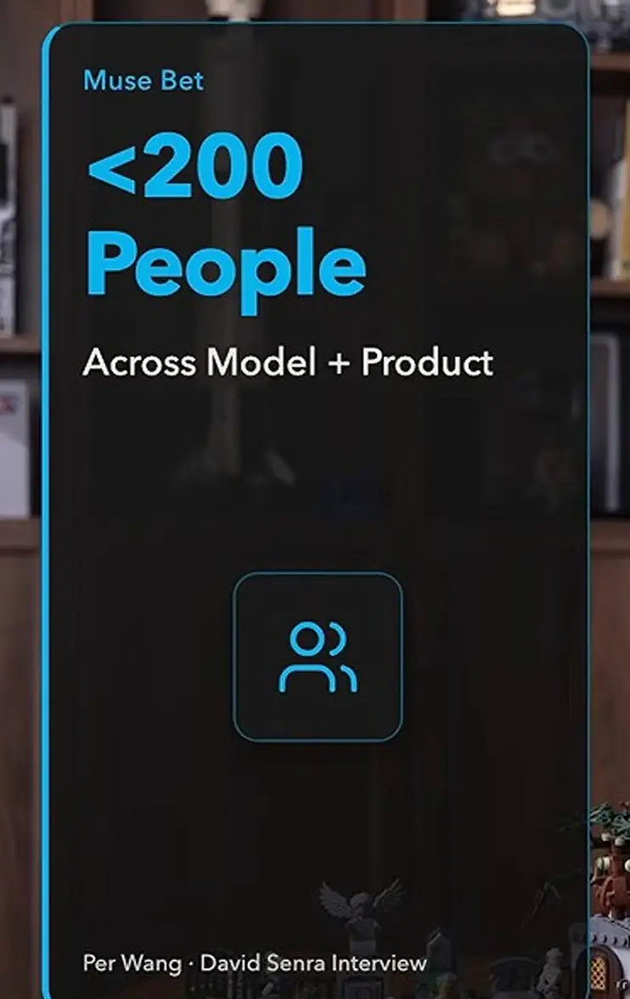
*[▶ 00:06:12](https://www.youtube.com/watch?v=JFoDdKuRmSk&t=372s) · Muse Bet: fewer than 200 people*

Consensus compromises leak to users: one tab follows one set of rules, another a different set, and users pay the effort.

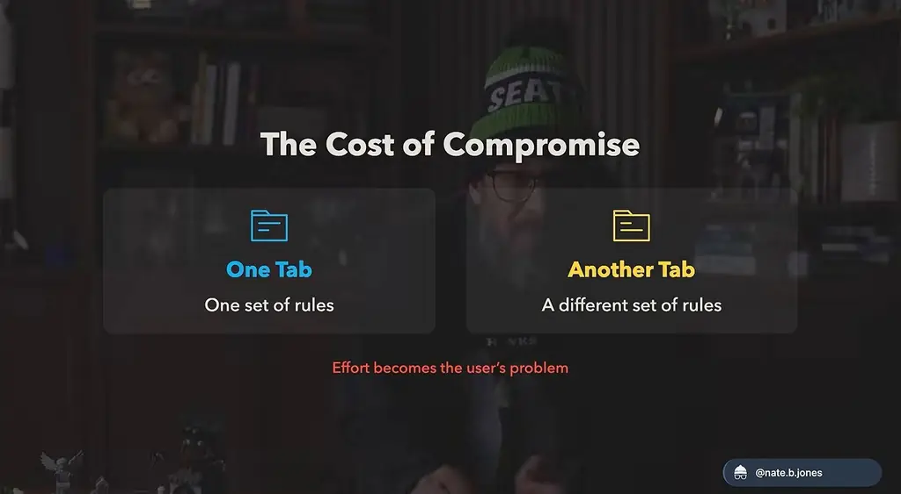
*[▶ 00:07:17](https://www.youtube.com/watch?v=JFoDdKuRmSk&t=437s) · The Cost of Compromise*

Someone must own the whole experience.

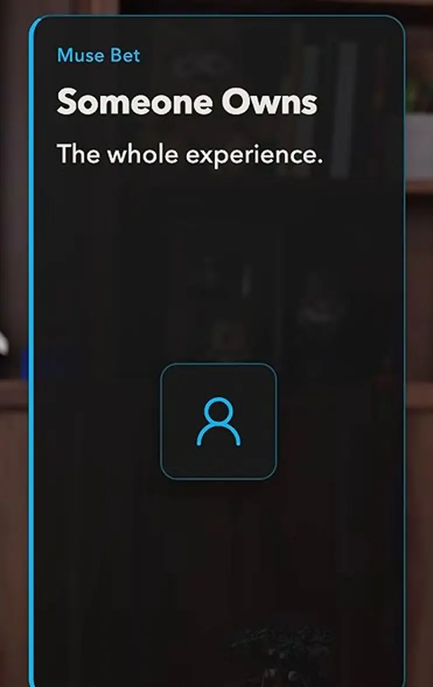
*[▶ 00:07:21](https://www.youtube.com/watch?v=JFoDdKuRmSk&t=441s) · Callout card: Someone Owns*

After a failed bet, change something specific: how you understand the customer, design judgment, who you work with, or your approach. Repeating the same assumptions won't fix it.

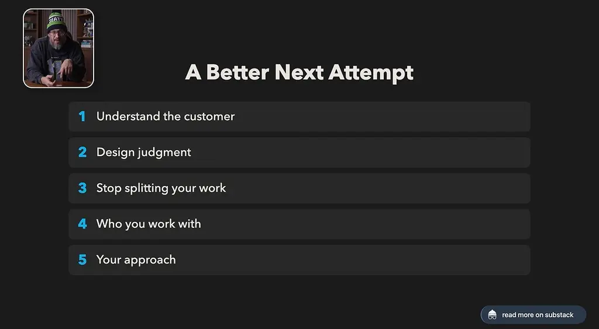
*[▶ 00:08:53](https://www.youtube.com/watch?v=JFoDdKuRmSk&t=533s) · A Better Next Attempt*

Care shows in the bathroom, not the entrance. Muse's polish lives in parts that weren't the launch demo.

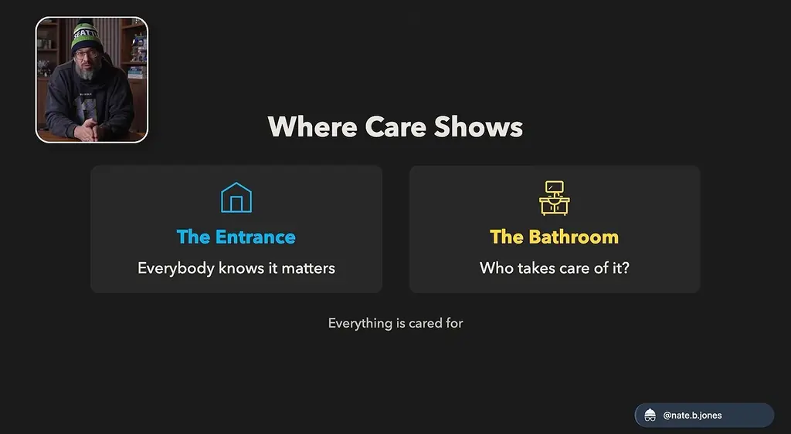
*[▶ 00:09:57](https://www.youtube.com/watch?v=JFoDdKuRmSk&t=597s) · Where Care Shows*

A detail that looks minor in a demo becomes irritating over long use.

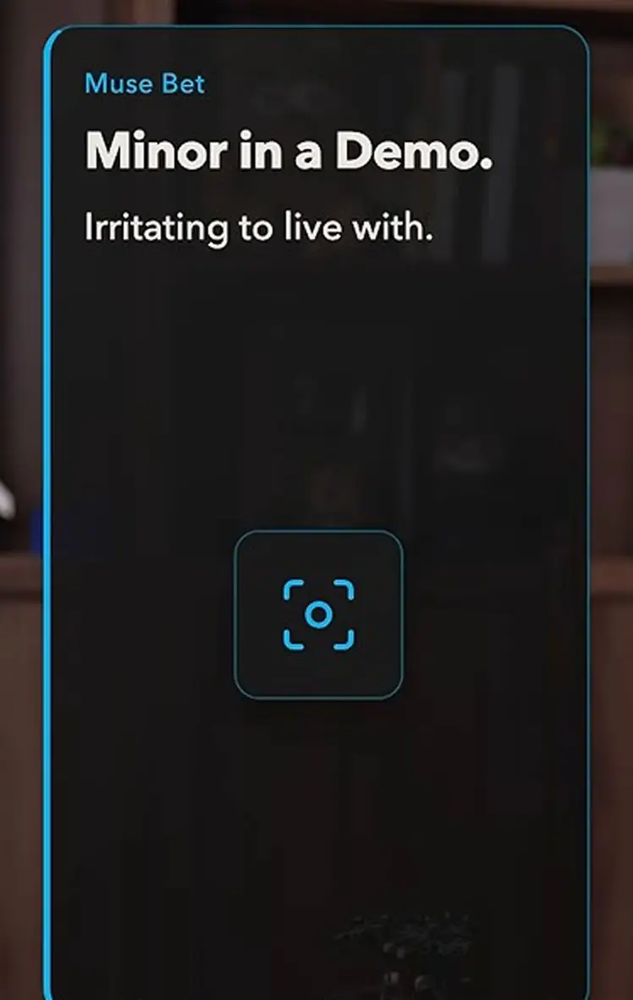
*[▶ 00:10:25](https://www.youtube.com/watch?v=JFoDdKuRmSk&t=625s) · Minor in a Demo*

## Show the agent's state, then show your idea

[▶ 00:10:30](https://www.youtube.com/watch?v=JFoDdKuRmSk&t=630s)

Muse signals work in progress with a small animation: Marvin typing on a laptop. Users read the state at a glance instead of interpreting a status message.

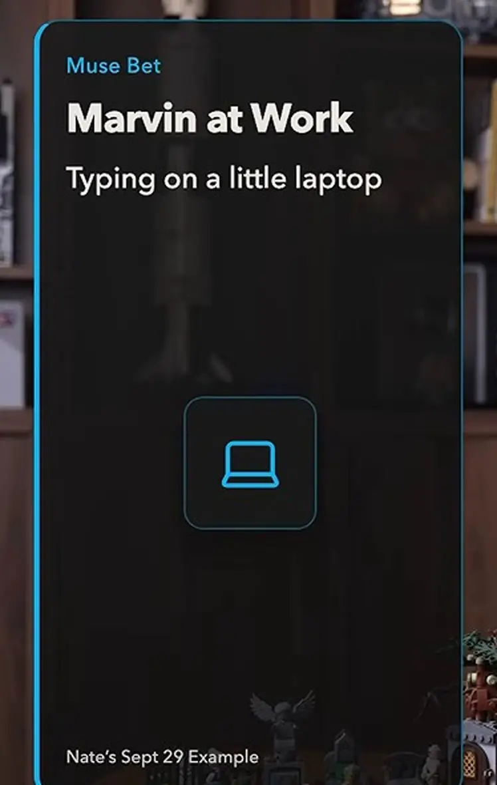
*[▶ 00:10:38](https://www.youtube.com/watch?v=JFoDdKuRmSk&t=638s) · Marvin at Work*

Every user who delegates to an agent asks the same three questions:

- Is it doing it?
- Is it waiting on me?
- Is it finished?

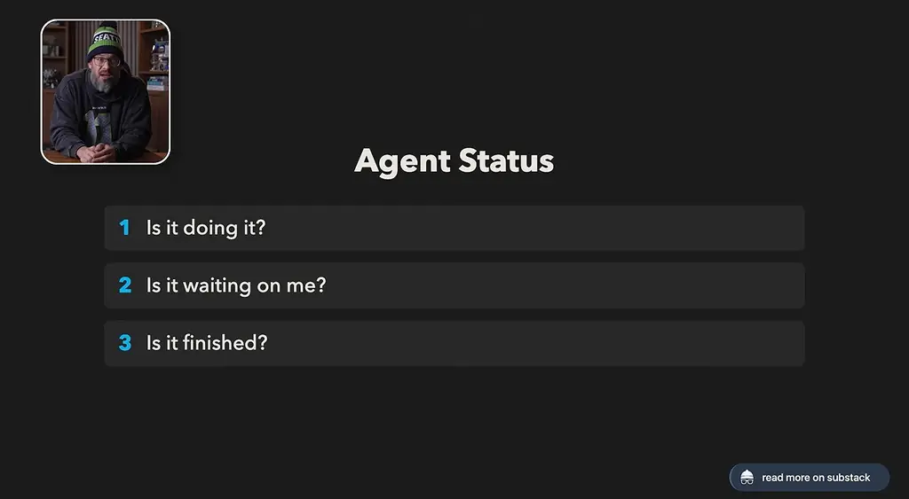
*[▶ 00:11:13](https://www.youtube.com/watch?v=JFoDdKuRmSk&t=673s) · Agent Status*

A model can know a lot and still frustrate users by misjudging when they're needed. Muse's team tested over a hundred specific behaviors before launch. Character, conversation, and work must fit together to feel natural.

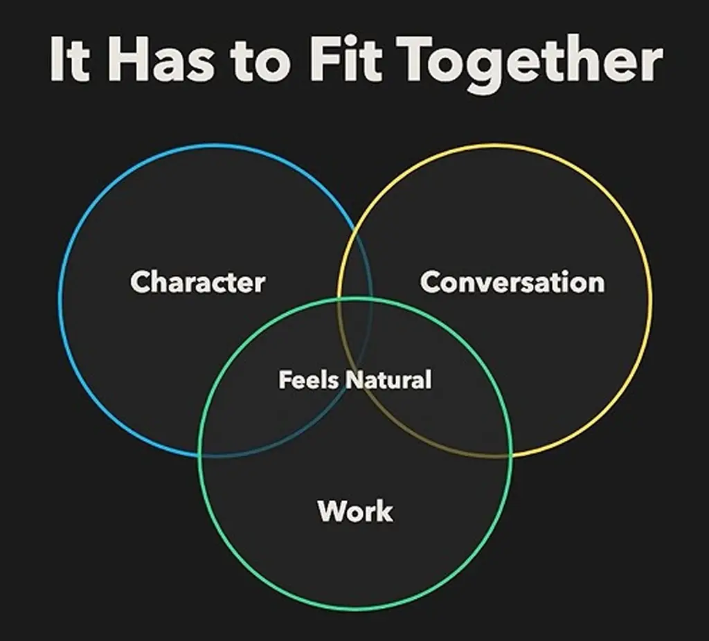
*[▶ 00:13:19](https://www.youtube.com/watch?v=JFoDdKuRmSk&t=799s) · It Has to Fit Together*

Muse has about 10 million users, which is far from the scale Meta needs. Meta's advantages (distribution, compute, talent, existing business) don't make its win inevitable.

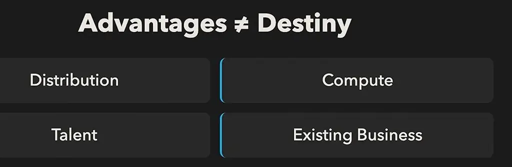
*[▶ 00:14:39](https://www.youtube.com/watch?v=JFoDdKuRmSk&t=879s) · Advantages ≠ Destiny*

AI lowers the cost of attempts that once needed money or specialists. Ask how timidly you live. With complicated quotes, you can start by mapping what's included and what's missing.

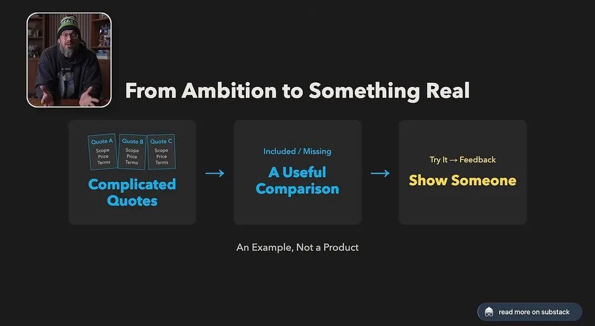
*[▶ 00:15:41](https://www.youtube.com/watch?v=JFoDdKuRmSk&t=941s) · From Ambition to Something Real*

Show a working version to someone instead of pitching slides. That shortens the distance between ambition and a bet you can scale.

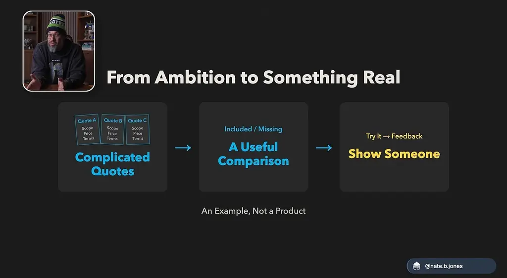
*[▶ 00:15:58](https://www.youtube.com/watch?v=JFoDdKuRmSk&t=958s) · From Ambition to Something Real*

## Muse Was a Bet, and Embarrassment Is the Real Barrier

[▶ 00:17:01](https://www.youtube.com/watch?v=JFoDdKuRmSk&t=1021s)

Muse looks inevitable only in hindsight. Its bet started with a failed platform and a leader who had never built a billion-user consumer product.

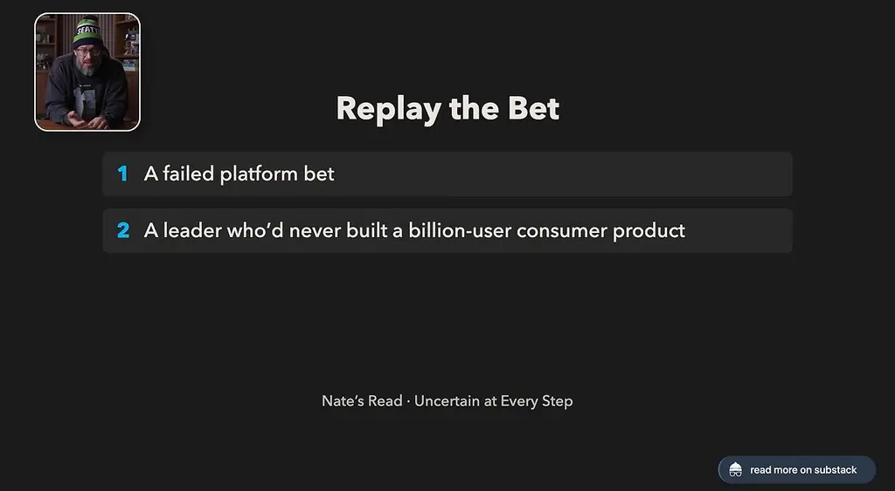
*[▶ 00:17:21](https://www.youtube.com/watch?v=JFoDdKuRmSk&t=1041s) · Replay the Bet: first two points*

Add a tiny team and no winning model, and it was simply an uncertain bet.

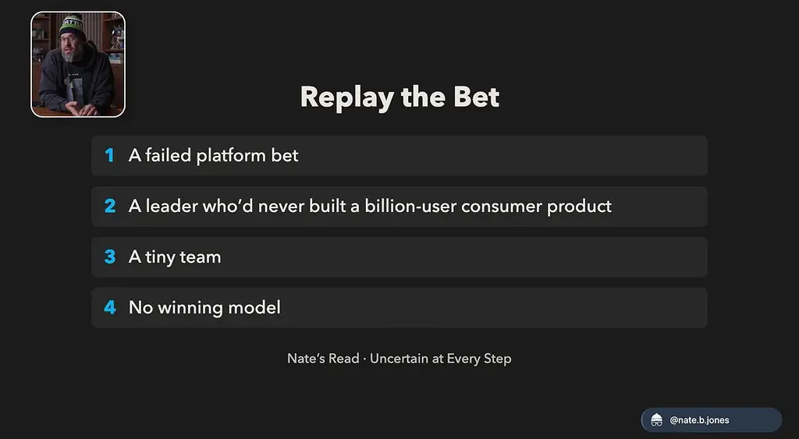
*[▶ 00:17:27](https://www.youtube.com/watch?v=JFoDdKuRmSk&t=1047s) · Replay the Bet: four points*

It worked because it was useful to consumers. Treat it as another bet, not destiny.

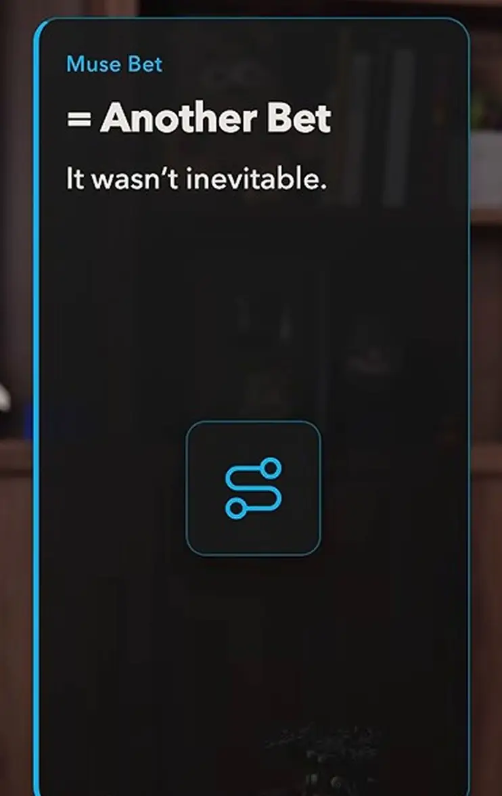
*[▶ 00:17:33](https://www.youtube.com/watch?v=JFoDdKuRmSk&t=1053s) · Callout: Muse Bet = Another Bet*

The lessons:

- Bring in a collaborator who understands the hard parts better than you do.
- Dig deeper with customers.
- Invest in polish, not just an MVP.

Revisit ideas you dropped because the first version was unaffordable. Attempts are cheaper now.

Technical and financial barriers have fallen. Embarrassment has not.

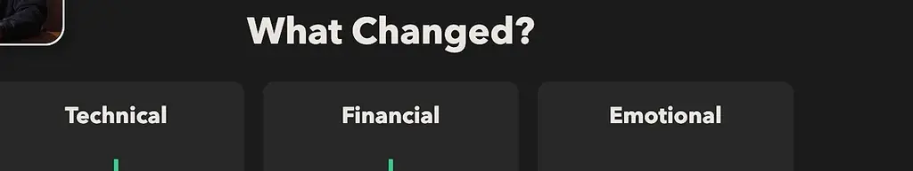
*[▶ 00:19:57](https://www.youtube.com/watch?v=JFoDdKuRmSk&t=1197s) · What Changed? Technical, Financial, Emotional*

Many "impractical" judgments really mean you don't want to fail publicly. Pick work you're more excited about when the next model ships.

## Links & resources

- [Zuckerberg Muse lessons: Nate's newsletter article linked in the description](https://natesnewsletter.substack.com/p/zuckerberg-muse-lessons?utm_source=youtube&utm_medium=video&utm_campaign=zuckerberg-muse-lessons-launch&utm_content=description) — <https://natesnewsletter.substack.com/p/zuckerberg-muse-lessons?utm_source=youtube&utm_medium=video&utm_campaign=zuckerberg-muse-lessons-launch&utm_content=description> · video description
- [How to connect Nate's library: Unlock AI guide linked in the description](https://unlock-ai.natebjones.com/guides/how-to-connect-nates-library?utm_source=youtube&utm_medium=video&utm_campaign=zuckerberg-muse-lessons-launch&utm_content=description) — <https://unlock-ai.natebjones.com/guides/how-to-connect-nates-library?utm_source=youtube&utm_medium=video&utm_campaign=zuckerberg-muse-lessons-launch&utm_content=description> · video description
- [Nate's Newsletter on Substack: the speaker's main publication](https://natesnewsletter.substack.com/?utm_source=youtube&utm_medium=video&utm_campaign=zuckerberg-muse-lessons-launch&utm_content=description) — <https://natesnewsletter.substack.com/?utm_source=youtube&utm_medium=video&utm_campaign=zuckerberg-muse-lessons-launch&utm_content=description> · video description
