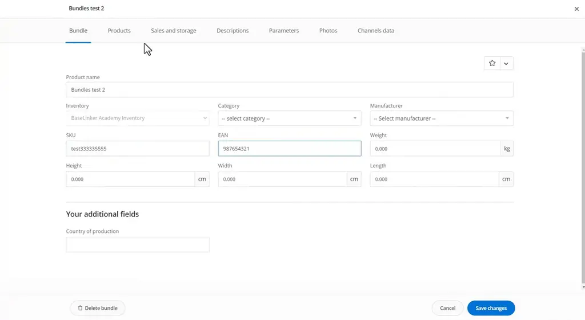
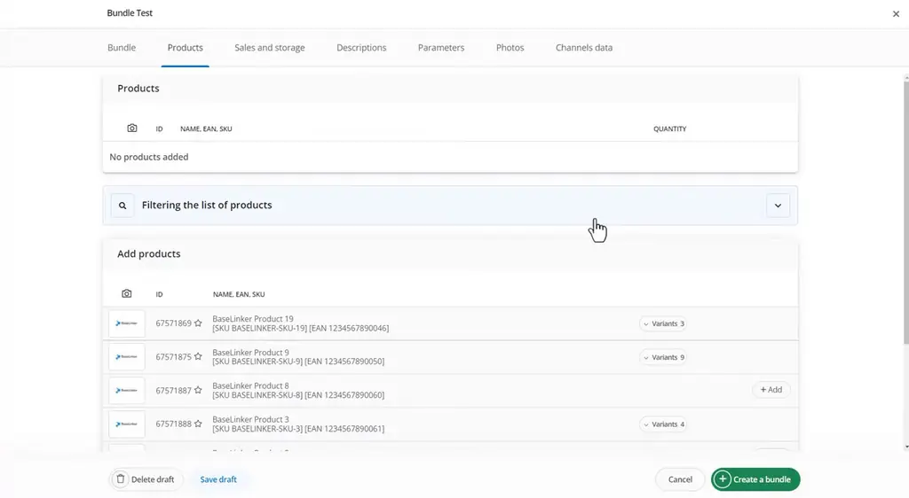
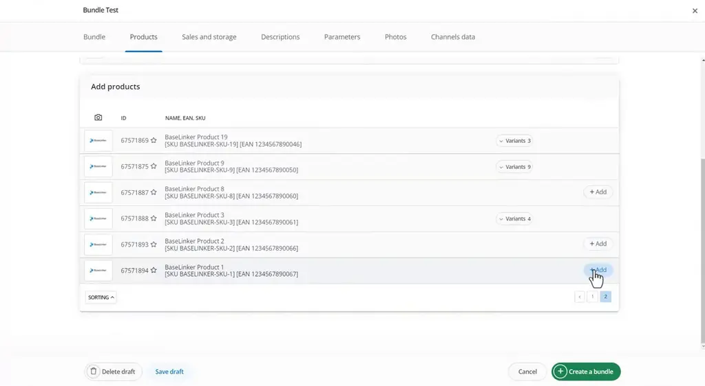
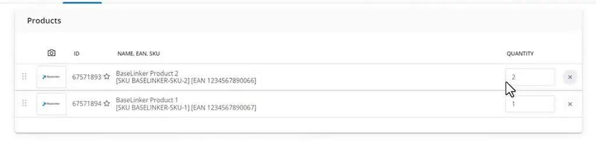
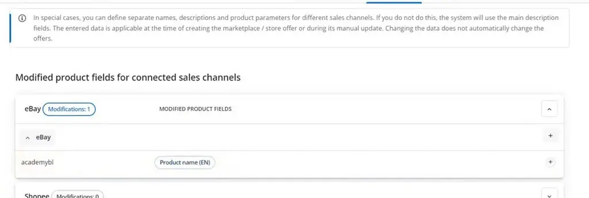
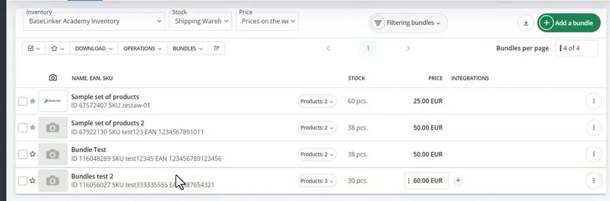

# Adding / editing product bundles | BaseLinker Academy

*Learn how to create and edit product bundles in BaseLinker's warehouse, including their own name, codes, price and per-marketplace names.*

Source: [Adding / editing product bundles | BaseLinker Academy](https://www.youtube.com/watch?v=c-PLehpe6e0) · Base · 5 min

## TL;DR

Warehouse items are managed one by one in BaseLinker, but a set of products is often sold as a single item. This talk shows how to build a bundle from warehouse products, using a Bundle tab for its identity and a sales and storage section for its pricing. Bundles can carry their own price and data separate from the products inside them. Setting these up lets a set be listed, priced and tracked as one item.

## Key takeaways

- Bundles live in their own tab, separate from individual warehouse items.
- The Bundle tab holds the name, category, SKU, EAN, weight and dimensions of the bundle.
- Filter the warehouse product list to find the items you want to include in the bundle.
- Add products to the bundle and set a quantity for each, for example 2 of one product and 1 of another.
- Set the bundle's price and VAT rate in the sales and storage section, since a bundle can have its own price separate from its products.
- Channel data can override the bundle name for each marketplace, such as eBay.
- Saved bundles appear in the bundle list with their stock and price.

## Building a bundle from warehouse products

[▶ 00:00:00](https://www.youtube.com/watch?v=c-PLehpe6e0&t=0s)

Bundles live in their own tab. Name, category, SKU, EAN, weight and dimensions go in the Bundle tab.

*[▶ 00:04:18](https://www.youtube.com/watch?v=c-PLehpe6e0&t=258s) · New bundle form, Bundle tab*

Filter the warehouse list, add products, and set quantities such as 2 and 1.

*[▶ 00:01:07](https://www.youtube.com/watch?v=c-PLehpe6e0&t=67s) · Bundle Products tab: collapsed filter and add list*

*[▶ 00:01:13](https://www.youtube.com/watch?v=c-PLehpe6e0&t=73s) · Two products added to the bundle*

*[▶ 00:01:22](https://www.youtube.com/watch?v=c-PLehpe6e0&t=82s) · Bundle products list with quantities*

Sales and storage sets price and VAT rate.

Channels data overrides names per marketplace, such as eBay.

*[▶ 00:03:06](https://www.youtube.com/watch?v=c-PLehpe6e0&t=186s) · Channels data saved with eBay modification*

Saved bundles appear in the list with stock and price.

*[▶ 00:04:45](https://www.youtube.com/watch?v=c-PLehpe6e0&t=285s) · Bundles list with new bundle*

## Links & resources

- [Link from video description (purpose not stated in talk)](https://bit.ly/3v3n6v3) — <https://bit.ly/3v3n6v3> · video description
