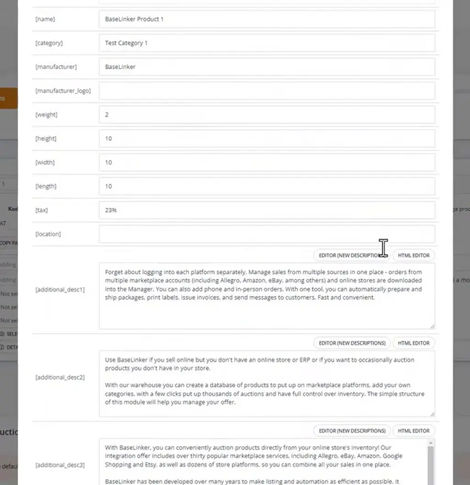
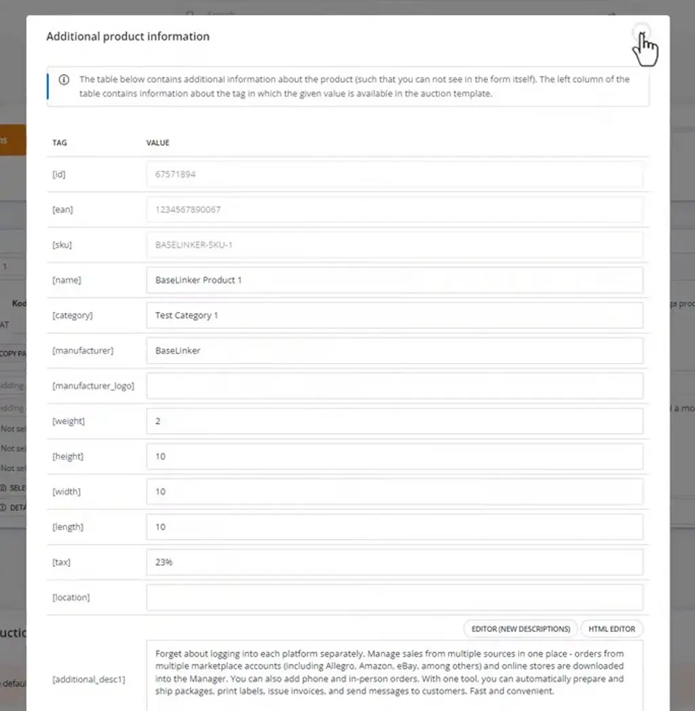
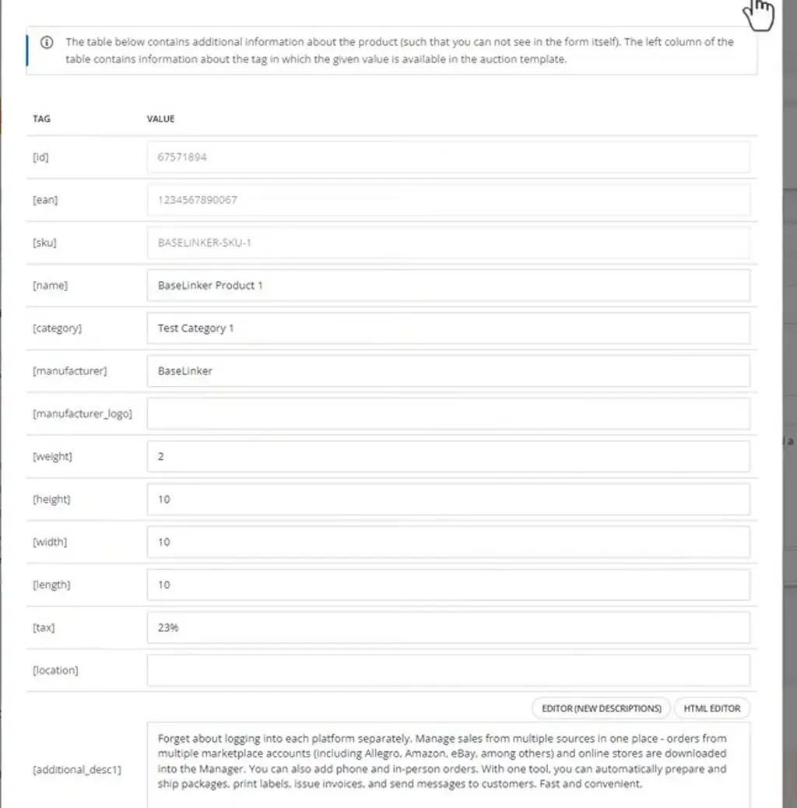
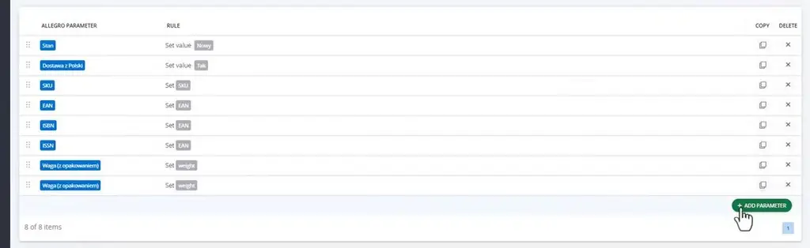
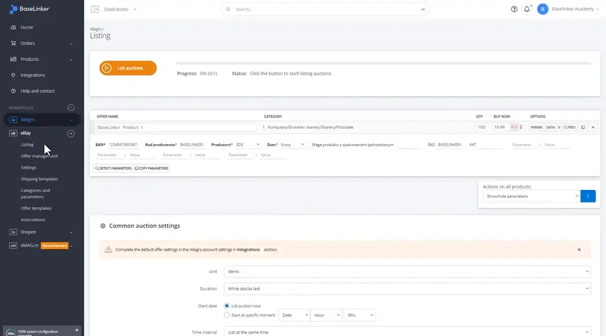
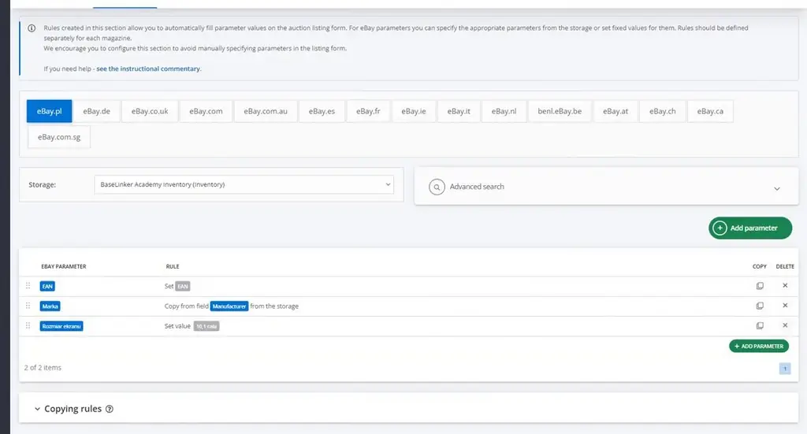

# Adding parameters during the listing | BaseLinker Academy

*Learn how to set up BaseLinker mapping rules that fill a marketplace listing's mandatory category parameters from product data.*

Source: [Adding parameters during the listing | BaseLinker Academy](https://www.youtube.com/watch?v=MjaIGhJ_VIs) · Base · 6 min

## TL;DR

Marketplaces require certain parameters for each category, and bold parameters block a listing from being published. Mapping rules fill these parameters from product tags such as [name] and [manufacturer], including hidden tags like [id], [ean] and [sku]. The rules are set under Categories and parameters, using only values the marketplace allows. Mapping rules let sellers complete required fields automatically instead of entering them by hand for each offer.

## Key takeaways

- Bold parameters in a marketplace category are mandatory, and a listing cannot be published until they are filled.
- Mapping rules can pull values from product tags such as [name] and [manufacturer] to fill category parameters.
- Hidden tags [id], [ean] and [sku] can also serve as sources for mapping rules.
- The same product tags can be used to fill auction templates.
- Mapping rules are configured under Categories and parameters, and must use values the marketplace allows.
- There are three rule types: Set value for a fixed value, Set field for storage data such as SKU or EAN, and Copy from field, such as copying the Manufacturer.
- Manufacturer names are matched to the marketplace's names using ADD MAPPING.
- Parameters without storage data, such as Model, should be given a constant value.

## Filling mandatory parameters with mapping rules

[▶ 00:00:00](https://www.youtube.com/watch?v=MjaIGhJ_VIs&t=0s)

Each marketplace requires certain parameters per category, and bold ones block listing. Mapping rules pull from product tags such as [name] and [manufacturer].

*[▶ 00:00:42](https://www.youtube.com/watch?v=MjaIGhJ_VIs&t=42s) · Additional product tags and values (scrolled)*

Hidden tags like [id], [ean] and [sku] are also sources.

*[▶ 00:01:00](https://www.youtube.com/watch?v=MjaIGhJ_VIs&t=60s) · Additional product information tag table*

The same tags can fill auction templates.

*[▶ 00:04:03](https://www.youtube.com/watch?v=MjaIGhJ_VIs&t=243s) · Allegro additional product information tag table*

Rules go under Categories and parameters, using values the marketplace allows:

- **Set value**: fixed, e.g. Stan to Nowy
- **Set field**: storage data, e.g. SKU, EAN
- **Copy from field**: e.g. Manufacturer

*[▶ 00:01:25](https://www.youtube.com/watch?v=MjaIGhJ_VIs&t=85s) · Allegro parameters mapping rules list*

Match manufacturer names with ADD MAPPING. Parameters without storage data, like Model, take a constant.

*[▶ 00:04:11](https://www.youtube.com/watch?v=MjaIGhJ_VIs&t=251s) · BaseLinker eBay listing parameters form*

On eBay.pl, Marka copies Manufacturer and Rozmiar ekranu is a constant.

*[▶ 00:04:55](https://www.youtube.com/watch?v=MjaIGhJ_VIs&t=295s) · eBay parameter rules in BaseLinker*

## Links & resources

- [Link from video description (target not verified)](https://bit.ly/3v3n6v3) — <https://bit.ly/3v3n6v3> · video description
