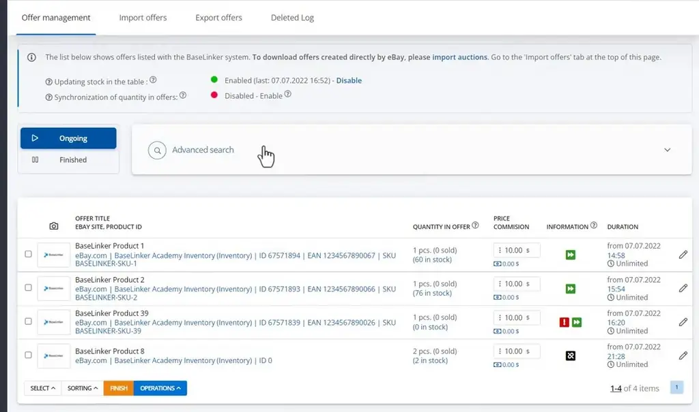
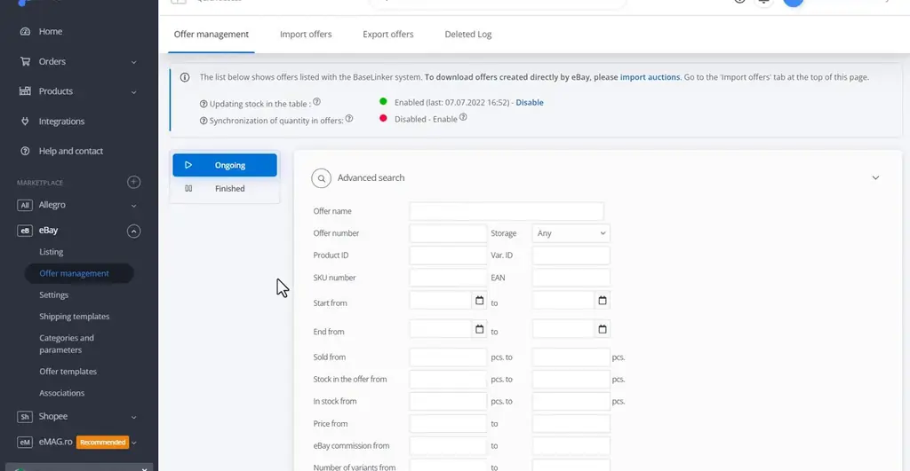
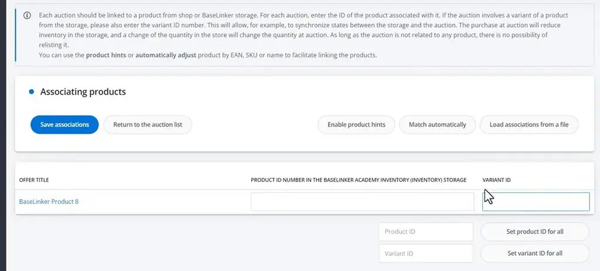
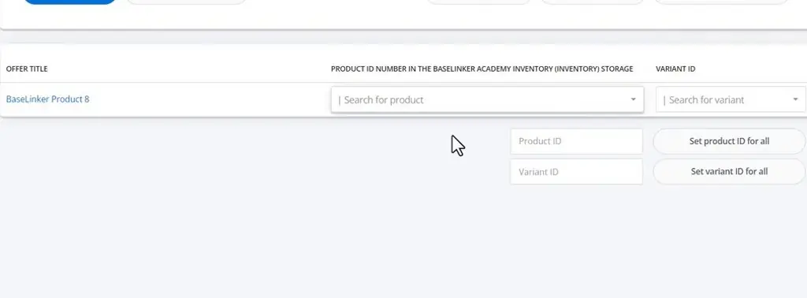
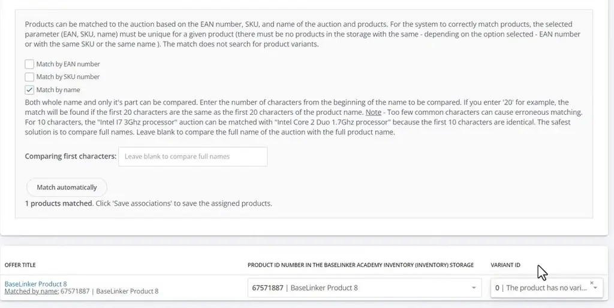
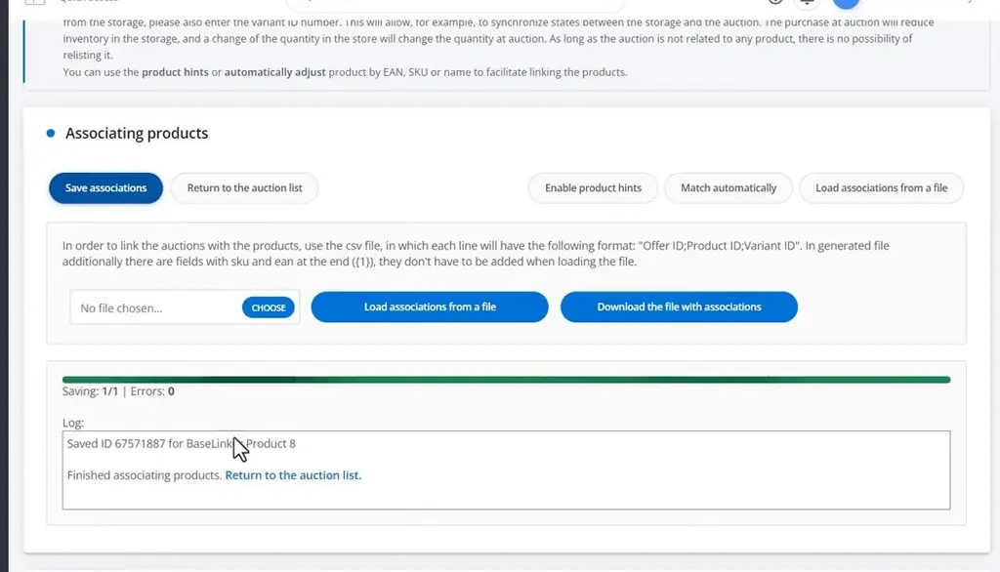

# Associating auctions with storage products | BaseLinker Academy

*How to link eBay offers to storage products in BaseLinker, using single, bulk, auto-match, or CSV methods.*

Source: [Associating auctions with storage products | BaseLinker Academy](https://www.youtube.com/watch?v=bxGSIW05AD4) · Base · 5 min

## TL;DR

Every eBay offer in BaseLinker needs a link to a storage product, whether that product is in BaseLinker storage, a connected shop, or a warehouse. Unlinked offers show a no-association icon in the Information column, and the advanced search's "Auction not connected" warning finds them. You can link offers one at a time or in bulk, by entering IDs, searching, or auto-matching by EAN, SKU, or name, and you can also load a CSV. Linking matters because auctions copy EAN, SKU, weight, and VAT values from storage, so stale links mean stale listing data.

## Key takeaways

- Unlinked eBay offers show a no-association icon in the Information column, and the advanced search's "Auction not connected" warning filters for them.
- Offers can be linked to storage products in BaseLinker storage, a connected online shop, or a wholesaler or warehouse.
- Link offers by entering product and variant IDs, searching for a product, or auto-matching by EAN, SKU, or name, either one at a time or in bulk.
- Name matching compares leading characters, so too few characters cause wrong matches; leave the name field blank to compare full names.
- Auto-match only finds the main product, so variants must be selected manually after matching.
- Save associations, or load a CSV with rows in the format `Offer ID;Product ID;Variant ID` to link many offers at once.
- Auctions keep the EAN, SKU, weight, and VAT values they had before association, so refresh them after those values change in storage.

## Linking eBay offers to storage products

[▶ 00:00:00](https://www.youtube.com/watch?v=bxGSIW05AD4&t=0s)

Every eBay offer needs a link to a storage product from BaseLinker, a connected shop, or a warehouse. Unlinked offers show a no-association icon in the Information column.

*[▶ 00:00:18](https://www.youtube.com/watch?v=bxGSIW05AD4&t=18s) · eBay offer management list with warning icons*

Filter for them with the advanced search's "Auction not connected" warning.

*[▶ 00:03:12](https://www.youtube.com/watch?v=bxGSIW05AD4&t=192s) · Offer management list with advanced search*

Link offers one at a time or in bulk. Enter product and variant IDs, search for a product, or auto-match by EAN, SKU, or name.

*[▶ 00:01:38](https://www.youtube.com/watch?v=bxGSIW05AD4&t=98s) · Empty product association form in eBay offers*

Name matching compares leading characters, and too few characters cause wrong matches. Leave the field blank to compare full names.

*[▶ 00:02:17](https://www.youtube.com/watch?v=bxGSIW05AD4&t=137s) · Automatic matching options: EAN, SKU, name*

Auto-match only finds the main product, so select variants manually.

*[▶ 00:02:37](https://www.youtube.com/watch?v=bxGSIW05AD4&t=157s) · Auto-match result: product matched by name*

Save the associations, or load a CSV in the format `Offer ID;Product ID;Variant ID`.

*[▶ 00:03:05](https://www.youtube.com/watch?v=bxGSIW05AD4&t=185s) · Saving product associations for an auction*

Auctions keep the EAN, SKU, weight, and VAT values from before the association. Refresh them after those values change in storage.

## Links & resources

- [Link from the video description (bit.ly), purpose not stated in the talk](https://bit.ly/3v3n6v3) — <https://bit.ly/3v3n6v3> · video description
