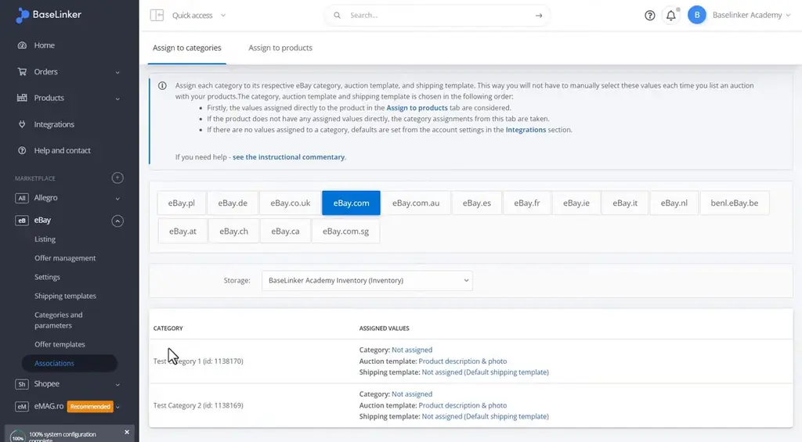
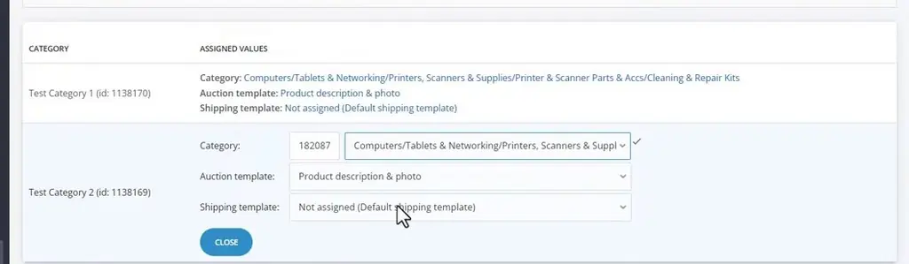
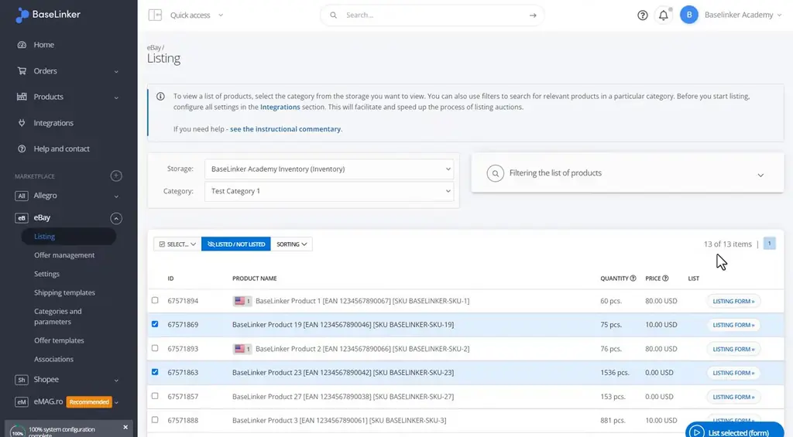
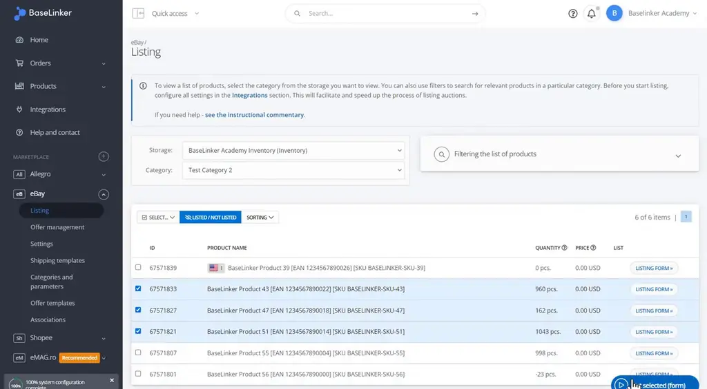

# Category and product associations | BaseLinker Academy

*Learn how to map BaseLinker warehouse storage categories to eBay categories so products are matched automatically.*

Source: [Category and product associations | BaseLinker Academy](https://www.youtube.com/watch?v=zA_bIELyg60) · Base · 2 min

## TL;DR

Marketplace listings need the right marketplace category, and matching each product by hand is slow. In BaseLinker, you link each warehouse storage category to one eBay category in the Associations tab. A product must belong to one storage category for the match to work. Once the mappings are set, offers in those categories show their matched eBay category automatically.

## Key takeaways

- The Associations tab maps each storage category to exactly one eBay category.
- To create a mapping, choose the target eBay category from the dropdown next to the storage category.
- A product must belong to one storage category for the association to match it.
- Favorite eBay categories are saved so you can reuse them when listing auctions.
- The same mapping process is repeated for each additional storage category, such as a second category.
- After mapping, the offers in a mapped category display the matched eBay category; for example, three selected offers in the second category showed the Duplexers category.

## Mapping storage categories to eBay categories

[▶ 00:00:00](https://www.youtube.com/watch?v=zA_bIELyg60&t=0s)

Favorite eBay categories are saved for listing auctions.

*[▶ 00:00:25](https://www.youtube.com/watch?v=zA_bIELyg60&t=25s) · eBay categories tab with favorite categories*

The **Associations** tab maps each storage category to one eBay category.

*[▶ 00:00:28](https://www.youtube.com/watch?v=zA_bIELyg60&t=28s) · Associations: assign to categories tab*

Choose the eBay category from the dropdown.

*[▶ 00:00:43](https://www.youtube.com/watch?v=zA_bIELyg60&t=43s) · Assigning eBay category to Test Category 2*

A product must belong to one storage category for the match to work.

*[▶ 00:01:04](https://www.youtube.com/watch?v=zA_bIELyg60&t=64s) · eBay listing view for Test Category 1*

The second category works the same way.

*[▶ 00:01:35](https://www.youtube.com/watch?v=zA_bIELyg60&t=95s) · eBay listing view for Test Category 2*

Three selected offers in the second category show the matched Duplexers category.

*[▶ 00:02:00](https://www.youtube.com/watch?v=zA_bIELyg60&t=120s) · Shopee listing form for the same products*

## Links & resources

- [Short link from video description; purpose not stated in talk](https://bit.ly/3v3n6v3) — <https://bit.ly/3v3n6v3> · video description
