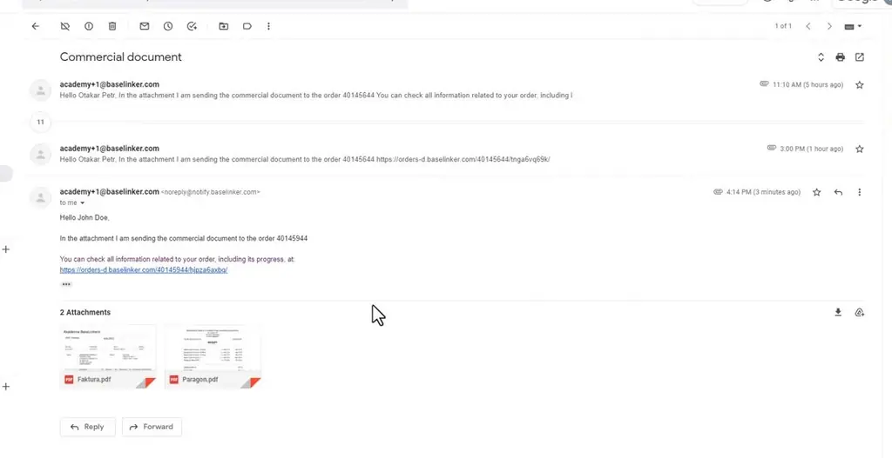
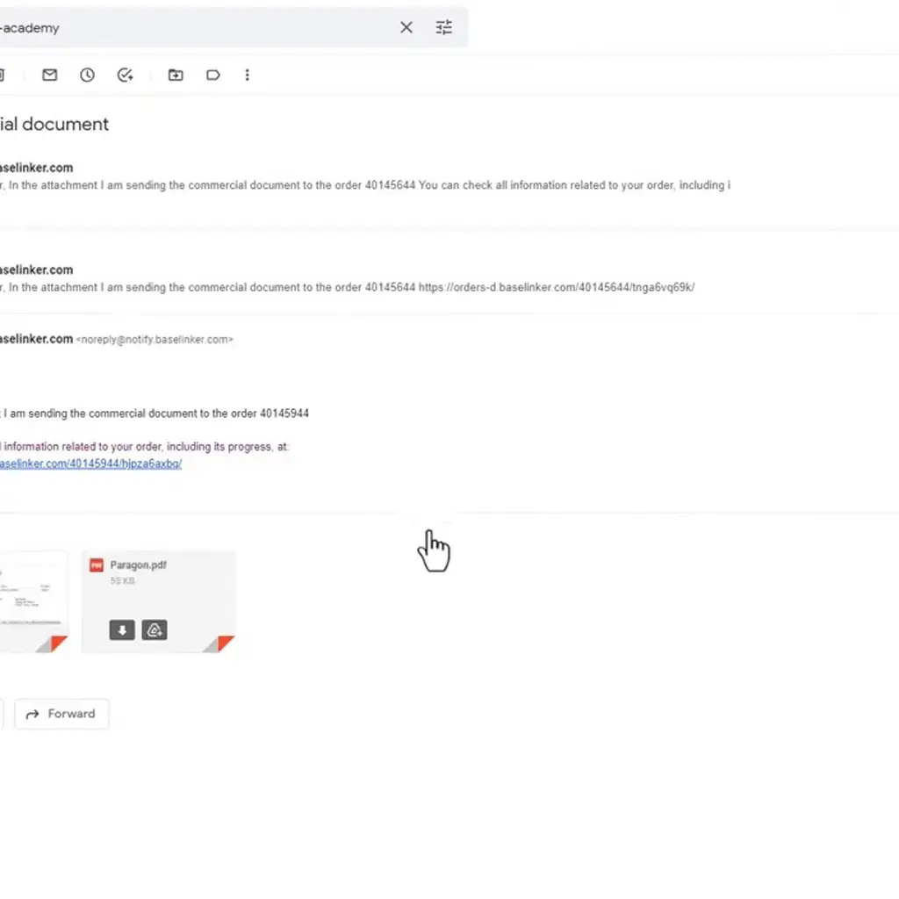
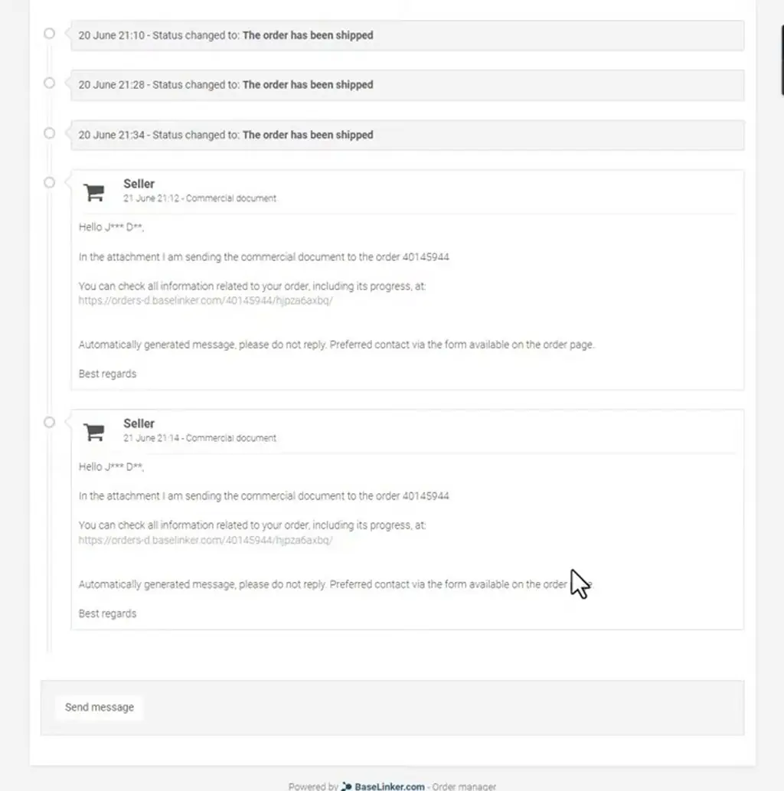
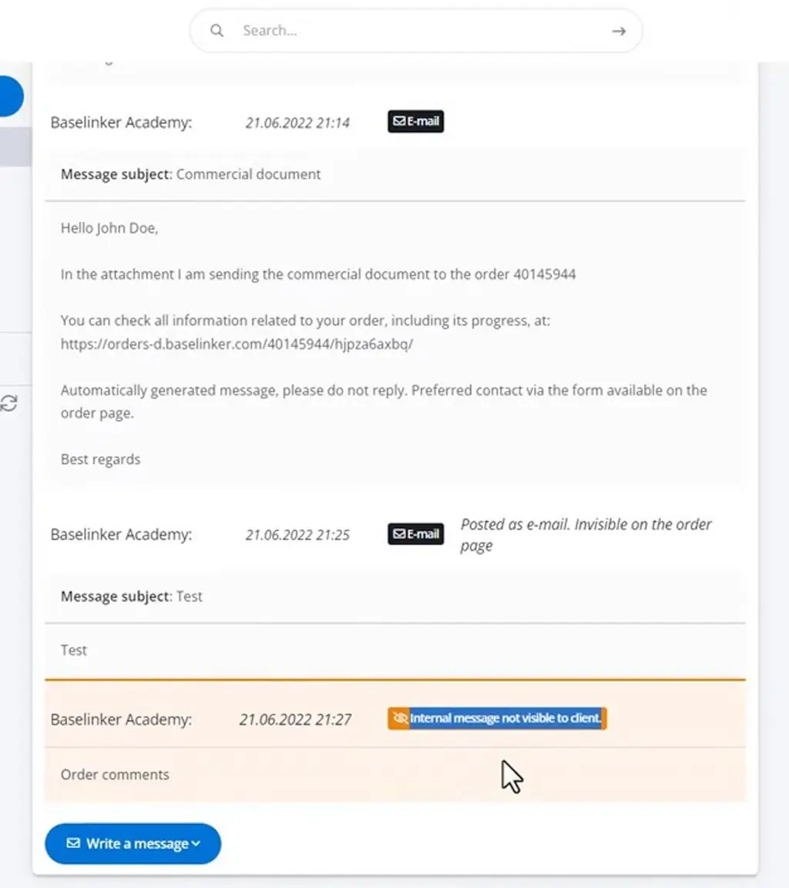
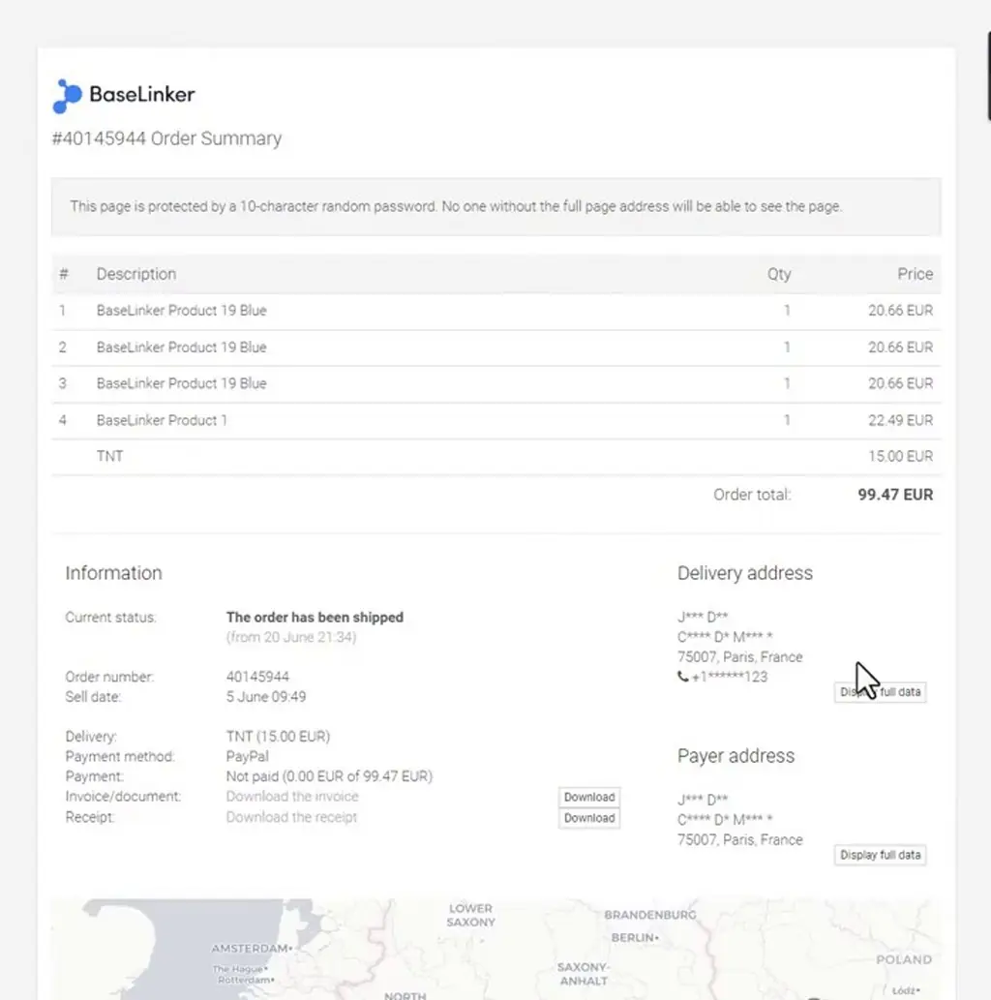
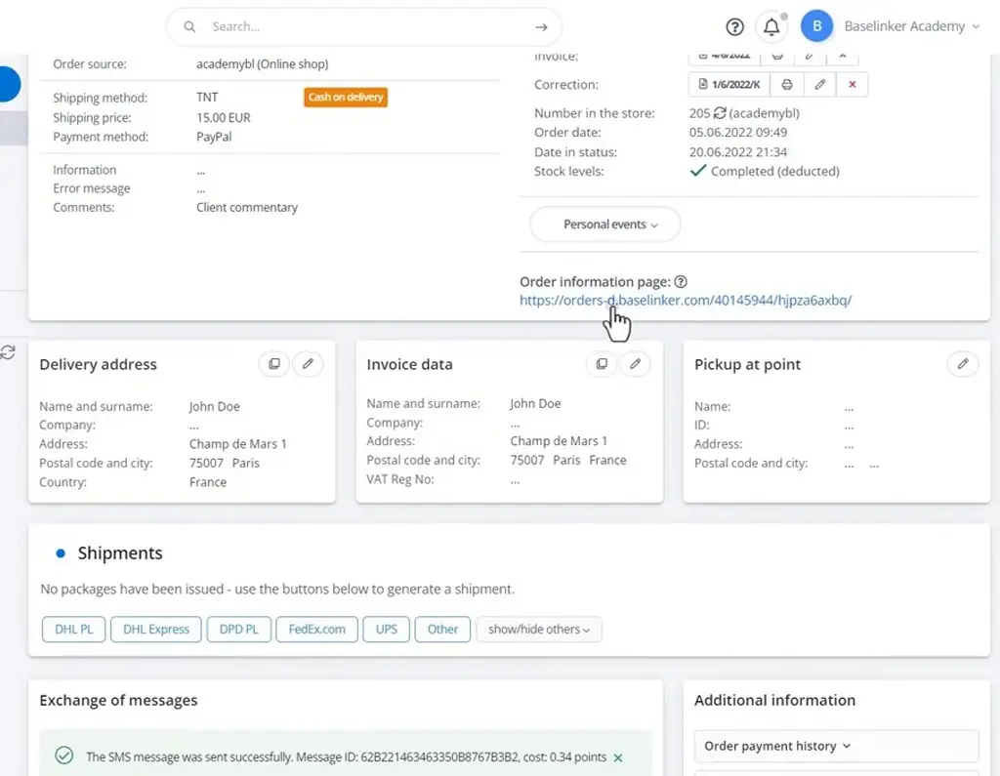

# Communication with the client | BaseLinker Academy

*How to send emails and SMS to buyers from the BaseLinker order card, choosing who sees each message, and how bulk emails work.*

Source: [Communication with the client | BaseLinker Academy](https://www.youtube.com/watch?v=rHpkNrvYjiY) · Base · 6 min

## TL;DR

Keeping buyers informed about their orders is part of good customer service, but it is easy for those messages to be scattered or untracked. BaseLinker lets you send emails and SMS messages straight from the order card or order list. You choose one of four sending options, which control whether the message appears on the order page, reaches the client, or stays internal to the seller. Sending from the system keeps every message logged in the order history, and bulk emails can go to marked orders.

## Key takeaways

- From the BaseLinker order card you can send a message by email or SMS, choosing one of four options: order page plus email, order page only, email only, or seller only.
- Emails sent to clients include their attachments and tracking link.
- Each sent message is logged in the order's seller history.
- Email-only messages do not appear on the order page.
- Seller-only messages appear in orange and are hidden from clients, so they work for internal notes.
- The order link sent to clients opens a summary page with order status, items and totals, and clients can reply through a form on that page.
- An SMS send is confirmed with a message ID and the point cost of the message.
- Bulk emails are sent to the orders you have marked, rather than one order at a time.

## Sending messages from the order card

[▶ 00:00:00](https://www.youtube.com/watch?v=rHpkNrvYjiY&t=0s)

Messages go out from the order card, by email or SMS, with one of four sending options:

- Order page + email
- Order page only
- Email only
- Seller only

Clients get the email with its attachments and tracking link.

*[▶ 00:01:33](https://www.youtube.com/watch?v=rHpkNrvYjiY&t=93s) · Gmail thread with the commercial document email*

Seller history logs each sent message.

*[▶ 00:01:51](https://www.youtube.com/watch?v=rHpkNrvYjiY&t=111s) · Messages and history with two sent commercial documents*

Email-only messages stay off the order page.

*[▶ 00:02:35](https://www.youtube.com/watch?v=rHpkNrvYjiY&t=155s) · Customer order page showing commercial document messages*

Seller-only messages appear in orange, hidden from clients.

*[▶ 00:03:02](https://www.youtube.com/watch?v=rHpkNrvYjiY&t=182s) · Seller message history with internal order comment*

The order link opens a summary of status, items and totals.

*[▶ 00:03:18](https://www.youtube.com/watch?v=rHpkNrvYjiY&t=198s) · Customer order summary page*

SMS is confirmed with a message ID and point cost.

*[▶ 00:03:46](https://www.youtube.com/watch?v=rHpkNrvYjiY&t=226s) · Admin order details with SMS sent and order page link*

Clients reply via a form on that page.

Bulk emails go to marked orders.

## Links & resources

- [Link from the talk description (purpose not stated)](https://bit.ly/3v3n6v3) — <https://bit.ly/3v3n6v3> · video description
