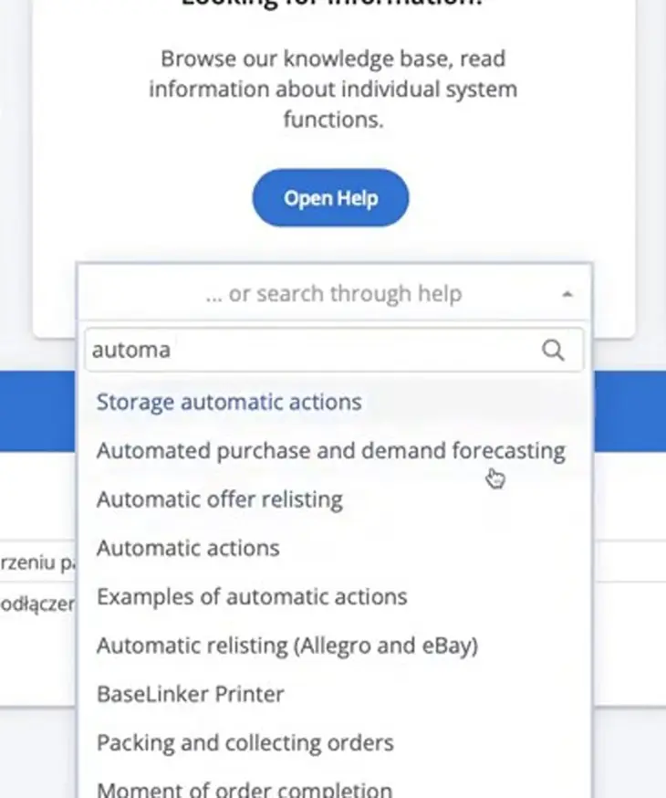
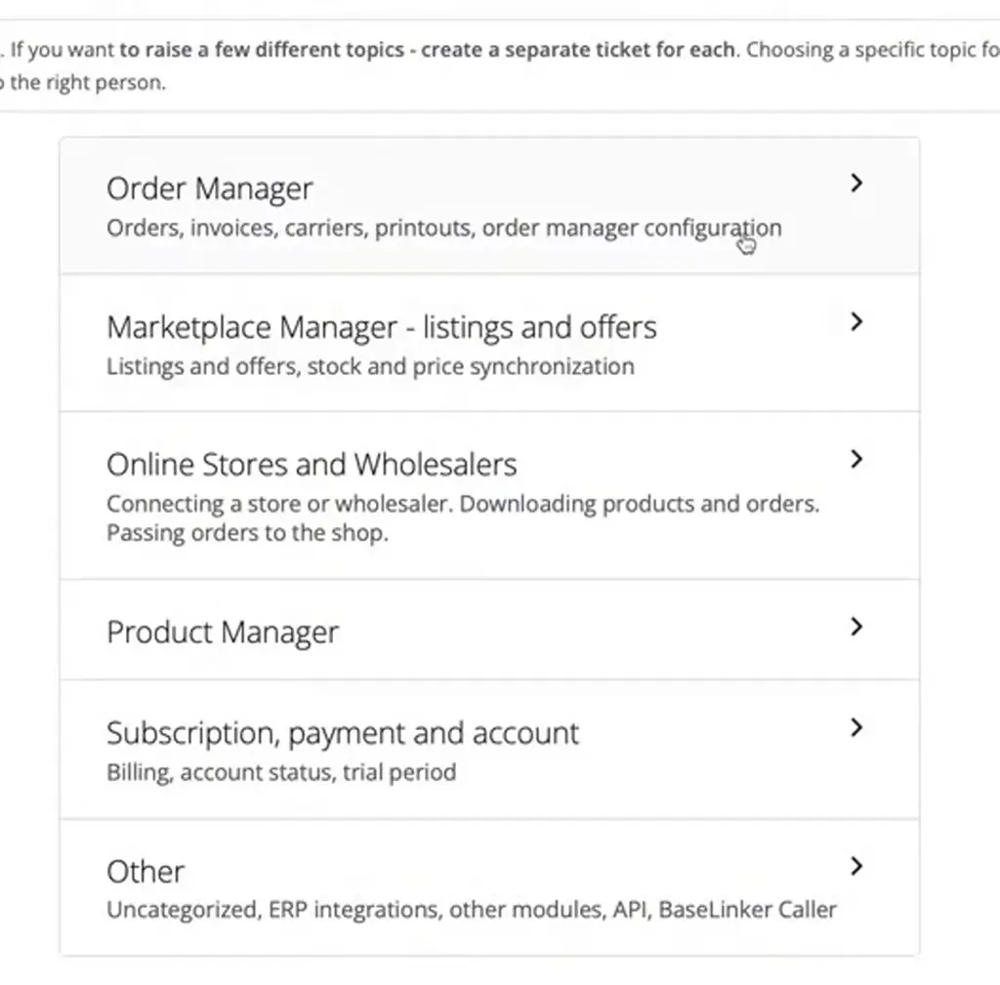
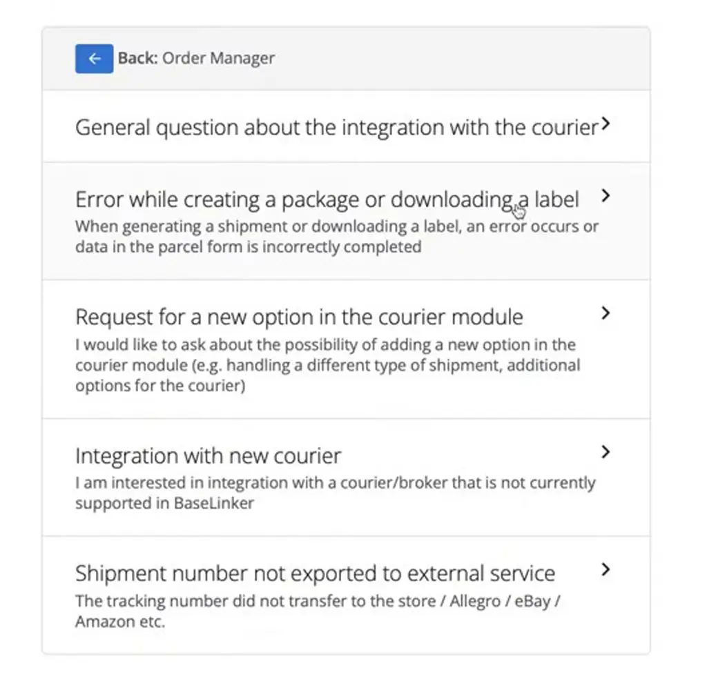
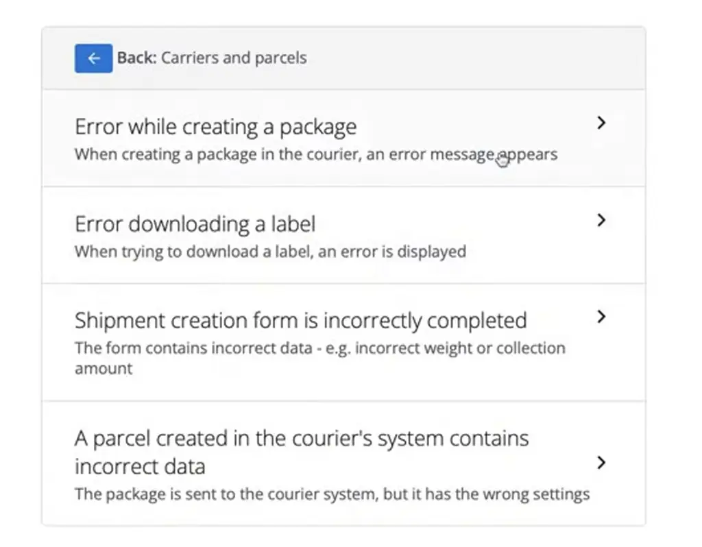
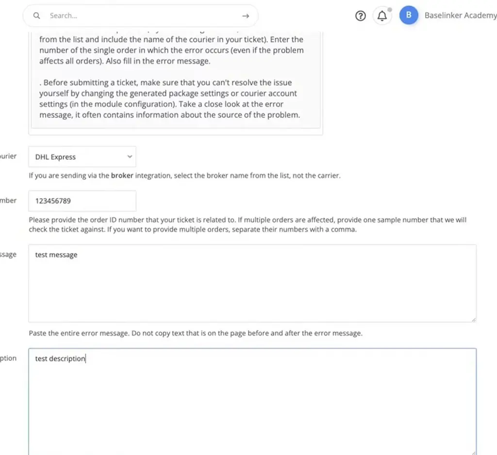
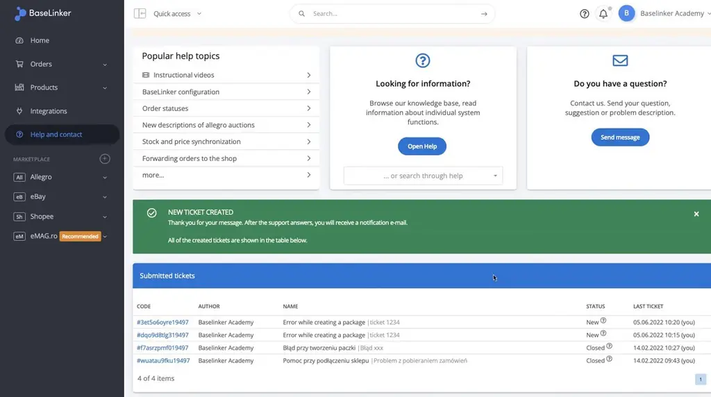

# Contact with the BaseLinker support team | BaseLinker Academy

*Learn how to search the BaseLinker knowledge base first and, if you still need help, what to include in a support ticket.*

Source: [Contact with the BaseLinker support team | BaseLinker Academy](https://www.youtube.com/watch?v=WY2xxIAXE9Q) · Base · 2 min

## TL;DR

Before contacting BaseLinker support, search the knowledge base, since matches appear as you type. If that doesn't answer your question, open a ticket, using one ticket per topic. For a courier error, go through Order Manager and then Carriers and parcels to the affected query, and include the courier, one affected order number, the full error message and when it happened. Tickets show as New until support replies by e-mail.

## Key takeaways

- Search the BaseLinker knowledge base first, because matches appear as you type.
- If the knowledge base doesn't answer your question, open a support ticket.
- Open one ticket per topic rather than combining several issues in one ticket.
- To find a courier error, drill through Order Manager, then Carriers and parcels, to the error.
- Select the affected query when you reach the error.
- Include the courier, one affected order number, the full error message and when the error happened in the ticket.
- Give support only one affected order number, not a list of orders.
- A new ticket shows as New until support replies by e-mail.

## Search first, then open a ticket

[▶ 00:00:00](https://www.youtube.com/watch?v=WY2xxIAXE9Q&t=0s)

Search the knowledge base first; matches appear as you type.

*[▶ 00:00:23](https://www.youtube.com/watch?v=WY2xxIAXE9Q&t=23s) · Help and contact page with knowledge base search*

Otherwise open a ticket, one per topic.

*[▶ 00:00:29](https://www.youtube.com/watch?v=WY2xxIAXE9Q&t=29s) · Contact form: choice of topic*

Drill through Order Manager, then Carriers and parcels, to the error.

*[▶ 00:00:36](https://www.youtube.com/watch?v=WY2xxIAXE9Q&t=36s) · Order Manager: carriers and parcels topics*

Pick the affected query.

*[▶ 00:00:39](https://www.youtube.com/watch?v=WY2xxIAXE9Q&t=39s) · Carriers topics: package and label errors*

Give the courier, one affected order number, the full error message and when it happened.

*[▶ 00:01:10](https://www.youtube.com/watch?v=WY2xxIAXE9Q&t=70s) · Support ticket form, partially filled*

Tickets show as New until support replies by e-mail.

*[▶ 00:01:36](https://www.youtube.com/watch?v=WY2xxIAXE9Q&t=96s) · Help and contact page with submitted tickets*

## Links & resources

- [Video description link — target not verified](https://bit.ly/3v3n6v3) — <https://bit.ly/3v3n6v3> · video description
- Help and contact tab — status of reports sent to support · mentioned [▶ 00:01:32](https://www.youtube.com/watch?v=WY2xxIAXE9Q&t=92s)
