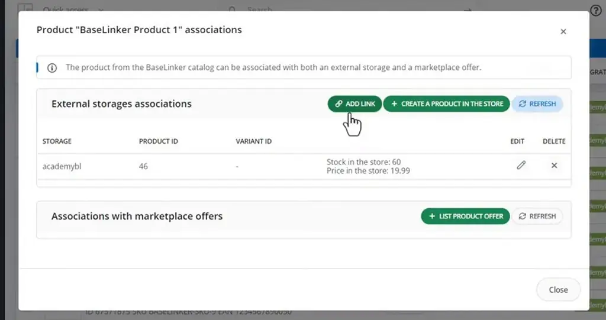
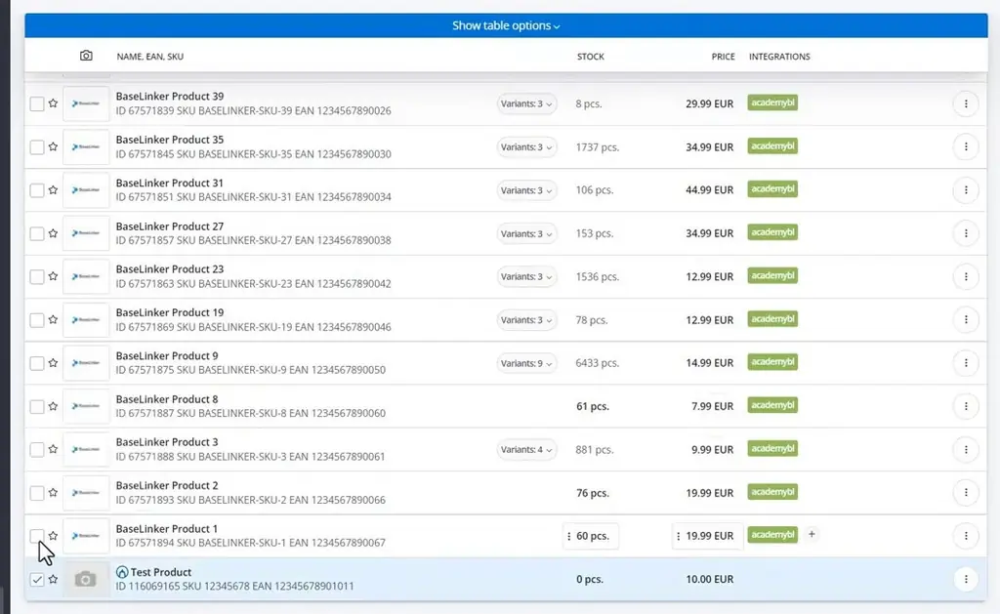
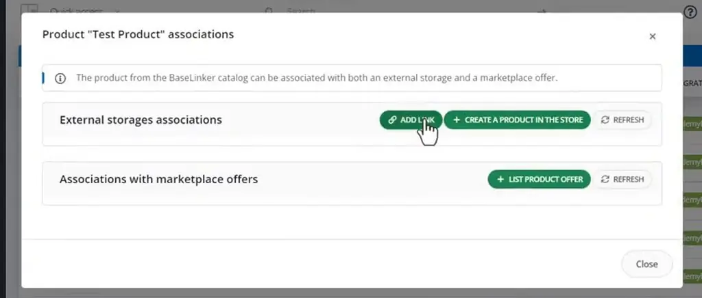
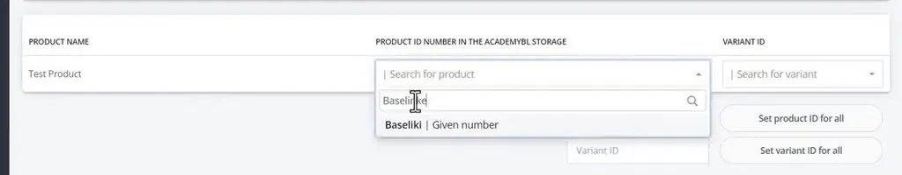
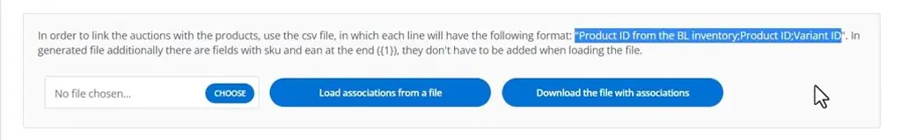
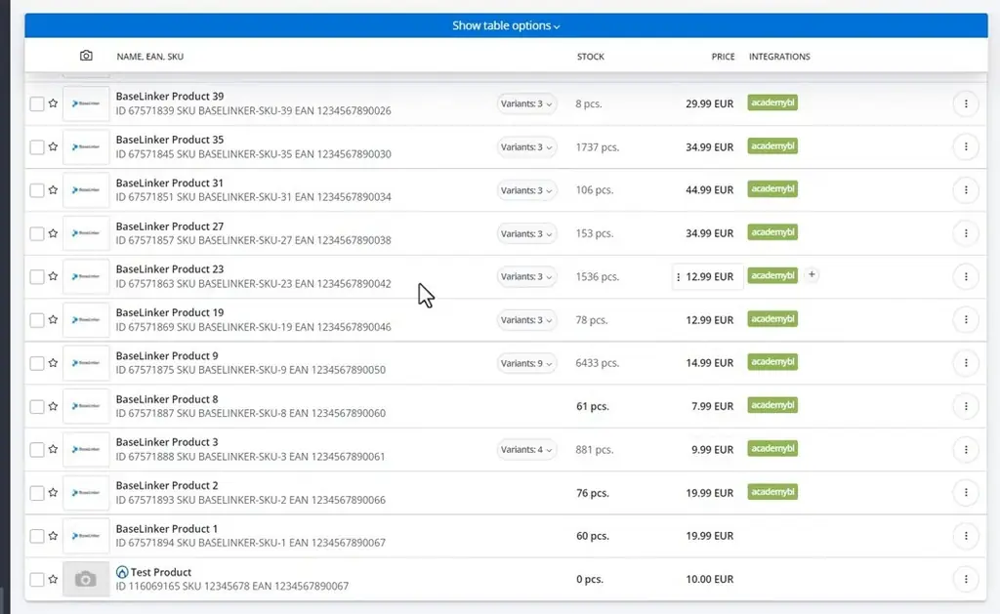

# Creating storage associations | BaseLinker Academy

*How to link BaseLinker catalog products to shop or wholesale items in bulk, match them by EAN, SKU or name, import links from CSV, and remove them.*

Source: [Creating storage associations | BaseLinker Academy](https://www.youtube.com/watch?v=5-nB0EsBtEA) · Base · 3 min

## TL;DR

BaseLinker features depend on each sales channel being linked to your catalog, and the links are easy to get wrong or leave out. This talk, from the BaseLinker Academy, covers creating these links in three ways: at catalog level, when importing from a store, wholesaler or marketplace, and when exporting to selected stores. The article covers the catalog-level method: selecting products and running Associate with products from the shop or wholesale, then matching by EAN, SKU or name. It also shows how to load links from a CSV and how to remove them.

## Key takeaways

- Products that already have a storage link show a green label in the catalog, so you can see which items are linked at a glance.
- To link products in bulk, select them and choose Operations, then Associate with products from the shop/wholesale.
- You can match products by EAN, SKU or name.
- Automatic matching skips variants, so variant products must be linked manually by selecting them yourself.
- You can load associations from a semicolon-separated CSV file instead of linking products one by one.
- To remove a link, enter 0 as the product ID, apply it to all products, and save.

## Linking products to a storage and removing links

[▶ 00:00:00](https://www.youtube.com/watch?v=5-nB0EsBtEA&t=0s)

Green labels show each product's storage links.

*[▶ 00:00:31](https://www.youtube.com/watch?v=5-nB0EsBtEA&t=31s) · Product 1 associations: external storage link*

Select products and choose Operations → Associate with products from the shop/wholesale.

*[▶ 00:00:47](https://www.youtube.com/watch?v=5-nB0EsBtEA&t=47s) · Product list with a product selected*

*[▶ 00:00:42](https://www.youtube.com/watch?v=5-nB0EsBtEA&t=42s) · Test Product associations: add link*

Match by EAN, SKU or name; automatic matching skips variants, which you select manually.

*[▶ 00:01:21](https://www.youtube.com/watch?v=5-nB0EsBtEA&t=81s) · Associating products: product ID search*

Load associations from a semicolon-separated CSV file.

*[▶ 00:02:02](https://www.youtube.com/watch?v=5-nB0EsBtEA&t=122s) · CSV import format for associations*

To remove a link, enter 0 as the product ID, set it for all, and save.

*[▶ 00:03:10](https://www.youtube.com/watch?v=5-nB0EsBtEA&t=190s) · Product list: associations removed*

## Links & resources

- [Link from the video description (purpose not stated in the talk)](https://bit.ly/3v3n6v3) — <https://bit.ly/3v3n6v3> · video description
