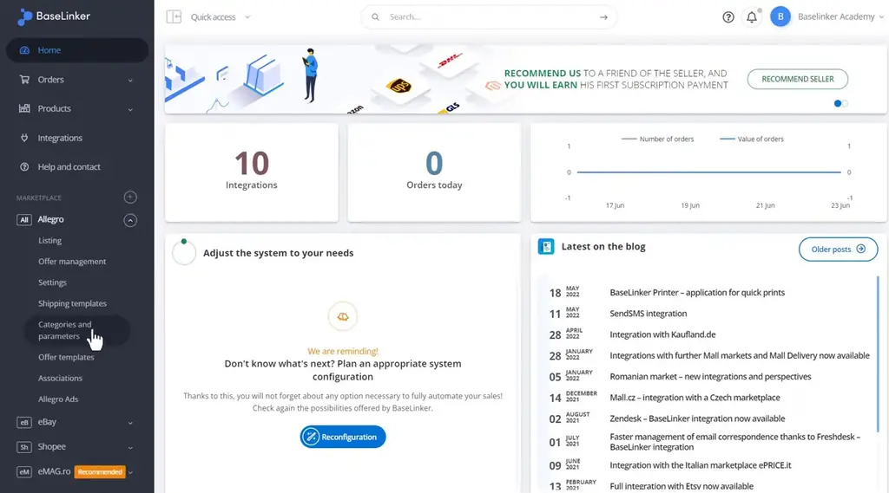
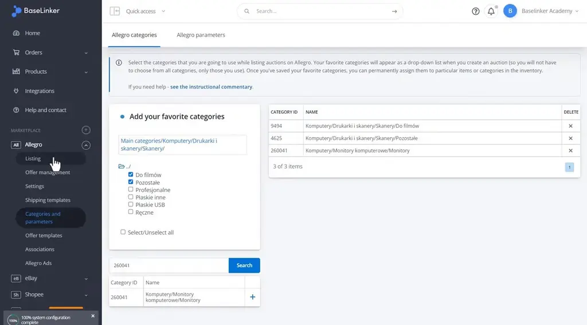
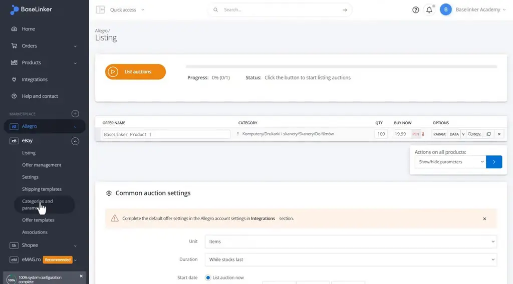
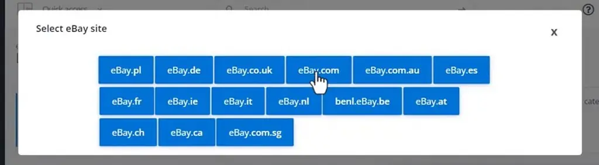
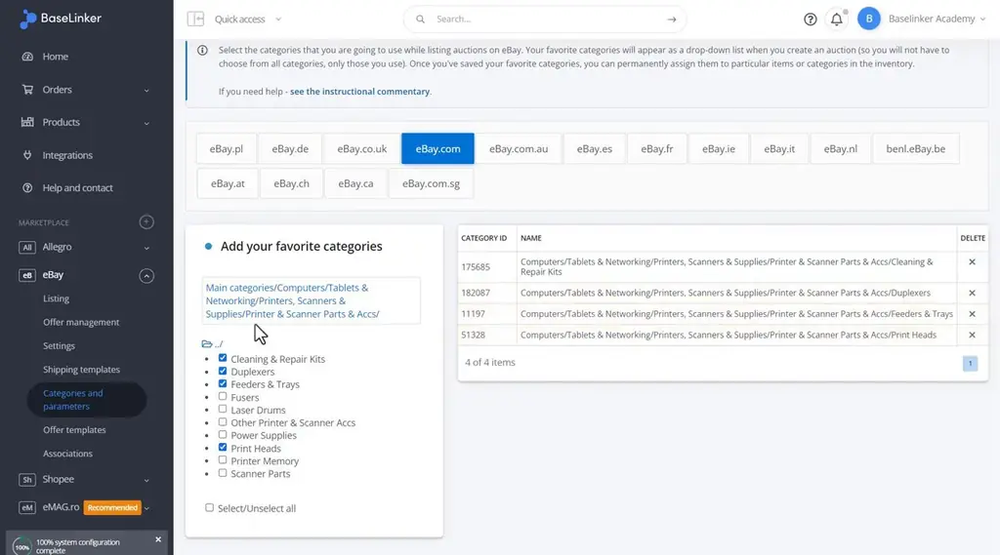
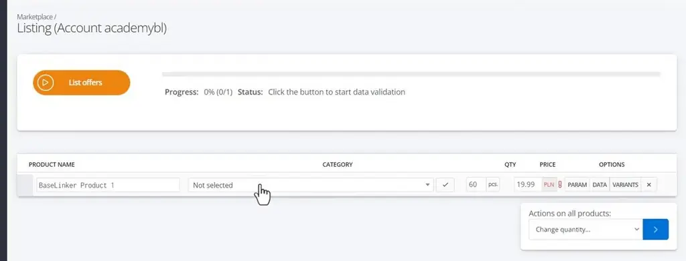
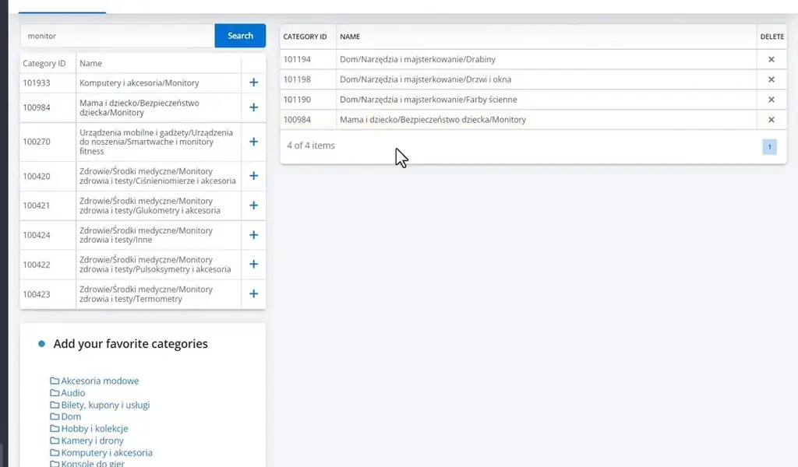

# Favorite categories | BaseLinker Academy

*Learn how to save marketplace categories as favorites in BaseLinker so they appear in a quick listing dropdown.*

Source: [Favorite categories | BaseLinker Academy](https://www.youtube.com/watch?v=X0uLwc69bEo) · Base · 3 min

## TL;DR

Each marketplace has its own product categories, and finding the right one while listing products takes time. In BaseLinker, you set favorite categories under Categories and parameters by ticking categories on the left so they move to the favorites table on the right. Those favorites then appear as a drop-down when you list auctions, which is faster than typing category IDs. Setting favorites once makes each listing quicker to complete.

## Key takeaways

- Each marketplace has its own set of categories, and you manage favorites for each one under Categories and parameters.
- Tick categories on the left side to move them into the favorites table on the right.
- Saved favorites appear as a drop-down when listing auctions in the BaseLinker panel, which is faster than typing category IDs.
- On eBay, favorites are set separately for each site, such as eBay.com.
- Shopee's listing drop-down works the same way as the favorites drop-down for other marketplaces.
- If a category is missing while listing, search for it in the listing form and press the plus button to add it to your favorites.

## Favorite categories speed up listing

[▶ 00:00:00](https://www.youtube.com/watch?v=X0uLwc69bEo&t=0s)

Each marketplace has its own categories; set favorites in **Categories and parameters**.

*[▶ 00:00:07](https://www.youtube.com/watch?v=X0uLwc69bEo&t=7s) · BaseLinker home dashboard with Allegro menu*

Tick categories on the left to move them to the favorites table on the right.

*[▶ 00:00:38](https://www.youtube.com/watch?v=X0uLwc69bEo&t=38s) · Allegro favorite categories selection*

Favorites then appear as a listing dropdown, faster than typing IDs.

*[▶ 00:01:05](https://www.youtube.com/watch?v=X0uLwc69bEo&t=65s) · Allegro listing page with auction settings*

On eBay, favorites are set per site, such as eBay.com.

*[▶ 00:01:33](https://www.youtube.com/watch?v=X0uLwc69bEo&t=93s) · Select eBay site dialog*

*[▶ 00:01:25](https://www.youtube.com/watch?v=X0uLwc69bEo&t=85s) · eBay favorite categories for eBay.com*

Shopee's listing dropdown works the same way.

*[▶ 00:02:08](https://www.youtube.com/watch?v=X0uLwc69bEo&t=128s) · BaseLinker Shopee listing with product row*

Search missing categories during listing; the plus button adds them as favorites.

*[▶ 00:02:28](https://www.youtube.com/watch?v=X0uLwc69bEo&t=148s) · Shopee category search with favorites panel*

## Links & resources

- [Link from the video description (purpose not stated in talk)](https://bit.ly/3v3n6v3) — <https://bit.ly/3v3n6v3> · video description
