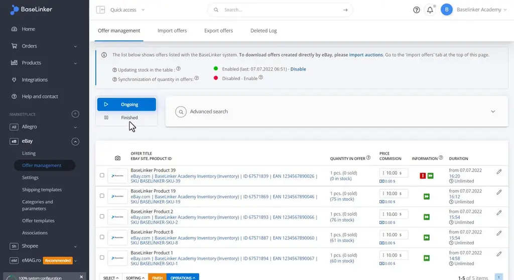
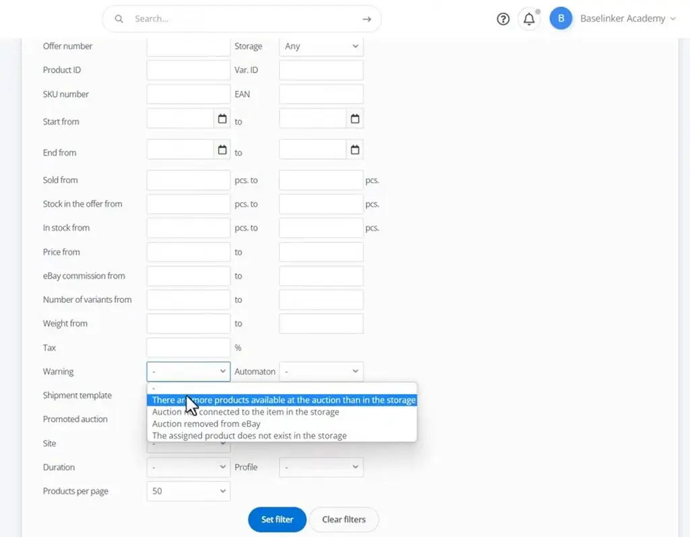
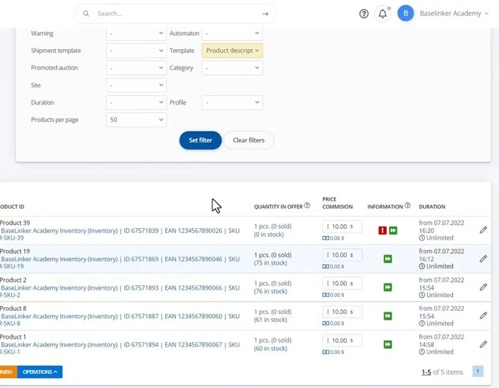
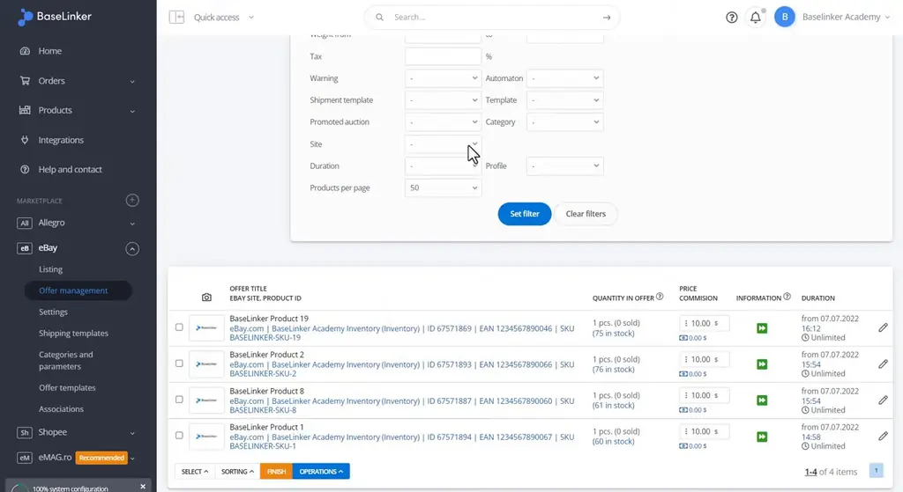
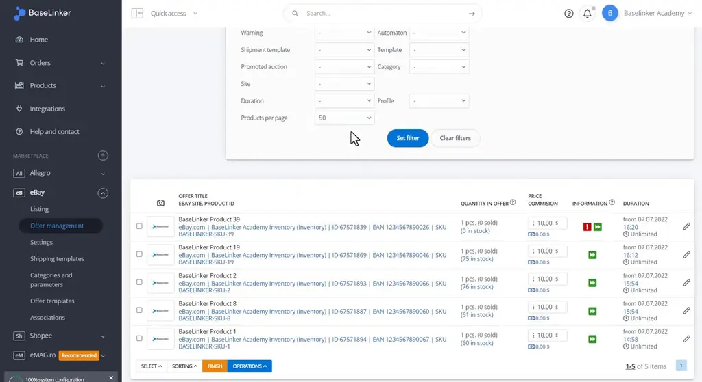
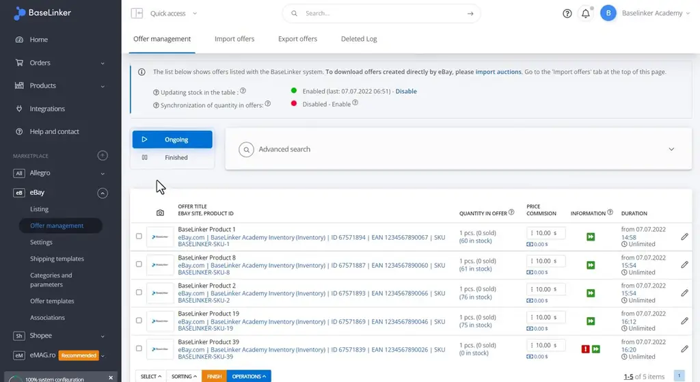

# Filtering auctions and offers | BaseLinker Academy

*Learn how to use BaseLinker's auction filters, warnings, and sorting to find and manage marketplace offers quickly.*

Source: [Filtering auctions and offers | BaseLinker Academy](https://www.youtube.com/watch?v=uajSYL-aggc) · Base · 4 min

## TL;DR

Managing many marketplace auctions makes it hard to find specific offers or spot problems. BaseLinker's auction panel addresses this with status splits, filters, warning flags, and sorting. Ongoing and finished auctions are separated, and the Warning filter flags sync errors such as more units listed at auction than held in storage. Filtering by Automaton, template, category, and listing profile, plus sorting by start date, price, or stock, helps wholesale sellers review and fix large catalogs efficiently.

## Key takeaways

- Ongoing and Finished are separate views, so active auctions can be kept apart from ended ones.
- The Warning filter surfaces sync errors, such as more units at auction than in storage.
- An auction with zero stock is marked with a warning icon in the list.
- Filters also cover Automaton (auto-renewal), template, category, and listing profile.
- The products-per-page setting can be raised to show more results at once, which suits wholesale work.
- Results can be sorted by start date, price, or stock, in ascending or descending order.

## Narrowing auctions with filters, warnings and sorting

[▶ 00:00:00](https://www.youtube.com/watch?v=uajSYL-aggc&t=0s)

Ongoing and Finished split active from ended auctions.

*[▶ 00:00:13](https://www.youtube.com/watch?v=uajSYL-aggc&t=13s) · eBay offer list with Ongoing and Finished toggle*

The **Warning** filter flags sync errors, like more units at auction than in storage.

*[▶ 00:01:00](https://www.youtube.com/watch?v=uajSYL-aggc&t=60s) · Advanced search form with Warning options*

Here, a zero-stock auction gets a warning icon.

*[▶ 00:01:43](https://www.youtube.com/watch?v=uajSYL-aggc&t=103s) · Filtered list with template and warning icons*

Filters also cover Automaton (auto-renewal), template, category and listing profile.

*[▶ 00:02:21](https://www.youtube.com/watch?v=uajSYL-aggc&t=141s) · eBay offer filters with four listed offers*

Products per page widens results for wholesale work.

*[▶ 00:02:53](https://www.youtube.com/watch?v=uajSYL-aggc&t=173s) · Offer list with five items and products-per-page option*

Sort by start date, price or stock, ascending or descending.

*[▶ 00:03:26](https://www.youtube.com/watch?v=uajSYL-aggc&t=206s) · BaseLinker eBay offer management list*

## Links & resources

- [Link from the video description (purpose not stated in talk)](https://bit.ly/3v3n6v3) — <https://bit.ly/3v3n6v3> · video description
