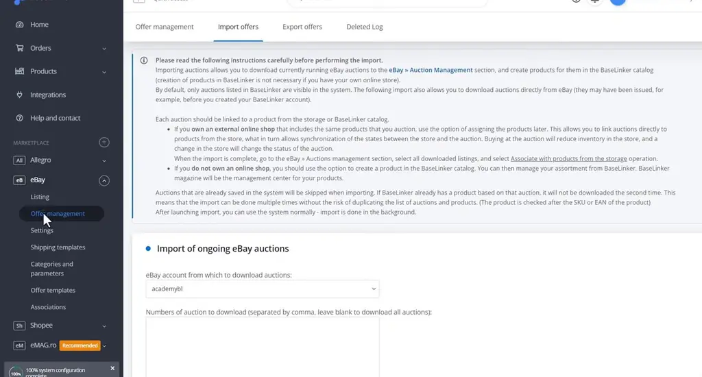
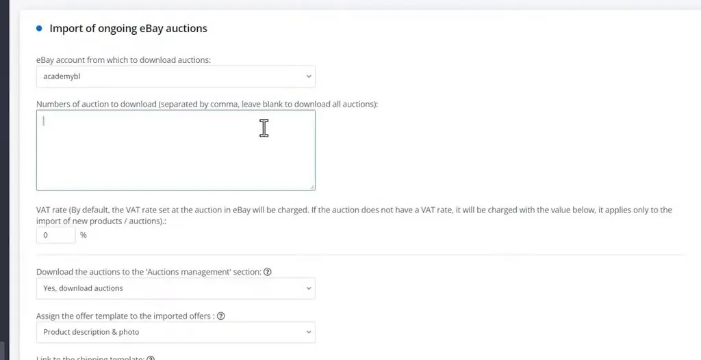
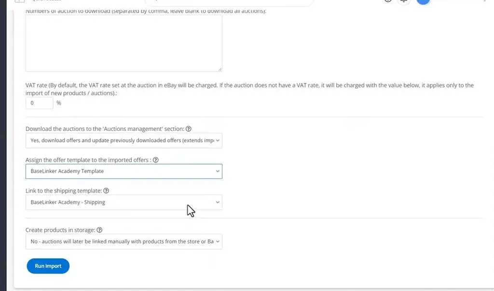
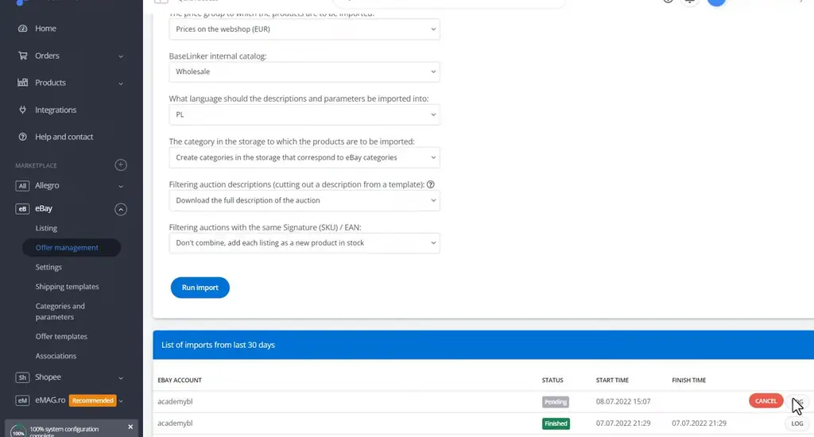
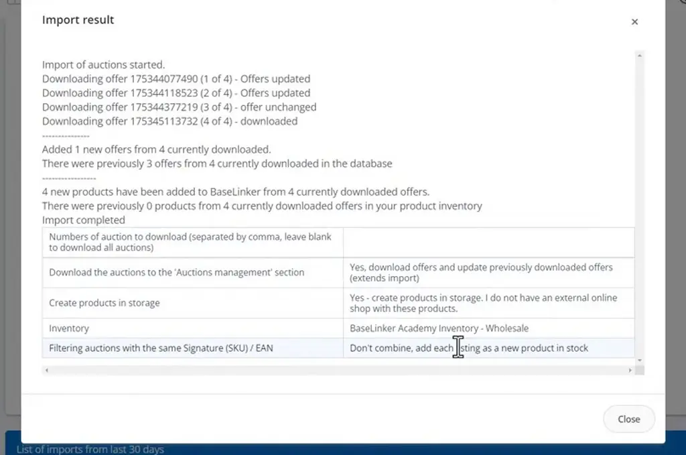
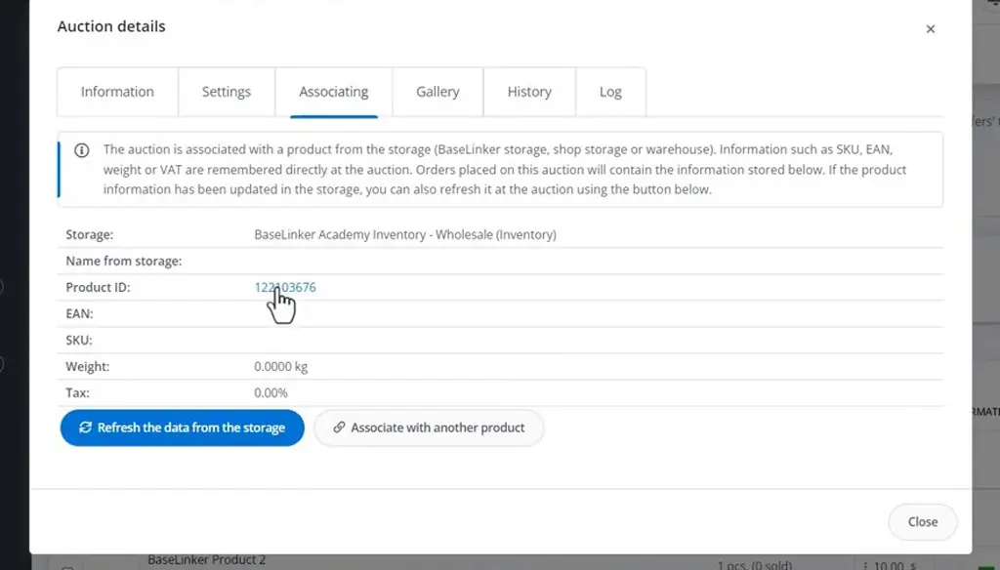

# Importing auctions and products | BaseLinker Academy

*Learn how to pull live eBay auctions into BaseLinker as offers and storage products, and how to avoid duplicates on re-runs.*

Source: [Importing auctions and products | BaseLinker Academy](https://www.youtube.com/watch?v=Lwg4LD_9Igg) · Base · 3 min

## TL;DR

Auctions created outside BaseLinker are not visible to the system, so they cannot be handled or managed there. The talk shows how to bring them in through the Import offers function. A blank auction number imports every ongoing auction, and each auction can become a storage product. Being able to pull live auctions into BaseLinker lets sellers manage them alongside their other orders and stock.

## Key takeaways

- Offers created outside BaseLinker are brought into the system through the Import offers function.
- Leaving the auction number blank imports all ongoing auctions at once.
- Re-running an import can update earlier auctions, not only add new ones.
- Creating storage products adds one product per auction, so use an SKU or EAN filter to stop duplicate products from being created.
- An auction marked Pending is still running.
- The import LOG lists each offer that was downloaded.
- Imported auctions keep the SKU, EAN, weight and VAT of the linked product.

## Importing live eBay auctions as offers and products

[▶ 00:00:00](https://www.youtube.com/watch?v=Lwg4LD_9Igg&t=0s)

Offers created outside BaseLinker come in via **Import offers**.

*[▶ 00:02:06](https://www.youtube.com/watch?v=Lwg4LD_9Igg&t=126s) · Import offers instructions and account selection*

Blank auction numbers import all ongoing auctions.

*[▶ 00:00:25](https://www.youtube.com/watch?v=Lwg4LD_9Igg&t=25s) · Import of ongoing eBay auctions form (top)*

Re-runs can update earlier auctions instead of adding only new ones.

*[▶ 00:00:44](https://www.youtube.com/watch?v=Lwg4LD_9Igg&t=44s) · Import form: templates, shipping, storage options*

Creating storage products adds one per auction; a SKU/EAN filter stops duplicates.

Pending means it is still running.

*[▶ 00:01:36](https://www.youtube.com/watch?v=Lwg4LD_9Igg&t=96s) · eBay auction import form and import list*

The LOG shows each downloaded offer.

*[▶ 00:01:53](https://www.youtube.com/watch?v=Lwg4LD_9Igg&t=113s) · Import result log in modal*

Auctions keep the linked product's SKU, EAN, weight and VAT.

*[▶ 00:02:22](https://www.youtube.com/watch?v=Lwg4LD_9Igg&t=142s) · Auction details, Associating tab*

## Links & resources

- [Link from the video description (purpose not stated in the talk)](https://bit.ly/3v3n6v3) — <https://bit.ly/3v3n6v3> · video description
- [eBay.com, the marketplace the auctions come from; shown as a product list filtered by auction ID](https://ebay.com) — <https://ebay.com> · on screen [▶ 00:02:25](https://www.youtube.com/watch?v=Lwg4LD_9Igg&t=145s)
