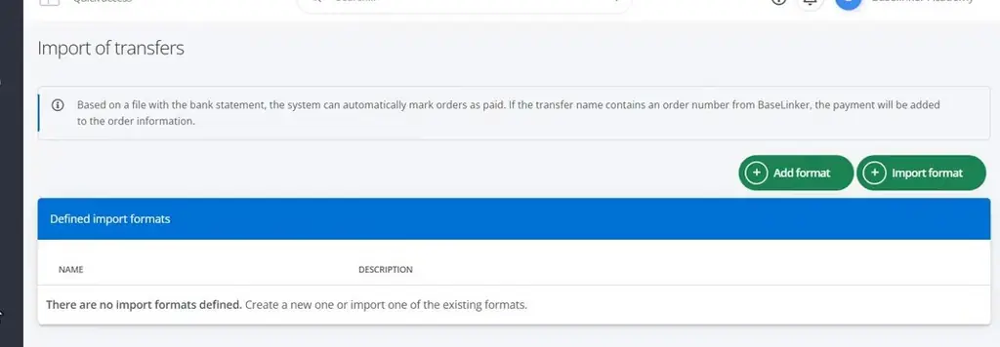
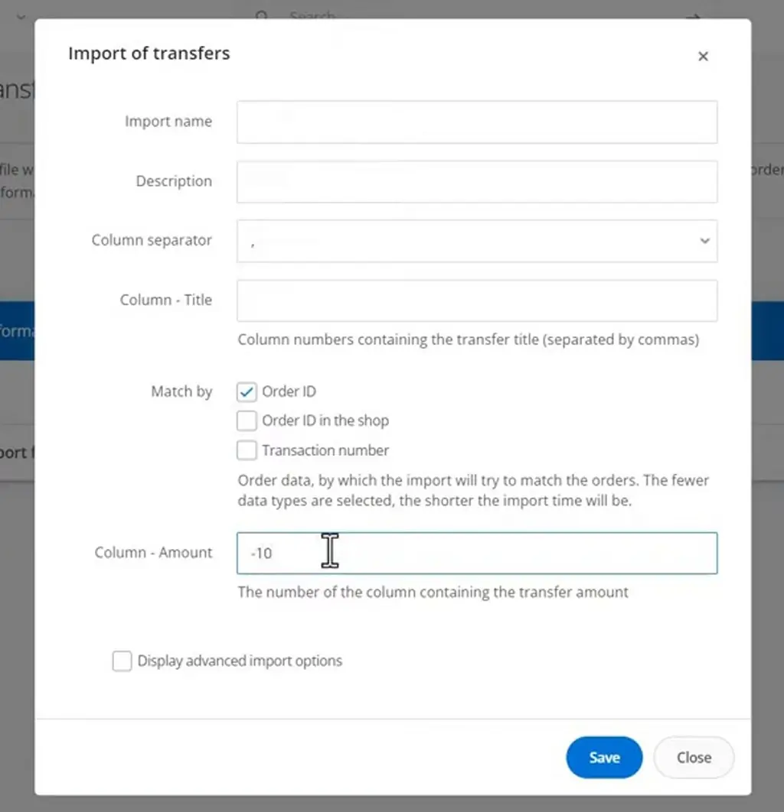
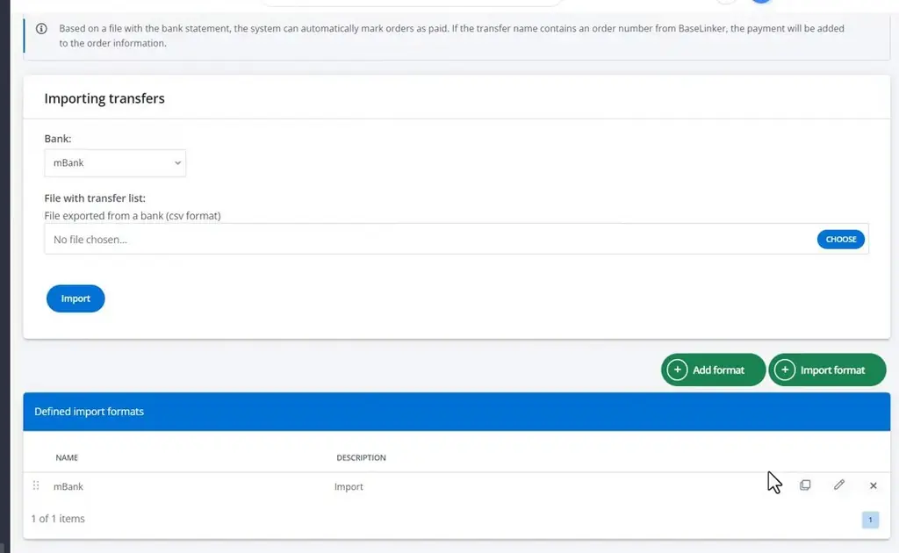
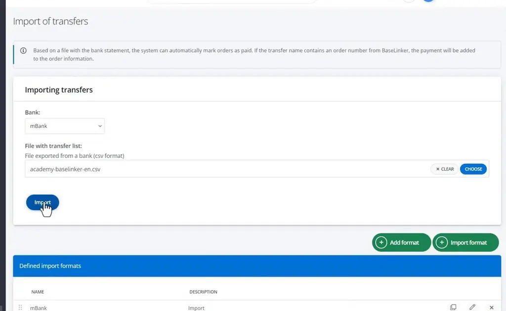
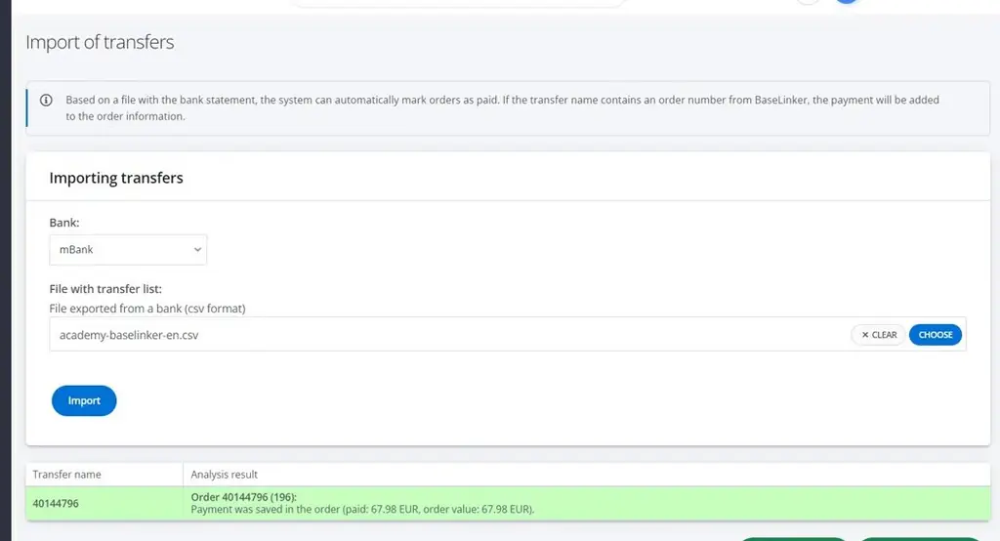
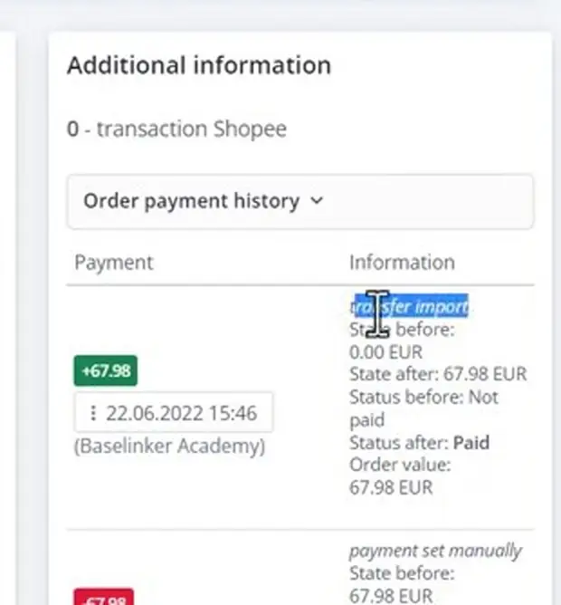

# Importing transfers and downloads | BaseLinker Academy

*Learn how to import a bank statement CSV into BaseLinker so that cash-on-delivery and bank-transfer orders are marked as paid.*

Source: [Importing transfers and downloads | BaseLinker Academy](https://www.youtube.com/watch?v=VKRGXTCehl4) · Base · 3 min

## TL;DR

BaseLinker books online payments automatically, but orders paid by cash on delivery or traditional bank transfer are not. The article shows how to register these payments by importing a bank's CSV file. You either create your own import format (name, separator, title column, match key, amount column) or pick a preset one such as mBank. After you select the bank, upload the CSV, and click Import, the matched order is marked Paid and the transfer is logged in payment history.

## Key takeaways

- Online payments are booked automatically in BaseLinker, so the CSV import is only needed for cash-on-delivery and traditional bank-transfer orders.
- To import a bank file, start with Add format to define your own layout or Import format to use a ready-made one.
- A manual import format requires a name, a separator, a title column, a match key, and an amount column.
- Ready-made formats such as mBank come preset, so you only need to select the bank.
- Upload the bank's CSV and click Import; the result shows which order was matched and the payment that was saved.
- After a successful import, the payment history logs a transfer import and the matched order is marked Paid.

## Importing bank transfers to mark orders as paid

[▶ 00:00:00](https://www.youtube.com/watch?v=VKRGXTCehl4&t=0s)

Start with **Add format** (your own) or **Import format** (ready-made).

*[▶ 00:00:23](https://www.youtube.com/watch?v=VKRGXTCehl4&t=23s) · Import of transfers page with no formats*

A manual format needs name, separator, title column, match key and amount column.

*[▶ 00:00:46](https://www.youtube.com/watch?v=VKRGXTCehl4&t=46s) · Manual import format settings form*

Ready-made formats such as mBank are preset.

*[▶ 00:01:42](https://www.youtube.com/watch?v=VKRGXTCehl4&t=102s) · Import of transfers page with mBank format*

Select the bank, upload the CSV and click Import.

*[▶ 00:02:10](https://www.youtube.com/watch?v=VKRGXTCehl4&t=130s) · Transfer CSV file chosen, ready to import*

The result shows the matched order and saved payment.

*[▶ 00:02:41](https://www.youtube.com/watch?v=VKRGXTCehl4&t=161s) · Transfer import result: payment saved to order*

Payment history then logs a transfer import, marking the order Paid.

*[▶ 00:03:10](https://www.youtube.com/watch?v=VKRGXTCehl4&t=190s) · Order payment history shows transfer import*

## Links & resources

- [Link from the video description (bit.ly shortener, destination not verified)](https://bit.ly/3v3n6v3) — <https://bit.ly/3v3n6v3> · video description
