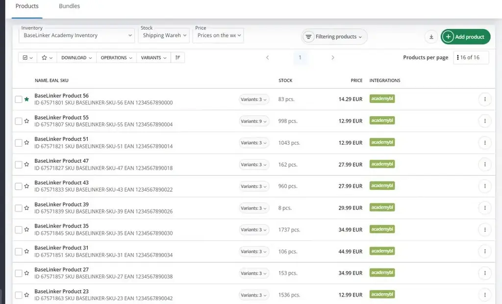
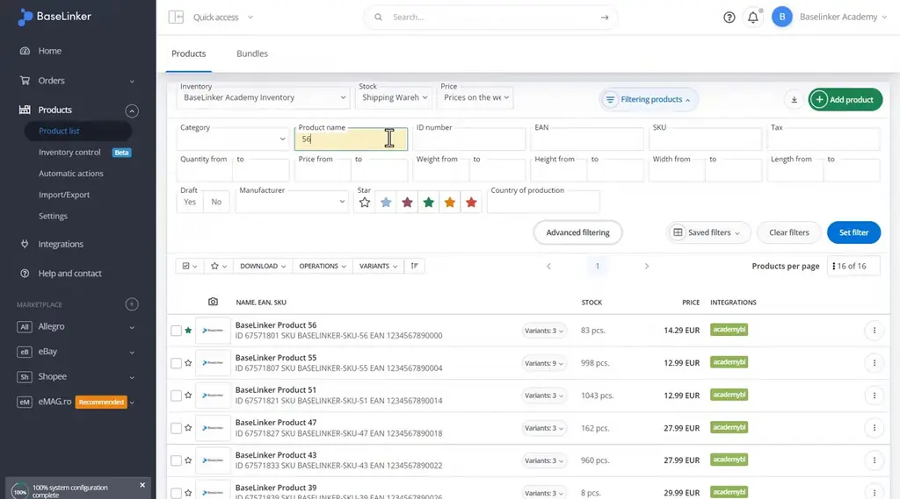
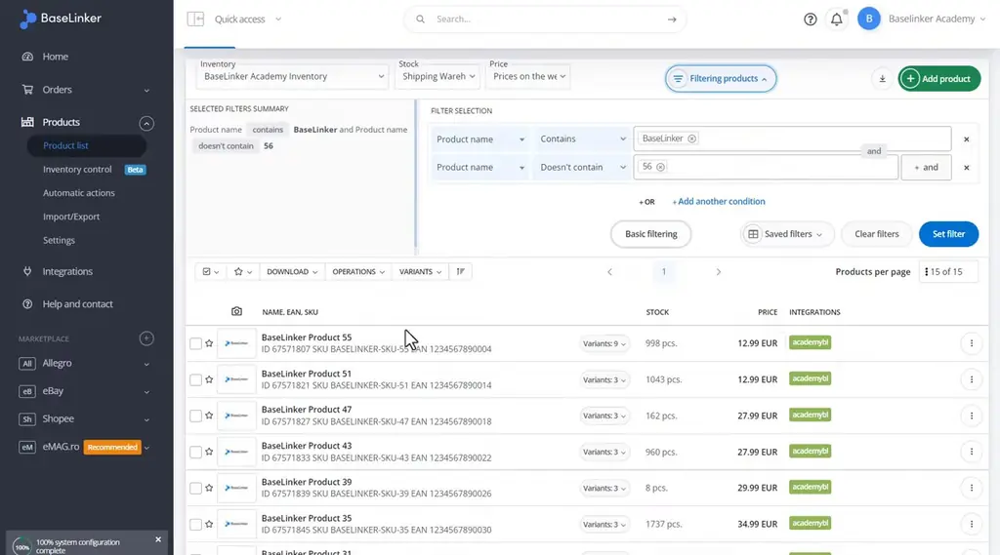
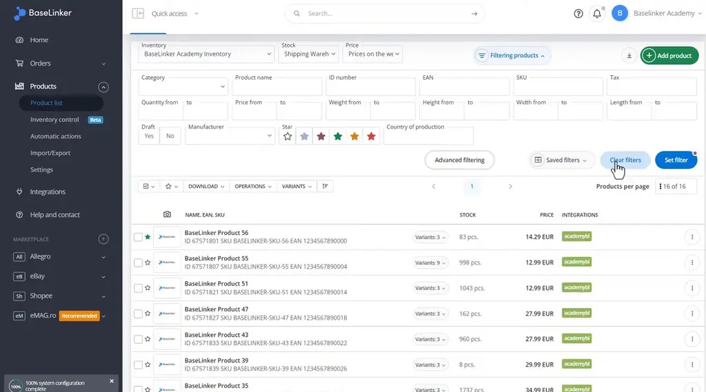
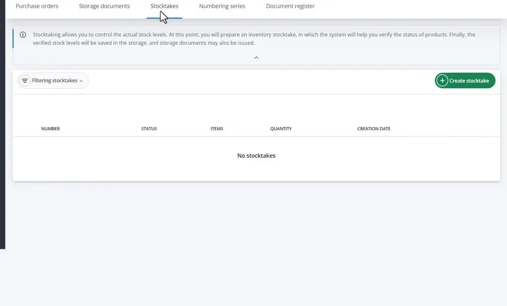
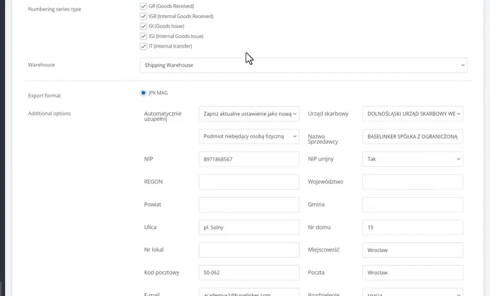

# Introduction to the Product Manager | BaseLinker Academy

*Learn how to filter, save, and act on products in the BaseLinker Product Manager, and how to pull a storage document register.*

Source: [Introduction to the Product Manager | BaseLinker Academy](https://www.youtube.com/watch?v=d0QZEpRgPaE) · Base · 6 min

## TL;DR

Warehouse staff need to find specific products in a long storage list and act on them quickly. The BaseLinker Product Manager covers this with basic and advanced filters, saved views, bulk operations, and a document register. Filters narrow the list by name and other conditions, saved views reuse those filters, and bulk operations create offers or bundles or delete products. The document register gives a dated list of storage documents that can be filtered by series and warehouse, which supports exports for tax reporting.

## Key takeaways

- The product list shows each product's name, EAN, SKU, stock, prices, and integrations.
- Use the basic panel's name filter to find a product by its name.
- Advanced filtering combines conditions; for example, name contains "BaseLinker" and does not contain "56" returned 15 products in the talk's example.
- A saved view stores a named filter set so you can reuse it without rebuilding the filters.
- From selected products you can create marketplace offers or bundles, or delete them.
- Variants either group under their parent product or are listed separately, depending on the setting.
- The document register lists storage documents for a chosen date range and can be filtered by numbering series and warehouse.
- The register's JPK MAG export includes the seller's tax and address details.

## Finding and acting on products in the product list

[▶ 00:00:00](https://www.youtube.com/watch?v=d0QZEpRgPaE&t=0s)

The product list shows names, EANs, SKUs, stock, prices and integrations.

*[▶ 00:06:11](https://www.youtube.com/watch?v=d0QZEpRgPaE&t=371s) · Product list in inventory control*

Filter by product name in the basic panel.

*[▶ 00:01:04](https://www.youtube.com/watch?v=d0QZEpRgPaE&t=64s) · Product list filter panel with name search*

**Advanced filtering** combines conditions: name contains "BaseLinker" and doesn't contain "56" returns 15 products.

*[▶ 00:01:51](https://www.youtube.com/watch?v=d0QZEpRgPaE&t=111s) · Advanced filtering: contains BaseLinker, excludes 56*

**Saved views** store a named filter set for reuse.

*[▶ 00:02:54](https://www.youtube.com/watch?v=d0QZEpRgPaE&t=174s) · BaseLinker product list with filters*

Operations create marketplace offers or bundles from selected products, or delete them. Variants group under their parent or list separately.

The **document register** generates a list of storage documents for a date range, filterable by numbering series and warehouse.

*[▶ 00:05:47](https://www.youtube.com/watch?v=d0QZEpRgPaE&t=347s) · Inventory control: document register form*

Its JPK MAG export includes seller tax and address details.

*[▶ 00:05:54](https://www.youtube.com/watch?v=d0QZEpRgPaE&t=354s) · Document register: export and seller options*

## Links & resources

- [Link from the video description (target not shown on screen or named in the talk)](https://bit.ly/3v3n6v3) — <https://bit.ly/3v3n6v3> · video description
