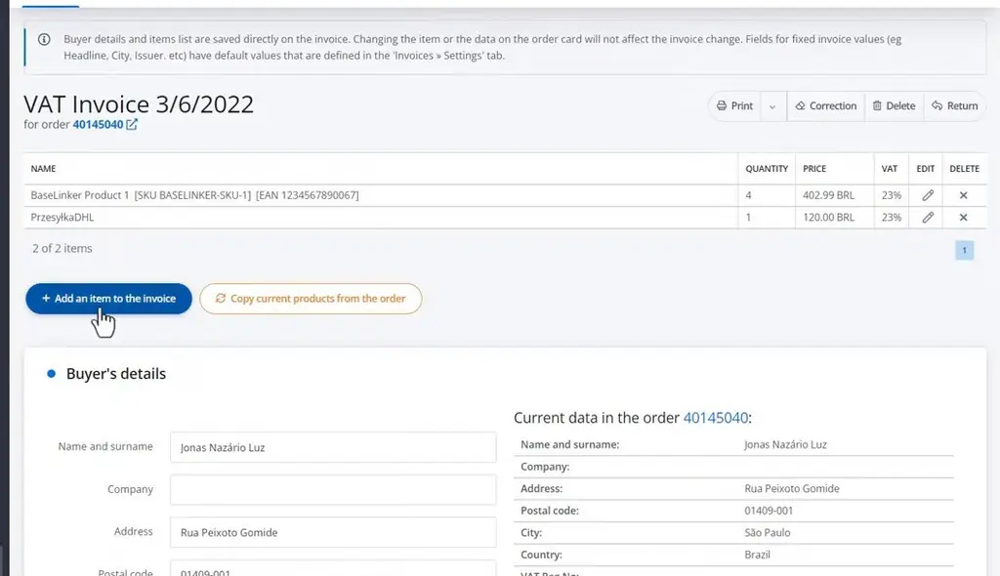
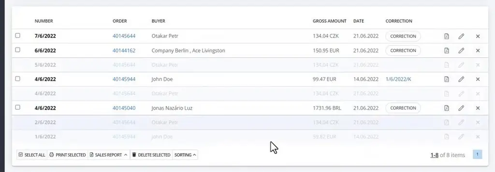
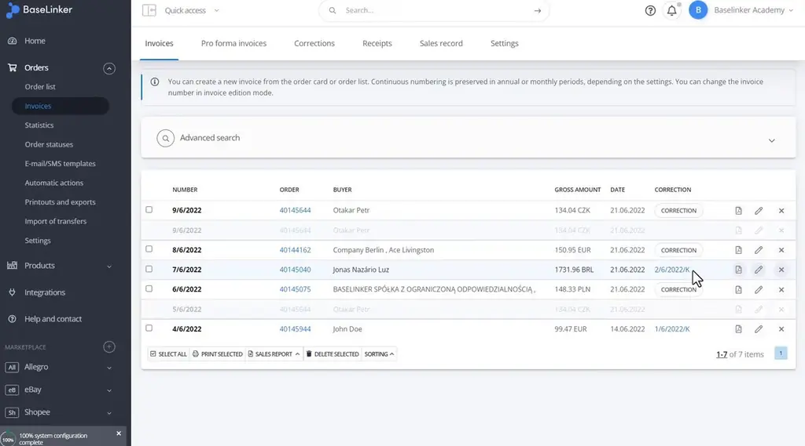
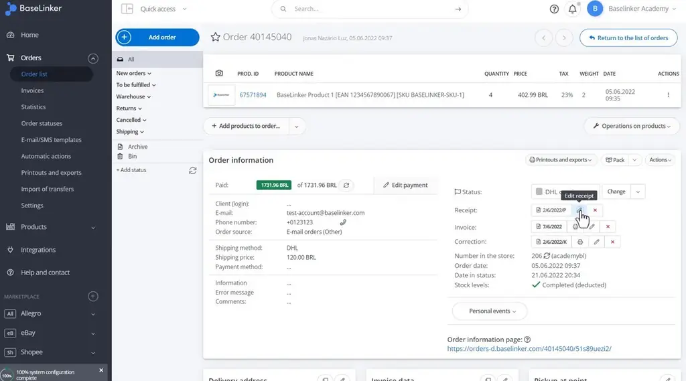
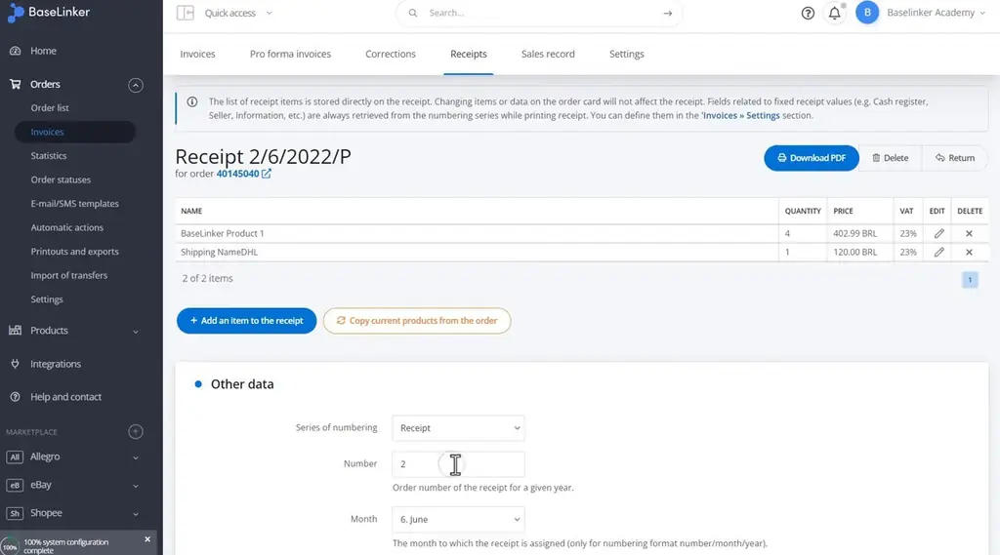
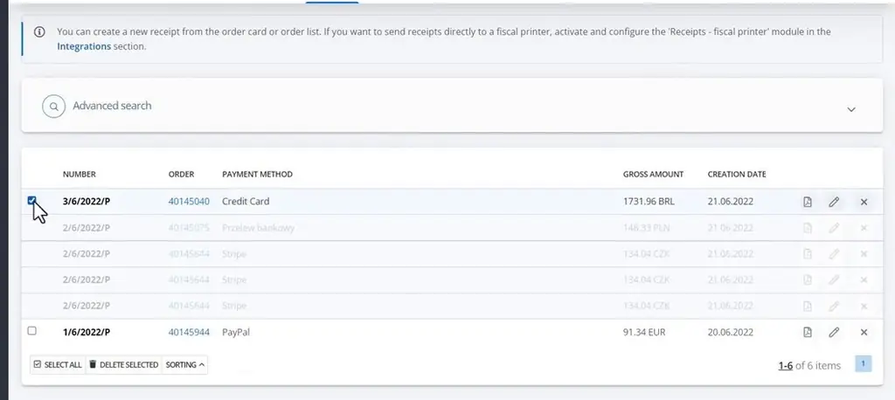

# Invoice editing and correction | BaseLinker Academy

*How to edit, correct, and delete invoices and receipts in the BaseLinker panel, and where each change is made.*

Source: [Invoice editing and correction | BaseLinker Academy](https://www.youtube.com/watch?v=9DvE7uYDpX0) · Base · 8 min

## TL;DR

Once BaseLinker issues an invoice or receipt, it stores its own items and buyer details, so later edits to the order do not change that document. The talk covers how to edit an issued invoice, how to issue a correction, how receipts differ, and how deletion works. Invoice edits happen in the invoice editor, while corrections start from the invoices list or editor with a required reason. Knowing which document type can be changed and where lets you fix billing errors without issuing conflicting documents.

## Key takeaways

- Issued invoices keep their own items and buyer details, so editing the order afterward does not change the issued invoice.
- In the invoice editor you can add items with name, EAN, SKU, quantity, gross price, and VAT rate, and change the buyer's data.
- Setting a number in the other-data section of an invoice makes all later documents number from that value.
- Corrections are issued from the invoices list or the invoice editor and begin with a reason for the correction.
- Corrected invoices are marked in the invoices list, and the correction number appears on the original invoice's row.
- Receipts keep their own item list and are edited from the order card or the receipts list, where the number and buyer's tax ID can be changed under other data.
- Deleting a document first leaves a greyed-out record, and a second click on the cross permanently removes it, one document at a time.
- Pro forma invoices are generated from the order and cannot be edited.

## Issued documents keep their own data

[▶ 00:00:00](https://www.youtube.com/watch?v=9DvE7uYDpX0&t=0s)

Issued invoices store their own items and buyer details, so later order edits do not change them.

*[▶ 00:00:45](https://www.youtube.com/watch?v=9DvE7uYDpX0&t=45s) · BaseLinker VAT invoice editing screen*

Invoice editing lets you add items (name, EAN, SKU, quantity, gross price, VAT rate) and change buyer data. Setting a number in the other-data section makes all later documents number from it.

Corrections are issued from the invoices list or the invoice editor, starting with a reason. Corrected invoices are marked in the list, and the correction number appears on the invoice row.

*[▶ 00:02:51](https://www.youtube.com/watch?v=9DvE7uYDpX0&t=171s) · Invoices list with correction markers*

*[▶ 00:04:28](https://www.youtube.com/watch?v=9DvE7uYDpX0&t=268s) · Invoices list showing issued correction*

Receipts keep their own item list and are edited from the order card or the receipts list. Number and buyer's tax ID are editable under other data.

*[▶ 00:04:49](https://www.youtube.com/watch?v=9DvE7uYDpX0&t=289s) · Order page with receipt edit button*

*[▶ 00:05:07](https://www.youtube.com/watch?v=9DvE7uYDpX0&t=307s) · Receipt edit page with other data*

Deleting first leaves a greyed-out record. A second click on the cross removes it permanently, one document at a time.

*[▶ 00:05:39](https://www.youtube.com/watch?v=9DvE7uYDpX0&t=339s) · Receipts list with first row selected*

Pro forma invoices are generated from the order and cannot be edited.

## Links & resources

- [Link from the video description (purpose not stated in the talk)](https://bit.ly/3v3n6v3) — <https://bit.ly/3v3n6v3> · video description
