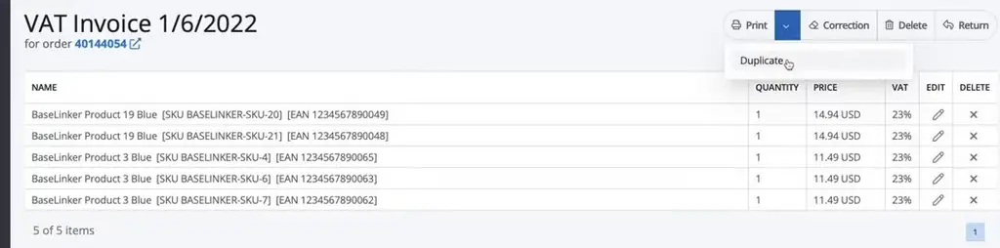
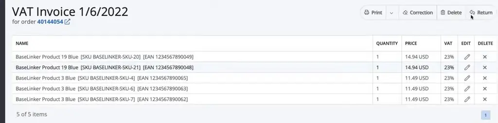
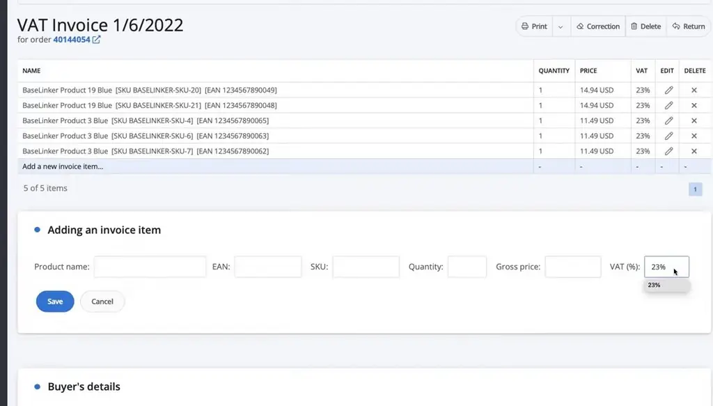
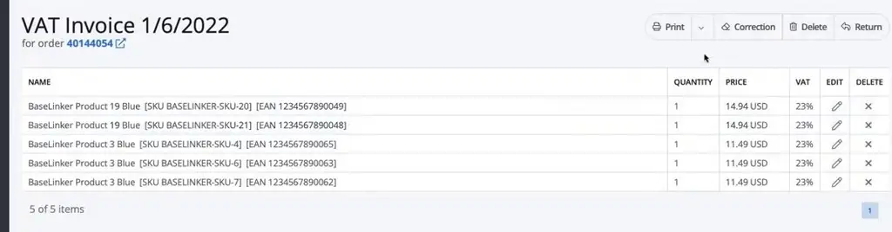
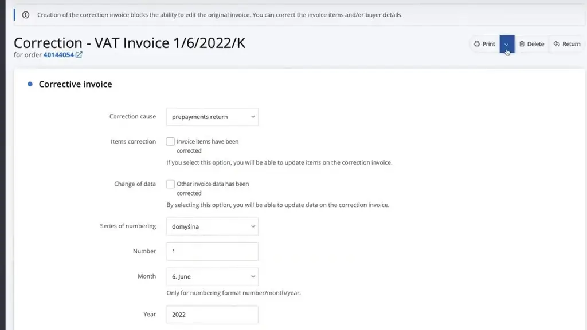
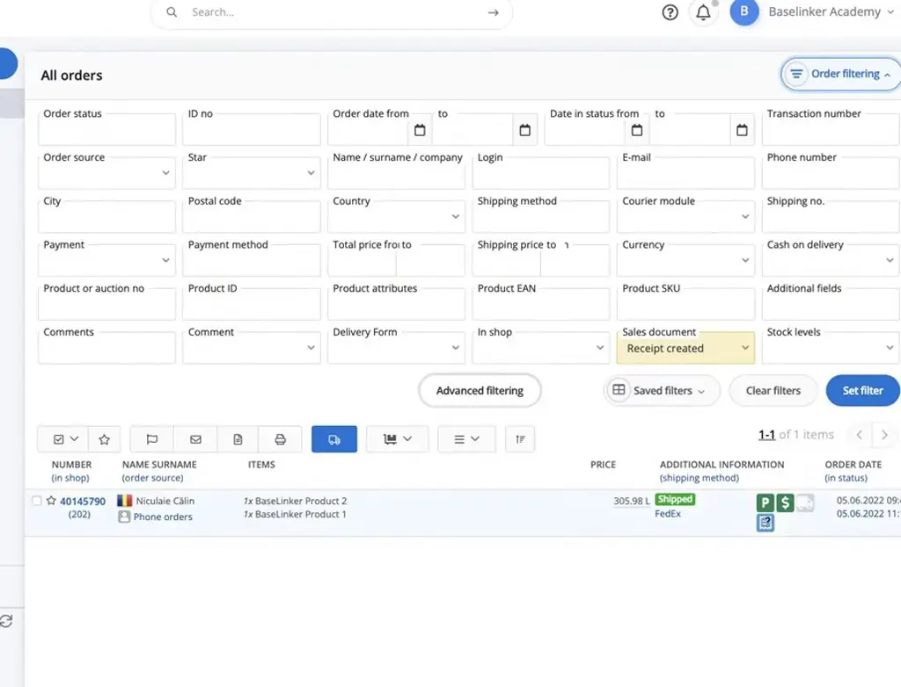

# Issuing invoices and receipts | BaseLinker Academy

*Learn how to issue, duplicate, correct and filter invoices and receipts in BaseLinker, from the order list or order card.*

Source: [Issuing invoices and receipts | BaseLinker Academy](https://www.youtube.com/watch?v=BHgl1aTzpV8) · Base · 7 min

## TL;DR

Sellers using BaseLinker need to issue invoices and receipts for orders, and need to know what happens to a document once it exists. The talk shows that invoices can be issued from the order list or the order card, and that the invoice keeps its own copy of items and buyer data, so later order edits don't change it. Corrections are handled as separate documents with a required reason, and creating one locks the original invoice. Knowing these rules helps avoid accidental changes to issued documents and makes it easier to find orders still missing a receipt.

## Key takeaways

- Issue an invoice from the order list or from the order card in BaseLinker.
- In the invoice editor, use Duplicate to generate a PDF stamped with the duplicate date.
- An invoice stores its own items and buyer data, so later edits to the order do not change the invoice.
- Each invoice item must include name, EAN, SKU, quantity, gross price and VAT rate.
- Saving an invoice updates fields such as its number and payment date.
- A correction requires a reason and a selection of an item change or data change, and creating it locks the original invoice.
- Use the Sales document filter with the option Receipt created to find orders that still need a receipt.

## Editing, correcting and numbering invoices

[▶ 00:00:00](https://www.youtube.com/watch?v=BHgl1aTzpV8&t=0s)

Issue invoices from the order list or order card. In the editor, **Duplicate** generates a PDF stamped with the duplicate date.

*[▶ 00:00:29](https://www.youtube.com/watch?v=BHgl1aTzpV8&t=29s) · Invoice editor with Duplicate option*

Correction, Delete and Return sit alongside.

*[▶ 00:00:47](https://www.youtube.com/watch?v=BHgl1aTzpV8&t=47s) · Invoice editor with Return action*

Items and buyer data live on the invoice, so order edits don't change it. Items need name, EAN, SKU, quantity, gross price and VAT rate.

*[▶ 00:00:59](https://www.youtube.com/watch?v=BHgl1aTzpV8&t=59s) · Adding an item to a VAT invoice*

Saving updates the invoice, such as its number and payment date.

*[▶ 00:02:39](https://www.youtube.com/watch?v=BHgl1aTzpV8&t=159s) · BaseLinker VAT invoice view after editing*

A correction needs a reason and an item or data change selection. Creating one locks the original invoice.

*[▶ 00:03:32](https://www.youtube.com/watch?v=BHgl1aTzpV8&t=212s) · Corrective invoice form in BaseLinker*

Find orders needing receipts via the Sales document filter: Receipt created.

*[▶ 00:04:37](https://www.youtube.com/watch?v=BHgl1aTzpV8&t=277s) · Order card with receipt in BaseLinker*

## Links & resources

- [BaseLinker link from the video description (purpose not stated in talk)](https://bit.ly/3v3n6v3) — <https://bit.ly/3v3n6v3> · video description
