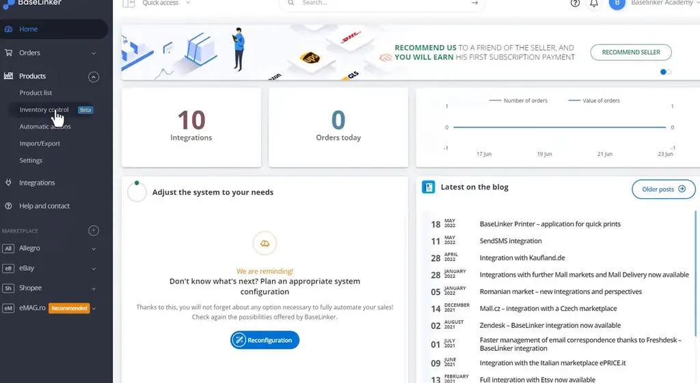
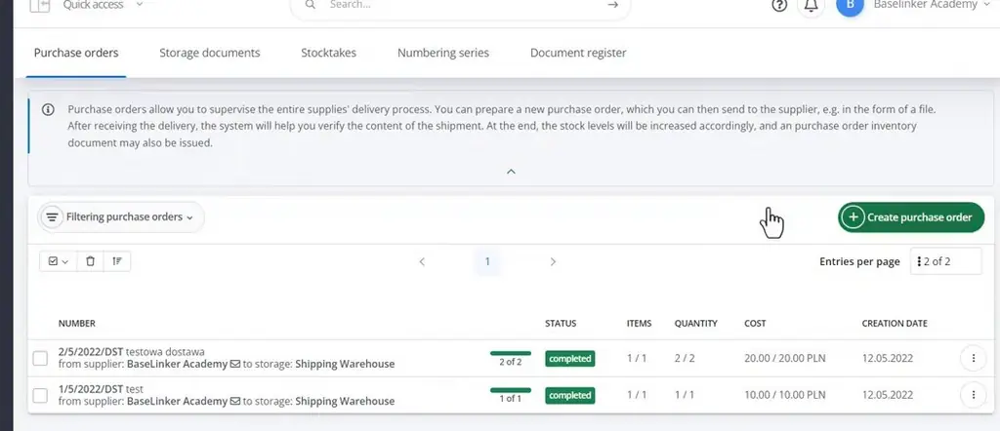
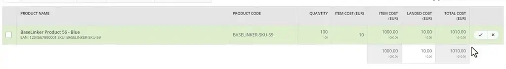
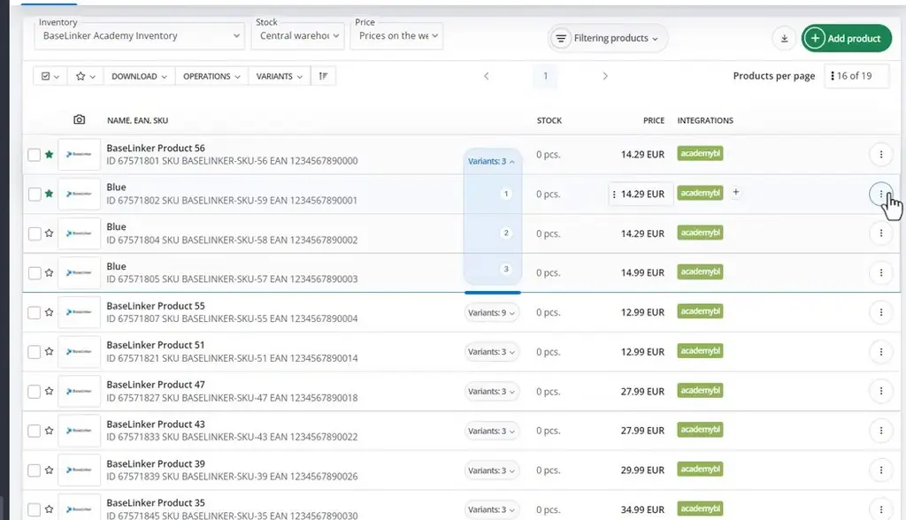
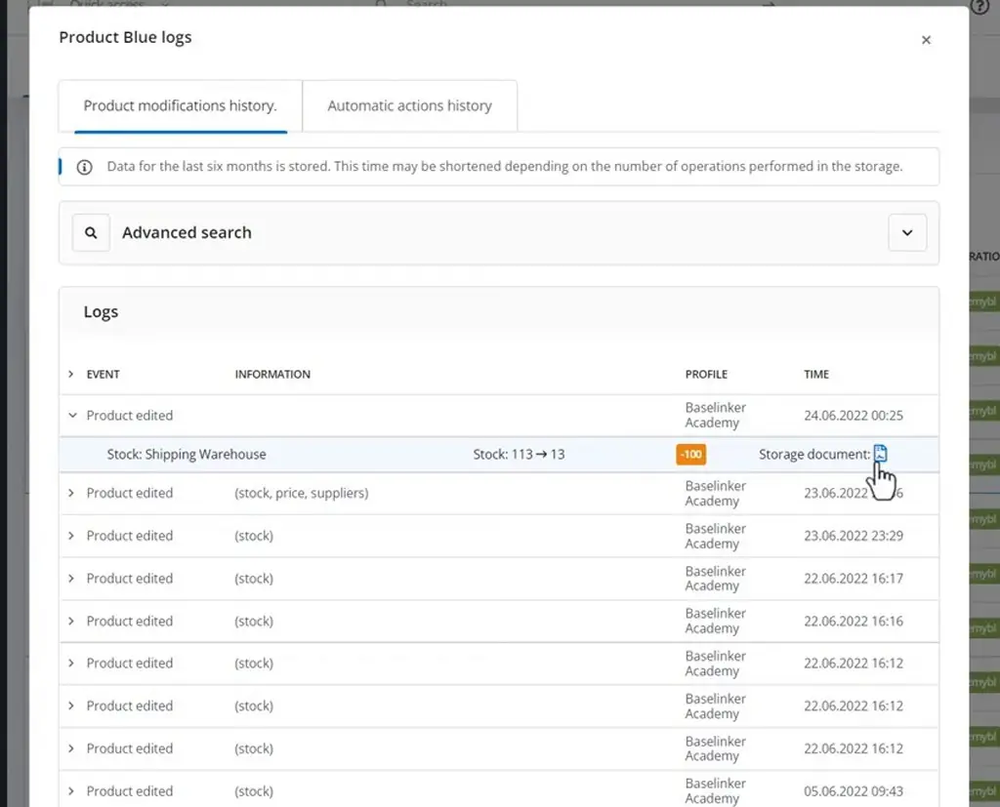
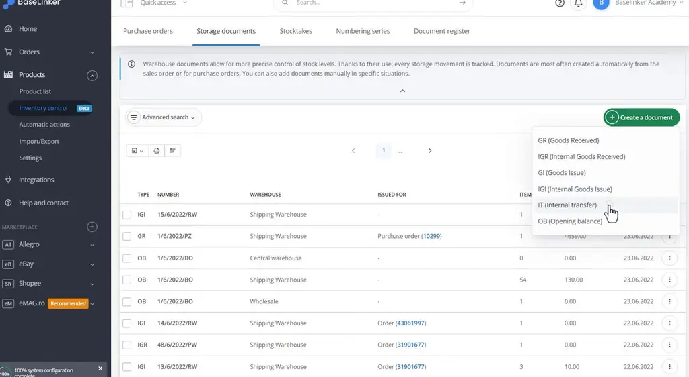

# Issuing storage documents, acceptance of a delivery | BaseLinker Academy

*Learn how BaseLinker purchase orders move a delivery from draft to completed stock, and how to create manual storage documents and trace stock changes.*

Source: [Issuing storage documents, acceptance of a delivery | BaseLinker Academy](https://www.youtube.com/watch?v=bD6SOg1Kq0Q) · Base · 8 min

## TL;DR

Tracking incoming deliveries and stock changes is easy to get wrong when quantities are not recorded consistently. In BaseLinker, purchase orders under Products > Inventory control move through the statuses draft, sent to supplier, received (verification) and completed. Saving the verified delivery to storage completes it and raises stock, and every stock change links to a storage document in the product's history. Manual documents (GR, IGR, GI, IGI, IT and OB) cover other movements, giving a traceable record of every quantity change.

## Key takeaways

- Purchase orders under Products > Inventory control track a delivery through four statuses: draft, sent to supplier, received (verification), and completed.
- Add products to a purchase order by name or barcode scan, entering the quantity and purchase price for each.
- Record extra delivery costs, such as a courier, under Landed costs.
- Confirm the received quantities during verification, then save to storage to complete the delivery and raise stock.
- Open a product's action menu and choose History to see every stock change, with each entry linked to its storage document.
- Create manual storage documents from the Create a document menu: GR, IGR, GI, IGI, IT and OB.
- Use an internal transfer (IT) document to move stock between warehouses.

## Recording deliveries and tracking stock through storage documents

[▶ 00:00:00](https://www.youtube.com/watch?v=bD6SOg1Kq0Q&t=0s)

Purchase orders, under Products > Inventory control, track deliveries from draft to completed.

*[▶ 00:00:08](https://www.youtube.com/watch?v=bD6SOg1Kq0Q&t=8s) · BaseLinker home dashboard with Products menu open*

Statuses are draft, sent to supplier, received (verification) and completed.

*[▶ 00:00:12](https://www.youtube.com/watch?v=bD6SOg1Kq0Q&t=12s) · BaseLinker purchase orders list*

Add products by name or barcode scan with quantity and purchase price; extra costs, like a courier, go under Landed costs.

Confirm the received quantities, then save to storage to complete the delivery and raise stock.

*[▶ 00:03:31](https://www.youtube.com/watch?v=bD6SOg1Kq0Q&t=211s) · Delivery items tab during verification*

Open a product's action menu and choose history to see every stock change.

*[▶ 00:05:59](https://www.youtube.com/watch?v=bD6SOg1Kq0Q&t=359s) · BaseLinker product list with variants*

Each change links to a storage document.

*[▶ 00:06:10](https://www.youtube.com/watch?v=bD6SOg1Kq0Q&t=370s) · Product Blue modification history*

Manual documents come from the Create a document menu: GR, IGR, GI, IGI, IT and OB.

*[▶ 00:06:25](https://www.youtube.com/watch?v=bD6SOg1Kq0Q&t=385s) · Storage documents list and document-type menu*

Internal transfers (IT) move stock between warehouses.

## Links & resources

- [Link from video description, purpose not stated in talk](https://bit.ly/3v3n6v3) — <https://bit.ly/3v3n6v3> · video description
