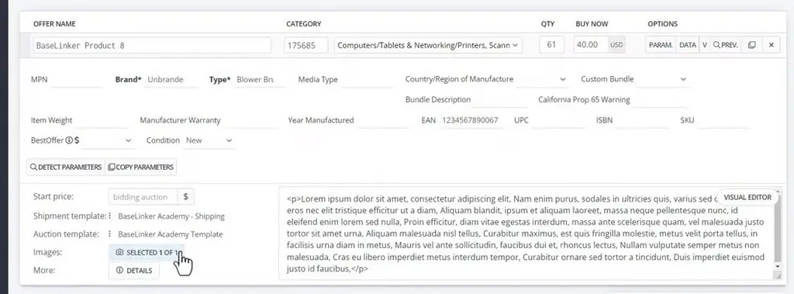
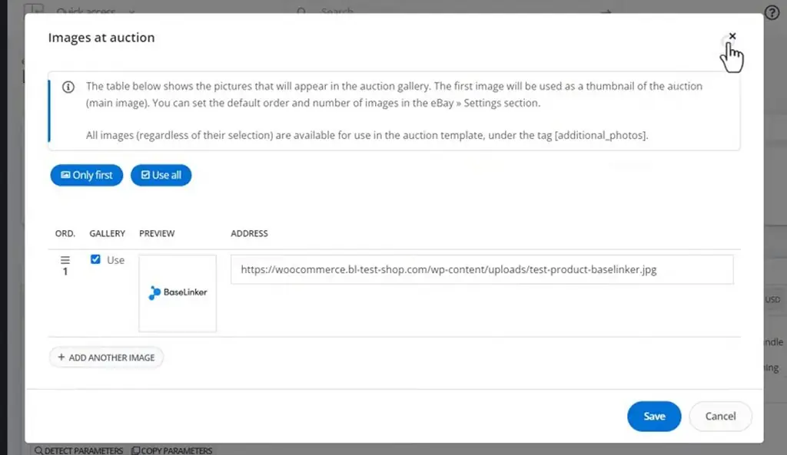
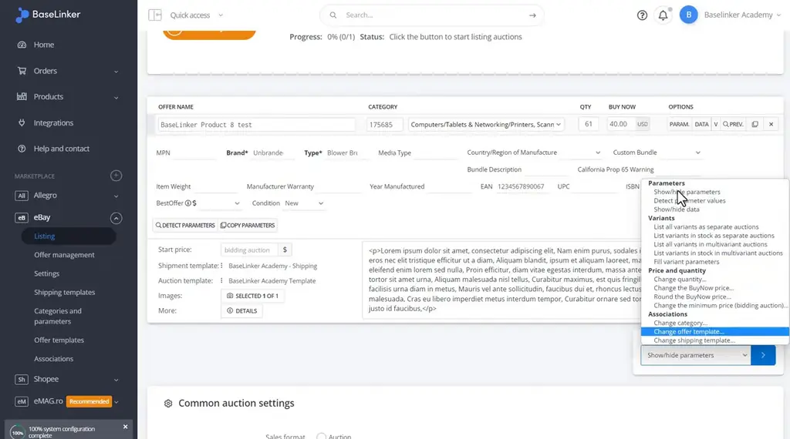
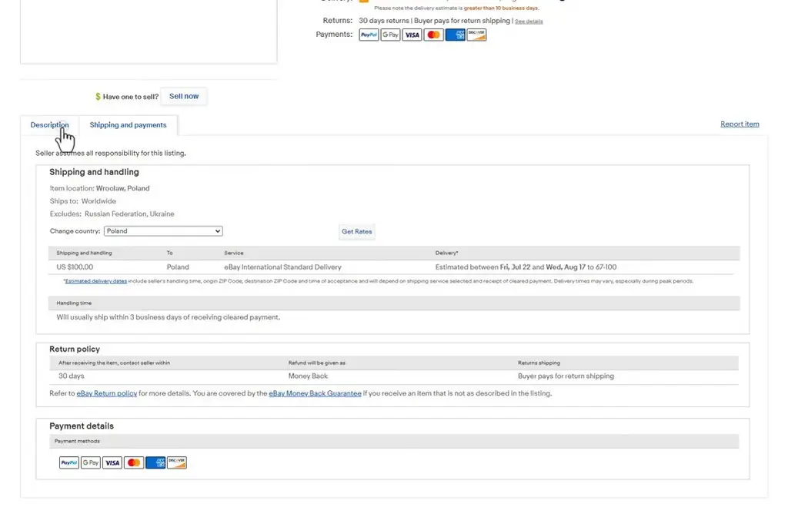
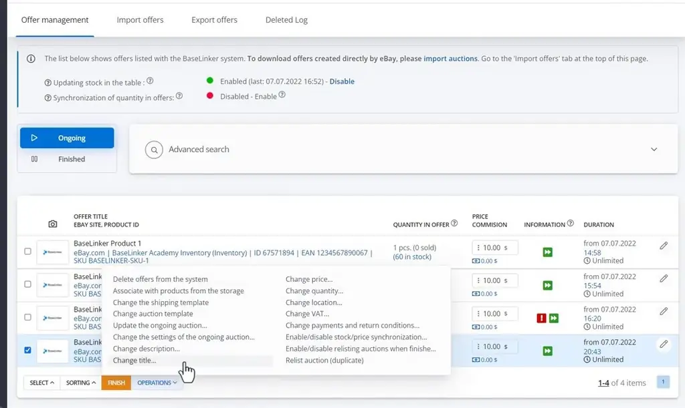

# Listing auctions and offers | BaseLinker Academy

*How to list auctions and offers on Allegro in BaseLinker, from required fields and images to bulk price changes and ending offers.*

Source: [Listing auctions and offers | BaseLinker Academy](https://www.youtube.com/watch?v=YN3ePbu06kw) · Base · 7 min

## TL;DR

Listing auctions and offers on Allegro through BaseLinker involves a long form with many fields. The talk says a well-configured BaseLinker system fills most of these fields automatically, and it walks through the full listing process. Mandatory parameters must be completed before an item can be listed. Knowing how images, the description, bulk actions, and offer management behave helps sellers avoid errors and manage listings efficiently.

## Key takeaways

- Mandatory parameters must be filled in before a listing can be published.
- The first image in the gallery becomes the thumbnail, and all gallery images are available as [additional_photos].
- The main description is HTML.
- Bulk actions apply to all listed products, such as cutting prices by 75%.
- A well-configured BaseLinker system completes most of the listing form automatically.
- Published listings show the shipping and return terms.
- In offer management, the Operations menu can finish ongoing offers with relisting turned off.

## Complete mandatory fields, then manage the listing

[▶ 00:00:00](https://www.youtube.com/watch?v=YN3ePbu06kw&t=0s)

Mandatory parameters must be filled before listing.


*[▶ 00:02:14](https://www.youtube.com/watch?v=YN3ePbu06kw&t=134s) · BaseLinker eBay listing form with parameters*

The first gallery image becomes the thumbnail, and all images are available as `[additional_photos]`.


*[▶ 00:02:23](https://www.youtube.com/watch?v=YN3ePbu06kw&t=143s) · Images at auction preview modal*

The main description is HTML.

```html
<p>Lorem ipsum dolor sit amet, consectetur adipiscing elit, Nam enim purus, sodales in ultricies quis, varius sed c…eros nec elit tristique efficitur ut a diam, Aliquam blandit, ipsum et aliquam laoreet, massa neque pellentesque nunc, id eleifend enim lorem sed nulla, Proin efficitur, diam vitae egestas interdum, massa ante scelerisque quam, vel malesuada justo tortor sit amet urna, Aliquam malesuada nisl tellus, Curabitur maximus, est quis fringilla molestie, metus velit porta tellus, in facilisis urna diam in metus, Mauris vel ante sollicitudin, faucibus dui et, rhoncus lectus, Nullam vulputate semper metus non malesuada, Cras eu libero imperdiet metus interdum tempor, Curabitur ornare sed tortor a tincidunt, Duis imperdiet euismod justo id faucibus,</p>
```

*[▶ 00:04:16](https://www.youtube.com/watch?v=YN3ePbu06kw&t=256s) · Listing form with HTML description field*

Bulk actions apply to all listed products, such as cutting prices by 75%.


*[▶ 00:04:23](https://www.youtube.com/watch?v=YN3ePbu06kw&t=263s) · Bulk actions menu on listing form*

Published listings show the shipping and return terms.


*[▶ 00:05:42](https://www.youtube.com/watch?v=YN3ePbu06kw&t=342s) · eBay listing: shipping and payments tab*

Offer management's Operations menu finishes ongoing offers, with relisting turned off.


*[▶ 00:06:13](https://www.youtube.com/watch?v=YN3ePbu06kw&t=373s) · Offer management operations menu*

## Links & resources

- [Link from the video description (URL as given there)](https://bit.ly/3v3n6v3) — <https://bit.ly/3v3n6v3> · video description
- [Finished eBay auction listing created in the talk, linked for preview](http://www.ebay.com/itm/175344338336) — <http://www.ebay.com/itm/175344338336> · on screen [▶ 00:05:30](https://www.youtube.com/watch?v=YN3ePbu06kw&t=330s)
- BaseLinker Academy auction template, the template used for the course · mentioned [▶ 00:01:59](https://www.youtube.com/watch?v=YN3ePbu06kw&t=119s)
